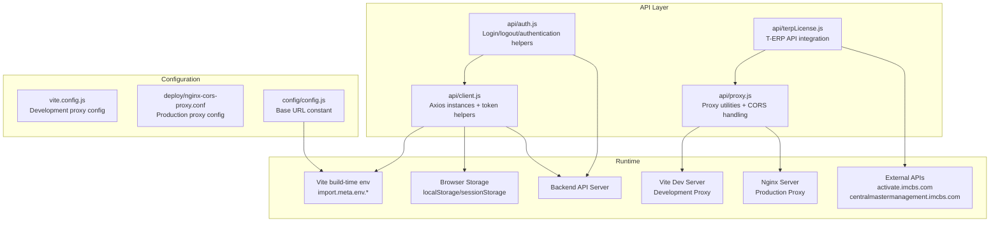
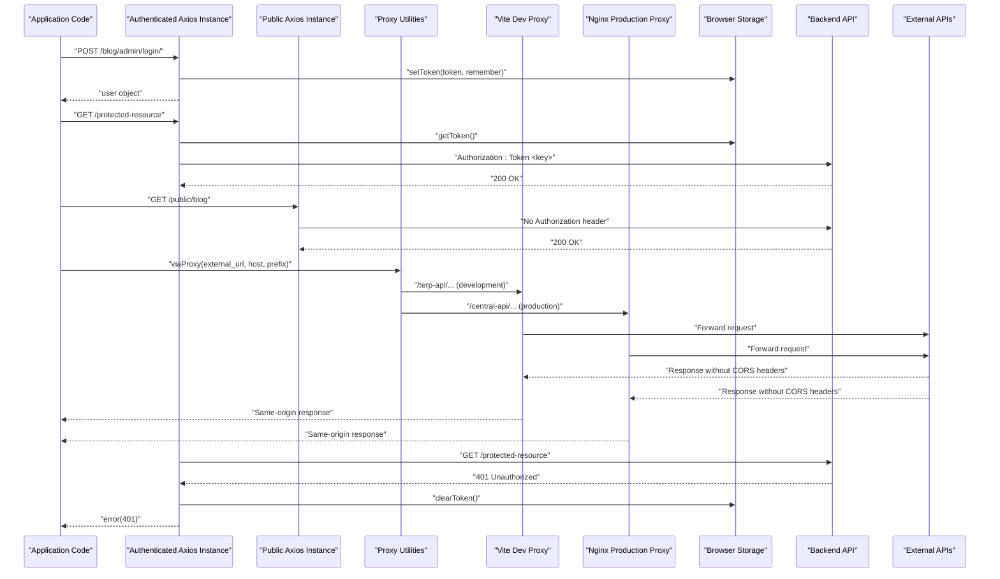
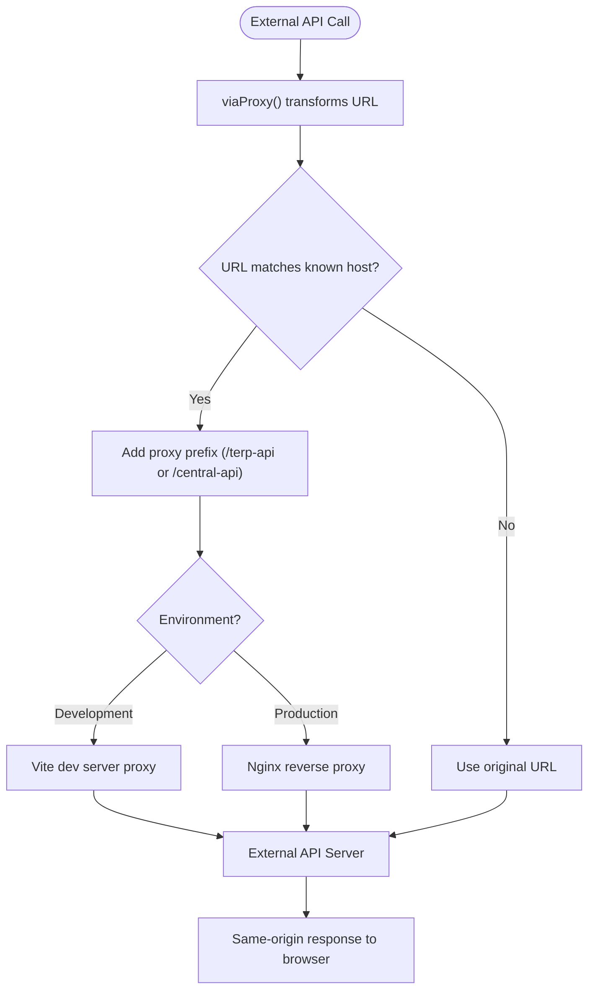
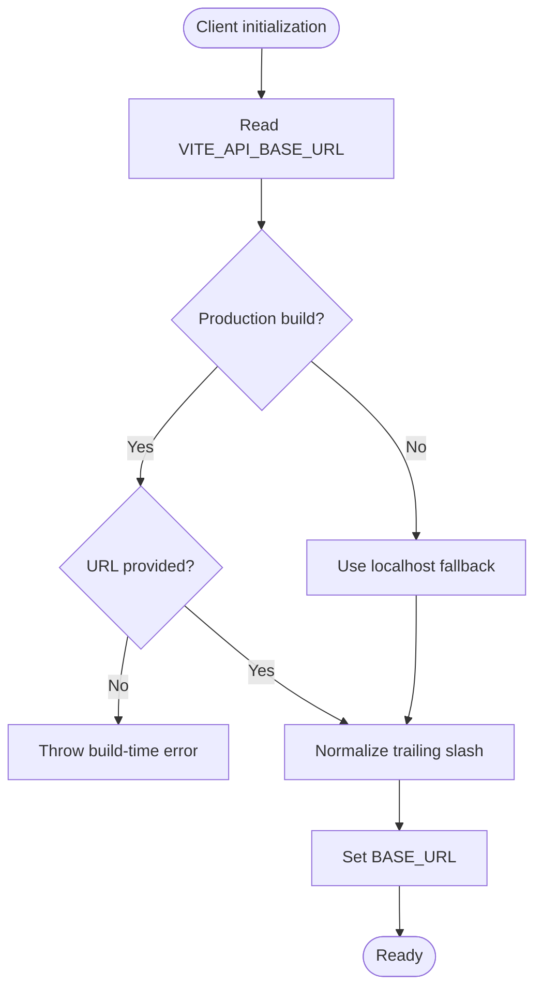
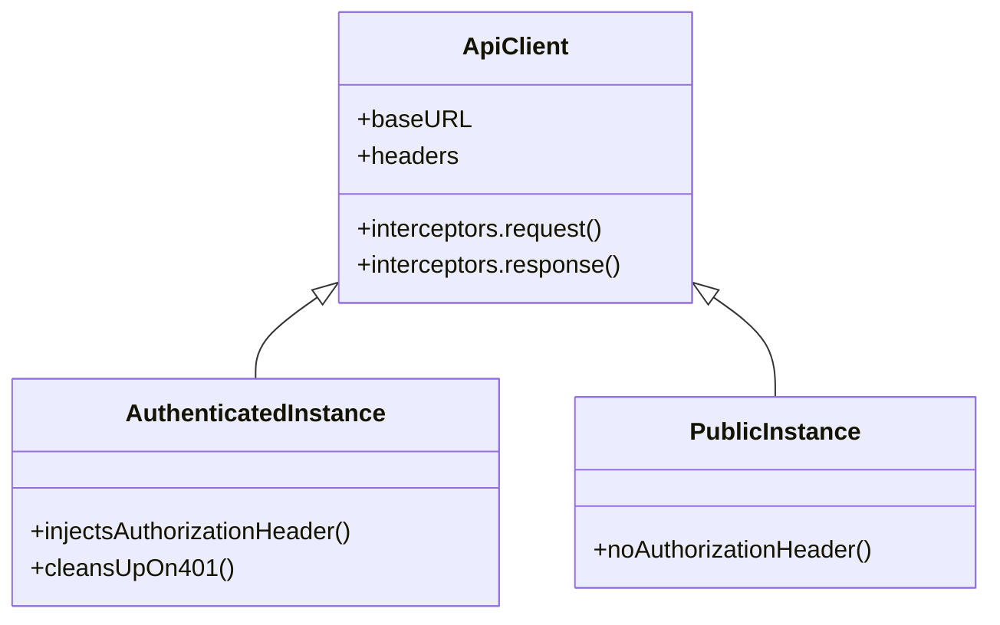
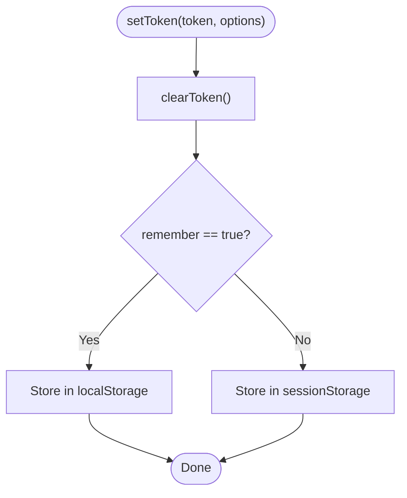
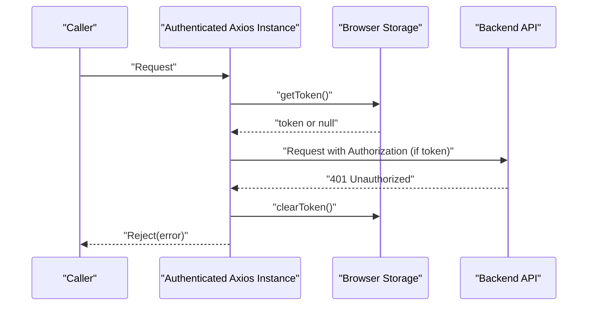
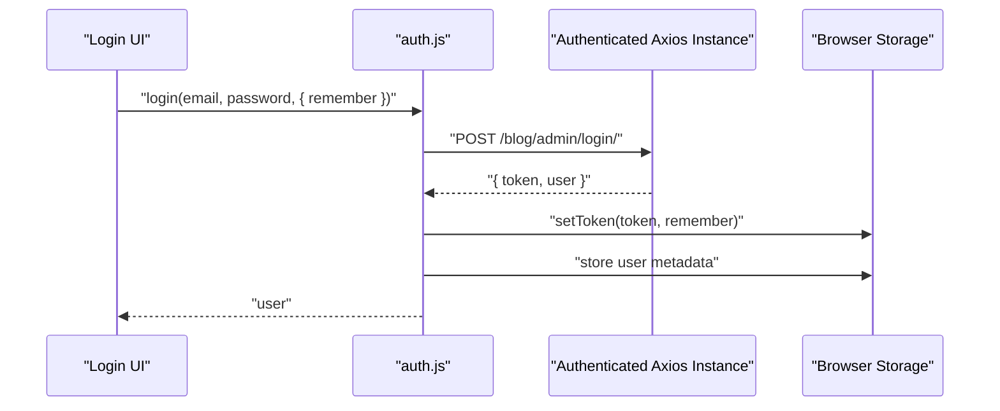
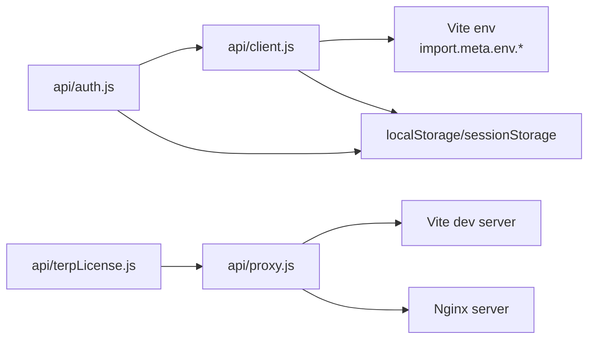

# API Client Configuration

<cite>
**Referenced Files in This Document**
- [client.js](file://src/api/client.js)
- [proxy.js](file://src/api/proxy.js)
- [nginx-cors-proxy.conf](file://deploy/nginx-cors-proxy.conf)
- [vite.config.js](file://vite.config.js)
- [auth.js](file://src/api/auth.js)
- [config.js](file://src/config/config.js)
- [package.json](file://package.json)
- [terpLicense.js](file://src/api/terpLicense.js)
</cite>

## Update Summary
**Changes Made**
- Added comprehensive documentation for the centralized proxy architecture
- Documented nginx reverse proxy configuration for CORS handling
- Added proxy utility module functionality and usage patterns
- Updated architecture diagrams to include proxy components
- Enhanced troubleshooting section with proxy-related issues
- Added development and production proxy configuration examples

## Table of Contents
1. [Introduction](#introduction)
2. [Project Structure](#project-structure)
3. [Core Components](#core-components)
4. [Architecture Overview](#architecture-overview)
5. [Proxy Architecture](#proxy-architecture)
6. [Detailed Component Analysis](#detailed-component-analysis)
7. [Dependency Analysis](#dependency-analysis)
8. [Performance Considerations](#performance-considerations)
9. [Troubleshooting Guide](#troubleshooting-guide)
10. [Conclusion](#conclusion)
11. [Appendices](#appendices)

## Introduction
This document explains the centralized API client configuration for the frontend application, including the new centralized proxy architecture. It covers how Axios instances are created, how environment variables configure the base URL, and how production safety checks prevent misconfiguration. The system now includes a dual-instance architecture that separates authenticated admin requests from public visitor requests, plus a sophisticated proxy layer that handles CORS issues with external APIs through nginx reverse proxy configuration and a proxy utility module.

## Project Structure
The API client is implemented as a focused module under the API layer with an integrated proxy system:
- Centralized Axios setup and token helpers live in the API client file.
- Proxy utilities handle CORS bypass and external API routing through same-origin prefixes.
- Authentication flows use the client to log in, log out, and check authentication state.
- Nginx configuration provides production proxy support for external APIs.
- Vite configuration includes development proxy settings.

**Diagram sources**
- [client.js:1-88](file://src/api/client.js#L1-L88)
- [proxy.js:1-56](file://src/api/proxy.js#L1-L56)
- [vite.config.js:12-33](file://vite.config.js#L12-L33)
- [nginx-cors-proxy.conf:24-50](file://deploy/nginx-cors-proxy.conf#L24-L50)

**Section sources**
- [client.js:1-88](file://src/api/client.js#L1-L88)
- [proxy.js:1-56](file://src/api/proxy.js#L1-L56)
- [vite.config.js:12-33](file://vite.config.js#L12-L33)
- [nginx-cors-proxy.conf:1-51](file://deploy/nginx-cors-proxy.conf#L1-L51)

## Core Components
- Centralized Axios instance for authenticated admin requests with automatic Authorization header injection and 401 cleanup.
- Public Axios instance for unauthenticated visitor requests that never sends admin tokens.
- Proxy utility module providing CORS bypass functionality through same-origin proxy prefixes.
- Token management utilities supporting both persistent (localStorage) and session-scoped (sessionStorage) strategies.
- Environment-driven base URL configuration with production safety checks.
- Dual proxy configuration supporting both development (Vite) and production (nginx) environments.

Key responsibilities:
- Base URL resolution from environment variables.
- Token persistence and retrieval across localStorage and sessionStorage.
- Automatic header injection for authenticated requests.
- Automatic logout on 401 responses.
- External API routing through proxy prefixes for CORS compliance.
- Clear separation between authenticated, public, and proxied API usage.

**Section sources**
- [client.js:4-21](file://src/api/client.js#L4-L21)
- [client.js:23-42](file://src/api/client.js#L23-L42)
- [client.js:44-88](file://src/api/client.js#L44-L88)
- [proxy.js:11-36](file://src/api/proxy.js#L11-L36)
- [auth.js:1-40](file://src/api/auth.js#L1-L40)

## Architecture Overview
The system uses two Axios instances plus a sophisticated proxy layer:
- Authenticated instance: attaches a token when present and clears it on 401 errors.
- Public instance: never attaches the token, ensuring visitors see only public content even if an admin is logged in.
- Proxy layer: routes external API calls through same-origin prefixes to bypass CORS restrictions.

**Diagram sources**
- [client.js:47-88](file://src/api/client.js#L47-L88)
- [proxy.js:26-36](file://src/api/proxy.js#L26-L36)
- [vite.config.js:17-32](file://vite.config.js#L17-L32)
- [nginx-cors-proxy.conf:24-50](file://deploy/nginx-cors-proxy.conf#L24-L50)

## Proxy Architecture

### Problem Statement
External APIs like `activate.imcbs.com` and `centralmastermanagement.imcbs.com` don't send CORS headers, causing browsers to block direct requests from the SPA. Additionally, some endpoints reject preflight requests with 405 errors.

### Solution Overview
The solution implements a centralized proxy architecture that makes external API calls appear as same-origin requests:
- **Development**: Vite dev server proxies `/terp-api/*` and `/central-api/*` to external hosts
- **Production**: Nginx reverse proxy handles the same routing
- **Client-side**: Proxy utilities transform URLs to use same-origin prefixes

**Diagram sources**
- [proxy.js:26-36](file://src/api/proxy.js#L26-L36)
- [vite.config.js:17-32](file://vite.config.js#L17-L32)
- [nginx-cors-proxy.conf:24-50](file://deploy/nginx-cors-proxy.conf#L24-L50)

### Proxy Utility Functions

#### URL Transformation
The `viaProxy()` function intelligently transforms URLs based on their origin:
- Returns relative URLs unchanged (already same-origin)
- Transforms matching external URLs to use proxy prefixes
- Falls back to original URLs for unknown hosts

#### JSON Response Validation
The `assertJson()` function ensures proxy responses contain valid JSON:
- Detects HTML responses (SPA fallback pages)
- Provides clear error messages about missing proxy configuration
- Helps identify deployment issues quickly

**Section sources**
- [proxy.js:26-36](file://src/api/proxy.js#L26-L36)
- [proxy.js:45-55](file://src/api/proxy.js#L45-L55)

### Development Proxy Configuration
Vite development server automatically proxies requests:
- `/terp-api/*` → `https://activate.imcbs.com/*`
- `/central-api/*` → `https://centralmastermanagement.imcbs.com/*`
- Uses `changeOrigin: true` to maintain proper Host headers
- Includes SSL verification for HTTPS targets

**Section sources**
- [vite.config.js:17-32](file://vite.config.js#L17-L32)

### Production Proxy Configuration
Nginx configuration provides production proxy support:
- Same path mappings as development environment
- Proper SSL configuration with `proxy_ssl_server_name on`
- Security headers for IP forwarding and protocol preservation
- Connection timeouts for reliability

**Section sources**
- [nginx-cors-proxy.conf:24-50](file://deploy/nginx-cors-proxy.conf#L24-L50)

## Detailed Component Analysis

### Base URL Configuration and Production Safety
- The client reads the base URL from a Vite environment variable at build time.
- If the variable is missing in production, the build fails loudly to avoid shipping a misconfigured client.
- In development, a localhost fallback ensures local development works without extra configuration.
- Trailing slashes are normalized to prevent double-slash path issues.

**Diagram sources**
- [client.js:4-19](file://src/api/client.js#L4-L19)

**Section sources**
- [client.js:4-19](file://src/api/client.js#L4-L19)

### Dual-Instance Architecture
- Authenticated instance:
  - Adds Content-Type header.
  - Intercepts outgoing requests to inject Authorization header when a token exists.
  - Intercepts responses to clear stored tokens on 401 errors.
- Public instance:
  - Uses the same base URL but does not attach any Authorization header.
  - Ensures public endpoints return exactly what a normal visitor would see.

**Diagram sources**
- [client.js:47-88](file://src/api/client.js#L47-L88)

**Section sources**
- [client.js:47-88](file://src/api/client.js#L47-L88)

### Token Management Utilities
- getToken():
  - Reads the token from localStorage first, then falls back to sessionStorage.
- setToken(token, options):
  - Clears existing tokens before storing the new one.
  - Supports a remember flag to choose between localStorage (persistent) and sessionStorage (session-scoped).
- clearToken():
  - Removes the token from both localStorage and sessionStorage.

**Diagram sources**
- [client.js:26-42](file://src/api/client.js#L26-L42)

**Section sources**
- [client.js:26-42](file://src/api/client.js#L26-L42)

### Request/Response Interceptors
- Request interceptor:
  - Retrieves the current token using getToken().
  - Attaches Authorization header with the scheme expected by the backend.
- Response interceptor:
  - On 401 responses, clears stored tokens to force re-authentication.
  - Propagates the error to callers.

**Diagram sources**
- [client.js:54-75](file://src/api/client.js#L54-L75)

**Section sources**
- [client.js:54-75](file://src/api/client.js#L54-L75)

### Authentication Flow Integration
- Login:
  - Posts credentials to the admin login endpoint via the authenticated instance.
  - Stores the returned token using setToken with the remember option.
  - Persists user metadata for quick access.
- Logout:
  - Calls the backend logout endpoint.
  - Clears tokens and user metadata from storage.
- Authentication checks:
  - isAuthenticated() checks for the presence of a token.
  - getCurrentUser() retrieves the persisted user object.

**Diagram sources**
- [auth.js:4-19](file://src/api/auth.js#L4-L19)
- [client.js:26-42](file://src/api/client.js#L26-L42)

**Section sources**
- [auth.js:4-19](file://src/api/auth.js#L4-L19)
- [auth.js:21-40](file://src/api/auth.js#L21-L40)
- [client.js:26-42](file://src/api/client.js#L26-L42)

## Dependency Analysis
- The authentication module depends on the centralized client for HTTP calls and token utilities.
- The client depends on Vite environment variables for base URL configuration.
- Both modules rely on browser storage APIs for token persistence.
- External API modules depend on the proxy utility for CORS-compliant access.
- Proxy utilities coordinate with both development and production proxy configurations.

**Diagram sources**
- [auth.js:1-40](file://src/api/auth.js#L1-L40)
- [client.js:1-88](file://src/api/client.js#L1-L88)
- [proxy.js:1-56](file://src/api/proxy.js#L1-L56)
- [terpLicense.js:1-278](file://src/api/terpLicense.js#L1-L278)

**Section sources**
- [auth.js:1-40](file://src/api/auth.js#L1-L40)
- [client.js:1-88](file://src/api/client.js#L1-L88)
- [proxy.js:1-56](file://src/api/proxy.js#L1-L56)

## Performance Considerations
- Using two Axios instances avoids unnecessary Authorization headers on public requests, reducing server-side auth overhead for anonymous traffic.
- Token lookup occurs per request; consider caching the token value in memory if you anticipate many rapid calls within a short timeframe.
- Avoid heavy synchronous operations inside interceptors to keep request latency low.
- Proxy requests add minimal overhead but provide essential CORS compliance.
- External API calls through proxies may have additional latency due to network hops.
- Consider implementing response caching for frequently accessed external data.

## Troubleshooting Guide
Common issues and resolutions:
- Missing base URL in production:
  - Symptom: Build fails with a message indicating the base URL is not set.
  - Resolution: Provide VITE_API_BASE_URL in your production environment file and rebuild.
- 401 Unauthorized after login:
  - Symptom: Requests fail with 401 despite being logged in.
  - Resolution: Ensure the Authorization header scheme matches the backend expectation and that setToken was called during login.
- Public pages showing admin-only content:
  - Symptom: Visitors see drafts or scheduled posts.
  - Resolution: Use the public Axios instance for public routes so no Authorization header is sent.
- Token not persisting across tabs:
  - Symptom: Logging in once does not persist across tabs.
  - Resolution: Use the remember option to store the token in localStorage instead of sessionStorage.
- External API calls failing with CORS errors:
  - Symptom: Browser blocks requests to external APIs like activate.imcbs.com.
  - Resolution: Ensure proxy prefixes are used via viaProxy() and proxy configuration is properly set up.
- Proxy returning HTML instead of JSON:
  - Symptom: API calls return the site's index.html instead of expected JSON data.
  - Resolution: Verify nginx proxy configuration is deployed and active in production.
- Development proxy not working:
  - Symptom: External API calls fail in development environment.
  - Resolution: Check vite.config.js proxy settings and ensure development server is running.

**Section sources**
- [client.js:10-19](file://src/api/client.js#L10-L19)
- [client.js:54-75](file://src/api/client.js#L54-L75)
- [client.js:77-88](file://src/api/client.js#L77-L88)
- [proxy.js:45-55](file://src/api/proxy.js#L45-L55)
- [vite.config.js:17-32](file://vite.config.js#L17-L32)
- [nginx-cors-proxy.conf:14-22](file://deploy/nginx-cors-proxy.conf#L14-L22)

## Conclusion
The centralized API client configuration provides a robust foundation for making HTTP requests in both authenticated and public contexts, enhanced with a sophisticated proxy architecture for handling CORS-restricted external APIs. It enforces safe base URL configuration, supports flexible token storage strategies, automates authentication header injection and cleanup, and seamlessly routes external API calls through same-origin proxies. By separating authenticated, public, and proxied API usage, the application ensures correct behavior for all user types while maintaining security, performance, and cross-browser compatibility.

## Appendices

### Environment Configuration Examples
- Development:
  - Set VITE_API_BASE_URL to point to your local backend API base path.
  - The client will fall back to a localhost base URL if the variable is not set.
  - External API calls automatically use Vite dev server proxy.
- Production:
  - Always set VITE_API_BASE_URL to the production API base path.
  - Deploy nginx proxy configuration for external API access.
  - The build will fail if the variable is missing, preventing accidental deployment with incorrect URLs.

Note: The repository also includes a separate configuration constant for a different base URL used elsewhere in the application.

**Section sources**
- [client.js:4-19](file://src/api/client.js#L4-L19)
- [config.js:1-3](file://src/config/config.js#L1-L3)

### Security Considerations for Token Storage
- Prefer sessionStorage for sensitive tokens when cross-tab persistence is not required.
- Use localStorage only when you explicitly need long-lived sessions, understanding the increased risk of XSS exposure.
- Always clear tokens on logout and on 401 responses.
- Avoid logging tokens in console output or analytics payloads.
- External API calls through proxies maintain security by appearing as same-origin requests.

**Section sources**
- [client.js:26-42](file://src/api/client.js#L26-L42)
- [client.js:66-75](file://src/api/client.js#L66-L75)

### Best Practices for Extending the Client Configuration
- Add additional Axios instances for other environments or services by cloning the base configuration.
- Centralize error handling in response interceptors to standardize user feedback.
- Keep token-related logic isolated in the client module to maintain consistency across the app.
- Validate environment variables at build time to catch misconfigurations early.
- Use proxy utilities for any external API calls to ensure CORS compliance.
- Test both development and production proxy configurations thoroughly.
- Implement proper error handling for proxy failures and external API timeouts.

**Section sources**
- [client.js:47-88](file://src/api/client.js#L47-L88)
- [proxy.js:26-36](file://src/api/proxy.js#L26-L36)

### Proxy Configuration Reference
#### Development (Vite)
- Path mapping: `/terp-api/*` → `https://activate.imcbs.com/*`
- Path mapping: `/central-api/*` → `https://centralmastermanagement.imcbs.com/*`
- SSL verification enabled for HTTPS targets
- Origin rewriting for proper Host headers

#### Production (Nginx)
- Identical path mappings as development
- SSL server name verification enabled
- Security headers for IP forwarding
- Connection and read timeouts configured
- Cloudflare compatibility considerations

**Section sources**
- [vite.config.js:17-32](file://vite.config.js#L17-L32)
- [nginx-cors-proxy.conf:24-50](file://deploy/nginx-cors-proxy.conf#L24-L50)