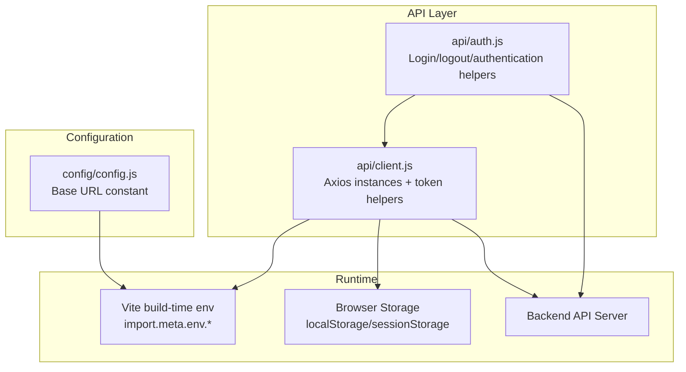
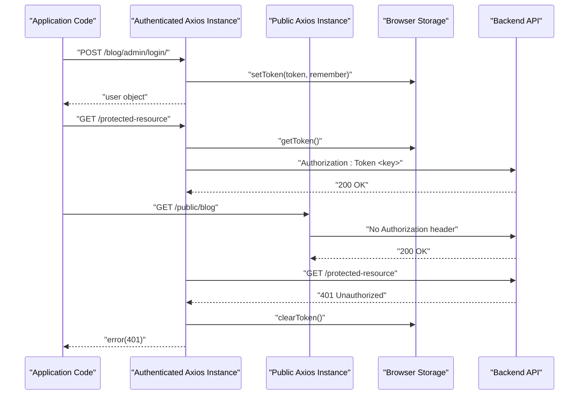
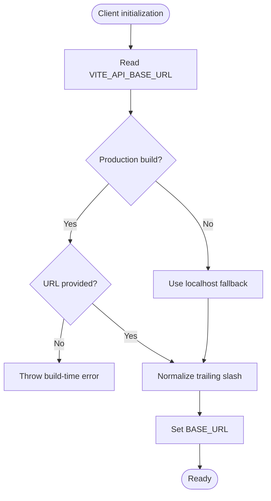
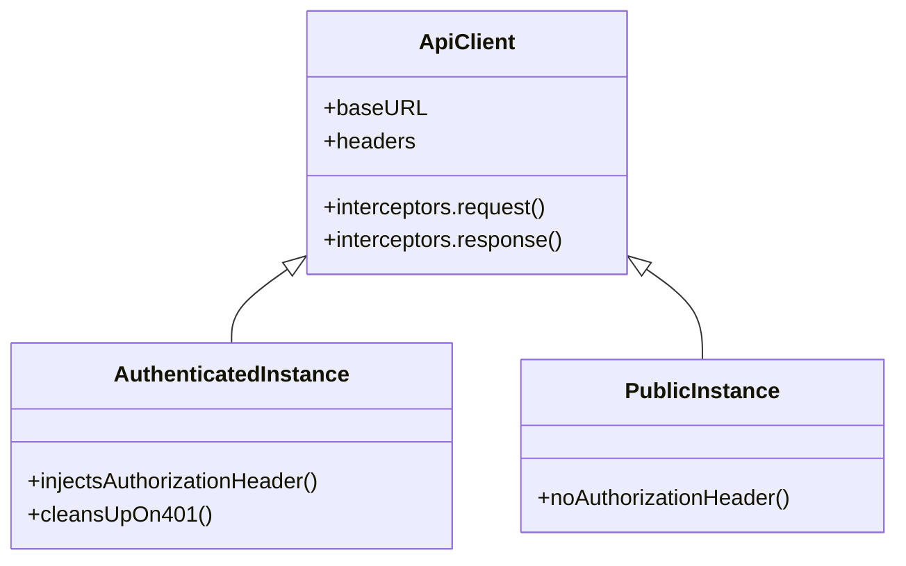
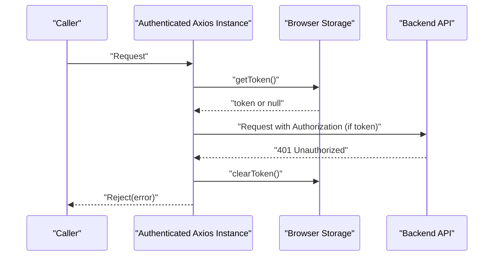
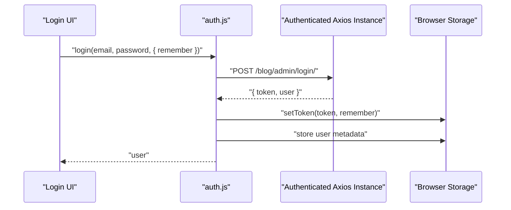
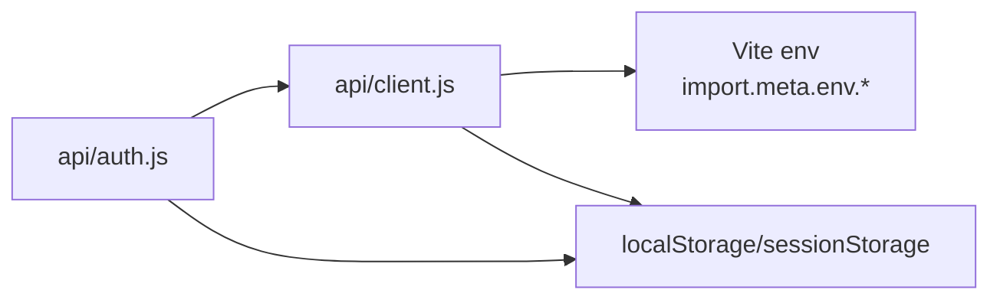

# API Client Configuration

<cite>
**Referenced Files in This Document**
- [client.js](file://src/api/client.js)
- [auth.js](file://src/api/auth.js)
- [config.js](file://src/config/config.js)
- [package.json](file://package.json)
</cite>

## Table of Contents
1. [Introduction](#introduction)
2. [Project Structure](#project-structure)
3. [Core Components](#core-components)
4. [Architecture Overview](#architecture-overview)
5. [Detailed Component Analysis](#detailed-component-analysis)
6. [Dependency Analysis](#dependency-analysis)
7. [Performance Considerations](#performance-considerations)
8. [Troubleshooting Guide](#troubleshooting-guide)
9. [Conclusion](#conclusion)
10. [Appendices](#appendices)

## Introduction
This document explains the centralized API client configuration for the frontend application. It covers how Axios instances are created, how environment variables configure the base URL, and how production safety checks prevent misconfiguration. It also documents the dual-instance architecture that separates authenticated admin requests from public visitor requests, token management utilities for secure storage, request/response interceptors for automatic authentication header injection and 401 error handling, and best practices for extending the client safely.

## Project Structure
The API client is implemented as a small, focused module under the API layer:
- Centralized Axios setup and token helpers live in the API client file.
- Authentication flows use the client to log in, log out, and check authentication state.
- A separate configuration file exposes an alternative base URL constant used elsewhere in the app.

**Diagram sources**
- [client.js:1-88](file://src/api/client.js#L1-L88)
- [auth.js:1-40](file://src/api/auth.js#L1-L40)
- [config.js:1-3](file://src/config/config.js#L1-L3)

**Section sources**
- [client.js:1-88](file://src/api/client.js#L1-L88)
- [auth.js:1-40](file://src/api/auth.js#L1-L40)
- [config.js:1-3](file://src/config/config.js#L1-L3)

## Core Components
- Centralized Axios instance for authenticated admin requests with automatic Authorization header injection and 401 cleanup.
- Public Axios instance for unauthenticated visitor requests that never sends admin tokens.
- Token management utilities supporting both persistent (localStorage) and session-scoped (sessionStorage) strategies.
- Environment-driven base URL configuration with production safety checks.

Key responsibilities:
- Base URL resolution from environment variables.
- Token persistence and retrieval across localStorage and sessionStorage.
- Automatic header injection for authenticated requests.
- Automatic logout on 401 responses.
- Clear separation between authenticated and public API usage.

**Section sources**
- [client.js:4-21](file://src/api/client.js#L4-L21)
- [client.js:23-42](file://src/api/client.js#L23-L42)
- [client.js:44-88](file://src/api/client.js#L44-L88)
- [auth.js:1-40](file://src/api/auth.js#L1-L40)

## Architecture Overview
The system uses two Axios instances:
- Authenticated instance: attaches a token when present and clears it on 401 errors.
- Public instance: never attaches the token, ensuring visitors see only public content even if an admin is logged in.

**Diagram sources**
- [client.js:47-88](file://src/api/client.js#L47-L88)
- [auth.js:4-19](file://src/api/auth.js#L4-L19)

## Detailed Component Analysis

### Base URL Configuration and Production Safety
- The client reads the base URL from a Vite environment variable at build time.
- If the variable is missing in production, the build fails loudly to avoid shipping a misconfigured client.
- In development, a localhost fallback ensures local development works without extra configuration.
- Trailing slashes are normalized to prevent double-slash path issues.

**Diagram sources**
- [client.js:4-19](file://src/api/client.js#L4-L19)

**Section sources**
- [client.js:4-19](file://src/api/client.js#L4-L19)

### Dual-Instance Architecture
- Authenticated instance:
  - Adds Content-Type header.
  - Intercepts outgoing requests to inject Authorization header when a token exists.
  - Intercepts responses to clear stored tokens on 401 errors.
- Public instance:
  - Uses the same base URL but does not attach any Authorization header.
  - Ensures public endpoints return exactly what a normal visitor would see.

**Diagram sources**
- [client.js:47-88](file://src/api/client.js#L47-L88)

**Section sources**
- [client.js:47-88](file://src/api/client.js#L47-L88)

### Token Management Utilities
- getToken():
  - Reads the token from localStorage first, then falls back to sessionStorage.
- setToken(token, options):
  - Clears existing tokens before storing the new one.
  - Supports a remember flag to choose between localStorage (persistent) and sessionStorage (session-scoped).
- clearToken():
  - Removes the token from both localStorage and sessionStorage.

**Diagram sources**
- [client.js:26-42](file://src/api/client.js#L26-L42)

**Section sources**
- [client.js:26-42](file://src/api/client.js#L26-L42)

### Request/Response Interceptors
- Request interceptor:
  - Retrieves the current token using getToken().
  - Attaches Authorization header with the scheme expected by the backend.
- Response interceptor:
  - On 401 responses, clears stored tokens to force re-authentication.
  - Propagates the error to callers.

**Diagram sources**
- [client.js:54-75](file://src/api/client.js#L54-L75)

**Section sources**
- [client.js:54-75](file://src/api/client.js#L54-L75)

### Authentication Flow Integration
- Login:
  - Posts credentials to the admin login endpoint via the authenticated instance.
  - Stores the returned token using setToken with the remember option.
  - Persists user metadata for quick access.
- Logout:
  - Calls the backend logout endpoint.
  - Clears tokens and user metadata from storage.
- Authentication checks:
  - isAuthenticated() checks for the presence of a token.
  - getCurrentUser() retrieves the persisted user object.

**Diagram sources**
- [auth.js:4-19](file://src/api/auth.js#L4-L19)
- [client.js:26-42](file://src/api/client.js#L26-L42)

**Section sources**
- [auth.js:4-19](file://src/api/auth.js#L4-L19)
- [auth.js:21-40](file://src/api/auth.js#L21-L40)
- [client.js:26-42](file://src/api/client.js#L26-L42)

## Dependency Analysis
- The authentication module depends on the centralized client for HTTP calls and token utilities.
- The client depends on Vite environment variables for base URL configuration.
- Both modules rely on browser storage APIs for token persistence.

**Diagram sources**
- [auth.js:1-40](file://src/api/auth.js#L1-L40)
- [client.js:1-88](file://src/api/client.js#L1-L88)

**Section sources**
- [auth.js:1-40](file://src/api/auth.js#L1-L40)
- [client.js:1-88](file://src/api/client.js#L1-L88)

## Performance Considerations
- Using two Axios instances avoids unnecessary Authorization headers on public requests, reducing server-side auth overhead for anonymous traffic.
- Token lookup occurs per request; consider caching the token value in memory if you anticipate many rapid calls within a short timeframe.
- Avoid heavy synchronous operations inside interceptors to keep request latency low.

[No sources needed since this section provides general guidance]

## Troubleshooting Guide
Common issues and resolutions:
- Missing base URL in production:
  - Symptom: Build fails with a message indicating the base URL is not set.
  - Resolution: Provide VITE_API_BASE_URL in your production environment file and rebuild.
- 401 Unauthorized after login:
  - Symptom: Requests fail with 401 despite being logged in.
  - Resolution: Ensure the Authorization header scheme matches the backend expectation and that setToken was called during login.
- Public pages showing admin-only content:
  - Symptom: Visitors see drafts or scheduled posts.
  - Resolution: Use the public Axios instance for public routes so no Authorization header is sent.
- Token not persisting across tabs:
  - Symptom: Logging in once does not persist across tabs.
  - Resolution: Use the remember option to store the token in localStorage instead of sessionStorage.

**Section sources**
- [client.js:10-19](file://src/api/client.js#L10-L19)
- [client.js:54-75](file://src/api/client.js#L54-L75)
- [client.js:77-88](file://src/api/client.js#L77-L88)
- [auth.js:4-19](file://src/api/auth.js#L4-L19)

## Conclusion
The centralized API client configuration provides a robust foundation for making HTTP requests in both authenticated and public contexts. It enforces safe base URL configuration, supports flexible token storage strategies, and automates authentication header injection and cleanup. By separating authenticated and public Axios instances, the application ensures correct behavior for both admin users and visitors while maintaining security and performance.

[No sources needed since this section summarizes without analyzing specific files]

## Appendices

### Environment Configuration Examples
- Development:
  - Set VITE_API_BASE_URL to point to your local backend API base path.
  - The client will fall back to a localhost base URL if the variable is not set.
- Production:
  - Always set VITE_API_BASE_URL to the production API base path.
  - The build will fail if the variable is missing, preventing accidental deployment with incorrect URLs.

Note: The repository also includes a separate configuration constant for a different base URL used elsewhere in the application.

**Section sources**
- [client.js:4-19](file://src/api/client.js#L4-L19)
- [config.js:1-3](file://src/config/config.js#L1-L3)

### Security Considerations for Token Storage
- Prefer sessionStorage for sensitive tokens when cross-tab persistence is not required.
- Use localStorage only when you explicitly need long-lived sessions, understanding the increased risk of XSS exposure.
- Always clear tokens on logout and on 401 responses.
- Avoid logging tokens in console output or analytics payloads.

**Section sources**
- [client.js:26-42](file://src/api/client.js#L26-L42)
- [client.js:66-75](file://src/api/client.js#L66-L75)

### Best Practices for Extending the Client Configuration
- Add additional Axios instances for other environments or services by cloning the base configuration.
- Centralize error handling in response interceptors to standardize user feedback.
- Keep token-related logic isolated in the client module to maintain consistency across the app.
- Validate environment variables at build time to catch misconfigurations early.

**Section sources**
- [client.js:47-88](file://src/api/client.js#L47-L88)