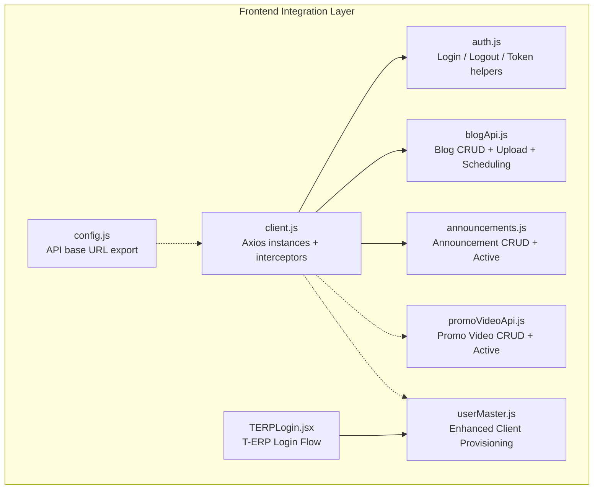
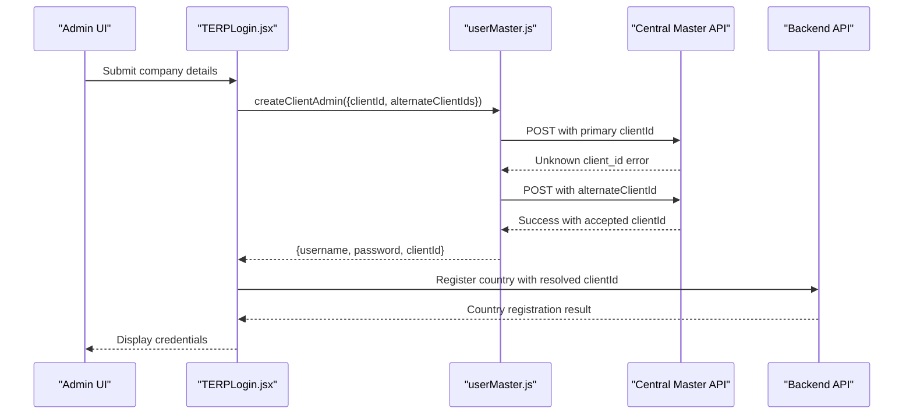
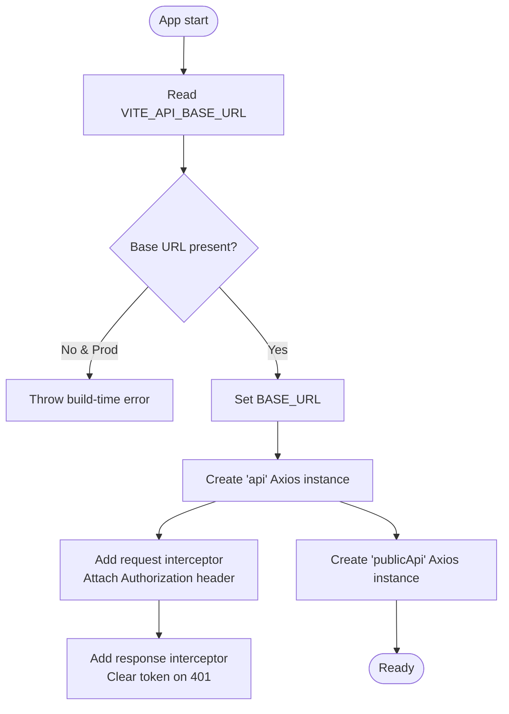
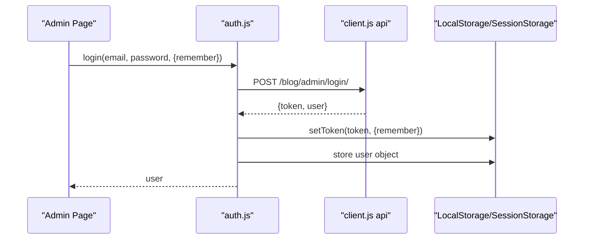
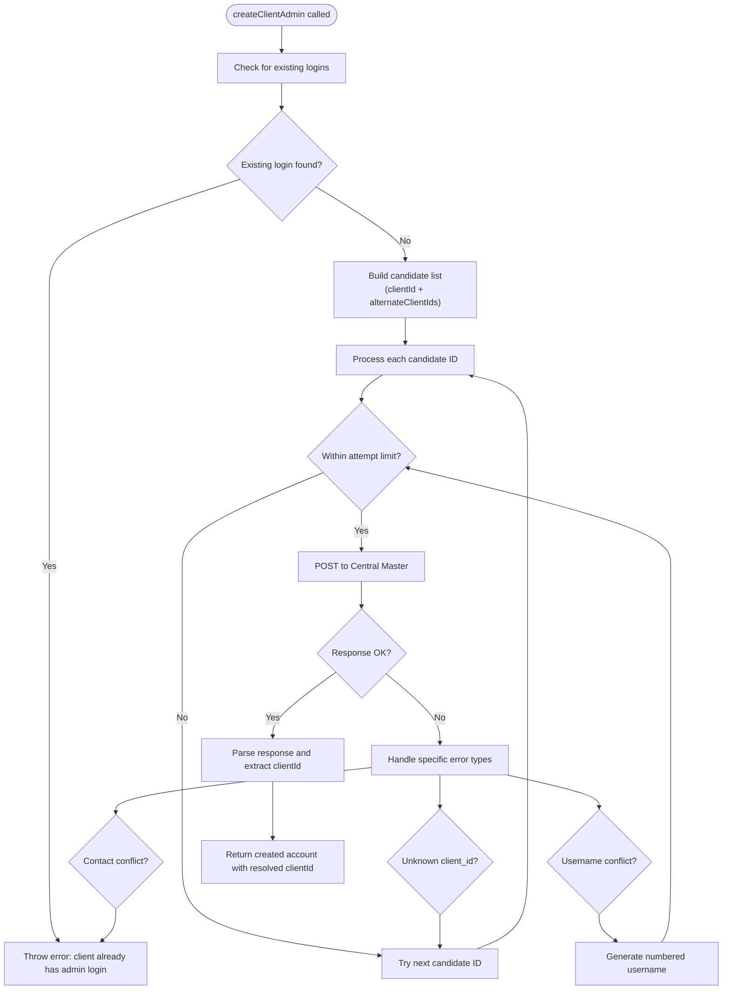
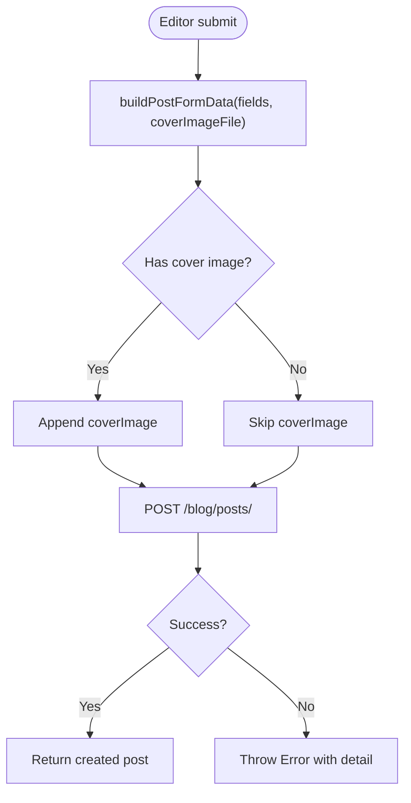
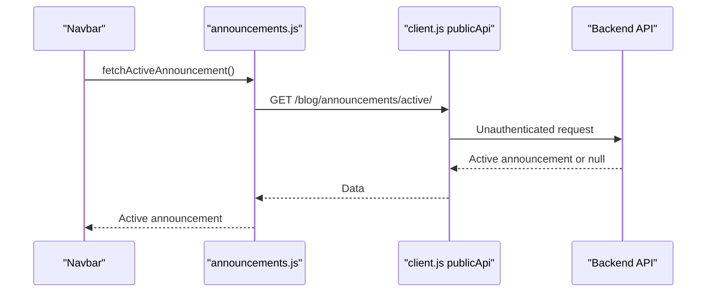
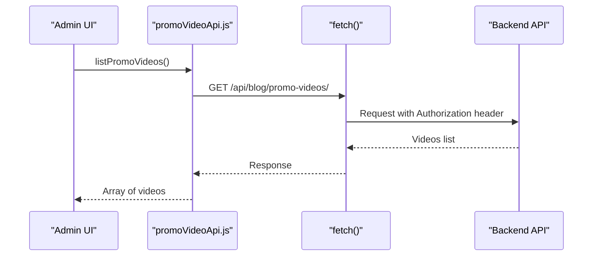
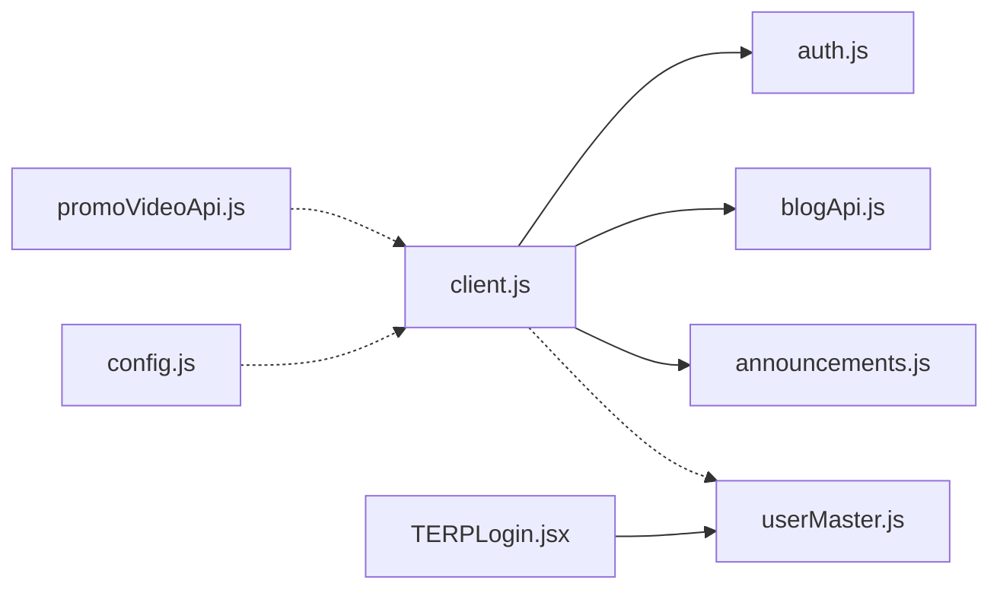

# API Integration Layer

<cite>
**Referenced Files in This Document**
- [client.js](file://src/api/client.js)
- [auth.js](file://src/api/auth.js)
- [blogApi.js](file://src/api/blogApi.js)
- [announcements.js](file://src/api/announcements.js)
- [promoVideoApi.js](file://src/api/promoVideoApi.js)
- [userMaster.js](file://src/api/userMaster.js)
- [TERPLogin.jsx](file://src/pages/TERPLogin.jsx)
- [config.js](file://src/config/config.js)
</cite>

## Update Summary
**Changes Made**
- Added comprehensive documentation for the enhanced `createClientAdmin()` function with alternate client ID support
- Updated client provisioning workflow to include automatic retry logic for Unknown client_id errors
- Added new section covering Central Master integration and client registration processes
- Enhanced authentication flow documentation to include client ID resolution mechanisms

## Table of Contents
1. [Introduction](#introduction)
2. [Project Structure](#project-structure)
3. [Core Components](#core-components)
4. [Architecture Overview](#architecture-overview)
5. [Detailed Component Analysis](#detailed-component-analysis)
6. [Dependency Analysis](#dependency-analysis)
7. [Performance Considerations](#performance-considerations)
8. [Troubleshooting Guide](#troubleshooting-guide)
9. [Conclusion](#conclusion)
10. [Appendices](#appendices)

## Introduction
This document describes the TRELLISCO_ERP_FRONTEND integration layer that centralizes HTTP communication with the backend. It covers:
- Centralized Axios client configuration with authentication, error handling, and request/response modification.
- Authentication endpoints for login, logout, and token management.
- Blog API endpoints for CRUD operations, file uploads, and scheduling.
- Announcements API for company-wide messages and visibility controls.
- Promotional video API for media upload, metadata management, and active video selection.
- **Enhanced client provisioning system with automatic retry logic and alternate client ID support.**
- Request/response schemas, error handling patterns, authentication methods, and rate limiting considerations.
- Usage examples and best practices for extending the integration layer.

## Project Structure
The integration layer lives under `src/api` and is consumed by admin pages and public-facing components. The key files are:
- `client.js`: Shared Axios instances, token helpers, and interceptors.
- `auth.js`: Authentication API functions.
- `blogApi.js`: Blog post CRUD, file upload, and scheduling helpers.
- `announcements.js`: Announcement listing, creation, update, deletion, and active announcement retrieval.
- `promoVideoApi.js`: Promo video listing, creation, update, deletion, and active promo retrieval.
- `userMaster.js`: **Enhanced client provisioning with alternate client ID support and automatic retry logic.**
- `TERPLogin.jsx`: **Updated T-ERP login flow with improved client ID resolution.**
- `config.js`: A small config export (not used by the main Axios clients).

**Diagram sources**
- [client.js:1-88](file://src/api/client.js#L1-L88)
- [auth.js:1-40](file://src/api/auth.js#L1-L40)
- [blogApi.js:1-135](file://src/api/blogApi.js#L1-L135)
- [announcements.js:1-61](file://src/api/announcements.js#L1-L61)
- [promoVideoApi.js:1-85](file://src/api/promoVideoApi.js#L1-L85)
- [userMaster.js:1-368](file://src/api/userMaster.js#L1-L368)
- [TERPLogin.jsx:1-849](file://src/pages/TERPLogin.jsx#L1-L849)
- [config.js:1-3](file://src/config/config.js#L1-L3)

**Section sources**
- [client.js:1-88](file://src/api/client.js#L1-L88)
- [auth.js:1-40](file://src/api/auth.js#L1-L40)
- [blogApi.js:1-135](file://src/api/blogApi.js#L1-L135)
- [announcements.js:1-61](file://src/api/announcements.js#L1-L61)
- [promoVideoApi.js:1-85](file://src/api/promoVideoApi.js#L1-L85)
- [userMaster.js:1-368](file://src/api/userMaster.js#L1-L368)
- [TERPLogin.jsx:1-849](file://src/pages/TERPLogin.jsx#L1-L849)
- [config.js:1-3](file://src/config/config.js#L1-L3)

## Core Components
- Centralized Axios clients:
  - `api`: Admin client that attaches a DRF-compatible `Token <key>` Authorization header via an interceptor. Clears the token on 401 responses.
  - `publicApi`: Public client that never sends the admin token to ensure visitors see only published content even if an admin is logged in elsewhere in the same browser.
- Token storage and helpers:
  - Tokens are stored in `localStorage` or `sessionStorage` based on a remember flag.
  - Helpers provide get/set/clear semantics for tokens and user info.
- Error normalization:
  - Each module converts Axios or fetch errors into readable JavaScript Errors using backend-provided details when available.
- **Enhanced client provisioning:**
  - `createClientAdmin()`: Advanced client account creation with alternate client ID support and automatic retry logic.
  - Automatic fallback to alternate client IDs when primary ID is rejected as "Unknown client_id".
  - Improved client ID resolution for country registration and credential handout processes.

Key responsibilities:
- `client.js`: Base URL resolution, token persistence, Axios instance setup, request/response interceptors.
- `auth.js`: Login/logout flows and current-user retrieval.
- `blogApi.js`: Post listing/detail (admin/public), create/update/delete, file upload, publish toggle, scheduling helpers, and FormData builder.
- `announcements.js`: Announcement CRUD and active announcement retrieval.
- `promoVideoApi.js`: Promo video CRUD and active promo retrieval.
- **`userMaster.js`: Enhanced client provisioning with intelligent client ID resolution and retry mechanisms.**

**Section sources**
- [client.js:21-88](file://src/api/client.js#L21-L88)
- [auth.js:1-40](file://src/api/auth.js#L1-L40)
- [blogApi.js:1-135](file://src/api/blogApi.js#L1-L135)
- [announcements.js:1-61](file://src/api/announcements.js#L1-L61)
- [promoVideoApi.js:1-85](file://src/api/promoVideoApi.js#L1-L85)
- [userMaster.js:264-365](file://src/api/userMaster.js#L264-L365)

## Architecture Overview
The integration layer uses two HTTP clients:
- Admin client (`api`) for authenticated operations.
- Public client (`publicApi`) for unauthenticated operations.

Authentication flow:
- On login, the frontend posts credentials to the backend and stores the returned token and user object.
- Subsequent requests automatically include the Authorization header.
- On 401, the token is cleared to force re-authentication.

Public vs admin visibility:
- Public endpoints return only what visitors should see (e.g., published blog posts).
- Admin endpoints return all records including drafts and scheduled items.

**Enhanced Client Provisioning Flow:**
- The `createClientAdmin()` function implements sophisticated client ID resolution with automatic retry logic.
- Primary client ID is attempted first, followed by alternate client IDs when "Unknown client_id" errors occur.
- The function returns the actual client ID that was accepted by Central Master for subsequent operations.

**Diagram sources**
- [TERPLogin.jsx:612-624](file://src/pages/TERPLogin.jsx#L612-L624)
- [userMaster.js:264-365](file://src/api/userMaster.js#L264-L365)
- [userMaster.js:137-140](file://src/api/userMaster.js#L137-L140)

**Section sources**
- [auth.js:4-19](file://src/api/auth.js#L4-L19)
- [client.js:47-75](file://src/api/client.js#L47-L75)
- [TERPLogin.jsx:612-624](file://src/pages/TERPLogin.jsx#L612-L624)
- [userMaster.js:264-365](file://src/api/userMaster.js#L264-L365)

## Detailed Component Analysis

### Centralized Axios Client Configuration
Responsibilities:
- Base URL resolution from environment variables with a development fallback.
- Token helpers for persistent or session-based storage.
- Admin Axios instance with request interceptor adding `Authorization: Token <key>`.
- Response interceptor clearing token on 401.
- Public Axios instance without auth headers.

Important notes:
- DRF expects `Token <key>`, not `Bearer <key>`.
- In production builds, missing base URL throws an error to avoid silent misconfiguration.

**Diagram sources**
- [client.js:4-19](file://src/api/client.js#L4-L19)
- [client.js:21-42](file://src/api/client.js#L21-L42)
- [client.js:47-88](file://src/api/client.js#L47-L88)

**Section sources**
- [client.js:4-19](file://src/api/client.js#L4-L19)
- [client.js:21-42](file://src/api/client.js#L21-L42)
- [client.js:47-88](file://src/api/client.js#L47-L88)

### Authentication API
Endpoints:
- Login: `POST /blog/admin/login/`
  - Request body: `{ email, password }`
  - Response: `{ token, user }`
  - Behavior: Stores token and user; returns user object.
- Logout: `POST /blog/admin/logout/`
  - Behavior: Clears token and user from storage.
- Token check: `isAuthenticated()`
  - Returns boolean based on presence of token.
- Current user: `getCurrentUser()`
  - Returns parsed user object or null.

Error handling:
- Uses shared Axios client; 401 clears token automatically.

Usage pattern:
- Call `login` with optional `remember` flag to choose localStorage vs sessionStorage.
- Use `isAuthenticated` to guard admin routes.
- Use `getCurrentUser` to display user info.

**Diagram sources**
- [auth.js:4-19](file://src/api/auth.js#L4-L19)
- [client.js:21-42](file://src/api/client.js#L21-L42)

**Section sources**
- [auth.js:4-19](file://src/api/auth.js#L4-L19)
- [auth.js:21-29](file://src/api/auth.js#L21-L29)
- [auth.js:31-40](file://src/api/auth.js#L31-L40)
- [client.js:21-42](file://src/api/client.js#L21-L42)

### Enhanced Client Provisioning System
**New Section** - Enhanced client provisioning with advanced client ID resolution and retry logic.

Capabilities:
- **Primary client ID attempt**: Tries the provided client ID first.
- **Automatic retry mechanism**: When Central Master returns "Unknown client_id", automatically attempts alternate client IDs.
- **Intelligent client ID resolution**: Returns the actual client ID that was accepted by Central Master.
- **Username collision handling**: Automatically generates numbered usernames when conflicts occur.
- **Contact conflict detection**: Prevents duplicate accounts for the same contact information.

Key features:
- `alternateClientIds` parameter support for fallback client identification.
- Automatic retry logic with configurable attempt limits.
- Enhanced error handling for various failure scenarios.
- Integration with Central Master's user management system.

Request/response schemas:
- Input parameters:
  - `clientId`: Primary client identifier
  - `alternateClientIds`: Array of fallback client identifiers
  - `firstName`, `lastName`: Contact person details
  - `email`, `phoneNumber`: Contact information
  - `selectedProjects`: Array of selected project configurations
  - `attempts`: Maximum retry attempts (default: 4)
  - `usernameEmail`: Email address for username derivation
- Response object:
  - `username`: Generated or derived username
  - `password`: Securely generated password
  - `flags`: Product flags based on selected projects
  - `user`: Complete user object from Central Master
  - `reused`: Boolean indicating if existing account was reused
  - `endpoint`: Central Master endpoint used
  - `clientId`: Actual client ID that was accepted

**Diagram sources**
- [userMaster.js:264-365](file://src/api/userMaster.js#L264-L365)
- [userMaster.js:137-140](file://src/api/userMaster.js#L137-L140)
- [userMaster.js:121-131](file://src/api/userMaster.js#L121-L131)

**Section sources**
- [userMaster.js:264-365](file://src/api/userMaster.js#L264-L365)
- [userMaster.js:137-140](file://src/api/userMaster.js#L137-L140)
- [userMaster.js:121-131](file://src/api/userMaster.js#L121-L131)

### Blog API
Capabilities:
- Admin read endpoints:
  - List posts: `GET /blog/posts/`
  - Get post by slug: `GET /blog/posts/{slug}/`
- Public read endpoints:
  - List public posts: `GET /blog/posts/`
  - Get public post by slug: `GET /blog/posts/{slug}/`
- Admin write endpoints:
  - Create post: `POST /blog/posts/` (multipart/form-data)
  - Update post: `PATCH /blog/posts/{slug}/` (multipart/form-data)
  - Delete post: `DELETE /blog/posts/{slug}/`
  - Toggle publish: `POST /blog/posts/{slug}/publish/`
- File upload:
  - Upload content file: `POST /blog/upload/` (multipart/form-data)
- Scheduling helpers:
  - Convert local datetime input to ISO string or empty.
  - Build multipart FormData payload matching serializer field names.

Request/response schemas:
- Create/Update Post (multipart/form-data fields):
  - `title`: string
  - `excerpt`: string
  - `author`: string
  - `category`: string
  - `categoryLabelOverride`: string
  - `readTime`: number or string
  - `status`: string (e.g., draft/published/scheduled)
  - `body`: JSON stringified array/object
  - `publishAt`: ISO string or empty
  - `deleteAt`: ISO string or empty
  - `coverImage`: File (optional)
- Upload Content File:
  - Request: multipart/form-data with `file`
  - Response: `{ url, type }`
- Toggle Publish:
  - Request: no body
  - Response: updated post object

Error handling:
- Upload function wraps Axios errors into a readable Error with backend detail when available.

Best practices:
- Always use `buildPostFormData` to construct payloads so serializer field names match exactly.
- Use `toIsoOrEmpty` for scheduling inputs to ensure correct ISO strings or empty values.

**Diagram sources**
- [blogApi.js:117-135](file://src/api/blogApi.js#L117-L135)
- [blogApi.js:35-47](file://src/api/blogApi.js#L35-L47)
- [blogApi.js:63-74](file://src/api/blogApi.js#L63-L74)

**Section sources**
- [blogApi.js:10-18](file://src/api/blogApi.js#L10-L18)
- [blogApi.js:25-33](file://src/api/blogApi.js#L25-L33)
- [blogApi.js:35-56](file://src/api/blogApi.js#L35-L56)
- [blogApi.js:63-74](file://src/api/blogApi.js#L63-L74)
- [blogApi.js:81-85](file://src/api/blogApi.js#L81-L85)
- [blogApi.js:117-135](file://src/api/blogApi.js#L117-L135)

### Announcements API
Capabilities:
- Public:
  - Get active announcement: `GET /blog/announcements/active/`
- Admin:
  - List announcements: `GET /blog/announcements/`
  - Create announcement: `POST /blog/announcements/`
  - Update announcement: `PATCH /blog/announcements/{id}/`
  - Delete announcement: `DELETE /blog/announcements/{id}/`

Request/response schemas:
- Payloads are passed directly to Axios; backend validation determines required fields.
- Responses are normalized to arrays where applicable.

Error handling:
- Converts Axios errors into readable JavaScript Errors using backend detail or first field error message.

Usage pattern:
- Use `fetchActiveAnnouncement` in public areas (no auth).
- Use admin functions for CRUD operations.

**Diagram sources**
- [announcements.js:22-25](file://src/api/announcements.js#L22-L25)
- [client.js:83-88](file://src/api/client.js#L83-L88)

**Section sources**
- [announcements.js:22-25](file://src/api/announcements.js#L22-L25)
- [announcements.js:28-61](file://src/api/announcements.js#L28-L61)
- [announcements.js:6-17](file://src/api/announcements.js#L6-L17)

### Promotional Video API
Capabilities:
- Admin:
  - List promo videos: `GET /api/blog/promo-videos/`
  - Create promo video: `POST /api/blog/promo-videos/`
  - Update promo video: `PATCH /api/blog/promo-videos/{id}/`
  - Delete promo video: `DELETE /api/blog/promo-videos/{id}/`
- Public:
  - Get active promo video: `GET /api/blog/promo-videos/active/`

Request/response schemas:
- Create/Update payload (multipart/form-data):
  - `video`: File (optional)
  - `title`: string
  - `subtitle`: string
  - `buttonLabel`: string
  - `buttonUrl`: string
  - `isActive`: boolean
  - `publishAt`: ISO string or empty
  - `deleteAt`: ISO string or empty

Error handling:
- Normalizes fetch responses into readable Errors using backend detail or first field error.

Notes:
- Uses native `fetch` instead of Axios.
- Reads base URL from `VITE_API_URL` and appends `/api/blog/promo-videos/`.

**Diagram sources**
- [promoVideoApi.js:49-53](file://src/api/promoVideoApi.js#L49-L53)
- [promoVideoApi.js:8-11](file://src/api/promoVideoApi.js#L8-L11)

**Section sources**
- [promoVideoApi.js:1-11](file://src/api/promoVideoApi.js#L1-L11)
- [promoVideoApi.js:14-34](file://src/api/promoVideoApi.js#L14-L34)
- [promoVideoApi.js:36-47](file://src/api/promoVideoApi.js#L36-L47)
- [promoVideoApi.js:49-85](file://src/api/promoVideoApi.js#L49-L85)

## Dependency Analysis
The integration layer has clear separation between shared HTTP infrastructure and feature-specific modules.

Observations:
- `auth.js`, `blogApi.js`, and `announcements.js` depend on `client.js` for Axios instances and token helpers.
- `promoVideoApi.js` uses native fetch and reads token from `client.js` helpers but does not import Axios.
- **`userMaster.js` integrates with Central Master API and provides enhanced client provisioning capabilities.**
- **`TERPLogin.jsx` orchestrates the complete T-ERP setup flow including client provisioning.**
- `config.js` exports a base URL constant but is not used by the primary Axios clients.

Potential coupling:
- All modules assume DRF-style error shapes for normalization.
- Token scheme must remain `Token <key>` across the stack.
- **Client provisioning relies on Central Master's user management system with robust error handling.**

**Section sources**
- [client.js:1-88](file://src/api/client.js#L1-L88)
- [auth.js:1-40](file://src/api/auth.js#L1-L40)
- [blogApi.js:1-135](file://src/api/blogApi.js#L1-L135)
- [announcements.js:1-61](file://src/api/announcements.js#L1-L61)
- [promoVideoApi.js:1-85](file://src/api/promoVideoApi.js#L1-L85)
- [userMaster.js:1-368](file://src/api/userMaster.js#L1-L368)
- [TERPLogin.jsx:1-849](file://src/pages/TERPLogin.jsx#L1-L849)
- [config.js:1-3](file://src/config/config.js#L1-L3)

## Performance Considerations
- Prefer `publicApi` for visitor-facing reads to avoid sending admin tokens unnecessarily.
- Batch operations where possible at the backend level; the frontend currently issues single-request calls per operation.
- Avoid unnecessary re-renders by caching results in component state or a lightweight cache layer.
- For large file uploads, consider progress indicators and chunking strategies at the UI layer.
- **Client provisioning includes built-in retry logic to minimize network failures and improve reliability.**
- **Alternate client ID resolution reduces failed provisioning attempts through intelligent fallback mechanisms.**

[No sources needed since this section provides general guidance]

## Troubleshooting Guide
Common issues and resolutions:
- Missing base URL in production:
  - Ensure `VITE_API_BASE_URL` is set before building for production; otherwise, the client throws an error.
- 401 Unauthorized:
  - The response interceptor clears the token automatically; re-authenticate via login.
- Blog cover images not saving:
  - Ensure you use `buildPostFormData` and pass the correct serializer field names (e.g., `coverImage`).
- Scheduling not working:
  - Use `toIsoOrEmpty` to convert local datetime inputs to ISO strings or empty values.
- Announcements returning unexpected shapes:
  - Normalize responses using the provided helper functions; some endpoints may return paginated objects.
- **Client provisioning failures:**
  - Check if the primary client ID is valid in Central Master's license registry.
  - Verify that alternate client IDs are properly configured when expected.
  - Monitor for "Unknown client_id" errors which trigger automatic retry logic.
  - Ensure proper error handling for username and contact conflicts.
- **T-ERP login flow issues:**
  - Verify Google authentication is working correctly before attempting client provisioning.
  - Check that the client ID resolution process completes successfully.
  - Monitor the retry mechanism for unknown client ID scenarios.

**Section sources**
- [client.js:10-16](file://src/api/client.js#L10-L16)
- [client.js:66-75](file://src/api/client.js#L66-L75)
- [blogApi.js:81-85](file://src/api/blogApi.js#L81-L85)
- [blogApi.js:117-135](file://src/api/blogApi.js#L117-L135)
- [announcements.js:6-17](file://src/api/announcements.js#L6-L17)
- [userMaster.js:137-140](file://src/api/userMaster.js#L137-L140)
- [userMaster.js:345-364](file://src/api/userMaster.js#L345-L364)

## Conclusion
The TRELLISCO_ERP_FRONTEND integration layer provides a robust, centralized approach to HTTP communication with clear separation between admin and public contexts. It standardizes authentication, error handling, and request construction while offering well-defined APIs for blogs, announcements, promotional videos, and **enhanced client provisioning**. The new client provisioning system with automatic retry logic and alternate client ID support significantly improves reliability and user experience during the T-ERP setup process. Following the documented patterns ensures consistent behavior, easier maintenance, and safe extension points for new features.

[No sources needed since this section summarizes without analyzing specific files]

## Appendices

### API Endpoints Summary
- Authentication
  - `POST /blog/admin/login/`
  - `POST /blog/admin/logout/`
- Blog
  - `GET /blog/posts/`
  - `GET /blog/posts/{slug}/`
  - `POST /blog/posts/`
  - `PATCH /blog/posts/{slug}/`
  - `DELETE /blog/posts/{slug}/`
  - `POST /blog/posts/{slug}/publish/`
  - `POST /blog/upload/`
- Announcements
  - `GET /blog/announcements/active/`
  - `GET /blog/announcements/`
  - `POST /blog/announcements/`
  - `PATCH /blog/announcements/{id}/`
  - `DELETE /blog/announcements/{id}/`
- Promotional Videos
  - `GET /api/blog/promo-videos/`
  - `POST /api/blog/promo-videos/`
  - `PATCH /api/blog/promo-videos/{id}/`
  - `DELETE /api/blog/promo-videos/{id}/`
  - `GET /api/blog/promo-videos/active/`
- **Central Master (Enhanced)**
  - `POST /central-api/user-master/` (via proxy)
  - `GET /central-api/user-master/` (for user lookup)
  - `PATCH /central-api/user-master/{id}/` (for enabling projects)

**Section sources**
- [auth.js:4-29](file://src/api/auth.js#L4-L29)
- [blogApi.js:10-56](file://src/api/blogApi.js#L10-L56)
- [announcements.js:22-61](file://src/api/announcements.js#L22-L61)
- [promoVideoApi.js:49-85](file://src/api/promoVideoApi.js#L49-L85)
- [userMaster.js:12-16](file://src/api/userMaster.js#L12-L16)
- [userMaster.js:218-222](file://src/api/userMaster.js#L218-L222)

### Request/Response Schemas
- Authentication
  - Login request: `{ email, password }`
  - Login response: `{ token, user }`
- Blog
  - Create/Update post (multipart/form-data):
    - Fields: `title`, `excerpt`, `author`, `category`, `categoryLabelOverride`, `readTime`, `status`, `body`, `publishAt`, `deleteAt`, `coverImage`
  - Upload content file:
    - Request: multipart/form-data with `file`
    - Response: `{ url, type }`
- Announcements
  - Payloads vary by endpoint; backend validation applies.
- Promotional Videos
  - Create/Update payload (multipart/form-data):
    - Fields: `video`, `title`, `subtitle`, `buttonLabel`, `buttonUrl`, `isActive`, `publishAt`, `deleteAt`
- **Enhanced Client Provisioning**
  - Create client admin request:
    - Fields: `clientId`, `alternateClientIds[]`, `firstName`, `lastName`, `email`, `phoneNumber`, `selectedProjects[]`, `attempts`, `usernameEmail`
  - Create client admin response:
    - Fields: `username`, `password`, `flags`, `user`, `reused`, `endpoint`, `clientId`

**Section sources**
- [auth.js:4-19](file://src/api/auth.js#L4-L19)
- [blogApi.js:35-47](file://src/api/blogApi.js#L35-L47)
- [blogApi.js:63-74](file://src/api/blogApi.js#L63-L74)
- [blogApi.js:117-135](file://src/api/blogApi.js#L117-L135)
- [promoVideoApi.js:36-47](file://src/api/promoVideoApi.js#L36-L47)
- [userMaster.js:264-365](file://src/api/userMaster.js#L264-L365)

### Error Handling Patterns
- Axios-based modules normalize errors using backend-provided details or first field error messages.
- Fetch-based modules parse response bodies and throw readable Errors with fallback messages.
- **Enhanced client provisioning includes sophisticated error categorization:**
  - Username conflict detection with automatic username regeneration
  - Contact conflict prevention to avoid duplicate accounts
  - Unknown client ID handling with automatic fallback to alternate IDs
  - Network error wrapping with contextual information

**Section sources**
- [announcements.js:6-17](file://src/api/announcements.js#L6-L17)
- [promoVideoApi.js:14-34](file://src/api/promoVideoApi.js#L14-L34)
- [blogApi.js:63-74](file://src/api/blogApi.js#L63-L74)
- [userMaster.js:121-140](file://src/api/userMaster.js#L121-L140)
- [userMaster.js:234-246](file://src/api/userMaster.js#L234-L246)

### Rate Limiting Considerations
- No explicit client-side rate limiting is implemented.
- Consider implementing exponential backoff or retry logic for transient failures.
- Respect backend rate limits and implement UI feedback for throttling scenarios.
- **Enhanced client provisioning includes built-in retry logic with configurable attempt limits to handle transient failures gracefully.**

[No sources needed since this section provides general guidance]

### Best Practices for Extending the Integration Layer
- Use `api` for authenticated operations and `publicApi` for unauthenticated ones.
- Keep serializer field names aligned with server expectations when constructing FormData.
- Normalize errors consistently across modules.
- Centralize environment configuration and validate it at build time.
- Prefer functional helpers over inline fetch/Axios calls to maintain consistency.
- **For client provisioning operations:**
  - Always provide both primary and alternate client IDs when available.
  - Implement proper error handling for "Unknown client_id" scenarios.
  - Use the returned `clientId` from successful provisioning for subsequent operations.
  - Leverage the built-in retry mechanisms rather than implementing custom retry logic.

**Section sources**
- [client.js:47-88](file://src/api/client.js#L47-L88)
- [blogApi.js:117-135](file://src/api/blogApi.js#L117-L135)
- [announcements.js:6-17](file://src/api/announcements.js#L6-L17)
- [promoVideoApi.js:14-34](file://src/api/promoVideoApi.js#L14-L34)
- [userMaster.js:264-365](file://src/api/userMaster.js#L264-L365)