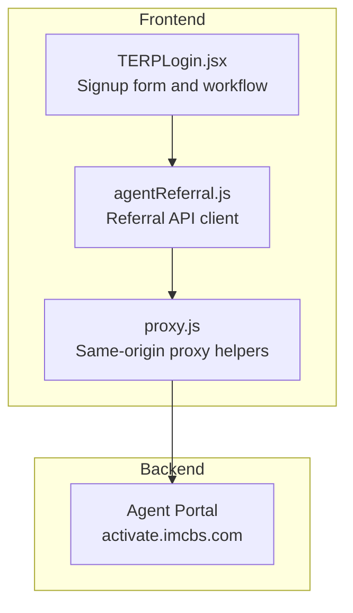
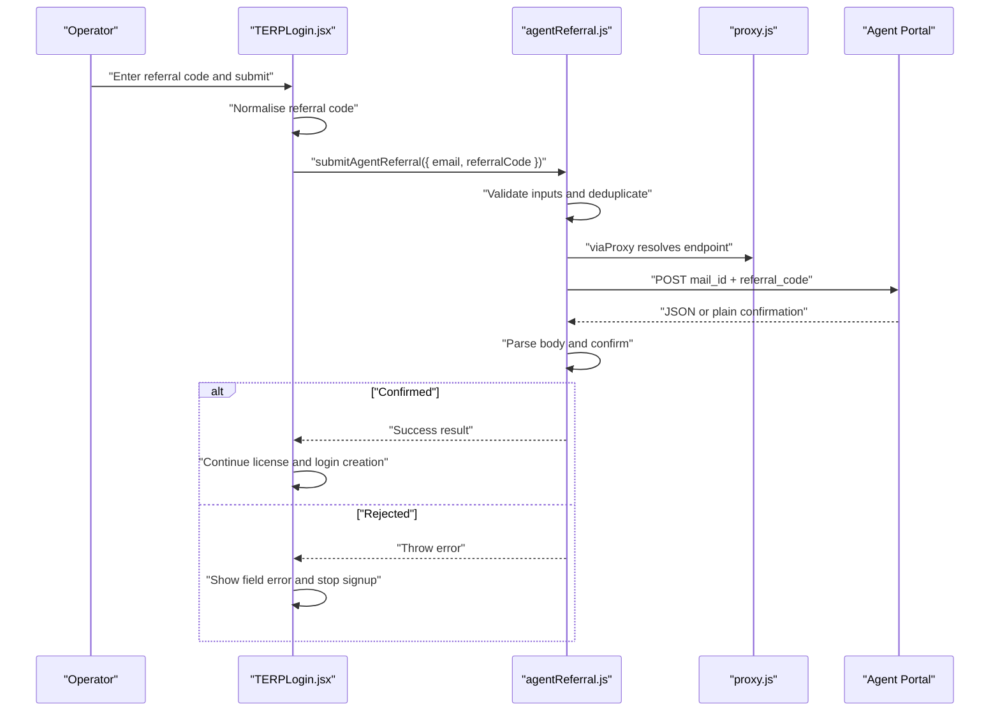
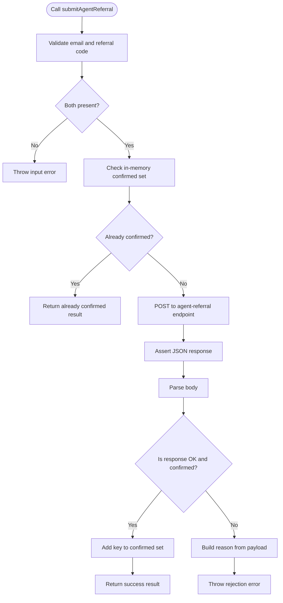
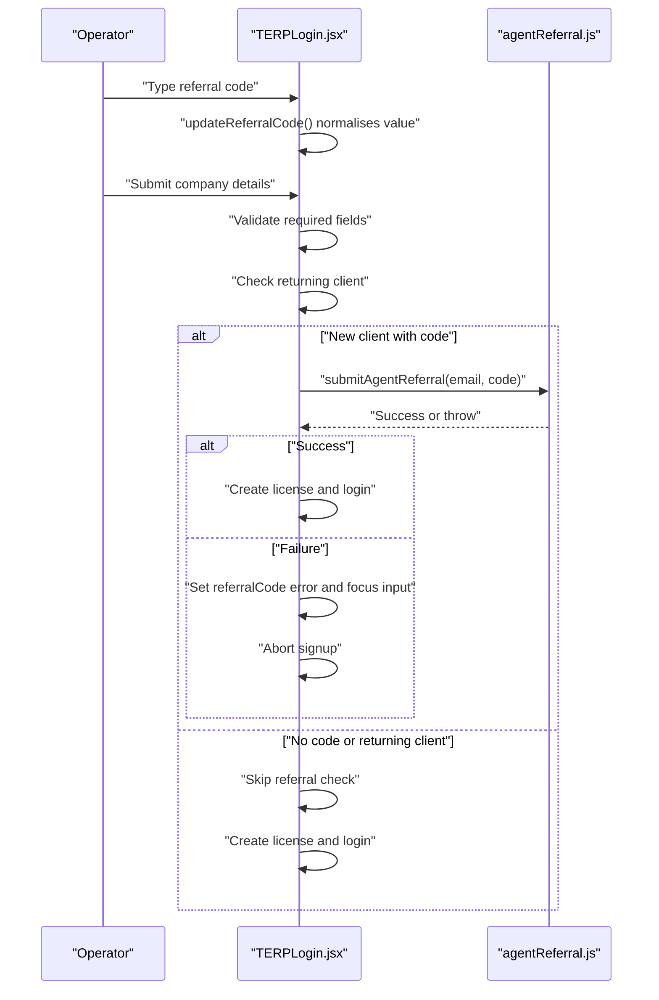
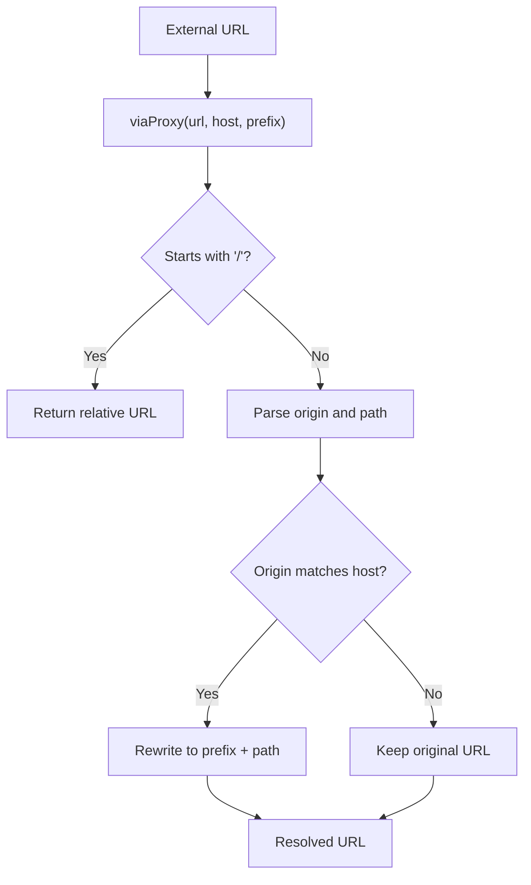
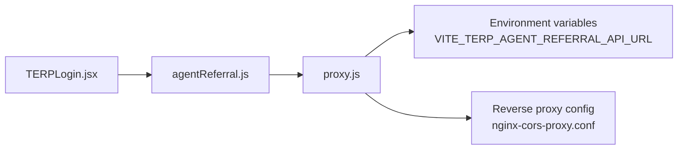

# Agent Referral System

<cite>
**Referenced Files in This Document**
- [agentReferral.js](file://src/api/agentReferral.js)
- [proxy.js](file://src/api/proxy.js)
- [TERPLogin.jsx](file://src/pages/TERPLogin.jsx)
- [README.md](file://README.md)
</cite>

## Table of Contents
1. [Introduction](#introduction)
2. [Project Structure](#project-structure)
3. [Core Components](#core-components)
4. [Architecture Overview](#architecture-overview)
5. [Detailed Component Analysis](#detailed-component-analysis)
6. [Dependency Analysis](#dependency-analysis)
7. [Performance Considerations](#performance-considerations)
8. [Troubleshooting Guide](#troubleshooting-guide)
9. [Conclusion](#conclusion)

## Introduction
The Agent Referral System is a frontend integration that credits an external agent portal when a new customer enters a referral code during signup. The system:

- Accepts an optional referral code on the company details form.
- Normalises and validates the code.
- Posts it to an external agent-referral endpoint through a same-origin proxy.
- Confirms acceptance before creating the license and admin login.
- Prevents duplicate crediting for the same email-code pair within the browser session.

This documentation explains how the frontend implements this flow, how it integrates with the broader TERP login process, and how configuration and error handling work.

**Section sources**
- [agentReferral.js:1-127](file://src/api/agentReferral.js#L1-L127)
- [TERPLogin.jsx:443-449](file://src/pages/TERPLogin.jsx#L443-L449)
- [TERPLogin.jsx:832-850](file://src/pages/TERPLogin.jsx#L832-L850)

## Project Structure
The Agent Referral System lives under the API layer and is consumed by the TERP login page:

**Diagram sources**
- [TERPLogin.jsx:1-29](file://src/pages/TERPLogin.jsx#L1-L29)
- [agentReferral.js:14-20](file://src/api/agentReferral.js#L14-L20)
- [proxy.js:1-56](file://src/api/proxy.js#L1-L56)

**Section sources**
- [TERPLogin.jsx:1-29](file://src/pages/TERPLogin.jsx#L1-L29)
- [agentReferral.js:1-20](file://src/api/agentReferral.js#L1-L20)
- [proxy.js:1-56](file://src/api/proxy.js#L1-L56)

## Core Components
The system has two main responsibilities:

1. **API Client (`agentReferral.js`)**
   - Builds the correct endpoint URL via the proxy helper.
   - Normalises referral codes.
   - Parses flexible confirmation responses.
   - Sends the POST request and throws on rejection.
   - Deduplicates confirmed pairs in memory.

2. **UI Integration (`TERPLogin.jsx`)**
   - Renders an optional referral code input.
   - Normalises user input while typing.
   - Calls the referral API only for new clients.
   - Stops signup if the code is not confirmed.
   - Shows field-level errors and focuses the referral input.

**Section sources**
- [agentReferral.js:16-24](file://src/api/agentReferral.js#L16-L24)
- [agentReferral.js:52-70](file://src/api/agentReferral.js#L52-L70)
- [agentReferral.js:96-126](file://src/api/agentReferral.js#L96-L126)
- [TERPLogin.jsx:443-449](file://src/pages/TERPLogin.jsx#L443-L449)
- [TERPLogin.jsx:832-850](file://src/pages/TERPLogin.jsx#L832-L850)

## Architecture Overview
The referral flow runs inside the TERP signup sequence. It is intentionally placed before license creation so that invalid referrals do not create accounts.

**Diagram sources**
- [TERPLogin.jsx:832-850](file://src/pages/TERPLogin.jsx#L832-L850)
- [agentReferral.js:96-126](file://src/api/agentReferral.js#L96-L126)
- [proxy.js:17-36](file://src/api/proxy.js#L17-L36)

## Detailed Component Analysis

### Referral API Client
The referral client encapsulates all backend-facing logic:

- **Endpoint resolution**: Uses `viaProxy` to map the external host to the same-origin `/terp-api` prefix.
- **Code normalisation**: Trims and uppercases the code.
- **Response interpretation**: Supports bare booleans, strings like `"true"` or `"success"`, numeric flags, and wrapped objects.
- **Confirmation rule**: A false flag wins; absence of acceptance is treated as refusal.
- **Deduplication**: Stores confirmed `(email, code)` pairs in a module-level set to avoid double crediting.
- **Error behavior**: Throws descriptive errors for missing inputs, empty bodies, non-JSON responses, and unconfirmed codes.

**Diagram sources**
- [agentReferral.js:96-126](file://src/api/agentReferral.js#L96-L126)
- [agentReferral.js:22-24](file://src/api/agentReferral.js#L22-L24)
- [agentReferral.js:26-70](file://src/api/agentReferral.js#L26-L70)
- [proxy.js:45-55](file://src/api/proxy.js#L45-L55)

**Section sources**
- [agentReferral.js:14-20](file://src/api/agentReferral.js#L14-L20)
- [agentReferral.js:22-24](file://src/api/agentReferral.js#L22-L24)
- [agentReferral.js:26-70](file://src/api/agentReferral.js#L26-L70)
- [agentReferral.js:72-81](file://src/api/agentReferral.js#L72-L81)
- [agentReferral.js:83-86](file://src/api/agentReferral.js#L83-L86)
- [agentReferral.js:96-126](file://src/api/agentReferral.js#L96-L126)

### UI Integration in TERP Login
The TERP login page integrates the referral system into the signup wizard:

- **Input handling**: The referral code input accepts uppercase letters, digits, and hyphens, with a maximum length.
- **State storage**: The code is stored in the company state object alongside other company fields.
- **Validation timing**: The referral check runs after basic form validation but before license creation.
- **Returning clients**: Returning clients are not asked to re-enter a code; their stored referral code remains associated with their account.
- **Error UX**: On failure, the page sets a field-specific error, focuses the referral input, and aborts the rest of the signup.

**Diagram sources**
- [TERPLogin.jsx:443-449](file://src/pages/TERPLogin.jsx#L443-L449)
- [TERPLogin.jsx:832-850](file://src/pages/TERPLogin.jsx#L832-L850)
- [TERPLogin.jsx:1346-1365](file://src/pages/TERPLogin.jsx#L1346-L1365)

**Section sources**
- [TERPLogin.jsx:443-449](file://src/pages/TERPLogin.jsx#L443-L449)
- [TERPLogin.jsx:832-850](file://src/pages/TERPLogin.jsx#L832-L850)
- [TERPLogin.jsx:1346-1365](file://src/pages/TERPLogin.jsx#L1346-L1365)

### Proxy and Endpoint Resolution
The proxy module ensures requests reach the external agent portal without CORS preflight failures:

- **Origins**: Defines the TERP and Central Master origins.
- **Prefixes**: Defines `/terp-api` and `/central-api`.
- **URL rewriting**: Rewrites URLs pointing at the configured host to use the same-origin prefix.
- **HTML fallback detection**: Detects when the reverse proxy returns HTML instead of JSON and throws a clear configuration error.

**Diagram sources**
- [proxy.js:11-15](file://src/api/proxy.js#L11-L15)
- [proxy.js:17-36](file://src/api/proxy.js#L17-L36)
- [proxy.js:45-55](file://src/api/proxy.js#L45-L55)

**Section sources**
- [proxy.js:1-56](file://src/api/proxy.js#L1-L56)

## Dependency Analysis
The referral system has a small, focused dependency graph:

Key relationships:

- `TERPLogin.jsx` imports `normaliseReferralCode` and `submitAgentReferral`.
- `agentReferral.js` depends on `proxy.js` for endpoint construction and JSON assertion.
- The endpoint can be overridden by an environment variable; otherwise, it uses the default agent-referral path.
- Production deployment relies on the nginx CORS proxy configuration to serve the same-origin prefix.

**Diagram sources**
- [TERPLogin.jsx:19-20](file://src/pages/TERPLogin.jsx#L19-L20)
- [agentReferral.js:14-20](file://src/api/agentReferral.js#L14-L20)
- [proxy.js:11-15](file://src/api/proxy.js#L11-L15)

**Section sources**
- [TERPLogin.jsx:19-20](file://src/pages/TERPLogin.jsx#L19-L20)
- [agentReferral.js:14-20](file://src/api/agentReferral.js#L14-L20)
- [proxy.js:11-15](file://src/api/proxy.js#L11-L15)

## Performance Considerations
- **In-memory deduplication**: The confirmed referral set prevents repeated network calls for the same email-code pair during the browser session.
- **Early validation**: Missing email or code throws immediately, avoiding unnecessary HTTP requests.
- **Minimal UI overhead**: The referral input is optional and does not block project selection or country loading.
- **Network sensitivity**: Because the referral check happens before license creation, slow or failing backend responses delay the full signup. Operators should see the referral error clearly rather than a generic network failure.

[No sources needed since this section provides general guidance]

## Troubleshooting Guide

### Common Errors and Causes

| Symptom | Likely Cause | Recommended Action |
|---|---|---|
| Signup stops with a referral error before license creation | The agent portal rejected the code, returned an empty body, or did not confirm acceptance | Verify the referral code, check the agent portal status, and inspect the error message attached to the referral field |
| Error mentions HTML instead of JSON | The reverse proxy is not configured or the URL is wrong | Check the server proxy configuration and ensure `/terp-api` routes to the agent portal |
| Referral code appears accepted but partner was not credited | The response body did not match any accepted truthy flag | Inspect the actual response shape and update the confirmation logic if the backend changes its format |
| Duplicate credit attempt prevented | The same email-code pair was already confirmed in the current browser session | Clear browser data or restart the tab if you need to force a fresh attempt |
| Referral input rejects characters | Only uppercase letters, digits, and hyphens are allowed | Correct the code format to match the expected pattern |

### Debugging Steps

1. **Confirm the endpoint**
   - Check whether `VITE_TERP_AGENT_REFERRAL_API_URL` is set.
   - If unset, verify the default path resolves through `/terp-api`.

2. **Inspect the response**
   - Look at the raw response text because the client parses both JSON and plain text.
   - Ensure the response is JSON and not the site’s HTML fallback.

3. **Validate the confirmation logic**
   - Confirm the response contains a truthy flag such as `true`, `"success"`, or an object with a true-like flag.
   - Remember that a false flag overrides other keys.

4. **Check operator-facing messages**
   - The client extracts `detail`, `message`, `error`, `errors`, or `reason` for human-readable feedback.
   - Use these fields to make rejection reasons clearer for support staff.

**Section sources**
- [agentReferral.js:43-50](file://src/api/agentReferral.js#L43-L50)
- [agentReferral.js:52-70](file://src/api/agentReferral.js#L52-L70)
- [agentReferral.js:112-121](file://src/api/agentReferral.js#L112-L121)
- [proxy.js:38-55](file://src/api/proxy.js#L38-L55)
- [TERPLogin.jsx:842-848](file://src/pages/TERPLogin.jsx#L842-L848)

## Conclusion
The Agent Referral System is a focused integration that protects signup integrity by validating referral codes before creating licenses and logins. It handles normalization, flexible response parsing, proxy routing, deduplication, and clear error reporting. Its tight coupling with the TERP login workflow makes it easy to understand, but also means that backend changes to the agent portal’s response format require corresponding updates to the confirmation logic.

[No sources needed since this section summarizes without analyzing specific files]