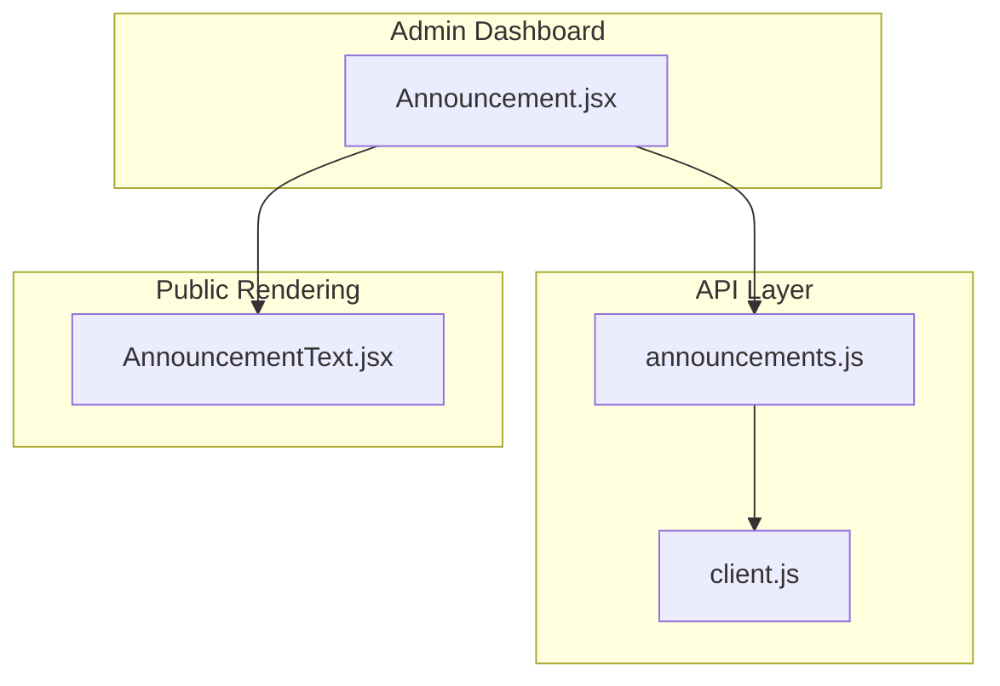
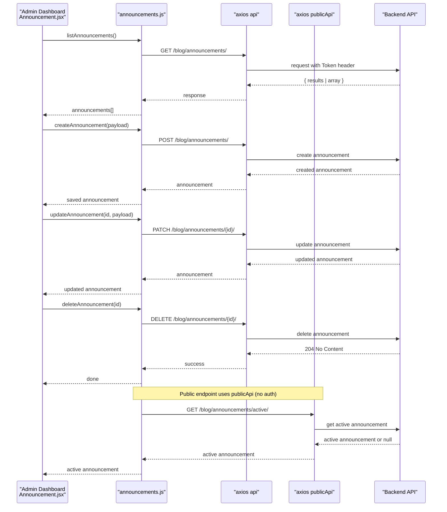
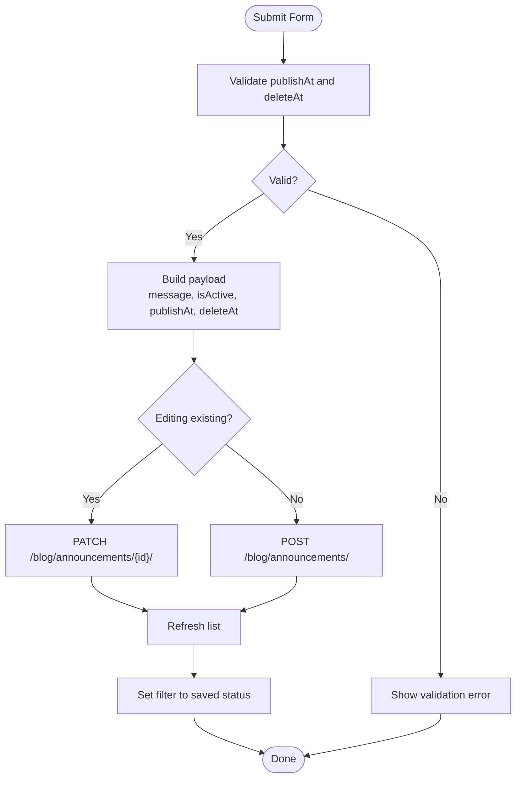
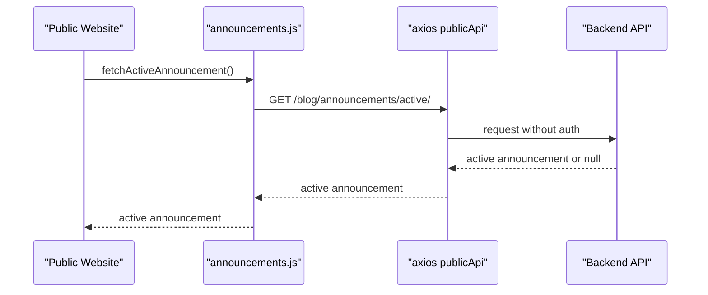
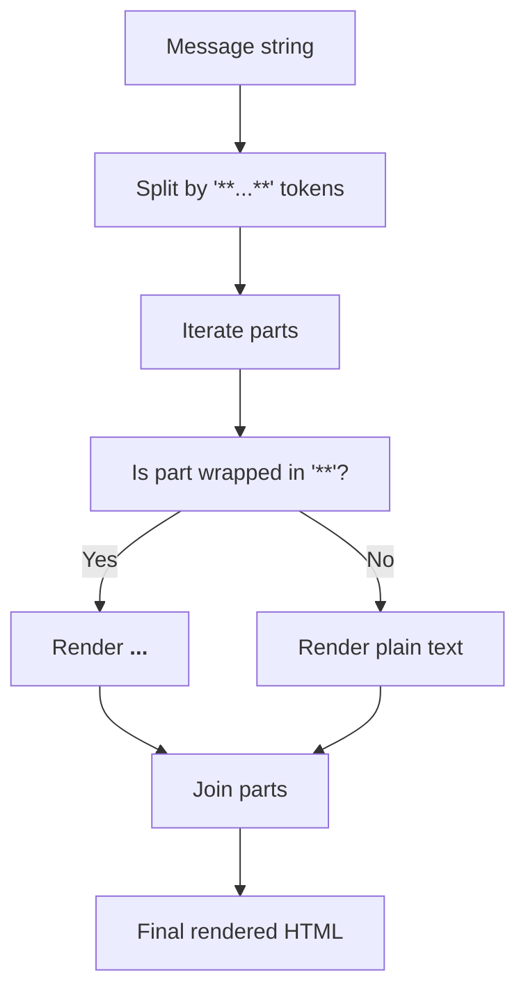
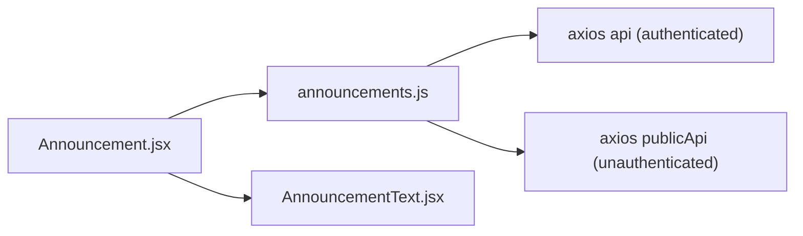

# Announcements API

<cite>
**Referenced Files in This Document**
- [announcements.js](file://src/api/announcements.js)
- [client.js](file://src/api/client.js)
- [Announcement.jsx](file://src/pages/AdminDashboard/Announcement.jsx)
- [AnnouncementText.jsx](file://src/components/AnnouncementText.jsx)
</cite>

## Table of Contents
1. [Introduction](#introduction)
2. [Project Structure](#project-structure)
3. [Core Components](#core-components)
4. [Architecture Overview](#architecture-overview)
5. [Detailed Component Analysis](#detailed-component-analysis)
6. [Dependency Analysis](#dependency-analysis)
7. [Performance Considerations](#performance-considerations)
8. [Troubleshooting Guide](#troubleshooting-guide)
9. [Conclusion](#conclusion)

## Introduction
This document describes the announcements management API surface exposed by the frontend client and used by the admin dashboard. It covers:
- CRUD operations for company-wide announcements
- Active announcement control for public display
- Visibility settings and scheduling features
- Request/response schemas, metadata fields, and status indicators
- Examples for creating, toggling active status, and retrieving currently visible announcements
- Permission requirements and public visibility rules

The backend endpoints are not implemented in this repository; this documentation is derived from the frontend client’s HTTP calls and UI behavior.

## Project Structure
The announcements feature spans a small set of files:
- API client layer that defines endpoints and error handling
- Admin dashboard page that implements CRUD workflows and scheduling controls
- Public helper component to render announcement text with simple bold formatting

**Diagram sources**
- [Announcement.jsx:1-10](file://src/pages/AdminDashboard/Announcement.jsx#L1-L10)
- [announcements.js:1-61](file://src/api/announcements.js#L1-L61)
- [client.js:47-88](file://src/api/client.js#L47-L88)
- [AnnouncementText.jsx:1-18](file://src/components/AnnouncementText.jsx#L1-L18)

**Section sources**
- [announcements.js:1-61](file://src/api/announcements.js#L1-L61)
- [client.js:1-88](file://src/api/client.js#L1-L88)
- [Announcement.jsx:1-360](file://src/pages/AdminDashboard/Announcement.jsx#L1-L360)
- [AnnouncementText.jsx:1-18](file://src/components/AnnouncementText.jsx#L1-L18)

## Core Components
- Announcement API client:
  - Provides functions for listing, creating, updating, deleting announcements, and fetching the active announcement for public display.
  - Uses an authenticated axios instance for admin operations and a public axios instance for visitor-facing data.
- Admin dashboard:
  - Implements form validation, scheduling controls, active toggle, edit/delete flows, and filtering by computed status.
- Announcement text renderer:
  - Renders message content with simple bold syntax using double asterisks.

Key responsibilities:
- Normalize errors returned by the backend into readable messages.
- Convert between local datetime inputs and UTC ISO strings for scheduling.
- Compute and display announcement lifecycle statuses (live, scheduled, expired, hidden).

**Section sources**
- [announcements.js:6-17](file://src/api/announcements.js#L6-L17)
- [announcements.js:22-61](file://src/api/announcements.js#L22-L61)
- [Announcement.jsx:12-53](file://src/pages/AdminDashboard/Announcement.jsx#L12-L53)
- [Announcement.jsx:101-170](file://src/pages/AdminDashboard/Announcement.jsx#L101-L170)
- [AnnouncementText.jsx:1-18](file://src/components/AnnouncementText.jsx#L1-L18)

## Architecture Overview
The announcements workflow involves two distinct clients:
- Authenticated client (`api`): Used by admin pages to manage announcements.
- Public client (`publicApi`): Used by the website to fetch only the currently active announcement without requiring authentication.

**Diagram sources**
- [announcements.js:22-61](file://src/api/announcements.js#L22-L61)
- [client.js:47-88](file://src/api/client.js#L47-L88)
- [Announcement.jsx:64-170](file://src/pages/AdminDashboard/Announcement.jsx#L64-L170)

## Detailed Component Analysis

### API Endpoints and Operations
All endpoints are relative to the base URL configured in the client. The path prefix for announcements is `/blog/announcements/`.

- List announcements
  - Method: GET
  - Path: `/blog/announcements/`
  - Auth: Required (admin)
  - Response: Array of announcements or paginated object with `results`
  - Error handling: Normalized to a user-friendly Error message

- Create announcement
  - Method: POST
  - Path: `/blog/announcements/`
  - Auth: Required (admin)
  - Request body: See schema below
  - Response: Created announcement object

- Update announcement
  - Method: PATCH
  - Path: `/blog/announcements/{id}/`
  - Auth: Required (admin)
  - Request body: Partial update fields
  - Response: Updated announcement object

- Delete announcement
  - Method: DELETE
  - Path: `/blog/announcements/{id}/`
  - Auth: Required (admin)
  - Response: Success with no content

- Get active announcement (public)
  - Method: GET
  - Path: `/blog/announcements/active/`
  - Auth: Not required (public)
  - Response: Currently active announcement or null

Request/Response Schemas
- Announcement object
  - id: string or integer (backend-provided identifier)
  - message: string (announcement text; supports **bold** via double asterisks)
  - isActive: boolean (visibility flag)
  - publishAt: string|null (ISO 8601 UTC datetime when it should become live)
  - deleteAt: string|null (ISO 8601 UTC datetime when it should be hidden)
  - status: string (computed by backend or client logic; values include live, scheduled, expired, hidden)

- Create/Update payload
  - message: string (required for creation)
  - isActive: boolean
  - publishAt: string|null (UTC ISO 8601)
  - deleteAt: string|null (UTC ISO 8601)

Notes on scheduling and visibility:
- If publishAt is set to a future time, the announcement is considered scheduled until that time.
- If deleteAt is set, the announcement is automatically hidden at that time.
- Only one announcement can be live at a time; publishing a new live announcement replaces the current one.

Error handling:
- Errors are normalized from backend responses into a single Error message for consistent UI feedback.

**Section sources**
- [announcements.js:4-17](file://src/api/announcements.js#L4-L17)
- [announcements.js:22-61](file://src/api/announcements.js#L22-L61)

### Admin Dashboard Workflows
The admin page provides:
- Form for creating/editing announcements with message, active toggle, show/hide times
- Validation ensuring hide time is after show time and both are in the future when provided
- Actions to toggle active status, edit, and delete announcements
- Filtering by computed status tabs: Live, Scheduled, Expired, Hidden, All

Key behaviors:
- Converting local datetime input to UTC ISO strings before sending to the backend
- Updating filter tab based on the saved announcement’s status
- Displaying formatted dates and status pills

**Diagram sources**
- [Announcement.jsx:101-148](file://src/pages/AdminDashboard/Announcement.jsx#L101-L148)
- [Announcement.jsx:150-170](file://src/pages/AdminDashboard/Announcement.jsx#L150-L170)

**Section sources**
- [Announcement.jsx:12-53](file://src/pages/AdminDashboard/Announcement.jsx#L12-L53)
- [Announcement.jsx:101-170](file://src/pages/AdminDashboard/Announcement.jsx#L101-L170)
- [Announcement.jsx:172-185](file://src/pages/AdminDashboard/Announcement.jsx#L172-L185)

### Public Active Announcement Retrieval
The public endpoint returns the currently active announcement without requiring authentication. This ensures the homepage banner works independently of admin sessions.

**Diagram sources**
- [announcements.js:19-25](file://src/api/announcements.js#L19-L25)
- [client.js:77-88](file://src/api/client.js#L77-L88)

**Section sources**
- [announcements.js:19-25](file://src/api/announcements.js#L19-L25)
- [client.js:77-88](file://src/api/client.js#L77-L88)

### Text Rendering and Formatting
Announcement messages support a simple bold syntax using double asterisks around words. The rendering component splits the message and wraps matching segments in bold tags.

**Diagram sources**
- [AnnouncementText.jsx:1-18](file://src/components/AnnouncementText.jsx#L1-L18)

**Section sources**
- [AnnouncementText.jsx:1-18](file://src/components/AnnouncementText.jsx#L1-L18)

## Dependency Analysis
The following diagram shows how components depend on each other and the underlying HTTP clients.

**Diagram sources**
- [Announcement.jsx:1-10](file://src/pages/AdminDashboard/Announcement.jsx#L1-L10)
- [announcements.js:1-61](file://src/api/announcements.js#L1-L61)
- [client.js:47-88](file://src/api/client.js#L47-L88)
- [AnnouncementText.jsx:1-18](file://src/components/AnnouncementText.jsx#L1-L18)

**Section sources**
- [Announcement.jsx:1-10](file://src/pages/AdminDashboard/Announcement.jsx#L1-L10)
- [announcements.js:1-61](file://src/api/announcements.js#L1-L61)
- [client.js:47-88](file://src/api/client.js#L47-L88)
- [AnnouncementText.jsx:1-18](file://src/components/AnnouncementText.jsx#L1-L18)

## Performance Considerations
- Use the public client for active announcement retrieval to avoid unnecessary authentication overhead on public pages.
- Avoid frequent polling of the active endpoint; cache the result at the page level where appropriate.
- Debounce or throttle list refreshes after mutations to reduce redundant requests.
- Keep message length reasonable (the UI enforces a maximum length) to minimize payload size.

[No sources needed since this section provides general guidance]

## Troubleshooting Guide
Common issues and resolutions:
- 401 Unauthorized on admin endpoints
  - Ensure a valid token exists and is attached with the correct scheme.
  - The client clears the token on 401 responses; re-authenticate if necessary.
- Unexpected empty lists
  - Verify backend pagination format; the client expects either an array or an object with a `results` field.
- Scheduling validation errors
  - Hide time must be after show time and both must be in the future when provided.
- Public active endpoint returning null
  - No announcement is currently active; ensure at least one announcement has isActive enabled and is within its scheduled window.

**Section sources**
- [client.js:54-75](file://src/api/client.js#L54-L75)
- [announcements.js:28-35](file://src/api/announcements.js#L28-L35)
- [Announcement.jsx:101-113](file://src/pages/AdminDashboard/Announcement.jsx#L101-L113)

## Conclusion
The announcements API surface integrates a secure admin workflow with a public read-only endpoint for displaying the active announcement. The frontend enforces scheduling constraints, normalizes errors, and computes status labels to provide a clear lifecycle view. Administrators can create, edit, toggle, and delete announcements, while the public site retrieves only the currently active announcement without authentication.

[No sources needed since this section summarizes without analyzing specific files]