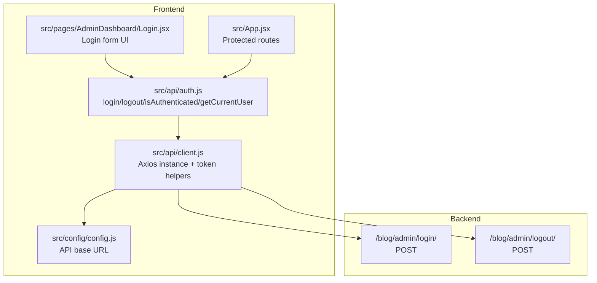
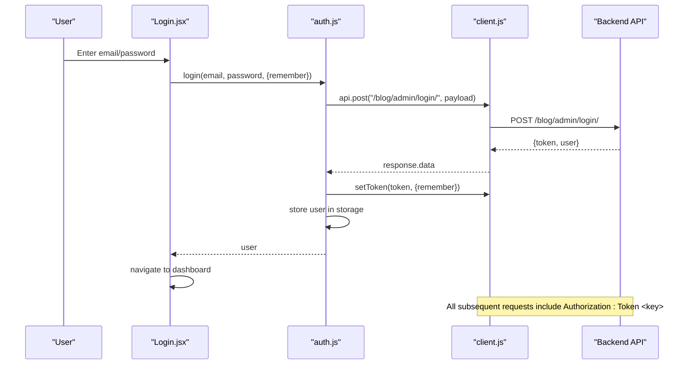
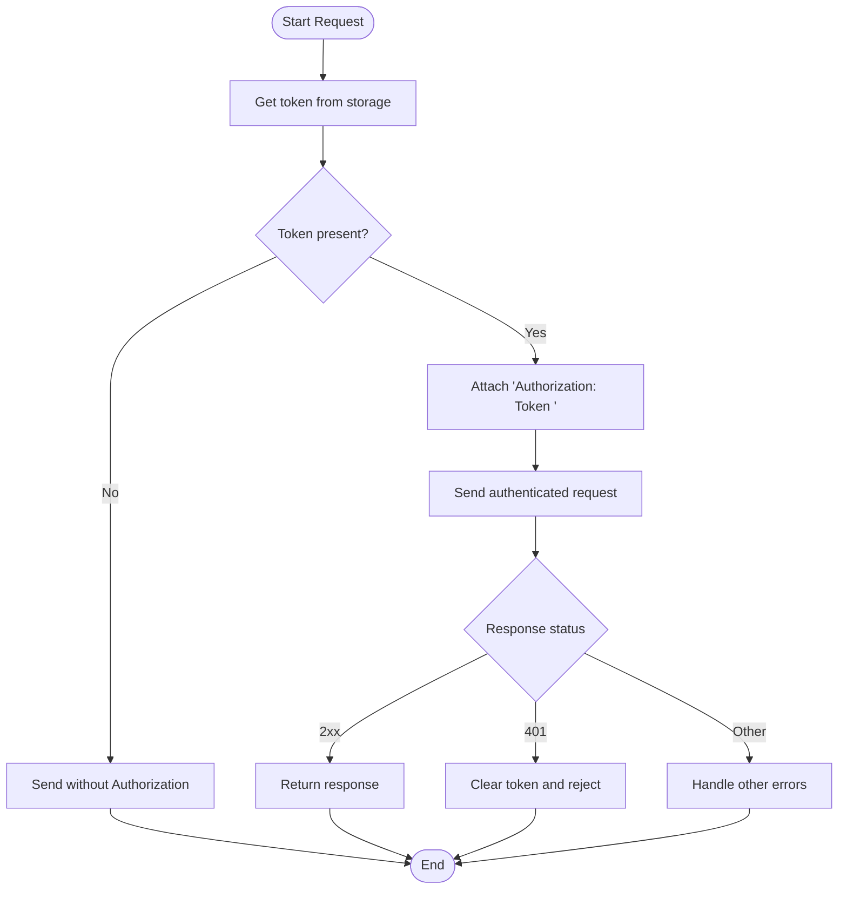
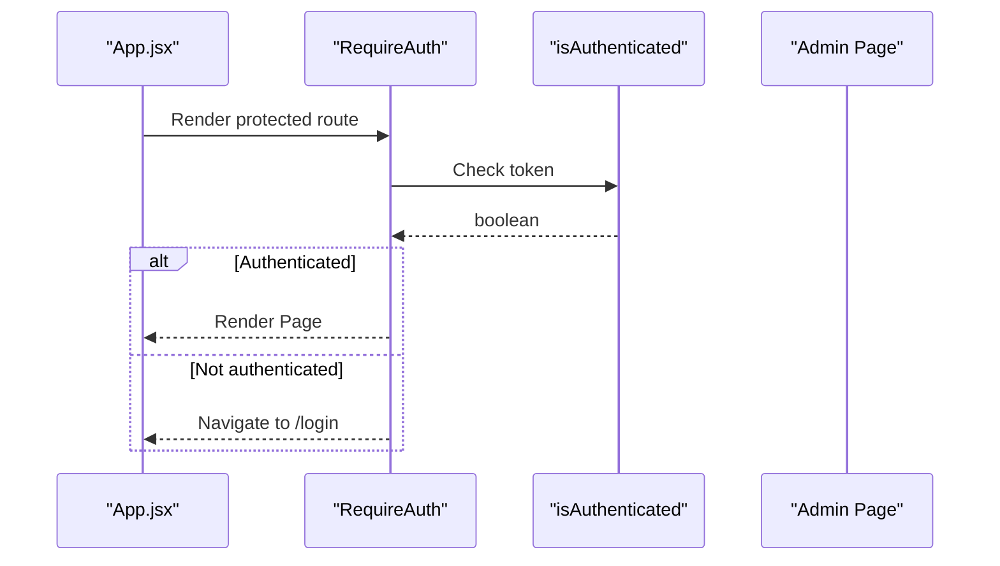
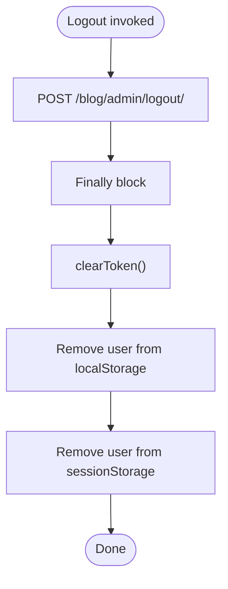
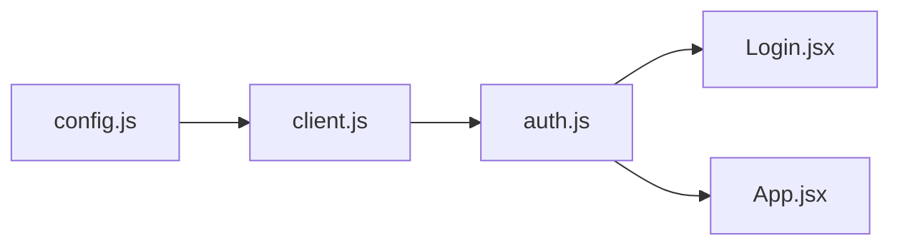

# Authentication API

<cite>
**Referenced Files in This Document**
- [auth.js](file://src/api/auth.js)
- [client.js](file://src/api/client.js)
- [Login.jsx](file://src/pages/AdminDashboard/Login.jsx)
- [App.jsx](file://src/App.jsx)
- [config.js](file://src/config/config.js)
</cite>

## Table of Contents
1. [Introduction](#introduction)
2. [Project Structure](#project-structure)
3. [Core Components](#core-components)
4. [Architecture Overview](#architecture-overview)
5. [Detailed Component Analysis](#detailed-component-analysis)
6. [Dependency Analysis](#dependency-analysis)
7. [Performance Considerations](#performance-considerations)
8. [Troubleshooting Guide](#troubleshooting-guide)
9. [Conclusion](#conclusion)

## Introduction
This document describes the authentication service endpoints and their integration within the frontend application. It covers login and logout flows, token acquisition and validation, session storage patterns, protected route enforcement, error handling for invalid credentials and expired tokens, and security considerations such as token expiration handling and secure storage practices. The backend endpoints are called from the frontend; this documentation focuses on how the frontend consumes them and manages sessions.

## Project Structure
The authentication-related code is organized into:
- API layer: HTTP client configuration, token helpers, and authentication functions.
- UI layer: Login page and protected routes.
- Configuration: Base URL for API calls.

**Diagram sources**
- [client.js:1-88](file://src/api/client.js#L1-L88)
- [auth.js:1-40](file://src/api/auth.js#L1-L40)
- [Login.jsx:1-244](file://src/pages/AdminDashboard/Login.jsx#L1-L244)
- [App.jsx:1-74](file://src/App.jsx#L1-L74)
- [config.js:1-3](file://src/config/config.js#L1-L3)

**Section sources**
- [client.js:1-88](file://src/api/client.js#L1-L88)
- [auth.js:1-40](file://src/api/auth.js#L1-L40)
- [Login.jsx:1-244](file://src/pages/AdminDashboard/Login.jsx#L1-L244)
- [App.jsx:1-74](file://src/App.jsx#L1-L74)
- [config.js:1-3](file://src/config/config.js#L1-L3)

## Core Components
- Token storage and request interceptor: Centralized in the Axios client with helpers to get/set/clear tokens. Tokens are stored in localStorage or sessionStorage depending on a remember flag.
- Authentication API functions: Provide login, logout, authentication state check, and current user retrieval.
- Login UI: Collects email/password, handles errors, and navigates after successful login.
- Protected routes: Enforce authentication using an authentication guard.

Key responsibilities:
- Acquire token on login and attach it to subsequent requests.
- Clear token on 401 responses (expired/invalid).
- Persist user profile alongside token based on remember flag.
- Guard admin routes by checking token presence.

**Section sources**
- [client.js:21-42](file://src/api/client.js#L21-L42)
- [client.js:47-75](file://src/api/client.js#L47-L75)
- [auth.js:4-19](file://src/api/auth.js#L4-L19)
- [auth.js:21-29](file://src/api/auth.js#L21-L29)
- [auth.js:31-40](file://src/api/auth.js#L31-L40)
- [Login.jsx:113-136](file://src/pages/AdminDashboard/Login.jsx#L113-L136)
- [App.jsx:15-17](file://src/App.jsx#L15-L17)

## Architecture Overview
The authentication flow uses Django REST Framework’s TokenAuthentication scheme. The frontend sends credentials to a login endpoint, receives a token and user object, stores the token, and attaches it to all authenticated requests via an Axios interceptor. Logout clears server-side session and local storage.

**Diagram sources**
- [Login.jsx:113-136](file://src/pages/AdminDashboard/Login.jsx#L113-L136)
- [auth.js:4-19](file://src/api/auth.js#L4-L19)
- [client.js:54-64](file://src/api/client.js#L54-L64)

## Detailed Component Analysis

### Authentication Endpoints
- POST /blog/admin/login/
  - Purpose: Authenticate user and return token and user profile.
  - Request body: email, password.
  - Response data: token, user.
  - Behavior: Frontend stores token and user profile according to remember flag.
- POST /blog/admin/logout/
  - Purpose: Invalidate server-side session and clear local token/user data.
  - Response: No specific body required; frontend clears storage regardless.

Request/response schemas:
- Login request
  - Fields:
    - email: string
    - password: string
- Login response
  - Fields:
    - token: string
    - user: object
- Logout request
  - No body required.

Error handling:
- Invalid credentials: Backend returns 401 with detail message; frontend displays backend-provided message.
- Expired/invalid token: Interceptor clears token on 401 responses.

Security notes:
- Token scheme: Authorization header uses "Token <key>" (not "Bearer").
- Storage: Token stored in localStorage when remember is true; otherwise sessionStorage.
- User profile: Stored alongside token in the same storage type.

**Section sources**
- [auth.js:4-19](file://src/api/auth.js#L4-L19)
- [auth.js:21-29](file://src/api/auth.js#L21-L29)
- [client.js:54-75](file://src/api/client.js#L54-L75)
- [Login.jsx:124-136](file://src/pages/AdminDashboard/Login.jsx#L124-L136)

### Token Acquisition and Validation
- Acquisition: On successful login, the token is persisted via setToken with remember flag determining storage location.
- Validation: Every outgoing request includes Authorization header if a token exists. If backend responds with 401, the token is cleared automatically.

**Diagram sources**
- [client.js:54-75](file://src/api/client.js#L54-L75)

**Section sources**
- [client.js:21-42](file://src/api/client.js#L21-L42)
- [client.js:54-75](file://src/api/client.js#L54-L75)

### Session Management Patterns
- Remember me: When enabled, token and user profile are stored in localStorage; otherwise, sessionStorage is used.
- Current user: Retrieved from the same storage type where it was saved.
- Logout: Clears token and removes user profile from both localStorage and sessionStorage to ensure consistent cleanup.

Storage keys:
- Token key: trellisco_token
- Admin user key: trellisco_admin_user

Behavior summary:
- Login sets token and user in matching storage.
- isAuthenticated checks token presence.
- getCurrentUser reads user from matching storage.
- Logout clears both token and user entries.

**Section sources**
- [auth.js:10-18](file://src/api/auth.js#L10-L18)
- [auth.js:21-29](file://src/api/auth.js#L21-L29)
- [auth.js:31-40](file://src/api/auth.js#L31-L40)
- [client.js:21-42](file://src/api/client.js#L21-L42)

### Protected Route Integration
- RequireAuth component checks authentication state before rendering protected pages.
- Routes under /admin/* are guarded; unauthenticated users are redirected to /login.

**Diagram sources**
- [App.jsx:15-17](file://src/App.jsx#L15-L17)
- [App.jsx:35-66](file://src/App.jsx#L35-L66)
- [auth.js:31-33](file://src/api/auth.js#L31-L33)

**Section sources**
- [App.jsx:15-17](file://src/App.jsx#L15-L17)
- [App.jsx:35-66](file://src/App.jsx#L35-L66)
- [auth.js:31-33](file://src/api/auth.js#L31-L33)

### Logout Procedures
- Server call: Sends POST to /blog/admin/logout/.
- Cleanup: Clears token and removes user profile from both localStorage and sessionStorage.
- Error handling: Cleanup runs even if logout request fails.

**Diagram sources**
- [auth.js:21-29](file://src/api/auth.js#L21-L29)

**Section sources**
- [auth.js:21-29](file://src/api/auth.js#L21-L29)

## Dependency Analysis
The authentication system has clear boundaries:
- client.js provides the HTTP client and token management.
- auth.js depends on client.js for token operations and API calls.
- Login.jsx depends on auth.js for login logic and navigation.
- App.jsx depends on auth.js for route protection.

**Diagram sources**
- [client.js:1-88](file://src/api/client.js#L1-L88)
- [auth.js:1-40](file://src/api/auth.js#L1-L40)
- [Login.jsx:1-244](file://src/pages/AdminDashboard/Login.jsx#L1-L244)
- [App.jsx:1-74](file://src/App.jsx#L1-L74)
- [config.js:1-3](file://src/config/config.js#L1-L3)

**Section sources**
- [client.js:1-88](file://src/api/client.js#L1-L88)
- [auth.js:1-40](file://src/api/auth.js#L1-L40)
- [Login.jsx:1-244](file://src/pages/AdminDashboard/Login.jsx#L1-L244)
- [App.jsx:1-74](file://src/App.jsx#L1-L74)
- [config.js:1-3](file://src/config/config.js#L1-L3)

## Performance Considerations
- Token lookup is O(1) per request due to direct storage access.
- Interceptors avoid unnecessary work by only attaching headers when a token exists.
- Logout cleanup ensures no stale data remains, preventing unnecessary re-authentication attempts.

[No sources needed since this section provides general guidance]

## Troubleshooting Guide
Common issues and resolutions:
- 401 Unauthorized on protected requests:
  - Cause: Missing, expired, or invalid token.
  - Resolution: Re-login; the interceptor clears tokens on 401 responses.
- Login fails with generic error:
  - Cause: Backend returns a detail message in the response body.
  - Resolution: Display backend detail message to the user.
- Requests not authenticated:
  - Cause: Authorization header missing or wrong scheme.
  - Resolution: Ensure Authorization header uses "Token <key>".
- Token persists across tabs unexpectedly:
  - Cause: Using localStorage when remember is true.
  - Resolution: Use sessionStorage by disabling remember or clearing storage.

**Section sources**
- [client.js:54-75](file://src/api/client.js#L54-L75)
- [Login.jsx:124-136](file://src/pages/AdminDashboard/Login.jsx#L124-L136)

## Conclusion
The authentication system integrates cleanly with the frontend through a centralized Axios client that manages tokens and enforces authorization headers. Login and logout endpoints are straightforward, with robust cleanup and error handling. Protected routes rely on token presence, ensuring unauthorized access is blocked. For production, consider adding CSRF protection at the backend level, validating tokens server-side, and implementing refresh token strategies to improve security and user experience.

[No sources needed since this section summarizes without analyzing specific files]