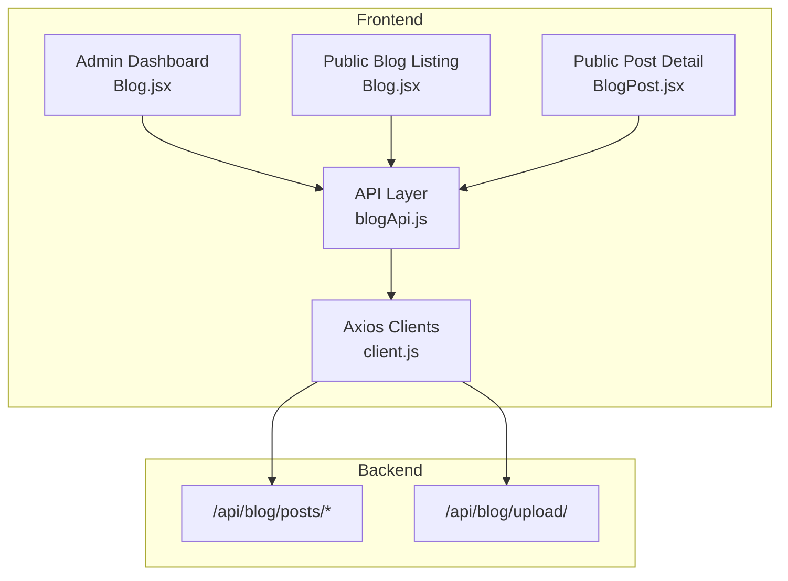
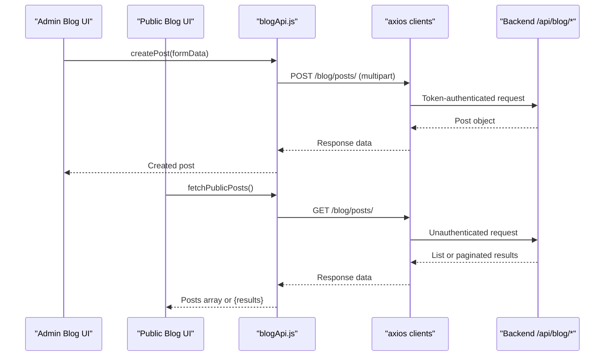
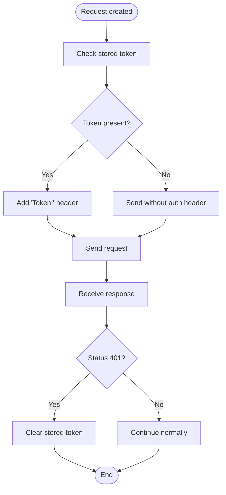
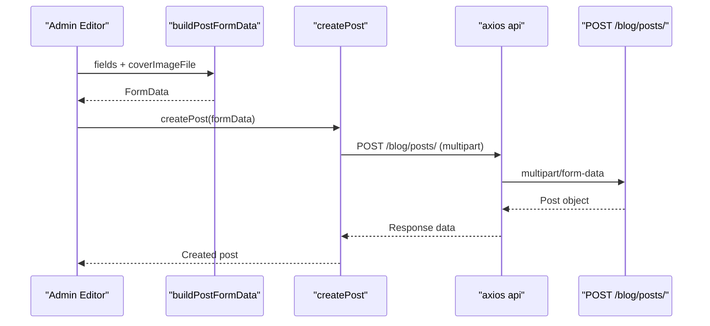
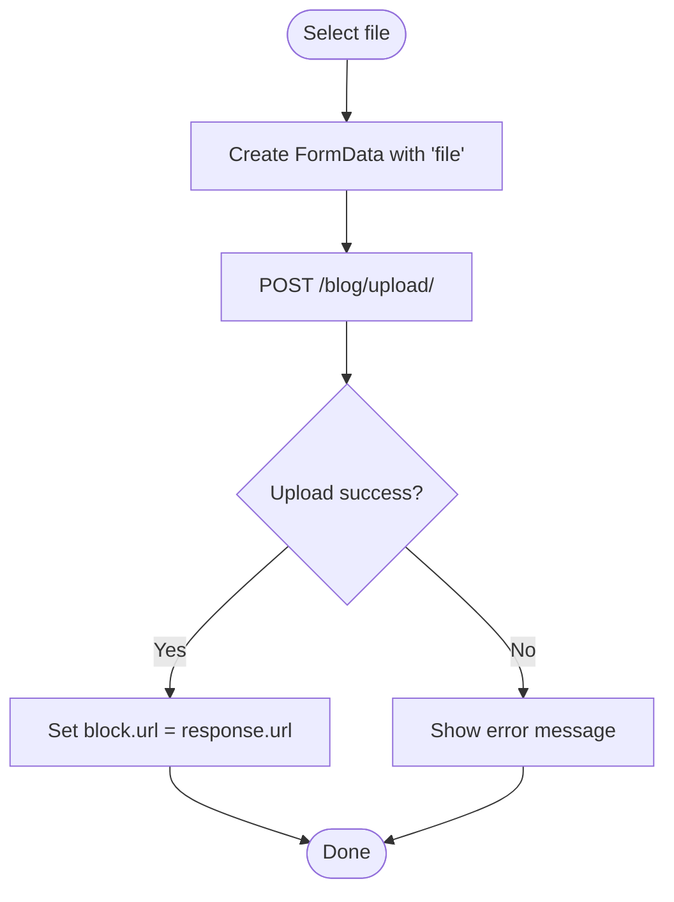
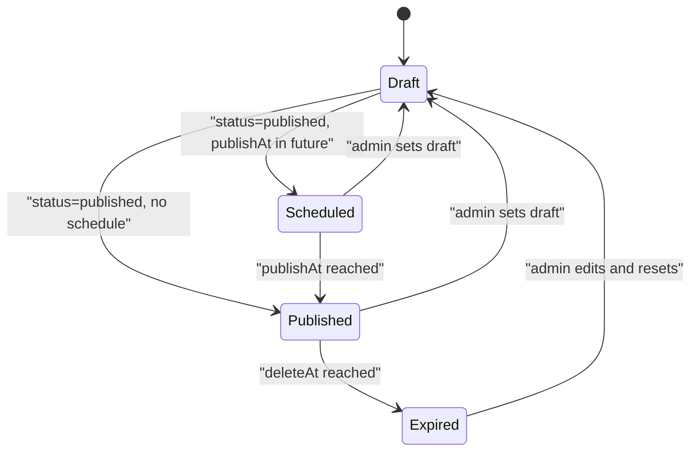
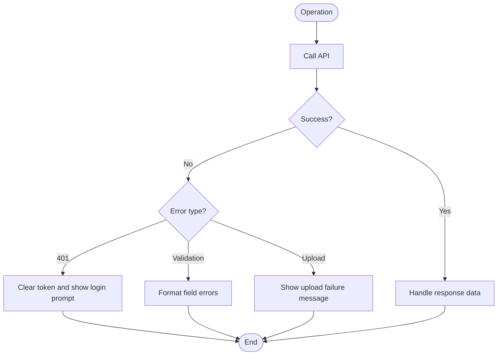
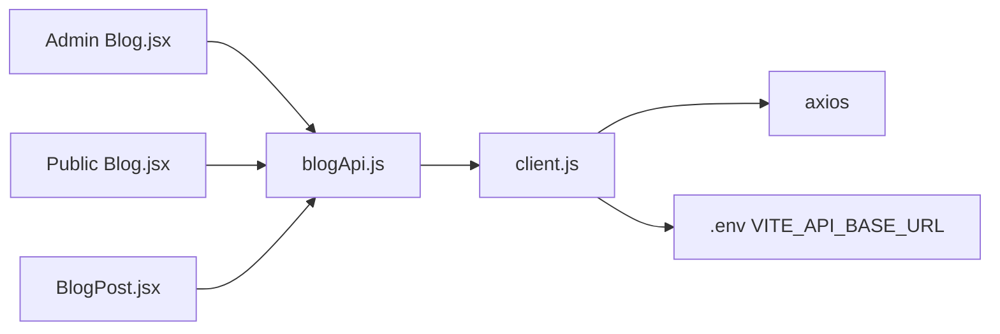

# Blog API

<cite>
**Referenced Files in This Document**
- [blogApi.js](file://src/api/blogApi.js)
- [client.js](file://src/api/client.js)
- [Blog.jsx (Admin)](file://src/pages/AdminDashboard/Blog.jsx)
- [Blog.jsx (Public)](file://src/pages/Blog.jsx)
- [BlogPost.jsx](file://src/pages/BlogPost.jsx)
</cite>

## Table of Contents
1. [Introduction](#introduction)
2. [Project Structure](#project-structure)
3. [Core Components](#core-components)
4. [Architecture Overview](#architecture-overview)
5. [Detailed Component Analysis](#detailed-component-analysis)
6. [Dependency Analysis](#dependency-analysis)
7. [Performance Considerations](#performance-considerations)
8. [Troubleshooting Guide](#troubleshooting-guide)
9. [Conclusion](#conclusion)

## Introduction
This document describes the blog management API surface exposed by the frontend to the backend. It covers:
- CRUD operations for blog posts through admin endpoints.
- Public read-only endpoints used by visitor-facing pages.
- File upload for cover images and media attachments using multipart form data.
- Scheduling and status management, including draft, published, scheduled, and expired behavior.
- Request/response patterns, pagination expectations, filtering, and error handling.

The implementation is a React + Vite application that uses Axios instances to call backend endpoints under `/api`. Admin operations use an authenticated Axios instance; public operations use a separate unauthenticated instance.

## Project Structure
The blog-related code is organized into:
- An API layer that wraps HTTP calls.
- Admin dashboard UI for managing posts.
- Public blog listing and single-post pages.

**Diagram sources**
- [Blog.jsx (Admin):1-12](file://src/pages/AdminDashboard/Blog.jsx#L1-L12)
- [Blog.jsx (Public):1-7](file://src/pages/Blog.jsx#L1-L7)
- [BlogPost.jsx:1-7](file://src/pages/BlogPost.jsx#L1-L7)
- [blogApi.js:1-3](file://src/api/blogApi.js#L1-L3)
- [client.js:47-88](file://src/api/client.js#L47-L88)

**Section sources**
- [blogApi.js:1-135](file://src/api/blogApi.js#L1-L135)
- [client.js:1-88](file://src/api/client.js#L1-L88)
- [Blog.jsx (Admin):1-100](file://src/pages/AdminDashboard/Blog.jsx#L1-L100)
- [Blog.jsx (Public):1-320](file://src/pages/Blog.jsx#L1-L320)
- [BlogPost.jsx:1-587](file://src/pages/BlogPost.jsx#L1-L587)

## Core Components
- API client configuration:
  - Authenticated `api` instance attaches a token with scheme `Token <key>` and clears it on 401 responses.
  - Public `publicApi` instance never sends the admin token.
- Blog API functions:
  - Admin reads: list and detail.
  - Public reads: list and detail.
  - Create, update, delete.
  - Publish toggle endpoint.
  - File upload endpoint for content files.
  - Helpers to build multipart payloads and convert scheduling times.

Key responsibilities:
- Separation between admin and public access.
- Multipart uploads for cover images and block media.
- Status and scheduling fields sent as part of the post payload.

**Section sources**
- [client.js:21-88](file://src/api/client.js#L21-L88)
- [blogApi.js:4-135](file://src/api/blogApi.js#L4-L135)

## Architecture Overview
The blog system has two distinct access paths:
- Admin path: authenticated requests to manage all posts, including drafts and scheduled items.
- Public path: unauthenticated requests returning only visible posts.

**Diagram sources**
- [blogApi.js:10-56](file://src/api/blogApi.js#L10-L56)
- [client.js:47-88](file://src/api/client.js#L47-L88)

## Detailed Component Analysis

### Authentication and Access Control
- The authenticated Axios instance automatically adds an Authorization header when a token exists.
- A 401 response clears stored tokens to force re-authentication.
- Public endpoints do not send the admin token, ensuring visitors see only published content.

**Diagram sources**
- [client.js:47-75](file://src/api/client.js#L47-L75)

**Section sources**
- [client.js:21-88](file://src/api/client.js#L21-L88)

### Blog Post Object Schema
The frontend constructs and consumes a blog post object with these fields:
- Metadata:
  - id
  - slug
  - title
  - excerpt
  - author
  - category
  - categoryLabel
  - readTime
  - date
  - featured
  - allowComments
- Content:
  - body: array of blocks or legacy sections
  - coverImage
  - coverImageAlt
  - coverImageCaption
- Visibility and scheduling:
  - status: draft, published, scheduled, expired
  - publishAt: ISO datetime string or empty
  - deleteAt: ISO datetime string or empty
- SEO:
  - seoTitle
  - metaDescription
  - seoKeywords
- Tags:
  - tags: array of strings

Notes:
- The admin editor sends multipart FormData with camelCase keys matching the serializer.
- The body field is JSON-stringified before being appended to FormData.
- Scheduling fields are converted from local datetime-local inputs to UTC ISO strings.

**Section sources**
- [blogApi.js:87-135](file://src/api/blogApi.js#L87-L135)
- [Blog.jsx (Admin):254-275](file://src/pages/AdminDashboard/Blog.jsx#L254-L275)

### Listing Endpoints and Pagination
Admin listing:
- Endpoint: GET `/api/blog/posts/`
- Auth: required
- Query parameters: supported via Axios params
- Response: either an array or a paginated object with a `results` property

Public listing:
- Endpoint: GET `/api/blog/posts/`
- Auth: not required
- Response: same shape as admin listing

Pagination usage:
- Public pages handle both array and `{results}` responses.
- Admin pages pass query parameters through Axios params.

Filtering options:
- Category filter is implemented in the public page by client-side filtering after fetching.
- Admin filters include tabs for all, published, and scheduled posts.

Sorting options:
- Admin UI shows updated-at sorting visually; server-side sorting parameters are passed through params.

Example parameter usage:
- Use Axios params to pass filters such as category, status, search, and pagination fields like page and page_size.

**Section sources**
- [blogApi.js:10-33](file://src/api/blogApi.js#L10-L33)
- [Blog.jsx (Public):272-298](file://src/pages/Blog.jsx#L272-L298)
- [Blog.jsx (Admin):29-42](file://src/pages/AdminDashboard/Blog.jsx#L29-L42)

### Create Post
- Endpoint: POST `/api/blog/posts/`
- Auth: required
- Content-Type: multipart/form-data
- Payload fields:
  - title
  - excerpt
  - author
  - category
  - categoryLabelOverride
  - readTime
  - status
  - body: JSON string of block array
  - publishAt: ISO datetime or empty
  - deleteAt: ISO datetime or empty
  - coverImage: file
- Response: created post object

Example flow:
1. User fills admin form.
2. Frontend builds FormData using helper.
3. Frontend sends multipart request.
4. Backend validates and stores post and cover image.
5. Frontend receives post object.

**Diagram sources**
- [blogApi.js:35-40](file://src/api/blogApi.js#L35-L40)
- [blogApi.js:117-135](file://src/api/blogApi.js#L117-L135)

**Section sources**
- [blogApi.js:35-40](file://src/api/blogApi.js#L35-L40)
- [blogApi.js:117-135](file://src/api/blogApi.js#L117-L135)

### Update Post
- Endpoint: PATCH `/api/blog/posts/{slug}/`
- Auth: required
- Content-Type: multipart/form-data
- Payload: same structure as create post
- Response: updated post object

Behavior:
- Existing fields can be partially updated.
- Cover image can be replaced by sending a new file.
- Body must be JSON-stringified again.

**Section sources**
- [blogApi.js:42-47](file://src/api/blogApi.js#L42-L47)
- [blogApi.js:117-135](file://src/api/blogApi.js#L117-L135)

### Delete Post
- Endpoint: DELETE `/api/blog/posts/{slug}/`
- Auth: required
- Response: typically no content or confirmation

Usage:
- Admin UI triggers deletion per post row.

**Section sources**
- [blogApi.js:49-51](file://src/api/blogApi.js#L49-L51)

### Toggle Publish
- Endpoint: POST `/api/blog/posts/{slug}/publish/`
- Auth: required
- Purpose: toggle or set publish state
- Response: updated post object reflecting new status

Admin UI:
- Shows current status and allows toggling via button.
- Uses busySlug to prevent concurrent actions.

**Section sources**
- [blogApi.js:53-56](file://src/api/blogApi.js#L53-L56)
- [Blog.jsx (Admin):457-466](file://src/pages/AdminDashboard/Blog.jsx#L457-L466)

### File Upload for Media Attachments
- Endpoint: POST `/api/blog/upload/`
- Auth: required
- Content-Type: multipart/form-data
- Field: file
- Response: object containing url and type

Use cases:
- Uploading cover images during post creation/editing.
- Uploading images and videos inside content blocks.

Progress handling:
- UI shows uploading state per block.
- Errors are caught and displayed to users.

**Diagram sources**
- [blogApi.js:58-74](file://src/api/blogApi.js#L58-L74)
- [Blog.jsx (Admin):613-622](file://src/pages/AdminDashboard/Blog.jsx#L613-L622)

**Section sources**
- [blogApi.js:58-74](file://src/api/blogApi.js#L58-L74)
- [Blog.jsx (Admin):547-586](file://src/pages/AdminDashboard/Blog.jsx#L547-L586)
- [Blog.jsx (Admin):613-622](file://src/pages/AdminDashboard/Blog.jsx#L613-L622)

### Scheduling and Status Management
Supported statuses:
- draft
- published
- scheduled
- expired

Scheduling fields:
- publishAt: future time makes a post scheduled when status is published.
- deleteAt: expiration time; when reached, post becomes expired.

Conversion helpers:
- Local datetime-local values are converted to UTC ISO strings.
- Empty values mean no schedule.

Admin UI:
- Displays schedule notes such as “Goes live …” and “Expires …”.
- Status badge reflects current bucket.

**Diagram sources**
- [blogApi.js:76-85](file://src/api/blogApi.js#L76-L85)
- [blogApi.js:111-115](file://src/api/blogApi.js#L111-L115)
- [Blog.jsx (Admin):69-114](file://src/pages/AdminDashboard/Blog.jsx#L69-L114)

**Section sources**
- [blogApi.js:76-85](file://src/api/blogApi.js#L76-L85)
- [blogApi.js:111-115](file://src/api/blogApi.js#L111-L115)
- [Blog.jsx (Admin):69-114](file://src/pages/AdminDashboard/Blog.jsx#L69-L114)

### Request and Response Examples

#### Create Post with Cover Image
- Method: POST
- URL: `/api/blog/posts/`
- Headers:
  - Content-Type: multipart/form-data
- Body fields:
  - title
  - excerpt
  - author
  - category
  - categoryLabelOverride
  - readTime
  - status
  - body: JSON string
  - publishAt: ISO or empty
  - deleteAt: ISO or empty
  - coverImage: file
- Response:
  - Post object with id, slug, status, coverImage, etc.

#### Update Post
- Method: PATCH
- URL: `/api/blog/posts/{slug}/`
- Headers:
  - Content-Type: multipart/form-data
- Body fields: same as create post
- Response:
  - Updated post object

#### Delete Post
- Method: DELETE
- URL: `/api/blog/posts/{slug}/`
- Response:
  - Typically empty or confirmation

#### Toggle Publish
- Method: POST
- URL: `/api/blog/posts/{slug}/publish/`
- Response:
  - Updated post object with new status

#### Upload Media
- Method: POST
- URL: `/api/blog/upload/`
- Headers:
  - Content-Type: multipart/form-data
- Body:
  - file: file
- Response:
  - { url, type }

**Section sources**
- [blogApi.js:35-74](file://src/api/blogApi.js#L35-L74)
- [blogApi.js:117-135](file://src/api/blogApi.js#L117-L135)

### Error Handling

Common errors:
- File size limits:
  - Backend may reject oversized files.
  - Frontend catches upload errors and displays readable messages.
- Content validation:
  - Backend returns field-level errors or detail messages.
  - Frontend formats DRF errors into user-friendly text.
- Permission-based access controls:
  - Missing or invalid token results in 401.
  - Frontend clears token on 401 and rejects the promise.

Error formatting:
- Admin UI converts DRF error objects into a single-line message.
- Upload failures throw an Error with a readable message.

**Diagram sources**
- [client.js:66-75](file://src/api/client.js#L66-L75)
- [blogApi.js:66-74](file://src/api/blogApi.js#L66-L74)
- [Blog.jsx (Admin):116-126](file://src/pages/AdminDashboard/Blog.jsx#L116-L126)

**Section sources**
- [client.js:66-75](file://src/api/client.js#L66-L75)
- [blogApi.js:66-74](file://src/api/blogApi.js#L66-L74)
- [Blog.jsx (Admin):116-126](file://src/pages/AdminDashboard/Blog.jsx#L116-L126)

## Dependency Analysis
The blog feature depends on:
- Axios for HTTP requests.
- Environment variable for base URL.
- Local storage/session storage for tokens.
- React components for admin and public UIs.

**Diagram sources**
- [blogApi.js:1-3](file://src/api/blogApi.js#L1-L3)
- [client.js:1-20](file://src/api/client.js#L1-L20)
- [Blog.jsx (Admin):1-12](file://src/pages/AdminDashboard/Blog.jsx#L1-L12)
- [Blog.jsx (Public):1-7](file://src/pages/Blog.jsx#L1-L7)
- [BlogPost.jsx:1-7](file://src/pages/BlogPost.jsx#L1-L7)

**Section sources**
- [blogApi.js:1-3](file://src/api/blogApi.js#L1-L3)
- [client.js:1-20](file://src/api/client.js#L1-L20)

## Performance Considerations
- Separate public and admin Axios instances avoid unnecessary authentication overhead on public pages.
- Multipart uploads should be optimized by limiting file sizes and compressing images where possible.
- Pagination should be used for large post lists to reduce payload size.
- Avoid sending large JSON bodies repeatedly; prefer partial updates where supported.

[No sources needed since this section provides general guidance]

## Troubleshooting Guide

Common issues and resolutions:
- 401 Unauthorized:
  - Ensure a valid token is stored.
  - Verify the Authorization header uses scheme `Token`, not `Bearer`.
  - Re-authenticate if token is expired.
- File upload fails:
  - Check file size limits enforced by the backend.
  - Confirm Content-Type is multipart/form-data.
  - Validate that the file field name matches the backend expectation (`file`).
- Cover image not saved:
  - Ensure the FormData key matches the serializer field (`coverImage`).
  - Confirm the file is attached before submitting.
- Post stays draft:
  - Verify status field is included and set correctly.
  - For scheduling, ensure publishAt is a valid ISO string or empty.
- Validation errors:
  - Display field-specific messages returned by the backend.
  - Normalize DRF error shapes into user-friendly text.

**Section sources**
- [client.js:54-75](file://src/api/client.js#L54-L75)
- [blogApi.js:96-115](file://src/api/blogApi.js#L96-L115)
- [Blog.jsx (Admin):116-126](file://src/pages/AdminDashboard/Blog.jsx#L116-L126)

## Conclusion
The blog API integration separates admin and public access, supports full CRUD operations, file uploads, and scheduling. Proper error handling and token management ensure secure and predictable behavior. When extending the API, maintain alignment with the serializer field names and multipart requirements to avoid silent data loss.

[No sources needed since this section summarizes without analyzing specific files]