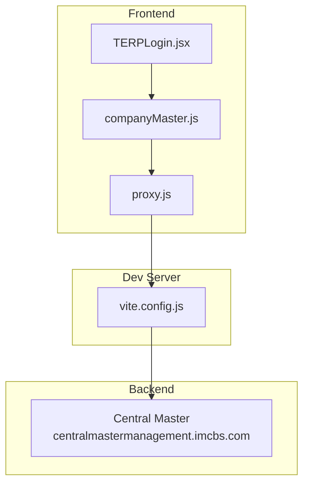
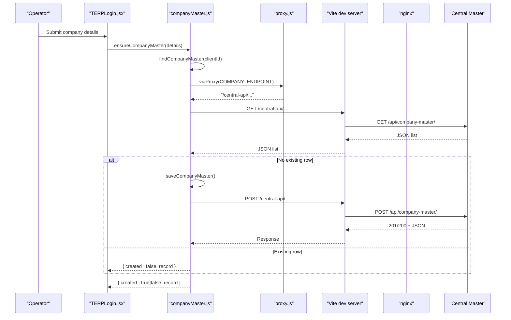
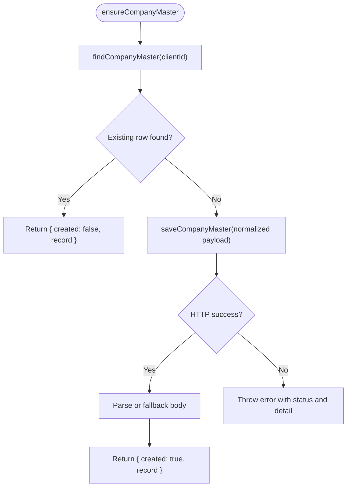
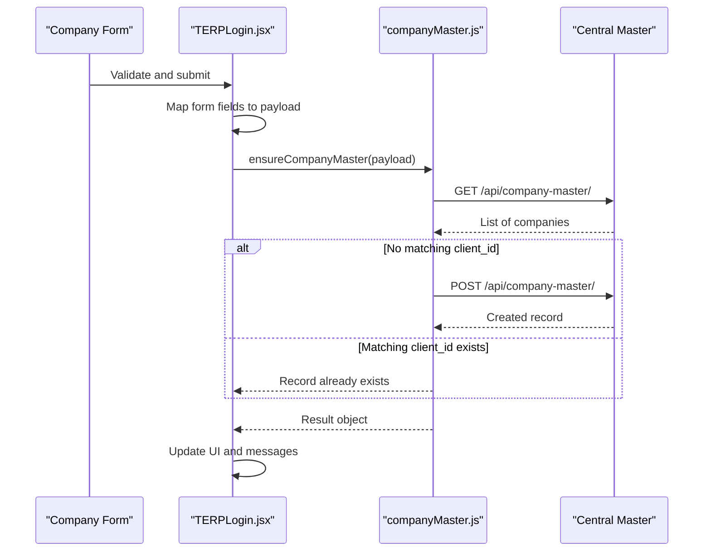
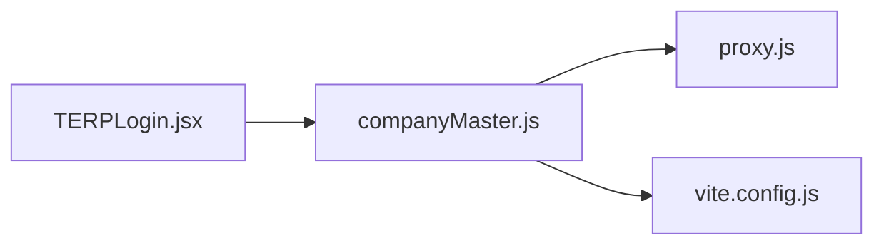

# Company Master API Integration

<cite>
**Referenced Files in This Document**   
- [companyMaster.js](file://src/api/companyMaster.js)
- [proxy.js](file://src/api/proxy.js)
- [TERPLogin.jsx](file://src/pages/TERPLogin.jsx)
- [vite.config.js](file://vite.config.js)
- [api.js](file://src/api/api.js)
</cite>

## Table of Contents
1. [Introduction](#introduction)
2. [Project Structure](#project-structure)
3. [Core Components](#core-components)
4. [Architecture Overview](#architecture-overview)
5. [Detailed Component Analysis](#detailed-component-analysis)
6. [Dependency Analysis](#dependency-analysis)
7. [Performance Considerations](#performance-considerations)
8. [Troubleshooting Guide](#troubleshooting-guide)
9. [Conclusion](#conclusion)

## Introduction
This document explains how the frontend integrates with the Central Master company register. The integration is used during T-ERP license registration to persist statutory company details such as GSTIN, PAN, full address, and logo. Because the Central Master service does not send CORS headers, all requests are routed through a same-origin reverse proxy prefix. The frontend provides a small API module that normalizes input, retries transient failures, and exposes safe functions for reading and writing company records.

## Project Structure
The relevant code lives under two areas:
- `src/api`: HTTP client modules, including the company register client and shared proxy helpers.
- `src/pages`: The T-ERP login flow that collects company data and calls the company register after a license exists.
- Build configuration: Vite dev proxy rules mirror the production nginx proxy behavior.

**Diagram sources**
- [TERPLogin.jsx:572-595](file://src/pages/TERPLogin.jsx#L572-L595)
- [companyMaster.js:9-15](file://src/api/companyMaster.js#L9-L15)
- [proxy.js:11-15](file://src/api/proxy.js#L11-L15)
- [vite.config.js:25-32](file://vite.config.js#L25-L32)

**Section sources**
- [companyMaster.js:1-165](file://src/api/companyMaster.js#L1-L165)
- [proxy.js:1-56](file://src/api/proxy.js#L1-L56)
- [TERPLogin.jsx:572-595](file://src/pages/TERPLogin.jsx#L572-L595)
- [vite.config.js:1-36](file://vite.config.js#L1-L36)

## Core Components
- **Company register client**: Provides payload building, lookup, creation, and idempotent write logic.
- **Proxy helper**: Rewrites external Central Master URLs into same-origin `/central-api` paths and detects misconfigured server responses.
- **T-ERP login page**: Collects company information, validates it, creates or reuses a license, then writes the company record once per client.

Key responsibilities:
- Normalize and validate company fields before sending them to Central Master.
- Avoid duplicate company rows by checking for an existing client id.
- Route requests through the same-origin proxy when needed.
- Surface clear errors when the backend returns HTML instead of JSON.

**Section sources**
- [companyMaster.js:63-107](file://src/api/companyMaster.js#L63-L107)
- [companyMaster.js:113-162](file://src/api/companyMaster.js#L113-L162)
- [proxy.js:17-55](file://src/api/proxy.js#L17-L55)
- [TERPLogin.jsx:572-595](file://src/pages/TERPLogin.jsx#L572-L595)

## Architecture Overview
The company registration flow runs after a T-ERP license has been created or confirmed. The login page maps form data to the company register payload and calls `ensureCompanyMaster`. That function checks whether a row already exists for the client id; if not, it posts the normalized payload. All requests go through `/central-api`, which is proxied locally by Vite and in production by nginx.

**Diagram sources**
- [TERPLogin.jsx:572-595](file://src/pages/TERPLogin.jsx#L572-L595)
- [companyMaster.js:113-162](file://src/api/companyMaster.js#L113-L162)
- [proxy.js:26-35](file://src/api/proxy.js#L26-L35)
- [vite.config.js:25-32](file://vite.config.js#L25-L32)

## Detailed Component Analysis

### Company Register Client (`companyMaster.js`)
The client encapsulates all interaction with Central Master’s company register. It exports three main operations:
- `buildCompanyPayload`: Normalizes user-supplied fields into the exact shape expected by the backend.
- `findCompanyMaster`: Reads the full company list and filters by client id.
- `saveCompanyMaster`: Posts a new company record.
- `ensureCompanyMaster`: Idempotent wrapper that avoids rewriting statutory data for existing clients.

Important behaviors:
- Input normalization ensures empty values are sent as empty strings rather than omitted keys.
- Phone numbers are stripped to digits; GSTIN and PAN are uppercased.
- Logo payloads must be bare base64 without the `data:` prefix.
- A retry mechanism handles intermittent 404 responses caused by multi-instance deployments.
- Network errors are retried only for reads; writes are not retried because a lost response may still have succeeded on the server.

**Diagram sources**
- [companyMaster.js:113-162](file://src/api/companyMaster.js#L113-L162)
- [companyMaster.js:17-61](file://src/api/companyMaster.js#L17-L61)

#### Payload Builder
The payload builder converts UI-friendly fields into backend-compatible fields. It also sets a default status and enforces canonical formatting for tax identifiers and country codes.

Key mapping highlights:
- `clientId` → `client_id`
- `licenseKey` → `license_key`
- `gstNumber` → `gst_number` (uppercase)
- `panNumber` → `pan_number` (uppercase)
- `phoneNumber` → `phone_number` (digits only)
- `addressLine1` / `addressLine2` → address lines
- `city`, `district`, `state`, `country`
- `logo` as bare base64 string
- `status` set to `"ACTIVE"`

**Section sources**
- [companyMaster.js:63-107](file://src/api/companyMaster.js#L63-L107)

#### Retry and Error Handling
The client uses a small delay-based retry loop for network resilience. It distinguishes between read and write semantics:
- Reads can retry on network failure.
- Writes do not retry to avoid accidental duplication.
- Non-JSON responses are converted into readable errors.
- Missing proxy routes return HTML from the SPA fallback; `assertJson` detects this and throws a descriptive message.

**Section sources**
- [companyMaster.js:17-61](file://src/api/companyMaster.js#L17-L61)
- [companyMaster.js:125-146](file://src/api/companyMaster.js#L125-L146)

### Proxy Helper (`proxy.js`)
The proxy helper centralizes routing decisions for services that do not support CORS:
- Defines origins and proxy prefixes for T-ERP and Central Master.
- Rewrites absolute URLs pointing at known hosts into same-origin proxy paths.
- Detects when the server returns HTML instead of JSON and throws a helpful error.

This module is reused by other Central Master integrations, such as financial year endpoints.

**Section sources**
- [proxy.js:1-56](file://src/api/proxy.js#L1-L56)

### T-ERP Login Flow (`TERPLogin.jsx`)
The login page orchestrates the complete signup experience. For the company register integration:
- It collects company name, place, email, phone number, referral code, GSTIN, PAN, address, district, state, country, and logo.
- It validates required fields and formats inputs before submission.
- After creating or confirming a license, it calls `ensureCompanyMaster` with the mapped fields.
- It strips the `data:` prefix from the logo before posting.
- It captures and displays partial failures so operators can continue using the product even if the company register write fails.

**Diagram sources**
- [TERPLogin.jsx:572-595](file://src/pages/TERPLogin.jsx#L572-L595)
- [companyMaster.js:113-162](file://src/api/companyMaster.js#L113-L162)

**Section sources**
- [TERPLogin.jsx:36-80](file://src/pages/TERPLogin.jsx#L36-L80)
- [TERPLogin.jsx:439-476](file://src/pages/TERPLogin.jsx#L439-L476)
- [TERPLogin.jsx:572-595](file://src/pages/TERPLogin.jsx#L572-L595)

### Development Proxy Configuration (`vite.config.js`)
During development, Vite proxies same-origin paths to the real backend hosts:
- `/terp-api` forwards to the T-ERP activation host.
- `/central-api` forwards to Central Master.
- Both use `changeOrigin` and secure settings to match production behavior.

This allows the browser to bypass CORS restrictions while developing locally.

**Section sources**
- [vite.config.js:12-33](file://vite.config.js#L12-L33)

## Dependency Analysis
The company register integration depends on:
- `proxy.js` for URL rewriting and JSON validation.
- `TERPLogin.jsx` for collecting and submitting company data.
- Vite dev proxy for local development routing.

There is no direct dependency on the generic Axios client in `api.js`; the company register uses native `fetch` through its own helper layer.

**Diagram sources**
- [TERPLogin.jsx:572-595](file://src/pages/TERPLogin.jsx#L572-L595)
- [companyMaster.js:9-15](file://src/api/companyMaster.js#L9-L15)
- [vite.config.js:25-32](file://vite.config.js#L25-L32)

**Section sources**
- [companyMaster.js:9-15](file://src/api/companyMaster.js#L9-L15)
- [TERPLogin.jsx:572-595](file://src/pages/TERPLogin.jsx#L572-L595)
- [vite.config.js:25-32](file://vite.config.js#L25-L32)

## Performance Considerations
- **Retry strategy**: Small delays reduce thundering-herd retries while improving resilience against temporary 404s across multiple instances.
- **Read-only retry**: Only reads retry on network errors to prevent duplicate writes.
- **Payload size**: The logo is validated on the client side to avoid sending oversized images twice.
- **Minimal round trips**: `ensureCompanyMaster` performs one read followed by at most one write.

[No sources needed since this section provides general guidance]

## Troubleshooting Guide
Common issues and their likely causes:
- **HTML returned instead of JSON**: The reverse proxy is not configured correctly on the server. The client detects HTML responses and throws a message indicating the missing proxy configuration.
- **Unknown client_id**: The license did not register the expected client id with Central Master. This usually means the license creation step did not produce a usable client id for the company register.
- **Empty result vs unreachable**: A 404 from Central Master is treated as potentially transient and retried; an empty list is represented as a successful response with no rows.
- **Logo upload problems**: Ensure the image file is valid and under the size limit. The frontend strips the `data:` prefix before posting.

Operational checks:
- Verify `/central-api` is proxied in both Vite and nginx.
- Confirm Central Master responds with JSON for `/api/company-master/`.
- Check that the license creation step produces a valid client id and license key.

**Section sources**
- [proxy.js:38-55](file://src/api/proxy.js#L38-L55)
- [companyMaster.js:17-61](file://src/api/companyMaster.js#L17-L61)
- [TERPLogin.jsx:572-595](file://src/pages/TERPLogin.jsx#L572-L595)

## Conclusion
The Company Master API integration is a focused, resilient client that normalizes company data, avoids redundant writes, and routes requests through a same-origin proxy. It integrates cleanly into the T-ERP login flow and surfaces actionable errors when the backend or proxy configuration is unavailable. Maintaining correct proxy configuration and ensuring the license step produces a valid client id are the most important operational requirements for reliable operation.

[No sources needed since this section summarizes without analyzing specific files]