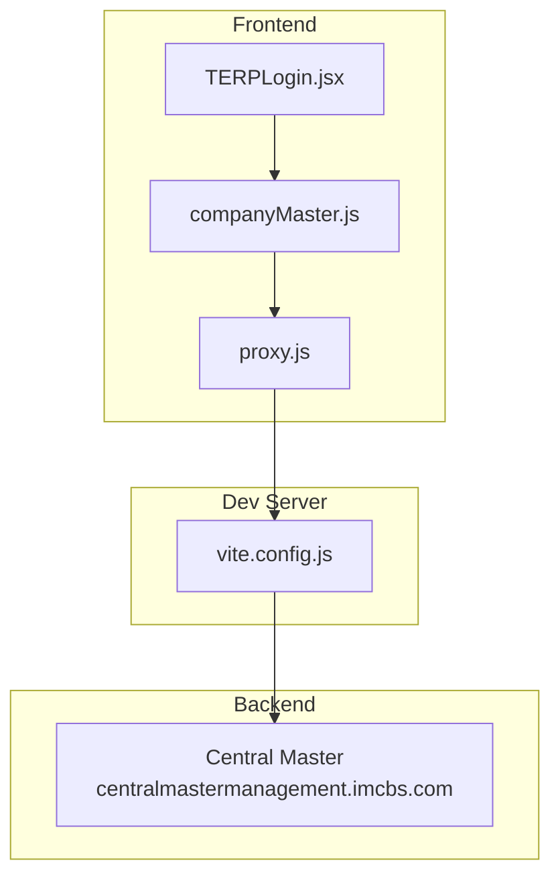
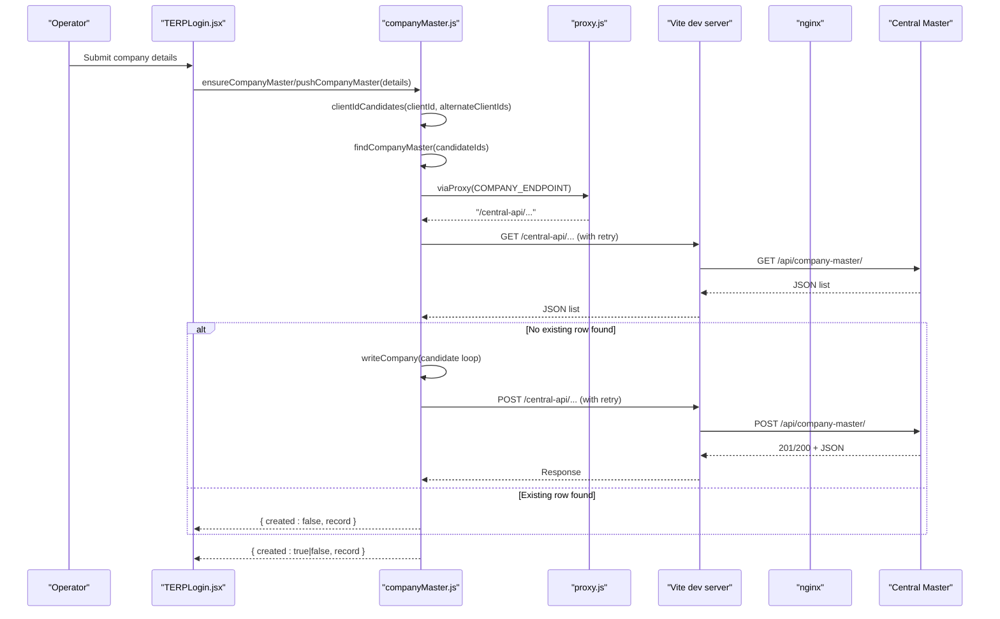
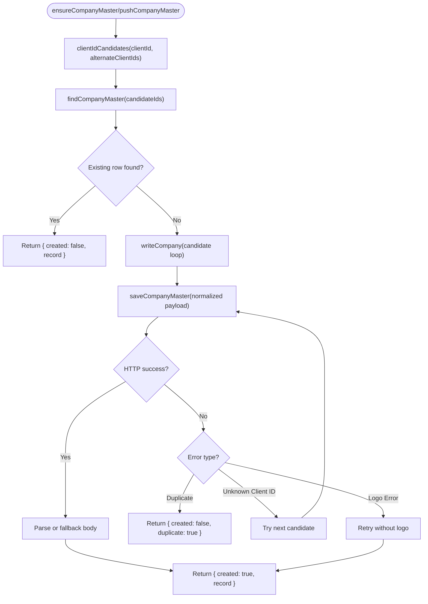
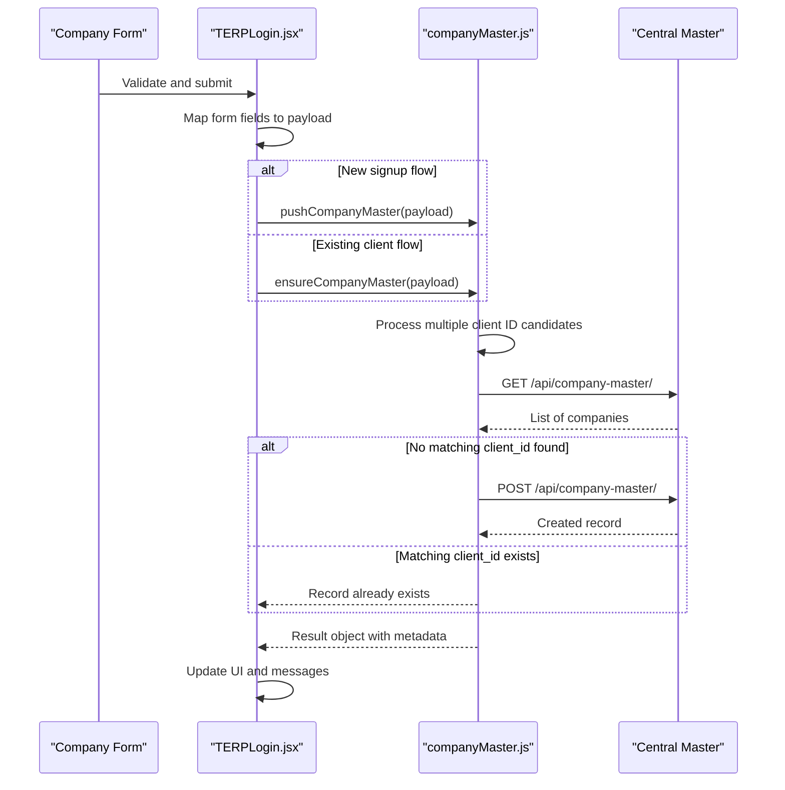
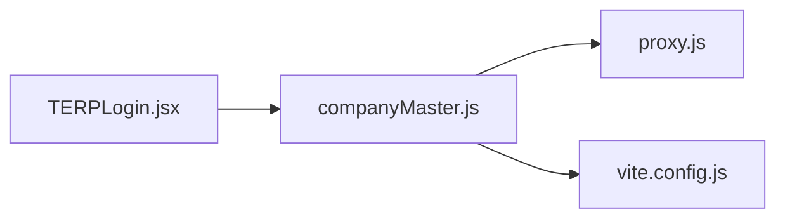

# Company Master API Integration

<cite>
**Referenced Files in This Document**   
- [companyMaster.js](file://src/api/companyMaster.js)
- [proxy.js](file://src/api/proxy.js)
- [TERPLogin.jsx](file://src/pages/TERPLogin.jsx)
- [vite.config.js](file://vite.config.js)
</cite>

## Update Summary
**Changes Made**   
- Enhanced retry mechanisms with sophisticated backoff strategies for network resilience
- Added multiple client ID candidate support for flexible client identification
- Improved error handling with unknown client ID detection and validation error parsing
- Introduced new `pushCompanyMaster` function specifically for signup flow scenarios
- Enhanced logo processing with base64 prefix stripping and format validation
- Updated architecture diagrams to reflect new retry and candidate ID workflows

## Table of Contents
1. [Introduction](#introduction)
2. [Project Structure](#project-structure)
3. [Core Components](#core-components)
4. [Architecture Overview](#architecture-overview)
5. [Detailed Component Analysis](#detailed-component-analysis)
6. [Dependency Analysis](#dependency-analysis)
7. [Performance Considerations](#performance-considerations)
8. [Troubleshooting Guide](#troubleshooting-guide)
9. [Conclusion](#conclusion)

## Introduction
This document explains how the frontend integrates with the Central Master company register. The integration is used during T-ERP license registration to persist statutory company details such as GSTIN, PAN, full address, and logo. Because the Central Master service does not send CORS headers, all requests are routed through a same-origin reverse proxy prefix. The frontend provides a small API module that normalizes input, implements robust retry mechanisms with exponential backoff, supports multiple client ID candidates, handles various error scenarios including unknown client IDs, and exposes safe functions for reading and writing company records.

## Project Structure
The relevant code lives under two areas:
- `src/api`: HTTP client modules, including the company register client and shared proxy helpers.
- `src/pages`: The T-ERP login flow that collects company data and calls the company register after a license exists.
- Build configuration: Vite dev proxy rules mirror the production nginx proxy behavior.

**Diagram sources**
- [TERPLogin.jsx:572-595](file://src/pages/TERPLogin.jsx#L572-L595)
- [companyMaster.js:9-15](file://src/api/companyMaster.js#L9-L15)
- [proxy.js:11-15](file://src/api/proxy.js#L11-L15)
- [vite.config.js:25-32](file://vite.config.js#L25-L32)

**Section sources**
- [companyMaster.js:1-299](file://src/api/companyMaster.js#L1-L299)
- [proxy.js:1-56](file://src/api/proxy.js#L1-L56)
- [TERPLogin.jsx:572-595](file://src/pages/TERPLogin.jsx#L572-L595)
- [vite.config.js:1-36](file://vite.config.js#L1-L36)

## Core Components
- **Company register client**: Provides payload building, lookup, creation, idempotent write logic, and robust retry mechanisms with exponential backoff.
- **Proxy helper**: Rewrites external Central Master URLs into same-origin `/central-api` paths and detects misconfigured server responses.
- **T-ERP login page**: Collects company information, validates it, creates or reuses a license, then writes the company record once per client using multiple client ID candidates.

Key responsibilities:
- Normalize and validate company fields before sending them to Central Master.
- Avoid duplicate company rows by checking for existing client IDs across multiple candidates.
- Route requests through the same-origin proxy when needed.
- Surface clear errors when the backend returns HTML instead of JSON.
- Handle transient failures with intelligent retry strategies.
- Support both immediate signup flows and existing client updates.

**Section sources**
- [companyMaster.js:63-107](file://src/api/companyMaster.js#L63-L107)
- [companyMaster.js:113-162](file://src/api/companyMaster.js#L113-L162)
- [companyMaster.js:272-296](file://src/api/companyMaster.js#L272-L296)
- [proxy.js:17-55](file://src/api/proxy.js#L17-L55)
- [TERPLogin.jsx:572-595](file://src/pages/TERPLogin.jsx#L572-L595)

## Architecture Overview
The company registration flow runs after a T-ERP license has been created or confirmed. The login page maps form data to the company register payload and calls either `ensureCompanyMaster` for existing clients or `pushCompanyMaster` for new signups. Both functions check whether a row already exists for any of the provided client ID candidates; if not, they post the normalized payload. All requests go through `/central-api`, which is proxied locally by Vite and in production by nginx.

**Diagram sources**
- [TERPLogin.jsx:572-595](file://src/pages/TERPLogin.jsx#L572-L595)
- [companyMaster.js:113-162](file://src/api/companyMaster.js#L113-L162)
- [companyMaster.js:272-296](file://src/api/companyMaster.js#L272-L296)
- [proxy.js:26-35](file://src/api/proxy.js#L26-L35)
- [vite.config.js:25-32](file://vite.config.js#L25-L32)

## Detailed Component Analysis

### Company Register Client (`companyMaster.js`)
The client encapsulates all interaction with Central Master's company register with enhanced reliability features. It exports four main operations:
- `buildCompanyPayload`: Normalizes user-supplied fields into the exact shape expected by the backend.
- `findCompanyMaster`: Reads the full company list and filters by multiple client ID candidates.
- `saveCompanyMaster`: Posts a new company record with reduced retry attempts.
- `ensureCompanyMaster`: Idempotent wrapper for existing clients that avoids rewriting statutory data.
- `pushCompanyMaster`: New function for signup flow that bypasses strict read-before-write checks.

Important behaviors:
- Input normalization ensures empty values are sent as empty strings rather than omitted keys.
- Phone numbers are stripped to digits; GSTIN and PAN are uppercased.
- Logo payloads must be bare base64 without the `data:` prefix.
- Sophisticated retry mechanism with exponential backoff handles intermittent failures.
- Multiple client ID candidate support allows flexibility in client identification.
- Network errors are retried only for reads; writes use fewer retries to avoid duplication.
- Unknown client ID detection provides specific error handling for licensing issues.

**Diagram sources**
- [companyMaster.js:113-162](file://src/api/companyMaster.js#L113-L162)
- [companyMaster.js:225-261](file://src/api/companyMaster.js#L225-L261)
- [companyMaster.js:272-296](file://src/api/companyMaster.js#L272-L296)

#### Payload Builder
The payload builder converts UI-friendly fields into backend-compatible fields. It also sets a default status and enforces canonical formatting for tax identifiers and country codes.

Key mapping highlights:
- `clientId` → `client_id`
- `licenseKey` → `license_key`
- `gstNumber` → `gst_number` (uppercase)
- `panNumber` → `pan_number` (uppercase)
- `phoneNumber` → `phone_number` (digits only)
- `addressLine1` / `addressLine2` → address lines
- `city`, `district`, `state`, `country`
- `logo` as bare base64 string with automatic `data:` prefix stripping
- `status` set to `"ACTIVE"`

**Section sources**
- [companyMaster.js:63-107](file://src/api/companyMaster.js#L63-L107)

#### Enhanced Retry and Error Handling
The client uses sophisticated retry mechanisms with exponential backoff for network resilience. Key improvements include:
- **Exponential backoff**: Delays of 250ms, 500ms, 1000ms, 1500ms between retry attempts.
- **Read-only retry**: Only reads retry on network failure to prevent duplicate writes.
- **Cache busting**: Each read request gets a unique URL to avoid CDN caching of 404 responses.
- **Smart error classification**: Distinguishes between network errors, HTTP errors, and validation errors.
- **Unknown client ID detection**: Specific handling for licensing-related client ID issues.
- **Validation error parsing**: Converts field-specific validation errors into readable messages.

**Section sources**
- [companyMaster.js:17-61](file://src/api/companyMaster.js#L17-L61)
- [companyMaster.js:92-109](file://src/api/companyMaster.js#L92-L109)
- [companyMaster.js:125-146](file://src/api/companyMaster.js#L125-L146)

#### Multiple Client ID Candidate Support
The system now supports multiple client ID candidates to handle different ways clients might be identified:
- Primary client ID from the current context
- Alternate client IDs from the license API response
- Automatic deduplication and normalization of candidate IDs
- Sequential trial of candidates until one is accepted

**Section sources**
- [companyMaster.js:67-79](file://src/api/companyMaster.js#L67-L79)
- [companyMaster.js:174-184](file://src/api/companyMaster.js#L174-L184)
- [companyMaster.js:225-261](file://src/api/companyMaster.js#L225-L261)

### Proxy Helper (`proxy.js`)
The proxy helper centralizes routing decisions for services that do not support CORS:
- Defines origins and proxy prefixes for T-ERP and Central Master.
- Rewrites absolute URLs pointing at known hosts into same-origin proxy paths.
- Detects when the server returns HTML instead of JSON and throws a helpful error.

This module is reused by other Central Master integrations, such as financial year endpoints.

**Section sources**
- [proxy.js:1-56](file://src/api/proxy.js#L1-L56)

### T-ERP Login Flow (`TERPLogin.jsx`)
The login page orchestrates the complete signup experience with enhanced company registration support:
- It collects company name, place, email, phone number, referral code, GSTIN, PAN, address, district, state, country, and logo.
- It validates required fields and formats inputs before submission.
- After creating or confirming a license, it calls either `ensureCompanyMaster` or `pushCompanyMaster` depending on the flow.
- It strips the `data:` prefix from the logo before posting.
- It passes multiple client ID candidates to handle different identification methods.
- It captures and displays partial failures so operators can continue using the product even if the company register write fails.

**Diagram sources**
- [TERPLogin.jsx:572-595](file://src/pages/TERPLogin.jsx#L572-L595)
- [companyMaster.js:113-162](file://src/api/companyMaster.js#L113-L162)
- [companyMaster.js:272-296](file://src/api/companyMaster.js#L272-L296)

**Section sources**
- [TERPLogin.jsx:36-80](file://src/pages/TERPLogin.jsx#L36-L80)
- [TERPLogin.jsx:439-476](file://src/pages/TERPLogin.jsx#L439-L476)
- [TERPLogin.jsx:572-595](file://src/pages/TERPLogin.jsx#L572-L595)

### Development Proxy Configuration (`vite.config.js`)
During development, Vite proxies same-origin paths to the real backend hosts:
- `/terp-api` forwards to the T-ERP activation host.
- `/central-api` forwards to Central Master.
- Both use `changeOrigin` and secure settings to match production behavior.

This allows the browser to bypass CORS restrictions while developing locally.

**Section sources**
- [vite.config.js:12-33](file://vite.config.js#L12-L33)

## Dependency Analysis
The company register integration depends on:
- `proxy.js` for URL rewriting and JSON validation.
- `TERPLogin.jsx` for collecting and submitting company data.
- Vite dev proxy for local development routing.

There is no direct dependency on the generic Axios client in `api.js`; the company register uses native `fetch` through its own helper layer.

**Diagram sources**
- [TERPLogin.jsx:572-595](file://src/pages/TERPLogin.jsx#L572-L595)
- [companyMaster.js:9-15](file://src/api/companyMaster.js#L9-L15)
- [vite.config.js:25-32](file://vite.config.js#L25-L32)

**Section sources**
- [companyMaster.js:9-15](file://src/api/companyMaster.js#L9-L15)
- [TERPLogin.jsx:572-595](file://src/pages/TERPLogin.jsx#L572-L595)
- [vite.config.js:25-32](file://vite.config.js#L25-L32)

## Performance Considerations
- **Enhanced retry strategy**: Exponential backoff with delays of 250ms, 500ms, 1000ms, 1500ms reduces thundering-herd effects while improving resilience against temporary failures.
- **Read-only retry**: Only reads retry on network errors to prevent duplicate writes and reduce unnecessary load.
- **Multiple client ID candidates**: Reduces failed attempts by trying alternative client identification methods.
- **Logo optimization**: Client-side validation prevents oversized images from being uploaded twice.
- **Minimal round trips**: Functions perform one read followed by at most one write, with smart caching of candidate results.
- **Cache busting**: Unique URLs for each read request prevent CDN caching of 404 responses.

[No sources needed since this section provides general guidance]

## Troubleshooting Guide
Common issues and their likely causes:
- **HTML returned instead of JSON**: The reverse proxy is not configured correctly on the server. The client detects HTML responses and throws a message indicating the missing proxy configuration.
- **Unknown client_id**: The license did not register the expected client id with Central Master. The system now tries multiple client ID candidates and provides specific error messages for licensing issues.
- **Empty result vs unreachable**: A 404 from Central Master is treated as potentially transient and retried; an empty list is represented as a successful response with no rows.
- **Logo upload problems**: Ensure the image file is valid and under the size limit. The frontend strips the `data:` prefix before posting and validates file types.
- **Validation errors**: Field-specific validation errors are now parsed and displayed clearly to users.

Operational checks:
- Verify `/central-api` is proxied in both Vite and nginx.
- Confirm Central Master responds with JSON for `/api/company-master/`.
- Check that the license creation step produces a valid client id and license key.
- Monitor retry logs to identify patterns of transient failures.

**Section sources**
- [proxy.js:38-55](file://src/api/proxy.js#L38-L55)
- [companyMaster.js:17-61](file://src/api/companyMaster.js#L17-L61)
- [companyMaster.js:81-85](file://src/api/companyMaster.js#L81-L85)
- [TERPLogin.jsx:572-595](file://src/pages/TERPLogin.jsx#L572-L595)

## Conclusion
The Company Master API integration is now a highly resilient, feature-rich client that normalizes company data, supports multiple client identification methods, implements sophisticated retry mechanisms, and routes requests through a same-origin proxy. The enhanced error handling provides clear feedback for various failure scenarios, while the new `pushCompanyMaster` function optimizes the signup flow. It integrates cleanly into the T-ERP login flow and surfaces actionable errors when the backend or proxy configuration is unavailable. Maintaining correct proxy configuration and ensuring the license step produces valid client IDs remain the most important operational requirements for reliable operation.