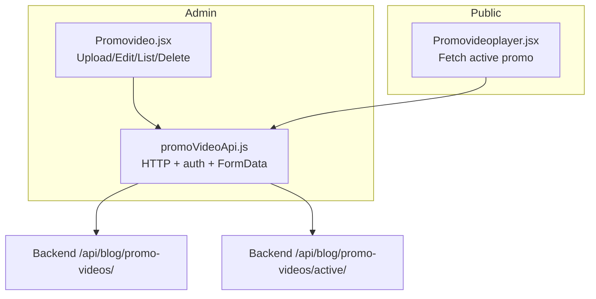
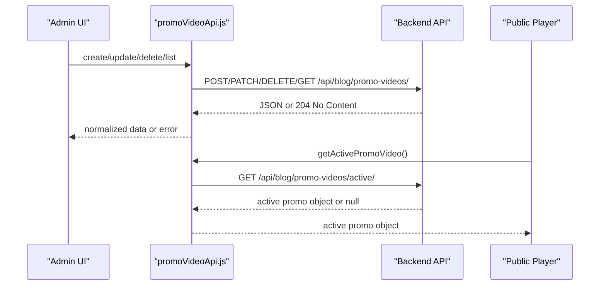
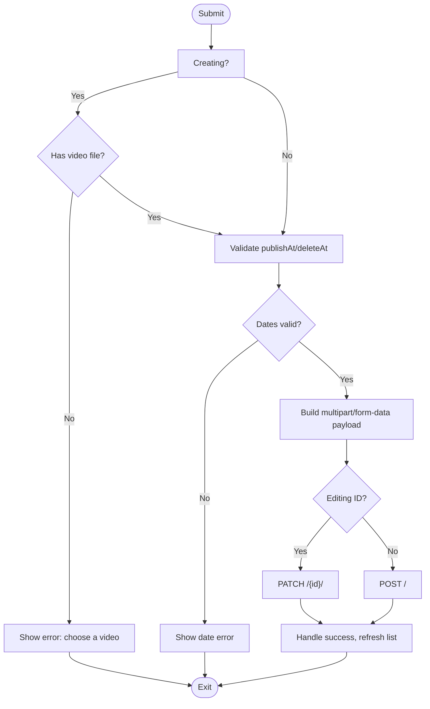
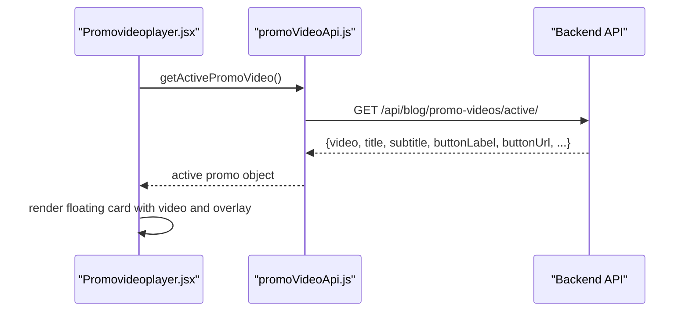
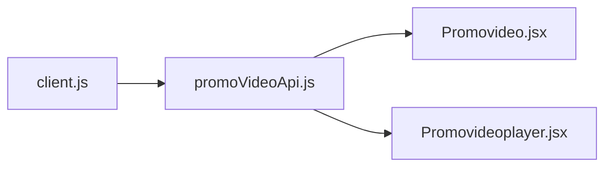

# Promotional Video API

<cite>
**Referenced Files in This Document**
- [promoVideoApi.js](file://src/api/promoVideoApi.js)
- [Promovideo.jsx](file://src/pages/AdminDashboard/Promovideo.jsx)
- [Promovideoplayer.jsx](file://src/pages/Promovideoplayer.jsx)
- [client.js](file://src/api/client.js)
- [App.jsx](file://src/App.jsx)
</cite>

## Table of Contents
1. [Introduction](#introduction)
2. [Project Structure](#project-structure)
3. [Core Components](#core-components)
4. [Architecture Overview](#architecture-overview)
5. [Detailed Component Analysis](#detailed-component-analysis)
6. [Dependency Analysis](#dependency-analysis)
7. [Performance Considerations](#performance-considerations)
8. [Troubleshooting Guide](#troubleshooting-guide)
9. [Conclusion](#conclusion)

## Introduction
This document describes the promotional video management API surface exposed by the frontend and how it integrates with the backend. It covers:
- Video upload via multipart/form-data, including file validation and metadata handling
- CRUD operations for promotional videos (list, create, update, delete)
- Active video selection endpoint used to control which promotional video is displayed on the public website
- Request/response schemas inferred from client usage
- Supported formats, size limits, scheduling fields, and UI-driven behaviors that affect API payloads

The backend implementation is not included in this repository; the documentation below reflects the frontend’s contract with the backend as observed in the code.

## Project Structure
The promotional video feature spans three main areas:
- API client layer: HTTP calls, authentication headers, error normalization, and FormData conversion
- Admin dashboard page: Upload form, editing, scheduling, toggling active status, listing, filtering, and deletion
- Public player component: Fetches and displays the currently active promotional video

**Diagram sources**
- [Promovideo.jsx:1-484](file://src/pages/AdminDashboard/Promovideo.jsx#L1-L484)
- [Promovideoplayer.jsx:1-346](file://src/pages/Promovideoplayer.jsx#L1-L346)
- [promoVideoApi.js:1-85](file://src/api/promoVideoApi.js#L1-L85)

**Section sources**
- [App.jsx:59-66](file://src/App.jsx#L59-L66)
- [promoVideoApi.js:1-85](file://src/api/promoVideoApi.js#L1-L85)
- [Promovideo.jsx:1-484](file://src/pages/AdminDashboard/Promovideo.jsx#L1-L484)
- [Promovideoplayer.jsx:1-346](file://src/pages/Promovideoplayer.jsx#L1-L346)

## Core Components
- PromoVideoApi module: Provides functions to list, create, update, delete, and fetch the active promotional video. It handles token-based authorization and converts payloads to multipart/form-data when needed.
- Admin PromoVideo page: Implements the full lifecycle of a promotional video, including file selection, preview, validation, scheduling, toggling active status, and listing/filtering.
- Public PromoVideoPlayer component: Loads the active promotional video and renders an interactive floating card on the site.

Key responsibilities:
- Authentication: Authorization header uses the Token scheme consistent with DRF TokenAuthentication.
- Payload encoding: Uses multipart/form-data for uploads and updates that include a video file.
- Error handling: Normalizes backend errors into user-friendly messages.

**Section sources**
- [promoVideoApi.js:1-85](file://src/api/promoVideoApi.js#L1-L85)
- [Promovideo.jsx:1-484](file://src/pages/AdminDashboard/Promovideo.jsx#L1-L484)
- [Promovideoplayer.jsx:1-346](file://src/pages/Promovideoplayer.jsx#L1-L346)

## Architecture Overview
The system follows a simple client-server model:
- The admin interface sends authenticated requests to manage promotional videos.
- The public interface reads only the active promotional video without authentication.
- The backend exposes endpoints under /api/blog/promo-videos/.

**Diagram sources**
- [promoVideoApi.js:49-84](file://src/api/promoVideoApi.js#L49-L84)
- [Promovideoplayer.jsx:65-75](file://src/pages/Promovideoplayer.jsx#L65-L75)

## Detailed Component Analysis

### API Endpoints and Contracts
Base path: /api/blog/promo-videos/

| Operation | Method | Endpoint | Auth | Request Body | Response | Notes |
|---|---:|---|---:|---|---|---|
| List videos | GET | /api/blog/promo-videos/ | Yes | None | Array of video objects or paginated results | Client accepts both array and {results} |
| Create video | POST | /api/blog/promo-videos/ | Yes | multipart/form-data | Video object | See payload schema below |
| Update video | PATCH | /api/blog/promo-videos/{id}/ | Yes | multipart/form-data | Video object | Omitted keys are skipped |
| Delete video | DELETE | /api/blog/promo-videos/{id}/ | Yes | None | 204 No Content or JSON | Client treats 204 as success |
| Get active video | GET | /api/blog/promo-videos/active/ | No | None | Video object or null | Used by public player |

Request payload schema (multipart/form-data):
- video: File (optional; omit to keep existing video during edit)
- title: string (optional)
- subtitle: string (optional)
- buttonLabel: string (optional)
- buttonUrl: string (optional)
- isActive: boolean (optional)
- publishAt: ISO datetime string or null (optional)
- deleteAt: ISO datetime string or null (optional)

Response object shape (inferred from usage):
- id: string or number
- video: string (URL)
- title: string
- subtitle: string
- buttonLabel: string
- buttonUrl: string
- isActive: boolean
- publishAt: string or null
- deleteAt: string or null
- status: string (one of live, scheduled, expired, hidden)

Example flows:
- Upload a new video:
  - Select a video file and fill optional metadata
  - Submit creates a new record and returns the saved object
  - If isActive is true, it becomes the active video shown publicly
- Edit an existing video:
  - Optionally replace the video file
  - Update metadata and schedule fields
  - Toggle isActive to show/hide
- Switch active promotional video:
  - Toggle isActive on any item; only one can be live at a time
- Delete a video:
  - Removes the record; no confirmation from API side is required

Supported video formats and size limits:
- Accepted types: video/mp4, video/webm, video/quicktime, video/x-m4v
- Maximum size: 50 MB (enforced in the UI before upload)

Thumbnail generation:
- Thumbnails are rendered by the browser using the video element; no separate thumbnail endpoint is used.

Scheduling behavior:
- publishAt controls when the video becomes visible
- deleteAt controls when the video is automatically taken down
- The UI enforces constraints such as hide time must be after show time and in the future

Error handling:
- Errors are normalized from various backend response shapes into a single message string
- 204 responses are treated as successful deletions

**Section sources**
- [promoVideoApi.js:5-84](file://src/api/promoVideoApi.js#L5-L84)
- [Promovideo.jsx:112-201](file://src/pages/AdminDashboard/Promovideo.jsx#L112-L201)
- [Promovideo.jsx:233-239](file://src/pages/AdminDashboard/Promovideo.jsx#L233-L239)
- [Promovideo.jsx:433-476](file://src/pages/AdminDashboard/Promovideo.jsx#L433-L476)

### Admin Page: Upload, Metadata, Scheduling, and Management
Responsibilities:
- File input with accept attributes and type/size validation
- Local preview via URL.createObjectURL
- Form state for metadata and scheduling
- Validation rules for dates and existence of a video when creating
- Submission routes to create or update depending on editing mode
- Toggling active status per item
- Listing, filtering by status, and deleting items

Key behaviors:
- When editing, leaving the video field empty keeps the current server-side video
- Only one promo video can be live; setting a new one live replaces the current one
- Status labels: Live, Scheduled, Expired, Hidden
- Date inputs convert between local datetime-local values and ISO strings

**Diagram sources**
- [Promovideo.jsx:148-201](file://src/pages/AdminDashboard/Promovideo.jsx#L148-L201)

**Section sources**
- [Promovideo.jsx:112-201](file://src/pages/AdminDashboard/Promovideo.jsx#L112-L201)
- [Promovideo.jsx:203-223](file://src/pages/AdminDashboard/Promovideo.jsx#L203-L223)
- [Promovideo.jsx:225-239](file://src/pages/AdminDashboard/Promovideo.jsx#L225-L239)
- [Promovideo.jsx:263-389](file://src/pages/AdminDashboard/Promovideo.jsx#L263-L389)
- [Promovideo.jsx:392-478](file://src/pages/AdminDashboard/Promovideo.jsx#L392-L478)

### Public Player: Active Video Selection and Display
Responsibilities:
- Fetch the active promotional video once on mount
- Render a draggable, minimizable, expandable floating card
- Respect mute/play states and auto-play policies
- Hide while navigation menus are open and clamp position within viewport

Active video selection:
- Calls the active endpoint and displays the returned video if present
- Dismissed cards are tracked in memory for the current session

**Diagram sources**
- [Promovideoplayer.jsx:65-75](file://src/pages/Promovideoplayer.jsx#L65-L75)
- [promoVideoApi.js:81-84](file://src/api/promoVideoApi.js#L81-L84)

**Section sources**
- [Promovideoplayer.jsx:52-75](file://src/pages/Promovideoplayer.jsx#L52-L75)
- [Promovideoplayer.jsx:147-181](file://src/pages/Promovideoplayer.jsx#L147-L181)
- [Promovideoplayer.jsx:246-346](file://src/pages/Promovideoplayer.jsx#L246-L346)

## Dependency Analysis
- promoVideoApi.js depends on:
  - client.js for token retrieval and storage helpers
  - Environment variable VITE_API_URL for backend base URL
- Promovideo.jsx depends on:
  - promoVideoApi.js for all CRUD operations
  - CSS styles for layout and feedback
- Promovideoplayer.jsx depends on:
  - promoVideoApi.js for fetching the active video
  - CSS styles for positioning and interactions

**Diagram sources**
- [client.js:21-42](file://src/api/client.js#L21-L42)
- [promoVideoApi.js:1-11](file://src/api/promoVideoApi.js#L1-L11)
- [Promovideo.jsx:1-10](file://src/pages/AdminDashboard/Promovideo.jsx#L1-L10)
- [Promovideoplayer.jsx:1-3](file://src/pages/Promovideoplayer.jsx#L1-L3)

**Section sources**
- [client.js:1-88](file://src/api/client.js#L1-L88)
- [promoVideoApi.js:1-85](file://src/api/promoVideoApi.js#L1-L85)
- [Promovideo.jsx:1-10](file://src/pages/AdminDashboard/Promovideo.jsx#L1-L10)
- [Promovideoplayer.jsx:1-3](file://src/pages/Promovideoplayer.jsx#L1-L3)

## Performance Considerations
- Large media files:
  - Enforce client-side size limit of 50 MB to avoid unnecessary network overhead
  - Use preload="metadata" in previews to minimize initial load
  - Prefer vertical aspect ratio (9:16) for better fit in the card UI
- Network efficiency:
  - Avoid re-uploading unchanged video by omitting the video field during edits
  - Use PATCH instead of PUT where possible to send only changed fields
- Rendering performance:
  - Revoke object URLs when files change or components unmount to free memory
  - Defer heavy computations off the main thread if needed (not present here)
- Public player:
  - Auto-play muted by default to comply with browser autoplay policies
  - Expand to unmute only on explicit user gesture

[No sources needed since this section provides general guidance]

## Troubleshooting Guide
Common issues and resolutions:
- 401 Unauthorized:
  - Ensure the token exists and uses the correct scheme ("Token <key>")
  - Verify environment configuration points to the correct backend
- Upload fails due to file type or size:
  - Confirm the file is one of the accepted types and under 50 MB
- Schedule validation errors:
  - Ensure deleteAt is after publishAt and both are valid dates
- Active video not showing:
  - Verify the selected video has isActive set to true
  - Confirm the active endpoint returns a non-null object
- Preview not updating:
  - Clear previous object URLs and reset the file input key when changing files

**Section sources**
- [client.js:54-75](file://src/api/client.js#L54-L75)
- [Promovideo.jsx:112-129](file://src/pages/AdminDashboard/Promovideo.jsx#L112-L129)
- [Promovideo.jsx:148-164](file://src/pages/AdminDashboard/Promovideo.jsx#L148-L164)
- [Promovideo.jsx:86-90](file://src/pages/AdminDashboard/Promovideo.jsx#L86-L90)

## Conclusion
The promotional video feature provides a complete workflow for uploading, managing, and displaying promotional videos. The admin interface handles file validation, metadata, scheduling, and active selection, while the public player consumes the active video endpoint to render an interactive card. The API contracts are straightforward, relying on multipart/form-data for uploads and standard REST patterns for resource management. Proper attention to file sizes, supported formats, and scheduling constraints ensures a smooth experience for both administrators and end users.

[No sources needed since this section summarizes without analyzing specific files]