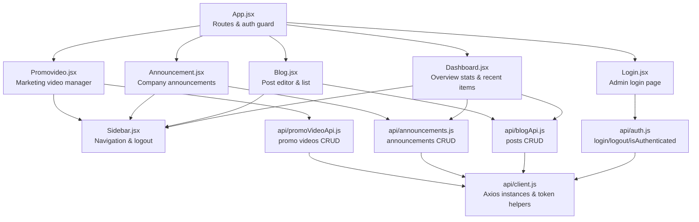
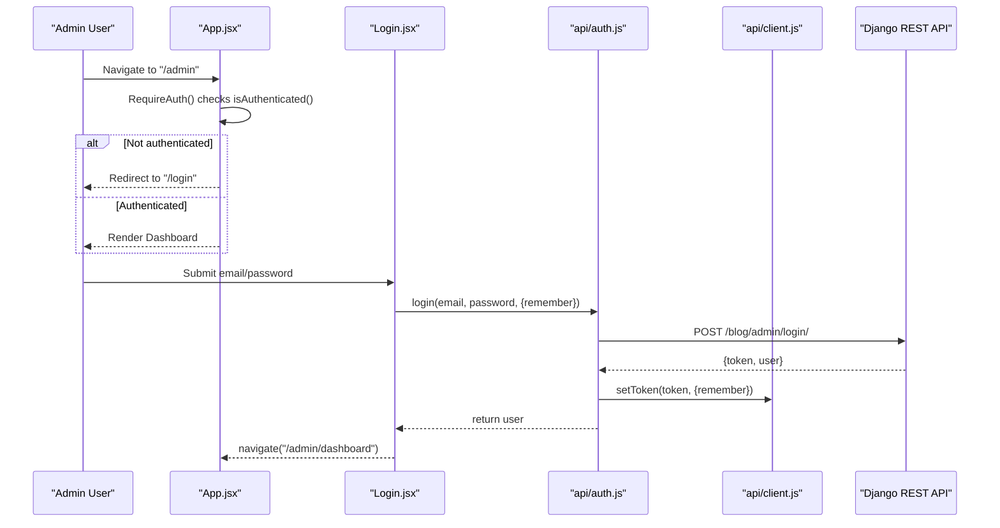
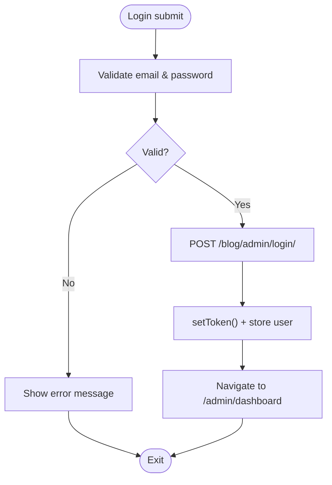
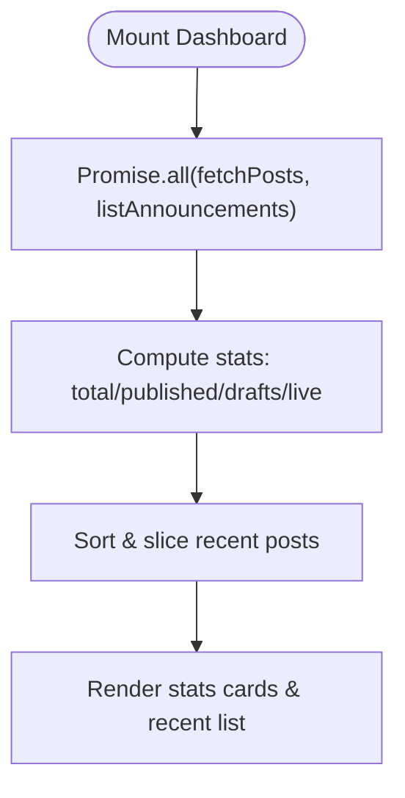
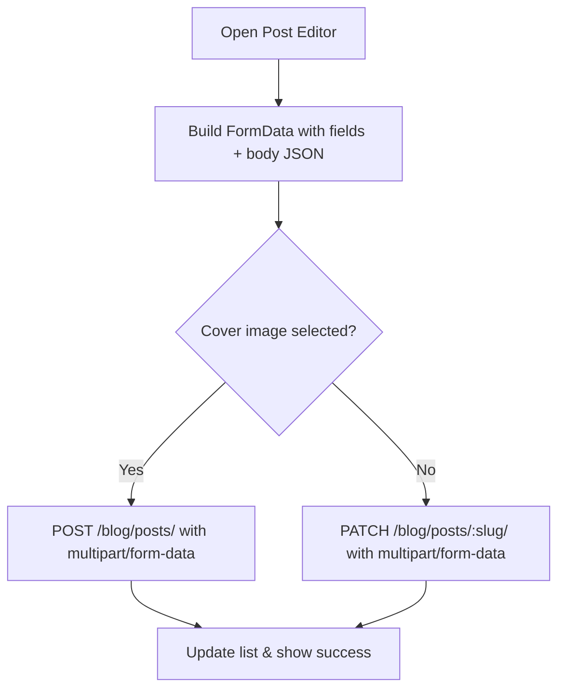
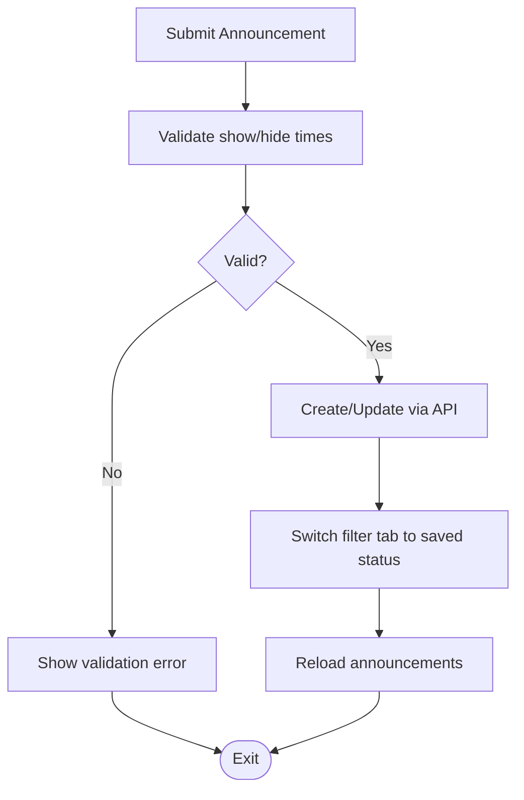
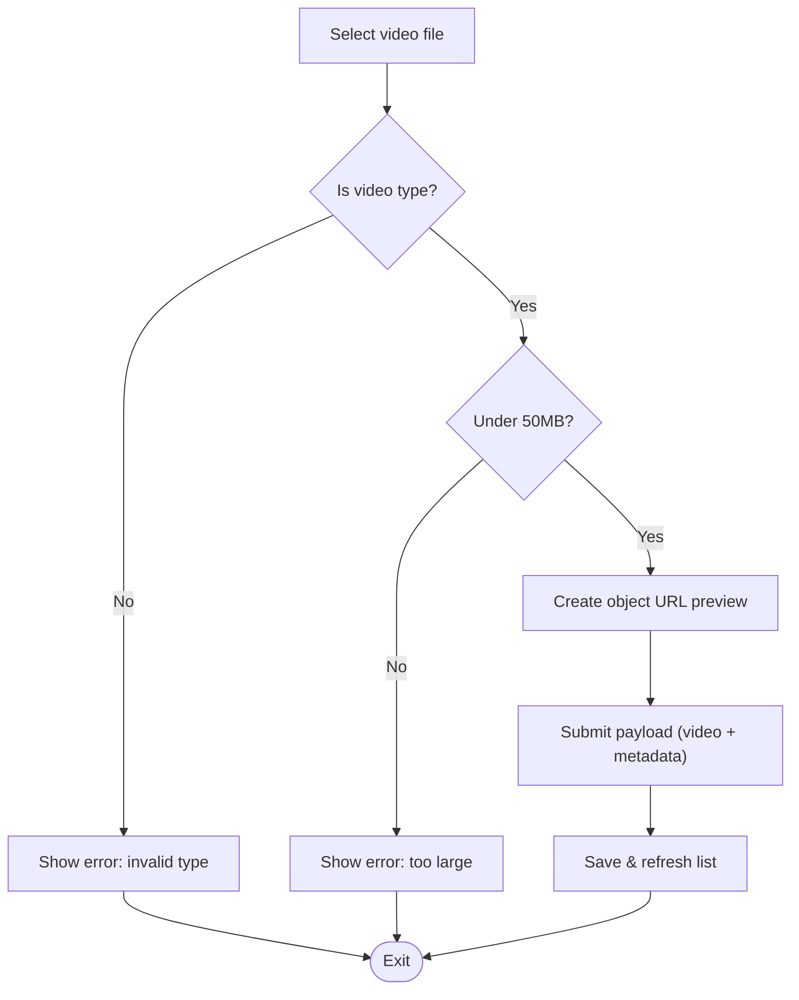
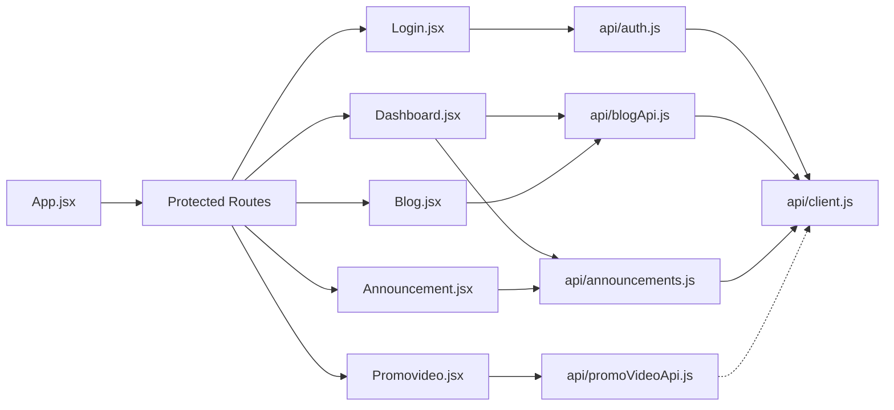

# Admin Dashboard

<cite>
**Referenced Files in This Document**
- [App.jsx](file://src/App.jsx)
- [main.jsx](file://src/main.jsx)
- [package.json](file://package.json)
- [README.md](file://README.md)
- [client.js](file://src/api/client.js)
- [auth.js](file://src/api/auth.js)
- [blogApi.js](file://src/api/blogApi.js)
- [announcements.js](file://src/api/announcements.js)
- [promoVideoApi.js](file://src/api/promoVideoApi.js)
- [Login.jsx](file://src/pages/AdminDashboard/Login.jsx)
- [Dashboard.jsx](file://src/pages/AdminDashboard/Dashboard.jsx)
- [Blog.jsx](file://src/pages/AdminDashboard/Blog.jsx)
- [Announcement.jsx](file://src/pages/AdminDashboard/Announcement.jsx)
- [Promovideo.jsx](file://src/pages/AdminDashboard/Promovideo.jsx)
- [Sidebar.jsx](file://src/components/Sidebar.jsx)
</cite>

## Table of Contents
1. [Introduction](#introduction)
2. [Project Structure](#project-structure)
3. [Core Components](#core-components)
4. [Architecture Overview](#architecture-overview)
5. [Detailed Component Analysis](#detailed-component-analysis)
6. [Dependency Analysis](#dependency-analysis)
7. [Performance Considerations](#performance-considerations)
8. [Troubleshooting Guide](#troubleshooting-guide)
9. [Conclusion](#conclusion)

## Introduction
This document explains the administrative dashboard functionality for the marketing frontend. It covers authentication, protected routes, token management, and the main admin modules: dashboard overview, blog post management, announcements, and promotional video management. It also documents UI patterns, form handling, file upload processing, status workflows, security considerations, and validation strategies.

The application is a React + Vite project using React Router for navigation and Axios for authenticated API calls. The admin area is protected by token-based authentication against a Django REST Framework backend.

**Section sources**
- [README.md:1-17](file://README.md#L1-L17)
- [package.json:1-33](file://package.json#L1-L33)

## Project Structure
The admin dashboard is implemented as a set of pages under `src/pages/AdminDashboard`, with shared API clients under `src/api` and shared layout components under `src/components`.

**Diagram sources**
- [App.jsx:1-74](file://src/App.jsx#L1-L74)
- [Login.jsx:1-244](file://src/pages/AdminDashboard/Login.jsx#L1-L244)
- [Dashboard.jsx:1-234](file://src/pages/AdminDashboard/Dashboard.jsx#L1-L234)
- [Blog.jsx:1-800](file://src/pages/AdminDashboard/Blog.jsx#L1-L800)
- [Announcement.jsx:1-360](file://src/pages/AdminDashboard/Announcement.jsx#L1-L360)
- [Promovideo.jsx:1-484](file://src/pages/AdminDashboard/Promovideo.jsx#L1-L484)
- [Sidebar.jsx:1-239](file://src/components/Sidebar.jsx#L1-L239)
- [auth.js:1-40](file://src/api/auth.js#L1-L40)
- [blogApi.js:1-135](file://src/api/blogApi.js#L1-L135)
- [announcements.js:1-61](file://src/api/announcements.js#L1-L61)
- [promoVideoApi.js:1-85](file://src/api/promoVideoApi.js#L1-L85)
- [client.js:1-88](file://src/api/client.js#L1-L88)

**Section sources**
- [main.jsx:1-11](file://src/main.jsx#L1-L11)
- [App.jsx:1-74](file://src/App.jsx#L1-L74)

## Core Components
- Authentication layer: login flow, token persistence, and route protection.
- Dashboard overview: aggregated statistics and recent activity.
- Blog management: create/edit/schedule posts with rich content blocks and media uploads.
- Announcements: company-wide messaging with visibility control and scheduling.
- Promo video management: upload and manage marketing videos with visibility controls.
- Shared sidebar: navigation and logout workflow.

Key responsibilities:
- `App.jsx`: defines routes and protects admin routes via an authentication guard.
- `Login.jsx`: handles user credentials, error display, and redirects to `/admin/dashboard`.
- `Dashboard.jsx`: loads posts and announcements, computes stats, and shows recent posts.
- `Blog.jsx`: full-featured post editor with block-based content, cover image upload, scheduling, and list operations.
- `Announcement.jsx`: create/update/delete announcements with live/scheduled/expired/hidden states.
- `Promovideo.jsx`: create/update/delete promo videos with file upload and visibility controls.
- `Sidebar.jsx`: navigation between admin sections and logout confirmation.

**Section sources**
- [App.jsx:15-66](file://src/App.jsx#L15-L66)
- [Login.jsx:99-136](file://src/pages/AdminDashboard/Login.jsx#L99-L136)
- [Dashboard.jsx:101-159](file://src/pages/AdminDashboard/Dashboard.jsx#L101-L159)
- [Blog.jsx:254-275](file://src/pages/AdminDashboard/Blog.jsx#L254-L275)
- [Announcement.jsx:55-148](file://src/pages/AdminDashboard/Announcement.jsx#L55-L148)
- [Promovideo.jsx:58-201](file://src/pages/AdminDashboard/Promovideo.jsx#L58-L201)
- [Sidebar.jsx:167-239](file://src/components/Sidebar.jsx#L167-L239)

## Architecture Overview
The admin dashboard uses React Router for client-side routing, Axios interceptors for attaching tokens, and separate API modules per feature. Public endpoints use a public Axios instance without tokens; admin endpoints use the authenticated instance.

**Diagram sources**
- [App.jsx:15-17](file://src/App.jsx#L15-L17)
- [Login.jsx:113-136](file://src/pages/AdminDashboard/Login.jsx#L113-L136)
- [auth.js:4-18](file://src/api/auth.js#L4-L18)
- [client.js:26-42](file://src/api/client.js#L26-L42)

**Section sources**
- [client.js:47-75](file://src/api/client.js#L47-L75)
- [auth.js:1-40](file://src/api/auth.js#L1-L40)

## Detailed Component Analysis

### Authentication System
- Login flow:
  - Validates required fields locally.
  - Calls `login()` which posts credentials to the backend.
  - Stores token via `setToken()` and persists user object in storage based on remember flag.
  - Navigates to `/admin/dashboard`.
- Token management:
  - Tokens are stored in localStorage or sessionStorage depending on the remember flag.
  - Axios interceptor attaches `Authorization: Token <key>` to all requests made through the authenticated client.
  - On 401 responses, the token is cleared automatically.
- Protected routes:
  - `RequireAuth` guards `/admin`, `/admin/dashboard`, `/admin/announcements`, and `/admin/promo-video`.
  - Unauthenticated users are redirected to `/login`.

**Diagram sources**
- [Login.jsx:113-136](file://src/pages/AdminDashboard/Login.jsx#L113-L136)
- [auth.js:4-18](file://src/api/auth.js#L4-L18)
- [client.js:58-75](file://src/api/client.js#L58-L75)

Security considerations:
- Uses DRF’s TokenAuthentication scheme (`Token <key>`).
- Clears token on 401 to prevent stale sessions.
- Public API endpoints do not send admin tokens, ensuring visitors see only published content.

**Section sources**
- [Login.jsx:99-136](file://src/pages/AdminDashboard/Login.jsx#L99-L136)
- [auth.js:1-40](file://src/api/auth.js#L1-L40)
- [client.js:26-75](file://src/api/client.js#L26-L75)
- [App.jsx:15-66](file://src/App.jsx#L15-L66)

### Dashboard Overview
- Loads posts and announcements concurrently.
- Computes statistics: total posts, published, drafts, and announcement count with a hint if any are live.
- Displays recent posts sorted by update time, showing category, author, and status pill.

**Diagram sources**
- [Dashboard.jsx:107-159](file://src/pages/AdminDashboard/Dashboard.jsx#L107-L159)

Status normalization:
- Post status falls back to `is_published` for legacy records.
- Status labels include published, draft, scheduled, archived.

**Section sources**
- [Dashboard.jsx:11-13](file://src/pages/AdminDashboard/Dashboard.jsx#L11-L13)
- [Dashboard.jsx:94-99](file://src/pages/AdminDashboard/Dashboard.jsx#L94-L99)
- [Dashboard.jsx:107-159](file://src/pages/AdminDashboard/Dashboard.jsx#L107-L159)

### Blog Management System
Capabilities:
- Create, edit, delete posts.
- Toggle publish state.
- Rich block-based content editor supporting headings, paragraphs, images, videos, quotes, lists, CTAs, dividers, and preserved legacy blocks.
- Cover image upload via multipart form data.
- Scheduling with publish and delete timestamps.
- Filtering, sorting, and pagination controls in the list view.

Form model:
- Fields include title, excerpt, author, category, category label override, tags, read time, cover image metadata, SEO fields, body blocks, status, featured flag, comments toggle, and schedule dates.

Content blocks:
- Each block type has its own editor and preview text.
- Image/video blocks support direct upload and show progress indicators.
- Lists allow adding/removing items inline.

Scheduling:
- Converts local datetime-local values to UTC ISO strings for the backend.
- Supports future publish times and optional expiration times.

File upload processing:
- Content files (images/videos) are uploaded via a dedicated endpoint returning `{url, type}`.
- Cover image is sent as part of multipart form data when creating/updating posts.

Validation:
- Local validation ensures required fields before submission.
- Backend errors are normalized into readable messages.

**Diagram sources**
- [blogApi.js:35-47](file://src/api/blogApi.js#L35-L47)
- [blogApi.js:117-135](file://src/api/blogApi.js#L117-L135)
- [Blog.jsx:254-275](file://src/pages/AdminDashboard/Blog.jsx#L254-L275)

**Section sources**
- [Blog.jsx:16-54](file://src/pages/AdminDashboard/Blog.jsx#L16-L54)
- [Blog.jsx:254-275](file://src/pages/AdminDashboard/Blog.jsx#L254-L275)
- [Blog.jsx:401-500](file://src/pages/AdminDashboard/Blog.jsx#L401-L500)
- [Blog.jsx:547-586](file://src/pages/AdminDashboard/Blog.jsx#L547-L586)
- [Blog.jsx:591-800](file://src/pages/AdminDashboard/Blog.jsx#L591-L800)
- [blogApi.js:1-135](file://src/api/blogApi.js#L1-L135)

### Announcement Management System
Capabilities:
- Create, update, delete announcements.
- Visibility control via `isActive`.
- Scheduling with show/hide timestamps.
- Filter tabs: Live, Scheduled, Expired, Hidden, All.
- Inline editing and quick actions (show/hide, edit, delete).

Validation:
- Ensures hide time is after show time and both are in the future when provided.
- Limits message length and provides character counter.

Status workflow:
- Back-end determines status (live, scheduled, expired, hidden).
- Frontend displays formatted dates and status pills.

**Diagram sources**
- [Announcement.jsx:101-148](file://src/pages/AdminDashboard/Announcement.jsx#L101-L148)

**Section sources**
- [Announcement.jsx:12-53](file://src/pages/AdminDashboard/Announcement.jsx#L12-L53)
- [Announcement.jsx:55-148](file://src/pages/AdminDashboard/Announcement.jsx#L55-L148)
- [Announcement.jsx:172-185](file://src/pages/AdminDashboard/Announcement.jsx#L172-L185)
- [announcements.js:1-61](file://src/api/announcements.js#L1-L61)

### Promotional Video Management
Capabilities:
- Upload new promo videos or update existing ones.
- Preview selected video locally before upload.
- Set title, subtitle, button label, and button URL.
- Visibility control via `isActive`.
- Scheduling with show/hide timestamps.
- Filter tabs: Live, Scheduled, Expired, Hidden, All.

Validation:
- Enforces video MIME types and maximum file size (50MB).
- Requires either a new file or an existing video when editing.
- Validates scheduling constraints similar to announcements.

File handling:
- Uses native file input with accept filters.
- Creates object URLs for previews and revokes them to avoid memory leaks.

**Diagram sources**
- [Promovideo.jsx:112-129](file://src/pages/AdminDashboard/Promovideo.jsx#L112-L129)
- [Promovideo.jsx:148-201](file://src/pages/AdminDashboard/Promovideo.jsx#L148-L201)

**Section sources**
- [Promovideo.jsx:12-29](file://src/pages/AdminDashboard/Promovideo.jsx#L12-L29)
- [Promovideo.jsx:58-201](file://src/pages/AdminDashboard/Promovideo.jsx#L58-L201)
- [promoVideoApi.js:1-85](file://src/api/promoVideoApi.js#L1-L85)

### User Interface Patterns
Common patterns across admin pages:
- Consistent card-based forms with labeled inputs and hints.
- Status pills indicating current state (published, scheduled, expired, hidden).
- Filter tabs with counts for quick navigation.
- Inline editing with cancel/reset actions.
- Confirmation dialogs for destructive actions (delete, logout).
- Loading and error states with user-friendly messages.

Shared components:
- Sidebar provides navigation and logout confirmation modal.
- Reusable styling classes for admin shell, cards, tables, and buttons.

**Section sources**
- [Sidebar.jsx:9-14](file://src/components/Sidebar.jsx#L9-L14)
- [Sidebar.jsx:121-163](file://src/components/Sidebar.jsx#L121-L163)
- [Sidebar.jsx:167-239](file://src/components/Sidebar.jsx#L167-L239)

## Dependency Analysis
High-level dependencies between modules:

Notes:
- `api/client.js` centralizes base URL configuration, token helpers, and Axios interceptors.
- `api/auth.js` depends on `client.js` for token persistence and authenticated requests.
- Feature APIs (`blogApi.js`, `announcements.js`) use the authenticated client; public endpoints use a separate public client.
- `promoVideoApi.js` implements its own fetch wrapper but still reads the token from `client.js`.

**Diagram sources**
- [App.jsx:1-74](file://src/App.jsx#L1-L74)
- [auth.js:1-40](file://src/api/auth.js#L1-L40)
- [blogApi.js:1-135](file://src/api/blogApi.js#L1-L135)
- [announcements.js:1-61](file://src/api/announcements.js#L1-L61)
- [promoVideoApi.js:1-85](file://src/api/promoVideoApi.js#L1-L85)
- [client.js:1-88](file://src/api/client.js#L1-L88)

**Section sources**
- [client.js:1-88](file://src/api/client.js#L1-L88)
- [auth.js:1-40](file://src/api/auth.js#L1-L40)
- [blogApi.js:1-135](file://src/api/blogApi.js#L1-L135)
- [announcements.js:1-61](file://src/api/announcements.js#L1-L61)
- [promoVideoApi.js:1-85](file://src/api/promoVideoApi.js#L1-L85)

## Performance Considerations
- Concurrent data loading: Dashboard fetches posts and announcements in parallel to reduce load time.
- Pagination and filtering: Blog list supports pagination and filtering to limit DOM size.
- File previews: Object URLs are created for local previews and revoked when no longer needed to free memory.
- Multipart uploads: Large media files are handled via multipart form data; consider server-side limits and compression.
- Environment configuration: Base URL is configured at build time to avoid runtime overhead and misconfiguration.

[No sources needed since this section provides general guidance]

## Troubleshooting Guide
Common issues and resolutions:
- 401 Unauthorized on admin endpoints:
  - Ensure token exists and is attached via the Axios interceptor.
  - If token is expired, it will be cleared automatically; re-login is required.
- Missing environment variable:
  - In production, `VITE_API_BASE_URL` must be set; otherwise, the app throws an error during build.
- Upload failures:
  - Verify file type and size constraints.
  - Check backend response details for field-specific errors.
- Scheduling anomalies:
  - Confirm that local datetime values are converted correctly to UTC ISO strings.
  - Ensure hide time is after show time and both are in the future.

**Section sources**
- [client.js:10-16](file://src/api/client.js#L10-L16)
- [client.js:58-75](file://src/api/client.js#L58-L75)
- [Login.jsx:127-136](file://src/pages/AdminDashboard/Login.jsx#L127-L136)
- [Announcement.jsx:101-113](file://src/pages/AdminDashboard/Announcement.jsx#L101-L113)
- [Promovideo.jsx:112-129](file://src/pages/AdminDashboard/Promovideo.jsx#L112-L129)

## Conclusion
The admin dashboard provides a secure, role-aware interface for managing blog posts, announcements, and promotional videos. Authentication is enforced via token-based authorization with Axios interceptors, and protected routes ensure only authenticated users can access admin features. The UI follows consistent patterns for forms, file uploads, status management, and scheduling. Robust validation and error handling improve reliability and user experience. For further enhancements, consider adding role-based permissions, richer content editing tools, and improved performance optimizations for large media assets.

[No sources needed since this section summarizes without analyzing specific files]