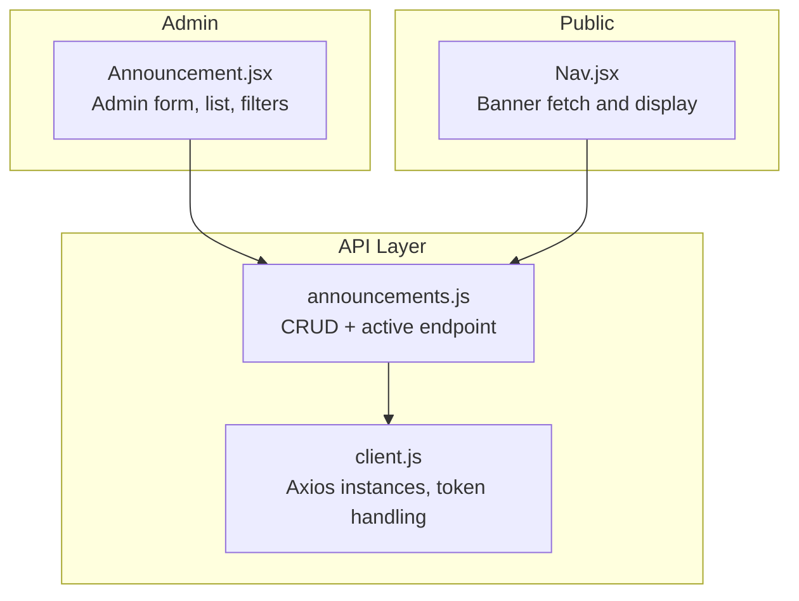
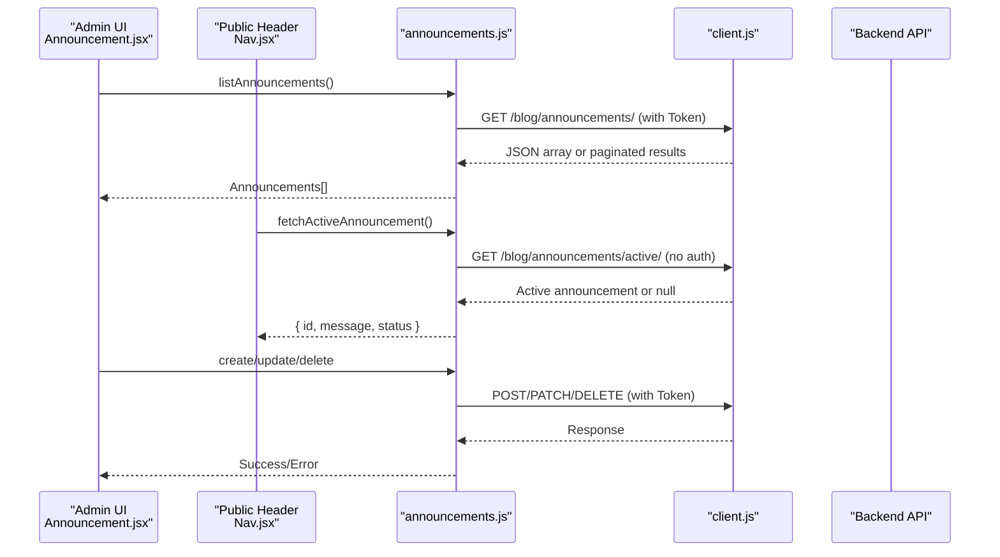
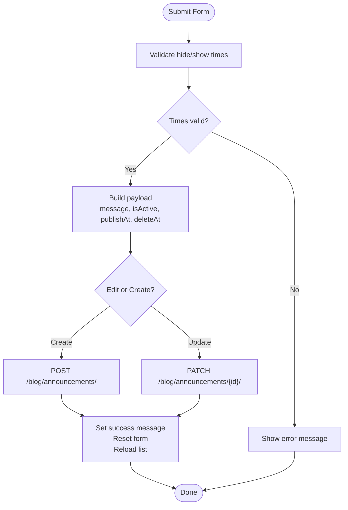
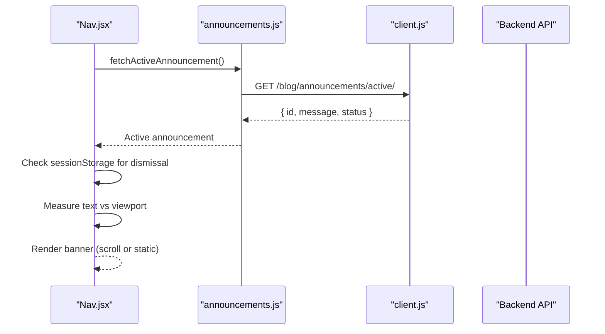
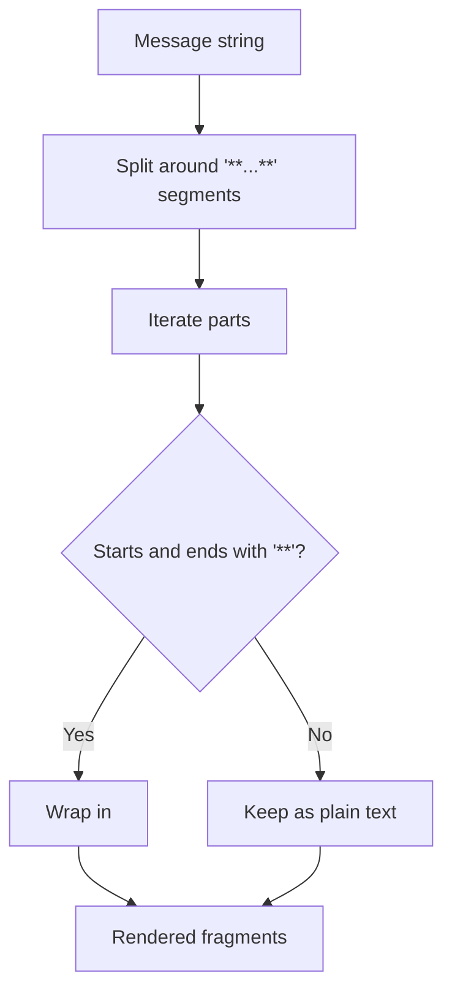
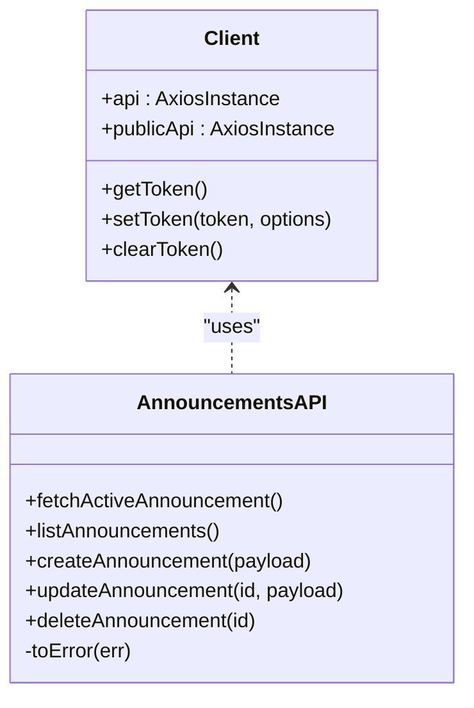
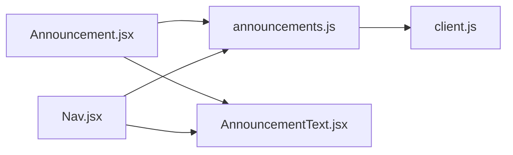

# Announcement Management

<cite>
**Referenced Files in This Document**
- [announcements.js](file://src/api/announcements.js)
- [client.js](file://src/api/client.js)
- [Announcement.jsx](file://src/pages/AdminDashboard/Announcement.jsx)
- [AnnouncementText.jsx](file://src/components/AnnouncementText.jsx)
- [Nav.jsx](file://src/components/Nav.jsx)
</cite>

## Table of Contents
1. [Introduction](#introduction)
2. [Project Structure](#project-structure)
3. [Core Components](#core-components)
4. [Architecture Overview](#architecture-overview)
5. [Detailed Component Analysis](#detailed-component-analysis)
6. [Dependency Analysis](#dependency-analysis)
7. [Performance Considerations](#performance-considerations)
8. [Troubleshooting Guide](#troubleshooting-guide)
9. [Conclusion](#conclusion)

## Introduction
This document explains the announcement management system implemented in the frontend application. It covers how administrators create and edit company-wide announcements with simple rich text formatting, how to toggle visibility, how announcements are displayed to end users, and how the API layer integrates with the backend. It also documents the announcement lifecycle (creation, activation, scheduling, deactivation, and archival), the admin listing interface with filtering, validation rules, error handling, and user experience considerations for real-time updates.

## Project Structure
The announcement feature spans three main areas:
- Admin UI for managing announcements
- Public banner display on the site header
- API client utilities for authenticated and public endpoints

**Diagram sources**
- [Announcement.jsx:1-360](file://src/pages/AdminDashboard/Announcement.jsx#L1-L360)
- [Nav.jsx:1277-1458](file://src/components/Nav.jsx#L1277-L1458)
- [announcements.js:1-61](file://src/api/announcements.js#L1-L61)
- [client.js:47-88](file://src/api/client.js#L47-L88)

**Section sources**
- [Announcement.jsx:1-360](file://src/pages/AdminDashboard/Announcement.jsx#L1-L360)
- [Nav.jsx:1277-1458](file://src/components/Nav.jsx#L1277-L1458)
- [announcements.js:1-61](file://src/api/announcements.js#L1-L61)
- [client.js:47-88](file://src/api/client.js#L47-L88)

## Core Components
- Admin Announcement Manager: Creates, edits, schedules, toggles, and deletes announcements; lists them with status-based filters.
- Public Banner Renderer: Fetches the currently active announcement and renders it in the site header as a dismissible banner.
- Simple Rich Text Formatter: Converts double-asterisk markup into bold text for both admin list and public banner.
- API Utilities: Provide authenticated and public HTTP clients and wrap backend calls with consistent error mapping.

Key responsibilities:
- Admin UI handles form state, validation, scheduling, and user feedback.
- Public banner uses a no-auth client to ensure visitors see only what is intended for them.
- API layer centralizes base URL configuration, token injection, and error normalization.

**Section sources**
- [Announcement.jsx:55-185](file://src/pages/AdminDashboard/Announcement.jsx#L55-L185)
- [Nav.jsx:1277-1458](file://src/components/Nav.jsx#L1277-L1458)
- [AnnouncementText.jsx:1-18](file://src/components/AnnouncementText.jsx#L1-L18)
- [announcements.js:1-61](file://src/api/announcements.js#L1-L61)
- [client.js:47-88](file://src/api/client.js#L47-L88)

## Architecture Overview
The system separates admin operations from public consumption:
- Admin pages call authenticated endpoints to manage announcements.
- Public pages call a dedicated “active” endpoint without authentication headers.
- Both sides render announcement text using the same lightweight formatter.

**Diagram sources**
- [Announcement.jsx:64-170](file://src/pages/AdminDashboard/Announcement.jsx#L64-L170)
- [Nav.jsx:1289-1315](file://src/components/Nav.jsx#L1289-L1315)
- [announcements.js:22-61](file://src/api/announcements.js#L22-L61)
- [client.js:47-88](file://src/api/client.js#L47-L88)

## Detailed Component Analysis

### Admin Announcement Manager
Responsibilities:
- Form creation and editing with message, visibility toggle, and optional schedule times.
- Validation for required content and time ordering.
- Listing with filter tabs by computed status: Live, Scheduled, Expired, Hidden, All.
- Inline actions: Show/Hide, Edit, Delete.
- User feedback via success/error banners.

Form behavior:
- Message field supports simple bold markup using double asterisks.
- Maximum length enforced at the UI level.
- Optional “Show at” and “Hide at” fields accept local datetime values and convert to UTC ISO strings before sending.
- Only one announcement can be live at a time; enabling a new one replaces the current live item.

Validation rules:
- Message must not be empty.
- Hide time must be after the current time.
- Hide time must be after show time if both are provided.

Status computation:
- The backend returns a status per announcement used to group items in the list.
- Status labels include Live, Scheduled, Expired, Hidden.

Filtering:
- Filter tabs compute counts per status and filter the visible table rows accordingly.

Lifecycle interactions:
- Create: Sends payload to backend; sets filter to the saved item’s status for immediate visibility.
- Update: Edits existing announcement; preserves scheduling and visibility settings.
- Toggle Active: Flips isActive flag and refreshes the list.
- Delete: Removes an announcement after confirmation.

User experience:
- Loading states while fetching data.
- Success messages explain whether an announcement is immediately live, scheduled, or hidden.
- Smooth scroll to the top when starting to edit.

**Diagram sources**
- [Announcement.jsx:101-148](file://src/pages/AdminDashboard/Announcement.jsx#L101-L148)

**Section sources**
- [Announcement.jsx:12-185](file://src/pages/AdminDashboard/Announcement.jsx#L12-L185)
- [Announcement.jsx:187-360](file://src/pages/AdminDashboard/Announcement.jsx#L187-L360)

### Public Banner Display
Responsibilities:
- Fetch the active announcement using the public API client.
- Render the announcement in the header banner.
- Support dismissal per session so users do not repeatedly see the same banner.
- Handle long text by scrolling the banner like a ticker.

Behavior:
- Uses `publicApi` to avoid sending admin tokens to the public endpoint.
- Stores dismissal state in session storage keyed by announcement id.
- Measures text width and viewport size to decide whether to animate scrolling.
- Gracefully hides the banner if the API fails or returns no data.

**Diagram sources**
- [Nav.jsx:1289-1349](file://src/components/Nav.jsx#L1289-L1349)
- [announcements.js:22-25](file://src/api/announcements.js#L22-L25)
- [client.js:83-88](file://src/api/client.js#L83-L88)

**Section sources**
- [Nav.jsx:1277-1458](file://src/components/Nav.jsx#L1277-L1458)

### Simple Rich Text Formatter
Responsibilities:
- Convert double-asterisk markup into bold text.
- Used consistently in both admin list and public banner.

Behavior:
- Splits the message around bold segments and wraps matching parts in bold elements.
- Leaves other text unchanged, including emojis and plain words.

**Diagram sources**
- [AnnouncementText.jsx:1-18](file://src/components/AnnouncementText.jsx#L1-L18)

**Section sources**
- [AnnouncementText.jsx:1-18](file://src/components/AnnouncementText.jsx#L1-L18)

### API Integration
Endpoints and usage:
- Public active endpoint: GET `/blog/announcements/active/`
  - Called by the public header to fetch the currently active announcement.
  - Uses the public axios instance without authentication headers.
- Admin endpoints:
  - List: GET `/blog/announcements/`
  - Create: POST `/blog/announcements/`
  - Update: PATCH `/blog/announcements/{id}/`
  - Delete: DELETE `/blog/announcements/{id}/`
  - All use the authenticated axios instance with a token header.

Error handling:
- Axios errors are normalized into readable Error objects.
- Field-level and detail messages from the backend are extracted when available.
- 401 responses clear stored tokens automatically.

Base URL configuration:
- Base URL comes from environment variables during build.
- In development, a localhost fallback is used.
- Missing base URL in production throws a clear error.

Token handling:
- Tokens are read from localStorage or sessionStorage.
- Authenticated requests attach `Authorization: Token <key>`.
- Invalid/expired tokens trigger automatic logout flow by clearing stored tokens.

**Diagram sources**
- [client.js:21-88](file://src/api/client.js#L21-L88)
- [announcements.js:1-61](file://src/api/announcements.js#L1-L61)

**Section sources**
- [announcements.js:1-61](file://src/api/announcements.js#L1-L61)
- [client.js:1-88](file://src/api/client.js#L1-L88)

## Dependency Analysis
- Admin UI depends on:
  - Sidebar component for layout
  - AnnouncementText for rendering formatted messages
  - announcements.js for all CRUD operations
- Public header depends on:
  - announcements.js for the active endpoint
  - AnnouncementText for consistent formatting
- API layer depends on:
  - client.js for axios instances and token logic
  - Environment variables for base URL configuration

**Diagram sources**
- [Announcement.jsx:1-10](file://src/pages/AdminDashboard/Announcement.jsx#L1-L10)
- [Nav.jsx:17-18](file://src/components/Nav.jsx#L17-L18)
- [announcements.js:1-61](file://src/api/announcements.js#L1-L61)
- [client.js:47-88](file://src/api/client.js#L47-L88)

**Section sources**
- [Announcement.jsx:1-10](file://src/pages/AdminDashboard/Announcement.jsx#L1-L10)
- [Nav.jsx:17-18](file://src/components/Nav.jsx#L17-L18)
- [announcements.js:1-61](file://src/api/announcements.js#L1-L61)
- [client.js:47-88](file://src/api/client.js#L47-L88)

## Performance Considerations
- Public banner avoids unnecessary network calls by checking dismissal state in session storage.
- Long announcement text triggers CSS-driven marquee animation based on measured width; this minimizes JavaScript overhead during scrolling.
- Admin list computes counts and filtered views using memoized values to avoid re-renders.
- Token interception ensures that invalid tokens are cleared promptly, preventing repeated failed requests.

[No sources needed since this section provides general guidance]

## Troubleshooting Guide
Common issues and resolutions:
- No banner appears on the public site:
  - Verify the backend active endpoint returns data.
  - Ensure the public API base URL is configured correctly.
  - Check browser console for network errors; the banner intentionally hides on failure.
- Admin cannot save announcements:
  - Confirm the message is non-empty and within the maximum length.
  - Ensure hide time is after show time and in the future.
  - Review error messages shown in the admin status banner.
- Token-related 401 errors:
  - The client clears tokens on 401 responses; re-authenticate and retry.
- Formatting not applied:
  - Use double asterisks around words to make them bold.
  - Emojis and plain text are supported without additional markup.

Operational tips:
- Use the filter tabs to locate announcements by status quickly.
- After saving, the admin view switches to the tab where the announcement now lives.
- Dismissed banners are session-scoped; closing the browser resets the dismissal.

**Section sources**
- [Announcement.jsx:101-170](file://src/pages/AdminDashboard/Announcement.jsx#L101-L170)
- [Nav.jsx:1289-1315](file://src/components/Nav.jsx#L1289-L1315)
- [announcements.js:6-17](file://src/api/announcements.js#L6-L17)
- [client.js:66-75](file://src/api/client.js#L66-L75)

## Conclusion
The announcement management system provides a straightforward yet robust way to manage company-wide messaging. Administrators can create, schedule, toggle, and remove announcements through a clean interface with clear validation and feedback. End users see a single active announcement in the header, rendered consistently with simple rich text formatting. The API layer cleanly separates authenticated admin operations from public reads, ensuring secure and predictable behavior across contexts. With proper environment configuration and token handling, the system delivers reliable real-time updates and a smooth user experience.