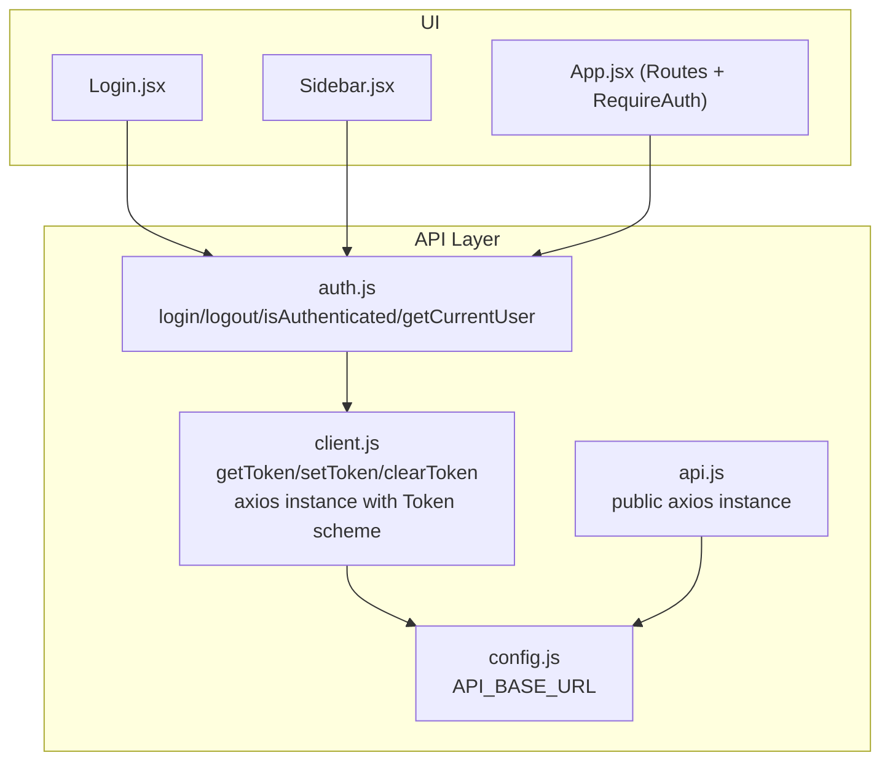
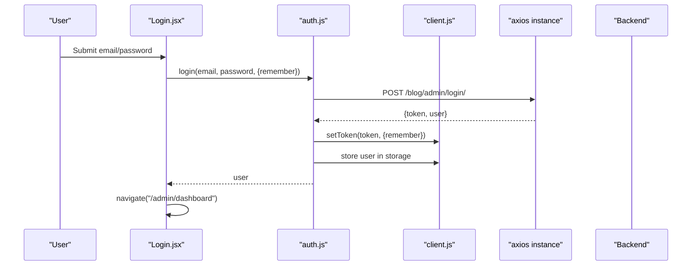
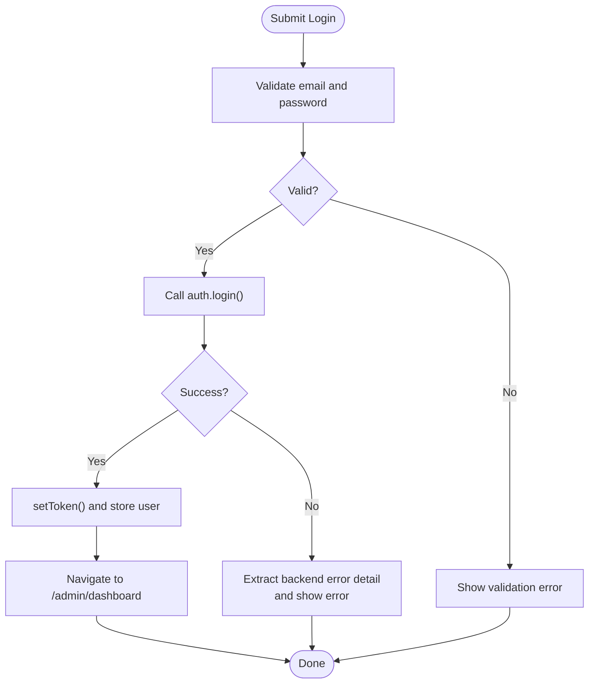
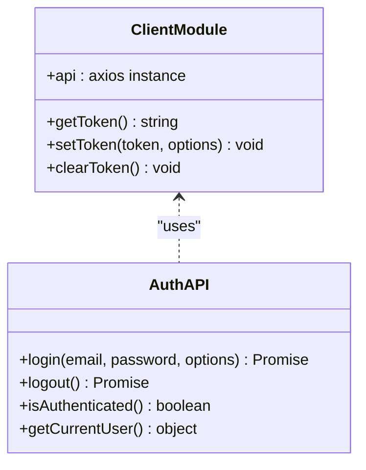
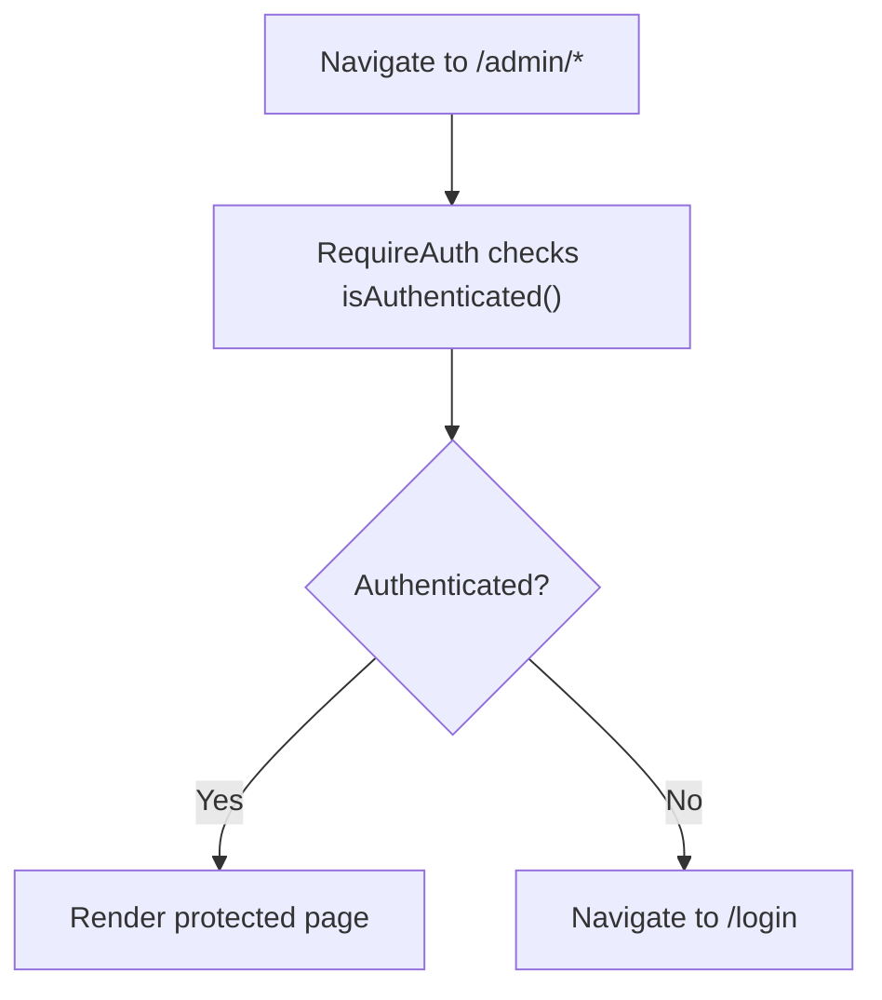
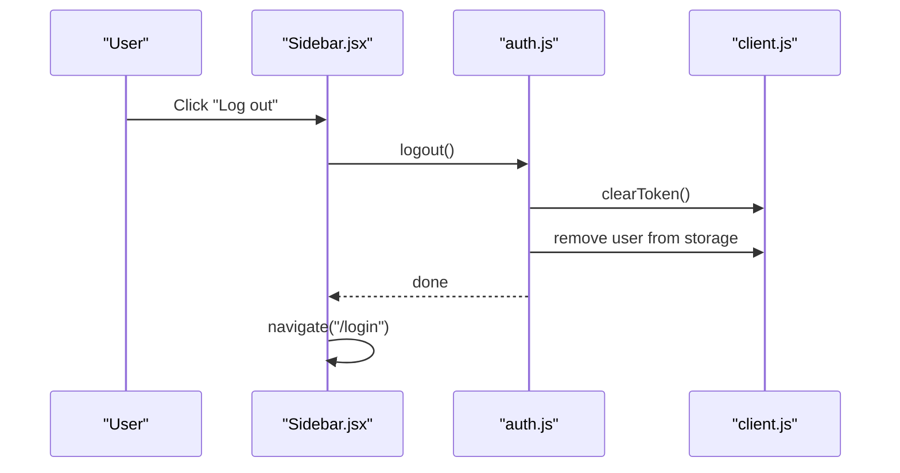
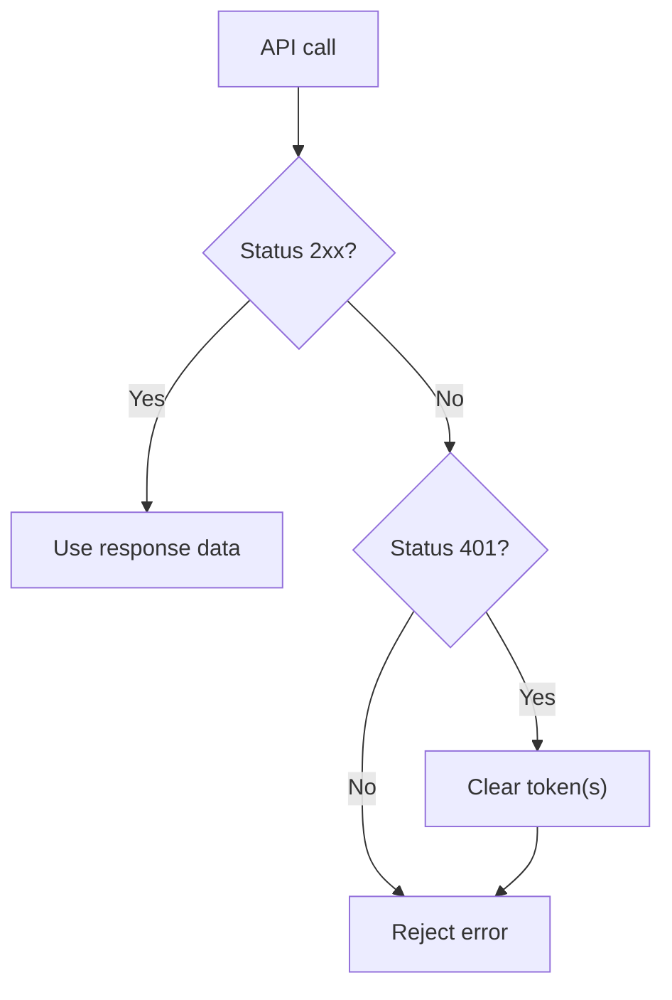
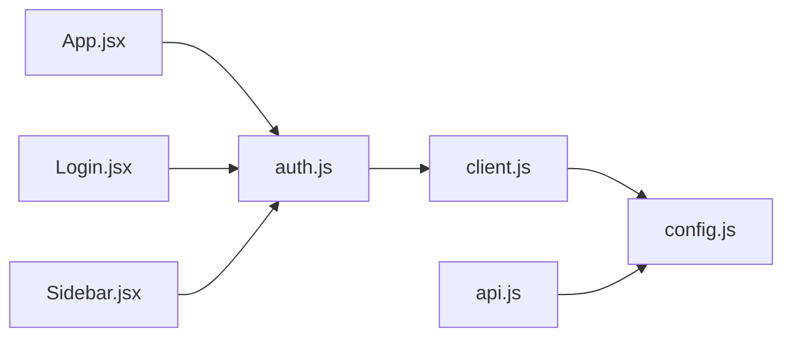

# Authentication System

<cite>
**Referenced Files in This Document**
- [App.jsx](file://src/App.jsx)
- [auth.js](file://src/api/auth.js)
- [client.js](file://src/api/client.js)
- [api.js](file://src/api/api.js)
- [config.js](file://src/config/config.js)
- [Login.jsx](file://src/pages/AdminDashboard/Login.jsx)
- [Sidebar.jsx](file://src/components/Sidebar.jsx)
</cite>

## Table of Contents
1. [Introduction](#introduction)
2. [Project Structure](#project-structure)
3. [Core Components](#core-components)
4. [Architecture Overview](#architecture-overview)
5. [Detailed Component Analysis](#detailed-component-analysis)
6. [Dependency Analysis](#dependency-analysis)
7. [Performance Considerations](#performance-considerations)
8. [Troubleshooting Guide](#troubleshooting-guide)
9. [Security Considerations](#security-considerations)
10. [Extending the Authentication Flow](#extending-the-authentication-flow)
11. [Conclusion](#conclusion)

## Introduction
This document explains the admin authentication system implemented in the ERP frontend. It covers how users sign in, how credentials are validated, how tokens are stored and attached to requests, how protected routes guard admin pages, and how logout clears state. It also provides guidance on error handling, token expiration behavior, and security considerations such as storage practices and CSRF protection. Finally, it shows how to add new protected routes and customize the authentication flow.

## Project Structure
The authentication logic is split across a few focused modules:
- API layer for authentication and HTTP clients
- UI components for login and navigation
- Routing configuration that enforces access control

**Diagram sources**
- [App.jsx:1-74](file://src/App.jsx#L1-L74)
- [auth.js:1-40](file://src/api/auth.js#L1-L40)
- [client.js:1-88](file://src/api/client.js#L1-L88)
- [api.js:1-39](file://src/api/api.js#L1-L39)
- [config.js:1-3](file://src/config/config.js#L1-L3)

**Section sources**
- [App.jsx:1-74](file://src/App.jsx#L1-L74)
- [auth.js:1-40](file://src/api/auth.js#L1-L40)
- [client.js:1-88](file://src/api/client.js#L1-L88)
- [api.js:1-39](file://src/api/api.js#L1-L39)
- [config.js:1-3](file://src/config/config.js#L1-L3)

## Core Components
- Authentication API module: exposes login, logout, isAuthenticated, and getCurrentUser. It stores tokens using client helpers and persists user info based on the remember flag.
- Client module: defines getToken/setToken/clearToken and an authenticated axios instance that attaches a Token-scheme Authorization header. It clears tokens on 401 responses.
- Public API module: a separate axios instance for public endpoints that does not send admin tokens.
- Routing module: defines a RequireAuth wrapper that redirects unauthenticated users to /login.
- Login page: handles form input, validation, calls login, and navigates to the dashboard on success.
- Sidebar: provides a logout action that calls the logout API and clears local state.

**Section sources**
- [auth.js:1-40](file://src/api/auth.js#L1-L40)
- [client.js:1-88](file://src/api/client.js#L1-L88)
- [api.js:1-39](file://src/api/api.js#L1-L39)
- [App.jsx:15-17](file://src/App.jsx#L15-L17)
- [Login.jsx:99-136](file://src/pages/AdminDashboard/Login.jsx#L99-L136)
- [Sidebar.jsx:167-181](file://src/components/Sidebar.jsx#L167-L181)

## Architecture Overview
The authentication architecture follows a layered approach:
- UI triggers login or logout actions.
- The auth API performs HTTP calls and manages token persistence.
- An authenticated axios instance automatically attaches the token to every request.
- A route guard ensures only authenticated users can access admin routes.

**Diagram sources**
- [Login.jsx:113-136](file://src/pages/AdminDashboard/Login.jsx#L113-L136)
- [auth.js:4-18](file://src/api/auth.js#L4-L18)
- [client.js:30-42](file://src/api/client.js#L30-L42)

## Detailed Component Analysis

### Login Flow
- Form handling: The login component maintains email, password, remember me, visibility toggle, submitting state, and error message.
- Validation: Prevents submission if fields are empty; sets a user-facing error.
- Credential validation: Calls the backend login endpoint via the auth API. On success, navigates to the admin dashboard. On failure, extracts backend detail messages when available.
- Session management: On successful login, the token is persisted according to the remember flag, and user data is stored in the corresponding storage.

**Diagram sources**
- [Login.jsx:108-136](file://src/pages/AdminDashboard/Login.jsx#L108-L136)
- [auth.js:4-18](file://src/api/auth.js#L4-L18)

**Section sources**
- [Login.jsx:99-136](file://src/pages/AdminDashboard/Login.jsx#L99-L136)
- [auth.js:4-18](file://src/api/auth.js#L4-L18)

### Token Storage and Request Interception
- Token storage: Tokens are stored in localStorage when remember is true, otherwise in sessionStorage. The key used by the client module is consistent across get/set/clear operations.
- Request interception: The authenticated axios instance adds an Authorization header with the Token scheme for every request when a token exists.
- Response interception: If a 401 response occurs, the token is cleared so subsequent requests are unauthenticated until re-login.

**Diagram sources**
- [client.js:21-42](file://src/api/client.js#L21-L42)
- [client.js:47-75](file://src/api/client.js#L47-L75)
- [auth.js:1-40](file://src/api/auth.js#L1-L40)

**Section sources**
- [client.js:21-42](file://src/api/client.js#L21-L42)
- [client.js:47-75](file://src/api/client.js#L47-L75)
- [auth.js:1-40](file://src/api/auth.js#L1-L40)

### Protected Routes and Redirects
- Route guard: RequireAuth checks isAuthenticated(). If false, it redirects to /login with replace to avoid history stacking.
- Admin routes: All admin routes wrap their elements with RequireAuth to ensure only authenticated users can access them.

**Diagram sources**
- [App.jsx:15-17](file://src/App.jsx#L15-L17)
- [App.jsx:35-66](file://src/App.jsx#L35-L66)
- [auth.js:31-33](file://src/api/auth.js#L31-L33)

**Section sources**
- [App.jsx:15-17](file://src/App.jsx#L15-L17)
- [App.jsx:35-66](file://src/App.jsx#L35-L66)
- [auth.js:31-33](file://src/api/auth.js#L31-L33)

### Logout Functionality
- Trigger: Sidebar provides a logout button with a confirmation modal.
- Action: Calls the logout API, then navigates to /login.
- Cleanup: The logout function clears the token from both storages and removes stored user data.

**Diagram sources**
- [Sidebar.jsx:167-181](file://src/components/Sidebar.jsx#L167-L181)
- [auth.js:21-29](file://src/api/auth.js#L21-L29)
- [client.js:39-42](file://src/api/client.js#L39-L42)

**Section sources**
- [Sidebar.jsx:167-181](file://src/components/Sidebar.jsx#L167-L181)
- [auth.js:21-29](file://src/api/auth.js#L21-L29)
- [client.js:39-42](file://src/api/client.js#L39-L42)

### Error Handling
- Login errors: The login page attempts to extract backend-provided detail messages and displays them to the user.
- Network and server errors: The authenticated axios instance rejects errors; 401 responses trigger token clearing.
- Dashboard loading errors: The dashboard catches errors from API calls and surfaces a user-friendly message.

**Diagram sources**
- [Login.jsx:124-135](file://src/pages/AdminDashboard/Login.jsx#L124-L135)
- [client.js:67-75](file://src/api/client.js#L67-L75)

**Section sources**
- [Login.jsx:124-135](file://src/pages/AdminDashboard/Login.jsx#L124-L135)
- [client.js:67-75](file://src/api/client.js#L67-L75)

## Dependency Analysis
- App.jsx depends on auth.js for authentication checks and renders protected routes.
- Login.jsx depends on auth.js for credential submission.
- Sidebar.jsx depends on auth.js for logout.
- auth.js depends on client.js for token storage and axios instance creation.
- client.js depends on environment configuration for base URLs.
- api.js defines a separate public axios instance that does not attach admin tokens.

**Diagram sources**
- [App.jsx:1-13](file://src/App.jsx#L1-L13)
- [Login.jsx:1-4](file://src/pages/AdminDashboard/Login.jsx#L1-L4)
- [Sidebar.jsx:1-6](file://src/components/Sidebar.jsx#L1-L6)
- [auth.js:1-2](file://src/api/auth.js#L1-L2)
- [client.js:1-8](file://src/api/client.js#L1-L8)
- [api.js:1-2](file://src/api/api.js#L1-L2)
- [config.js:1-3](file://src/config/config.js#L1-L3)

**Section sources**
- [App.jsx:1-13](file://src/App.jsx#L1-L13)
- [Login.jsx:1-4](file://src/pages/AdminDashboard/Login.jsx#L1-L4)
- [Sidebar.jsx:1-6](file://src/components/Sidebar.jsx#L1-L6)
- [auth.js:1-2](file://src/api/auth.js#L1-L2)
- [client.js:1-8](file://src/api/client.js#L1-L8)
- [api.js:1-2](file://src/api/api.js#L1-L2)
- [config.js:1-3](file://src/config/config.js#L1-L3)

## Performance Considerations
- Avoid unnecessary re-renders: Keep authentication checks minimal in render paths; rely on route guards rather than per-component checks.
- Debounce network calls where appropriate: For example, if implementing auto-refresh or polling, debounce to reduce load.
- Minimize storage reads: Cache isAuthenticated() result during a session if needed, but invalidate on logout or 401.

[No sources needed since this section provides general guidance]

## Troubleshooting Guide
- 401 Unauthorized after login:
  - Ensure the token is being stored correctly and the Authorization header uses the correct scheme.
  - Verify that the backend expects the same token format and that the token is valid.
- Login fails with generic error:
  - Check the backend’s error payload; the login page attempts to display detail messages when present.
- Public endpoints fail unexpectedly:
  - Confirm you are using the public axios instance for visitor-facing endpoints to avoid sending admin tokens.
- Environment misconfiguration:
  - Ensure VITE_API_BASE_URL or VITE_API_URL is set appropriately for development and production builds.

**Section sources**
- [Login.jsx:124-135](file://src/pages/AdminDashboard/Login.jsx#L124-L135)
- [client.js:58-75](file://src/api/client.js#L58-L75)
- [api.js:11-36](file://src/api/api.js#L11-L36)
- [config.js:1-3](file://src/config/config.js#L1-L3)

## Security Considerations
- Token expiration handling:
  - The authenticated axios instance clears tokens on 401 responses. After expiration, users will be redirected to login on next protected request.
- Secure storage practices:
  - Tokens are stored in localStorage or sessionStorage depending on the remember flag. Be mindful of XSS risks; consider additional protections like HttpOnly cookies on the backend and strict Content Security Policy on the frontend.
- CSRF protection:
  - The current implementation relies on token-based authentication. If switching to cookie-based sessions, implement CSRF tokens and validate them on the backend.
- Authorization scheme:
  - The authenticated axios instance uses the Token scheme. Ensure the backend is configured to accept this scheme consistently.
- Separation of public and private APIs:
  - Public endpoints should use the public axios instance to avoid leaking admin tokens to visitor-facing requests.

**Section sources**
- [client.js:58-75](file://src/api/client.js#L58-L75)
- [auth.js:10-18](file://src/api/auth.js#L10-L18)
- [api.js:11-36](file://src/api/api.js#L11-L36)

## Extending the Authentication Flow

### Adding a New Protected Route
- Wrap the route element with RequireAuth in App.jsx.
- Ensure the route path is under /admin or another protected namespace.

Example steps:
- Import RequireAuth and your new page component.
- Add a Route entry with RequireAuth wrapping the page element.

**Section sources**
- [App.jsx:15-17](file://src/App.jsx#L15-L17)
- [App.jsx:35-66](file://src/App.jsx#L35-L66)

### Customizing the Authentication Flow
- Change token storage strategy:
  - Modify setToken/clearToken in client.js to use different keys or storage mechanisms.
- Adjust authorization header scheme:
  - Update the interceptor in client.js to use Bearer instead of Token if the backend changes.
- Enhance error messaging:
  - Extend the login page to handle more backend error shapes or integrate a toast/notification system.
- Implement automatic token refresh:
  - Add a refresh token flow in auth.js and interceptors in client.js to retry failed requests after refreshing tokens.

**Section sources**
- [client.js:30-42](file://src/api/client.js#L30-L42)
- [client.js:58-75](file://src/api/client.js#L58-L75)
- [Login.jsx:124-135](file://src/pages/AdminDashboard/Login.jsx#L124-L135)

## Conclusion
The admin authentication system combines a simple login UI, robust token management, and route-level protection. Tokens are attached to requests via an authenticated axios instance, and unauthorized access is handled by redirecting to the login page. Logout clears tokens and user data. To extend the system, focus on secure storage, consistent authorization schemes, and comprehensive error handling. When adding new features, prefer using the existing auth utilities and route guards to maintain consistency and security.

[No sources needed since this section summarizes without analyzing specific files]