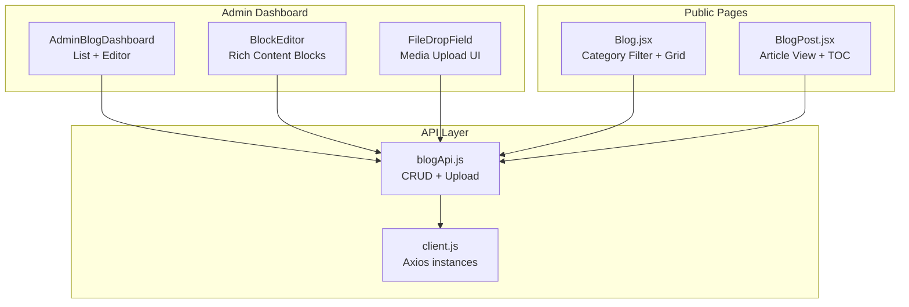
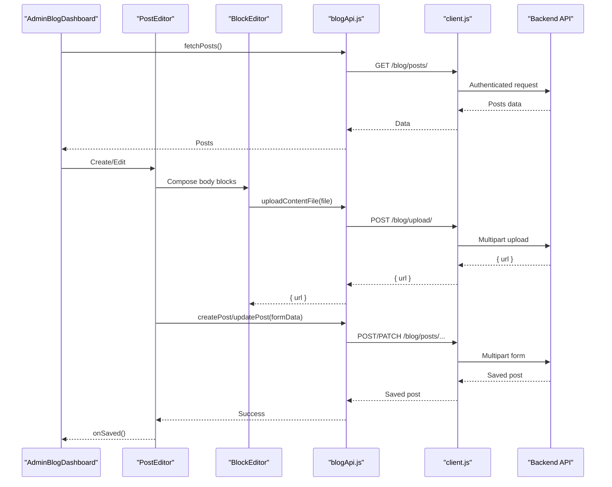
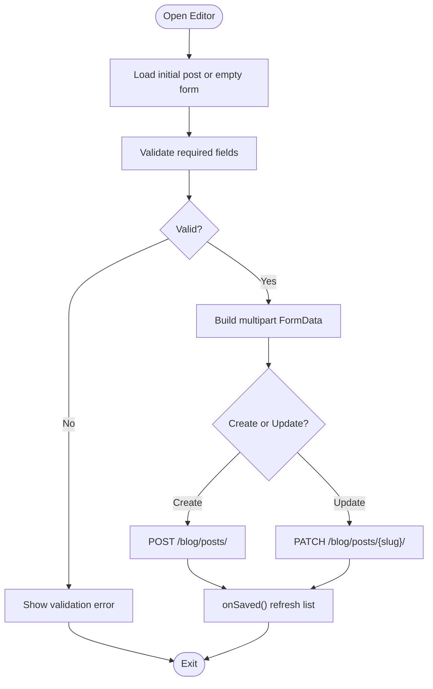
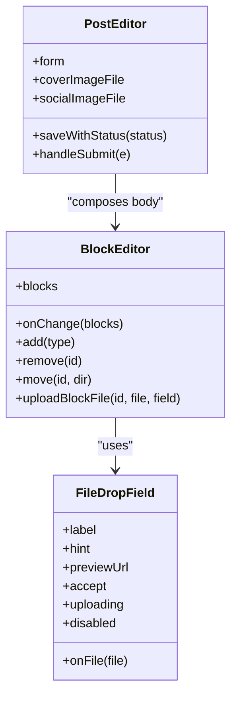
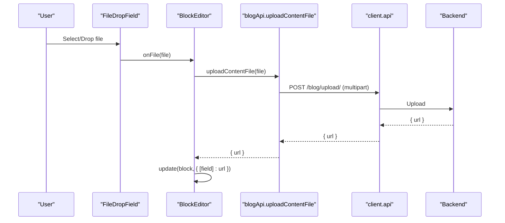
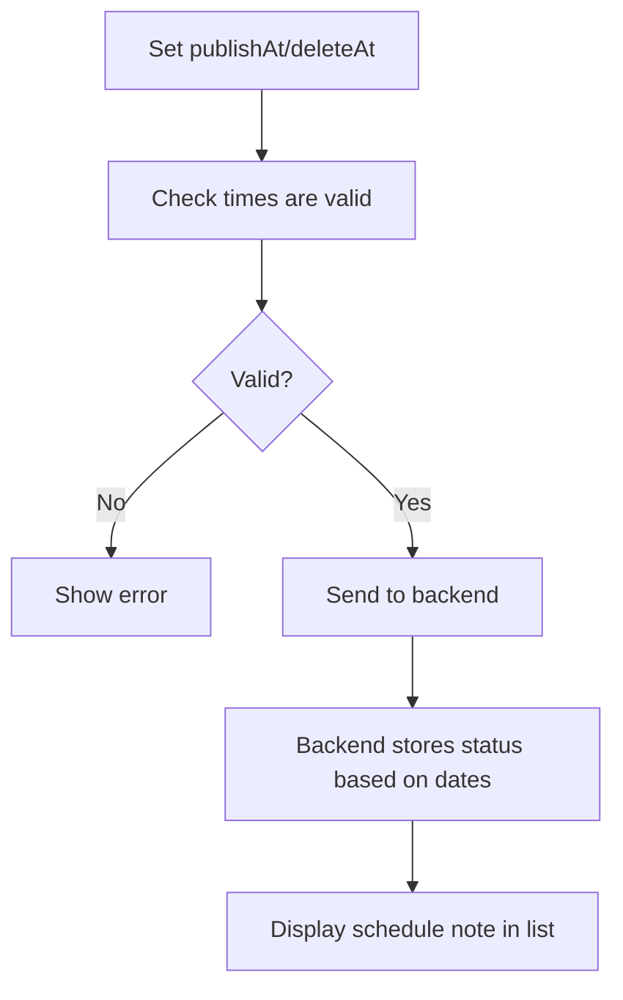
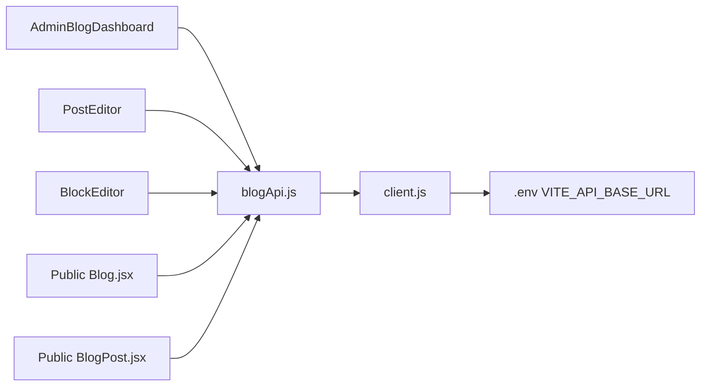

# Blog Management

<cite>
**Referenced Files in This Document**
- [Blog.jsx](file://src/pages/AdminDashboard/Blog.jsx)
- [blogApi.js](file://src/api/blogApi.js)
- [client.js](file://src/api/client.js)
- [Blog.jsx](file://src/pages/Blog.jsx)
- [BlogPost.jsx](file://src/pages/BlogPost.jsx)
</cite>

## Table of Contents
1. [Introduction](#introduction)
2. [Project Structure](#project-structure)
3. [Core Components](#core-components)
4. [Architecture Overview](#architecture-overview)
5. [Detailed Component Analysis](#detailed-component-analysis)
6. [Dependency Analysis](#dependency-analysis)
7. [Performance Considerations](#performance-considerations)
8. [Troubleshooting Guide](#troubleshooting-guide)
9. [Conclusion](#conclusion)

## Introduction
This document explains the blog management system implemented in the frontend. It covers:
- Full CRUD operations for blog posts in the admin dashboard
- Rich content editing through a block-based editor
- Media upload handling for images and videos, including validation and previews
- Post scheduling with publish and expiry dates, draft states, and publication workflows
- Category management, tagging systems, and SEO fields
- Public-facing post listing and reading experience
- Form validation, error handling, and user feedback
- Performance considerations for large collections and image optimization strategies

The system separates admin operations (authenticated) from public reads (unauthenticated), ensuring visitors only see published content while administrators can manage drafts, scheduled, and expired posts.

## Project Structure
The blog feature spans two main areas:
- Admin dashboard: full creation, editing, deletion, filtering, sorting, search, and publishing controls
- Public pages: category-filtered listing and detailed post view with table of contents and related articles

**Diagram sources**
- [Blog.jsx:1210-1470](file://src/pages/AdminDashboard/Blog.jsx#L1210-L1470)
- [Blog.jsx:591-814](file://src/pages/AdminDashboard/Blog.jsx#L591-L814)
- [Blog.jsx:547-586](file://src/pages/AdminDashboard/Blog.jsx#L547-L586)
- [blogApi.js:1-135](file://src/api/blogApi.js#L1-L135)
- [client.js:47-88](file://src/api/client.js#L47-L88)
- [Blog.jsx:266-320](file://src/pages/Blog.jsx#L266-L320)
- [BlogPost.jsx:447-587](file://src/pages/BlogPost.jsx#L447-L587)

**Section sources**
- [Blog.jsx:1210-1470](file://src/pages/AdminDashboard/Blog.jsx#L1210-L1470)
- [blogApi.js:1-135](file://src/api/blogApi.js#L1-L135)
- [client.js:1-88](file://src/api/client.js#L1-L88)
- [Blog.jsx:266-320](file://src/pages/Blog.jsx#L266-L320)
- [BlogPost.jsx:447-587](file://src/pages/BlogPost.jsx#L447-L587)

## Core Components
- Admin blog list and editor: manages post lifecycle, filters, sorting, search, pagination, and rich content editing
- API layer: provides authenticated and public endpoints for posts and file uploads
- Client configuration: sets base URL, token injection, and error handling for authenticated requests
- Public blog listing: displays categorized posts with lazy loading and featured ordering
- Public post detail: renders blocks, table of contents, share actions, and related posts

Key responsibilities:
- Admin list: fetches all posts, supports status/category/search/sort/pagination
- Block editor: composes structured content with inline media uploads
- File upload: direct drag-and-drop or click-to-upload with preview and progress state
- Scheduling: local datetime inputs converted to UTC ISO strings; backend enforces business rules
- SEO: title, meta description, keywords, social share image
- Public views: read-only access to published content with category filtering and navigation

**Section sources**
- [Blog.jsx:1210-1470](file://src/pages/AdminDashboard/Blog.jsx#L1210-L1470)
- [Blog.jsx:591-814](file://src/pages/AdminDashboard/Blog.jsx#L591-L814)
- [blogApi.js:1-135](file://src/api/blogApi.js#L1-L135)
- [client.js:47-88](file://src/api/client.js#L47-L88)
- [Blog.jsx:266-320](file://src/pages/Blog.jsx#L266-L320)
- [BlogPost.jsx:447-587](file://src/pages/BlogPost.jsx#L447-L587)

## Architecture Overview
The system uses React components for UI, Axios instances for HTTP communication, and a clear separation between admin and public APIs.

**Diagram sources**
- [Blog.jsx:1210-1470](file://src/pages/AdminDashboard/Blog.jsx#L1210-L1470)
- [Blog.jsx:819-1205](file://src/pages/AdminDashboard/Blog.jsx#L819-L1205)
- [Blog.jsx:591-814](file://src/pages/AdminDashboard/Blog.jsx#L591-L814)
- [blogApi.js:35-74](file://src/api/blogApi.js#L35-L74)
- [client.js:47-88](file://src/api/client.js#L47-L88)

## Detailed Component Analysis

### Admin Blog List and Editor
Responsibilities:
- Fetch and display posts with status badges, cover thumbnails, categories, updated timestamps, and actions
- Provide search by title/author/category, filter by status and category, sort by newest/oldest, and paginate results
- Open editor for new or existing posts, preloading full post details when editing
- Handle delete and toggle publish actions with confirmation and busy-state protection

Form fields include:
- Title, excerpt, author, category, optional category label override
- Tags via chip input
- Read time
- Cover image with alt and caption
- Body blocks (rich content)
- SEO title, meta description, SEO keywords
- Social share image
- Status (published/scheduled), publish date/time, expiry date/time
- Featured toggle and allow comments toggle

Validation and feedback:
- Required fields: title, excerpt, author
- Schedule constraints: expiry must be after publish and in the future
- Error messages formatted from API responses
- Saving state disables controls and updates button labels

**Diagram sources**
- [Blog.jsx:819-1205](file://src/pages/AdminDashboard/Blog.jsx#L819-L1205)
- [blogApi.js:35-47](file://src/api/blogApi.js#L35-L47)

**Section sources**
- [Blog.jsx:1210-1470](file://src/pages/AdminDashboard/Blog.jsx#L1210-L1470)
- [Blog.jsx:819-1205](file://src/pages/AdminDashboard/Blog.jsx#L819-L1205)

### Rich Text Editor Integration (Block-Based)
The editor is not a WYSIWYG library but a structured block model that maps to rendered content types:
- Heading, paragraph, quote
- Image and video with captions and alt text
- Bullet and numbered lists
- Call-to-action buttons
- Divider
- Preserved legacy blocks for platform cards and workflow steps

Features:
- Add/remove/reorder blocks
- Inline file upload per block with preview and uploading state
- Preview text per block type to indicate filled vs empty
- Migration helper to convert older section-based bodies into blocks without losing content

**Diagram sources**
- [Blog.jsx:591-814](file://src/pages/AdminDashboard/Blog.jsx#L591-L814)
- [Blog.jsx:547-586](file://src/pages/AdminDashboard/Blog.jsx#L547-L586)
- [Blog.jsx:819-1205](file://src/pages/AdminDashboard/Blog.jsx#L819-L1205)

**Section sources**
- [Blog.jsx:591-814](file://src/pages/AdminDashboard/Blog.jsx#L591-L814)
- [Blog.jsx:819-1205](file://src/pages/AdminDashboard/Blog.jsx#L819-L1205)

### Media Upload Handling and Validation
Upload flow:
- Drag-and-drop or click-to-open file picker
- Accepts images and videos based on context
- Shows preview once selected
- Calls upload endpoint with multipart/form-data
- Returns URL stored in block or cover/social fields
- Displays uploading state and alerts on failure

Validation:
- Frontend hints recommend dimensions and formats
- Backend enforces size/type limits and returns errors handled by the client

**Diagram sources**
- [Blog.jsx:547-586](file://src/pages/AdminDashboard/Blog.jsx#L547-L586)
- [Blog.jsx:613-622](file://src/pages/AdminDashboard/Blog.jsx#L613-L622)
- [blogApi.js:63-74](file://src/api/blogApi.js#L63-L74)

**Section sources**
- [Blog.jsx:547-586](file://src/pages/AdminDashboard/Blog.jsx#L547-L586)
- [blogApi.js:63-74](file://src/api/blogApi.js#L63-L74)

### Post Scheduling and Publication Workflow
Scheduling fields:
- Publish date/time (optional)
- Expiry date/time (optional)
- Status: published or scheduled

Behavior:
- Local datetime inputs are converted to UTC ISO strings before sending
- If publishAt is set in the future, the post becomes scheduled even if status is published
- Expiry must be after publish and in the future
- The list shows schedule notes like “Goes live … · Expires …”
- Toggle publish action updates status via dedicated endpoint

**Diagram sources**
- [Blog.jsx:887-903](file://src/pages/AdminDashboard/Blog.jsx#L887-L903)
- [blogApi.js:81-85](file://src/api/blogApi.js#L81-L85)
- [blogApi.js:117-135](file://src/api/blogApi.js#L117-L135)

**Section sources**
- [Blog.jsx:887-903](file://src/pages/AdminDashboard/Blog.jsx#L887-L903)
- [blogApi.js:81-85](file://src/api/blogApi.js#L81-L85)
- [blogApi.js:117-135](file://src/api/blogApi.js#L117-L135)

### Category Management, Tagging, and SEO
Categories:
- Fixed options in admin and public pages
- Optional category label override for display

Tags:
- Chip input allows adding/removing tags
- Serialized as JSON string in FormData

SEO:
- SEO title, meta description, SEO keywords (chip input)
- Social share image upload

Rendering:
- Public cards show category label, date, and read time
- Detail page shows category badge and metadata

**Section sources**
- [Blog.jsx:16-35](file://src/pages/AdminDashboard/Blog.jsx#L16-L35)
- [Blog.jsx:505-542](file://src/pages/AdminDashboard/Blog.jsx#L505-L542)
- [Blog.jsx:1065-1104](file://src/pages/AdminDashboard/Blog.jsx#L1065-L1104)
- [Blog.jsx:15-35](file://src/pages/Blog.jsx#L15-L35)
- [Blog.jsx:96-120](file://src/pages/Blog.jsx#L96-L120)

### Post Listing Interface: Filtering, Sorting, Search
Admin list features:
- Tabs for All, Published, Scheduled with counts
- Search across title, author, and category label
- Category filter dropdown
- Sort by newest or oldest
- Pagination with page size 10

Public listing features:
- Category tabs for All, Company, HRMS, Restaurant, Property, Gym
- Lazy-loaded images
- Featured posts sorted to top

**Section sources**
- [Blog.jsx:1336-1470](file://src/pages/AdminDashboard/Blog.jsx#L1336-L1470)
- [Blog.jsx:266-320](file://src/pages/Blog.jsx#L266-L320)

### Form Validation, Error Handling, and User Feedback
Validation:
- Required fields enforced before submission
- Date validations ensure logical scheduling order
- API errors normalized into readable messages

Feedback:
- Loading indicators during save
- Disabled controls while saving
- Alert dialogs for upload failures and some API errors
- Confirmation dialog before deleting posts

**Section sources**
- [Blog.jsx:887-903](file://src/pages/AdminDashboard/Blog.jsx#L887-L903)
- [Blog.jsx:943-947](file://src/pages/AdminDashboard/Blog.jsx#L943-L947)
- [Blog.jsx:1311-1334](file://src/pages/AdminDashboard/Blog.jsx#L1311-L1334)

### Public Post Reading Experience
Detail page features:
- Byline with author, date, read time
- Share actions for LinkedIn, X, and copy link
- Table of contents generated from heading blocks or legacy sections
- IntersectionObserver-based scrollspy for active section highlighting
- Related posts grouped by same category then others
- Legacy schema support for older posts

**Section sources**
- [BlogPost.jsx:90-173](file://src/pages/BlogPost.jsx#L90-L173)
- [BlogPost.jsx:179-194](file://src/pages/BlogPost.jsx#L179-L194)
- [BlogPost.jsx:274-372](file://src/pages/BlogPost.jsx#L274-L372)
- [BlogPost.jsx:377-419](file://src/pages/BlogPost.jsx#L377-L419)
- [BlogPost.jsx:447-587](file://src/pages/BlogPost.jsx#L447-L587)

## Dependency Analysis
The blog feature depends on:
- React components for UI and state management
- Axios instances for HTTP requests
- Environment variable for base API URL
- Token storage for authenticated admin operations

**Diagram sources**
- [Blog.jsx:1210-1470](file://src/pages/AdminDashboard/Blog.jsx#L1210-L1470)
- [blogApi.js:1-135](file://src/api/blogApi.js#L1-L135)
- [client.js:1-20](file://src/api/client.js#L1-L20)
- [Blog.jsx:266-320](file://src/pages/Blog.jsx#L266-L320)
- [BlogPost.jsx:447-587](file://src/pages/BlogPost.jsx#L447-L587)

**Section sources**
- [blogApi.js:1-135](file://src/api/blogApi.js#L1-L135)
- [client.js:1-88](file://src/api/client.js#L1-L88)

## Performance Considerations
- Client-side pagination reduces DOM load for large post collections in the admin list
- Lazy loading images in public cards and article images improves perceived performance
- Server-side filtering and pagination should be used for very large datasets; currently, admin search/filter/sort are client-side
- Avoid sending unloaded body content when editing existing posts to prevent overwriting saved content
- Use appropriate image sizes and compression on the server side; front-end hints suggest recommended dimensions
- Reuse axios interceptors for authentication and error handling to minimize overhead

[No sources needed since this section provides general guidance]

## Troubleshooting Guide
Common issues and resolutions:
- Missing environment variable: Ensure VITE_API_BASE_URL is set in .env files; production builds will throw an error if missing
- Authentication failures: Verify token is present and correctly prefixed as “Token <key>”; 401 responses clear stored tokens automatically
- Cover images not saving: Ensure FormData keys match serializer field names (e.g., coverImage); mismatched keys are silently dropped
- Status stuck on draft: Ensure status field is sent; publish state is driven by status, not is_published
- Scheduling not applied: Confirm publishAt/deleteAt are sent as ISO strings; empty values clear schedules on the server
- Upload failures: Check backend file size/type limits; client shows alert with error message

**Section sources**
- [client.js:10-16](file://src/api/client.js#L10-L16)
- [client.js:54-75](file://src/api/client.js#L54-L75)
- [blogApi.js:87-116](file://src/api/blogApi.js#L87-L116)
- [blogApi.js:63-74](file://src/api/blogApi.js#L63-L74)

## Conclusion
The blog management system provides a comprehensive admin interface for creating, editing, and managing blog posts with rich content blocks, media uploads, scheduling, and SEO fields. Public pages render categorized listings and detailed articles with navigation aids and sharing capabilities. The architecture cleanly separates authenticated admin operations from public reads, leverages multipart uploads for media, and includes robust validation and error handling. For scalability, consider moving filtering and sorting to the server and optimizing images at rest and in transit.

[No sources needed since this section summarizes without analyzing specific files]