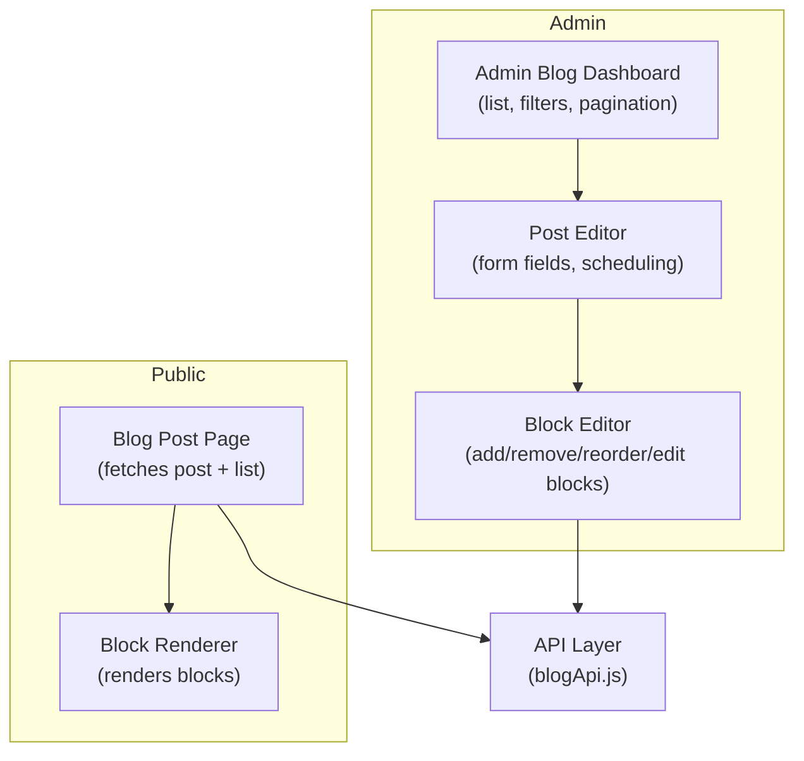
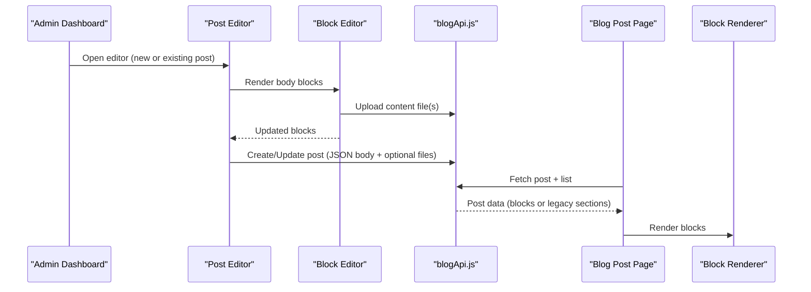
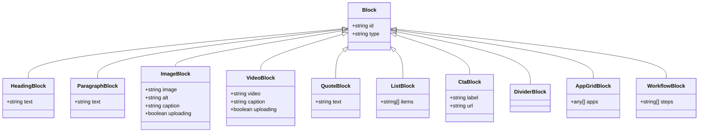
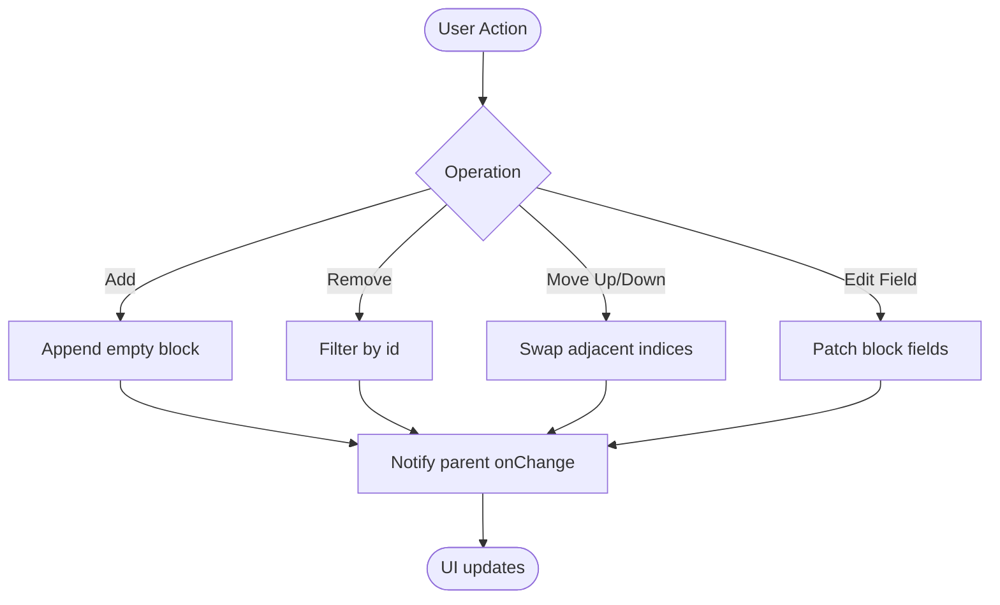
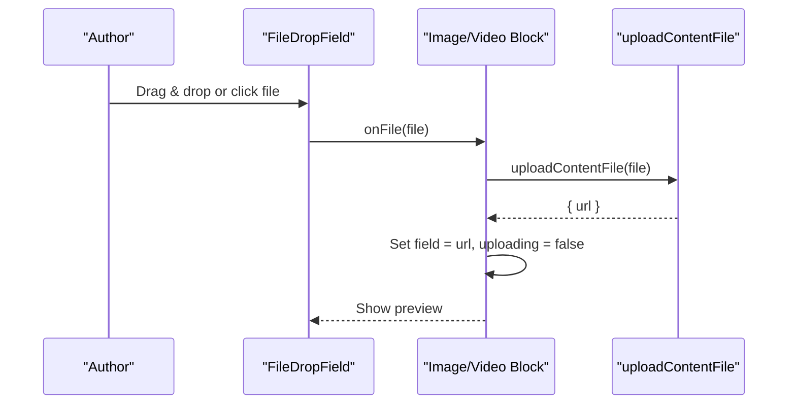
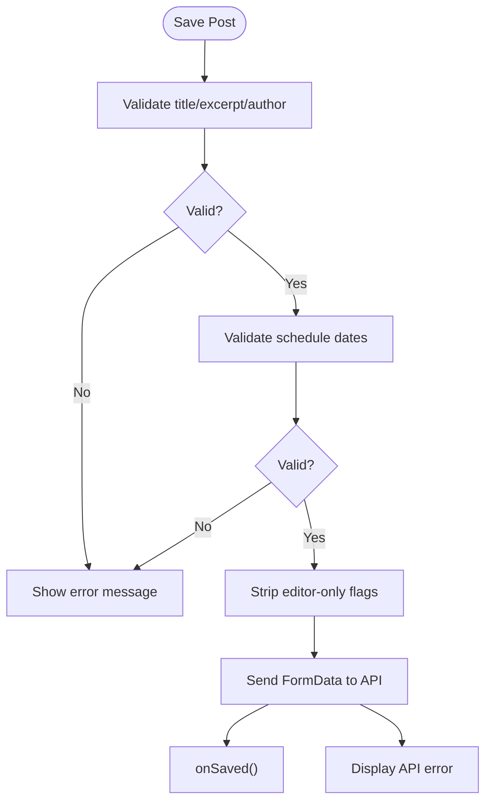
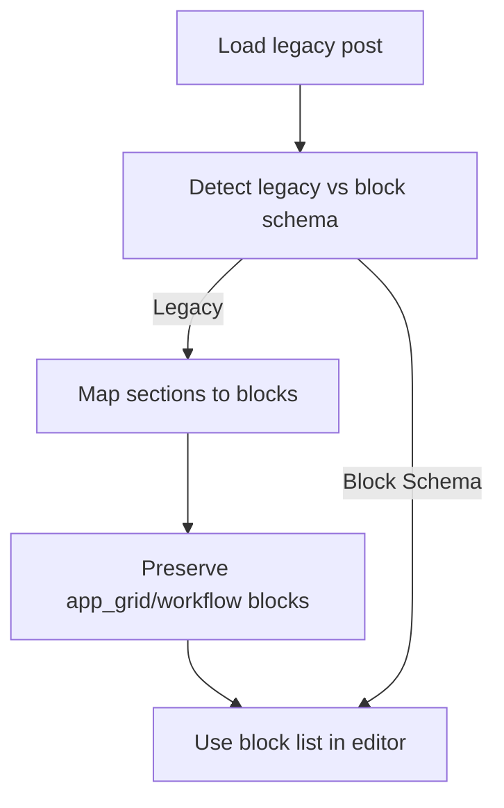
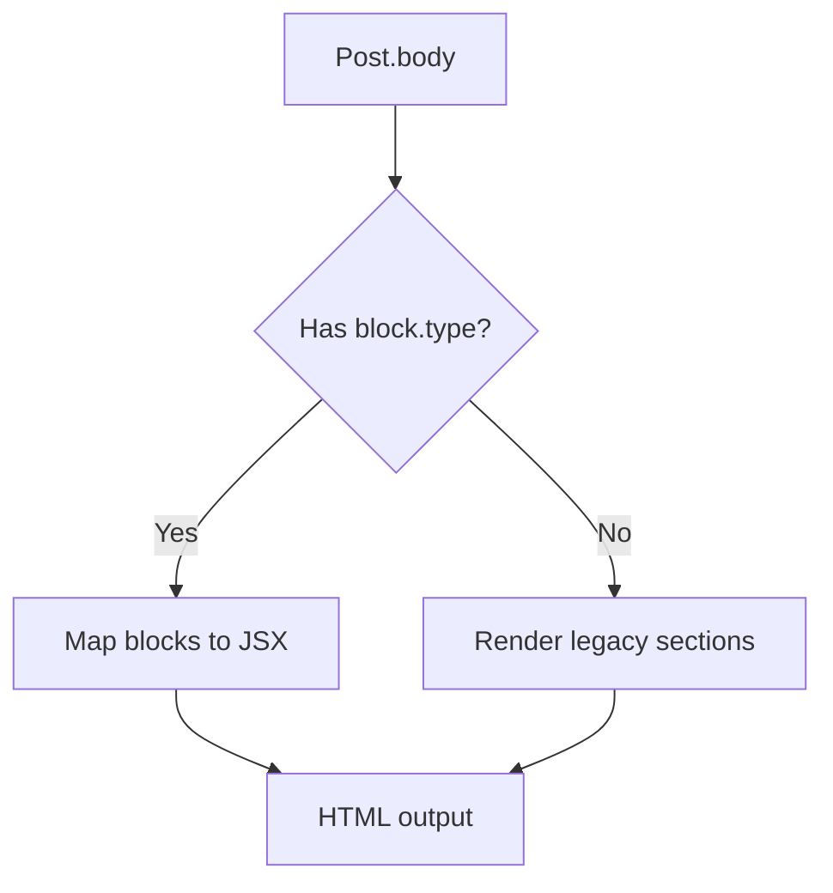
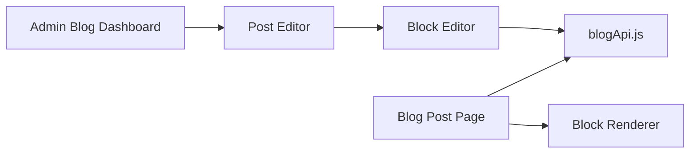

# Content Block Editor

<cite>
**Referenced Files in This Document**
- [Blog.jsx](file://src/pages/AdminDashboard/Blog.jsx)
- [BlogPost.jsx](file://src/pages/BlogPost.jsx)
- [blogApi.js](file://src/api/blogApi.js)
</cite>

## Table of Contents
1. [Introduction](#introduction)
2. [Project Structure](#project-structure)
3. [Core Components](#core-components)
4. [Architecture Overview](#architecture-overview)
5. [Detailed Component Analysis](#detailed-component-analysis)
6. [Dependency Analysis](#dependency-analysis)
7. [Performance Considerations](#performance-considerations)
8. [Troubleshooting Guide](#troubleshooting-guide)
9. [Conclusion](#conclusion)

## Introduction
This document describes the rich content block editor system used to author blog posts. It covers supported block types, manipulation operations (add, remove, reorder, edit), drag-and-drop file uploads, image and video handling, validation, preview, legacy data migration, rendering on the public page, and performance considerations for large content collections.

The editor is implemented as a React application with:
- An admin dashboard that provides the block editor and post management UI.
- A public blog post renderer that displays blocks consistently with the editor’s schema.
- API helpers for fetching, creating, updating, and uploading content files.

## Project Structure
The block editor lives primarily in the admin dashboard and is consumed by the public blog post renderer. The relevant files are:
- Admin dashboard and editor: src/pages/AdminDashboard/Blog.jsx
- Public renderer: src/pages/BlogPost.jsx
- API layer: src/api/blogApi.js

**Diagram sources**
- [Blog.jsx:401-500](file://src/pages/AdminDashboard/Blog.jsx#L401-L500)
- [Blog.jsx:819-1205](file://src/pages/AdminDashboard/Blog.jsx#L819-L1205)
- [Blog.jsx:591-814](file://src/pages/AdminDashboard/Blog.jsx#L591-L814)
- [BlogPost.jsx:447-587](file://src/pages/BlogPost.jsx#L447-L587)
- [BlogPost.jsx:274-325](file://src/pages/BlogPost.jsx#L274-L325)
- [blogApi.js](file://src/api/blogApi.js)

**Section sources**
- [Blog.jsx:401-500](file://src/pages/AdminDashboard/Blog.jsx#L401-L500)
- [Blog.jsx:819-1205](file://src/pages/AdminDashboard/Blog.jsx#L819-L1205)
- [Blog.jsx:591-814](file://src/pages/AdminDashboard/Blog.jsx#L591-L814)
- [BlogPost.jsx:447-587](file://src/pages/BlogPost.jsx#L447-L587)
- [BlogPost.jsx:274-325](file://src/pages/BlogPost.jsx#L274-L325)

## Core Components
- Admin Blog Dashboard: Lists posts, supports filtering, sorting, pagination, and opens the editor.
- Post Editor: Manages post metadata, cover/social images, SEO fields, scheduling, and delegates body editing to the Block Editor.
- Block Editor: Renders each block with type-specific inputs, toolbar actions (move up/down, delete), add block menu, and inline file upload for images/videos.
- Public Blog Post Page: Fetches a single post and the full list, renders the body using a block renderer that supports both new block-based bodies and legacy section-based bodies.

Key responsibilities:
- Data model normalization and migration from legacy sections to blocks.
- Validation of required fields and scheduling constraints.
- File upload via direct upload endpoint.
- Rendering blocks consistently on the public site.

**Section sources**
- [Blog.jsx:401-500](file://src/pages/AdminDashboard/Blog.jsx#L401-L500)
- [Blog.jsx:819-1205](file://src/pages/AdminDashboard/Blog.jsx#L819-L1205)
- [Blog.jsx:591-814](file://src/pages/AdminDashboard/Blog.jsx#L591-L814)
- [BlogPost.jsx:447-587](file://src/pages/BlogPost.jsx#L447-L587)
- [BlogPost.jsx:274-325](file://src/pages/BlogPost.jsx#L274-L325)

## Architecture Overview
The editor follows a clear separation between admin authoring and public rendering:
- Authoring flow: Admin Dashboard → Post Editor → Block Editor → API Layer.
- Publishing flow: Public Blog Post Page → API Layer → Block Renderer.

**Diagram sources**
- [Blog.jsx:819-1205](file://src/pages/AdminDashboard/Blog.jsx#L819-L1205)
- [Blog.jsx:591-814](file://src/pages/AdminDashboard/Blog.jsx#L591-L814)
- [BlogPost.jsx:447-587](file://src/pages/BlogPost.jsx#L447-L587)
- [BlogPost.jsx:274-325](file://src/pages/BlogPost.jsx#L274-L325)
- [blogApi.js](file://src/api/blogApi.js)

## Detailed Component Analysis

### Supported Block Types
The editor supports the following block types:
- heading
- paragraph
- image
- video
- quote
- bullet_list
- numbered_list
- cta
- divider

Legacy preserved blocks (kept when migrating older posts):
- app_grid
- workflow

These are defined centrally and used to render editor controls and public output.

**Section sources**
- [Blog.jsx:44-65](file://src/pages/AdminDashboard/Blog.jsx#L44-L65)
- [Blog.jsx:186-208](file://src/pages/AdminDashboard/Blog.jsx#L186-L208)
- [Blog.jsx:779-791](file://src/pages/AdminDashboard/Blog.jsx#L779-L791)
- [BlogPost.jsx:274-325](file://src/pages/BlogPost.jsx#L274-L325)

### Block Data Model
Each block has a stable id and a type discriminator. Type-specific fields vary:
- heading: text
- paragraph: text
- image: image URL, alt, caption; editor-only uploading flag
- video: video URL, caption; editor-only uploading flag
- quote: text
- bullet_list / numbered_list: items array of strings
- cta: label, url
- divider: none
- app_grid / workflow: legacy preserved structures

Empty block templates are provided per type to simplify adding new blocks.

**Diagram sources**
- [Blog.jsx:186-208](file://src/pages/AdminDashboard/Blog.jsx#L186-L208)
- [Blog.jsx:249-252](file://src/pages/AdminDashboard/Blog.jsx#L249-L252)

**Section sources**
- [Blog.jsx:186-208](file://src/pages/AdminDashboard/Blog.jsx#L186-L208)
- [Blog.jsx:249-252](file://src/pages/AdminDashboard/Blog.jsx#L249-L252)

### Block Manipulation Operations
- Add: Adds a new empty block at the end and focuses the add menu state.
- Remove: Filters out the block by id.
- Reorder: Swaps adjacent blocks based on direction (-1 or +1).
- Edit: Updates block fields through typed inputs (textareas, inputs, lists).

All operations update the parent form state immutably and propagate changes to child components.

**Diagram sources**
- [Blog.jsx:591-611](file://src/pages/AdminDashboard/Blog.jsx#L591-L611)
- [Blog.jsx:624-814](file://src/pages/AdminDashboard/Blog.jsx#L624-L814)

**Section sources**
- [Blog.jsx:591-611](file://src/pages/AdminDashboard/Blog.jsx#L591-L611)
- [Blog.jsx:624-814](file://src/pages/AdminDashboard/Blog.jsx#L624-L814)

### Drag-and-Drop File Uploads
- FileDropField supports click-to-upload and drag-and-drop.
- For image and video blocks, it triggers an upload to the server and stores the returned URL in the block.
- Preview is shown after successful upload.
- The component handles disabled states and loading indicators.

**Diagram sources**
- [Blog.jsx:547-586](file://src/pages/AdminDashboard/Blog.jsx#L547-L586)
- [Blog.jsx:613-622](file://src/pages/AdminDashboard/Blog.jsx#L613-L622)
- [Blog.jsx:677-725](file://src/pages/AdminDashboard/Blog.jsx#L677-L725)

**Section sources**
- [Blog.jsx:547-586](file://src/pages/AdminDashboard/Blog.jsx#L547-L586)
- [Blog.jsx:613-622](file://src/pages/AdminDashboard/Blog.jsx#L613-L622)
- [Blog.jsx:677-725](file://src/pages/AdminDashboard/Blog.jsx#L677-L725)

### Image Optimization and Video Processing
- The editor accepts image and video files directly and sends them to the backend via a dedicated upload endpoint.
- No client-side optimization or transcoding is performed in this repository; optimization and processing are delegated to the backend.
- The UI shows hints such as recommended dimensions and maximum file sizes.

Note: Actual optimization/processing logic resides on the server side and is not present in this frontend codebase.

**Section sources**
- [Blog.jsx:677-725](file://src/pages/AdminDashboard/Blog.jsx#L677-L725)

### Block Validation System
- Required post-level fields: title, excerpt, author.
- Scheduling constraints: expiry must be in the future and after publish time if set.
- Block-level preview and filled status help authors identify incomplete blocks before saving.
- Server-side validation is also enforced; errors are normalized and displayed.

**Diagram sources**
- [Blog.jsx:887-948](file://src/pages/AdminDashboard/Blog.jsx#L887-L948)
- [Blog.jsx:249-252](file://src/pages/AdminDashboard/Blog.jsx#L249-L252)

**Section sources**
- [Blog.jsx:887-948](file://src/pages/AdminDashboard/Blog.jsx#L887-L948)
- [Blog.jsx:249-252](file://src/pages/AdminDashboard/Blog.jsx#L249-L252)

### Preview Functionality
- Each block shows a short preview text next to its type badge indicating current content.
- Image/video blocks show thumbnails or video previews after upload.
- The filled indicator helps distinguish empty placeholders from completed blocks.

**Section sources**
- [Blog.jsx:128-184](file://src/pages/AdminDashboard/Blog.jsx#L128-L184)
- [Blog.jsx:624-814](file://src/pages/AdminDashboard/Blog.jsx#L624-L814)

### Content Migration from Legacy Formats
- Legacy posts use a section-based structure with fields like heading, paragraphs, apps, workflow, image, video, quote.
- On load, the editor converts these sections into the new flat block list while preserving order and IDs where possible.
- Preserved blocks (app_grid, workflow) are kept as-is so existing visuals continue to render.

**Diagram sources**
- [Blog.jsx:210-247](file://src/pages/AdminDashboard/Blog.jsx#L210-L247)
- [Blog.jsx:828-864](file://src/pages/AdminDashboard/Blog.jsx#L828-L864)

**Section sources**
- [Blog.jsx:210-247](file://src/pages/AdminDashboard/Blog.jsx#L210-L247)
- [Blog.jsx:828-864](file://src/pages/AdminDashboard/Blog.jsx#L828-L864)

### Public Rendering of Blocks
- The public page renders blocks using a switch-based renderer that maps block types to semantic HTML elements.
- It supports both the new block schema and the legacy section schema for backward compatibility.
- Headings generate anchor IDs used by the table of contents.

**Diagram sources**
- [BlogPost.jsx:274-325](file://src/pages/BlogPost.jsx#L274-L325)
- [BlogPost.jsx:333-372](file://src/pages/BlogPost.jsx#L333-L372)

**Section sources**
- [BlogPost.jsx:274-325](file://src/pages/BlogPost.jsx#L274-L325)
- [BlogPost.jsx:333-372](file://src/pages/BlogPost.jsx#L333-L372)

## Dependency Analysis
- Admin Blog Dashboard depends on:
  - Post Editor for authoring.
  - Block Editor for content composition.
  - API layer for data operations and file uploads.
- Public Blog Post Page depends on:
  - API layer for fetching post and list data.
  - Block Renderer for consistent display.

**Diagram sources**
- [Blog.jsx:401-500](file://src/pages/AdminDashboard/Blog.jsx#L401-L500)
- [Blog.jsx:819-1205](file://src/pages/AdminDashboard/Blog.jsx#L819-L1205)
- [Blog.jsx:591-814](file://src/pages/AdminDashboard/Blog.jsx#L591-L814)
- [BlogPost.jsx:447-587](file://src/pages/BlogPost.jsx#L447-L587)
- [BlogPost.jsx:274-325](file://src/pages/BlogPost.jsx#L274-L325)
- [blogApi.js](file://src/api/blogApi.js)

**Section sources**
- [Blog.jsx:401-500](file://src/pages/AdminDashboard/Blog.jsx#L401-L500)
- [Blog.jsx:819-1205](file://src/pages/AdminDashboard/Blog.jsx#L819-L1205)
- [Blog.jsx:591-814](file://src/pages/AdminDashboard/Blog.jsx#L591-L814)
- [BlogPost.jsx:447-587](file://src/pages/BlogPost.jsx#L447-L587)
- [BlogPost.jsx:274-325](file://src/pages/BlogPost.jsx#L274-L325)

## Performance Considerations
- Large content collections:
  - The admin dashboard uses client-side filtering, sorting, and pagination to keep the UI responsive.
  - Only the visible page slice is rendered in the list view.
- Memory management:
  - Avoid storing unnecessary editor-only flags in persisted data; strip them before sending to the API.
  - Reuse object references where possible and avoid deep cloning unless necessary.
- Rendering efficiency:
  - Keep block keys stable (id) to minimize re-renders.
  - Prefer memoization for derived data (e.g., filtered/sorted lists).
- Media handling:
  - Defer heavy media processing to the backend; the frontend only manages URLs and previews.
  - Use lazy loading for images and videos in the public renderer.

[No sources needed since this section provides general guidance]

## Troubleshooting Guide
- Common save errors:
  - Missing required fields: ensure title, excerpt, and author are filled.
  - Invalid schedule: expiry must be in the future and after publish time.
  - API errors: normalized messages are displayed; check network tab for details.
- Upload issues:
  - Ensure the file type matches accepted types (image/* or video/*).
  - Confirm the backend upload endpoint is reachable and returns a URL.
- Migration anomalies:
  - If legacy sections do not convert correctly, verify section fields exist and are arrays/strings as expected.
- Rendering differences:
  - Verify block ids are present for headings to maintain TOC anchors.
  - Ensure the body is either a block array or legacy sections; mixed formats may cause unexpected behavior.

**Section sources**
- [Blog.jsx:887-948](file://src/pages/AdminDashboard/Blog.jsx#L887-L948)
- [Blog.jsx:613-622](file://src/pages/AdminDashboard/Blog.jsx#L613-L622)
- [Blog.jsx:210-247](file://src/pages/AdminDashboard/Blog.jsx#L210-L247)
- [BlogPost.jsx:489-499](file://src/pages/BlogPost.jsx#L489-L499)

## Conclusion
The content block editor provides a flexible, extensible system for composing rich blog content. It supports multiple block types, robust manipulation operations, drag-and-drop uploads, validation, preview, and seamless migration from legacy formats. The public renderer ensures consistent display across both new and old content schemas. With careful attention to performance and memory management, the system scales well for large content collections and complex posts.

[No sources needed since this section summarizes without analyzing specific files]