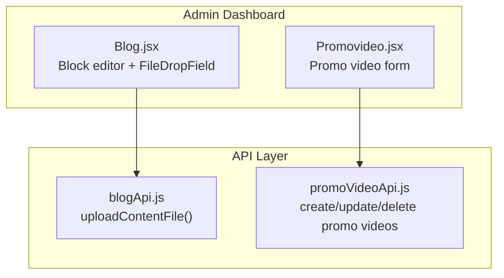
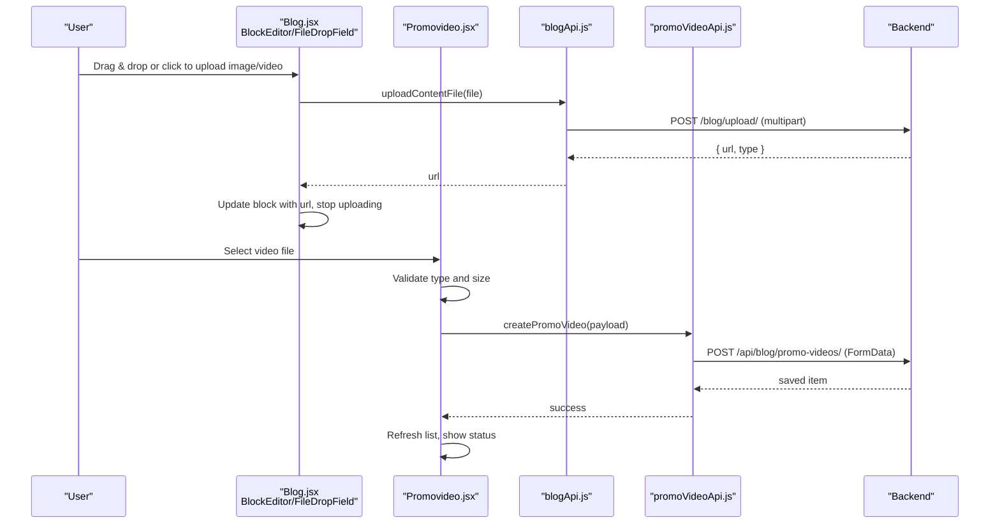
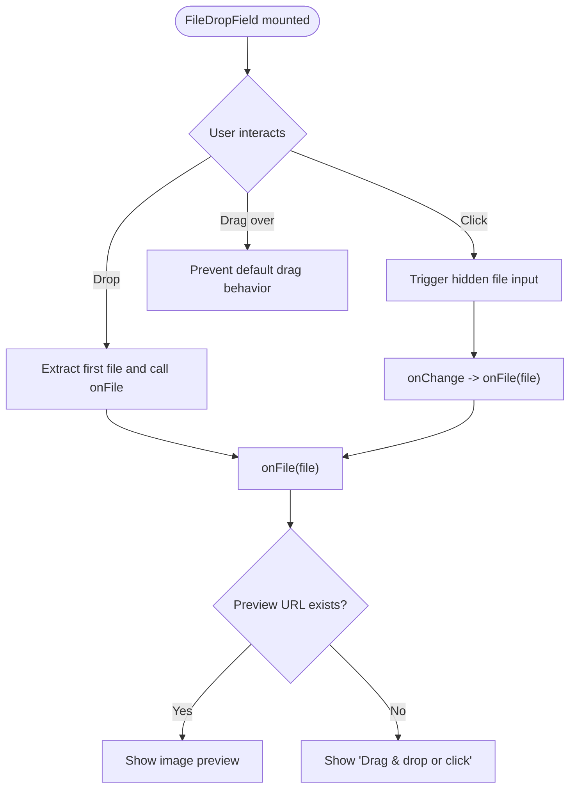
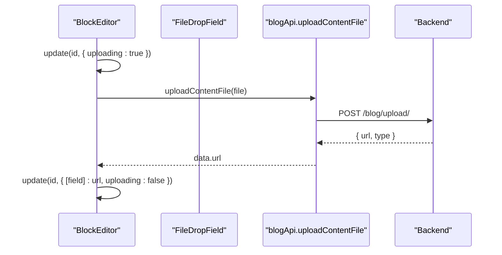
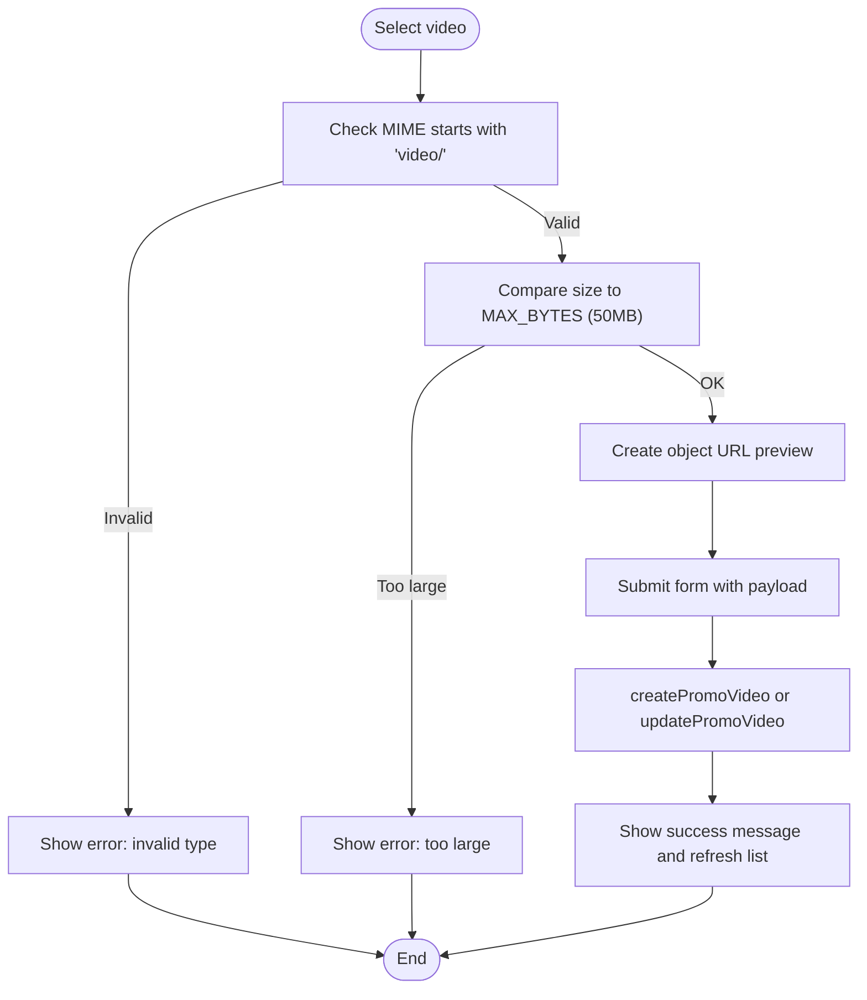
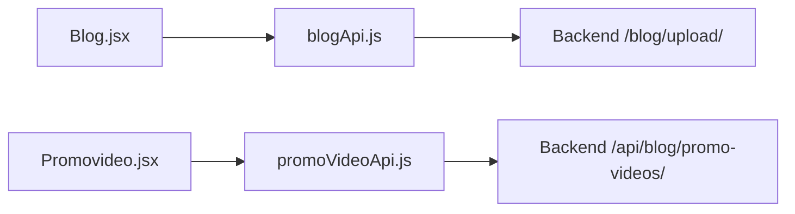

# Media Upload System

<cite>
**Referenced Files in This Document**   
- [Blog.jsx](file://src/pages/AdminDashboard/Blog.jsx)
- [Promovideo.jsx](file://src/pages/AdminDashboard/Promovideo.jsx)
- [blogApi.js](file://src/api/blogApi.js)
- [promoVideoApi.js](file://src/api/promoVideoApi.js)
</cite>

## Table of Contents
1. [Introduction](#introduction)
2. [Project Structure](#project-structure)
3. [Core Components](#core-components)
4. [Architecture Overview](#architecture-overview)
5. [Detailed Component Analysis](#detailed-component-analysis)
6. [Dependency Analysis](#dependency-analysis)
7. [Performance Considerations](#performance-considerations)
8. [Troubleshooting Guide](#troubleshooting-guide)
9. [Conclusion](#conclusion)

## Introduction
This document explains the media upload system for images and videos in the admin dashboard. It covers:
- File drop zone implementation with drag-and-drop and click-to-upload
- File validation rules, including size limits and format restrictions
- Upload progress indicators and error handling
- API integration for content uploads and promo video management
- Storage expectations and how uploaded URLs are used
- Browser compatibility, mobile support, and accessibility considerations

The system supports two main flows:
- Blog content blocks can upload images and videos directly into post content.
- The Promo Video page allows uploading a single promotional video with metadata and scheduling.

## Project Structure
Media upload functionality is implemented across two admin pages and their corresponding API modules:
- Blog editor: reusable file drop zone and block-level image/video upload
- Promo video page: dedicated video upload form with client-side validation



**Diagram sources**
- [Blog.jsx:547-586](file://src/pages/AdminDashboard/Blog.jsx#L547-L586)
- [Blog.jsx:613-622](file://src/pages/AdminDashboard/Blog.jsx#L613-L622)
- [Promovideo.jsx:112-129](file://src/pages/AdminDashboard/Promovideo.jsx#L112-L129)
- [blogApi.js:63-74](file://src/api/blogApi.js#L63-L74)
- [promoVideoApi.js:55-70](file://src/api/promoVideoApi.js#L55-L70)

**Section sources**
- [Blog.jsx:547-586](file://src/pages/AdminDashboard/Blog.jsx#L547-L586)
- [Promovideo.jsx:112-129](file://src/pages/AdminDashboard/Promovideo.jsx#L112-L129)
- [blogApi.js:63-74](file://src/api/blogApi.js#L63-L74)
- [promoVideoApi.js:55-70](file://src/api/promoVideoApi.js#L55-L70)

## Core Components
- FileDropField (Blog): A reusable component that provides a clickable and draggable area to select files. It shows a preview when available and an “Uploading…” state while a file is being sent.
- BlockEditor (Blog): Manages content blocks and triggers per-block uploads for images and videos.
- PromoVideo form (Promovideo.jsx): A focused form for selecting a video file, validating it, previewing it, and submitting it along with metadata.

Key responsibilities:
- Accept user input via drag-and-drop or file picker
- Validate file type and size where applicable
- Show previews and upload status
- Call the appropriate API endpoint to persist the file and receive a URL
- Display errors and allow retry through re-selection

**Section sources**
- [Blog.jsx:547-586](file://src/pages/AdminDashboard/Blog.jsx#L547-L586)
- [Blog.jsx:613-622](file://src/pages/AdminDashboard/Blog.jsx#L613-L622)
- [Promovideo.jsx:112-129](file://src/pages/AdminDashboard/Promovideo.jsx#L112-L129)

## Architecture Overview
The upload architecture separates UI interaction from API calls:

- UI layer:
  - Blog.jsx renders FileDropField and BlockEditor.
  - Promovideo.jsx renders a video upload form with validation and preview.
- API layer:
  - blogApi.uploadContentFile posts multipart/form-data to /blog/upload/.
  - promoVideoApi uses fetch to POST/PATCH/DELETE promo videos to /api/blog/promo-videos/.



**Diagram sources**
- [Blog.jsx:613-622](file://src/pages/AdminDashboard/Blog.jsx#L613-L622)
- [blogApi.js:63-74](file://src/api/blogApi.js#L63-L74)
- [Promovideo.jsx:148-201](file://src/pages/AdminDashboard/Promovideo.jsx#L148-L201)
- [promoVideoApi.js:55-70](file://src/api/promoVideoApi.js#L55-L70)

## Detailed Component Analysis

### File Drop Zone and Drag-and-Drop (Blog.jsx)
The FileDropField component implements:
- Click-to-upload by triggering a hidden file input
- Drag-and-drop via onDragOver and onDrop handlers
- Preview rendering when a URL is provided
- Disabled state propagation to prevent uploads during saving

Validation and UX:
- accept attribute restricts browser file picker options
- No explicit MIME/type check inside FileDropField; validation is delegated to callers or backend
- Uploading state is passed down to update the UI text



**Diagram sources**
- [Blog.jsx:547-586](file://src/pages/AdminDashboard/Blog.jsx#L547-L586)

**Section sources**
- [Blog.jsx:547-586](file://src/pages/AdminDashboard/Blog.jsx#L547-L586)

### Block-Level Image and Video Upload (Blog.jsx)
BlockEditor manages per-block upload lifecycle:
- Sets uploading flag before calling uploadContentFile
- Updates block field with returned URL on success
- Clears uploading flag and alerts on failure



**Diagram sources**
- [Blog.jsx:613-622](file://src/pages/AdminDashboard/Blog.jsx#L613-L622)
- [blogApi.js:63-74](file://src/api/blogApi.js#L63-L74)

**Section sources**
- [Blog.jsx:613-622](file://src/pages/AdminDashboard/Blog.jsx#L613-L622)

### Promo Video Upload Form (Promovideo.jsx)
The promo video form includes:
- Client-side validation for MIME type and file size
- Local preview using URL.createObjectURL
- Scheduling fields and metadata submission
- Error handling and success feedback



**Diagram sources**
- [Promovideo.jsx:112-129](file://src/pages/AdminDashboard/Promovideo.jsx#L112-L129)
- [Promovideo.jsx:148-201](file://src/pages/AdminDashboard/Promovideo.jsx#L148-L201)
- [promoVideoApi.js:55-70](file://src/api/promoVideoApi.js#L55-L70)

**Section sources**
- [Promovideo.jsx:112-129](file://src/pages/AdminDashboard/Promovideo.jsx#L112-L129)
- [Promovideo.jsx:148-201](file://src/pages/AdminDashboard/Promovideo.jsx#L148-L201)

### API Integration for Uploads
- Content file upload:
  - Endpoint: POST /blog/upload/
  - Payload: multipart/form-data with key file
  - Response: object containing url and type
  - Errors: thrown as Error with readable message derived from response body

- Promo video CRUD:
  - Endpoints:
    - GET /api/blog/promo-videos/
    - POST /api/blog/promo-videos/
    - PATCH /api/blog/promo-videos/{id}/
    - DELETE /api/blog/promo-videos/{id}/
  - Payload: FormData with optional video file and metadata
  - Authentication: Authorization header with token retrieved from client

```mermaid
classDiagram
class BlogApi {
+uploadContentFile(file)
+createPost(formData)
+updatePost(slug, formData)
}
class PromoVideoApi {
+listPromoVideos()
+createPromoVideo(payload)
+updatePromoVideo(id, payload)
+deletePromoVideo(id)
}
BlogApi --> "POST /blog/upload/" : "multipart/form-data"
PromoVideoApi --> "POST/PATCH/DELETE /api/blog/promo-videos/" : "FormData"
```

**Diagram sources**
- [blogApi.js:63-74](file://src/api/blogApi.js#L63-L74)
- [promoVideoApi.js:49-79](file://src/api/promoVideoApi.js#L49-L79)

**Section sources**
- [blogApi.js:63-74](file://src/api/blogApi.js#L63-L74)
- [promoVideoApi.js:49-79](file://src/api/promoVideoApi.js#L49-L79)

## Dependency Analysis
- Blog.jsx depends on:
  - blogApi.uploadContentFile for block-level media uploads
  - blogApi.createPost/updatePost for saving posts with optional cover/social images
- Promovideo.jsx depends on:
  - promoVideoApi functions for listing, creating, updating, and deleting promo videos
- Both pages use standard browser APIs:
  - FileReader-free approach using URL.createObjectURL for local previews
  - FormData for multipart submissions
  - Fetch for promo video API calls



**Diagram sources**
- [Blog.jsx:613-622](file://src/pages/AdminDashboard/Blog.jsx#L613-L622)
- [blogApi.js:63-74](file://src/api/blogApi.js#L63-L74)
- [Promovideo.jsx:148-201](file://src/pages/AdminDashboard/Promovideo.jsx#L148-L201)
- [promoVideoApi.js:49-79](file://src/api/promoVideoApi.js#L49-L79)

**Section sources**
- [Blog.jsx:613-622](file://src/pages/AdminDashboard/Blog.jsx#L613-L622)
- [Promovideo.jsx:148-201](file://src/pages/AdminDashboard/Promovideo.jsx#L148-L201)

## Performance Considerations
- Client-side preview:
  - Uses URL.createObjectURL to avoid network overhead for previews
  - PromoVideo.jsx revokes object URLs when they change or on unmount to free memory
- Multipart uploads:
  - Blog block uploads send one file at a time
  - Promo video form sends a single video file with metadata
- No client-side compression or thumbnail generation is implemented; optimization should be handled server-side or via a CDN/storage service.

Recommendations:
- Implement client-side image resizing and compression before upload for large images
- Add chunked or resumable uploads for large videos
- Introduce progress tracking using XMLHttpRequest upload events or a library like axios-progress if needed

[No sources needed since this section provides general guidance]

## Troubleshooting Guide
Common issues and resolutions:
- Invalid file type:
  - PromoVideo.jsx validates MIME type and shows an error if not a video
  - Ensure accept attributes match expected types in UI
- File too large:
  - PromoVideo.jsx enforces a 50MB limit; adjust MAX_BYTES if backend policy changes
- Upload failures:
  - Blog block uploads alert with the error message from the API
  - PromoVideo.jsx displays error messages from the API response
- Scheduling constraints:
  - Both Blog and PromoVideo validate publishAt and deleteAt to ensure valid future times and ordering

Action steps:
- Verify backend endpoints are reachable and returning expected responses
- Check authentication headers for promo video API calls
- Confirm file size and MIME type constraints align with backend requirements

**Section sources**
- [Promovideo.jsx:112-129](file://src/pages/AdminDashboard/Promovideo.jsx#L112-L129)
- [Promovideo.jsx:148-201](file://src/pages/AdminDashboard/Promovideo.jsx#L148-L201)
- [Blog.jsx:613-622](file://src/pages/AdminDashboard/Blog.jsx#L613-L622)
- [blogApi.js:63-74](file://src/api/blogApi.js#L63-L74)

## Conclusion
The media upload system provides robust, user-friendly interfaces for uploading images and videos within blog content and managing promotional videos. It leverages drag-and-drop and click-to-upload patterns, applies basic client-side validation, and integrates with backend APIs to persist media and return URLs for display. For production-grade performance and security, consider adding client-side compression, detailed upload progress, retry logic, and comprehensive server-side validation and sanitization.

[No sources needed since this section summarizes without analyzing specific files]