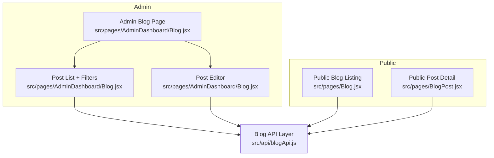
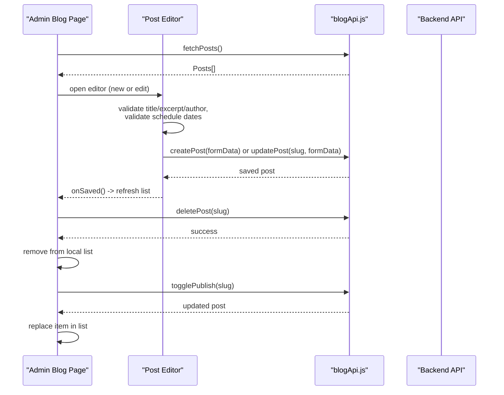
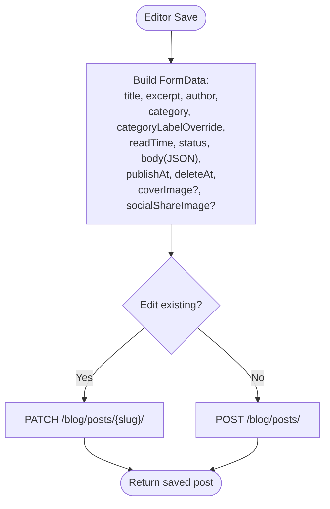
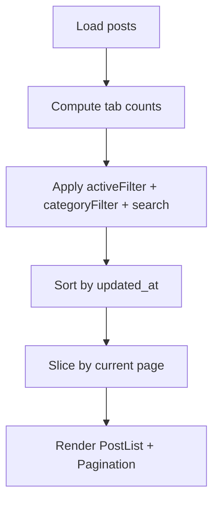
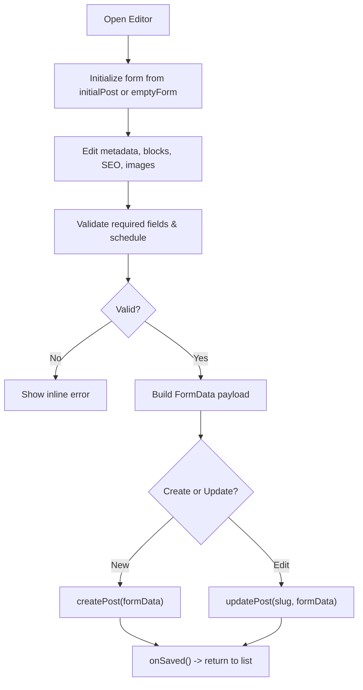
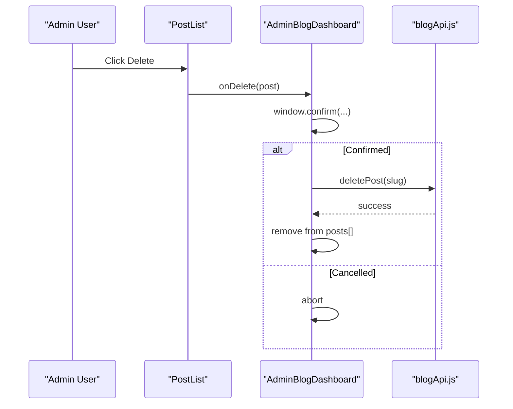
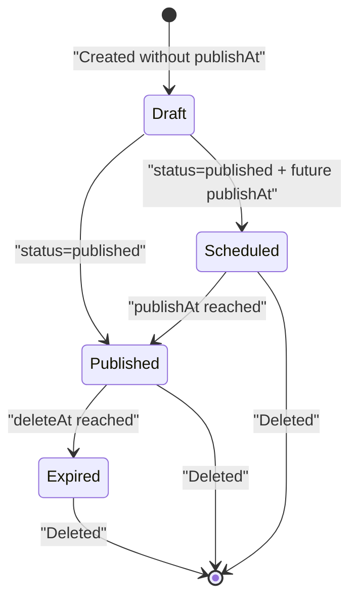
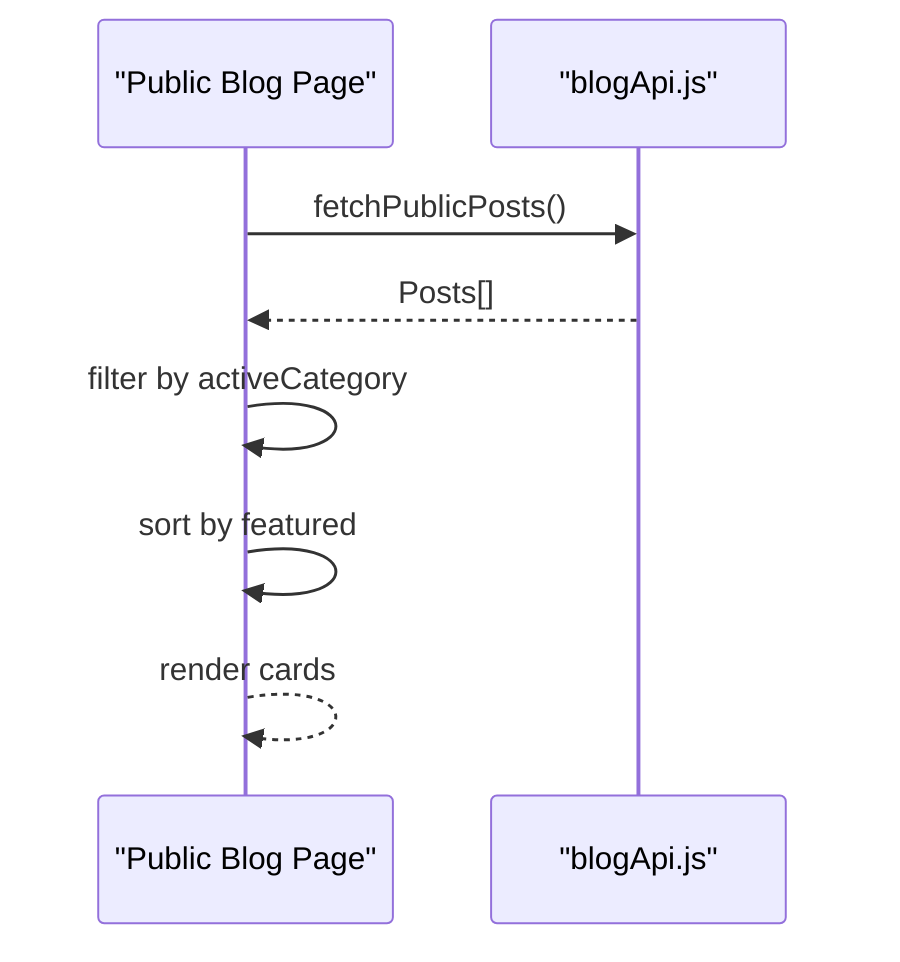
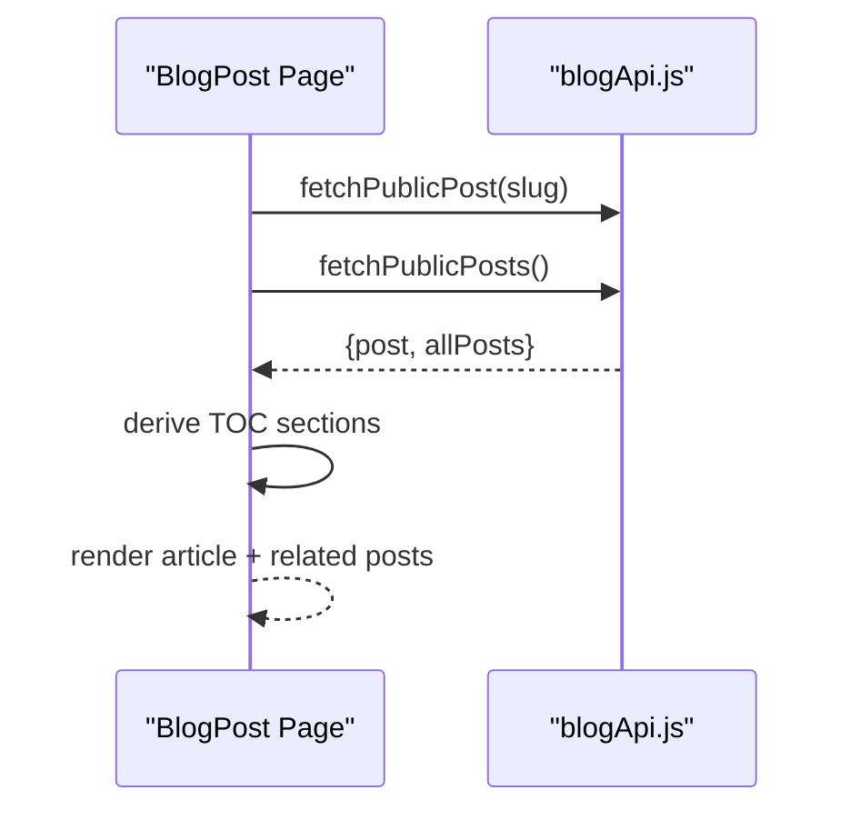
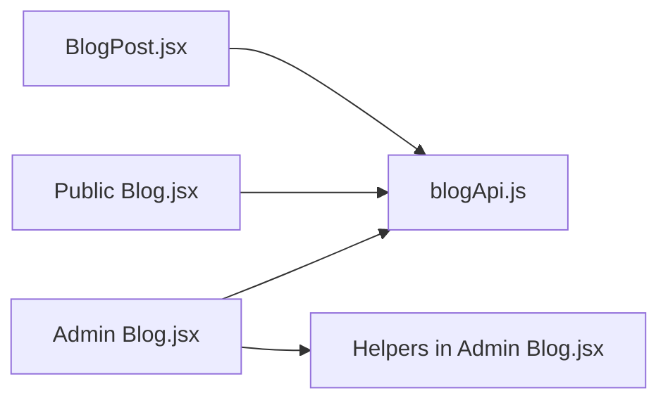

# Post CRUD Operations

<cite>
**Referenced Files in This Document**   
- [blogApi.js](file://src/api/blogApi.js)
- [Blog.jsx (Admin Dashboard)](file://src/pages/AdminDashboard/Blog.jsx)
- [Blog.jsx (Public)](file://src/pages/Blog.jsx)
- [BlogPost.jsx](file://src/pages/BlogPost.jsx)
</cite>

## Table of Contents
1. [Introduction](#introduction)
2. [Project Structure](#project-structure)
3. [Core Components](#core-components)
4. [Architecture Overview](#architecture-overview)
5. [Detailed Component Analysis](#detailed-component-analysis)
6. [Dependency Analysis](#dependency-analysis)
7. [Performance Considerations](#performance-considerations)
8. [Troubleshooting Guide](#troubleshooting-guide)
9. [Conclusion](#conclusion)

## Introduction
This document explains the complete blog post lifecycle implemented in the frontend: creating, reading, updating, and deleting posts; editing interfaces; deletion confirmation; retrieval for both admin and public contexts; form handling and validation; error handling; user feedback; listing with filtering, search, sorting, and pagination; and status management including draft, published, scheduled, and expired states. It also includes API call examples, data transformation patterns, and state management approaches used across the application.

## Project Structure
The blog feature is split into two main areas:
- Admin dashboard: full CRUD, editor, scheduling, filtering, search, sorting, and pagination.
- Public pages: read-only listing and single-post view.

**Diagram sources**
- [Blog.jsx (Admin Dashboard):1-1470](file://src/pages/AdminDashboard/Blog.jsx#L1-L1470)
- [Blog.jsx (Public):1-320](file://src/pages/Blog.jsx#L1-L320)
- [BlogPost.jsx:1-587](file://src/pages/BlogPost.jsx#L1-L587)
- [blogApi.js:1-135](file://src/api/blogApi.js#L1-L135)

**Section sources**
- [blogApi.js:1-135](file://src/api/blogApi.js#L1-L135)
- [Blog.jsx (Admin Dashboard):1-1470](file://src/pages/AdminDashboard/Blog.jsx#L1-L1470)
- [Blog.jsx (Public):1-320](file://src/pages/Blog.jsx#L1-L320)
- [BlogPost.jsx:1-587](file://src/pages/BlogPost.jsx#L1-L587)

## Core Components
- API layer:
  - Admin endpoints: fetchPosts, fetchPost, createPost, updatePost, deletePost, togglePublish, uploadContentFile.
  - Public endpoints: fetchPublicPosts, fetchPublicPost.
  - Utilities: toIsoOrEmpty, buildPostFormData.
- Admin UI:
  - Post list with tabs, search, category filter, sort, pagination.
  - Post editor with rich block-based content, cover/social image uploads, SEO fields, publishing controls, scheduling.
  - Deletion confirmation via browser confirm dialog.
- Public UI:
  - Category-filtered listing grid.
  - Single post detail with table of contents, related posts, share actions.

**Section sources**
- [blogApi.js:1-135](file://src/api/blogApi.js#L1-L135)
- [Blog.jsx (Admin Dashboard):16-1470](file://src/pages/AdminDashboard/Blog.jsx#L16-L1470)
- [Blog.jsx (Public):1-320](file://src/pages/Blog.jsx#L1-L320)
- [BlogPost.jsx:1-587](file://src/pages/BlogPost.jsx#L1-L587)

## Architecture Overview
The system separates concerns between API calls and UI state:
- Admin pages use authenticated API clients to manage all posts, including drafts and scheduled items.
- Public pages use unauthenticated API clients to show only published content.
- The editor builds multipart FormData payloads to support file uploads and JSON body serialization.
- Status transitions are handled by a dedicated publish toggle endpoint and by explicit status selection during save.

**Diagram sources**
- [Blog.jsx (Admin Dashboard):1210-1470](file://src/pages/AdminDashboard/Blog.jsx#L1210-L1470)
- [blogApi.js:10-56](file://src/api/blogApi.js#L10-L56)

## Detailed Component Analysis

### API Layer: blogApi.js
Responsibilities:
- Admin reads: fetchPosts, fetchPost.
- Public reads: fetchPublicPosts, fetchPublicPost.
- Mutations: createPost, updatePost, deletePost, togglePublish.
- File upload: uploadContentFile.
- Data helpers: toIsoOrEmpty, buildPostFormData.

Key behaviors:
- Admin endpoints send authenticated requests; public endpoints do not include admin tokens.
- Create/update use multipart/form-data because cover images and social images are files.
- Body is JSON-stringified before appending to FormData so DRF can parse it back.
- Scheduling fields accept empty strings to clear schedules on the server.

**Diagram sources**
- [blogApi.js:35-56](file://src/api/blogApi.js#L35-L56)
- [blogApi.js:117-135](file://src/api/blogApi.js#L117-L135)

**Section sources**
- [blogApi.js:1-135](file://src/api/blogApi.js#L1-L135)

### Admin Post List: Filtering, Search, Sorting, Pagination
Features:
- Tabs: All, Published, Scheduled.
- Search: filters by title, author, and category label.
- Category filter: dropdown with “All categories” plus predefined options.
- Sort: newest first or oldest first by updated_at.
- Pagination: client-side paging with PAGE_SIZE = 10.

State management:
- Full posts array loaded once.
- Computed derived values: tabCounts, filteredPosts, sortedPosts, pagedPosts.
- Page resets when filters change.

**Diagram sources**
- [Blog.jsx (Admin Dashboard):1240-1284](file://src/pages/AdminDashboard/Blog.jsx#L1240-L1284)
- [Blog.jsx (Admin Dashboard):1374-1452](file://src/pages/AdminDashboard/Blog.jsx#L1374-L1452)

**Section sources**
- [Blog.jsx (Admin Dashboard):16-42](file://src/pages/AdminDashboard/Blog.jsx#L16-L42)
- [Blog.jsx (Admin Dashboard):1210-1470](file://src/pages/AdminDashboard/Blog.jsx#L1210-L1470)

### Admin Post Editor: Creation and Editing
Responsibilities:
- Initialize form from either empty defaults or an existing post.
- Support block-based content with multiple block types.
- Upload cover image and social share image.
- Manage SEO fields and tags/keywords chips.
- Publishing controls: status, featured, allowComments.
- Scheduling: publishAt and deleteAt with validation and preview.

Validation rules:
- Required: title, excerpt, author.
- Schedule constraints: expiry must be in the future; expiry must be after publish time.
- Client-side checks complement backend validation.

User feedback:
- Inline error messages for validation and API errors.
- Saving state disables inputs and changes button text.
- Success returns to list and refreshes posts.

**Diagram sources**
- [Blog.jsx (Admin Dashboard):819-1205](file://src/pages/AdminDashboard/Blog.jsx#L819-L1205)
- [blogApi.js:35-47](file://src/api/blogApi.js#L35-L47)

**Section sources**
- [Blog.jsx (Admin Dashboard):254-275](file://src/pages/AdminDashboard/Blog.jsx#L254-L275)
- [Blog.jsx (Admin Dashboard):819-1205](file://src/pages/AdminDashboard/Blog.jsx#L819-L1205)

### Deletion Process with Confirmation
Flow:
- User clicks delete on a row.
- Browser confirm dialog asks for confirmation.
- If confirmed, call deletePost and remove the item from local state.
- Busy slug prevents concurrent operations.

**Diagram sources**
- [Blog.jsx (Admin Dashboard):1311-1322](file://src/pages/AdminDashboard/Blog.jsx#L1311-L1322)
- [blogApi.js:49-51](file://src/api/blogApi.js#L49-L51)

**Section sources**
- [Blog.jsx (Admin Dashboard):1311-1322](file://src/pages/AdminDashboard/Blog.jsx#L1311-L1322)

### Status Management: Draft, Published, Scheduled, Expired
Status resolution:
- Newer posts use a status field: published, scheduled, expired.
- Older records may still have an is_published boolean; the code falls back to that.

Scheduling:
- publishAt sets when a post goes live.
- deleteAt sets when a post expires.
- With status 'published' and a future publishAt, the backend stores it as 'scheduled'.

UI behavior:
- Status badge buttons toggle publish state via togglePublish.
- Editor allows selecting status and setting schedule times.
- List shows schedule notes like “Goes live … · Expires …”.

**Diagram sources**
- [Blog.jsx (Admin Dashboard):69-73](file://src/pages/AdminDashboard/Blog.jsx#L69-L73)
- [Blog.jsx (Admin Dashboard):100-114](file://src/pages/AdminDashboard/Blog.jsx#L100-L114)
- [blogApi.js:117-135](file://src/api/blogApi.js#L117-L135)

**Section sources**
- [Blog.jsx (Admin Dashboard):69-73](file://src/pages/AdminDashboard/Blog.jsx#L69-L73)
- [Blog.jsx (Admin Dashboard):100-114](file://src/pages/AdminDashboard/Blog.jsx#L100-L114)
- [blogApi.js:117-135](file://src/api/blogApi.js#L117-L135)

### Public Blog Listing: Category Filtering
Behavior:
- Loads public posts using fetchPublicPosts.
- Displays hero with category tabs.
- Filters posts locally by selected category.
- Featured posts float to the top.

Data flow:
- Loading state and error state managed locally.
- No pagination on the public listing; all results are rendered.

**Diagram sources**
- [Blog.jsx (Public):266-320](file://src/pages/Blog.jsx#L266-L320)
- [blogApi.js:25-28](file://src/api/blogApi.js#L25-L28)

**Section sources**
- [Blog.jsx (Public):15-35](file://src/pages/Blog.jsx#L15-L35)
- [Blog.jsx (Public):266-320](file://src/pages/Blog.jsx#L266-L320)

### Public Post Detail: Retrieval and Rendering
Behavior:
- Fetches the specific post and the full public list for related posts.
- Handles 404 and other errors gracefully.
- Renders both new block schema and legacy section schema.
- Provides table of contents with scroll-spy and share actions.

**Diagram sources**
- [BlogPost.jsx:447-587](file://src/pages/BlogPost.jsx#L447-L587)
- [blogApi.js:30-33](file://src/api/blogApi.js#L30-L33)

**Section sources**
- [BlogPost.jsx:447-587](file://src/pages/BlogPost.jsx#L447-L587)

## Dependency Analysis
High-level dependencies:
- Admin and public pages depend on blogApi.js for all HTTP interactions.
- Admin page composes PostList, PostEditor, and utility functions.
- Public pages compose Nav, Footer, and rendering components.

**Diagram sources**
- [Blog.jsx (Admin Dashboard):1-1470](file://src/pages/AdminDashboard/Blog.jsx#L1-L1470)
- [Blog.jsx (Public):1-320](file://src/pages/Blog.jsx#L1-L320)
- [BlogPost.jsx:1-587](file://src/pages/BlogPost.jsx#L1-L587)
- [blogApi.js:1-135](file://src/api/blogApi.js#L1-L135)

**Section sources**
- [blogApi.js:1-135](file://src/api/blogApi.js#L1-L135)
- [Blog.jsx (Admin Dashboard):1-1470](file://src/pages/AdminDashboard/Blog.jsx#L1-L1470)
- [Blog.jsx (Public):1-320](file://src/pages/Blog.jsx#L1-L320)
- [BlogPost.jsx:1-587](file://src/pages/BlogPost.jsx#L1-L587)

## Performance Considerations
- Admin list uses client-side filtering, sorting, and pagination to avoid extra network calls.
- Public listing loads all posts at once; consider server-side pagination if the dataset grows large.
- Image/video uploads are handled per block with uploading flags to prevent redundant work.
- Avoid sending the entire body when editing existing posts unless necessary; the editor conditionally sends body based on whether it’s already present.

[No sources needed since this section provides general guidance]

## Troubleshooting Guide
Common issues and strategies:
- Validation errors:
  - Missing title, excerpt, or author triggers an inline error message.
  - Invalid schedule dates produce descriptive errors.
- API errors:
  - Errors are normalized into readable messages, including field-specific messages from the backend.
- Upload failures:
  - Block-level upload catches errors and alerts the user; uploading flag is reset.
- Not found:
  - Public post detail shows a “Post not found” view for 404 responses.

Recommended debugging steps:
- Check the inline error area in the editor for validation feedback.
- Inspect network requests to ensure correct Content-Type headers for multipart uploads.
- Verify that publishAt/deleteAt are correctly converted to ISO strings.
- Confirm that the status field is being sent as expected.

**Section sources**
- [Blog.jsx (Admin Dashboard):116-126](file://src/pages/AdminDashboard/Blog.jsx#L116-L126)
- [Blog.jsx (Admin Dashboard):887-948](file://src/pages/AdminDashboard/Blog.jsx#L887-L948)
- [Blog.jsx (Admin Dashboard):613-622](file://src/pages/AdminDashboard/Blog.jsx#L613-L622)
- [BlogPost.jsx:469-478](file://src/pages/BlogPost.jsx#L469-L478)

## Conclusion
The blog CRUD implementation cleanly separates admin and public concerns, uses robust form handling with multipart uploads, and provides comprehensive status and scheduling capabilities. The admin interface offers powerful filtering, search, sorting, and pagination, while the public interface focuses on readability and discoverability. Error handling and user feedback are integrated throughout to ensure a smooth experience for both authors and readers.

[No sources needed since this section summarizes without analyzing specific files]