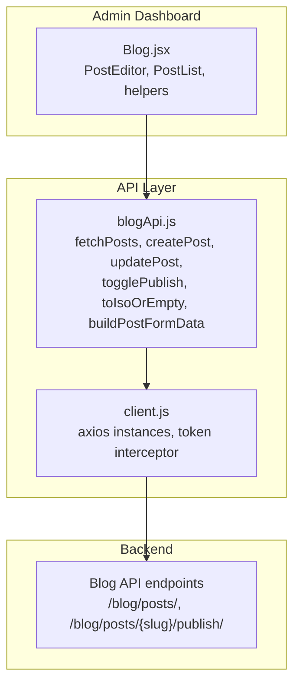
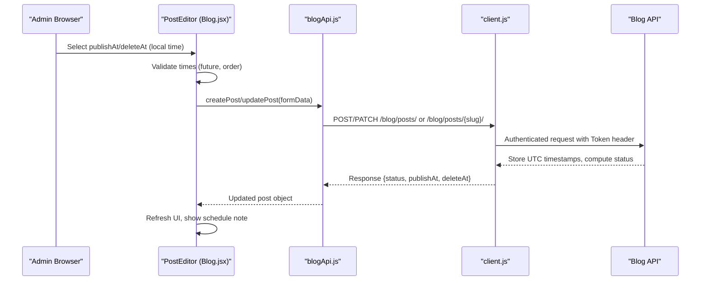
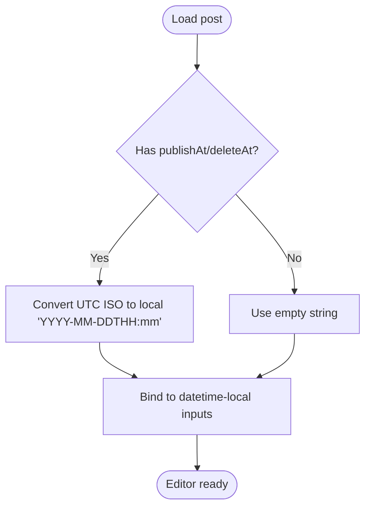
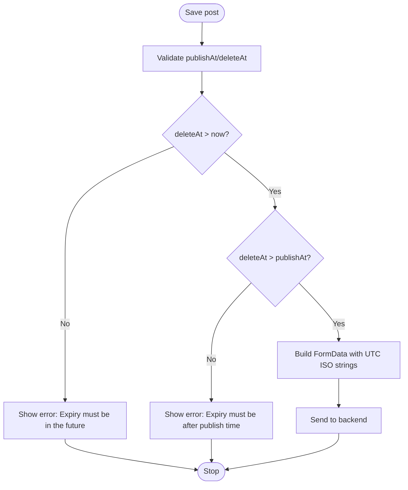
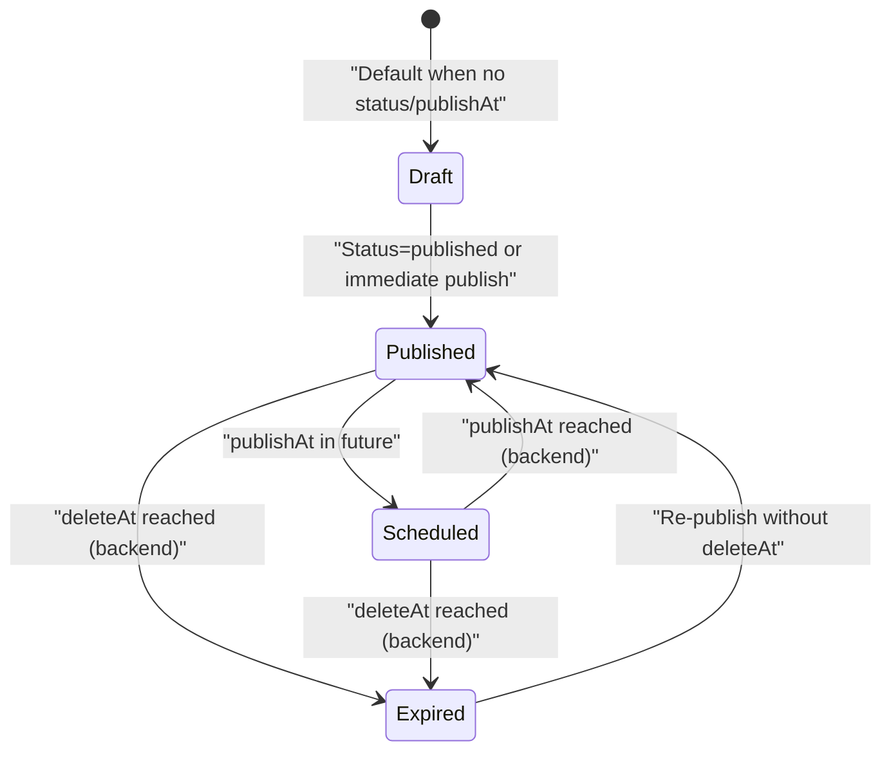
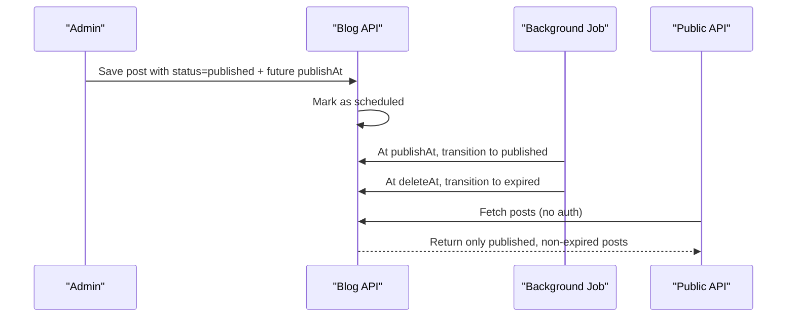
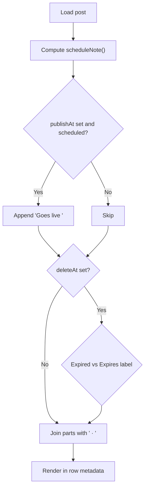
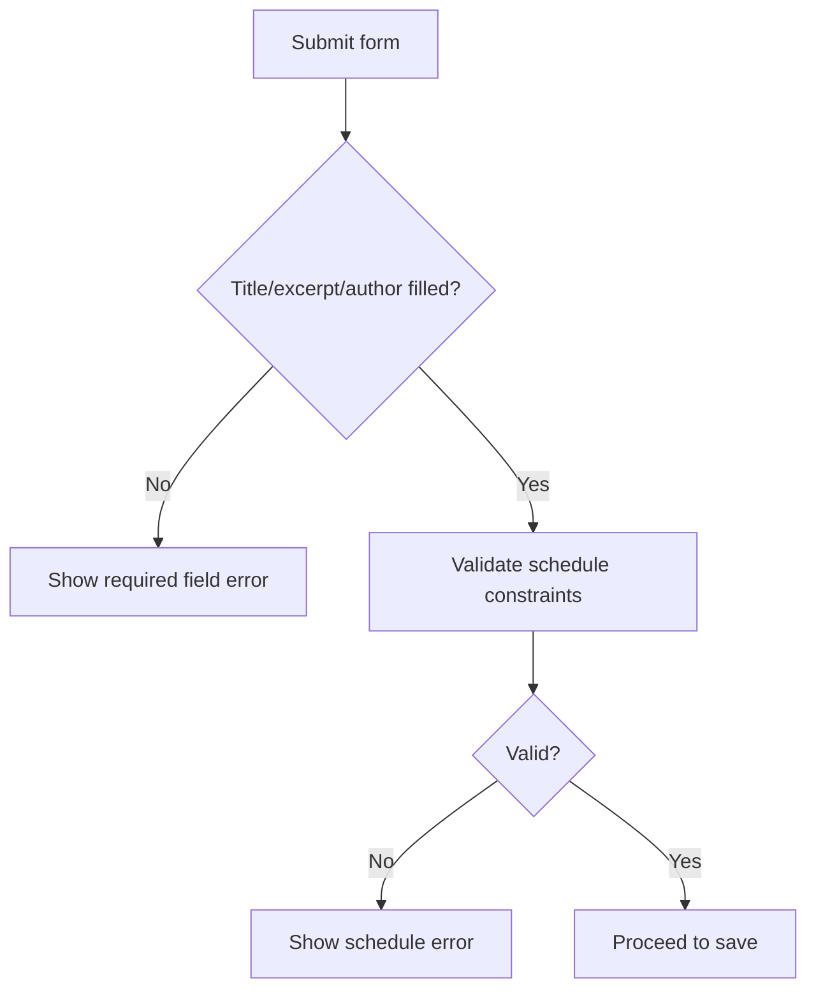
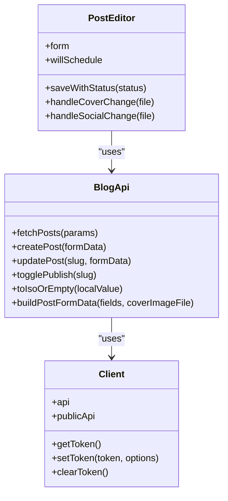
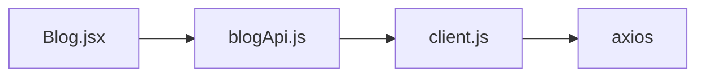

# Post Scheduling System

<cite>
**Referenced Files in This Document**
- [Blog.jsx](file://src/pages/AdminDashboard/Blog.jsx)
- [blogApi.js](file://src/api/blogApi.js)
- [client.js](file://src/api/client.js)
</cite>

## Table of Contents
1. [Introduction](#introduction)
2. [Project Structure](#project-structure)
3. [Core Components](#core-components)
4. [Architecture Overview](#architecture-overview)
5. [Detailed Component Analysis](#detailed-component-analysis)
6. [Dependency Analysis](#dependency-analysis)
7. [Performance Considerations](#performance-considerations)
8. [Troubleshooting Guide](#troubleshooting-guide)
9. [Conclusion](#conclusion)

## Introduction
This document explains the post scheduling and publication workflow implemented in the admin blog dashboard. It covers:
- Datetime picker implementation and timezone handling
- Local time conversion utilities
- Scheduling logic using publishAt and deleteAt fields
- Status transitions between draft, published, scheduled, and expired states
- Automated publishing triggers (server-side)
- Schedule display formatting and calendar integration
- Validation rules for scheduling dates and conflict resolution
- Business logic for automatic status updates
- Examples of scheduling APIs, date formatting functions, and state management for scheduled content

The system is built on a React frontend that communicates with a backend API. The frontend handles user input, local-time conversions, validation, and UI presentation. The backend stores UTC timestamps and enforces business rules such as automatic status transitions.

## Project Structure
The scheduling feature spans two primary files:
- Admin dashboard page and editor: src/pages/AdminDashboard/Blog.jsx
- Blog API helpers and data builders: src/api/blogApi.js
- HTTP client configuration and token handling: src/api/client.js

**Diagram sources**
- [Blog.jsx:1-1470](file://src/pages/AdminDashboard/Blog.jsx#L1-L1470)
- [blogApi.js:1-135](file://src/api/blogApi.js#L1-L135)
- [client.js:1-88](file://src/api/client.js#L1-L88)

**Section sources**
- [Blog.jsx:1-1470](file://src/pages/AdminDashboard/Blog.jsx#L1-L1470)
- [blogApi.js:1-135](file://src/api/blogApi.js#L1-L135)
- [client.js:1-88](file://src/api/client.js#L1-L88)

## Core Components
- PostEditor: Handles creating/editing posts, including scheduling via datetime-local inputs for publishAt and deleteAt. It validates times locally and sends ISO strings to the backend.
- PostList: Displays posts with status badges and schedule notes formatted for the admin’s local time.
- blogApi helpers: Provide fetch/create/update/togglePublish operations and convert local datetime values to UTC ISO strings.
- client.js: Configures authenticated and public axios instances; ensures admin requests carry tokens while public requests do not.

Key responsibilities:
- Timezone conversion: Convert between browser local time and UTC ISO strings.
- Validation: Ensure expiry is after publish time and both are in the future when set.
- Status management: Map server status to UI labels and compute derived statuses like expired.
- Display formatting: Render human-readable schedule notes in the admin list.

**Section sources**
- [Blog.jsx:71-126](file://src/pages/AdminDashboard/Blog.jsx#L71-L126)
- [Blog.jsx:819-1205](file://src/pages/AdminDashboard/Blog.jsx#L819-L1205)
- [blogApi.js:10-56](file://src/api/blogApi.js#L10-L56)
- [blogApi.js:76-135](file://src/api/blogApi.js#L76-L135)
- [client.js:47-88](file://src/api/client.js#L47-L88)

## Architecture Overview
The scheduling flow involves:
- User selects publishAt and/or deleteAt in the editor using native datetime-local inputs.
- Frontend converts these local times to UTC ISO strings before sending to the backend.
- Backend persists UTC timestamps and determines effective status (published/scheduled/expired).
- Admin list displays schedule notes using local time formatting.
- Public endpoints hide drafts, scheduled, and expired posts.

**Diagram sources**
- [Blog.jsx:887-948](file://src/pages/AdminDashboard/Blog.jsx#L887-L948)
- [blogApi.js:35-56](file://src/api/blogApi.js#L35-L56)
- [blogApi.js:117-135](file://src/api/blogApi.js#L117-L135)
- [client.js:47-75](file://src/api/client.js#L47-L75)

## Detailed Component Analysis

### Datetime Picker Implementation and Timezone Handling
- Inputs: Two datetime-local inputs for publishAt and deleteAt in the Publishing section.
- Conversion to local input: When loading an existing post, UTC ISO strings from the API are converted to local "YYYY-MM-DDTHH:mm" format for the datetime-local control.
- Conversion to UTC ISO: On save, local datetime values are converted to UTC ISO strings using a helper that returns empty string for no schedule.

**Diagram sources**
- [Blog.jsx:78-84](file://src/pages/AdminDashboard/Blog.jsx#L78-L84)
- [Blog.jsx:858-861](file://src/pages/AdminDashboard/Blog.jsx#L858-L861)

**Section sources**
- [Blog.jsx:78-84](file://src/pages/AdminDashboard/Blog.jsx#L78-L84)
- [Blog.jsx:858-861](file://src/pages/AdminDashboard/Blog.jsx#L858-L861)
- [blogApi.js:76-85](file://src/api/blogApi.js#L76-L85)

### Scheduling Logic: publishAt and deleteAt
- publishAt: Optional timestamp indicating when the post goes live. If set in the future and status is published, the backend treats it as scheduled until the time arrives.
- deleteAt: Optional expiration timestamp. Must be in the future and after publishAt if both are set.
- Empty values mean no schedule; the post remains permanent.

Validation rules enforced in the editor:
- Expiry must be in the future.
- Expiry must be after publish time.
- If publishAt is in the future, the main action button reads “Schedule” instead of “Publish”.

**Diagram sources**
- [Blog.jsx:883-903](file://src/pages/AdminDashboard/Blog.jsx#L883-L903)
- [Blog.jsx:929-932](file://src/pages/AdminDashboard/Blog.jsx#L929-L932)

**Section sources**
- [Blog.jsx:883-903](file://src/pages/AdminDashboard/Blog.jsx#L883-L903)
- [Blog.jsx:929-932](file://src/pages/AdminDashboard/Blog.jsx#L929-L932)
- [blogApi.js:111-115](file://src/api/blogApi.js#L111-L115)

### Status Transitions: Draft, Published, Scheduled, Expired
- Derived status: The UI computes a status bucket per post, falling back to is_published for legacy records.
- Status options in the editor: published and scheduled.
- Expired: Computed when deleteAt has passed; shown in the list with a distinct badge.
- Toggle publish: The admin can toggle publish status via a dedicated endpoint.

**Diagram sources**
- [Blog.jsx:69-73](file://src/pages/AdminDashboard/Blog.jsx#L69-L73)
- [Blog.jsx:457-466](file://src/pages/AdminDashboard/Blog.jsx#L457-L466)
- [blogApi.js:53-56](file://src/api/blogApi.js#L53-L56)

**Section sources**
- [Blog.jsx:69-73](file://src/pages/AdminDashboard/Blog.jsx#L69-L73)
- [Blog.jsx:457-466](file://src/pages/AdminDashboard/Blog.jsx#L457-L466)
- [blogApi.js:53-56](file://src/api/blogApi.js#L53-L56)

### Automated Publishing Triggers
- Server-side automation: When a post is saved with status=published and a future publishAt, the backend stores it as scheduled and automatically publishes it at the specified time.
- Expiration: When deleteAt passes, the backend marks the post as expired.
- Public visibility: Public endpoints never return drafts, scheduled, or expired posts, ensuring only valid content is visible to visitors.

**Diagram sources**
- [blogApi.js:111-115](file://src/api/blogApi.js#L111-L115)
- [blogApi.js:20-33](file://src/api/blogApi.js#L20-L33)

**Section sources**
- [blogApi.js:20-33](file://src/api/blogApi.js#L20-L33)
- [blogApi.js:111-115](file://src/api/blogApi.js#L111-L115)

### Schedule Display Formatting and Calendar Integration
- Schedule note: Combines “Goes live …” and “Expires …” based on status and timestamps.
- Local formatting: Uses the browser’s locale to render readable dates and times.
- Calendar icon: Used in the toolbar to indicate sorting by date.

**Diagram sources**
- [Blog.jsx:100-114](file://src/pages/AdminDashboard/Blog.jsx#L100-L114)
- [Blog.jsx:427-447](file://src/pages/AdminDashboard/Blog.jsx#L427-L447)

**Section sources**
- [Blog.jsx:100-114](file://src/pages/AdminDashboard/Blog.jsx#L100-L114)
- [Blog.jsx:427-447](file://src/pages/AdminDashboard/Blog.jsx#L427-L447)

### Notification Systems
- No explicit notification system is present in the analyzed code. Errors are surfaced inline or via alerts.
- For production, consider adding toast notifications or email digests for scheduled publications and expirations.

[No sources needed since this section provides general guidance]

### Calendar Integration
- The UI uses a calendar icon in the sort selector to visually associate date-based sorting.
- There is no external calendar integration (e.g., Google Calendar) in the current implementation.

**Section sources**
- [Blog.jsx:1397-1407](file://src/pages/AdminDashboard/Blog.jsx#L1397-L1407)

### Validation Rules and Conflict Resolution
- Required fields: Title, excerpt, author.
- Scheduling constraints:
  - deleteAt must be in the future.
  - deleteAt must be after publishAt.
- Clear schedule: Button clears both dates, making the post permanent.

**Diagram sources**
- [Blog.jsx:887-903](file://src/pages/AdminDashboard/Blog.jsx#L887-L903)
- [Blog.jsx:1145-1154](file://src/pages/AdminDashboard/Blog.jsx#L1145-L1154)

**Section sources**
- [Blog.jsx:887-903](file://src/pages/AdminDashboard/Blog.jsx#L887-L903)
- [Blog.jsx:1145-1154](file://src/pages/AdminDashboard/Blog.jsx#L1145-L1154)

### Business Logic for Automatic Status Updates
- When saving with status=published and a future publishAt, the backend stores the post as scheduled and transitions it to published at publishAt.
- When deleteAt passes, the backend transitions the post to expired.
- The admin list reflects these computed statuses and shows appropriate schedule notes.

**Section sources**
- [blogApi.js:111-115](file://src/api/blogApi.js#L111-L115)
- [Blog.jsx:69-73](file://src/pages/AdminDashboard/Blog.jsx#L69-L73)

### Examples of Scheduling APIs, Date Formatting Functions, and State Management

- Scheduling APIs:
  - Create post: POST /blog/posts/ with multipart/form-data including publishAt and deleteAt as UTC ISO strings.
  - Update post: PATCH /blog/posts/{slug}/ with same payload.
  - Toggle publish: POST /blog/posts/{slug}/publish/.

- Date formatting functions:
  - toLocalInput(iso): Converts UTC ISO to local datetime-local string.
  - formatWhen(iso): Formats a UTC ISO into a localized human-readable string.
  - toIsoOrEmpty(localValue): Converts local datetime-local value to UTC ISO or empty string.

- State management:
  - Form state includes publishAt and deleteAt as local datetime strings.
  - willSchedule toggles button text based on whether publishAt is in the future.
  - postStatus computes derived status for filtering/badges.

**Diagram sources**
- [Blog.jsx:819-1205](file://src/pages/AdminDashboard/Blog.jsx#L819-L1205)
- [blogApi.js:10-56](file://src/api/blogApi.js#L10-L56)
- [blogApi.js:76-135](file://src/api/blogApi.js#L76-L135)
- [client.js:26-42](file://src/api/client.js#L26-L42)
- [client.js:47-88](file://src/api/client.js#L47-L88)

**Section sources**
- [Blog.jsx:819-1205](file://src/pages/AdminDashboard/Blog.jsx#L819-L1205)
- [blogApi.js:10-56](file://src/api/blogApi.js#L10-L56)
- [blogApi.js:76-135](file://src/api/blogApi.js#L76-L135)
- [client.js:26-42](file://src/api/client.js#L26-L42)
- [client.js:47-88](file://src/api/client.js#L47-L88)

## Dependency Analysis
- Blog.jsx depends on blogApi.js for all data operations and on client.js indirectly through blogApi.js for HTTP transport and authentication.
- blogApi.js abstracts API calls and data transformation, decoupling the UI from network details.
- client.js centralizes base URL configuration, token injection, and error handling for 401 responses.

**Diagram sources**
- [Blog.jsx:1-14](file://src/pages/AdminDashboard/Blog.jsx#L1-L14)
- [blogApi.js:1-3](file://src/api/blogApi.js#L1-L3)
- [client.js:1-3](file://src/api/client.js#L1-L3)

**Section sources**
- [Blog.jsx:1-14](file://src/pages/AdminDashboard/Blog.jsx#L1-L14)
- [blogApi.js:1-3](file://src/api/blogApi.js#L1-L3)
- [client.js:1-3](file://src/api/client.js#L1-L3)

## Performance Considerations
- Client-side filtering and sorting: The admin list filters and sorts posts in memory; for large datasets, consider server-side pagination and filtering.
- Image/video uploads: Direct upload endpoint is used; ensure proper size limits and compression to avoid slow saves.
- Avoid unnecessary re-renders: Memoize computed values like tab counts and filtered lists to reduce render overhead.

[No sources needed since this section provides general guidance]

## Troubleshooting Guide
Common issues and resolutions:
- Token errors (401): Ensure VITE_API_BASE_URL is set correctly and the token scheme is "Token <key>". The client clears invalid tokens automatically.
- Cover images not saving: Verify that the correct serializer field names are used (e.g., coverImage) and that multipart/form-data is sent.
- Scheduling not taking effect: Confirm that publishAt is in the future and that the backend processes scheduled posts. Check that deleteAt is after publishAt.
- Schedule display incorrect: Ensure UTC ISO strings are being converted to local time for display and that formatWhen uses the browser’s locale.

**Section sources**
- [client.js:10-16](file://src/api/client.js#L10-L16)
- [client.js:54-75](file://src/api/client.js#L54-L75)
- [blogApi.js:96-115](file://src/api/blogApi.js#L96-L115)
- [Blog.jsx:887-903](file://src/pages/AdminDashboard/Blog.jsx#L887-L903)

## Conclusion
The post scheduling system combines a robust frontend editor with clear timezone handling and a backend-driven automation model. Users can schedule posts with precise local-time inputs, which are safely converted to UTC for storage. The backend manages status transitions and visibility, while the admin interface presents clear feedback and formatting. By following the documented validation rules and leveraging the provided API helpers, teams can extend the system with additional features such as notifications and calendar integrations.