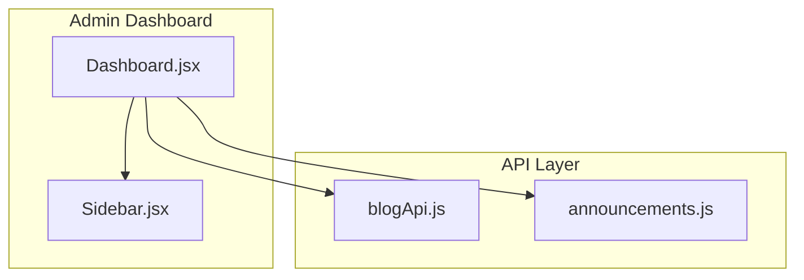
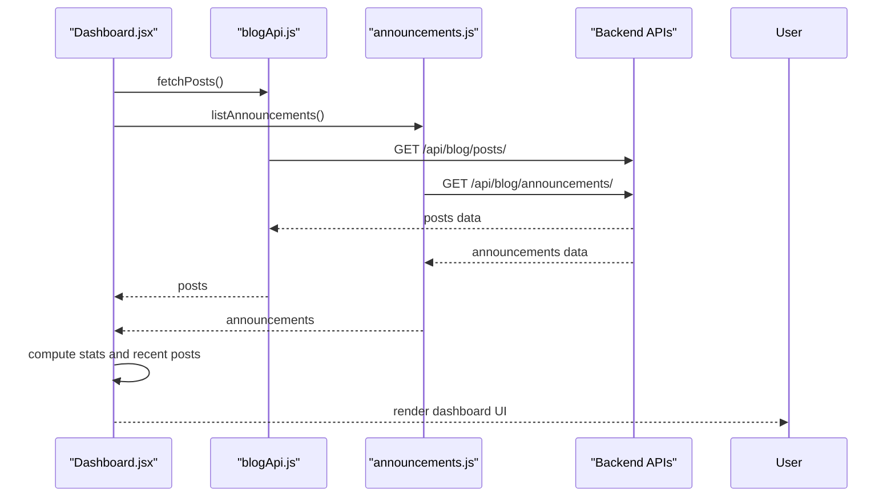
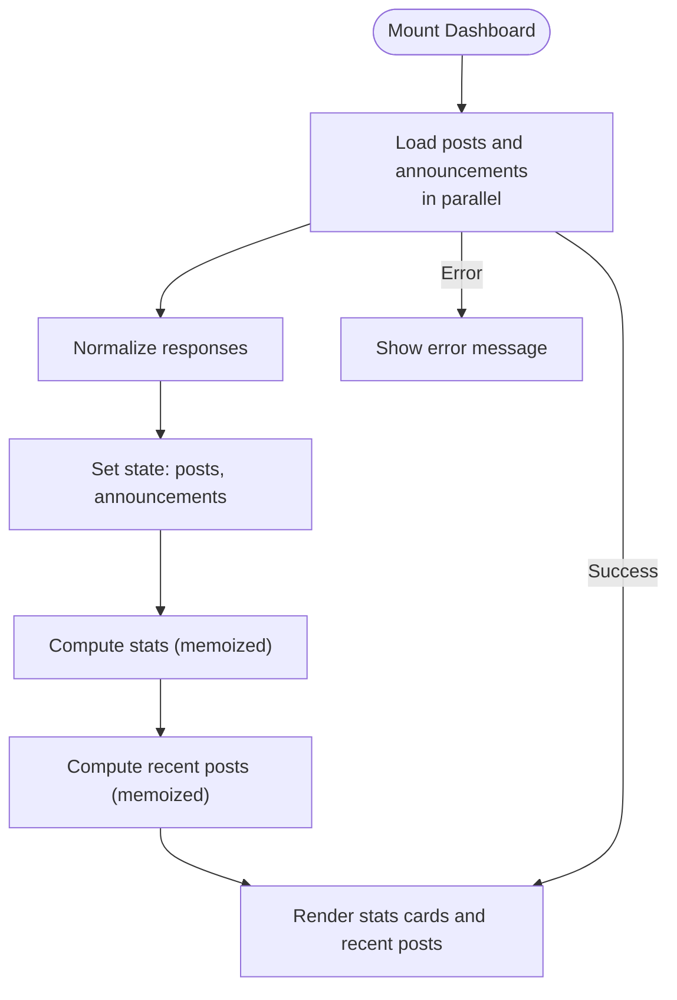
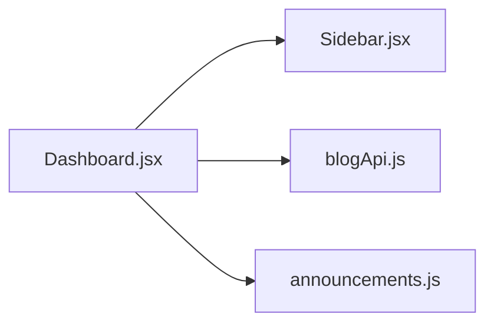

# Dashboard Overview

<cite>
**Referenced Files in This Document**
- [Dashboard.jsx](file://src/pages/AdminDashboard/Dashboard.jsx)
- [blogApi.js](file://src/api/blogApi.js)
- [announcements.js](file://src/api/announcements.js)
- [Sidebar.jsx](file://src/components/Sidebar.jsx)
</cite>

## Table of Contents
1. [Introduction](#introduction)
2. [Project Structure](#project-structure)
3. [Core Components](#core-components)
4. [Architecture Overview](#architecture-overview)
5. [Detailed Component Analysis](#detailed-component-analysis)
6. [Dependency Analysis](#dependency-analysis)
7. [Performance Considerations](#performance-considerations)
8. [Troubleshooting Guide](#troubleshooting-guide)
9. [Conclusion](#conclusion)

## Introduction
This document explains the admin dashboard overview component that displays key statistics for blog posts and announcements, shows recent posts with status badges, and integrates with the admin sidebar and navigation. It also covers data fetching from multiple API endpoints, performance optimizations such as memoization, and handling of loading, error, and empty states.

## Project Structure
The dashboard is implemented as a React page under the admin dashboard feature folder. It composes:
- A layout shell containing the shared admin sidebar and main content area.
- Statistics cards for total posts, published count, drafts, and announcements with live status hints.
- A recent posts list showing the latest items with metadata and status badges.
- Data fetching logic that aggregates results from blog and announcement APIs.

**Diagram sources**
- [Dashboard.jsx:101-234](file://src/pages/AdminDashboard/Dashboard.jsx#L101-L234)
- [Sidebar.jsx:167-239](file://src/components/Sidebar.jsx#L167-L239)
- [blogApi.js:10-13](file://src/api/blogApi.js#L10-L13)
- [announcements.js:28-35](file://src/api/announcements.js#L28-L35)

**Section sources**
- [Dashboard.jsx:101-234](file://src/pages/AdminDashboard/Dashboard.jsx#L101-L234)
- [Sidebar.jsx:167-239](file://src/components/Sidebar.jsx#L167-L239)
- [blogApi.js:10-13](file://src/api/blogApi.js#L10-L13)
- [announcements.js:28-35](file://src/api/announcements.js#L28-L35)

## Core Components
- Dashboard page: orchestrates state, fetches data, computes statistics, renders stats cards and recent posts.
- Sidebar: provides navigation to dashboard, blog posts, announcements, promo video, and includes logout flow.
- Blog API client: exposes functions to read all posts (admin-scoped).
- Announcements API client: exposes functions to list announcements (admin-scoped).

Key responsibilities:
- Fetching and normalizing data from multiple endpoints.
- Computing derived metrics efficiently.
- Rendering user-facing UI with clear loading, error, and empty states.
- Integrating with routing via links to other admin pages.

**Section sources**
- [Dashboard.jsx:101-234](file://src/pages/AdminDashboard/Dashboard.jsx#L101-L234)
- [Sidebar.jsx:9-14](file://src/components/Sidebar.jsx#L9-L14)
- [blogApi.js:10-13](file://src/api/blogApi.js#L10-L13)
- [announcements.js:28-35](file://src/api/announcements.js#L28-L35)

## Architecture Overview
The dashboard follows a simple unidirectional data flow:
- On mount, it triggers parallel requests to fetch posts and announcements.
- Results are stored in local state.
- Derived values (statistics and recent posts) are computed using memoization.
- The UI renders based on current state, including loading, error, and empty states.

**Diagram sources**
- [Dashboard.jsx:107-134](file://src/pages/AdminDashboard/Dashboard.jsx#L107-L134)
- [blogApi.js:10-13](file://src/api/blogApi.js#L10-L13)
- [announcements.js:28-35](file://src/api/announcements.js#L28-L35)

## Detailed Component Analysis

### Dashboard Overview Component
Responsibilities:
- Manage state for posts, announcements, loading, and error.
- Fetch data in parallel on initial load.
- Compute statistics: total posts, published count, drafts, announcements with live hint.
- Render recent posts sorted by update time with status badges and metadata.
- Integrate with sidebar and navigation links.

Data fetching strategy:
- Uses Promise.all to fetch both posts and announcements concurrently.
- Normalizes response shapes: posts may be an array or object with results; announcements normalized to arrays.
- Handles errors gracefully and sets a user-facing message.

Statistics computation:
- Memoized to avoid recomputation when inputs do not change.
- Published and draft counts are derived from post status.
- Announcement card includes a live hint based on active flag.

Recent posts:
- Memoized sorting by updated timestamp and slicing to top five.
- Displays category label or category, author, and a status badge.

Status normalization:
- A helper determines post status, falling back to is_published for legacy records.

Layout and integration:
- Renders within a shell alongside the shared Sidebar.
- Provides quick actions to manage posts and create new announcements.

**Diagram sources**
- [Dashboard.jsx:107-159](file://src/pages/AdminDashboard/Dashboard.jsx#L107-L159)
- [Dashboard.jsx:161-234](file://src/pages/AdminDashboard/Dashboard.jsx#L161-L234)

**Section sources**
- [Dashboard.jsx:101-234](file://src/pages/AdminDashboard/Dashboard.jsx#L101-L234)

### Statistics Display
- Total posts: shows the length of the posts array.
- Published: filters posts by status equals published and counts them.
- Drafts: filters posts by status equals draft and counts them.
- Announcements: shows total announcements and a live hint if any announcement is active.

Live status indicator:
- The announcements card includes a hint indicating whether at least one announcement is active.

Rendering behavior:
- While loading, stat values display a placeholder.
- Each stat card is a link to relevant admin pages.

**Section sources**
- [Dashboard.jsx:136-153](file://src/pages/AdminDashboard/Dashboard.jsx#L136-L153)
- [Dashboard.jsx:184-198](file://src/pages/AdminDashboard/Dashboard.jsx#L184-L198)

### Recent Posts Section
- Displays up to five most recently updated posts.
- Shows title, category label or category, and author.
- Status badge reflects normalized post status.
- Empty state informs users to create their first post.

Sorting and selection:
- Sorts by updated_at descending and slices to five items.

**Section sources**
- [Dashboard.jsx:155-159](file://src/pages/AdminDashboard/Dashboard.jsx#L155-L159)
- [Dashboard.jsx:200-229](file://src/pages/AdminDashboard/Dashboard.jsx#L200-L229)

### Dashboard Layout and Sidebar Integration
- The dashboard uses a shell layout with a left sidebar and main content area.
- Sidebar provides navigation to dashboard, blog posts, announcements, and promo video.
- Active navigation item is highlighted based on current route.
- Logout flow is handled through a confirmation modal.

Navigation patterns:
- Stat cards and header actions use Link components to navigate to admin routes.
- Sidebar uses NavLink for active state management.

**Section sources**
- [Dashboard.jsx:161-180](file://src/pages/AdminDashboard/Dashboard.jsx#L161-L180)
- [Sidebar.jsx:9-14](file://src/components/Sidebar.jsx#L9-L14)
- [Sidebar.jsx:191-212](file://src/components/Sidebar.jsx#L191-L212)

### Data Fetching Strategies
- Parallel fetching: Both posts and announcements are fetched concurrently using Promise.all to reduce overall latency.
- Admin-scoped endpoints: Posts and announcements are retrieved via admin clients that attach authentication tokens.
- Response normalization:
  - Posts: supports both array and object with results property.
  - Announcements: ensures array result even if backend returns wrapped data.

Error handling:
- Catches network and API errors, extracts readable messages, and stores them in state for display.
- Cleanup prevents state updates after component unmount.

**Section sources**
- [Dashboard.jsx:107-134](file://src/pages/AdminDashboard/Dashboard.jsx#L107-L134)
- [blogApi.js:10-13](file://src/api/blogApi.js#L10-L13)
- [announcements.js:28-35](file://src/api/announcements.js#L28-L35)

### Performance Optimizations
- Memoization:
  - Statistics are computed once per posts/announcements change using memoization.
  - Recent posts are sorted and sliced once per posts change using memoization.
- Efficient re-rendering:
  - Avoids unnecessary recalculations by isolating derived computations.
  - Uses stable keys for list rendering (post slug).
- Concurrent requests:
  - Reduces perceived latency by fetching independent resources in parallel.

**Section sources**
- [Dashboard.jsx:136-159](file://src/pages/AdminDashboard/Dashboard.jsx#L136-L159)

### Loading States, Error Handling, and Empty State Management
- Loading:
  - Sets loading to true before requests and false after completion.
  - Stats show placeholders while loading.
  - Recent posts section shows a loading hint.
- Errors:
  - Captures errors during data fetching and displays a user-friendly message.
- Empty state:
  - When no posts exist, the recent posts section shows a helpful message prompting creation.

**Section sources**
- [Dashboard.jsx:107-134](file://src/pages/AdminDashboard/Dashboard.jsx#L107-L134)
- [Dashboard.jsx:182-182](file://src/pages/AdminDashboard/Dashboard.jsx#L182-L182)
- [Dashboard.jsx:208-212](file://src/pages/AdminDashboard/Dashboard.jsx#L208-L212)

## Dependency Analysis
The dashboard depends on:
- Sidebar for navigation and branding.
- Blog API for reading all posts.
- Announcements API for listing announcements.

**Diagram sources**
- [Dashboard.jsx:1-7](file://src/pages/AdminDashboard/Dashboard.jsx#L1-L7)
- [Sidebar.jsx:167-239](file://src/components/Sidebar.jsx#L167-L239)
- [blogApi.js:10-13](file://src/api/blogApi.js#L10-L13)
- [announcements.js:28-35](file://src/api/announcements.js#L28-L35)

**Section sources**
- [Dashboard.jsx:1-7](file://src/pages/AdminDashboard/Dashboard.jsx#L1-L7)
- [Sidebar.jsx:167-239](file://src/components/Sidebar.jsx#L167-L239)
- [blogApi.js:10-13](file://src/api/blogApi.js#L10-L13)
- [announcements.js:28-35](file://src/api/announcements.js#L28-L35)

## Performance Considerations
- Prefer concurrent data fetching for independent resources to minimize wait times.
- Use memoization for derived data like statistics and sorted lists to prevent redundant computations.
- Keep list keys stable to optimize reconciliation.
- Avoid unnecessary re-renders by separating concerns: keep UI logic close to presentation and data transformation in dedicated functions.

[No sources needed since this section provides general guidance]

## Troubleshooting Guide
Common issues and resolutions:
- No data displayed:
  - Check network requests for posts and announcements endpoints.
  - Verify authentication token is attached for admin endpoints.
- Incorrect status badges:
  - Ensure post status normalization handles legacy fields.
- Live hint not updating:
  - Confirm announcements include active flag and that the dashboard checks it correctly.
- Error messages not shown:
  - Inspect error handling path and ensure error state is rendered.

Operational tips:
- Validate backend response shapes match expected normalization.
- Add logging around API calls during development to trace failures.

**Section sources**
- [Dashboard.jsx:107-134](file://src/pages/AdminDashboard/Dashboard.jsx#L107-L134)
- [Dashboard.jsx:11-13](file://src/pages/AdminDashboard/Dashboard.jsx#L11-L13)
- [announcements.js:28-35](file://src/api/announcements.js#L28-L35)

## Conclusion
The admin dashboard overview component provides a concise, performant view of blog and announcement metrics, integrates seamlessly with the shared sidebar, and implements robust data fetching, error handling, and state management. Its design emphasizes clarity, efficiency, and maintainability through memoization, parallel requests, and well-defined responsibilities across components and API modules.

[No sources needed since this section summarizes without analyzing specific files]