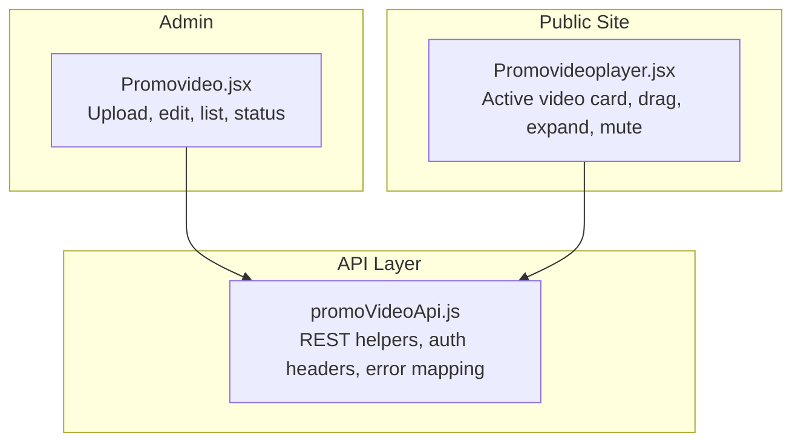
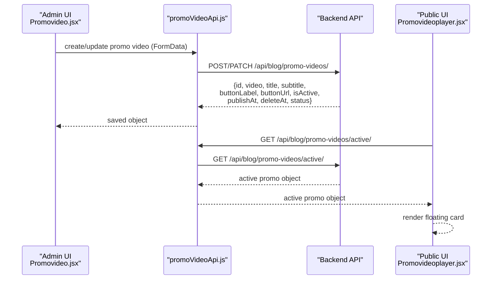
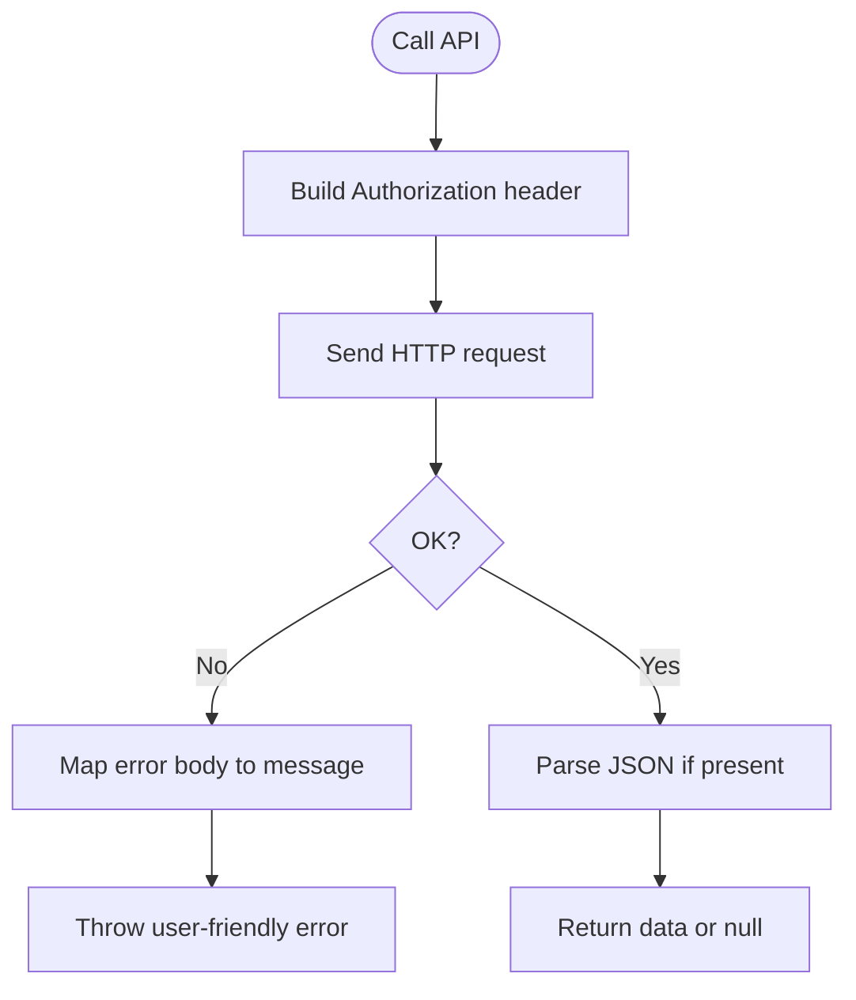
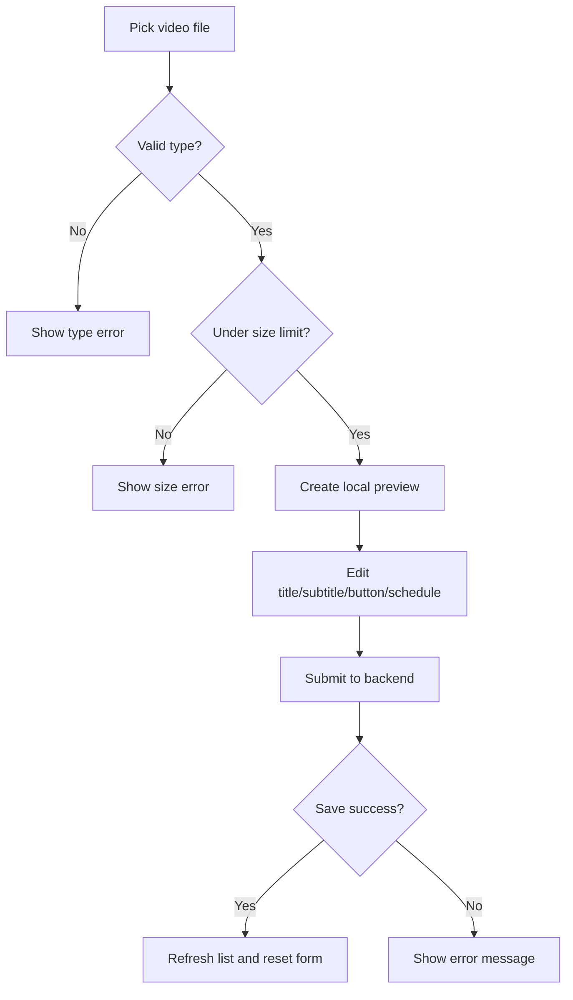
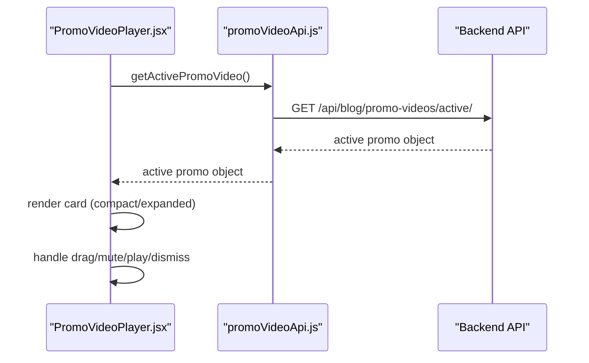
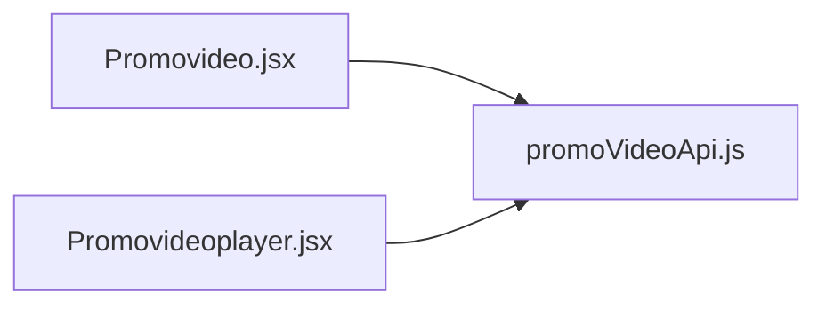

# Promotional Video Management

<cite>
**Referenced Files in This Document**
- [promoVideoApi.js](file://src/api/promoVideoApi.js)
- [Promovideo.jsx](file://src/pages/AdminDashboard/Promovideo.jsx)
- [Promovideoplayer.jsx](file://src/pages/Promovideoplayer.jsx)
</cite>

## Table of Contents
1. [Introduction](#introduction)
2. [Project Structure](#project-structure)
3. [Core Components](#core-components)
4. [Architecture Overview](#architecture-overview)
5. [Detailed Component Analysis](#detailed-component-analysis)
6. [Dependency Analysis](#dependency-analysis)
7. [Performance Considerations](#performance-considerations)
8. [Troubleshooting Guide](#troubleshooting-guide)
9. [Conclusion](#conclusion)

## Introduction
This document explains the promotional video management system implemented in the frontend application. It covers how administrators upload and manage promotional videos, how metadata is handled, how the active video is selected for public display, and how the public-facing player renders and interacts with the selected video. It also includes performance guidance for large media files, caching considerations, and patterns that can be extended to CDN integration.

## Project Structure
The promotional video feature spans three primary files:
- API client for promo videos
- Admin dashboard page for creating, editing, listing, and managing promo videos
- Public-facing component that displays the active promo video as a floating card

**Diagram sources**
- [Promovideo.jsx:1-484](file://src/pages/AdminDashboard/Promovideo.jsx#L1-L484)
- [promoVideoApi.js:1-85](file://src/api/promoVideoApi.js#L1-L85)
- [Promovideoplayer.jsx:1-346](file://src/pages/Promovideoplayer.jsx#L1-L346)

**Section sources**
- [Promovideo.jsx:1-484](file://src/pages/AdminDashboard/Promovideo.jsx#L1-L484)
- [promoVideoApi.js:1-85](file://src/api/promoVideoApi.js#L1-L85)
- [Promovideoplayer.jsx:1-346](file://src/pages/Promovideoplayer.jsx#L1-L346)

## Core Components
- PromoVideoApi: Provides authenticated REST calls for listing, creating, updating, deleting, and fetching the active promo video. It normalizes errors and converts form payloads into FormData.
- Promovideo (Admin): UI for uploading videos, setting titles/subtitles/button labels/links, scheduling publish/hide times, toggling visibility, previewing, filtering by status, and performing CRUD operations.
- PromoVideoPlayer (Public): Fetches the active promo video and renders a draggable, minimizable, expandable floating card with play/pause, mute/unmute, and call-to-action behavior.

**Section sources**
- [promoVideoApi.js:1-85](file://src/api/promoVideoApi.js#L1-L85)
- [Promovideo.jsx:1-484](file://src/pages/AdminDashboard/Promovideo.jsx#L1-L484)
- [Promovideoplayer.jsx:1-346](file://src/pages/Promovideoplayer.jsx#L1-L346)

## Architecture Overview
The system follows a simple admin-to-backend-to-public flow:
- Admin uploads or edits a promo video via Promovideo.jsx, which sends FormData through promoVideoApi.js.
- The backend returns a normalized object including fields such as id, video URL, title, subtitle, buttonLabel, buttonUrl, isActive, publishAt, deleteAt, and computed status.
- The public site fetches only the currently active promo video using getActivePromoVideo and renders it in PromoVideoPlayer.jsx.

**Diagram sources**
- [Promovideo.jsx:148-201](file://src/pages/AdminDashboard/Promovideo.jsx#L148-L201)
- [promoVideoApi.js:49-85](file://src/api/promoVideoApi.js#L49-L85)
- [Promovideoplayer.jsx:65-75](file://src/pages/Promovideoplayer.jsx#L65-L75)

## Detailed Component Analysis

### PromoVideoApi: Authenticated REST Helpers
Responsibilities:
- Build Authorization headers from a shared token store.
- Normalize backend responses and map DRF-style errors to readable messages.
- Convert payload objects to FormData, handling booleans and nulls.
- Provide functions for listing, creating, updating, deleting, and retrieving the active promo video.

Key behaviors:
- Base URL is configurable via environment variable; default points to localhost.
- Error normalization supports string, detail, and array-of-errors formats.
- Active endpoint is public; other endpoints require authentication.

**Diagram sources**
- [promoVideoApi.js:8-34](file://src/api/promoVideoApi.js#L8-L34)
- [promoVideoApi.js:36-47](file://src/api/promoVideoApi.js#L36-L47)
- [promoVideoApi.js:49-85](file://src/api/promoVideoApi.js#L49-L85)

**Section sources**
- [promoVideoApi.js:1-85](file://src/api/promoVideoApi.js#L1-L85)

### Promovideo (Admin): Upload, Metadata, Listing, Status
Responsibilities:
- File selection and validation (type and size).
- Local preview generation and cleanup.
- Metadata editing: title, subtitle, button label/link, show/hide schedule.
- Toggle active state and CRUD operations.
- Filtered listing with thumbnails and status pills.

Upload and validation:
- Accepts common video MIME types.
- Enforces a maximum file size limit.
- Shows inline error messages and resets input on failure.

Metadata and scheduling:
- Converts local datetime inputs to ISO strings for the backend.
- Validates that hide time is after current time and after publish time.
- Supports immediate activation or scheduled publishing.

Listing and status:
- Displays thumbnails, details, status pill, and formatted dates.
- Filters items by live/scheduled/expired/hidden/all.
- Allows toggling active state directly from the table.

**Diagram sources**
- [Promovideo.jsx:112-129](file://src/pages/AdminDashboard/Promovideo.jsx#L112-L129)
- [Promovideo.jsx:148-201](file://src/pages/AdminDashboard/Promovideo.jsx#L148-L201)
- [Promovideo.jsx:225-236](file://src/pages/AdminDashboard/Promovideo.jsx#L225-L236)
- [Promovideo.jsx:419-477](file://src/pages/AdminDashboard/Promovideo.jsx#L419-L477)

**Section sources**
- [Promovideo.jsx:1-484](file://src/pages/AdminDashboard/Promovideo.jsx#L1-L484)

### PromoVideoPlayer (Public): Active Video Card
Responsibilities:
- Fetch the active promo video and render it as a floating card.
- Support compact mode when scrolling, expanded fullscreen-like view.
- Handle dragging within viewport bounds, mute/unmute, play/pause, and dismissal.
- Render optional title, subtitle, and call-to-action link.

Behavior highlights:
- Dismissal persists during the page load session but not across refreshes.
- Dragging clamps the card within screen margins.
- Expanding allows unmuted playback triggered by user gesture.
- Hides while a mega menu overlay is open to avoid overlap.

**Diagram sources**
- [Promovideoplayer.jsx:65-75](file://src/pages/Promovideoplayer.jsx#L65-L75)
- [Promovideoplayer.jsx:147-181](file://src/pages/Promovideoplayer.jsx#L147-L181)
- [Promovideoplayer.jsx:183-244](file://src/pages/Promovideoplayer.jsx#L183-L244)
- [Promovideoplayer.jsx:248-346](file://src/pages/Promovideoplayer.jsx#L248-L346)

**Section sources**
- [Promovideoplayer.jsx:1-346](file://src/pages/Promovideoplayer.jsx#L1-L346)

## Dependency Analysis
- Promovideo.jsx depends on promoVideoApi.js for all server interactions.
- PromoVideoPlayer.jsx depends on promoVideoApi.js for reading the active promo video.
- promoVideoApi.js depends on a shared token provider for authorization and uses environment configuration for the API root.

**Diagram sources**
- [Promovideo.jsx:1-10](file://src/pages/AdminDashboard/Promovideo.jsx#L1-L10)
- [Promovideoplayer.jsx:1-3](file://src/pages/Promovideoplayer.jsx#L1-L3)
- [promoVideoApi.js:1-11](file://src/api/promoVideoApi.js#L1-L11)

**Section sources**
- [Promovideo.jsx:1-10](file://src/pages/AdminDashboard/Promovideo.jsx#L1-L10)
- [Promovideoplayer.jsx:1-3](file://src/pages/Promovideoplayer.jsx#L1-L3)
- [promoVideoApi.js:1-11](file://src/api/promoVideoApi.js#L1-L11)

## Performance Considerations
- Client-side size limit: The admin interface enforces a maximum file size before upload to reduce failed transfers and improve UX.
- Local previews: Object URLs are created for immediate feedback and revoked when no longer needed to free memory.
- Efficient listing: Thumbnails use preload="metadata" to minimize initial bandwidth while still showing quick previews.
- Public player optimizations:
  - Auto-play muted loop for background preview.
  - Compact mode reduces visual weight during scroll.
  - Expanded mode enables full interaction and unmuted playback only after explicit user action.
- Network efficiency:
  - Only the active promo video is fetched on the public side.
  - Admin lists all entries once and filters locally.

Recommendations for production:
- Integrate a CDN for video delivery and consider preloading critical assets.
- Implement resumable uploads for larger files beyond the current client-side limit.
- Add progress indicators and chunked uploads to improve reliability for large media.
- Use browser caching headers on the backend for static video assets.
- Consider generating multiple resolutions and adaptive streaming formats at upload time.

[No sources needed since this section provides general guidance]

## Troubleshooting Guide
Common issues and remedies:
- Invalid file type: Ensure the selected file has a supported video MIME type. The admin UI validates and shows an error otherwise.
- File too large: The admin UI enforces a maximum size; compress or trim the video before upload.
- Scheduling conflicts: Hide time must be in the future and after the publish time; adjust accordingly.
- Authentication errors: Confirm that the admin token is valid and matches the backend’s expectations.
- Public player not appearing: Verify that an active promo video exists and the active endpoint returns a valid object.

Operational tips:
- Clear the file input and preview when switching between new and edit modes to avoid stale references.
- Revoke object URLs when they change or the component unmounts to prevent memory leaks.
- When toggling active state, refresh the list immediately to reflect changes.

**Section sources**
- [Promovideo.jsx:112-129](file://src/pages/AdminDashboard/Promovideo.jsx#L112-L129)
- [Promovideo.jsx:148-201](file://src/pages/AdminDashboard/Promovideo.jsx#L148-L201)
- [Promovideo.jsx:86-90](file://src/pages/AdminDashboard/Promovideo.jsx#L86-L90)
- [Promovideo.jsx:203-223](file://src/pages/AdminDashboard/Promovideo.jsx#L203-L223)
- [Promovideoplayer.jsx:65-75](file://src/pages/Promovideoplayer.jsx#L65-L75)

## Conclusion
The promotional video management system provides a clear separation between admin operations and public consumption. Administrators can upload, validate, and manage promotional videos with rich metadata and scheduling. The public site consumes only the active video, presenting it as an interactive floating card. For robustness at scale, consider adding resumable uploads, multi-resolution processing, CDN distribution, and enhanced progress tracking.