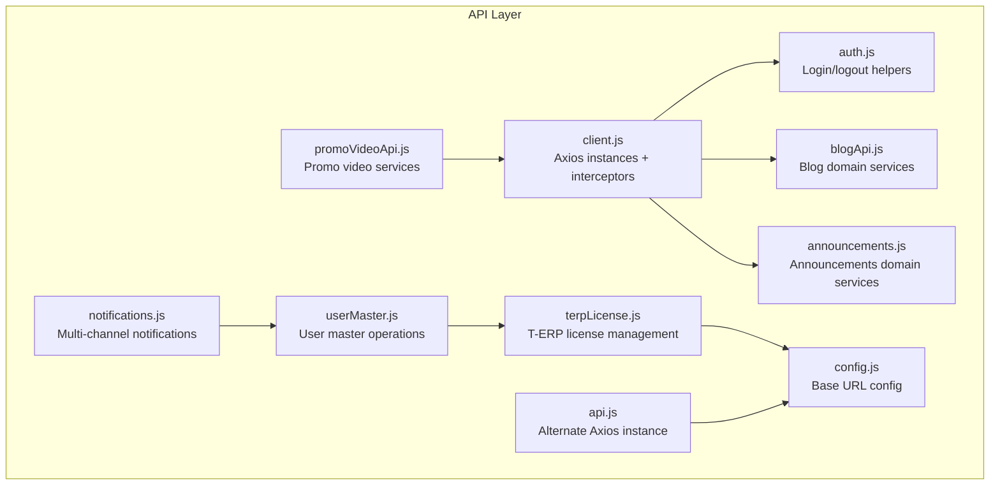
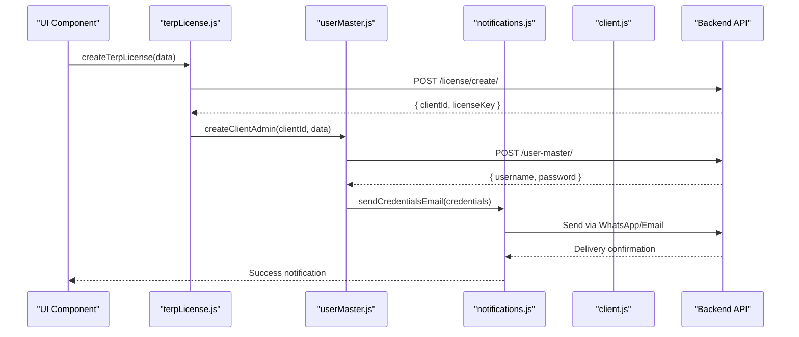
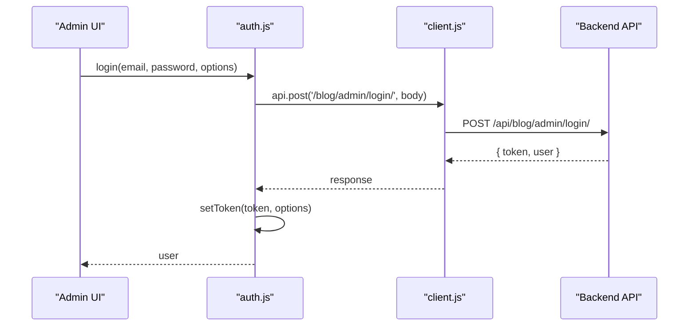
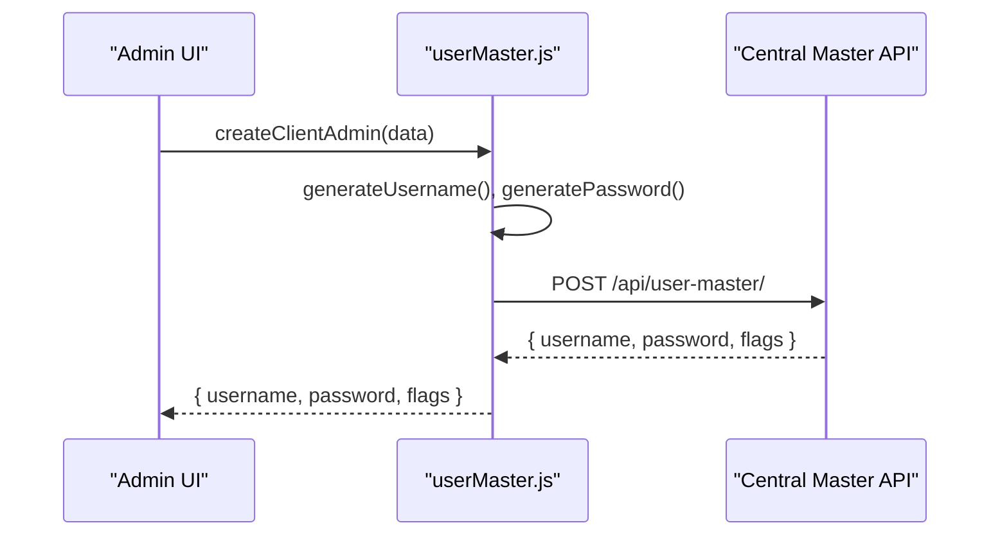
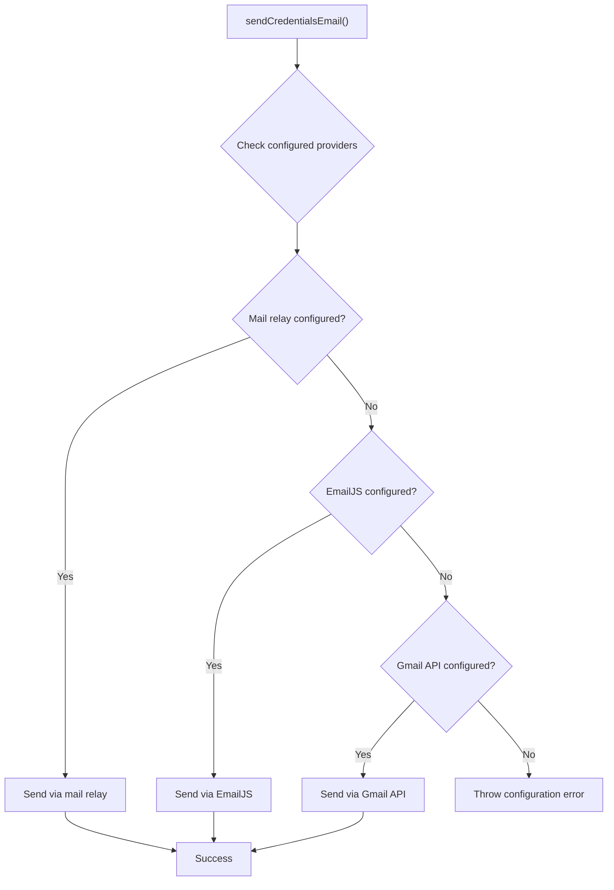
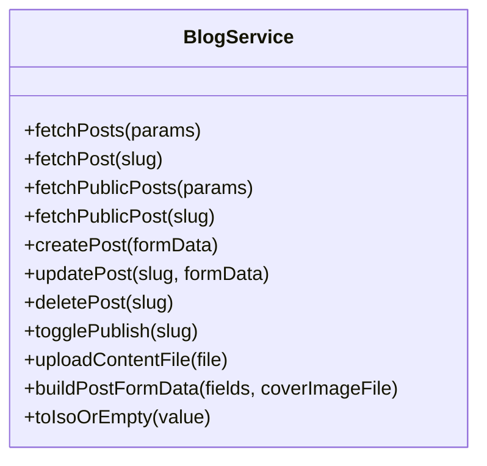
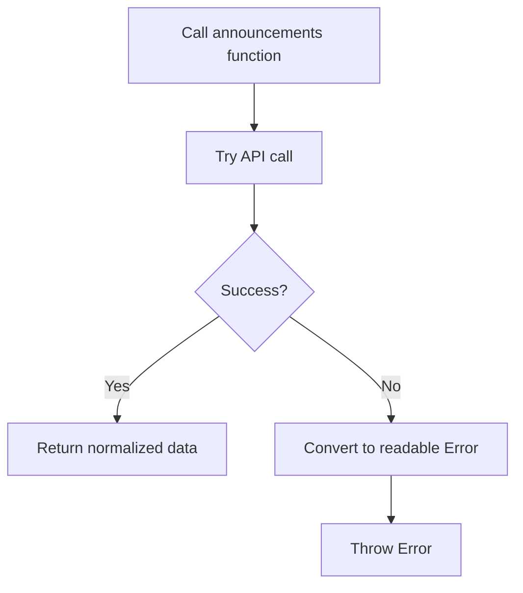
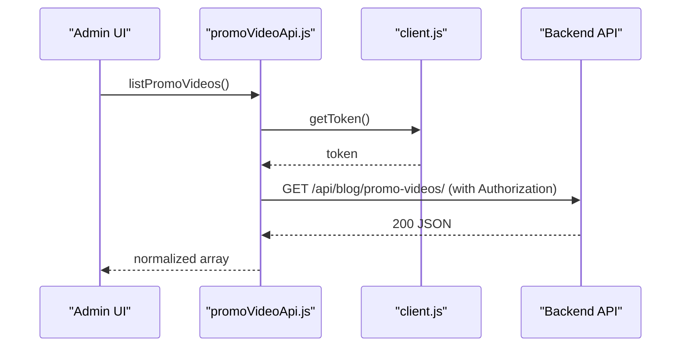
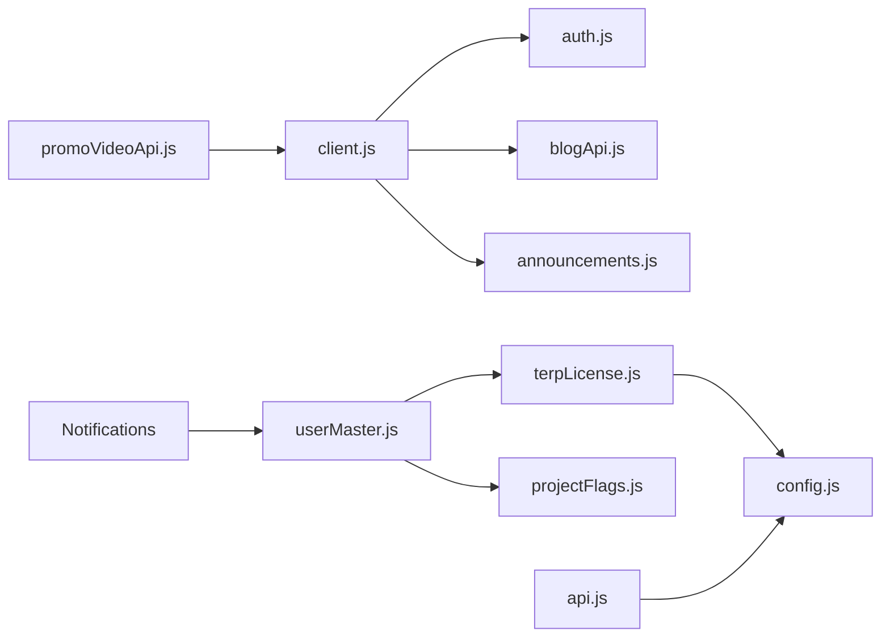

# API Integration Patterns

<cite>
**Referenced Files in This Document**
- [client.js](file://src/api/client.js)
- [api.js](file://src/api/api.js)
- [auth.js](file://src/api/auth.js)
- [blogApi.js](file://src/api/blogApi.js)
- [announcements.js](file://src/api/announcements.js)
- [promoVideoApi.js](file://src/api/promoVideoApi.js)
- [terpLicense.js](file://src/api/terpLicense.js)
- [userMaster.js](file://src/api/userMaster.js)
- [notifications.js](file://src/api/notifications.js)
- [projectFlags.js](file://src/config/projectFlags.js)
- [config.js](file://src/config/config.js)
</cite>

## Update Summary
**Changes Made**
- Added comprehensive documentation for T-ERP license management system (terpLicense.js)
- Added detailed coverage of user master operations and admin account creation (userMaster.js)
- Documented multi-channel notification system with WhatsApp and email delivery (notifications.js)
- Updated architecture diagrams to include new service modules
- Enhanced guidelines for handling external API integrations and third-party services

## Table of Contents
1. [Introduction](#introduction)
2. [Project Structure](#project-structure)
3. [Core Components](#core-components)
4. [Architecture Overview](#architecture-overview)
5. [Detailed Component Analysis](#detailed-component-analysis)
6. [Dependency Analysis](#dependency-analysis)
7. [Performance Considerations](#performance-considerations)
8. [Troubleshooting Guide](#troubleshooting-guide)
9. [Guidelines for Adding New Endpoints](#guidelines-for-adding-new-endpoints)
10. [Conclusion](#conclusion)

## Introduction
This document explains the API integration layer architecture, focusing on:
- Centralized Axios client configuration with interceptors for authentication and error handling
- Service layer pattern by domain (blog, announcements, videos, T-ERP licenses, user management, notifications)
- Error handling strategies, retry mechanisms, and loading state guidance
- Examples of making API calls, file uploads, and response normalization
- Caching strategies, request optimization, and performance considerations
- Guidelines for adding new endpoints consistently

The goal is to make the API layer predictable, secure, and easy to extend while keeping public and authenticated flows clearly separated. The architecture now supports complex enterprise workflows including license management, user provisioning, and multi-channel communications.

## Project Structure
The API integration lives under `src/api` and is organized by domain modules that share a common Axios client:
- `client.js`: Central Axios instances (`api`, `publicApi`) with token injection and 401 handling
- `api.js`: A secondary Axios instance using a different base URL and token key (legacy or alternate auth flow)
- `auth.js`: Authentication helpers using the centralized client
- `blogApi.js`: Blog domain service functions (posts, uploads, form builders)
- `announcements.js`: Announcements domain service functions
- `promoVideoApi.js`: Promo video domain service functions (uses native fetch but shares token source)
- `terpLicense.js`: T-ERP license management and project catalogue operations
- `userMaster.js`: User master operations and admin account creation
- `notifications.js`: Multi-channel notification system (WhatsApp, Email via multiple providers)
- `config.js`: Shared environment-based base URL configuration



**Diagram sources**
- [client.js:47-88](file://src/api/client.js#L47-L88)
- [api.js:1-39](file://src/api/api.js#L1-L39)
- [auth.js:1-40](file://src/api/auth.js#L1-L40)
- [blogApi.js:1-135](file://src/api/blogApi.js#L1-L135)
- [announcements.js:1-61](file://src/api/announcements.js#L1-L61)
- [promoVideoApi.js:1-85](file://src/api/promoVideoApi.js#L1-L85)
- [terpLicense.js:1-222](file://src/api/terpLicense.js#L1-L222)
- [userMaster.js:1-282](file://src/api/userMaster.js#L1-L282)
- [notifications.js:1-415](file://src/api/notifications.js#L1-L415)
- [config.js:1-3](file://src/config/config.js#L1-L3)

**Section sources**
- [client.js:1-88](file://src/api/client.js#L1-L88)
- [api.js:1-39](file://src/api/api.js#L1-L39)
- [auth.js:1-40](file://src/api/auth.js#L1-L40)
- [blogApi.js:1-135](file://src/api/blogApi.js#L1-L135)
- [announcements.js:1-61](file://src/api/announcements.js#L1-L61)
- [promoVideoApi.js:1-85](file://src/api/promoVideoApi.js#L1-L85)
- [terpLicense.js:1-222](file://src/api/terpLicense.js#L1-L222)
- [userMaster.js:1-282](file://src/api/userMaster.js#L1-L282)
- [notifications.js:1-415](file://src/api/notifications.js#L1-L415)
- [config.js:1-3](file://src/config/config.js#L1-L3)

## Core Components
- Centralized Axios clients:
  - `api`: Authenticated admin requests; injects `Token <key>` header automatically
  - `publicApi`: Public visitor requests; never sends admin token
- Token management:
  - Read/write/clear helpers for persistent or session-scoped tokens
- Interceptors:
  - Request interceptor attaches token when present
  - Response interceptor clears token on 401 and rejects errors
- Domain service modules:
  - Blog, announcements, promo videos each expose typed functions for CRUD operations
  - T-ERP license management with project catalogue and license creation
  - User master operations for admin account provisioning
  - Multi-channel notifications with WhatsApp and email delivery
- Error normalization:
  - Helpers convert DRF error bodies into readable messages

Key responsibilities:
- Single source of truth for base URLs and headers
- Consistent authentication behavior across domains
- Clear separation between public and authenticated flows
- Predictable error shapes for UI consumption
- Support for complex enterprise workflows and third-party integrations

**Section sources**
- [client.js:21-75](file://src/api/client.js#L21-L75)
- [blogApi.js:1-135](file://src/api/blogApi.js#L1-L135)
- [announcements.js:1-61](file://src/api/announcements.js#L1-L61)
- [promoVideoApi.js:1-85](file://src/api/promoVideoApi.js#L1-L85)
- [terpLicense.js:1-222](file://src/api/terpLicense.js#L1-L222)
- [userMaster.js:1-282](file://src/api/userMaster.js#L1-L282)
- [notifications.js:1-415](file://src/api/notifications.js#L1-L415)

## Architecture Overview
The API layer follows a layered approach:
- Infrastructure: Axios instances and interceptors
- Auth: Login/logout and token persistence
- Services: Domain-specific API functions
- Enterprise Services: License management, user provisioning, notifications
- Consumers: Pages and components call service functions



**Diagram sources**
- [terpLicense.js:170-198](file://src/api/terpLicense.js#L170-L198)
- [userMaster.js:213-279](file://src/api/userMaster.js#L213-L279)
- [notifications.js:363-414](file://src/api/notifications.js#L363-L414)

## Detailed Component Analysis

### Centralized Axios Client Configuration
- Base URL resolution:
  - Uses an environment variable for production; falls back to localhost in development
  - Fails loudly in production if the base URL is missing
- Two Axios instances:
  - `api`: Admin-authenticated; adds `Authorization: Token <key>` via interceptor
  - `publicApi`: Public; no token attached
- Token helpers:
  - `getToken`, `setToken`, `clearToken` support both localStorage and sessionStorage
- Interceptors:
  - Request: attach token if available
  - Response: clear token on 401 and reject the error


**Diagram sources**
- [client.js:47-75](file://src/api/client.js#L47-L75)

**Section sources**
- [client.js:1-88](file://src/api/client.js#L1-L88)

### Authentication Flow
- Login:
  - Calls admin login endpoint
  - Stores token via shared helpers
  - Persists user info in storage
- Logout:
  - Calls logout endpoint
  - Clears token and user info
- Auth checks:
  - `isAuthenticated` reads token presence
  - `getCurrentUser` returns persisted user object



**Diagram sources**
- [auth.js:4-19](file://src/api/auth.js#L4-L19)
- [client.js:47-64](file://src/api/client.js#L47-L64)

**Section sources**
- [auth.js:1-40](file://src/api/auth.js#L1-L40)
- [client.js:21-75](file://src/api/client.js#L21-L75)

### T-ERP License Management System
**New** The T-ERP license management system handles enterprise license provisioning with sophisticated client identification and project mapping capabilities.

Responsibilities:
- Fetch project catalogue from T-ERP API
- Create licenses with corporate and company details
- Identify returning customers via email and client ID matching
- Normalize project data from various API response formats
- Extract client IDs and license keys from responses

Key features:
- Intelligent client workspace detection based on email addresses
- Corporate hierarchy support (corporate → shops → projects)
- HTML error parsing for Django backend compatibility
- Caching mechanism for client registers to reduce API calls
- Flexible project data normalization supporting multiple response formats

```mermaid
classDiagram
class TERPLicenseService {
+fetchTerpProjects()
+findClientWorkspace(email)
+createTerpLicense({company, corporate, projects})
+extractClientId(payload)
+extractLicenseKey(payload)
+normaliseProjects(payload)
+getNetworkError(error, endpoint)
}
```

**Diagram sources**
- [terpLicense.js:104-222](file://src/api/terpLicense.js#L104-L222)

**Section sources**
- [terpLicense.js:1-222](file://src/api/terpLicense.js#L1-L222)

### User Master Operations
**New** The user master system manages admin account creation and product flag management for T-ERP clients.

Responsibilities:
- Generate secure usernames and passwords
- Create admin accounts in Central Master
- Enable/disable product flags for existing users
- Handle username conflicts and duplicate detection
- Map T-ERP projects to user master flags

Key features:
- Secure credential generation with crypto.getRandomValues
- Username conflict resolution with automatic retries
- Contact uniqueness validation (email/phone)
- Product flag mapping between T-ERP projects and user master flags
- Partial updates for enabling additional products without affecting existing ones



**Diagram sources**
- [userMaster.js:213-279](file://src/api/userMaster.js#L213-L279)

**Section sources**
- [userMaster.js:1-282](file://src/api/userMaster.js#L1-L282)
- [projectFlags.js:1-53](file://src/config/projectFlags.js#L1-L53)

### Multi-Channel Notification System
**New** The notification system provides multi-channel delivery of credentials via WhatsApp and email through multiple providers.

Responsibilities:
- Send WhatsApp messages via Dxing gateway
- Send emails via multiple providers (EmailJS, Gmail API, custom mail relay)
- Format and normalize contact information
- Handle OAuth authentication for Gmail API
- Provide fallback mechanisms for different delivery channels

Key features:
- WhatsApp number normalization (Indian format support)
- Multiple email delivery methods with automatic fallback
- Gmail OAuth integration with token caching
- EmailJS integration for SMTP-based sending
- Custom mail relay support with authentication
- Comprehensive error handling and debugging information



**Diagram sources**
- [notifications.js:363-414](file://src/api/notifications.js#L363-L414)

**Section sources**
- [notifications.js:1-415](file://src/api/notifications.js#L1-L415)

### Blog Domain Service
Responsibilities:
- Fetch posts (admin vs public)
- Create/update/delete posts
- Toggle publish status
- Upload content files
- Build multipart FormData payloads for editor forms

Key patterns:
- Separate admin and public endpoints via `api` vs `publicApi`
- Multipart uploads use explicit headers
- Helper utilities normalize dates and build payloads



**Diagram sources**
- [blogApi.js:10-135](file://src/api/blogApi.js#L10-L135)

**Section sources**
- [blogApi.js:1-135](file://src/api/blogApi.js#L1-L135)

### Announcements Domain Service
Responsibilities:
- List, create, update, delete announcements (admin)
- Fetch active announcement (public)
- Normalize DRF errors into readable messages

Patterns:
- Public endpoint uses `publicApi` to avoid clearing admin tokens
- Admin endpoints use `api` for authentication
- Error helper extracts field-level or detail messages



**Diagram sources**
- [announcements.js:6-17](file://src/api/announcements.js#L6-L17)
- [announcements.js:22-61](file://src/api/announcements.js#L22-L61)

**Section sources**
- [announcements.js:1-61](file://src/api/announcements.js#L1-L61)

### Promo Video Domain Service
Responsibilities:
- List, create, update, delete promo videos (admin)
- Get active promo video (public)
- Use native fetch with manual token injection
- Normalize responses and errors

Patterns:
- Shares token source with centralized client via `getToken`
- Manual FormData builder handles booleans and nulls
- Centralized error handler wraps fetch results



**Diagram sources**
- [promoVideoApi.js:1-85](file://src/api/promoVideoApi.js#L1-L85)
- [client.js:26-28](file://src/api/client.js#L26-L28)

**Section sources**
- [promoVideoApi.js:1-85](file://src/api/promoVideoApi.js#L1-L85)

### Alternate Axios Instance (Legacy/Secondary)
- Uses a separate base URL from `config.js`
- Attempts to inject a Bearer token (note: current implementation has a syntax issue in the Authorization header assignment)
- Clears access and refresh tokens on 401

Recommendation:
- Prefer the centralized `client.js` instances for consistency
- If this instance must remain, fix the Authorization header construction and align token keys with the rest of the app

**Section sources**
- [api.js:1-39](file://src/api/api.js#L1-L39)
- [config.js:1-3](file://src/config/config.js#L1-L3)

## Dependency Analysis


**Diagram sources**
- [client.js:1-88](file://src/api/client.js#L1-L88)
- [auth.js:1-40](file://src/api/auth.js#L1-L40)
- [blogApi.js:1-135](file://src/api/blogApi.js#L1-L135)
- [announcements.js:1-61](file://src/api/announcements.js#L1-L61)
- [promoVideoApi.js:1-85](file://src/api/promoVideoApi.js#L1-L85)
- [terpLicense.js:1-222](file://src/api/terpLicense.js#L1-L222)
- [userMaster.js:1-282](file://src/api/userMaster.js#L1-L282)
- [notifications.js:1-415](file://src/api/notifications.js#L1-L415)
- [projectFlags.js:1-53](file://src/config/projectFlags.js#L1-L53)
- [api.js:1-39](file://src/api/api.js#L1-L39)
- [config.js:1-3](file://src/config/config.js#L1-L3)

**Section sources**
- [client.js:1-88](file://src/api/client.js#L1-L88)
- [api.js:1-39](file://src/api/api.js#L1-L39)
- [auth.js:1-40](file://src/api/auth.js#L1-L40)
- [blogApi.js:1-135](file://src/api/blogApi.js#L1-L135)
- [announcements.js:1-61](file://src/api/announcements.js#L1-L61)
- [promoVideoApi.js:1-85](file://src/api/promoVideoApi.js#L1-L85)
- [terpLicense.js:1-222](file://src/api/terpLicense.js#L1-L222)
- [userMaster.js:1-282](file://src/api/userMaster.js#L1-L282)
- [notifications.js:1-415](file://src/api/notifications.js#L1-L415)
- [projectFlags.js:1-53](file://src/config/projectFlags.js#L1-L53)
- [config.js:1-3](file://src/config/config.js#L1-L3)

## Performance Considerations
- Avoid duplicate network calls:
  - Cache lists at the component level or with a lightweight cache layer when appropriate
  - T-ERP license module implements register caching for client lists
- Minimize payload size:
  - Use query parameters for filtering/sorting instead of fetching all records
- Defer non-critical requests:
  - Load optional features after initial render
- Optimize file uploads:
  - Validate and compress images before upload
  - Show progress indicators and cancel options
- Reduce re-renders:
  - Memoize derived data and avoid unnecessary state updates
- Prefer public endpoints where possible:
  - Avoid sending admin tokens for read-only public data
- External API optimization:
  - Implement proper error handling for third-party services
  - Use exponential backoff for retry logic
  - Cache static configuration data

[No sources needed since this section provides general guidance]

## Troubleshooting Guide
Common issues and resolutions:
- 401 Unauthorized:
  - The centralized client clears the token on 401; ensure login flow sets the same token key used by the interceptor
- Public endpoints returning 401:
  - Ensure public functions use `publicApi` so they do not send admin tokens
- File uploads failing silently:
  - Verify Content-Type is set to multipart/form-data and FormData keys match backend serializer fields
- Inconsistent base URLs:
  - Centralize base URL configuration; avoid hardcoding per module
- Legacy axios instance token header:
  - Fix the Authorization header construction and align token keys
- T-ERP license creation failures:
  - Check CORS configuration for external APIs
  - Verify client ID and corporate name formatting
- User master account creation issues:
  - Ensure unique client_id, email, and phone_number combinations
  - Check username conflict resolution logic
- Notification delivery problems:
  - Verify WhatsApp API credentials and configuration
  - Check EmailJS setup and Gmail OAuth configuration
  - Validate mail relay accessibility and authentication

Operational tips:
- Wrap API calls in try/catch and surface user-friendly messages
- Log network errors with context (endpoint, method, payload hash) without exposing secrets
- Add feature flags for experimental endpoints
- Monitor third-party API availability and implement graceful degradation

**Section sources**
- [client.js:58-75](file://src/api/client.js#L58-L75)
- [announcements.js:6-17](file://src/api/announcements.js#L6-L17)
- [blogApi.js:63-74](file://src/api/blogApi.js#L63-L74)
- [api.js:11-36](file://src/api/api.js#L11-L36)
- [terpLicense.js:67-78](file://src/api/terpLicense.js#L67-L78)
- [userMaster.js:190-202](file://src/api/userMaster.js#L190-L202)
- [notifications.js:84-112](file://src/api/notifications.js#L84-L112)

## Guidelines for Adding New Endpoints
Follow these steps to maintain consistency:
1. Choose the correct client:
   - Use `api` for admin endpoints
   - Use `publicApi` for public endpoints
   - Use native fetch for external APIs that don't require authentication
2. Create or extend the domain module:
   - Add functions for each operation (list, get, create, update, delete)
   - Normalize responses to arrays or objects as expected by consumers
3. Handle errors consistently:
   - Convert DRF error bodies into readable messages
   - Throw standard JavaScript Errors with clear messages
   - Implement proper error parsing for HTML responses from external APIs
4. For file uploads:
   - Build FormData explicitly
   - Set Content-Type to multipart/form-data
   - Validate file types and sizes before upload
5. Keep base URLs centralized:
   - Do not hardcode paths; rely on baseURL from the client
   - Use environment variables for external API endpoints
6. Align token usage:
   - Ensure token keys and schemes match the server expectations
7. Add tests:
   - Mock axios/fetch and verify success/error paths
   - Test third-party API integrations with mock responses
8. Document contracts:
   - Update this guide with any new response shapes or required fields
9. For enterprise features:
   - Implement proper caching for frequently accessed data
   - Handle concurrent operations safely
   - Provide meaningful feedback for long-running processes

Example patterns to follow:
- Public read: see public post fetch
- Admin CRUD: see announcements module
- File upload: see blog upload and promo video create/update
- External API integration: see T-ERP license management
- Third-party service integration: see notification system

**Section sources**
- [blogApi.js:25-47](file://src/api/blogApi.js#L25-L47)
- [announcements.js:22-61](file://src/api/announcements.js#L22-L61)
- [promoVideoApi.js:49-85](file://src/api/promoVideoApi.js#L49-L85)
- [terpLicense.js:104-222](file://src/api/terpLicense.js#L104-L222)
- [userMaster.js:213-279](file://src/api/userMaster.js#L213-L279)
- [notifications.js:84-414](file://src/api/notifications.js#L84-L414)

## Conclusion
This API integration layer centralizes Axios configuration, enforces consistent authentication, and organizes domain logic into dedicated service modules. The architecture now supports complex enterprise workflows including license management, user provisioning, and multi-channel communications. By separating public and authenticated flows, normalizing errors, and providing reusable helpers for uploads and payloads, the codebase remains scalable and maintainable. The addition of specialized modules for T-ERP license management, user master operations, and multi-channel notifications demonstrates the system's ability to handle sophisticated business requirements while maintaining clean architectural boundaries. Follow the guidelines for adding new endpoints to keep behavior predictable and consistent across the application.

[No sources needed since this section summarizes without analyzing specific files]