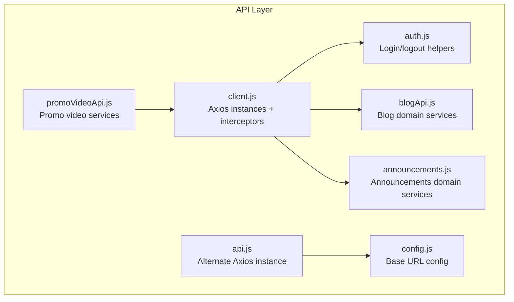
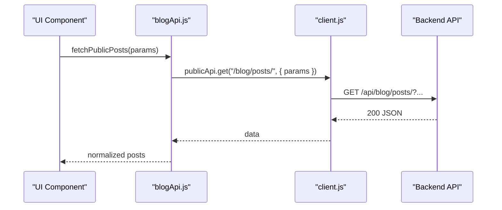
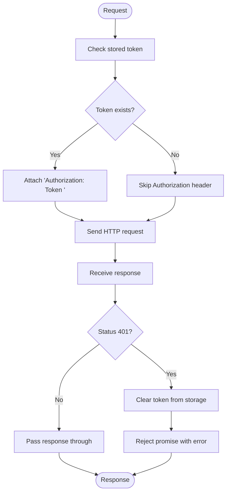
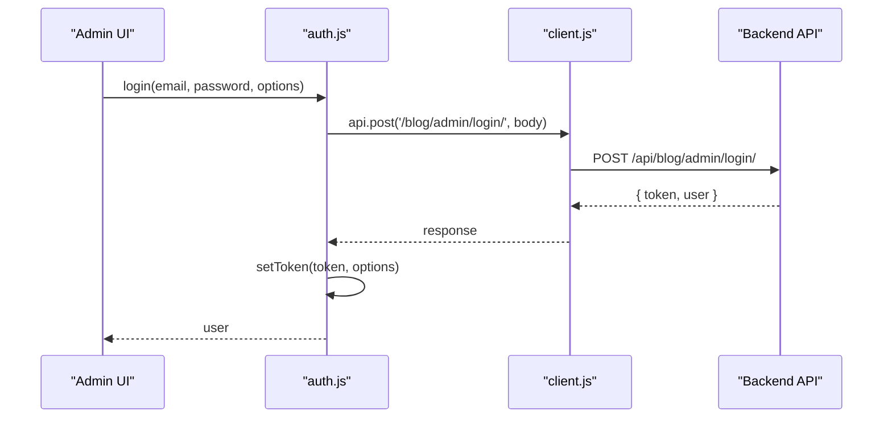
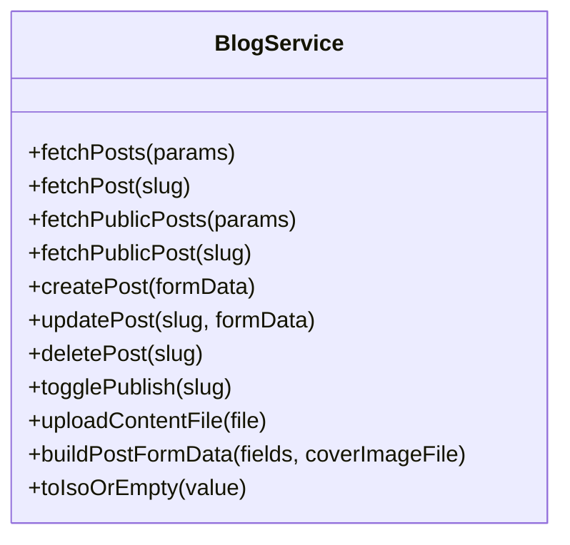
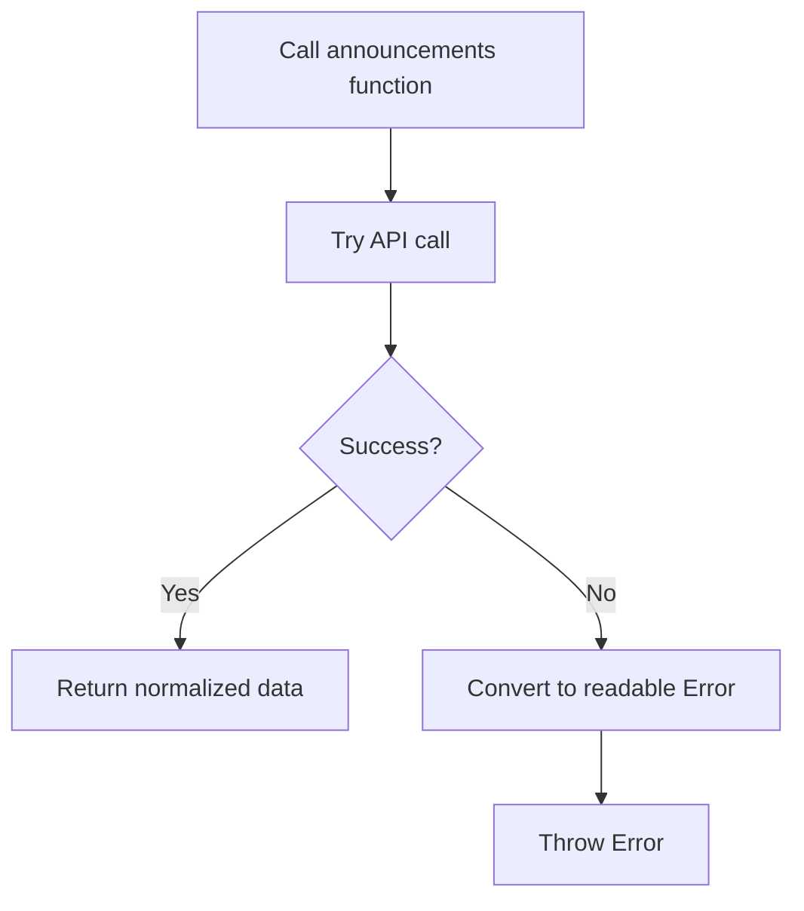
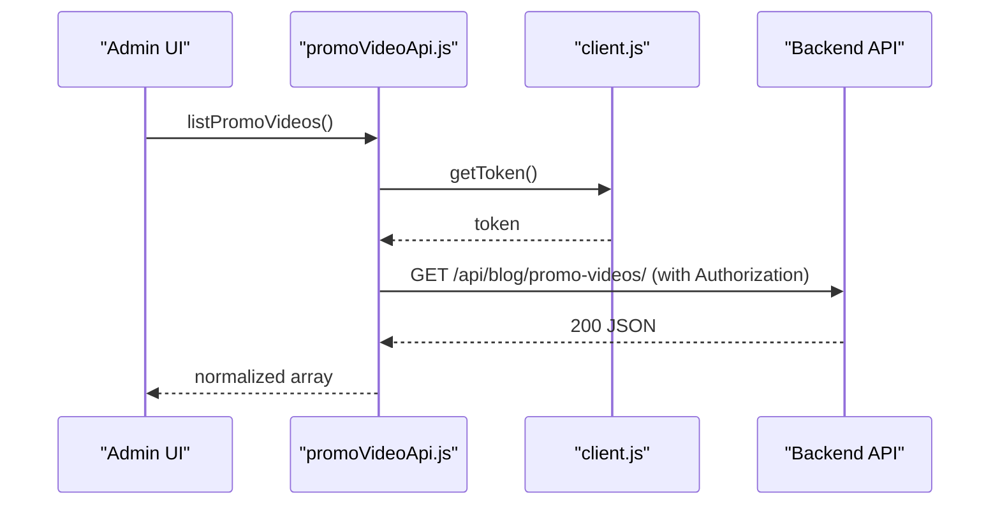
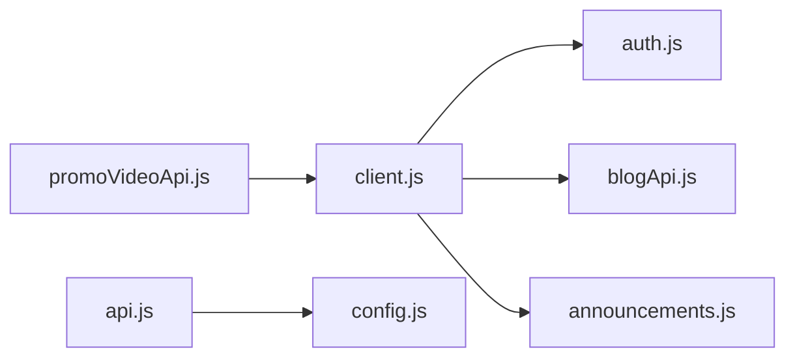

# API Integration Patterns

<cite>
**Referenced Files in This Document**
- [client.js](file://src/api/client.js)
- [api.js](file://src/api/api.js)
- [auth.js](file://src/api/auth.js)
- [blogApi.js](file://src/api/blogApi.js)
- [announcements.js](file://src/api/announcements.js)
- [promoVideoApi.js](file://src/api/promoVideoApi.js)
- [config.js](file://src/config/config.js)
</cite>

## Table of Contents
1. [Introduction](#introduction)
2. [Project Structure](#project-structure)
3. [Core Components](#core-components)
4. [Architecture Overview](#architecture-overview)
5. [Detailed Component Analysis](#detailed-component-analysis)
6. [Dependency Analysis](#dependency-analysis)
7. [Performance Considerations](#performance-considerations)
8. [Troubleshooting Guide](#troubleshooting-guide)
9. [Guidelines for Adding New Endpoints](#guidelines-for-adding-new-endpoints)
10. [Conclusion](#conclusion)

## Introduction
This document explains the API integration layer architecture, focusing on:
- Centralized Axios client configuration with interceptors for authentication and error handling
- Service layer pattern by domain (blog, announcements, videos)
- Error handling strategies, retry mechanisms, and loading state guidance
- Examples of making API calls, file uploads, and response normalization
- Caching strategies, request optimization, and performance considerations
- Guidelines for adding new endpoints consistently

The goal is to make the API layer predictable, secure, and easy to extend while keeping public and authenticated flows clearly separated.

## Project Structure
The API integration lives under `src/api` and is organized by domain modules that share a common Axios client:
- `client.js`: Central Axios instances (`api`, `publicApi`) with token injection and 401 handling
- `api.js`: A secondary Axios instance using a different base URL and token key (legacy or alternate auth flow)
- `auth.js`: Authentication helpers using the centralized client
- `blogApi.js`: Blog domain service functions (posts, uploads, form builders)
- `announcements.js`: Announcements domain service functions
- `promoVideoApi.js`: Promo video domain service functions (uses native fetch but shares token source)
- `config.js`: Shared environment-based base URL configuration

**Diagram sources**
- [client.js:47-88](file://src/api/client.js#L47-L88)
- [api.js:1-39](file://src/api/api.js#L1-L39)
- [auth.js:1-40](file://src/api/auth.js#L1-L40)
- [blogApi.js:1-135](file://src/api/blogApi.js#L1-L135)
- [announcements.js:1-61](file://src/api/announcements.js#L1-L61)
- [promoVideoApi.js:1-85](file://src/api/promoVideoApi.js#L1-L85)
- [config.js:1-3](file://src/config/config.js#L1-L3)

**Section sources**
- [client.js:1-88](file://src/api/client.js#L1-L88)
- [api.js:1-39](file://src/api/api.js#L1-L39)
- [auth.js:1-40](file://src/api/auth.js#L1-L40)
- [blogApi.js:1-135](file://src/api/blogApi.js#L1-L135)
- [announcements.js:1-61](file://src/api/announcements.js#L1-L61)
- [promoVideoApi.js:1-85](file://src/api/promoVideoApi.js#L1-L85)
- [config.js:1-3](file://src/config/config.js#L1-L3)

## Core Components
- Centralized Axios clients:
  - `api`: Authenticated admin requests; injects `Token <key>` header automatically
  - `publicApi`: Public visitor requests; never sends admin token
- Token management:
  - Read/write/clear helpers for persistent or session-scoped tokens
- Interceptors:
  - Request interceptor attaches token when present
  - Response interceptor clears token on 401 and rejects errors
- Domain service modules:
  - Blog, announcements, promo videos each expose typed functions for CRUD operations
- Error normalization:
  - Helpers convert DRF error bodies into readable messages

Key responsibilities:
- Single source of truth for base URLs and headers
- Consistent authentication behavior across domains
- Clear separation between public and authenticated flows
- Predictable error shapes for UI consumption

**Section sources**
- [client.js:21-75](file://src/api/client.js#L21-L75)
- [blogApi.js:1-135](file://src/api/blogApi.js#L1-L135)
- [announcements.js:1-61](file://src/api/announcements.js#L1-L61)
- [promoVideoApi.js:1-85](file://src/api/promoVideoApi.js#L1-L85)

## Architecture Overview
The API layer follows a layered approach:
- Infrastructure: Axios instances and interceptors
- Auth: Login/logout and token persistence
- Services: Domain-specific API functions
- Consumers: Pages and components call service functions

**Diagram sources**
- [blogApi.js:25-28](file://src/api/blogApi.js#L25-L28)
- [client.js:83-88](file://src/api/client.js#L83-L88)

## Detailed Component Analysis

### Centralized Axios Client Configuration
- Base URL resolution:
  - Uses an environment variable for production; falls back to localhost in development
  - Fails loudly in production if the base URL is missing
- Two Axios instances:
  - `api`: Admin-authenticated; adds `Authorization: Token <key>` via interceptor
  - `publicApi`: Public; no token attached
- Token helpers:
  - `getToken`, `setToken`, `clearToken` support both localStorage and sessionStorage
- Interceptors:
  - Request: attach token if available
  - Response: clear token on 401 and reject the error

**Diagram sources**
- [client.js:47-75](file://src/api/client.js#L47-L75)

**Section sources**
- [client.js:1-88](file://src/api/client.js#L1-L88)

### Authentication Flow
- Login:
  - Calls admin login endpoint
  - Stores token via shared helpers
  - Persists user info in storage
- Logout:
  - Calls logout endpoint
  - Clears token and user info
- Auth checks:
  - `isAuthenticated` reads token presence
  - `getCurrentUser` returns persisted user object

**Diagram sources**
- [auth.js:4-19](file://src/api/auth.js#L4-L19)
- [client.js:47-64](file://src/api/client.js#L47-L64)

**Section sources**
- [auth.js:1-40](file://src/api/auth.js#L1-L40)
- [client.js:21-75](file://src/api/client.js#L21-L75)

### Blog Domain Service
Responsibilities:
- Fetch posts (admin vs public)
- Create/update/delete posts
- Toggle publish status
- Upload content files
- Build multipart FormData payloads for editor forms

Key patterns:
- Separate admin and public endpoints via `api` vs `publicApi`
- Multipart uploads use explicit headers
- Helper utilities normalize dates and build payloads

**Diagram sources**
- [blogApi.js:10-135](file://src/api/blogApi.js#L10-L135)

**Section sources**
- [blogApi.js:1-135](file://src/api/blogApi.js#L1-L135)

### Announcements Domain Service
Responsibilities:
- List, create, update, delete announcements (admin)
- Fetch active announcement (public)
- Normalize DRF errors into readable messages

Patterns:
- Public endpoint uses `publicApi` to avoid clearing admin tokens
- Admin endpoints use `api` for authentication
- Error helper extracts field-level or detail messages

**Diagram sources**
- [announcements.js:6-17](file://src/api/announcements.js#L6-L17)
- [announcements.js:22-61](file://src/api/announcements.js#L22-L61)

**Section sources**
- [announcements.js:1-61](file://src/api/announcements.js#L1-L61)

### Promo Video Domain Service
Responsibilities:
- List, create, update, delete promo videos (admin)
- Get active promo video (public)
- Use native fetch with manual token injection
- Normalize responses and errors

Patterns:
- Shares token source with centralized client via `getToken`
- Manual FormData builder handles booleans and nulls
- Centralized error handler wraps fetch results

**Diagram sources**
- [promoVideoApi.js:1-85](file://src/api/promoVideoApi.js#L1-L85)
- [client.js:26-28](file://src/api/client.js#L26-L28)

**Section sources**
- [promoVideoApi.js:1-85](file://src/api/promoVideoApi.js#L1-L85)

### Alternate Axios Instance (Legacy/Secondary)
- Uses a separate base URL from `config.js`
- Attempts to inject a Bearer token (note: current implementation has a syntax issue in the Authorization header assignment)
- Clears access and refresh tokens on 401

Recommendation:
- Prefer the centralized `client.js` instances for consistency
- If this instance must remain, fix the Authorization header construction and align token keys with the rest of the app

**Section sources**
- [api.js:1-39](file://src/api/api.js#L1-L39)
- [config.js:1-3](file://src/config/config.js#L1-L3)

## Dependency Analysis

**Diagram sources**
- [client.js:1-88](file://src/api/client.js#L1-L88)
- [auth.js:1-40](file://src/api/auth.js#L1-L40)
- [blogApi.js:1-135](file://src/api/blogApi.js#L1-L135)
- [announcements.js:1-61](file://src/api/announcements.js#L1-L61)
- [promoVideoApi.js:1-85](file://src/api/promoVideoApi.js#L1-L85)
- [api.js:1-39](file://src/api/api.js#L1-L39)
- [config.js:1-3](file://src/config/config.js#L1-L3)

**Section sources**
- [client.js:1-88](file://src/api/client.js#L1-L88)
- [api.js:1-39](file://src/api/api.js#L1-L39)
- [auth.js:1-40](file://src/api/auth.js#L1-L40)
- [blogApi.js:1-135](file://src/api/blogApi.js#L1-L135)
- [announcements.js:1-61](file://src/api/announcements.js#L1-L61)
- [promoVideoApi.js:1-85](file://src/api/promoVideoApi.js#L1-L85)
- [config.js:1-3](file://src/config/config.js#L1-L3)

## Performance Considerations
- Avoid duplicate network calls:
  - Cache lists at the component level or with a lightweight cache layer when appropriate
- Minimize payload size:
  - Use query parameters for filtering/sorting instead of fetching all records
- Defer non-critical requests:
  - Load optional features after initial render
- Optimize file uploads:
  - Validate and compress images before upload
  - Show progress indicators and cancel options
- Reduce re-renders:
  - Memoize derived data and avoid unnecessary state updates
- Prefer public endpoints where possible:
  - Avoid sending admin tokens for read-only public data

[No sources needed since this section provides general guidance]

## Troubleshooting Guide
Common issues and resolutions:
- 401 Unauthorized:
  - The centralized client clears the token on 401; ensure login flow sets the same token key used by the interceptor
- Public endpoints returning 401:
  - Ensure public functions use `publicApi` so they do not send admin tokens
- File uploads failing silently:
  - Verify Content-Type is set to multipart/form-data and FormData keys match backend serializer fields
- Inconsistent base URLs:
  - Centralize base URL configuration; avoid hardcoding per module
- Legacy axios instance token header:
  - Fix the Authorization header construction and align token keys

Operational tips:
- Wrap API calls in try/catch and surface user-friendly messages
- Log network errors with context (endpoint, method, payload hash) without exposing secrets
- Add feature flags for experimental endpoints

**Section sources**
- [client.js:58-75](file://src/api/client.js#L58-L75)
- [announcements.js:6-17](file://src/api/announcements.js#L6-L17)
- [blogApi.js:63-74](file://src/api/blogApi.js#L63-L74)
- [api.js:11-36](file://src/api/api.js#L11-L36)

## Guidelines for Adding New Endpoints
Follow these steps to maintain consistency:
1. Choose the correct client:
   - Use `api` for admin endpoints
   - Use `publicApi` for public endpoints
2. Create or extend the domain module:
   - Add functions for each operation (list, get, create, update, delete)
   - Normalize responses to arrays or objects as expected by consumers
3. Handle errors consistently:
   - Convert DRF error bodies into readable messages
   - Throw standard JavaScript Errors with clear messages
4. For file uploads:
   - Build FormData explicitly
   - Set Content-Type to multipart/form-data
   - Validate file types and sizes before upload
5. Keep base URLs centralized:
   - Do not hardcode paths; rely on baseURL from the client
6. Align token usage:
   - Ensure token keys and schemes match the server expectations
7. Add tests:
   - Mock axios/fetch and verify success/error paths
8. Document contracts:
   - Update this guide with any new response shapes or required fields

Example patterns to follow:
- Public read: see public post fetch
- Admin CRUD: see announcements module
- File upload: see blog upload and promo video create/update

**Section sources**
- [blogApi.js:25-47](file://src/api/blogApi.js#L25-L47)
- [announcements.js:22-61](file://src/api/announcements.js#L22-L61)
- [promoVideoApi.js:49-85](file://src/api/promoVideoApi.js#L49-L85)

## Conclusion
This API integration layer centralizes Axios configuration, enforces consistent authentication, and organizes domain logic into dedicated service modules. By separating public and authenticated flows, normalizing errors, and providing reusable helpers for uploads and payloads, the codebase remains scalable and maintainable. Follow the guidelines for adding new endpoints to keep behavior predictable and consistent across the application.

[No sources needed since this section summarizes without analyzing specific files]