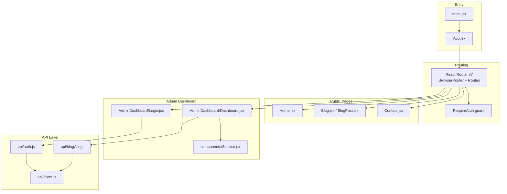
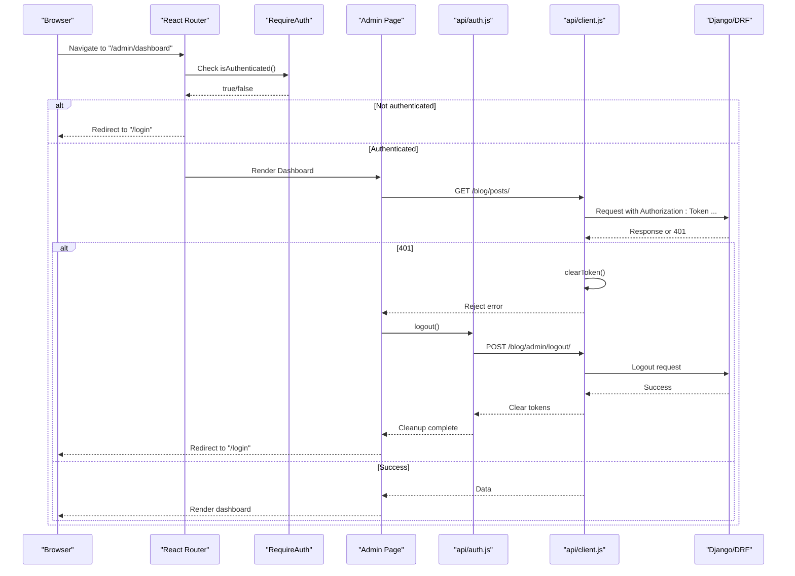
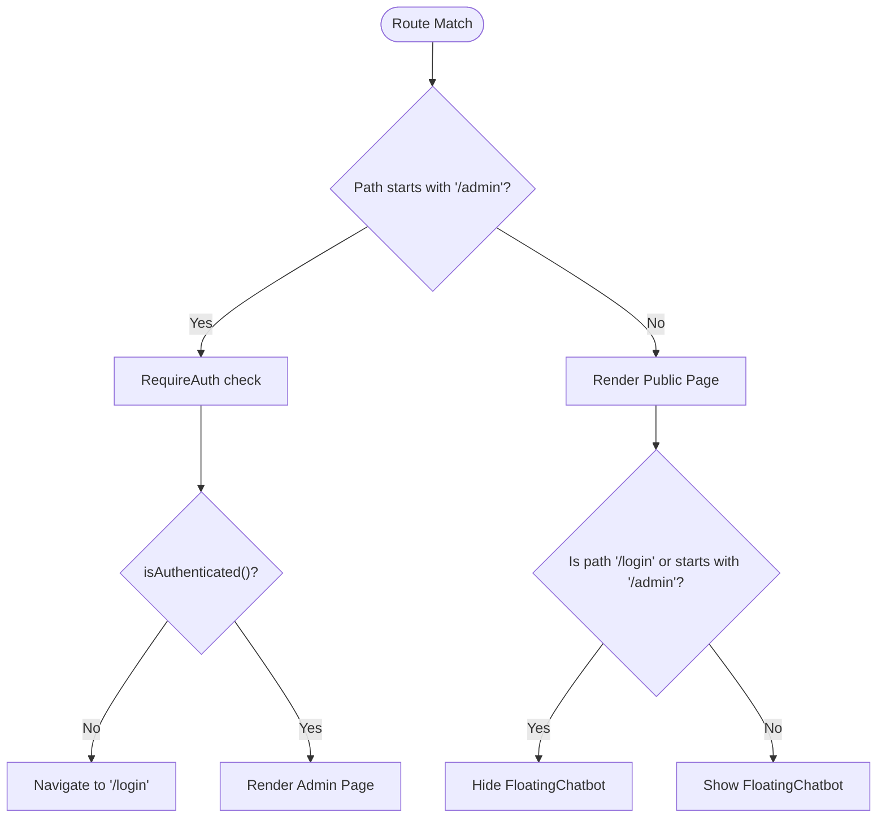
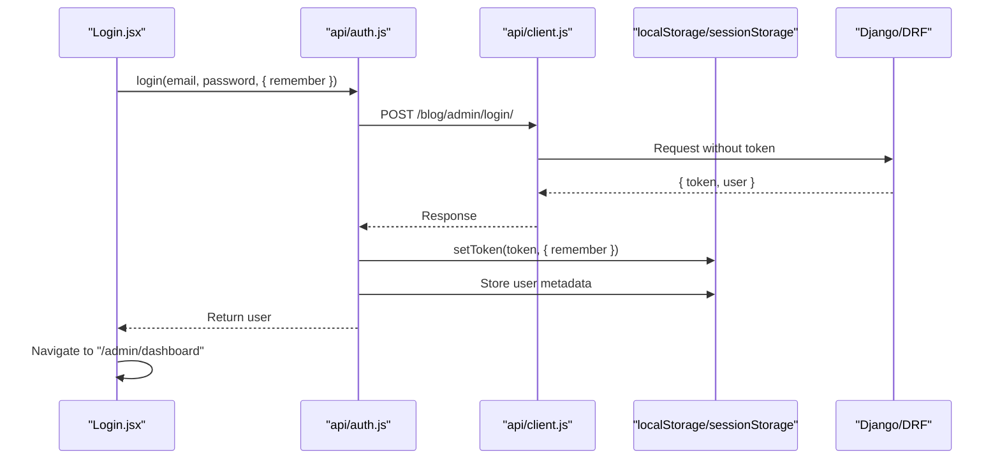
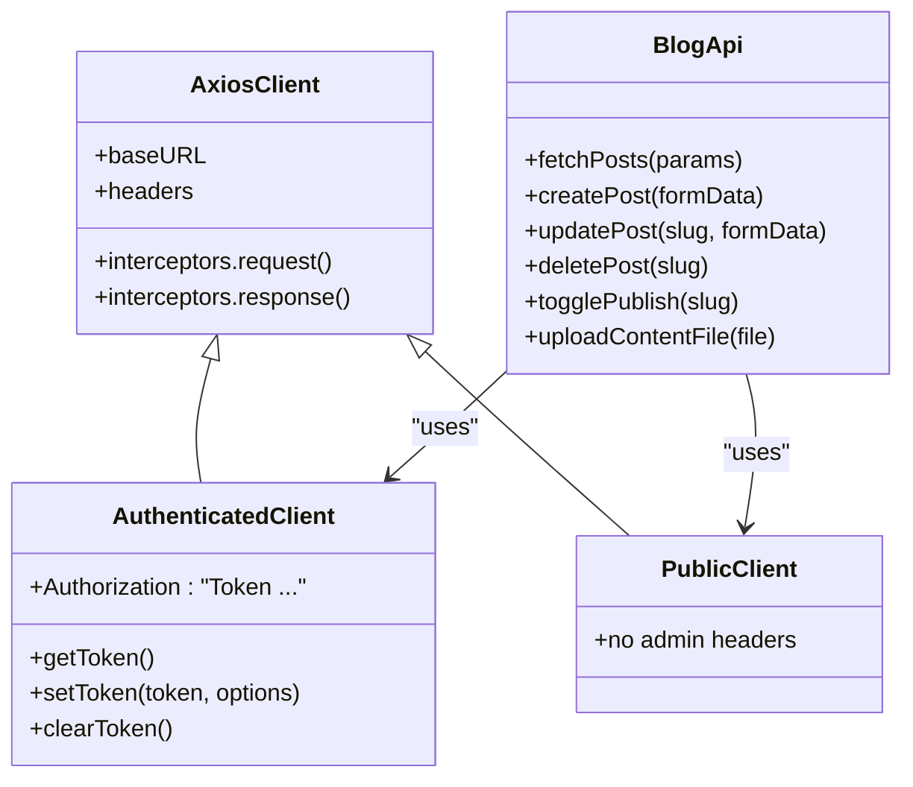
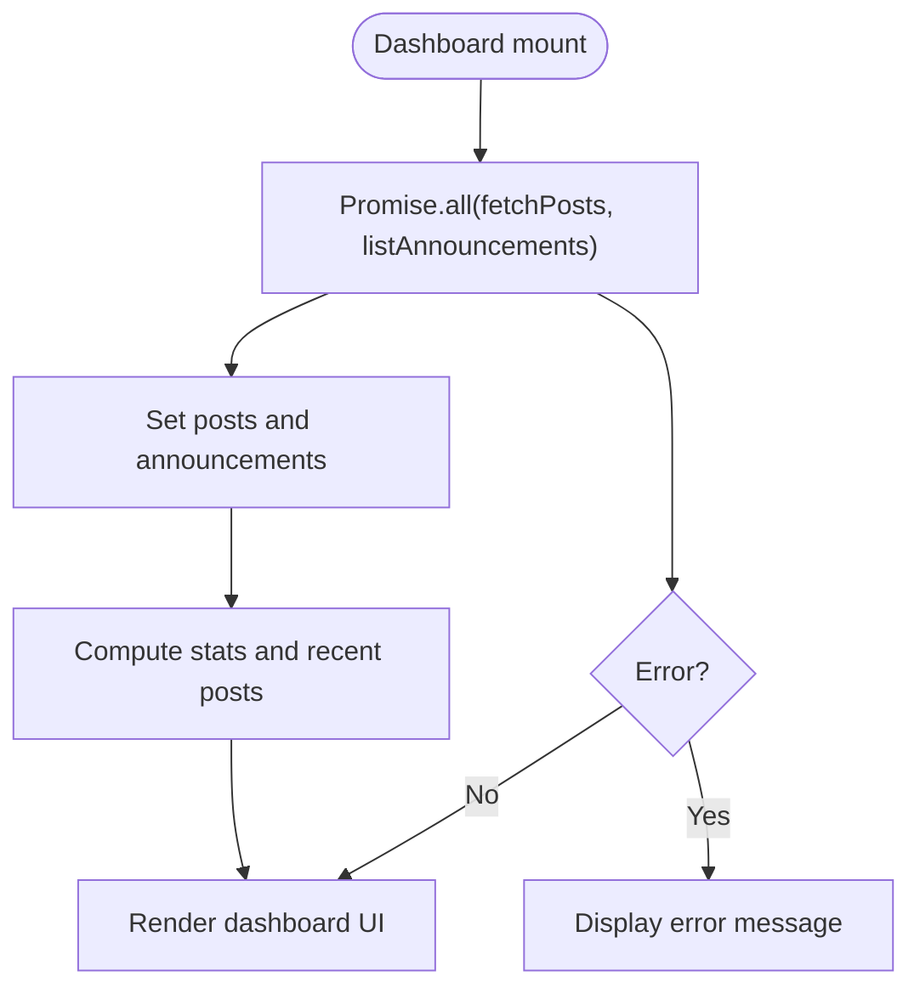
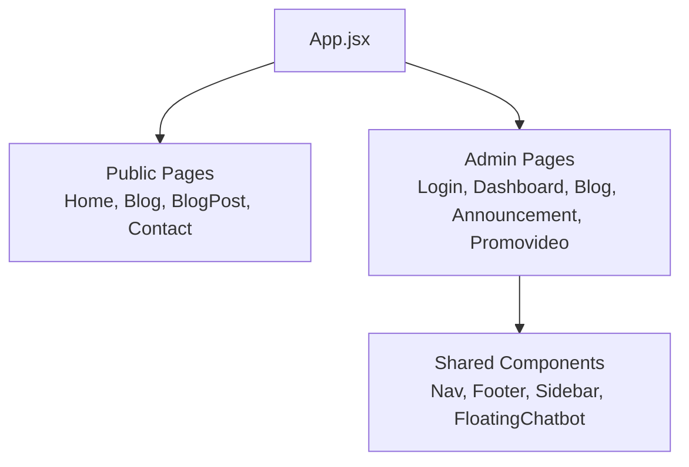
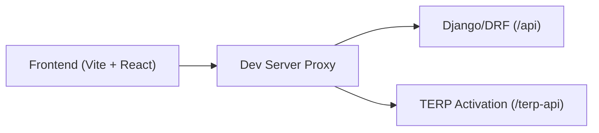

# Application Architecture

<cite>
**Referenced Files in This Document**
- [main.jsx](file://src/main.jsx)
- [App.jsx](file://src/App.jsx)
- [package.json](file://package.json)
- [vite.config.js](file://vite.config.js)
- [config.js](file://src/config/config.js)
- [client.js](file://src/api/client.js)
- [api.js](file://src/api/api.js)
- [auth.js](file://src/api/auth.js)
- [blogApi.js](file://src/api/blogApi.js)
- [Login.jsx](file://src/pages/AdminDashboard/Login.jsx)
- [Dashboard.jsx](file://src/pages/AdminDashboard/Dashboard.jsx)
- [Sidebar.jsx](file://src/components/Sidebar.jsx)
</cite>

## Table of Contents
1. [Introduction](#introduction)
2. [Project Structure](#project-structure)
3. [Core Components](#core-components)
4. [Architecture Overview](#architecture-overview)
5. [Detailed Component Analysis](#detailed-component-analysis)
6. [Dependency Analysis](#dependency-analysis)
7. [Performance Considerations](#performance-considerations)
8. [Troubleshooting Guide](#troubleshooting-guide)
9. [Conclusion](#conclusion)

## Introduction
TRELLISCO_ERP_FRONTEND is a React 19 + Vite application that serves two distinct user experiences:
- Public website pages for visitors (home, blog, contact).
- Admin dashboard for authenticated users to manage blog posts, announcements, and promotional content.

The application follows a component-based architecture with feature-based organization under `pages/` and shared UI components under `components/`. A service layer pattern is implemented through Axios instances and API modules that encapsulate HTTP calls, token handling, and error management. Routing uses React Router v7 with protected routes for admin functionality. Styling uses SCSS modules per component.

## Project Structure
At a high level, the application is organized as follows:
- Entry point renders the root React tree and wraps it with routing.
- Routing defines public and admin routes, with admin routes guarded by authentication checks.
- API layer provides authenticated and public Axios clients, token helpers, and domain-specific modules.
- Pages implement feature areas (public pages and admin dashboard features).
- Shared components provide reusable UI elements such as navigation, sidebar, and chatbot.

**Diagram sources**
- [main.jsx:1-11](file://src/main.jsx#L1-L11)
- [App.jsx:1-74](file://src/App.jsx#L1-L74)
- [client.js:1-88](file://src/api/client.js#L1-L88)
- [auth.js:1-40](file://src/api/auth.js#L1-L40)
- [blogApi.js:1-135](file://src/api/blogApi.js#L1-L135)
- [Login.jsx:1-244](file://src/pages/AdminDashboard/Login.jsx#L1-L244)
- [Dashboard.jsx:1-234](file://src/pages/AdminDashboard/Dashboard.jsx#L1-L234)
- [Sidebar.jsx:1-239](file://src/components/Sidebar.jsx#L1-L239)

**Section sources**
- [main.jsx:1-11](file://src/main.jsx#L1-L11)
- [App.jsx:1-74](file://src/App.jsx#L1-L74)
- [package.json:12-19](file://package.json#L12-L19)

## Core Components
- App shell and routing: The root component configures BrowserRouter and declares all routes, including protected admin routes guarded by RequireAuth. It also conditionally renders the floating chatbot based on current path.
- Authentication service: Provides login/logout, token persistence, and session utilities. It stores tokens using localStorage or sessionStorage depending on the remember flag and persists user metadata for quick access.
- API clients: Two Axios instances are provided:
  - Authenticated client attaches an Authorization header with a Token scheme for admin endpoints.
  - Public client never sends admin tokens, ensuring visitor-facing pages see only published content even when an admin is logged in.
- Domain API modules: Encapsulate REST calls for blog posts and other resources, abstracting request/response details from page components.

Key responsibilities:
- Routing strategy separates public and admin boundaries.
- Service layer centralizes HTTP concerns and error handling.
- State is primarily local within components; no global state library is used.

**Section sources**
- [App.jsx:15-23](file://src/App.jsx#L15-L23)
- [App.jsx:25-70](file://src/App.jsx#L25-L70)
- [auth.js:4-40](file://src/api/auth.js#L4-L40)
- [client.js:21-88](file://src/api/client.js#L21-L88)
- [blogApi.js:1-135](file://src/api/blogApi.js#L1-L135)

## Architecture Overview
The system boundary divides into:
- Public website: Home, Blog, BlogPost, Contact. These use the public API client and do not send admin tokens.
- Admin dashboard: Login, Dashboard, Blog management, Announcements, Promo video. These use the authenticated API client and require a valid token.

Data flow patterns:
- User navigates to a route; React Router renders the corresponding component.
- Page components call API modules to fetch or mutate data.
- API modules use Axios interceptors to attach tokens and handle errors.
- On 401 responses, tokens are cleared to force re-authentication.

**Diagram sources**
- [App.jsx:15-17](file://src/App.jsx#L15-L17)
- [App.jsx:35-66](file://src/App.jsx#L35-L66)
- [auth.js:4-29](file://src/api/auth.js#L4-L29)
- [client.js:54-75](file://src/api/client.js#L54-L75)
- [blogApi.js:10-13](file://src/api/blogApi.js#L10-L13)

## Detailed Component Analysis

### Routing Strategy and Protected Routes
- Public routes: `/`, `/blog`, `/blog/:slug`, `/contact`.
- Admin routes: `/login`, `/t-erp-login`, `/admin`, `/admin/dashboard`, `/admin/announcements`, `/admin/promo-video`.
- Protection: Admin routes wrap their elements with RequireAuth, which checks authentication via `isAuthenticated()` and redirects to `/login` if unauthenticated.
- Chatbot visibility: A gate component hides the FloatingChatbot on `/login` and any path starting with `/admin`.

**Diagram sources**
- [App.jsx:15-23](file://src/App.jsx#L15-L23)
- [App.jsx:25-70](file://src/App.jsx#L25-L70)

**Section sources**
- [App.jsx:15-23](file://src/App.jsx#L15-L23)
- [App.jsx:25-70](file://src/App.jsx#L25-L70)

### Authentication Flow
- Login form collects email/password and submits to `/blog/admin/login/`.
- On success, the token is stored using `setToken(token, { remember })`, which chooses localStorage or sessionStorage based on the remember flag.
- User metadata is persisted in storage under a dedicated key for quick retrieval.
- Logout calls `/blog/admin/logout/`, clears tokens, and removes user metadata.
- Interceptors automatically attach the Authorization header with the Token scheme and clear tokens on 401 responses.

**Diagram sources**
- [Login.jsx:113-136](file://src/pages/AdminDashboard/Login.jsx#L113-L136)
- [auth.js:4-18](file://src/api/auth.js#L4-L18)
- [client.js:26-42](file://src/api/client.js#L26-L42)

**Section sources**
- [Login.jsx:113-136](file://src/pages/AdminDashboard/Login.jsx#L113-L136)
- [auth.js:4-40](file://src/api/auth.js#L4-L40)
- [client.js:26-42](file://src/api/client.js#L26-L42)

### API Integration Layer
- Authenticated client (`api`):
  - Base URL configured via environment variables.
  - Attaches `Authorization: Token <key>` header when a token exists.
  - Clears tokens on 401 responses.
- Public client (`publicApi`):
  - Never attaches admin tokens, ensuring public pages show only published content.
- Domain modules:
  - `blogApi.js` exposes functions for fetching, creating, updating, deleting posts, toggling publish status, and uploading files.
  - Uses multipart/form-data for file uploads and JSON fields where required.

**Diagram sources**
- [client.js:47-88](file://src/api/client.js#L47-L88)
- [blogApi.js:10-74](file://src/api/blogApi.js#L10-L74)

**Section sources**
- [client.js:47-88](file://src/api/client.js#L47-L88)
- [blogApi.js:10-135](file://src/api/blogApi.js#L10-L135)

### Admin Dashboard Data Flow
- Dashboard loads posts and announcements concurrently using Promise.all.
- Computes stats and recent posts locally.
- Displays loading states and errors.
- Navigates to related admin sections via Sidebar links.

**Diagram sources**
- [Dashboard.jsx:107-134](file://src/pages/AdminDashboard/Dashboard.jsx#L107-L134)
- [Dashboard.jsx:136-159](file://src/pages/AdminDashboard/Dashboard.jsx#L136-L159)

**Section sources**
- [Dashboard.jsx:101-234](file://src/pages/AdminDashboard/Dashboard.jsx#L101-L234)

### Component Hierarchy
- Root: App (routing, chatbot gate).
- Public pages: Home, Blog, BlogPost, Contact.
- Admin pages: Login, Dashboard, Blog management, Announcements, Promo video.
- Shared components: Nav, Footer, Sidebar, FloatingChatbot, FallingText, Heroart, GlowCursor.

**Diagram sources**
- [App.jsx:1-74](file://src/App.jsx#L1-L74)
- [Sidebar.jsx:1-239](file://src/components/Sidebar.jsx#L1-L239)

## Dependency Analysis
External dependencies relevant to architecture:
- React 19 and React DOM for UI rendering.
- React Router v7 for routing and navigation.
- Axios for HTTP requests and interceptors.
- Vite for build tooling and development server proxy configuration.

Development server proxies:
- `/api` proxied to Django backend at localhost:8000.
- `/terp-api` proxied to external activation endpoint with rewrite rules.

**Diagram sources**
- [vite.config.js:7-21](file://vite.config.js#L7-L21)

**Section sources**
- [package.json:12-19](file://package.json#L12-L19)
- [vite.config.js:7-21](file://vite.config.js#L7-L21)

## Performance Considerations
- Concurrent data fetching: Dashboard uses Promise.all to load independent datasets in parallel, reducing total load time.
- Local computations: Stats and recent posts are computed with useMemo to avoid unnecessary recalculations.
- Conditional rendering: Chatbot is hidden on admin paths to reduce overhead in sensitive areas.
- Build-time configuration: Environment variables control base URLs and prevent runtime misconfiguration.
- Styling approach: SCSS modules per component keep styles scoped and minimize CSS bloat.

[No sources needed since this section provides general guidance]

## Troubleshooting Guide
Common issues and resolutions:
- 401 Unauthorized:
  - Interceptors clear tokens on 401 responses. Ensure logout clears both localStorage and sessionStorage tokens and user metadata.
  - Verify Authorization header uses the correct scheme ("Token ...") for DRF TokenAuthentication.
- Missing base URL:
  - In production builds, a missing VITE_API_BASE_URL throws an error to fail loudly. Configure environment variables before building.
- Public vs Admin data leakage:
  - Ensure public pages use publicApi to avoid sending admin tokens and exposing drafts/scheduled posts.
- File uploads:
  - Use multipart/form-data for file uploads and ensure field names match the backend serializer expectations.

**Section sources**
- [client.js:54-75](file://src/api/client.js#L54-L75)
- [auth.js:21-29](file://src/api/auth.js#L21-L29)
- [blogApi.js:63-74](file://src/api/blogApi.js#L63-L74)

## Conclusion
TRELLISCO_ERP_FRONTEND implements a clean separation between public and admin experiences using React Router v7 and protected routes. The service layer pattern centralizes HTTP concerns with Axios interceptors for token management and error handling. Feature-based organization under pages/ keeps domain logic cohesive, while shared components under components/ promote reuse. Styling with SCSS modules ensures maintainability. The architecture supports scalable growth by isolating cross-cutting concerns and providing clear integration points with the backend.

[No sources needed since this section summarizes without analyzing specific files]