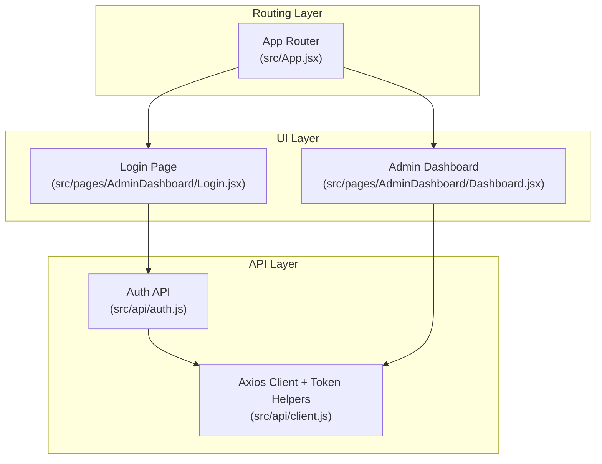
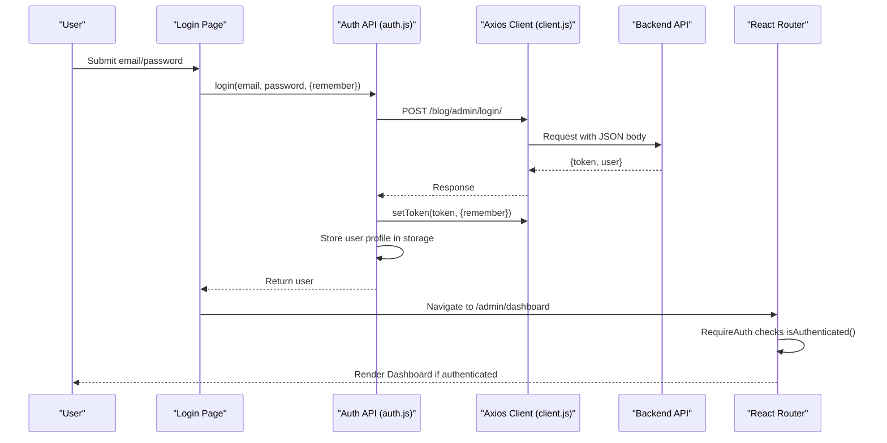
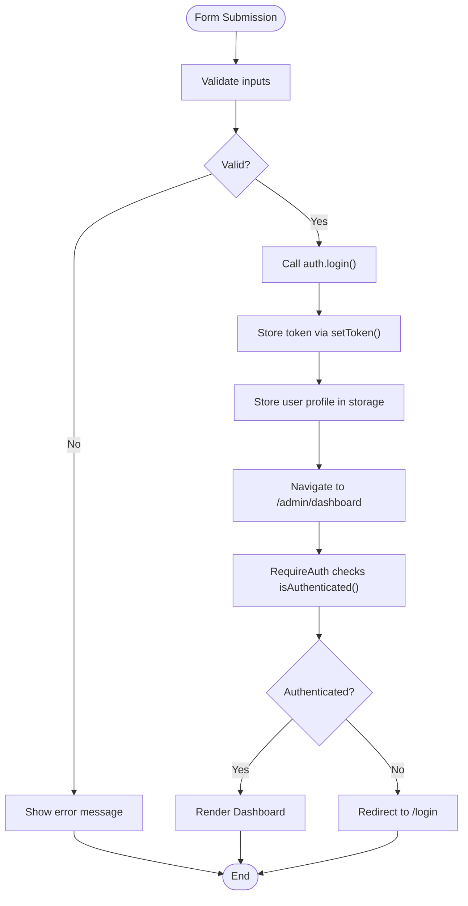
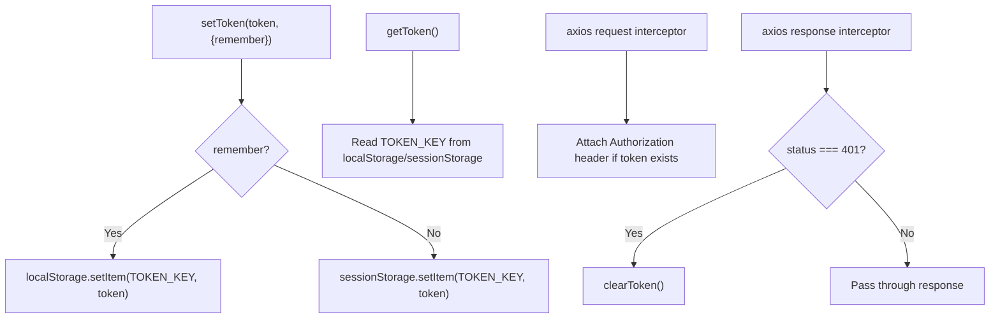
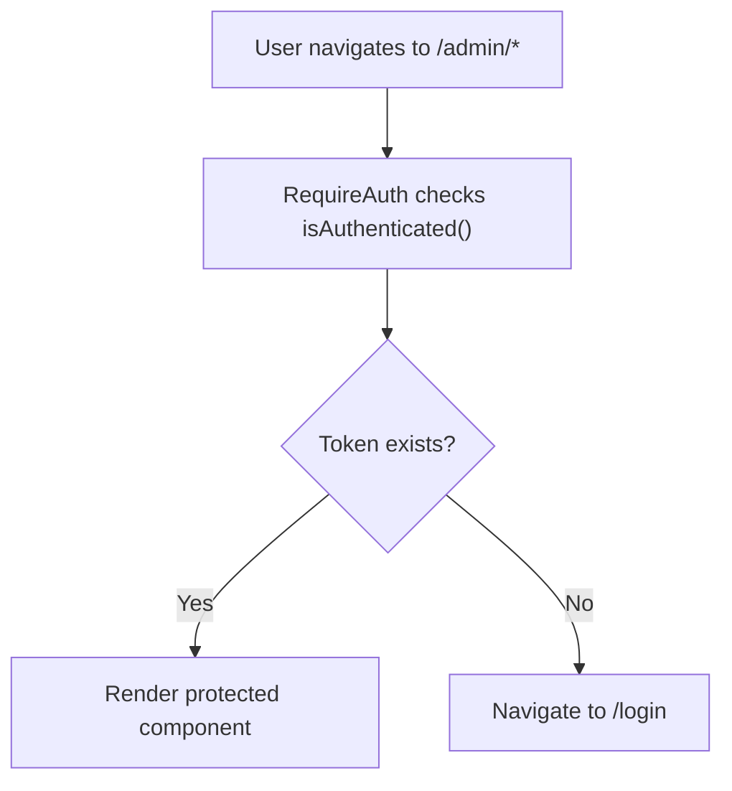
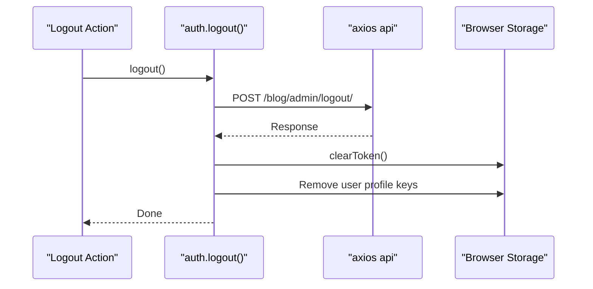
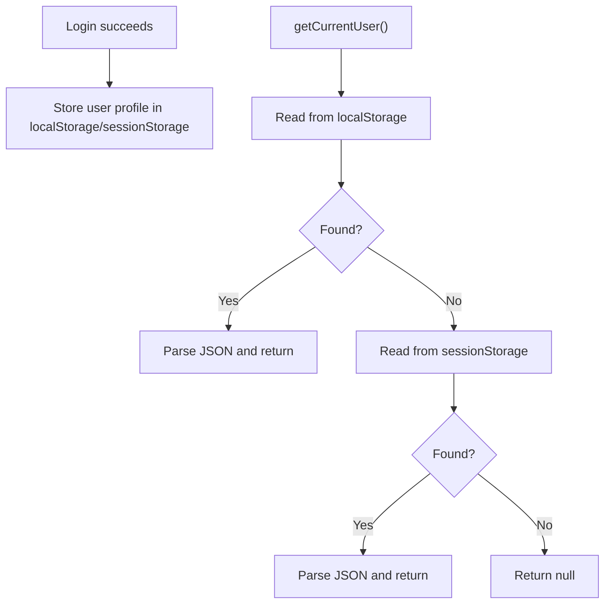
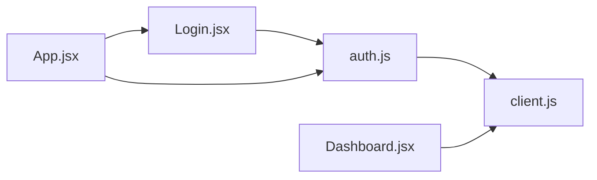

# Authentication & Authorization

<cite>
**Referenced Files in This Document**
- [src/api/auth.js](file://src/api/auth.js)
- [src/api/client.js](file://src/api/client.js)
- [src/App.jsx](file://src/App.jsx)
- [src/pages/AdminDashboard/Login.jsx](file://src/pages/AdminDashboard/Login.jsx)
- [src/pages/AdminDashboard/Dashboard.jsx](file://src/pages/AdminDashboard/Dashboard.jsx)
</cite>

## Table of Contents
1. [Introduction](#introduction)
2. [Project Structure](#project-structure)
3. [Core Components](#core-components)
4. [Architecture Overview](#architecture-overview)
5. [Detailed Component Analysis](#detailed-component-analysis)
6. [Dependency Analysis](#dependency-analysis)
7. [Performance Considerations](#performance-considerations)
8. [Troubleshooting Guide](#troubleshooting-guide)
9. [Conclusion](#conclusion)
10. [Appendices](#appendices)

## Introduction
This document explains the authentication and authorization system implemented in the frontend application. It covers:
- The complete login flow from form submission to token storage and navigation.
- How protected admin routes prevent unauthorized access.
- Token management, including storage strategy and automatic handling of expired tokens.
- Client-side authorization checks.
- Security considerations such as CSRF, XSS, and secure token handling.
- Guidance for extending the system with custom guards and additional roles or permissions.

## Project Structure
The authentication logic is split across a small set of focused files:
- API layer: HTTP client configuration, token helpers, and auth endpoints.
- Routing layer: Protected route wrapper and admin route definitions.
- UI layer: Login form and dashboard that consume authenticated APIs.

**Diagram sources**
- [src/App.jsx:1-74](file://src/App.jsx#L1-L74)
- [src/pages/AdminDashboard/Login.jsx:1-244](file://src/pages/AdminDashboard/Login.jsx#L1-L244)
- [src/pages/AdminDashboard/Dashboard.jsx:1-234](file://src/pages/AdminDashboard/Dashboard.jsx#L1-L234)
- [src/api/auth.js:1-40](file://src/api/auth.js#L1-L40)
- [src/api/client.js:1-88](file://src/api/client.js#L1-L88)

**Section sources**
- [src/App.jsx:1-74](file://src/App.jsx#L1-L74)
- [src/api/auth.js:1-40](file://src/api/auth.js#L1-L40)
- [src/api/client.js:1-88](file://src/api/client.js#L1-L88)

## Core Components
- Auth API module: Provides login, logout, authentication check, and current user retrieval.
- Axios client: Centralizes base URL, token injection into requests, and 401-based cleanup.
- App router: Defines public and protected routes using a RequireAuth guard.
- Login page: Collects credentials, calls the backend, stores tokens, and navigates on success.
- Admin dashboard: Loads data via authenticated API calls after successful authentication.

Key responsibilities:
- Token storage: Uses localStorage or sessionStorage based on a remember flag.
- Request authorization: Automatically attaches an Authorization header when a token exists.
- Session invalidation: Clears stored tokens on 401 responses.
- Route protection: Redirects unauthenticated users to the login page.

**Section sources**
- [src/api/auth.js:1-40](file://src/api/auth.js#L1-L40)
- [src/api/client.js:1-88](file://src/api/client.js#L1-L88)
- [src/App.jsx:1-74](file://src/App.jsx#L1-L74)
- [src/pages/AdminDashboard/Login.jsx:1-244](file://src/pages/AdminDashboard/Login.jsx#L1-L244)
- [src/pages/AdminDashboard/Dashboard.jsx:1-234](file://src/pages/AdminDashboard/Dashboard.jsx#L1-L234)

## Architecture Overview
The authentication architecture follows a layered approach:
- UI triggers login by submitting credentials.
- Auth API posts to the backend and persists the returned token and user profile.
- Axios interceptors attach the token to subsequent requests and clear it on 401 errors.
- React Router protects admin routes using a RequireAuth component.

**Diagram sources**
- [src/pages/AdminDashboard/Login.jsx:113-136](file://src/pages/AdminDashboard/Login.jsx#L113-L136)
- [src/api/auth.js:4-18](file://src/api/auth.js#L4-L18)
- [src/api/client.js:26-42](file://src/api/client.js#L26-L42)
- [src/App.jsx:15-17](file://src/App.jsx#L15-L17)

## Detailed Component Analysis

### Authentication Flow
The login flow consists of:
- Form validation and submission state management.
- Calling the auth endpoint and storing the token and user profile.
- Navigating to the admin dashboard.
- Protecting admin routes through RequireAuth.

**Diagram sources**
- [src/pages/AdminDashboard/Login.jsx:113-136](file://src/pages/AdminDashboard/Login.jsx#L113-L136)
- [src/api/auth.js:4-18](file://src/api/auth.js#L4-L18)
- [src/App.jsx:15-17](file://src/App.jsx#L15-L17)

**Section sources**
- [src/pages/AdminDashboard/Login.jsx:113-136](file://src/pages/AdminDashboard/Login.jsx#L113-L136)
- [src/api/auth.js:4-18](file://src/api/auth.js#L4-L18)
- [src/App.jsx:15-17](file://src/App.jsx#L15-L17)

### Token Management Strategy
- Storage mechanism: Tokens are stored in either localStorage or sessionStorage depending on the remember flag.
- Retrieval: getToken reads from both storages; setToken clears existing tokens before writing new ones.
- Interceptor behavior: Every outgoing request includes an Authorization header with the scheme expected by the backend.
- Automatic refresh handling: On 401 responses, the interceptor clears the token to force re-authentication. There is no automatic token refresh implementation in this codebase.

**Diagram sources**
- [src/api/client.js:26-42](file://src/api/client.js#L26-L42)
- [src/api/client.js:58-75](file://src/api/client.js#L58-L75)

**Section sources**
- [src/api/client.js:26-42](file://src/api/client.js#L26-L42)
- [src/api/client.js:58-75](file://src/api/client.js#L58-L75)

### Protected Routes and Authorization Checks
- Client-side protection: RequireAuth wraps admin routes and redirects to /login if not authenticated.
- Authentication check: isAuthenticated returns true only when a token exists.
- Server-side protection: The backend enforces authentication on admin endpoints; the frontend relies on the backend’s 401 responses to invalidate sessions.

**Diagram sources**
- [src/App.jsx:15-17](file://src/App.jsx#L15-L17)
- [src/api/auth.js:31-33](file://src/api/auth.js#L31-L33)

**Section sources**
- [src/App.jsx:15-17](file://src/App.jsx#L15-L17)
- [src/api/auth.js:31-33](file://src/api/auth.js#L31-L33)

### Logout and Session Cleanup
- Logout calls the backend logout endpoint and then clears tokens and user profiles from both localStorage and sessionStorage.
- This ensures that subsequent requests do not carry stale credentials.

**Diagram sources**
- [src/api/auth.js:21-29](file://src/api/auth.js#L21-L29)
- [src/api/client.js:39-42](file://src/api/client.js#L39-L42)

**Section sources**
- [src/api/auth.js:21-29](file://src/api/auth.js#L21-L29)
- [src/api/client.js:39-42](file://src/api/client.js#L39-L42)

### Current User Handling
- After login, the user profile is stored under a dedicated key in both localStorage and sessionStorage.
- getCurrentUser retrieves the user object from either storage location.

**Diagram sources**
- [src/api/auth.js:15-18](file://src/api/auth.js#L15-L18)
- [src/api/auth.js:35-40](file://src/api/auth.js#L35-L40)

**Section sources**
- [src/api/auth.js:15-18](file://src/api/auth.js#L15-L18)
- [src/api/auth.js:35-40](file://src/api/auth.js#L35-L40)

## Dependency Analysis
The following diagram shows how components depend on each other for authentication and routing:

**Diagram sources**
- [src/pages/AdminDashboard/Login.jsx:1-244](file://src/pages/AdminDashboard/Login.jsx#L1-L244)
- [src/api/auth.js:1-40](file://src/api/auth.js#L1-L40)
- [src/api/client.js:1-88](file://src/api/client.js#L1-L88)
- [src/App.jsx:1-74](file://src/App.jsx#L1-L74)
- [src/pages/AdminDashboard/Dashboard.jsx:1-234](file://src/pages/AdminDashboard/Dashboard.jsx#L1-L234)

**Section sources**
- [src/pages/AdminDashboard/Login.jsx:1-244](file://src/pages/AdminDashboard/Login.jsx#L1-L244)
- [src/api/auth.js:1-40](file://src/api/auth.js#L1-L40)
- [src/api/client.js:1-88](file://src/api/client.js#L1-L88)
- [src/App.jsx:1-74](file://src/App.jsx#L1-L74)
- [src/pages/AdminDashboard/Dashboard.jsx:1-234](file://src/pages/AdminDashboard/Dashboard.jsx#L1-L234)

## Performance Considerations
- Token lookup is O(1) per request due to direct storage access.
- Interceptors run on every request/response, adding minimal overhead.
- Avoid unnecessary re-renders by keeping authentication state centralized in storage rather than duplicating it in global state unless needed for UI responsiveness.
- Public API instance avoids sending admin tokens to public endpoints, reducing unnecessary headers and potential cross-origin issues.

[No sources needed since this section provides general guidance]

## Troubleshooting Guide
Common issues and resolutions:
- 401 Unauthorized on admin requests:
  - Cause: Missing or expired token.
  - Resolution: Ensure login succeeded and token was stored; verify that the Authorization header uses the correct scheme.
- Requests sent without Authorization header:
  - Cause: Token not present in storage or wrong storage scope.
  - Resolution: Confirm remember flag and storage selection; check getToken behavior.
- Public pages showing admin-only content:
  - Cause: Using the authenticated axios instance instead of publicApi.
  - Resolution: Use publicApi for visitor-facing endpoints.

**Section sources**
- [src/api/client.js:58-75](file://src/api/client.js#L58-L75)
- [src/api/client.js:83-88](file://src/api/client.js#L83-L88)

## Conclusion
The application implements a straightforward yet robust authentication and authorization model:
- Credentials are submitted to a backend endpoint, returning a token and user profile.
- Tokens are stored securely in browser storage and automatically attached to authenticated requests.
- Admin routes are protected client-side, while server-side enforcement remains essential.
- The system currently clears tokens on 401 responses but does not implement automatic token refresh.
- Extending the system with role-based access control and custom guards is straightforward by enhancing RequireAuth and adding permission checks in components and API calls.

[No sources needed since this section summarizes without analyzing specific files]

## Appendices

### Security Considerations
- CSRF protection:
  - If the backend uses cookie-based CSRF tokens, ensure cookies are configured correctly and consider SameSite attributes.
  - For token-based auth, CSRF is less relevant, but still validate backend expectations.
- XSS prevention:
  - Avoid rendering unsanitized user input directly in JSX; rely on React’s default escaping.
  - Do not store sensitive data beyond what is necessary in localStorage.
- Secure token handling:
  - Prefer httpOnly cookies for tokens where possible to mitigate XSS exposure.
  - If using localStorage/sessionStorage, be aware of XSS risks and minimize exposure time.
  - Always use HTTPS in production to protect tokens in transit.

[No sources needed since this section provides general guidance]

### Extending the System: Custom Guards and Roles
To add custom authentication guards and support additional roles or permissions:
- Enhance RequireAuth:
  - Add a prop for required roles or permissions.
  - Compare the current user’s roles against the required set.
  - Redirect to an appropriate fallback route if access is denied.
- Extend getCurrentUser:
  - Include role and permission fields in the stored user profile.
  - Provide helper functions like hasRole(role) and hasPermission(permission).
- Implement feature-level checks:
  - Conditionally render admin-only UI elements based on user roles.
  - Gate API mutations behind permission checks before making requests.

Example pattern outline:
- RequireAuth({ children, requiredRoles })
  - Reads current user from storage.
  - Compares roles and grants or denies access.
- hasRole(user, role)
  - Returns boolean indicating whether the user has the specified role.
- hasPermission(user, permission)
  - Returns boolean indicating whether the user has the specified permission.

[No sources needed since this section provides conceptual guidance]