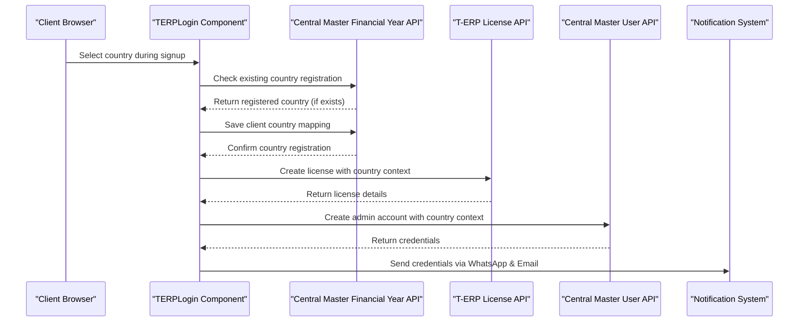
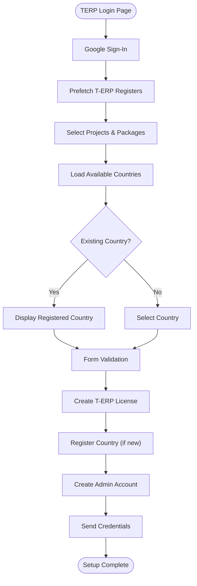
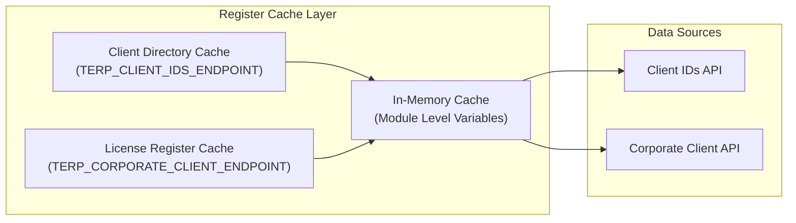
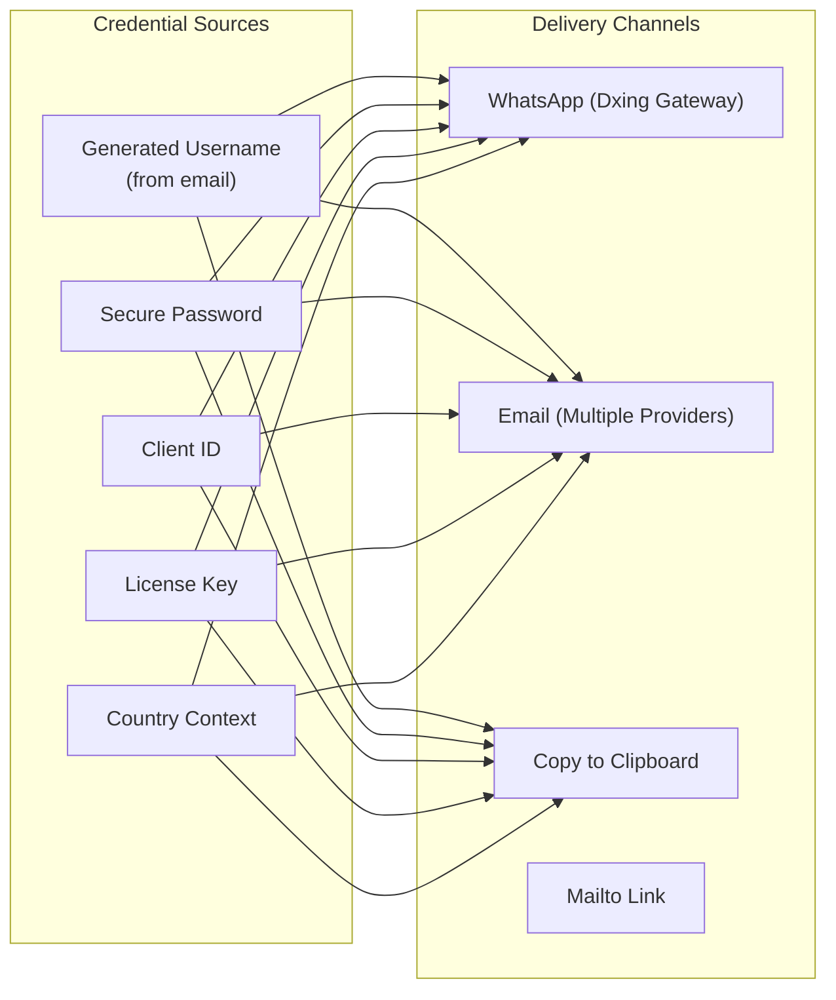

# Authentication & Authorization

<cite>
**Referenced Files in This Document**
- [src/api/auth.js](file://src/api/auth.js)
- [src/api/client.js](file://src/api/client.js)
- [src/App.jsx](file://src/App.jsx)
- [src/pages/AdminDashboard/Login.jsx](file://src/pages/AdminDashboard/Login.jsx)
- [src/pages/TERPLogin.jsx](file://src/pages/TERPLogin.jsx)
- [src/components/CredentialsModal.jsx](file://src/components/CredentialsModal.jsx)
- [src/api/terpLicense.js](file://src/api/terpLicense.js)
- [src/api/userMaster.js](file://src/api/userMaster.js)
- [src/api/notifications.js](file://src/api/notifications.js)
- [src/api/financialYear.js](file://src/api/financialYear.js)
</cite>

## Update Summary
**Changes Made**
- Enhanced T-ERP login workflow with centralized license register loading for improved performance
- Implemented prefetch optimization for client directory and license register data
- Improved asynchronous project ownership detection with callback-based updates
- Added advanced caching mechanisms for T-ERP registers to reduce API calls
- Enhanced workspace recognition with parallel data loading strategies
- Optimized credential delivery system with improved error handling and retry mechanisms

## Table of Contents
1. [Introduction](#introduction)
2. [Authentication Systems Overview](#authentication-systems-overview)
3. [Google Sign-In Integration](#google-sign-in-integration)
4. [Financial Year and Country Management System](#financial-year-and-country-management-system)
5. [Enhanced T-ERP Login Flow](#enhanced-t-erp-login-flow)
6. [Centralized License Register Loading](#centralized-license-register-loading)
7. [Prefetch Optimization Strategy](#prefetch-optimization-strategy)
8. [Asynchronous Project Ownership Detection](#asynchronous-project-ownership-detection)
9. [Project Selection and Workspace Recognition](#project-selection-and-workspace-recognition)
10. [Credential Delivery System](#credential-delivery-system)
11. [Traditional Admin Authentication](#traditional-admin-authentication)
12. [Token Management Strategy](#token-management-strategy)
13. [Protected Routes and Authorization](#protected-routes-and-authorization)
14. [Security Considerations](#security-considerations)
15. [Performance Considerations](#performance-considerations)
16. [Troubleshooting Guide](#troubleshooting-guide)
17. [Conclusion](#conclusion)

## Introduction
This document explains the comprehensive authentication and authorization system implemented in the TRELLISCO ERP frontend application. The system now supports two distinct authentication flows with enhanced performance optimizations:

1. **T-ERP Customer Onboarding**: A sophisticated multi-step process using Google Sign-In, project selection, automatic workspace recognition, financial year management, and automated credential delivery with optimized data loading
2. **Traditional Admin Authentication**: Standard email/password authentication for administrative access

The system integrates with multiple external services including Google Identity Services, WhatsApp messaging, email delivery systems, and the Central Master platform for financial year and country management.

## Authentication Systems Overview
The application implements a dual authentication architecture with enhanced performance through centralized data loading:

```mermaid
graph TB
subgraph "Customer Onboarding Flow"
GOOGLE["Google Sign-In<br/>(OAuth 2.0)"]
PREFETCH["Prefetch Registers<br/>(Client Directory + License Register)"]
PROJECTS["Project Selection<br/>(T-ERP Catalogue)"]
COUNTRY["Country Selection<br/>(Financial Year Register)"]
WORKSPACE["Workspace Recognition<br/>(Returning Customers)"]
LICENSE["License Creation<br/>(T-ERP System)"]
CREDENTIALS["Credential Delivery<br/>(WhatsApp + Email)"]
end
subgraph "Admin Authentication Flow"
TRADITIONAL["Email/Password Login"]
ADMIN_TOKEN["Admin Token Storage"]
PROTECTED["Protected Admin Routes"]
end
GOOGLE --> PREFETCH --> PROJECTS --> COUNTRY --> WORKSPACE --> LICENSE --> CREDENTIALS
TRADITIONAL --> ADMIN_TOKEN --> PROTECTED
```



**Diagram sources**
- [src/pages/TERPLogin.jsx:87-505](file://src/pages/TERPLogin.jsx#L87-L505)
- [src/pages/AdminDashboard/Login.jsx:99-244](file://src/pages/AdminDashboard/Login.jsx#L99-L244)
- [src/App.jsx:15-74](file://src/App.jsx#L15-L74)

## Google Sign-In Integration
The Google Sign-In integration provides secure authentication for T-ERP customer onboarding:

### Google Identity Services Setup
```javascript
// Dynamic loading of Google Identity Services
const GOOGLE_SCRIPT = "https://accounts.google.com/gsi/client"

function loadGoogleScript() {
  return new Promise((resolve, reject) => {
    if (window.google?.accounts?.id) {
      resolve()
      return
    }

    const existing = document.querySelector(`script[src="${GOOGLE_SCRIPT}"]`)
    if (existing) {
      existing.addEventListener("load", resolve, { once: true })
      existing.addEventListener("error", reject, { once: true })
      return
    }

    const script = document.createElement("script")
    script.src = GOOGLE_SCRIPT
    script.async = true
    script.defer = true
    script.onload = resolve
    script.onerror = reject
    document.head.appendChild(script)
  })
}
```

### Google User Profile Handling
```javascript
window.google.accounts.id.initialize({
  client_id: import.meta.env.VITE_GOOGLE_CLIENT_ID,
  callback: (response) => {
    // Decode JWT token to extract user profile
    const [, payload] = response.credential.split(".")
    const profile = JSON.parse(window.atob(payload.replace(/-/g, "+").replace(/_/g, "/")))
    setGoogleUser({ 
      name: profile.name, 
      email: profile.email, 
      picture: profile.picture, 
      credential: response.credential 
    })
  },
})
```

**Section sources**
- [src/pages/TERPLogin.jsx:63-85](file://src/pages/TERPLogin.jsx#L63-L85)
- [src/pages/TERPLogin.jsx:157-178](file://src/pages/TERPLogin.jsx#L157-L178)

## Financial Year and Country Management System
The financial year and country management system integrates with Central Master to provide country-specific financial year configurations:

### Central Master Integration Architecture


**Diagram sources**
- [src/pages/TERPLogin.jsx:383-510](file://src/pages/TERPLogin.jsx#L383-L510)
- [src/api/financialYear.js:59-115](file://src/api/financialYear.js#L59-L115)
- [src/api/userMaster.js:241-312](file://src/api/userMaster.js#L241-L312)

### Country Registration and Validation
The system manages country-specific financial years through Central Master's financial year register:

```javascript
export async function ensureClientCountry({ clientId, countryName }) {
  const existing = await findClientFinancialYears(clientId)
  if (existing.length) {
    return { created: false, country: existing[0]?.country_name || "", record: existing[0], years: existing.length }
  }

  const record = await saveClientCountry({ clientId, countryName })
  return { created: true, country: String(countryName || "").trim().toUpperCase(), record, years: 1 }
}
```

### Dynamic Country Selection
Countries are dynamically loaded from Central Master and displayed with currency information:

```javascript
useEffect(() => {
  let cancelled = false
  fetchFinancialYearCountries()
    .then((items) => {
      if (cancelled) return
      setCountries(items)
      // India stays the default because that is where the licence is sold;
      // any country list without it simply starts on its first entry.
      setCompany((current) => current.country
        ? current
        : { ...current, country: items.some((item) => item.name === "INDIA") ? "INDIA" : items[0]?.name || "" })
    })
    .catch((fetchError) => {
      if (!cancelled) setError(getNetworkError(fetchError, "the country list API"))
    })
    .finally(() => {
      if (!cancelled) setLoadingCountries(false)
    })
  return () => { cancelled = true }
}, [])
```

**Section sources**
- [src/api/financialYear.js:38-115](file://src/api/financialYear.js#L38-L115)
- [src/pages/TERPLogin.jsx:136-155](file://src/pages/TERPLogin.jsx#L136-L155)

## Enhanced T-ERP Login Flow
The enhanced login flow now includes financial year management and improved country handling with optimized data loading:

### Step 1: Google Authentication
- Dynamic loading of Google Identity Services
- OAuth 2.0 token exchange
- User profile extraction from JWT payload
- Automatic form population with Google identity data

### Step 2: Project Selection with Country Context
- Display available T-ERP projects from catalogue
- Allow selection of multiple projects
- Package assignment for each selected project
- Country-based financial year validation
- Validation of required fields

### Step 3: Company Details Collection with Country Management
- Corporate information gathering
- Contact person details
- Email and phone number validation
- Country specification with financial year implications
- Automatic country registration for new clients



**Diagram sources**
- [src/pages/TERPLogin.jsx:87-505](file://src/pages/TERPLogin.jsx#L87-L505)

**Section sources**
- [src/pages/TERPLogin.jsx:391-542](file://src/pages/TERPLogin.jsx#L391-L542)

## Centralized License Register Loading
The system now uses centralized license register loading to improve performance and reduce redundant API calls:

### Register Caching Architecture


**Diagram sources**
- [src/api/terpLicense.js:117-154](file://src/api/terpLicense.js#L117-L154)

### Module-Level Caching Implementation
The system maintains module-level caches for both client directory and license register data:

```javascript
// Both registers total ~100 KB and change only when a client is onboarded, so one
// fetch per page load is enough however often the email field is edited. They are
// cached separately because the ticks only need the license register: waiting for
// the (larger) client directory as well made the owned-project ticks appear late.
let clientDirectoryCache = null
let licenseRegisterCache = null

function loadClientDirectory() {
  if (!clientDirectoryCache) {
    clientDirectoryCache = fetchList(TERP_CLIENT_IDS_ENDPOINT, "Unable to load the T-ERP client list")
      .catch((error) => {
        // Drop the failed promise so the next lookup can retry.
        clientDirectoryCache = null
        throw error
      })
  }
  return clientDirectoryCache
}

function loadLicenseRegister() {
  if (!licenseRegisterCache) {
    licenseRegisterCache = fetchList(TERP_CORPORATE_CLIENT_ENDPOINT, "Unable to load the T-ERP license register")
      .catch((error) => {
        licenseRegisterCache = null
        throw error
      })
  }
  return licenseRegisterCache
}
```

**Section sources**
- [src/api/terpLicense.js:117-154](file://src/api/terpLicense.js#L117-L154)

## Prefetch Optimization Strategy
The system implements intelligent prefetching to optimize the user experience by loading critical data before the user interacts with the interface:

### Parallel Data Loading
```javascript
/**
 * Starts both registers while the visitor is still on the first step, so they are
 * already in memory by the time Google sign-in returns. Failures are ignored
 * here: the lookup that really needs the data retries and reports them.
 */
export function prefetchTerpRegisters() {
  Promise.allSettled([loadClientDirectory(), loadLicenseRegister()])
}
```

### Early Data Access Pattern
The prefetch function is called immediately when the component mounts, ensuring data is available when needed:

```javascript
useEffect(() => {
  // Pull both T-ERP registers while the visitor is still on step 1, so the
  // projects they already own are ready to be ticked the moment Google returns
  // instead of being fetched on that critical path.
  prefetchTerpRegisters()
}, [])
```

**Section sources**
- [src/api/terpLicense.js:147-154](file://src/api/terpLicense.js#L147-L154)
- [src/pages/TERPLogin.jsx:203-208](file://src/pages/TERPLogin.jsx#L203-L208)

## Asynchronous Project Ownership Detection
The system now uses an improved asynchronous approach for detecting project ownership with callback-based updates:

### Callback-Based Workspace Detection
```javascript
/**
 * The workspace behind an email address, or null when it has never been
 * provisioned. Some client ids are the company email itself, which is why the
 * address used to sign in can be enough to recognise a returning customer.
 *
 * `onProjects` fires as soon as the license register resolves — it is the only
 * input for "already owned" — so the cards can be ticked without waiting for the
 * client directory that only adds the company name and place.
 */
export async function findClientWorkspace(email, onProjects) {
  const wanted = String(email || "").trim().toLowerCase()
  if (!wanted) return null

  const register = loadLicenseRegister()
  register
    .then((corporates) => {
      const owned = ownedProjectsOf(corporates, wanted)
      if (owned.projects.length) onProjects?.(owned.projects, owned.corporateName)
    })
    .catch(() => {
      // Reported by the full lookup below.
    })

  const [clients, corporates] = await Promise.all([loadClientDirectory(), register])

  const client = clients.find((item) => String(item?.client_id || "").trim().toLowerCase() === wanted)
  const { projects, corporateName } = ownedProjectsOf(corporates, wanted)

  if (!client && !projects.length) return null
  return {
    clientId: client?.client_id || email,
    companyName: client?.company_name || "",
    corporateName,
    place: client?.place || "",
    projects,
  }
}
```

### Immediate UI Updates
The component handles immediate UI updates when project ownership data becomes available:

```javascript
useEffect(() => {
  const candidate = String(company.email || googleUser?.email || "").trim()
  if (!candidate.includes("@")) return
  let cancelled = false

  // The ticks only need the license register, so the cards are marked as soon
  // as it lands; the company name and place follow with the directory.
  setCheckingWorkspace(true)
  const tickOwnedProjects = (projects, corporateName) => {
    if (cancelled) return
    setCheckingWorkspace(false)
    setWorkspace((current) => ({
      clientId: current?.clientId || candidate,
      companyName: current?.companyName || "",
      corporateName: current?.corporateName || corporateName || "",
      place: current?.place || "",
      projects,
    }))
  }

  findClientWorkspace(candidate, tickOwnedProjects)
    .then((found) => {
      if (cancelled || !found) return
      // Upgrade the partial workspace the register produced with the company
      // name and place the directory adds — never downgrade it.
      setWorkspace((current) => ({ ...current, ...found }))
      setCompany((current) => {
        const filled = {
          ...current,
          name: current.name || found.companyName,
          corporateName: current.corporateName || found.corporateName || found.companyName,
          place: current.place || found.place,
        }
        return filled.name === current.name && filled.place === current.place ? current : filled
      })
    })
    .catch(() => {
      // Recognition is a convenience: a brand new signup must still go through.
    })
    .finally(() => {
      if (!cancelled) setCheckingWorkspace(false)
    })

  return () => { cancelled = true }
}, [googleUser, company.email])
```

**Section sources**
- [src/api/terpLicense.js:172-208](file://src/api/terpLicense.js#L172-L208)
- [src/pages/TERPLogin.jsx:213-257](file://src/pages/TERPLogin.jsx#L213-L257)

## Project Selection and Workspace Recognition
The system intelligently recognizes returning customers and manages project assignments with country context:

### Automatic Workspace Recognition
```javascript
useEffect(() => {
  const candidate = String(company.email || googleUser?.email || "").trim()
  if (!candidate.includes("@")) return
  
  async function loadWorkspace() {
    try {
      const found = await findClientWorkspace(candidate)
      if (cancelled || !found) return
      setWorkspace((current) => (current?.clientId === found.clientId ? current : found))
      setCompany((current) => {
        const filled = {
          ...current,
          name: current.name || found.companyName,
          corporateName: current.corporateName || found.corporateName || found.companyName,
          place: current.place || found.place,
          email: current.email || found.clientId,
        }
        return filled.name === current.name && filled.place === current.place && filled.email === current.email
          ? current : filled
      })
    } catch {
      // Recognition is a convenience: a brand new signup must still go through.
    }
  }

  loadWorkspace()
}, [googleUser, company.email])
```

### Project Ownership Tracking
```javascript
const ownedProjects = new Set((workspace?.projects || []).map(normaliseName))
const tickedOwned = projects.filter((item) => ownedProjects.has(normaliseName(item.name))).length
```

**Section sources**
- [src/pages/TERPLogin.jsx:213-257](file://src/pages/TERPLogin.jsx#L213-L257)
- [src/pages/TERPLogin.jsx:259-261](file://src/pages/TERPLogin.jsx#L259-L261)

## Credential Delivery System
The system provides multiple channels for delivering credentials securely with country-specific formatting:

### Multi-Channel Delivery Architecture


**Diagram sources**
- [src/components/CredentialsModal.jsx:85-117](file://src/components/CredentialsModal.jsx#L85-L117)
- [src/api/notifications.js:63-79](file://src/api/notifications.js#L63-L79)

### Enhanced Username Generation from Email Addresses
The system now generates usernames directly from email addresses with improved handling:

```javascript
export function usernameFromEmail(email) {
  const local = String(email || "").split("@")[0]
  // A typed company address may carry capitals, and usernames are matched
  // case-sensitively, so everything is folded to lower case first.
  const cleaned = local.toLowerCase().replace(/[^a-z0-9._-]+/g, "").replace(USERNAME_EDGE_CHARS, "")
  if (!cleaned) return ""
  // A leading digit is legal for some validators and rejected by stricter ones,
  // so the handle is anchored with a letter rather than refused.
  const anchored = /^[a-z]/test(cleaned) ? cleaned : `u${cleaned}`
  return anchored.slice(0, USERNAME_MAX_LENGTH)
}
```

**Section sources**
- [src/api/userMaster.js:42-52](file://src/api/userMaster.js#L42-L52)
- [src/api/notifications.js:84-112](file://src/api/notifications.js#L84-L112)

## Traditional Admin Authentication
The traditional admin authentication system remains unchanged:

### Admin Login Process
```javascript
const handleSubmit = async (e) => {
  e.preventDefault()
  
  if (!form.email.trim() || !form.password) {
    setError('Enter both your email and password.')
    return
  }

  setSubmitting(true)
  setError('')

  try {
    await login(form.email.trim(), form.password, { remember })
    navigate('/admin/dashboard')
  } catch (err) {
    const backendMessage = err.response?.data?.detail
    setError(backendMessage || 'Something went wrong. Please try again.')
  } finally {
    setSubmitting(false)
  }
}
```

**Section sources**
- [src/pages/AdminDashboard/Login.jsx:113-136](file://src/pages/AdminDashboard/Login.jsx#L113-L136)

## Token Management Strategy
The system maintains separate token storage for different authentication contexts:

### Dual Token Storage
```javascript
// Admin tokens (for blog/admin functionality)
const TOKEN_KEY = "trellisco_token"

export function setToken(token, { remember = true } = {}) {
  clearToken()
  if (remember) {
    localStorage.setItem(TOKEN_KEY, token)
  } else {
    sessionStorage.setItem(TOKEN_KEY, token)
  }
}

// T-ERP credentials (temporary session storage)
const GMAIL_TOKEN_KEY = "trellisco_gmail_token"
```

### Interceptor Configuration
```javascript
api.interceptors.request.use((config) => {
  const token = getToken()
  if (token) {
    config.headers.Authorization = `Token ${token}`
  }
  return config
})

api.interceptors.response.use(
  (response) => response,
  (error) => {
    if (error.response && error.response.status === 401) {
      clearToken()
    }
    return Promise.reject(error)
  }
)
```

**Section sources**
- [src/api/client.js:26-42](file://src/api/client.js#L26-L42)
- [src/api/client.js:58-75](file://src/api/client.js#L58-L75)

## Protected Routes and Authorization
Route protection is implemented through React Router guards:

### RequireAuth Component
```javascript
function RequireAuth({ children }) {
  return isAuthenticated() ? children : <Navigate to="/login" replace />
}
```

### Route Protection Configuration
```javascript
<Route
  path="/admin"
  element={
    <RequireAuth>
      <Dashboard />
    </RequireAuth>
  }
/>
```

**Section sources**
- [src/App.jsx:15-17](file://src/App.jsx#L15-L17)
- [src/App.jsx:35-66](file://src/App.jsx#L35-L66)

## Security Considerations
The authentication system implements multiple security measures with enhanced financial year protection:

### Google Sign-In Security
- JWT token verification on server-side recommended
- Secure handling of OAuth consent popups
- Proper error handling for authentication failures

### Financial Year Data Security
- Country data validation against Central Master registry
- Secure transmission of financial year mappings
- Protection against country manipulation attacks

### Credential Security
- Random password generation with complexity requirements
- Improved username generation from email addresses avoiding ambiguous characters
- Temporary credential storage in memory only

### Data Protection
- CSRF protection through proper header configuration
- XSS prevention through React's default escaping
- Secure token handling with appropriate storage mechanisms
- Financial year data integrity validation

### Communication Security
- HTTPS enforcement for all API calls
- Proper CORS configuration for Central Master integration
- Secure cookie settings where applicable

## Performance Considerations
Several optimizations are implemented for better performance:

### Caching Strategies
- **Centralized Register Caching**: Module-level caching for T-ERP client directory and license register data
- **Session-scoped Token Caching**: For Gmail API tokens to avoid repeated OAuth prompts
- **Project Catalogue Normalization**: To reduce API calls and normalize data formats
- **Financial Year Country List Caching**: For efficient country dropdown population

### Lazy Loading
- Dynamic loading of Google Identity Services
- Conditional component rendering based on authentication state
- Efficient state updates to minimize re-renders
- Deferred loading of country lists until needed

### Network Optimization
- **Parallel Data Loading**: Using `Promise.allSettled` for concurrent register loading
- **Batch Requests**: For related data operations
- **Error Handling**: To prevent unnecessary retries and provide meaningful feedback
- **Proper Cleanup**: Of event listeners and timers
- **Optimized API Calls**: With proxy support for development environments

### Memory Management
- **Module-Level Caches**: For expensive API responses that don't change frequently
- **Session Storage**: For temporary credentials and OAuth tokens
- **Cleanup Functions**: In useEffect hooks to prevent memory leaks
- **Conditional Rendering**: Based on data availability and user state

## Troubleshooting Guide
Common issues and their solutions:

### Google Sign-In Issues
- **Problem**: Google Sign-In button not loading
  - **Solution**: Check VITE_GOOGLE_CLIENT_ID environment variable
  - **Solution**: Verify Google Cloud Console OAuth configuration

- **Problem**: OAuth consent popup blocked
  - **Solution**: Allow popups for the site in browser settings
  - **Solution**: Use "Try again" button to retry authentication

### Financial Year and Country Issues
- **Problem**: Country dropdown not loading
  - **Solution**: Check Central Master API connectivity
  - **Solution**: Verify VITE_FINANCIAL_YEAR_COUNTRY_API_URL configuration

- **Problem**: Country registration fails
  - **Solution**: Check Central Master CORS configuration
  - **Solution**: Verify client_id format matches expected pattern

### License Creation Failures
- **Problem**: License creation returns 500 errors
  - **Solution**: Check T-ERP API availability and CORS configuration
  - **Solution**: Verify project names match available catalogue entries

### Credential Delivery Issues
- **Problem**: WhatsApp messages not delivered
  - **Solution**: Verify VITE_WHATSAPP_SECRET and VITE_WHATSAPP_ACCOUNT
  - **Solution**: Check phone number format and country code

- **Problem**: Email delivery fails
  - **Solution**: Configure mail relay or EmailJS properly
  - **Solution**: Verify Gmail OAuth scopes if using direct Gmail API

### Performance Issues
- **Problem**: Slow initial page load
  - **Solution**: Check network connectivity to T-ERP APIs
  - **Solution**: Verify prefetch optimization is working correctly

- **Problem**: Duplicate API calls
  - **Solution**: Ensure register caching is functioning properly
  - **Solution**: Check for proper cleanup of component instances

**Section sources**
- [src/pages/TERPLogin.jsx:157-178](file://src/pages/TERPLogin.jsx#L157-L178)
- [src/api/notifications.js:165-186](file://src/api/notifications.js#L165-L186)

## Conclusion
The TRELLISCO ERP frontend now implements a comprehensive authentication and authorization system that supports both traditional admin access and modern customer onboarding through Google Sign-In. The system provides:

- **Dual Authentication Flows**: Supporting both T-ERP customers and administrators
- **Advanced Customer Onboarding**: With Google Sign-In, project selection, financial year management, and automated credential delivery
- **Centralized License Register Loading**: Optimized data loading with module-level caching for improved performance
- **Prefetch Optimization**: Intelligent preloading of critical data before user interaction
- **Asynchronous Project Ownership Detection**: Callback-based updates for immediate UI responsiveness
- **Intelligent Workspace Recognition**: Automatically identifying returning customers with optimized data fetching
- **Enhanced Username Generation**: From email addresses with improved character handling
- **Multi-Channel Communication**: Through WhatsApp and multiple email providers
- **Robust Security Measures**: Including secure token handling, financial year data protection, and proper error management
- **Performance Optimizations**: Through caching strategies, lazy loading, parallel data loading, and optimized API calls

The architecture is designed to be extensible, allowing for additional authentication methods, notification channels, and business logic while maintaining security and performance standards. The integration with Central Master's financial year system ensures compliance with country-specific accounting requirements and provides a solid foundation for international expansion. The enhanced performance optimizations ensure a smooth user experience even with complex multi-step workflows and multiple external service integrations.