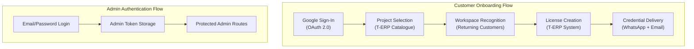
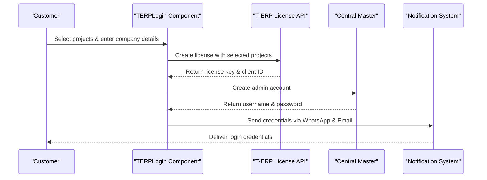
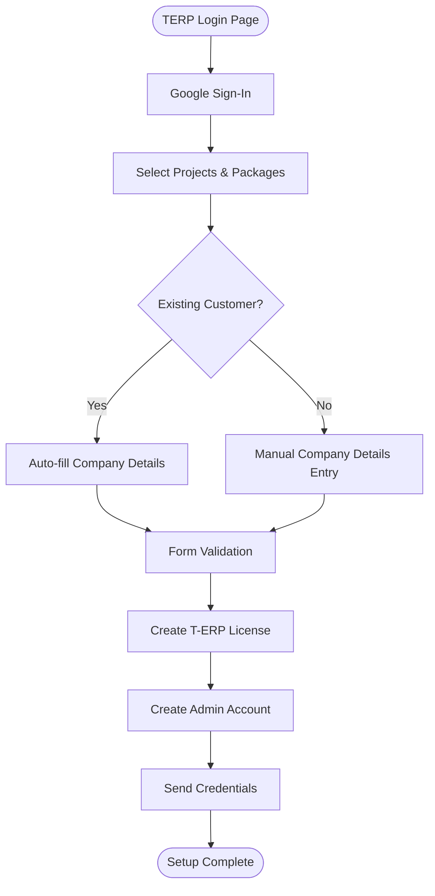
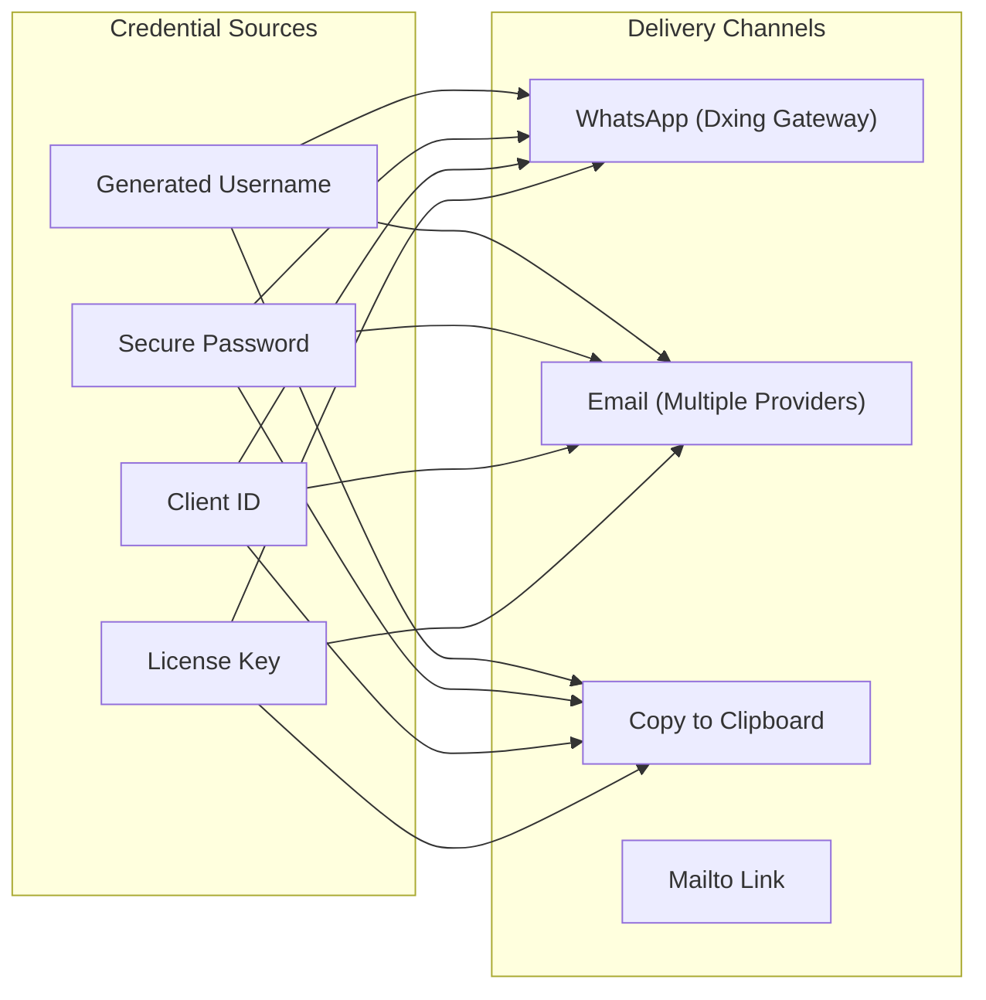

# Authentication & Authorization

<cite>
**Referenced Files in This Document**
- [src/api/auth.js](file://src/api/auth.js)
- [src/api/client.js](file://src/api/client.js)
- [src/App.jsx](file://src/App.jsx)
- [src/pages/AdminDashboard/Login.jsx](file://src/pages/AdminDashboard/Login.jsx)
- [src/pages/TERPLogin.jsx](file://src/pages/TERPLogin.jsx)
- [src/components/CredentialsModal.jsx](file://src/components/CredentialsModal.jsx)
- [src/api/terpLicense.js](file://src/api/terpLicense.js)
- [src/api/userMaster.js](file://src/api/userMaster.js)
- [src/api/notifications.js](file://src/api/notifications.js)
</cite>

## Update Summary
**Changes Made**
- Added comprehensive documentation for Google Sign-In integration with OAuth 2.0
- Documented the new T-ERP license management system with project selection workflow
- Explained automatic workspace recognition for returning customers
- Added detailed coverage of credential delivery through WhatsApp and email systems
- Updated authentication flow diagrams to reflect the enhanced multi-step process
- Documented the dual authentication system supporting both traditional login and Google Sign-In

## Table of Contents
1. [Introduction](#introduction)
2. [Authentication Systems Overview](#authentication-systems-overview)
3. [Google Sign-In Integration](#google-sign-in-integration)
4. [T-ERP License Management System](#t-erp-license-management-system)
5. [Enhanced Login Flow](#enhanced-login-flow)
6. [Project Selection and Workspace Recognition](#project-selection-and-workspace-recognition)
7. [Credential Delivery System](#credential-delivery-system)
8. [Traditional Admin Authentication](#traditional-admin-authentication)
9. [Token Management Strategy](#token-management-strategy)
10. [Protected Routes and Authorization](#protected-routes-and-authorization)
11. [Security Considerations](#security-considerations)
12. [Performance Considerations](#performance-considerations)
13. [Troubleshooting Guide](#troubleshooting-guide)
14. [Conclusion](#conclusion)

## Introduction
This document explains the comprehensive authentication and authorization system implemented in the TRELLISCO ERP frontend application. The system now supports two distinct authentication flows:

1. **T-ERP Customer Onboarding**: A sophisticated multi-step process using Google Sign-In, project selection, automatic workspace recognition, and automated credential delivery
2. **Traditional Admin Authentication**: Standard email/password authentication for administrative access

The system integrates with multiple external services including Google Identity Services, WhatsApp messaging, email delivery systems, and the T-ERP license management platform.

## Authentication Systems Overview
The application implements a dual authentication architecture:



**Diagram sources**
- [src/pages/TERPLogin.jsx:84-505](file://src/pages/TERPLogin.jsx#L84-L505)
- [src/pages/AdminDashboard/Login.jsx:99-244](file://src/pages/AdminDashboard/Login.jsx#L99-L244)
- [src/App.jsx:15-74](file://src/App.jsx#L15-L74)

## Google Sign-In Integration
The Google Sign-In integration provides secure authentication for T-ERP customer onboarding:

### Google Identity Services Setup
```javascript
// Dynamic loading of Google Identity Services
const GOOGLE_SCRIPT = "https://accounts.google.com/gsi/client"

function loadGoogleScript() {
  return new Promise((resolve, reject) => {
    if (window.google?.accounts?.id) {
      resolve()
      return
    }

    const existing = document.querySelector(`script[src="${GOOGLE_SCRIPT}"]`)
    if (existing) {
      existing.addEventListener("load", resolve, { once: true })
      existing.addEventListener("error", reject, { once: true })
      return
    }

    const script = document.createElement("script")
    script.src = GOOGLE_SCRIPT
    script.async = true
    script.defer = true
    script.onload = resolve
    script.onerror = reject
    document.head.appendChild(script)
  })
}
```

### Google User Profile Handling
```javascript
window.google.accounts.id.initialize({
  client_id: import.meta.env.VITE_GOOGLE_CLIENT_ID,
  callback: (response) => {
    // Decode JWT token to extract user profile
    const [, payload] = response.credential.split(".")
    const profile = JSON.parse(window.atob(payload.replace(/-/g, "+").replace(/_/g, "/")))
    setGoogleUser({ 
      name: profile.name, 
      email: profile.email, 
      picture: profile.picture, 
      credential: response.credential 
    })
  },
})
```

**Section sources**
- [src/pages/TERPLogin.jsx:60-82](file://src/pages/TERPLogin.jsx#L60-L82)
- [src/pages/TERPLogin.jsx:122-143](file://src/pages/TERPLogin.jsx#L122-L143)

## T-ERP License Management System
The T-ERP license management system handles the complete customer onboarding lifecycle:

### License Creation Workflow


**Diagram sources**
- [src/pages/TERPLogin.jsx:292-421](file://src/pages/TERPLogin.jsx#L292-L421)
- [src/api/terpLicense.js:170-198](file://src/api/terpLicense.js#L170-L198)
- [src/api/userMaster.js:213-279](file://src/api/userMaster.js#L213-L279)

### Project Catalogue Integration
The system normalizes project data from various API formats:

```javascript
export function normaliseProjects(payload) {
  const items = Array.isArray(payload)
    ? payload
    : payload?.results || payload?.projects || payload?.data || []

  return items
    .map((item) => {
      if (typeof item === "string") return { name: item, api_endpoint: "", packages: [] }

      const name = item.project || item.name || item.title
      const packages = item.packages || item.package_options || item.plans || []
      return {
        name,
        api_endpoint: item.api_endpoint || item.apiEndpoint || "",
        packages: Array.isArray(packages)
          ? packages.map((value) => (typeof value === "string" ? value : value.name || value.package)).filter(Boolean)
          : [],
      }
    })
    .filter(item => item.name)
}
```

**Section sources**
- [src/api/terpLicense.js:80-108](file://src/api/terpLicense.js#L80-L108)

## Enhanced Login Flow
The enhanced login flow consists of three main steps:

### Step 1: Google Authentication
- Dynamic loading of Google Identity Services
- OAuth 2.0 token exchange
- User profile extraction from JWT payload
- Automatic form population with Google identity data

### Step 2: Project Selection
- Display available T-ERP projects from catalogue
- Allow selection of multiple projects
- Package assignment for each selected project
- Validation of required fields

### Step 3: Company Details Collection
- Corporate information gathering
- Contact person details
- Email and phone number validation
- Country and location specification



**Diagram sources**
- [src/pages/TERPLogin.jsx:84-505](file://src/pages/TERPLogin.jsx#L84-L505)

**Section sources**
- [src/pages/TERPLogin.jsx:223-421](file://src/pages/TERPLogin.jsx#L223-L421)

## Project Selection and Workspace Recognition
The system intelligently recognizes returning customers and manages project assignments:

### Automatic Workspace Recognition
```javascript
useEffect(() => {
  const candidate = String(company.email || googleUser?.email || "").trim()
  if (!candidate.includes("@")) return
  
  async function loadWorkspace() {
    try {
      const found = await findClientWorkspace(candidate)
      if (cancelled || !found) return
      setWorkspace((current) => (current?.clientId === found.clientId ? current : found))
      setCompany((current) => {
        const filled = {
          ...current,
          name: current.name || found.companyName,
          corporateName: current.corporateName || found.corporateName || found.companyName,
          place: current.place || found.place,
          email: current.email || found.clientId,
        }
        return filled.name === current.name && filled.place === current.place && filled.email === current.email
          ? current : filled
      })
    } catch {
      // Recognition is a convenience: a brand new signup must still go through.
    }
  }

  loadWorkspace()
}, [googleUser, company.email])
```

### Project Ownership Tracking
```javascript
const ownedProjects = new Set((workspace?.projects || []).map(normaliseName))
const tickedOwned = projects.filter((item) => ownedProjects.has(normaliseName(item.name))).length
```

**Section sources**
- [src/pages/TERPLogin.jsx:145-177](file://src/pages/TERPLogin.jsx#L145-L177)
- [src/pages/TERPLogin.jsx:179-183](file://src/pages/TERPLogin.jsx#L179-L183)

## Credential Delivery System
The system provides multiple channels for delivering credentials securely:

### Multi-Channel Delivery Architecture


**Diagram sources**
- [src/components/CredentialsModal.jsx:77-109](file://src/components/CredentialsModal.jsx#L77-L109)
- [src/api/notifications.js:63-79](file://src/api/notifications.js#L63-L79)

### WhatsApp Integration
```javascript
export async function sendWhatsApp({ recipient, message }) {
  const number = normaliseWhatsAppNumber(recipient)
  if (!number) throw new Error("No WhatsApp number is available for this customer.")
  
  const query = new URLSearchParams({
    secret: WHATSAPP_SECRET,
    account: WHATSAPP_ACCOUNT,
    recipient: number,
    type: "text",
    message,
    priority: "1",
  })

  const response = await fetch(`${WHATSAPP_ENDPOINT}?${query.toString()}`)
  // Handle gateway responses and status codes
}
```

### Email Delivery Options
The system supports multiple email providers:
1. **Custom Mail API** - Direct HTTP endpoint
2. **EmailJS** - Third-party email service
3. **Gmail API** - Direct Gmail integration with OAuth

**Section sources**
- [src/api/notifications.js:84-112](file://src/api/notifications.js#L84-L112)
- [src/api/notifications.js:363-414](file://src/api/notifications.js#L363-L414)

## Traditional Admin Authentication
The traditional admin authentication system remains unchanged:

### Admin Login Process
```javascript
const handleSubmit = async (e) => {
  e.preventDefault()
  
  if (!form.email.trim() || !form.password) {
    setError('Enter both your email and password.')
    return
  }

  setSubmitting(true)
  setError('')

  try {
    await login(form.email.trim(), form.password, { remember })
    navigate('/admin/dashboard')
  } catch (err) {
    const backendMessage = err.response?.data?.detail
    setError(backendMessage || 'Something went wrong. Please try again.')
  } finally {
    setSubmitting(false)
  }
}
```

**Section sources**
- [src/pages/AdminDashboard/Login.jsx:113-136](file://src/pages/AdminDashboard/Login.jsx#L113-L136)

## Token Management Strategy
The system maintains separate token storage for different authentication contexts:

### Dual Token Storage
```javascript
// Admin tokens (for blog/admin functionality)
const TOKEN_KEY = "trellisco_token"

export function setToken(token, { remember = true } = {}) {
  clearToken()
  if (remember) {
    localStorage.setItem(TOKEN_KEY, token)
  } else {
    sessionStorage.setItem(TOKEN_KEY, token)
  }
}

// T-ERP credentials (temporary session storage)
const GMAIL_TOKEN_KEY = "trellisco_gmail_token"
```

### Interceptor Configuration
```javascript
api.interceptors.request.use((config) => {
  const token = getToken()
  if (token) {
    config.headers.Authorization = `Token ${token}`
  }
  return config
})

api.interceptors.response.use(
  (response) => response,
  (error) => {
    if (error.response && error.response.status === 401) {
      clearToken()
    }
    return Promise.reject(error)
  }
)
```

**Section sources**
- [src/api/client.js:26-42](file://src/api/client.js#L26-L42)
- [src/api/client.js:58-75](file://src/api/client.js#L58-L75)

## Protected Routes and Authorization
Route protection is implemented through React Router guards:

### RequireAuth Component
```javascript
function RequireAuth({ children }) {
  return isAuthenticated() ? children : <Navigate to="/login" replace />
}
```

### Route Protection Configuration
```javascript
<Route
  path="/admin"
  element={
    <RequireAuth>
      <Dashboard />
    </RequireAuth>
  }
/>
```

**Section sources**
- [src/App.jsx:15-17](file://src/App.jsx#L15-L17)
- [src/App.jsx:35-66](file://src/App.jsx#L35-L66)

## Security Considerations
The authentication system implements multiple security measures:

### Google Sign-In Security
- JWT token verification on server-side recommended
- Secure handling of OAuth consent popups
- Proper error handling for authentication failures

### Credential Security
- Random password generation with complexity requirements
- Secure username generation avoiding ambiguous characters
- Temporary credential storage in memory only

### Data Protection
- CSRF protection through proper header configuration
- XSS prevention through React's default escaping
- Secure token handling with appropriate storage mechanisms

### Communication Security
- HTTPS enforcement for all API calls
- Proper CORS configuration
- Secure cookie settings where applicable

## Performance Considerations
Several optimizations are implemented for better performance:

### Caching Strategies
- Register caching for client lists and corporate data
- Session-scoped token caching for Gmail API
- Project catalogue normalization to reduce API calls

### Lazy Loading
- Dynamic loading of Google Identity Services
- Conditional component rendering based on authentication state
- Efficient state updates to minimize re-renders

### Network Optimization
- Batch requests for related data
- Error handling to prevent unnecessary retries
- Proper cleanup of event listeners and timers

## Troubleshooting Guide
Common issues and their solutions:

### Google Sign-In Issues
- **Problem**: Google Sign-In button not loading
  - **Solution**: Check VITE_GOOGLE_CLIENT_ID environment variable
  - **Solution**: Verify Google Cloud Console OAuth configuration

- **Problem**: OAuth consent popup blocked
  - **Solution**: Allow popups for the site in browser settings
  - **Solution**: Use "Try again" button to retry authentication

### License Creation Failures
- **Problem**: License creation returns 500 errors
  - **Solution**: Check T-ERP API availability and CORS configuration
  - **Solution**: Verify project names match available catalogue entries

### Credential Delivery Issues
- **Problem**: WhatsApp messages not delivered
  - **Solution**: Verify VITE_WHATSAPP_SECRET and VITE_WHATSAPP_ACCOUNT
  - **Solution**: Check phone number format and country code

- **Problem**: Email delivery fails
  - **Solution**: Configure mail relay or EmailJS properly
  - **Solution**: Verify Gmail OAuth scopes if using direct Gmail API

**Section sources**
- [src/pages/TERPLogin.jsx:107-143](file://src/pages/TERPLogin.jsx#L107-L143)
- [src/api/notifications.js:165-186](file://src/api/notifications.js#L165-L186)

## Conclusion
The TRELLISCO ERP frontend now implements a comprehensive authentication and authorization system that supports both traditional admin access and modern customer onboarding through Google Sign-In. The system provides:

- **Dual Authentication Flows**: Supporting both T-ERP customers and administrators
- **Advanced Customer Onboarding**: With Google Sign-In, project selection, and automated credential delivery
- **Intelligent Workspace Recognition**: Automatically identifying returning customers
- **Multi-Channel Communication**: Through WhatsApp and multiple email providers
- **Robust Security Measures**: Including secure token handling and proper error management
- **Performance Optimizations**: Through caching strategies and lazy loading

The architecture is designed to be extensible, allowing for additional authentication methods, notification channels, and business logic while maintaining security and performance standards.