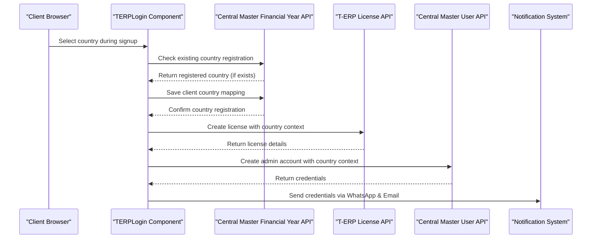
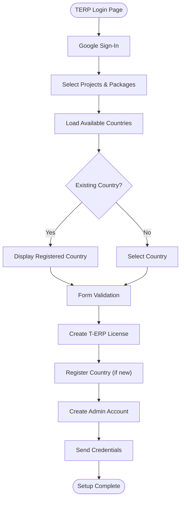
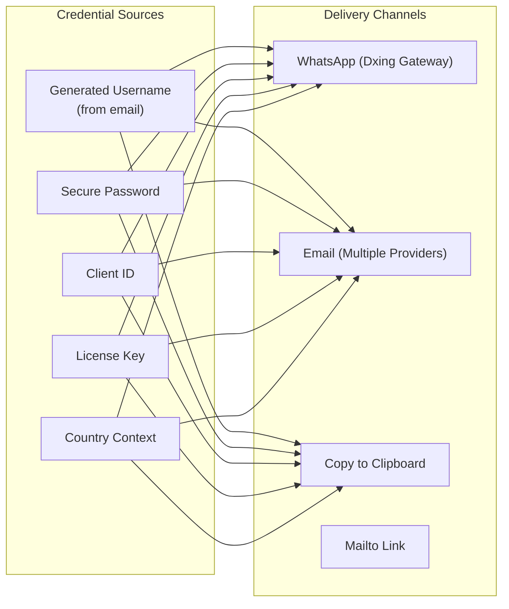

# Authentication & Authorization

<cite>
**Referenced Files in This Document**
- [src/api/auth.js](file://src/api/auth.js)
- [src/api/client.js](file://src/api/client.js)
- [src/App.jsx](file://src/App.jsx)
- [src/pages/AdminDashboard/Login.jsx](file://src/pages/AdminDashboard/Login.jsx)
- [src/pages/TERPLogin.jsx](file://src/pages/TERPLogin.jsx)
- [src/components/CredentialsModal.jsx](file://src/components/CredentialsModal.jsx)
- [src/api/terpLicense.js](file://src/api/terpLicense.js)
- [src/api/userMaster.js](file://src/api/userMaster.js)
- [src/api/notifications.js](file://src/api/notifications.js)
- [src/api/financialYear.js](file://src/api/financialYear.js)
</cite>

## Update Summary
**Changes Made**
- Added comprehensive documentation for financial year and country management system integration with Central Master
- Updated T-ERP login flow to include dynamic country selection and automatic country registration
- Enhanced username generation from email addresses with improved handling for ambiguous characters
- Documented Central Master integration for financial year tracking and country-wise financial systems
- Added detailed coverage of the enhanced multi-step authentication process with country validation
- Updated credential delivery system to support country-specific financial year configurations

## Table of Contents
1. [Introduction](#introduction)
2. [Authentication Systems Overview](#authentication-systems-overview)
3. [Google Sign-In Integration](#google-sign-in-integration)
4. [Financial Year and Country Management System](#financial-year-and-country-management-system)
5. [Enhanced T-ERP Login Flow](#enhanced-t-erp-login-flow)
6. [Project Selection and Workspace Recognition](#project-selection-and-workspace-recognition)
7. [Credential Delivery System](#credential-delivery-system)
8. [Traditional Admin Authentication](#traditional-admin-authentication)
9. [Token Management Strategy](#token-management-strategy)
10. [Protected Routes and Authorization](#protected-routes-and-authorization)
11. [Security Considerations](#security-considerations)
12. [Performance Considerations](#performance-considerations)
13. [Troubleshooting Guide](#troubleshooting-guide)
14. [Conclusion](#conclusion)

## Introduction
This document explains the comprehensive authentication and authorization system implemented in the TRELLISCO ERP frontend application. The system now supports two distinct authentication flows:

1. **T-ERP Customer Onboarding**: A sophisticated multi-step process using Google Sign-In, project selection, automatic workspace recognition, financial year management, and automated credential delivery
2. **Traditional Admin Authentication**: Standard email/password authentication for administrative access

The system integrates with multiple external services including Google Identity Services, WhatsApp messaging, email delivery systems, and the Central Master platform for financial year and country management.

## Authentication Systems Overview
The application implements a dual authentication architecture with enhanced financial year management:

```mermaid
graph TB
subgraph "Customer Onboarding Flow"
GOOGLE["Google Sign-In<br/>(OAuth 2.0)"]
PROJECTS["Project Selection<br/>(T-ERP Catalogue)"]
COUNTRY["Country Selection<br/>(Financial Year Register)"]
WORKSPACE["Workspace Recognition<br/>(Returning Customers)"]
LICENSE["License Creation<br/>(T-ERP System)"]
CREDENTIALS["Credential Delivery<br/>(WhatsApp + Email)"]
end
subgraph "Admin Authentication Flow"
TRADITIONAL["Email/Password Login"]
ADMIN_TOKEN["Admin Token Storage"]
PROTECTED["Protected Admin Routes"]
end
GOOGLE --> PROJECTS --> COUNTRY --> WORKSPACE --> LICENSE --> CREDENTIALS
TRADITIONAL --> ADMIN_TOKEN --> PROTECTED
```



**Diagram sources**
- [src/pages/TERPLogin.jsx:87-505](file://src/pages/TERPLogin.jsx#L87-L505)
- [src/pages/AdminDashboard/Login.jsx:99-244](file://src/pages/AdminDashboard/Login.jsx#L99-L244)
- [src/App.jsx:15-74](file://src/App.jsx#L15-L74)

## Google Sign-In Integration
The Google Sign-In integration provides secure authentication for T-ERP customer onboarding:

### Google Identity Services Setup
```javascript
// Dynamic loading of Google Identity Services
const GOOGLE_SCRIPT = "https://accounts.google.com/gsi/client"

function loadGoogleScript() {
  return new Promise((resolve, reject) => {
    if (window.google?.accounts?.id) {
      resolve()
      return
    }

    const existing = document.querySelector(`script[src="${GOOGLE_SCRIPT}"]`)
    if (existing) {
      existing.addEventListener("load", resolve, { once: true })
      existing.addEventListener("error", reject, { once: true })
      return
    }

    const script = document.createElement("script")
    script.src = GOOGLE_SCRIPT
    script.async = true
    script.defer = true
    script.onload = resolve
    script.onerror = reject
    document.head.appendChild(script)
  })
}
```

### Google User Profile Handling
```javascript
window.google.accounts.id.initialize({
  client_id: import.meta.env.VITE_GOOGLE_CLIENT_ID,
  callback: (response) => {
    // Decode JWT token to extract user profile
    const [, payload] = response.credential.split(".")
    const profile = JSON.parse(window.atob(payload.replace(/-/g, "+").replace(/_/g, "/")))
    setGoogleUser({ 
      name: profile.name, 
      email: profile.email, 
      picture: profile.picture, 
      credential: response.credential 
    })
  },
})
```

**Section sources**
- [src/pages/TERPLogin.jsx:63-85](file://src/pages/TERPLogin.jsx#L63-L85)
- [src/pages/TERPLogin.jsx:157-178](file://src/pages/TERPLogin.jsx#L157-L178)

## Financial Year and Country Management System
The financial year and country management system integrates with Central Master to provide country-specific financial year configurations:

### Central Master Integration Architecture


**Diagram sources**
- [src/pages/TERPLogin.jsx:383-510](file://src/pages/TERPLogin.jsx#L383-L510)
- [src/api/financialYear.js:59-115](file://src/api/financialYear.js#L59-L115)
- [src/api/userMaster.js:241-312](file://src/api/userMaster.js#L241-L312)

### Country Registration and Validation
The system manages country-specific financial years through Central Master's financial year register:

```javascript
export async function ensureClientCountry({ clientId, countryName }) {
  const existing = await findClientFinancialYears(clientId)
  if (existing.length) {
    return { created: false, country: existing[0]?.country_name || "", record: existing[0], years: existing.length }
  }

  const record = await saveClientCountry({ clientId, countryName })
  return { created: true, country: String(countryName || "").trim().toUpperCase(), record, years: 1 }
}
```

### Dynamic Country Selection
Countries are dynamically loaded from Central Master and displayed with currency information:

```javascript
useEffect(() => {
  let cancelled = false
  fetchFinancialYearCountries()
    .then((items) => {
      if (cancelled) return
      setCountries(items)
      // India stays the default because that is where the licence is sold;
      // any country list without it simply starts on its first entry.
      setCompany((current) => current.country
        ? current
        : { ...current, country: items.some((item) => item.name === "INDIA") ? "INDIA" : items[0]?.name || "" })
    })
    .catch((fetchError) => {
      if (!cancelled) setError(getNetworkError(fetchError, "the country list API"))
    })
    .finally(() => {
      if (!cancelled) setLoadingCountries(false)
    })
  return () => { cancelled = true }
}, [])
```

**Section sources**
- [src/api/financialYear.js:38-115](file://src/api/financialYear.js#L38-L115)
- [src/pages/TERPLogin.jsx:136-155](file://src/pages/TERPLogin.jsx#L136-L155)

## Enhanced T-ERP Login Flow
The enhanced login flow now includes financial year management and improved country handling:

### Step 1: Google Authentication
- Dynamic loading of Google Identity Services
- OAuth 2.0 token exchange
- User profile extraction from JWT payload
- Automatic form population with Google identity data

### Step 2: Project Selection with Country Context
- Display available T-ERP projects from catalogue
- Allow selection of multiple projects
- Package assignment for each selected project
- Country-based financial year validation
- Validation of required fields

### Step 3: Company Details Collection with Country Management
- Corporate information gathering
- Contact person details
- Email and phone number validation
- Country specification with financial year implications
- Automatic country registration for new clients



**Diagram sources**
- [src/pages/TERPLogin.jsx:87-505](file://src/pages/TERPLogin.jsx#L87-L505)

**Section sources**
- [src/pages/TERPLogin.jsx:391-542](file://src/pages/TERPLogin.jsx#L391-L542)

## Project Selection and Workspace Recognition
The system intelligently recognizes returning customers and manages project assignments with country context:

### Automatic Workspace Recognition
```javascript
useEffect(() => {
  const candidate = String(company.email || googleUser?.email || "").trim()
  if (!candidate.includes("@")) return
  
  async function loadWorkspace() {
    try {
      const found = await findClientWorkspace(candidate)
      if (cancelled || !found) return
      setWorkspace((current) => (current?.clientId === found.clientId ? current : found))
      setCompany((current) => {
        const filled = {
          ...current,
          name: current.name || found.companyName,
          corporateName: current.corporateName || found.corporateName || found.companyName,
          place: current.place || found.place,
          email: current.email || found.clientId,
        }
        return filled.name === current.name && filled.place === current.place && filled.email === current.email
          ? current : filled
      })
    } catch {
      // Recognition is a convenience: a brand new signup must still go through.
    }
  }

  loadWorkspace()
}, [googleUser, company.email])
```

### Project Ownership Tracking
```javascript
const ownedProjects = new Set((workspace?.projects || []).map(normaliseName))
const tickedOwned = projects.filter((item) => ownedProjects.has(normaliseName(item.name))).length
```

**Section sources**
- [src/pages/TERPLogin.jsx:213-257](file://src/pages/TERPLogin.jsx#L213-L257)
- [src/pages/TERPLogin.jsx:259-261](file://src/pages/TERPLogin.jsx#L259-L261)

## Credential Delivery System
The system provides multiple channels for delivering credentials securely with country-specific formatting:

### Multi-Channel Delivery Architecture


**Diagram sources**
- [src/components/CredentialsModal.jsx:85-117](file://src/components/CredentialsModal.jsx#L85-L117)
- [src/api/notifications.js:63-79](file://src/api/notifications.js#L63-L79)

### Enhanced Username Generation from Email Addresses
The system now generates usernames directly from email addresses with improved handling:

```javascript
export function usernameFromEmail(email) {
  const local = String(email || "").split("@")[0]
  // A typed company address may carry capitals, and usernames are matched
  // case-sensitively, so everything is folded to lower case first.
  const cleaned = local.toLowerCase().replace(/[^a-z0-9._-]+/g, "").replace(USERNAME_EDGE_CHARS, "")
  if (!cleaned) return ""
  // A leading digit is legal for some validators and rejected by stricter ones,
  // so the handle is anchored with a letter rather than refused.
  const anchored = /^[a-z]/test(cleaned) ? cleaned : `u${cleaned}`
  return anchored.slice(0, USERNAME_MAX_LENGTH)
}
```

**Section sources**
- [src/api/userMaster.js:42-52](file://src/api/userMaster.js#L42-L52)
- [src/api/notifications.js:84-112](file://src/api/notifications.js#L84-L112)

## Traditional Admin Authentication
The traditional admin authentication system remains unchanged:

### Admin Login Process
```javascript
const handleSubmit = async (e) => {
  e.preventDefault()
  
  if (!form.email.trim() || !form.password) {
    setError('Enter both your email and password.')
    return
  }

  setSubmitting(true)
  setError('')

  try {
    await login(form.email.trim(), form.password, { remember })
    navigate('/admin/dashboard')
  } catch (err) {
    const backendMessage = err.response?.data?.detail
    setError(backendMessage || 'Something went wrong. Please try again.')
  } finally {
    setSubmitting(false)
  }
}
```

**Section sources**
- [src/pages/AdminDashboard/Login.jsx:113-136](file://src/pages/AdminDashboard/Login.jsx#L113-L136)

## Token Management Strategy
The system maintains separate token storage for different authentication contexts:

### Dual Token Storage
```javascript
// Admin tokens (for blog/admin functionality)
const TOKEN_KEY = "trellisco_token"

export function setToken(token, { remember = true } = {}) {
  clearToken()
  if (remember) {
    localStorage.setItem(TOKEN_KEY, token)
  } else {
    sessionStorage.setItem(TOKEN_KEY, token)
  }
}

// T-ERP credentials (temporary session storage)
const GMAIL_TOKEN_KEY = "trellisco_gmail_token"
```

### Interceptor Configuration
```javascript
api.interceptors.request.use((config) => {
  const token = getToken()
  if (token) {
    config.headers.Authorization = `Token ${token}`
  }
  return config
})

api.interceptors.response.use(
  (response) => response,
  (error) => {
    if (error.response && error.response.status === 401) {
      clearToken()
    }
    return Promise.reject(error)
  }
)
```

**Section sources**
- [src/api/client.js:26-42](file://src/api/client.js#L26-L42)
- [src/api/client.js:58-75](file://src/api/client.js#L58-L75)

## Protected Routes and Authorization
Route protection is implemented through React Router guards:

### RequireAuth Component
```javascript
function RequireAuth({ children }) {
  return isAuthenticated() ? children : <Navigate to="/login" replace />
}
```

### Route Protection Configuration
```javascript
<Route
  path="/admin"
  element={
    <RequireAuth>
      <Dashboard />
    </RequireAuth>
  }
/>
```

**Section sources**
- [src/App.jsx:15-17](file://src/App.jsx#L15-L17)
- [src/App.jsx:35-66](file://src/App.jsx#L35-L66)

## Security Considerations
The authentication system implements multiple security measures with enhanced financial year protection:

### Google Sign-In Security
- JWT token verification on server-side recommended
- Secure handling of OAuth consent popups
- Proper error handling for authentication failures

### Financial Year Data Security
- Country data validation against Central Master registry
- Secure transmission of financial year mappings
- Protection against country manipulation attacks

### Credential Security
- Random password generation with complexity requirements
- Improved username generation from email addresses avoiding ambiguous characters
- Temporary credential storage in memory only

### Data Protection
- CSRF protection through proper header configuration
- XSS prevention through React's default escaping
- Secure token handling with appropriate storage mechanisms
- Financial year data integrity validation

### Communication Security
- HTTPS enforcement for all API calls
- Proper CORS configuration for Central Master integration
- Secure cookie settings where applicable

## Performance Considerations
Several optimizations are implemented for better performance:

### Caching Strategies
- Register caching for client lists and corporate data
- Session-scoped token caching for Gmail API
- Project catalogue normalization to reduce API calls
- Financial year country list caching

### Lazy Loading
- Dynamic loading of Google Identity Services
- Conditional component rendering based on authentication state
- Efficient state updates to minimize re-renders
- Deferred loading of country lists until needed

### Network Optimization
- Batch requests for related data
- Error handling to prevent unnecessary retries
- Proper cleanup of event listeners and timers
- Optimized Central Master API calls with proxy support

## Troubleshooting Guide
Common issues and their solutions:

### Google Sign-In Issues
- **Problem**: Google Sign-In button not loading
  - **Solution**: Check VITE_GOOGLE_CLIENT_ID environment variable
  - **Solution**: Verify Google Cloud Console OAuth configuration

- **Problem**: OAuth consent popup blocked
  - **Solution**: Allow popups for the site in browser settings
  - **Solution**: Use "Try again" button to retry authentication

### Financial Year and Country Issues
- **Problem**: Country dropdown not loading
  - **Solution**: Check Central Master API connectivity
  - **Solution**: Verify VITE_FINANCIAL_YEAR_COUNTRY_API_URL configuration

- **Problem**: Country registration fails
  - **Solution**: Check Central Master CORS configuration
  - **Solution**: Verify client_id format matches expected pattern

### License Creation Failures
- **Problem**: License creation returns 500 errors
  - **Solution**: Check T-ERP API availability and CORS configuration
  - **Solution**: Verify project names match available catalogue entries

### Credential Delivery Issues
- **Problem**: WhatsApp messages not delivered
  - **Solution**: Verify VITE_WHATSAPP_SECRET and VITE_WHATSAPP_ACCOUNT
  - **Solution**: Check phone number format and country code

- **Problem**: Email delivery fails
  - **Solution**: Configure mail relay or EmailJS properly
  - **Solution**: Verify Gmail OAuth scopes if using direct Gmail API

**Section sources**
- [src/pages/TERPLogin.jsx:157-178](file://src/pages/TERPLogin.jsx#L157-L178)
- [src/api/notifications.js:165-186](file://src/api/notifications.js#L165-L186)

## Conclusion
The TRELLISCO ERP frontend now implements a comprehensive authentication and authorization system that supports both traditional admin access and modern customer onboarding through Google Sign-In. The system provides:

- **Dual Authentication Flows**: Supporting both T-ERP customers and administrators
- **Advanced Customer Onboarding**: With Google Sign-In, project selection, financial year management, and automated credential delivery
- **Central Master Integration**: For financial year tracking and country-specific configurations
- **Intelligent Workspace Recognition**: Automatically identifying returning customers
- **Enhanced Username Generation**: From email addresses with improved character handling
- **Multi-Channel Communication**: Through WhatsApp and multiple email providers
- **Robust Security Measures**: Including secure token handling, financial year data protection, and proper error management
- **Performance Optimizations**: Through caching strategies, lazy loading, and optimized API calls

The architecture is designed to be extensible, allowing for additional authentication methods, notification channels, and business logic while maintaining security and performance standards. The integration with Central Master's financial year system ensures compliance with country-specific accounting requirements and provides a solid foundation for international expansion.