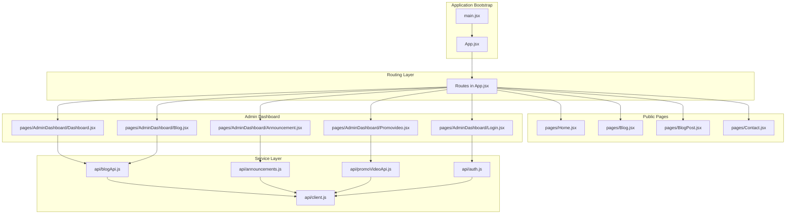
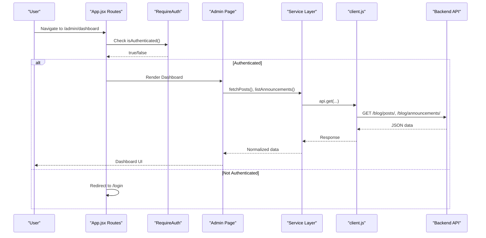
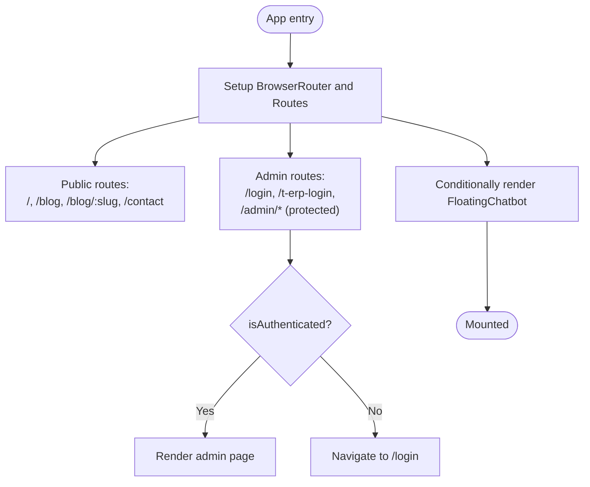
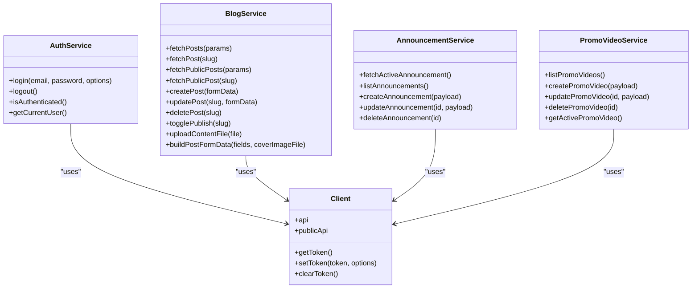
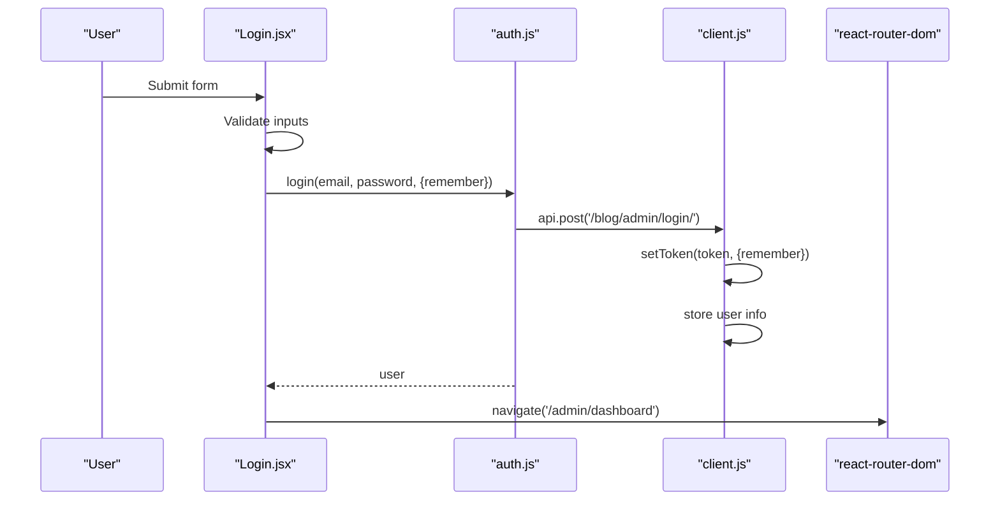
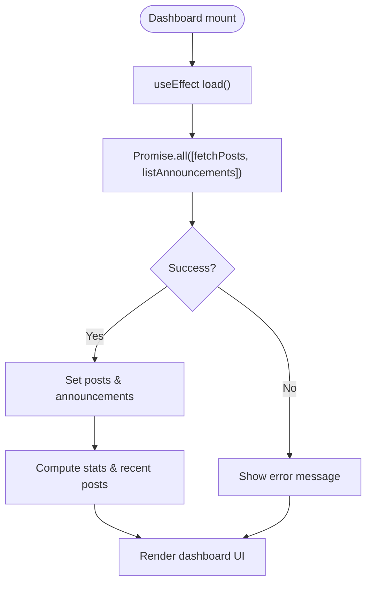
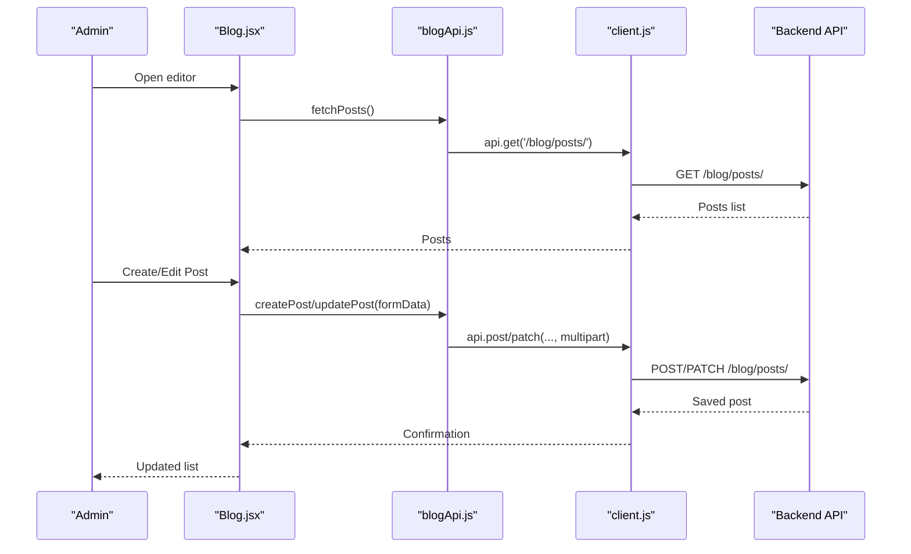
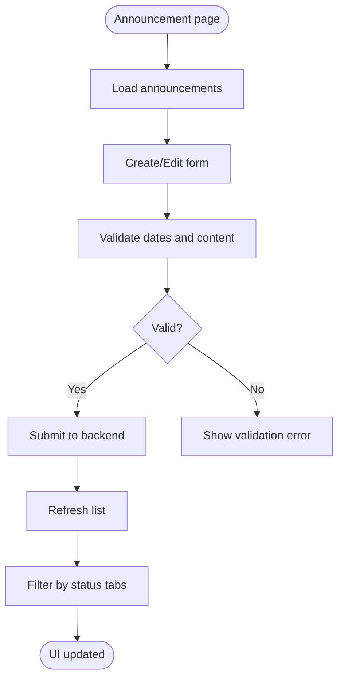
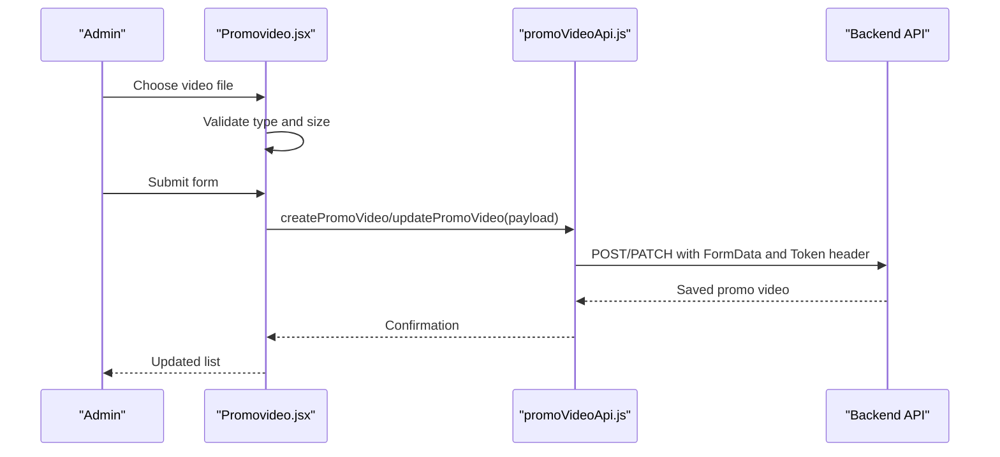
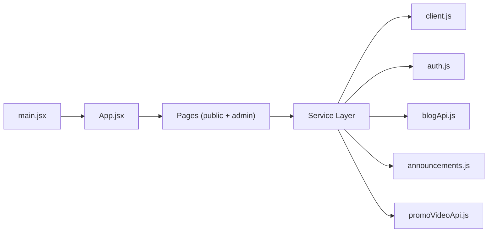

# Core Architecture Patterns

<cite>
**Referenced Files in This Document**
- [main.jsx](file://src/main.jsx)
- [App.jsx](file://src/App.jsx)
- [client.js](file://src/api/client.js)
- [auth.js](file://src/api/auth.js)
- [blogApi.js](file://src/api/blogApi.js)
- [announcements.js](file://src/api/announcements.js)
- [promoVideoApi.js](file://src/api/promoVideoApi.js)
- [config.js](file://src/config/config.js)
- [package.json](file://package.json)
- [Login.jsx](file://src/pages/AdminDashboard/Login.jsx)
- [Dashboard.jsx](file://src/pages/AdminDashboard/Dashboard.jsx)
- [Blog.jsx](file://src/pages/AdminDashboard/Blog.jsx)
- [Announcement.jsx](file://src/pages/AdminDashboard/Announcement.jsx)
- [Promovideo.jsx](file://src/pages/AdminDashboard/Promovideo.jsx)
</cite>

## Table of Contents
1. [Introduction](#introduction)
2. [Project Structure](#project-structure)
3. [Core Components](#core-components)
4. [Architecture Overview](#architecture-overview)
5. [Detailed Component Analysis](#detailed-component-analysis)
6. [Dependency Analysis](#dependency-analysis)
7. [Performance Considerations](#performance-considerations)
8. [Troubleshooting Guide](#troubleshooting-guide)
9. [Conclusion](#conclusion)

## Introduction
This document explains the core architecture patterns in TRELLISCO_ERP_FRONTEND. It focuses on:
- A component-based React application using functional components and hooks.
- Feature-based organization separating the public website from the admin dashboard.
- A service layer pattern for API integration with clear separation between authenticated and public requests.
- The application bootstrap process starting at main.jsx through App.jsx routing configuration.
- Design decisions such as preferring functional components with hooks, and the rationale behind the folder structure.

The goal is to make the system understandable for both technical and non-technical readers while providing precise references to source files.

## Project Structure
The project follows a feature-oriented layout under src/:
- api/: Service layer modules that encapsulate HTTP calls, token handling, and environment configuration.
- components/: Reusable UI components used across pages (navigation, footer, chatbot, sidebar).
- pages/: Page-level components grouped by domain. Public-facing pages are at the top level; admin features live under AdminDashboard/.
- config/: Centralized configuration values.
- Root files: main.jsx bootstraps React; App.jsx defines routes and global guards.

**Diagram sources**
- [main.jsx:1-11](file://src/main.jsx#L1-L11)
- [App.jsx:1-74](file://src/App.jsx#L1-L74)
- [client.js:1-88](file://src/api/client.js#L1-L88)
- [auth.js:1-40](file://src/api/auth.js#L1-L40)
- [blogApi.js:1-135](file://src/api/blogApi.js#L1-L135)
- [announcements.js:1-61](file://src/api/announcements.js#L1-L61)
- [promoVideoApi.js:1-85](file://src/api/promoVideoApi.js#L1-L85)
- [Dashboard.jsx:1-234](file://src/pages/AdminDashboard/Dashboard.jsx#L1-L234)
- [Blog.jsx:1-800](file://src/pages/AdminDashboard/Blog.jsx#L1-L800)
- [Announcement.jsx:1-360](file://src/pages/AdminDashboard/Announcement.jsx#L1-L360)
- [Promovideo.jsx:1-484](file://src/pages/AdminDashboard/Promovideo.jsx#L1-L484)

**Section sources**
- [main.jsx:1-11](file://src/main.jsx#L1-L11)
- [App.jsx:1-74](file://src/App.jsx#L1-L74)
- [package.json:1-33](file://package.json#L1-L33)

## Core Components
This section summarizes the key architectural layers and their responsibilities.

- Application bootstrap
  - main.jsx initializes the React root and renders App inside StrictMode.
  - App.jsx sets up BrowserRouter and declares all routes, including protected admin routes.

- Routing and navigation
  - App.jsx uses react-router-dom to map URLs to page components.
  - RequireAuth protects admin routes by checking authentication state via isAuthenticated().
  - ChatbotGate conditionally renders FloatingChatbot based on current pathname.

- Service layer
  - client.js provides two Axios instances:
    - api: authenticated instance that attaches Token headers and clears tokens on 401.
    - publicApi: unauthenticated instance for visitor-facing endpoints.
  - auth.js handles login/logout, token persistence, and user session checks.
  - blogApi.js, announcements.js, promoVideoApi.js encapsulate domain-specific API calls.

- Pages and components
  - Public pages: Home, Blog, BlogPost, Contact.
  - Admin pages: Login, Dashboard, Blog editor, Announcement manager, Promo video manager.
  - Shared components: Sidebar, Footer, Nav, FloatingChatbot, AnnouncementText.

Design decisions:
- Functional components with hooks over class components for simpler state management, better performance, and modern React practices.
- Feature-based folders separate concerns: pages for route-level UI, components for reusable UI, services for data access.

**Section sources**
- [main.jsx:1-11](file://src/main.jsx#L1-L11)
- [App.jsx:1-74](file://src/App.jsx#L1-L74)
- [client.js:1-88](file://src/api/client.js#L1-L88)
- [auth.js:1-40](file://src/api/auth.js#L1-L40)
- [blogApi.js:1-135](file://src/api/blogApi.js#L1-L135)
- [announcements.js:1-61](file://src/api/announcements.js#L1-L61)
- [promoVideoApi.js:1-85](file://src/api/promoVideoApi.js#L1-L85)

## Architecture Overview
The application follows a layered architecture:
- Presentation layer: React components and pages.
- Routing layer: react-router-dom manages navigation and route guards.
- Service layer: API modules encapsulate HTTP logic, token handling, and error normalization.
- Data layer: Backend APIs accessed via Axios or fetch.

**Diagram sources**
- [App.jsx:15-23](file://src/App.jsx#L15-L23)
- [App.jsx:35-50](file://src/App.jsx#L35-L50)
- [auth.js:31-33](file://src/api/auth.js#L31-L33)
- [Dashboard.jsx:107-134](file://src/pages/AdminDashboard/Dashboard.jsx#L107-L134)
- [blogApi.js:10-13](file://src/api/blogApi.js#L10-L13)
- [announcements.js:28-35](file://src/api/announcements.js#L28-L35)
- [client.js:47-75](file://src/api/client.js#L47-L75)

## Detailed Component Analysis

### Application Bootstrap and Routing
- main.jsx creates the React root and mounts App.
- App.jsx:
  - Defines RequireAuth to protect admin routes.
  - Defines ChatbotGate to hide the floating chatbot on login and admin paths.
  - Declares routes for public and admin pages.

**Diagram sources**
- [App.jsx:15-23](file://src/App.jsx#L15-L23)
- [App.jsx:25-70](file://src/App.jsx#L25-L70)

**Section sources**
- [main.jsx:1-11](file://src/main.jsx#L1-L11)
- [App.jsx:1-74](file://src/App.jsx#L1-L74)

### Service Layer Pattern
- client.js:
  - Configures base URL from environment variables.
  - Provides getToken/setToken/clearToken helpers.
  - Creates authenticated api instance with request/response interceptors.
  - Creates publicApi instance for unauthenticated requests.

- auth.js:
  - login posts credentials, stores token and user info.
  - logout clears token and user info.
  - isAuthenticated reads stored token.

- Domain services:
  - blogApi.js: CRUD operations for posts, file uploads, and form builders.
  - announcements.js: CRUD for announcements with error normalization.
  - promoVideoApi.js: CRUD for promo videos using fetch with manual header handling.

**Diagram sources**
- [client.js:1-88](file://src/api/client.js#L1-L88)
- [auth.js:1-40](file://src/api/auth.js#L1-L40)
- [blogApi.js:1-135](file://src/api/blogApi.js#L1-L135)
- [announcements.js:1-61](file://src/api/announcements.js#L1-L61)
- [promoVideoApi.js:1-85](file://src/api/promoVideoApi.js#L1-L85)

**Section sources**
- [client.js:1-88](file://src/api/client.js#L1-L88)
- [auth.js:1-40](file://src/api/auth.js#L1-L40)
- [blogApi.js:1-135](file://src/api/blogApi.js#L1-L135)
- [announcements.js:1-61](file://src/api/announcements.js#L1-L61)
- [promoVideoApi.js:1-85](file://src/api/promoVideoApi.js#L1-L85)

### Admin Login Flow
- Login.jsx collects email/password, validates input, calls auth.login, and navigates to /admin/dashboard on success.
- auth.login stores token and user info, then returns user object.

**Diagram sources**
- [Login.jsx:99-136](file://src/pages/AdminDashboard/Login.jsx#L99-L136)
- [auth.js:4-19](file://src/api/auth.js#L4-L19)
- [client.js:26-42](file://src/api/client.js#L26-L42)

**Section sources**
- [Login.jsx:99-136](file://src/pages/AdminDashboard/Login.jsx#L99-L136)
- [auth.js:4-19](file://src/api/auth.js#L4-L19)

### Admin Dashboard Data Loading
- Dashboard.jsx loads posts and announcements concurrently using Promise.all.
- Computes stats and recent posts, displays loading/error states.

**Diagram sources**
- [Dashboard.jsx:107-134](file://src/pages/AdminDashboard/Dashboard.jsx#L107-L134)
- [dashboard.jsx:136-159](file://src/pages/AdminDashboard/Dashboard.jsx#L136-L159)
- [blogApi.js:10-13](file://src/api/blogApi.js#L10-L13)
- [announcements.js:28-35](file://src/api/announcements.js#L28-L35)

**Section sources**
- [Dashboard.jsx:101-159](file://src/pages/AdminDashboard/Dashboard.jsx#L101-L159)

### Blog Editor Workflow
- Blog.jsx orchestrates post listing, editing, creation, deletion, publishing toggles, and content block management.
- Uses blogApi.js for authenticated operations and file uploads.

**Diagram sources**
- [Blog.jsx:1-135](file://src/pages/AdminDashboard/Blog.jsx#L1-L135)
- [blogApi.js:35-51](file://src/api/blogApi.js#L35-L51)
- [client.js:47-75](file://src/api/client.js#L47-L75)

**Section sources**
- [Blog.jsx:1-135](file://src/pages/AdminDashboard/Blog.jsx#L1-L135)
- [blogApi.js:35-51](file://src/api/blogApi.js#L35-L51)

### Announcement Manager
- Announcement.jsx provides CRUD for announcements with scheduling controls and status filtering.
- Uses announcements.js for API calls and normalizes errors.

**Diagram sources**
- [Announcement.jsx:55-148](file://src/pages/AdminDashboard/Announcement.jsx#L55-L148)
- [announcements.js:28-61](file://src/api/announcements.js#L28-L61)

**Section sources**
- [Announcement.jsx:55-148](file://src/pages/AdminDashboard/Announcement.jsx#L55-L148)
- [announcements.js:28-61](file://src/api/announcements.js#L28-L61)

### Promo Video Manager
- Promovideo.jsx manages video uploads, metadata, scheduling, and status control.
- Uses promoVideoApi.js which manually attaches Authorization headers and handles responses.

**Diagram sources**
- [Promovideo.jsx:112-201](file://src/pages/AdminDashboard/Promovideo.jsx#L112-L201)
- [promoVideoApi.js:49-79](file://src/api/promoVideoApi.js#L49-L79)

**Section sources**
- [Promovideo.jsx:112-201](file://src/pages/AdminDashboard/Promovideo.jsx#L112-L201)
- [promoVideoApi.js:49-79](file://src/api/promoVideoApi.js#L49-L79)

## Dependency Analysis
High-level dependencies among modules:

**Diagram sources**
- [main.jsx:1-11](file://src/main.jsx#L1-L11)
- [App.jsx:1-74](file://src/App.jsx#L1-L74)
- [client.js:1-88](file://src/api/client.js#L1-L88)
- [auth.js:1-40](file://src/api/auth.js#L1-L40)
- [blogApi.js:1-135](file://src/api/blogApi.js#L1-L135)
- [announcements.js:1-61](file://src/api/announcements.js#L1-L61)
- [promoVideoApi.js:1-85](file://src/api/promoVideoApi.js#L1-L85)

**Section sources**
- [main.jsx:1-11](file://src/main.jsx#L1-L11)
- [App.jsx:1-74](file://src/App.jsx#L1-L74)
- [client.js:1-88](file://src/api/client.js#L1-L88)
- [auth.js:1-40](file://src/api/auth.js#L1-L40)
- [blogApi.js:1-135](file://src/api/blogApi.js#L1-L135)
- [announcements.js:1-61](file://src/api/announcements.js#L1-L61)
- [promoVideoApi.js:1-85](file://src/api/promoVideoApi.js#L1-L85)

## Performance Considerations
- Use concurrent data fetching where possible (e.g., Promise.all in Dashboard) to reduce total load time.
- Prefer memoization (useMemo/useCallback) for derived data and expensive computations.
- Avoid unnecessary re-renders by keeping component state minimal and colocated.
- Leverage Vite’s fast build and HMR for development efficiency.
- Keep public and authenticated requests separated to prevent accidental token leakage and ensure consistent public visibility.

[No sources needed since this section provides general guidance]

## Troubleshooting Guide
Common issues and resolutions:
- Missing environment variable for API base URL
  - Symptom: Build fails in production if VITE_API_BASE_URL is not set.
  - Resolution: Add VITE_API_BASE_URL to .env.production and rebuild.

- Authentication failures due to wrong scheme
  - Symptom: 401 errors even with valid token.
  - Resolution: Ensure Authorization header uses "Token <key>" as required by DRF.

- Public endpoints returning 401 when admin is logged in
  - Symptom: Public pages fail because an expired token triggers 401.
  - Resolution: Use publicApi for public endpoints to avoid sending admin tokens.

- Uploads failing silently
  - Symptom: Cover images or videos not saved.
  - Resolution: Ensure correct field names match serializer expectations and use multipart/form-data.

- Date/time scheduling confusion
  - Symptom: Scheduled posts/videos do not appear at expected times.
  - Resolution: Convert local datetime-local values to UTC ISO strings before sending to backend.

**Section sources**
- [client.js:10-16](file://src/api/client.js#L10-L16)
- [client.js:54-75](file://src/api/client.js#L54-L75)
- [blogApi.js:87-135](file://src/api/blogApi.js#L87-L135)
- [promoVideoApi.js:1-22](file://src/api/promoVideoApi.js#L1-L22)

## Conclusion
TRELLISCO_ERP_FRONTEND employs a clean, modular architecture:
- Functional components with hooks for maintainable UI logic.
- Feature-based organization separating public and admin domains.
- A robust service layer that centralizes API interactions, token management, and error handling.
- Clear routing and guards ensuring secure access to admin features.

These patterns improve readability, scalability, and testability while supporting efficient development workflows with Vite and modern React practices.

[No sources needed since this section summarizes without analyzing specific files]