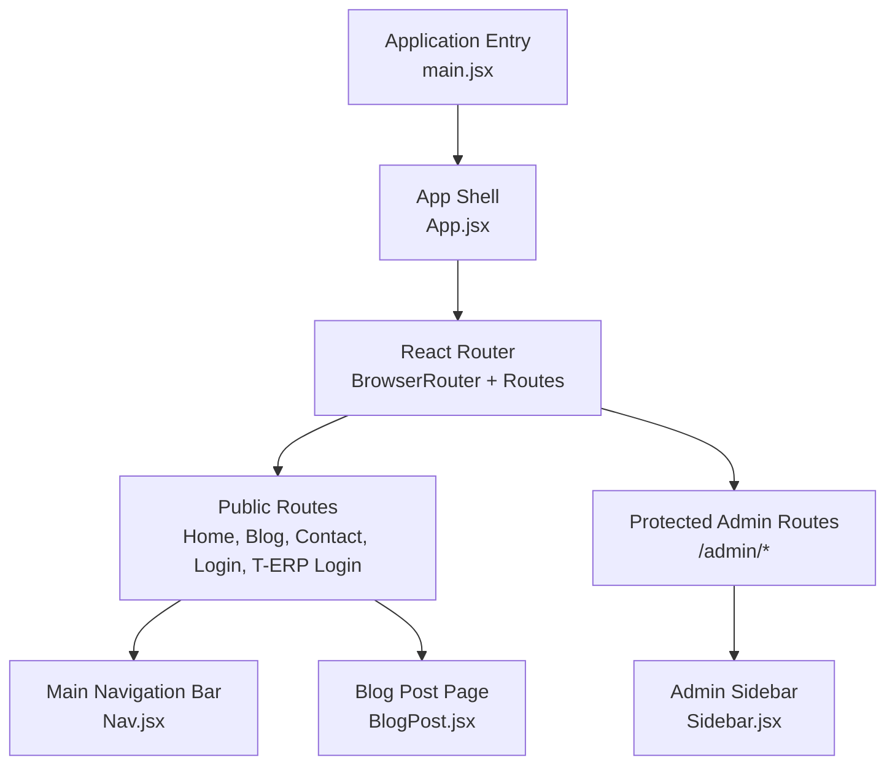
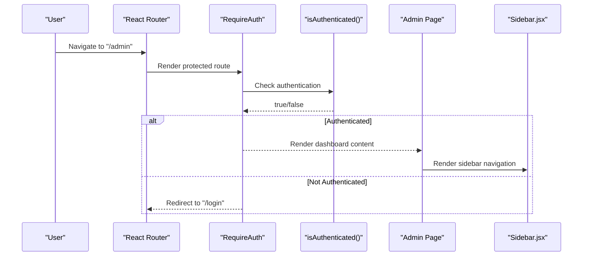
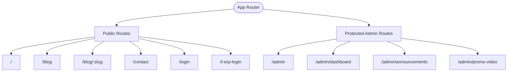
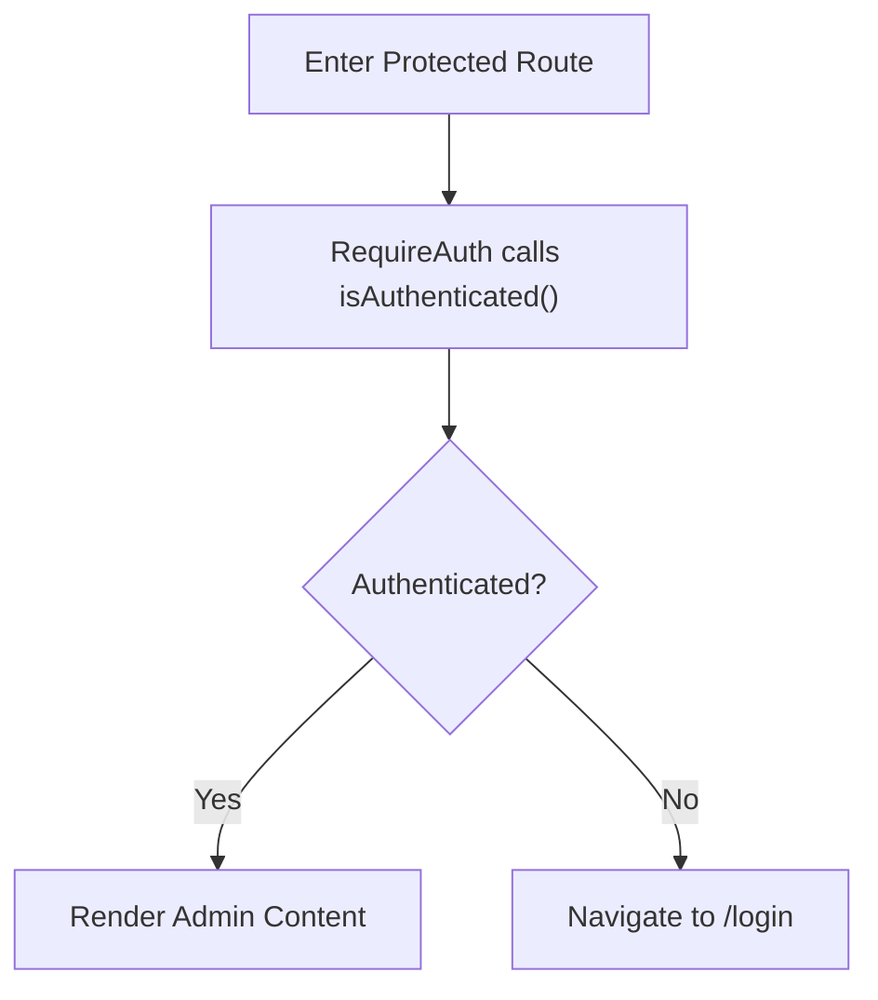
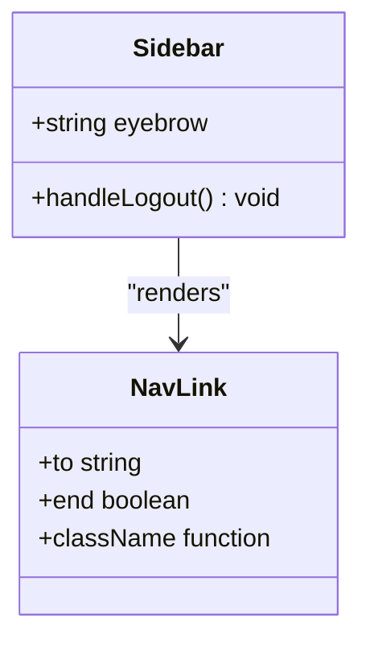
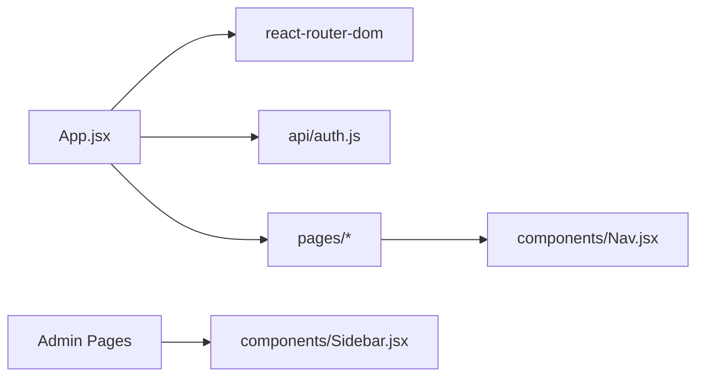

# Routing Strategy & Navigation

<cite>
**Referenced Files in This Document**
- [App.jsx](file://src/App.jsx)
- [main.jsx](file://src/main.jsx)
- [auth.js](file://src/api/auth.js)
- [Nav.jsx](file://src/components/Nav.jsx)
- [Sidebar.jsx](file://src/components/Sidebar.jsx)
- [BlogPost.jsx](file://src/pages/BlogPost.jsx)
</cite>

## Table of Contents
1. [Introduction](#introduction)
2. [Project Structure](#project-structure)
3. [Core Components](#core-components)
4. [Architecture Overview](#architecture-overview)
5. [Detailed Component Analysis](#detailed-component-analysis)
6. [Dependency Analysis](#dependency-analysis)
7. [Performance Considerations](#performance-considerations)
8. [Troubleshooting Guide](#troubleshooting-guide)
9. [Conclusion](#conclusion)
10. [Appendices](#appendices)

## Introduction
This document explains the routing strategy and navigation implementation for the application, focusing on:
- Route configuration structure using React Router
- Protected routes for admin functionality and authentication guards
- Navigation components (main navigation bar and sidebar), their props, and state management
- Route parameters, query strings, and programmatic navigation patterns
- SEO considerations for public routes
- Performance optimizations such as lazy loading
- Guidance for adding new routes and implementing nested routing structures

The analysis is based on the current codebase and highlights where to extend or improve the existing setup.

## Project Structure
At a high level, the routing layer is defined at the application root and wraps all pages under a single router instance. Public-facing pages are accessible without authentication, while admin routes are guarded by an authentication check.

**Diagram sources**
- [main.jsx:6-10](file://src/main.jsx#L6-L10)
- [App.jsx:25-70](file://src/App.jsx#L25-L70)
- [Sidebar.jsx:167-239](file://src/components/Sidebar.jsx#L167-L239)
- [Nav.jsx:612-618](file://src/components/Nav.jsx#L612-L618)
- [BlogPost.jsx:447-587](file://src/pages/BlogPost.jsx#L447-L587)

**Section sources**
- [main.jsx:1-11](file://src/main.jsx#L1-L11)
- [App.jsx:1-74](file://src/App.jsx#L1-L74)

## Core Components
- Application shell and router setup: The app initializes React Router with a BrowserRouter and defines all top-level routes in a single Routes block.
- Authentication guard: A RequireAuth component checks whether the user is authenticated before rendering protected admin routes; otherwise it redirects to the login page.
- Chatbot visibility gate: A ChatbotGate component hides the floating chatbot on login and admin paths.
- Main navigation bar: Nav.jsx provides global site navigation including product menus and links to public routes.
- Admin sidebar: Sidebar.jsx renders admin navigation items and handles logout flow with programmatic navigation.
- Blog post page: Demonstrates route parameter usage via useParams and internal navigation patterns.

Key responsibilities:
- App.jsx: Centralizes route definitions and guards.
- auth.js: Provides isAuthenticated, login, logout, and token utilities used by guards and navigation flows.
- Nav.jsx: Defines public navigation links and product groups.
- Sidebar.jsx: Renders admin navigation and triggers logout.
- BlogPost.jsx: Uses route parameters and demonstrates programmatic navigation patterns.

**Section sources**
- [App.jsx:15-23](file://src/App.jsx#L15-L23)
- [App.jsx:25-70](file://src/App.jsx#L25-L70)
- [auth.js:31-33](file://src/api/auth.js#L31-L33)
- [Nav.jsx:612-618](file://src/components/Nav.jsx#L612-L618)
- [Sidebar.jsx:167-239](file://src/components/Sidebar.jsx#L167-L239)
- [BlogPost.jsx:447-587](file://src/pages/BlogPost.jsx#L447-L587)

## Architecture Overview
The routing architecture follows a simple, centralized pattern:
- All routes are declared in App.jsx within a BrowserRouter.
- Public routes render directly.
- Admin routes are wrapped with RequireAuth to enforce authentication.
- The main navigation bar (Nav.jsx) is used across public pages.
- The admin sidebar (Sidebar.jsx) is rendered inside admin pages and controls admin navigation.

**Diagram sources**
- [App.jsx:15-17](file://src/App.jsx#L15-L17)
- [App.jsx:35-66](file://src/App.jsx#L35-L66)
- [auth.js:31-33](file://src/api/auth.js#L31-L33)
- [Sidebar.jsx:167-239](file://src/components/Sidebar.jsx#L167-L239)

## Detailed Component Analysis

### Route Configuration Structure
- Top-level routes include public pages (home, blog list, blog post, contact), login, and T-ERP login.
- Admin routes are grouped under /admin and require authentication.
- The chatbot visibility is controlled by path-based logic that hides it on login and admin paths.

Route map:
- Public:
  - "/" -> Home
  - "/blog" -> Blog list
  - "/blog/:slug" -> Blog post (parameterized)
  - "/contact" -> Contact
  - "/login" -> Admin login
  - "/t-erp-login" -> T-ERP login
- Protected:
  - "/admin" -> Dashboard
  - "/admin/dashboard" -> Admin blog dashboard
  - "/admin/announcements" -> Announcements
  - "/admin/promo-video" -> Promo video

**Diagram sources**
- [App.jsx:25-70](file://src/App.jsx#L25-L70)

**Section sources**
- [App.jsx:25-70](file://src/App.jsx#L25-L70)

### Authentication Guards for Admin Routes
- RequireAuth checks isAuthenticated() from auth.js. If false, it redirects to "/login" using Navigate with replace behavior.
- isAuthenticated reads the stored token via getToken() and returns a boolean.

Authentication flow:
- On accessing protected routes, RequireAuth evaluates authentication status.
- If not authenticated, the user is redirected to the login page.
- After successful login, tokens are set and subsequent requests carry Authorization headers.

**Diagram sources**
- [App.jsx:15-17](file://src/App.jsx#L15-L17)
- [auth.js:31-33](file://src/api/auth.js#L31-L33)

**Section sources**
- [App.jsx:15-17](file://src/App.jsx#L15-L17)
- [auth.js:1-40](file://src/api/auth.js#L1-L40)

### Navigation Components

#### Main Navigation Bar (Nav.jsx)
- Purpose: Global site navigation for public pages, including product menus and links to public routes.
- Props: No explicit props are required for basic usage; it uses internal data structures for menu items and product groups.
- State: Internal state manages dropdowns, mega menus, and UI interactions.
- Integration: Used by public pages like BlogPost.jsx.

Key behaviors:
- Links to public routes ("/", "/blog") are provided via NAV_LINKS.
- Product groups and individual products are configured through data arrays.

**Section sources**
- [Nav.jsx:612-618](file://src/components/Nav.jsx#L612-L618)

#### Admin Sidebar (Sidebar.jsx)
- Purpose: Admin navigation and logout actions.
- Props:
  - eyebrow: Label displayed above the nav items (default "Admin").
- State:
  - confirmingLogout: Controls the logout confirmation modal.
  - loggingOut: Indicates ongoing logout operation.
- Navigation:
  - Uses NavLink for active state styling.
  - Programmatic navigation via useNavigate for logout flow.

Navigation items:
- Dashboard (/admin)
- Blog posts (/admin/dashboard)
- Announcements (/admin/announcements)
- Promo video (/admin/promo-video)

**Diagram sources**
- [Sidebar.jsx:167-239](file://src/components/Sidebar.jsx#L167-L239)

**Section sources**
- [Sidebar.jsx:167-239](file://src/components/Sidebar.jsx#L167-L239)

### Route Parameters, Query Strings, and Programmatic Navigation

#### Route Parameters
- Blog post page uses useParams to extract the slug from "/blog/:slug".
- The slug drives fetching the specific post and related content.

Usage example reference:
- [BlogPost.jsx:447-587](file://src/pages/BlogPost.jsx#L447-L587)

#### Query Strings
- The current codebase does not demonstrate explicit query string handling in routes.
- For future needs, consider using useSearchParams to read/write query parameters when filtering or paginating lists.

#### Programmatic Navigation
- Sidebar.jsx uses useNavigate to redirect to "/login" after logout.
- Login page also uses useNavigate for post-login redirection.

References:
- [Sidebar.jsx:167-239](file://src/components/Sidebar.jsx#L167-L239)
- [App.jsx:15-17](file://src/App.jsx#L15-L17)

**Section sources**
- [BlogPost.jsx:447-587](file://src/pages/BlogPost.jsx#L447-L587)
- [Sidebar.jsx:167-239](file://src/components/Sidebar.jsx#L167-L239)
- [App.jsx:15-17](file://src/App.jsx#L15-L17)

### SEO Considerations for Public Routes
- Public routes should include appropriate meta tags (title, description, canonical URL, Open Graph/Twitter cards).
- Ensure server-side rendering or static generation if SEO is critical for crawlers.
- Use semantic HTML elements (h1-h6, article, section) and provide meaningful alt text for images.
- Avoid hiding important content behind interactive gates (e.g., chatbot gating should not affect SEO-critical content).

[No sources needed since this section provides general guidance]

### Performance Optimizations and Lazy Loading
- Current routes are imported statically at the top of App.jsx.
- To optimize initial bundle size, consider lazy loading heavy admin pages and feature modules using React.lazy and Suspense.
- Example approach:
  - Wrap admin components with React.lazy.
  - Provide fallback UI during loading.
  - Keep lightweight public routes eager-loaded for faster first paint.

Recommendation:
- Move heavy admin components (Dashboard, AdminBlogDashboard, Announcement, PromoVideo) into lazy imports.
- Maintain public routes (Home, Blog, BlogPost, Contact) as eager imports for better perceived performance.

[No sources needed since this section provides general guidance]

### Adding New Routes and Nested Routing Structures
To add a new route:
- Import the new page component at the top of App.jsx.
- Add a new Route entry under the appropriate section (public or protected).
- For protected routes, wrap the element with RequireAuth.

For nested routing:
- Create a parent layout component that renders <Outlet /> from react-router-dom.
- Define child routes under the parent route path.
- Use NavLink for nested navigation and maintain active states.

Example steps:
- Add import for the new page.
- Add Route definition with path and element.
- If nested, create a layout component and define children routes.

[No sources needed since this section provides general guidance]

## Dependency Analysis
The routing layer depends on:
- React Router for navigation and route matching.
- Authentication utilities for guarding admin routes.
- Navigation components for user interaction.

**Diagram sources**
- [App.jsx:1-14](file://src/App.jsx#L1-L14)
- [auth.js:1-40](file://src/api/auth.js#L1-L40)
- [Nav.jsx:1-20](file://src/components/Nav.jsx#L1-L20)
- [Sidebar.jsx:1-10](file://src/components/Sidebar.jsx#L1-L10)

**Section sources**
- [App.jsx:1-14](file://src/App.jsx#L1-L14)
- [auth.js:1-40](file://src/api/auth.js#L1-L40)
- [Nav.jsx:1-20](file://src/components/Nav.jsx#L1-L20)
- [Sidebar.jsx:1-10](file://src/components/Sidebar.jsx#L1-L10)

## Performance Considerations
- Keep public routes eager-loaded for fast initial navigation.
- Lazy-load admin and heavy feature pages to reduce initial bundle size.
- Use code splitting per route or per feature module.
- Optimize images and assets; leverage lazy loading for offscreen media.
- Minimize re-renders in navigation components by memoizing expensive computations.

[No sources needed since this section provides general guidance]

## Troubleshooting Guide
Common issues and resolutions:
- Redirect loops on protected routes:
  - Ensure isAuthenticated() correctly reflects authentication state.
  - Verify token storage and retrieval functions are consistent.
- Chatbot visibility unexpected:
  - Check pathname conditions in ChatbotGate to ensure correct paths are hidden.
- Sidebar navigation not updating active state:
  - Confirm NavLink props (to, end) match route definitions.
- Logout not clearing session:
  - Verify logout clears tokens and user data in both localStorage and sessionStorage.

**Section sources**
- [App.jsx:15-23](file://src/App.jsx#L15-L23)
- [auth.js:21-29](file://src/api/auth.js#L21-L29)
- [Sidebar.jsx:167-239](file://src/components/Sidebar.jsx#L167-L239)

## Conclusion
The application uses a straightforward routing strategy with React Router, centralizing route definitions in App.jsx and protecting admin routes with an authentication guard. Public navigation is handled by Nav.jsx, while admin navigation is managed by Sidebar.jsx. Route parameters are demonstrated in the blog post page, and programmatic navigation is used for logout flows. Future improvements should focus on lazy loading for performance and expanding query string handling for advanced filtering and pagination.

[No sources needed since this section summarizes without analyzing specific files]

## Appendices

### Quick Reference: Adding a New Protected Route
- Import the new page component in App.jsx.
- Add a Route entry under protected routes, wrapping the element with RequireAuth.
- Optionally add a corresponding item in Sidebar.jsx for admin navigation.

**Section sources**
- [App.jsx:35-66](file://src/App.jsx#L35-L66)
- [Sidebar.jsx:9-14](file://src/components/Sidebar.jsx#L9-L14)