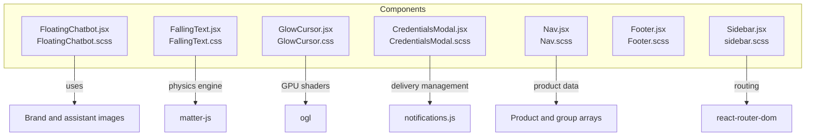
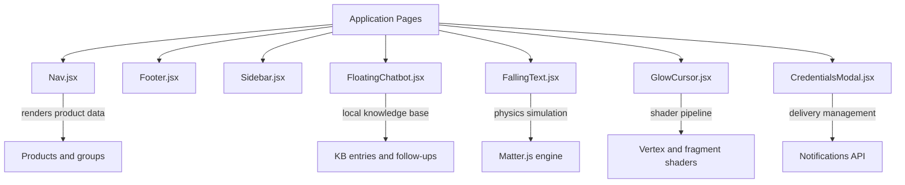
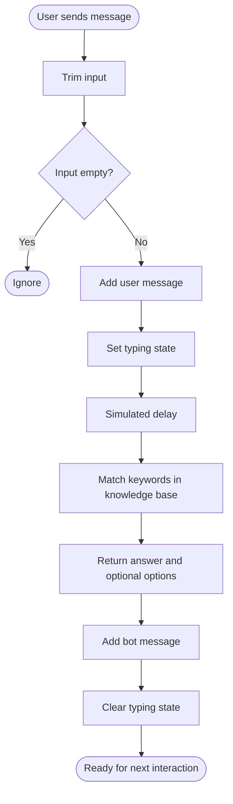
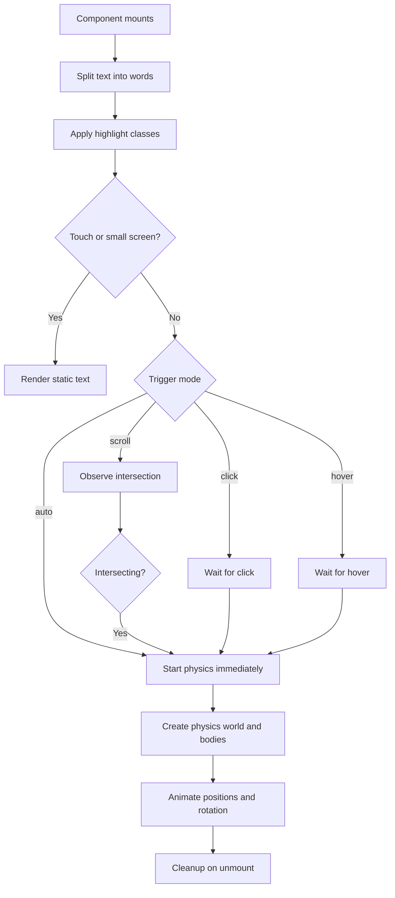
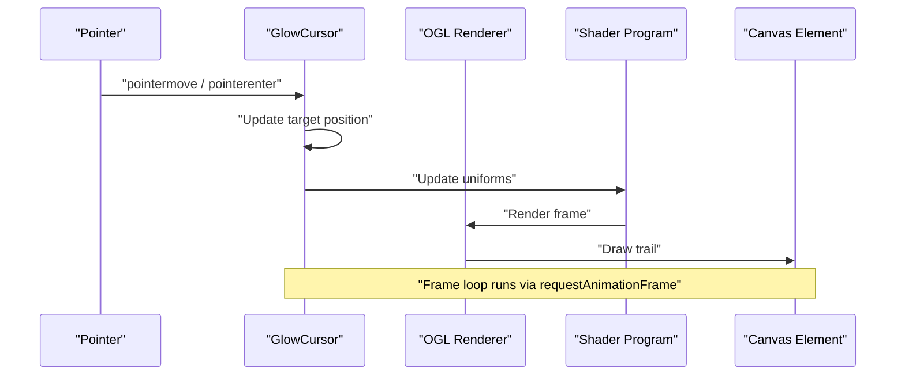
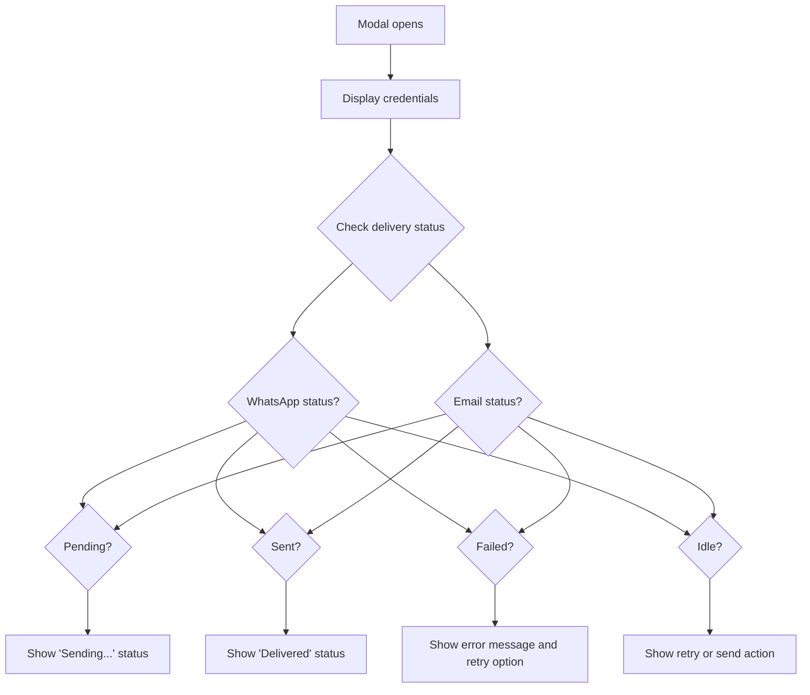
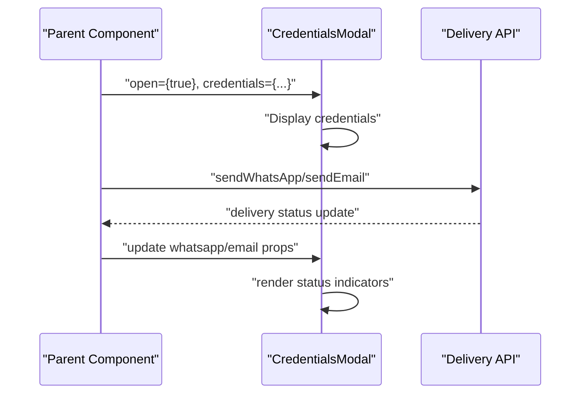
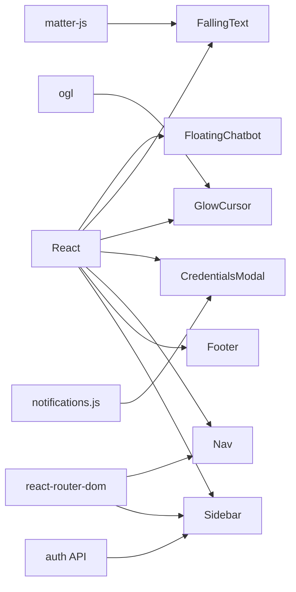

# Component Library

<cite>
**Referenced Files in This Document**
- [FloatingChatbot.jsx](file://src/components/FloatingChatbot.jsx)
- [FloatingChatbot.scss](file://src/components/FloatingChatbot.scss)
- [FallingText.jsx](file://src/components/FallingText.jsx)
- [FallingText.css](file://src/components/FallingText.css)
- [GlowCursor.jsx](file://src/components/GlowCursor.jsx)
- [GlowCursor.css](file://src/components/GlowCursor.css)
- [CredentialsModal.jsx](file://src/components/CredentialsModal.jsx)
- [CredentialsModal.scss](file://src/components/CredentialsModal.scss)
- [Nav.jsx](file://src/components/Nav.jsx)
- [Nav.scss](file://src/components/Nav.scss)
- [Footer.jsx](file://src/components/Footer.jsx)
- [Footer.scss](file://src/components/Footer.scss)
- [Sidebar.jsx](file://src/components/Sidebar.jsx)
- [sidebar.scss](file://src/components/sidebar.scss)
- [notifications.js](file://src/api/notifications.js)
- [TERPLogin.jsx](file://src/pages/TERPLogin.jsx)
</cite>

## Update Summary
**Changes Made**
- Added new CredentialsModal component documentation for displaying created credentials and managing delivery status
- Updated core components table to include CredentialsModal
- Added detailed section covering CredentialsModal functionality, props, and integration patterns
- Enhanced dependency analysis to include notifications API integration
- Updated troubleshooting guide with CredentialsModal-specific issues

## Table of Contents
1. [Introduction](#introduction)
2. [Project Structure](#project-structure)
3. [Core Components](#core-components)
4. [Architecture Overview](#architecture-overview)
5. [Detailed Component Analysis](#detailed-component-analysis)
6. [Dependency Analysis](#dependency-analysis)
7. [Performance Considerations](#performance-considerations)
8. [Troubleshooting Guide](#troubleshooting-guide)
9. [Conclusion](#conclusion)
10. [Appendices](#appendices)

## Introduction
This document describes the reusable component library used by the frontend application. It focuses on:

- Floating chatbot with a local knowledge base, contact link rendering, and quick-reply flows.
- Physics-based animation components: falling text using a 2D physics engine and a GPU-accelerated glow cursor trail.
- **New**: Credentials modal for displaying created credentials and managing delivery status across WhatsApp and email channels.
- Navigation system with product mega menu, mobile drawer, and announcement banner.
- Footer with branding, links, address blocks, call-to-action, and legal area.
- Admin sidebar with navigation, logout confirmation modal, and responsive layout.

The goal is to help developers understand how each component works, how to configure it, how to style it, and how to integrate it safely into pages while keeping performance and accessibility in mind.

## Project Structure
The relevant components live under `src/components`. Each component typically has:

- A React component file (`.jsx`).
- A styling file (`.scss` or `.css`).
- Optional assets such as images or icons.

**Diagram sources**
- [FloatingChatbot.jsx:1-370](file://src/components/FloatingChatbot.jsx#L1-L370)
- [FallingText.jsx:1-219](file://src/components/FallingText.jsx#L1-L219)
- [GlowCursor.jsx:1-352](file://src/components/GlowCursor.jsx#L1-L352)
- [CredentialsModal.jsx:1-227](file://src/components/CredentialsModal.jsx#L1-L227)
- [Nav.jsx:1-800](file://src/components/Nav.jsx#L1-L800)
- [Footer.jsx:1-295](file://src/components/Footer.jsx#L1-L295)
- [Sidebar.jsx:1-239](file://src/components/Sidebar.jsx#L1-L239)
- [notifications.js:1-415](file://src/api/notifications.js#L1-L415)

**Section sources**
- [FloatingChatbot.jsx:1-370](file://src/components/FloatingChatbot.jsx#L1-L370)
- [FallingText.jsx:1-219](file://src/components/FallingText.jsx#L1-L219)
- [GlowCursor.jsx:1-352](file://src/components/GlowCursor.jsx#L1-L352)
- [CredentialsModal.jsx:1-227](file://src/components/CredentialsModal.jsx#L1-L227)
- [Nav.jsx:1-800](file://src/components/Nav.jsx#L1-L800)
- [Footer.jsx:1-295](file://src/components/Footer.jsx#L1-L295)
- [Sidebar.jsx:1-239](file://src/components/Sidebar.jsx#L1-L239)

## Core Components
This section summarizes the main responsibilities of each component and how they fit together.

| Component | Purpose | Key Behaviors | Styling Approach |
|---|---|---|---|
| FloatingChatbot | In-page assistant with local knowledge base and contact integration | Toggles panel, renders messages, matches keywords, shows quick replies, auto-scrolls, hides when hero banner is visible | SCSS with BEM-like classes, animations for floating button, typing dots, and panel entrance |
| FallingText | Physics-driven falling word effect | Splits text into words, creates physics bodies, animates positions, supports trigger modes, disables on touch devices | CSS for container, static fallback, and highlighted words |
| GlowCursor | GPU-accelerated glowing cursor trail | Tracks pointer, updates shader uniforms, fades on idle, respects device pixel ratio | CSS overlay canvas with blend mode; heavy visual logic in GLSL shaders |
| **CredentialsModal** | **Modal for displaying created credentials and managing delivery status** | **Shows login details, tracks WhatsApp/email delivery states, provides retry functionality, generates mailto links** | **SCSS with BEM-like classes, modal overlay, delivery status indicators, and responsive layout** |
| Nav | Top navigation with mega menu, mobile drawer, and announcement banner | Renders products grouped by brand, handles hover/click states, supports mobile drawer and focus management | SCSS variables, mixins, media queries, and structured class hierarchy |
| Footer | Site footer with branding, links, addresses, CTA, and legal links | Static content configuration, social icons, responsive grid layout | SCSS with gradient backgrounds, responsive grids, and accessible labels |
| Sidebar | Admin dashboard navigation with logout flow | Uses router links, active state from URL, portal-based logout modal | SCSS with sticky layout, dark theme, and responsive breakpoints |

**Section sources**
- [FloatingChatbot.jsx:184-370](file://src/components/FloatingChatbot.jsx#L184-L370)
- [FallingText.jsx:5-219](file://src/components/FallingText.jsx#L5-L219)
- [GlowCursor.jsx:127-352](file://src/components/GlowCursor.jsx#L127-L352)
- [CredentialsModal.jsx:43-227](file://src/components/CredentialsModal.jsx#L43-L227)
- [Nav.jsx:21-618](file://src/components/Nav.jsx#L21-L618)
- [Footer.jsx:5-295](file://src/components/Footer.jsx#L5-L295)
- [Sidebar.jsx:9-239](file://src/components/Sidebar.jsx#L9-L239)

## Architecture Overview
At a high level, these components are independent UI building blocks. They do not share a global store; instead, they manage their own state and rely on standard React patterns.

**Diagram sources**
- [Nav.jsx:21-618](file://src/components/Nav.jsx#L21-L618)
- [FloatingChatbot.jsx:56-182](file://src/components/FloatingChatbot.jsx#L56-L182)
- [FallingText.jsx:72-187](file://src/components/FallingText.jsx#L72-L187)
- [GlowCursor.jsx:7-112](file://src/components/GlowCursor.jsx#L7-L112)
- [CredentialsModal.jsx:43-227](file://src/components/CredentialsModal.jsx#L43-L227)
- [notifications.js:1-415](file://src/api/notifications.js#L1-L415)

## Detailed Component Analysis

### FloatingChatbot
The floating chatbot provides an always-available assistant that answers questions based on a local knowledge base and integrates contact information directly into responses.

#### Responsibilities
- Toggle open/close state.
- Render message history with user and bot bubbles.
- Match user input against keyword-based knowledge base entries.
- Show follow-up options after product or software answers.
- Auto-scroll the chat body when new messages appear.
- Hide the launcher while the hero banner is in view.
- Convert email and phone strings into clickable links.

#### Props and Internal State
The component does not accept external props; it manages internal state:

| State | Purpose |
|---|---|
| `open` | Controls whether the chat panel is visible. |
| `visible` | Controls whether the launcher is shown at all. |
| `messages` | Stores conversation history. |
| `input` | Current text input value. |
| `typing` | Shows typing indicator while waiting for a reply. |
| `askedQuestions` | Tracks which quick questions have been used. |

#### Knowledge Base Flow
The knowledge base is an array of entries with keywords and optional follow-up options. Replies are matched by checking whether any keyword appears in the lowercased user input. If no match is found, a fallback reply is returned.

**Diagram sources**
- [FloatingChatbot.jsx:178-246](file://src/components/FloatingChatbot.jsx#L178-L246)

#### Contact Integration
Contact details are embedded as constants and rendered inside message lines. Email and phone numbers are detected by a regular expression and converted into `mailto:` and `tel:` links.

| Contact Detail | Usage |
|---|---|
| Support email | Rendered as a mailto link inside bot messages. |
| Display phone number | Matches user-visible text. |
| Phone tel number | Used for the actual `tel:` href. |

#### Accessibility Notes
- The toggle button has an `aria-label`.
- The close button has an `aria-label`.
- The avatar image uses descriptive alt text.
- Links generated from contact info are semantic anchor elements.

#### Styling and Customization
Styling uses SCSS with nested class names. Key customization points include:

- Launcher size and floating animation.
- Panel width, height, border radius, and shadow.
- Header background and status dot color.
- Bubble styles for bot and user messages.
- Quick reply button hover and reset styles.
- Input field and send button appearance.

To customize colors, fonts, spacing, or animations, modify the corresponding SCSS selectors. For example, change the panel background, bubble colors, or button hover states.

#### Lifecycle Behavior
- On mount, an intersection observer hides the launcher when the hero banner is visible.
- When the hero banner comes back into view, the chat panel closes.
- The chat body scrolls to the bottom whenever messages or typing state changes.

#### Performance Considerations
- Message rendering splits text by newline and renders line spans.
- Contact link detection runs per line.
- The component avoids expensive operations by only updating state on user actions.
- The launcher visibility depends on DOM presence of a `.hero-banner`; if missing, it stays visible.

**Section sources**
- [FloatingChatbot.jsx:8-32](file://src/components/FloatingChatbot.jsx#L8-L32)
- [FloatingChatbot.jsx:56-182](file://src/components/FloatingChatbot.jsx#L56-L182)
- [FloatingChatbot.jsx:184-370](file://src/components/FloatingChatbot.jsx#L184-L370)
- [FloatingChatbot.scss:1-306](file://src/components/FloatingChatbot.scss#L1-L306)

### FallingText
The falling text component wraps plain text in a physics simulation where each word becomes a rectangle that falls, bounces, rotates, and can be dragged with the mouse.

#### Props
| Prop | Default | Description |
|---|---:|---|
| `className` | `""` | Additional class name for the container. |
| `text` | `""` | Text content to split into words. |
| `highlightWords` | `[]` | Words to wrap with the highlight class. |
| `highlightClass` | `"highlighted"` | Class applied to highlighted words. |
| `trigger` | `"auto"` | Trigger mode: `"auto"`, `"scroll"`, `"click"`, or `"hover"`. |
| `backgroundColor` | `"transparent"` | Background color of the physics canvas. |
| `wireframes` | `false` | Whether to render wireframe physics bodies. |
| `gravity` | `1` | Gravity strength for the physics world. |
| `mouseConstraintStiffness` | `0.2` | Stiffness for dragging word bodies. |
| `fontSize` | `"1rem"` | Font size applied to the text target. |

#### Behavior Summary
- Splits text into words and wraps each word in a span.
- Applies a highlight class when a word starts with one of the configured highlight words.
- Detects touch/coarse-pointer devices and disables the physics effect on those devices.
- Supports automatic triggering, scroll-triggered triggering via intersection observer, click triggering, and hover triggering.
- Creates a physics world with boundaries and assigns each word a rectangle body.
- Animates word positions and rotation through a requestAnimationFrame loop.
- Cleans up the renderer, runner, canvas, and event listeners on unmount.

**Diagram sources**
- [FallingText.jsx:37-70](file://src/components/FallingText.jsx#L37-L70)
- [FallingText.jsx:72-187](file://src/components/FallingText.jsx#L72-L187)

#### Styling Notes
- The container allows vertical scrolling but prevents unwanted horizontal touch gestures.
- On touch devices, the text target uses a static layout class so words remain readable.
- The physics canvas overlays the text.
- Highlighted words use a default blue color and bold weight unless overridden.

#### Cross-Browser and Device Considerations
- Touch devices skip the physics effect entirely to avoid blocking page scroll.
- Mouse drag events are attached through the physics engine; touch handlers are defensively removed to prevent scroll interference.
- The component checks window width and coarse pointer capability.

**Section sources**
- [FallingText.jsx:5-47](file://src/components/FallingText.jsx#L5-L47)
- [FallingText.jsx:49-70](file://src/components/FallingText.jsx#L49-L70)
- [FallingText.jsx:72-187](file://src/components/FallingText.jsx#L72-L187)
- [FallingText.jsx:189-219](file://src/components/FallingText.jsx#L189-L219)
- [FallingText.css:1-48](file://src/components/FallingText.css#L1-L48)

### GlowCursor
The glow cursor component renders a smooth, GPU-accelerated trailing glow behind the pointer. It uses a triangle mesh and custom vertex and fragment shaders to compute the trail, glow, pulse, noise, and fade behavior.

#### Props
| Prop | Default | Description |
|---|---:|---|
| `color` | `"#67E8F9"` | Primary trail color. |
| `secondaryColor` | `"#A78BFA"` | Secondary trail color blended along the trail length. |
| `trailLength` | `40` | Number of trail points. |
| `trailWidth` | `8` | Width of the trail segment. |
| `trailTaper` | `0.8` | How quickly the trail tapers toward the tail. |
| `followSpeed` | `0.16` | How fast the head follows the pointer. |
| `glowIntensity` | `1.9` | Intensity of the outer glow. |
| `glowSpread` | `1.2` | Spread of the glow falloff. |
| `hotspot` | `0.65` | Brightness of the core hotspot. |
| `brightness` | `1.25` | Overall brightness multiplier. |
| `opacity` | `1` | Trail opacity. |
| `pulseSpeed` | `1.1` | Pulse animation speed. |
| `noiseStrength` | `0.035` | Film-grain noise amount. |
| `idleFade` | `true` | Fade out when idle or pointer leaves. |
| `idleTimeout` | `700` | Milliseconds before fading starts. |
| `fadeDuration` | `900` | Duration of the fade transition. |
| `blendMode` | `"screen"` | Canvas mix blend mode. |
| `maxDevicePixelRatio` | `1.5` | Cap for device pixel ratio. |
| `enabled` | `true` | Enable/disable the effect. |
| `children` | `undefined` | Content rendered above the canvas. |
| `className` | `""` | Additional class name. |
| `style` | `undefined` | Inline style object. |

#### Rendering Pipeline
The component initializes an OpenGL renderer, sets up a program with vertex and fragment shaders, tracks pointer movement, updates uniform values every frame, and renders a full-screen triangle.

**Diagram sources**
- [GlowCursor.jsx:178-341](file://src/components/GlowCursor.jsx#L178-L341)

#### Shader Highlights
The fragment shader computes:

- Distance to trail segments.
- Life and width based on progress along the trail.
- Glow intensity and core brightness.
- Color blending between primary and secondary colors.
- Film grain noise.
- Normal vs additive blend mode selection.
- Fade value for idle behavior.

#### Styling and Composition
- The wrapper div provides relative positioning and overflow handling.
- The canvas is absolutely positioned and set to `pointer-events: none`.
- Children are wrapped in a content layer with higher z-index.
- The canvas uses a configurable blend mode.

#### Performance Considerations
- Uses `requestAnimationFrame` for smooth rendering.
- Caps device pixel ratio to avoid excessive GPU load.
- Updates uniforms efficiently without recreating objects every frame.
- Cleans up animation frames, resize observers, and event listeners on cleanup.

**Section sources**
- [GlowCursor.jsx:7-112](file://src/components/GlowCursor.jsx#L7-L112)
- [GlowCursor.jsx:114-176](file://src/components/GlowCursor.jsx#L114-L176)
- [GlowCursor.jsx:178-341](file://src/components/GlowCursor.jsx#L178-L341)
- [GlowCursor.jsx:343-352](file://src/components/GlowCursor.jsx#L343-L352)
- [GlowCursor.css:1-24](file://src/components/GlowCursor.css#L1-L24)

### CredentialsModal
**Updated** The credentials modal displays created T-ERP license credentials and manages delivery status across WhatsApp and email channels. It provides a secure interface for operators to review and share customer login details.

#### Responsibilities
- Display created credentials including username, password, client ID, projects, and contact information.
- Track delivery status for WhatsApp and email channels with visual feedback.
- Provide retry functionality for failed deliveries.
- Generate mailto links for manual email sending.
- Copy credentials to clipboard for manual sharing.
- Manage modal lifecycle with keyboard navigation and accessibility features.

#### Props
| Prop | Type | Default | Description |
|---|---|---|---|
| `open` | `boolean` | - | Controls modal visibility. |
| `credentials` | `object` | - | Credential data including username, password, clientId, projects, email, phone, companyName, licenseKey. |
| `whatsapp` | `object` | - | WhatsApp delivery status with `state` and `message` properties. |
| `email` | `object` | - | Email delivery status with `state` and `message` properties. |
| `onClose` | `function` | - | Callback when modal is closed. |
| `onRetryWhatsApp` | `function` | - | Retry function for WhatsApp delivery. |
| `onRetryEmail` | `function` | - | Retry function for email delivery. |
| `retryingWhatsApp` | `boolean` | `false` | Indicates WhatsApp retry in progress. |
| `retryingEmail` | `boolean` | `false` | Indicates email retry in progress. |

#### Delivery Status Management
The component manages delivery states for both WhatsApp and email channels:

| Status | Meaning | Visual Indicator |
|---|---|---|
| `pending` | Delivery attempt in progress | Blue border and background |
| `sent` | Successfully delivered | Green border and background |
| `failed` | Delivery attempt failed | Red border and background |
| `skipped` | Delivery was skipped | Gray border and background |
| `idle` | No delivery attempt made | Gray border and background |

**Diagram sources**
- [CredentialsModal.jsx:5-18](file://src/components/CredentialsModal.jsx#L5-L18)
- [CredentialsModal.jsx:182-203](file://src/components/CredentialsModal.jsx#L182-L203)

#### Credential Display Features
- **Highlighted fields**: Username and password are displayed with monospace font and blue highlighting for easy copying.
- **Project chips**: Assigned projects are shown as interactive chips with proper formatting.
- **Contact information**: Email and phone numbers are displayed with appropriate placeholders for missing data.
- **License key**: Optional license key display when available.

#### Clipboard Integration
The component provides secure clipboard functionality:

- Copies formatted credential text including all relevant account information.
- Shows temporary "Copied" feedback for 2.5 seconds.
- Handles clipboard API errors gracefully.
- Formats output with clear labels and organization.

#### Mail Integration
For email channel, the component generates mailto links with:

- Pre-filled subject line including company name context.
- Complete message body with all credential details.
- Automatic CC to team mailbox when configured.
- Fallback option to open in native mail application.

#### Accessibility Features
- Modal dialog with proper ARIA attributes (`role="dialog"`, `aria-modal="true"`, `aria-labelledby`).
- Keyboard navigation support (Escape key to close).
- Focus management and screen reader compatibility.
- Semantic HTML structure with proper heading hierarchy.
- Descriptive labels for all interactive elements.

#### Styling and Customization
The component uses SCSS with BEM-like naming conventions:

- **Modal overlay**: Fixed positioning with backdrop blur and fade animation.
- **Card layout**: Responsive card with rounded corners and shadow effects.
- **Delivery indicators**: Color-coded status borders and backgrounds.
- **Typography**: Hierarchical text sizing with uppercase labels for metadata.
- **Interactive elements**: Styled buttons with hover states and disabled states.
- **Responsive design**: Mobile-first approach with breakpoint adjustments.

Key customization points include:

- Modal overlay colors and backdrop blur intensity.
- Card dimensions, border radius, and shadow effects.
- Delivery status color schemes (success, error, pending, idle).
- Typography scales and spacing values.
- Button styles and hover effects.
- Animation timing and easing functions.

#### Lifecycle Behavior
- **Opening**: Sets body overflow to hidden, adds keyboard event listener.
- **Closing**: Clears clipboard state, removes event listeners, restores body overflow.
- **Rendering**: Conditional rendering based on `open` prop and credentials availability.
- **Cleanup**: Proper event listener removal and state cleanup on unmount.

#### Integration Pattern
The component is designed to be integrated with parent components that manage delivery state:

**Diagram sources**
- [TERPLogin.jsx:491-501](file://src/pages/TERPLogin.jsx#L491-L501)
- [CredentialsModal.jsx:43-53](file://src/components/CredentialsModal.jsx#L43-L53)

**Section sources**
- [CredentialsModal.jsx:1-227](file://src/components/CredentialsModal.jsx#L1-L227)
- [CredentialsModal.scss:1-335](file://src/components/CredentialsModal.scss#L1-L335)
- [TERPLogin.jsx:491-501](file://src/pages/TERPLogin.jsx#L491-L501)

### Navigation System
The navigation component provides:

- Announcement banner with marquee-style scrolling.
- Desktop navigation bar with logo, links, login, and contact buttons.
- Mobile hamburger menu and drawer.
- Mega menu for products grouped by brand.
- Product preview panels with stats and chart labels.

#### Data Model
The navigation relies on two main data structures:

| Data Structure | Purpose |
|---|---|
| `PRODUCTS` | Defines product keys, names, descriptions, accent colors, links, badges, features, preview stats, and chart labels. |
| `GROUPS` | Groups products by brand, including label, slogan, tagline, logo, and product keys. |

#### Navigation Links
Top-level navigation links include Home, Products, Blog, Partners, and Resources. The Products link triggers the mega menu.

#### Mega Menu Behavior
- Selecting a brand group shows its products.
- Each product entry includes icon, title, description, accent color, and optional follow-up actions.
- Some products include preview statistics and chart labels.
- Hidden products exist in comments and can be enabled by uncommenting them.

#### Mobile Drawer
On smaller screens, the desktop links are replaced by a hamburger button and a slide-in drawer containing mobile-friendly navigation items.

#### Accessibility
- Focus rings are defined via a mixin.
- Buttons and links use consistent focus styles.
- Social and decorative SVGs use `aria-hidden` where appropriate.
- The drawer close button is keyboard-accessible.

#### Styling
SCSS defines:

- CSS variables for colors and fonts.
- Mixins for no-select buttons and focus rings.
- Responsive layouts for desktop and mobile.
- Mega menu structure with columns, groups, products, and help card.
- Animation for the announcement marquee.

**Section sources**
- [Nav.jsx:21-618](file://src/components/Nav.jsx#L21-L618)
- [Nav.jsx:612-618](file://src/components/Nav.jsx#L612-L618)
- [Nav.scss:1-313](file://src/components/Nav.scss#L1-L313)
- [Nav.scss:315-502](file://src/components/Nav.scss#L315-L502)
- [Nav.scss:504-800](file://src/components/Nav.scss#L504-L800)

### Footer
The footer component renders:

- Brand logo and tagline.
- Social media links with accessible labels.
- Link columns for Products, Solutions, Company, and Resources.
- Address sections for head office and branch locations.
- Call-to-action area with a primary button and sales link.
- Copyright and legal links.

#### Configuration
Most content is defined as static arrays and objects:

| Section | Configuration |
|---|---|
| Product and solution links | `FOOTER_LINKS` array. |
| Social icons | `SOCIALS` array with SVG icons. |
| Address and contact info | Inline JSX within the component. |
| CTA copy and actions | Inline JSX within the component. |

#### Accessibility
- Social links use `aria-label` for screen readers.
- Decorative dividers use `aria-hidden`.
- Links are semantic `<a>` elements.
- Legal and copyright text is plain text.

#### Styling
SCSS provides:

- Gradient background accents.
- Responsive grid for top section and address area.
- Social link hover colors matching platform brands.
- CTA gradient background and responsive stacking.
- Bottom section with flexible wrapping.

**Section sources**
- [Footer.jsx:5-81](file://src/components/Footer.jsx#L5-L81)
- [Footer.jsx:83-123](file://src/components/Footer.jsx#L83-L123)
- [Footer.jsx:124-295](file://src/components/Footer.jsx#L124-L295)
- [Footer.scss:1-161](file://src/components/Footer.scss#L1-L161)
- [Footer.scss:163-390](file://src/components/Footer.scss#L163-L390)

### Sidebar
The admin sidebar provides:

- Sticky left navigation for the admin area.
- Navigation items with icons and active state derived from the current route.
- Back-to-site link.
- Logout button with a confirmation modal portaled to `document.body`.

#### Navigation Items
The sidebar defines a fixed list of admin routes:

| Route | Label | Icon Key |
|---|---|---|
| `/admin` | Dashboard | `grid` |
| `/admin/dashboard` | Blog posts | `document` |
| `/admin/announcements` | Announcements | `megaphone` |
| `/admin/promo-video` | Promo video | `video` |

#### Logout Flow
- Clicking Log Out opens a confirmation modal.
- Confirming calls the logout API function.
- After logout, the app navigates to the login page.
- The modal is rendered via `createPortal` to avoid clipping issues.

#### Props
| Prop | Default | Description |
|---|---:|---|
| `eyebrow` | `"Admin"` | Label shown above the navigation items. |

Note: The `title` prop is still accepted for backward compatibility but is no longer used.

#### Styling
SCSS defines:

- Dark blue gradient background.
- Sticky layout with minimum viewport height.
- Active item highlighting with white background and shadow.
- Footer actions with hover states.
- Responsive layout for small screens.
- Logout modal overlay and dialog styles.

**Section sources**
- [Sidebar.jsx:9-14](file://src/components/Sidebar.jsx#L9-L14)
- [Sidebar.jsx:121-163](file://src/components/Sidebar.jsx#L121-L163)
- [Sidebar.jsx:167-239](file://src/components/Sidebar.jsx#L167-L239)
- [sidebar.scss:13-176](file://src/components/sidebar.scss#L13-L176)
- [sidebar.scss:178-293](file://src/components/sidebar.scss#L178-L293)

## Dependency Analysis
The components depend on different layers of the stack:

| Component | External Dependencies | Internal Dependencies |
|---|---|---|
| FloatingChatbot | None beyond React and assets | Local knowledge base, contact regex, SCSS |
| FallingText | `matter-js` | CSS layout and highlight classes |
| GlowCursor | `ogl` | Vertex and fragment shaders, CSS overlay |
| **CredentialsModal** | **None beyond React** | **Notifications API, SCSS, clipboard API** |
| Nav | `react-router-dom` | Product and group data, SCSS |
| Footer | None beyond React and assets | Static content arrays, SCSS |
| Sidebar | `react-router-dom`, auth API | Icons, SCSS, portal modal |

**Diagram sources**
- [FallingText.jsx:1-3](file://src/components/FallingText.jsx#L1-L3)
- [GlowCursor.jsx:1-3](file://src/components/GlowCursor.jsx#L1-L3)
- [CredentialsModal.jsx:1-3](file://src/components/CredentialsModal.jsx#L1-L3)
- [Nav.jsx:1-2](file://src/components/Nav.jsx#L1-L2)
- [Sidebar.jsx:1-7](file://src/components/Sidebar.jsx#L1-L7)
- [notifications.js:1-415](file://src/api/notifications.js#L1-L415)

**Section sources**
- [FallingText.jsx:1-3](file://src/components/FallingText.jsx#L1-L3)
- [GlowCursor.jsx:1-3](file://src/components/GlowCursor.jsx#L1-L3)
- [CredentialsModal.jsx:1-3](file://src/components/CredentialsModal.jsx#L1-L3)
- [Nav.jsx:1-2](file://src/components/Nav.jsx#L1-L2)
- [Sidebar.jsx:1-7](file://src/components/Sidebar.jsx#L1-L7)
- [notifications.js:1-415](file://src/api/notifications.js#L1-L415)

## Performance Considerations
- **FloatingChatbot**: Avoids heavy computation; most work is string splitting and simple state updates. Ensure the hero banner selector exists if you want the launcher to hide correctly.
- **FallingText**: Physics simulation runs per frame. It is disabled on touch devices to prevent scroll interference and reduce overhead. Keep `trailLength` reasonable if you reuse similar physics patterns elsewhere.
- **GlowCursor**: Uses GPU shaders and a continuous render loop. Limit device pixel ratio and avoid placing many instances on one page. Use `enabled` to disable when not needed.
- **CredentialsModal**: Lightweight modal with minimal re-renders. Clipboard operations are async and non-blocking. Delivery status updates are controlled by parent component state.
- **Nav**: Mega menu and product previews can be large. Keep product lists concise and avoid unnecessary re-renders by memoizing data where possible.
- **Footer**: Mostly static content; low runtime cost.
- **Sidebar**: Lightweight routing and state; modal is portaled to avoid layout clipping.

## Troubleshooting Guide

### FloatingChatbot Issues
- **Launcher not hiding**: The component hides itself when `.hero-banner` is intersecting. If no banner exists, it remains visible.
- **Contact links not clickable**: Ensure the displayed email and phone text exactly matches the constants used in the regex.
- **Quick questions not resetting**: The reset button clears `askedQuestions`; verify that the button is not being blocked by another element.

**Section sources**
- [FloatingChatbot.jsx:198-218](file://src/components/FloatingChatbot.jsx#L198-L218)
- [FloatingChatbot.jsx:12-32](file://src/components/FloatingChatbot.jsx#L12-L32)
- [FloatingChatbot.jsx:331-339](file://src/components/FloatingChatbot.jsx#L331-L339)

### FallingText Issues
- **Words not falling on mobile**: This is expected; the component skips physics on touch/coarse devices.
- **Scroll blocked on touch**: Touch handlers are removed defensively to prevent Matter.js from blocking page scroll.
- **Effect does not start**: Check `trigger` mode and ensure the container is visible when using `"scroll"`.

**Section sources**
- [FallingText.jsx:24-35](file://src/components/FallingText.jsx#L24-L35)
- [FallingText.jsx:49-70](file://src/components/FallingText.jsx#L49-L70)
- [FallingText.jsx:137-146](file://src/components/FallingText.jsx#L137-L146)

### GlowCursor Issues
- **Trail too heavy**: Reduce `trailLength`, `trailWidth`, or cap `maxDevicePixelRatio`.
- **Trail not visible**: Verify `enabled` is true, `opacity` is not zero, and the container has dimensions.
- **Canvas overlaps content**: Ensure children are placed inside the component so they render above the canvas.

**Section sources**
- [GlowCursor.jsx:127-176](file://src/components/GlowCursor.jsx#L127-L176)
- [GlowCursor.jsx:178-341](file://src/components/GlowCursor.jsx#L178-L341)
- [GlowCursor.jsx:343-352](file://src/components/GlowCursor.jsx#L343-L352)

### CredentialsModal Issues
**Updated** New troubleshooting section for the credentials modal component.

- **Modal not opening**: Verify `open` prop is true and `credentials` object contains required data.
- **Delivery status not updating**: Ensure parent component properly manages delivery state and passes updated props.
- **Copy button not working**: Check browser clipboard API permissions and HTTPS requirements.
- **Mailto link not generating**: Verify credentials contain valid email address.
- **Keyboard navigation not working**: Ensure modal is properly mounted and event listeners are attached.
- **Delivery retry not functioning**: Verify retry callback functions are properly passed and parent state management is correct.

**Section sources**
- [CredentialsModal.jsx:63-75](file://src/components/CredentialsModal.jsx#L63-L75)
- [CredentialsModal.jsx:113-121](file://src/components/CredentialsModal.jsx#L113-L121)
- [CredentialsModal.jsx:90-109](file://src/components/CredentialsModal.jsx#L90-L109)

### Navigation Issues
- **Mega menu not opening**: Ensure the Products link has the mega flag and that hover/click handlers are wired.
- **Mobile drawer not closing**: Verify the close button handler is attached and the backdrop dismisses the drawer.
- **Announcement banner not scrolling**: Check marquee animation classes and viewport hover pause behavior.

**Section sources**
- [Nav.jsx:612-618](file://src/components/Nav.jsx#L612-L618)
- [Nav.scss:315-502](file://src/components/Nav.scss#L315-L502)
- [Nav.scss:504-800](file://src/components/Nav.scss#L504-L800)

### Footer Issues
- **Social icons not accessible**: Ensure `aria-label` is present on social links.
- **Links not styled**: Verify SCSS imports and class names match the component structure.

**Section sources**
- [Footer.jsx:45-81](file://src/components/Footer.jsx#L45-L81)
- [Footer.jsx:124-295](file://src/components/Footer.jsx#L124-L295)

### Sidebar Issues
- **Logout modal clipped**: The modal is portaled to `document.body` to avoid clipping inside the sticky sidebar.
- **Active state wrong**: Active state is driven by the router; verify route paths.
- **Logout not navigating**: Ensure the logout API resolves and the router is available.

**Section sources**
- [Sidebar.jsx:121-163](file://src/components/Sidebar.jsx#L121-L163)
- [Sidebar.jsx:167-239](file://src/components/Sidebar.jsx#L167-L239)
- [sidebar.scss:199-293](file://src/components/sidebar.scss#L199-L293)

## Conclusion
This component library provides a cohesive set of UI building blocks:

- The floating chatbot offers a lightweight, local-knowledge-base assistant with contact integration.
- The falling text and glow cursor components deliver rich visual effects while respecting device capabilities.
- **The credentials modal provides secure credential display and delivery management across multiple communication channels.**
- The navigation system supports complex product discovery and mobile-friendly interactions.
- The footer and sidebar provide stable structural components for site-wide and admin-area layouts.

When integrating these components, prioritize:

- Clear props and configuration.
- Accessible markup and labels.
- Responsive design patterns.
- Performance-conscious defaults.
- Consistent styling approaches.
- **Proper state management for delivery tracking and modal lifecycle.**

## Appendices

### Component Props Reference

| Component | Important Props |
|---|---|
| FloatingChatbot | No external props; internal state controls behavior. |
| FallingText | `text`, `highlightWords`, `highlightClass`, `trigger`, `backgroundColor`, `wireframes`, `gravity`, `mouseConstraintStiffness`, `fontSize`, `className`. |
| GlowCursor | `color`, `secondaryColor`, `trailLength`, `trailWidth`, `trailTaper`, `followSpeed`, `glowIntensity`, `glowSpread`, `hotspot`, `brightness`, `opacity`, `pulseSpeed`, `noiseStrength`, `idleFade`, `idleTimeout`, `fadeDuration`, `blendMode`, `maxDevicePixelRatio`, `enabled`, `children`, `className`, `style`. |
| **CredentialsModal** | **`open`, `credentials`, `whatsapp`, `email`, `onClose`, `onRetryWhatsApp`, `onRetryEmail`, `retryingWhatsApp`, `retryingEmail`**. |
| Nav | No direct component props documented here; behavior controlled by internal data arrays and router. |
| Footer | No direct component props documented here; content defined internally. |
| Sidebar | `eyebrow`. |

**Section sources**
- [FallingText.jsx:5-16](file://src/components/FallingText.jsx#L5-L16)
- [GlowCursor.jsx:127-151](file://src/components/GlowCursor.jsx#L127-L151)
- [CredentialsModal.jsx:43-53](file://src/components/CredentialsModal.jsx#L43-L53)
- [Sidebar.jsx:167-169](file://src/components/Sidebar.jsx#L167-L169)

### Styling Approaches
- Use SCSS for components with complex themes, variables, and responsive layouts.
- Use CSS for simpler or isolated visual effects.
- Prefer BEM-like naming for clarity and maintainability.
- Keep animations subtle and respect user preferences for reduced motion where applicable.

**Section sources**
- [FloatingChatbot.scss:1-306](file://src/components/FloatingChatbot.scss#L1-L306)
- [FallingText.css:1-48](file://src/components/FallingText.css#L1-L48)
- [GlowCursor.css:1-24](file://src/components/GlowCursor.css#L1-L24)
- [CredentialsModal.scss:1-335](file://src/components/CredentialsModal.scss#L1-L335)
- [Nav.scss:1-800](file://src/components/Nav.scss#L1-L800)
- [Footer.scss:1-390](file://src/components/Footer.scss#L1-L390)
- [sidebar.scss:1-293](file://src/components/sidebar.scss#L1-L293)