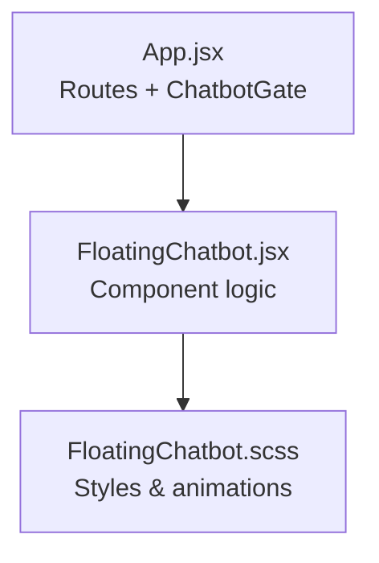
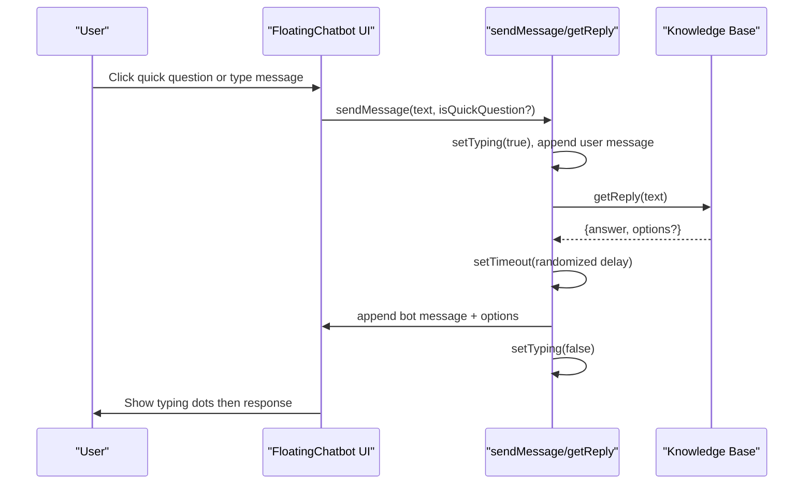
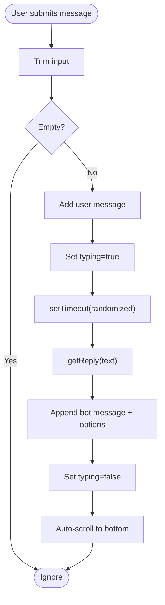
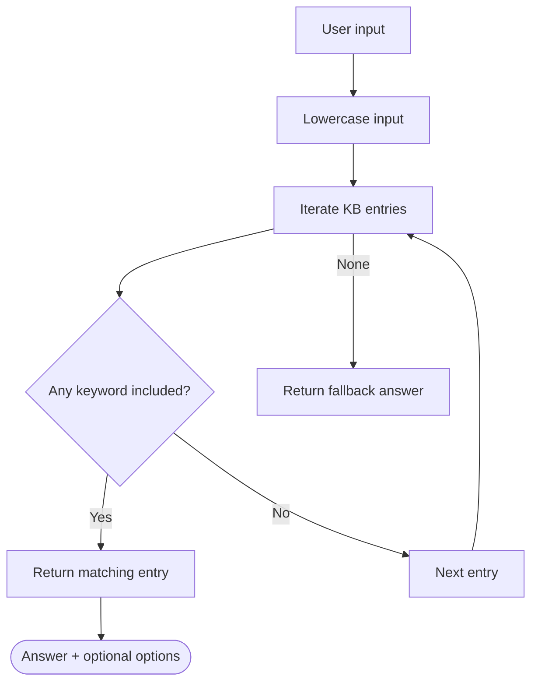
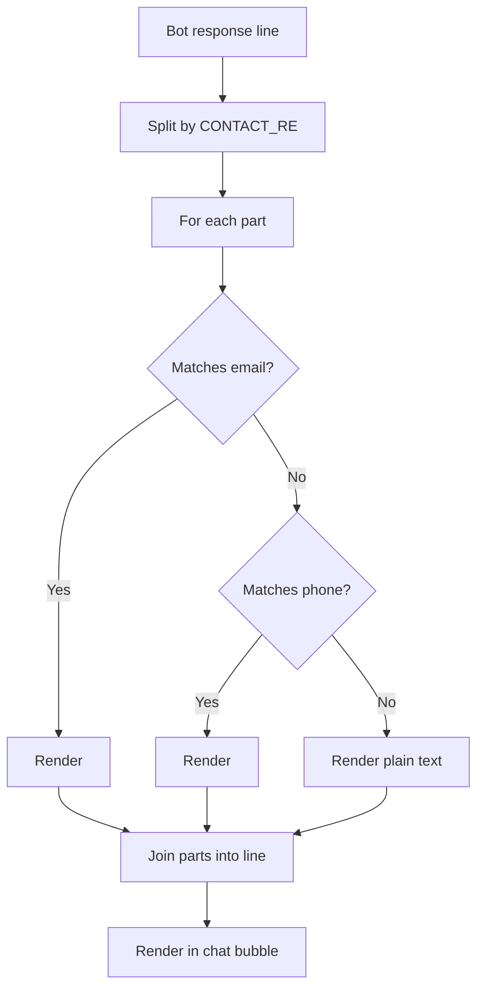
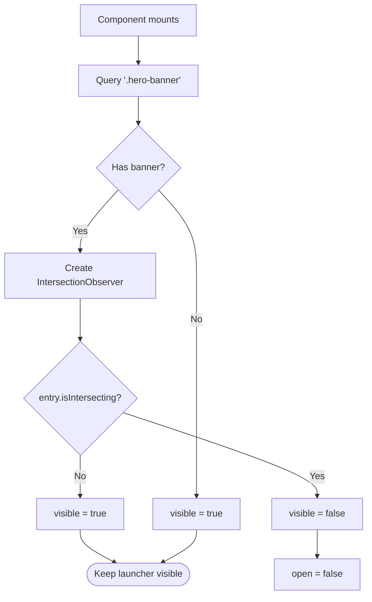
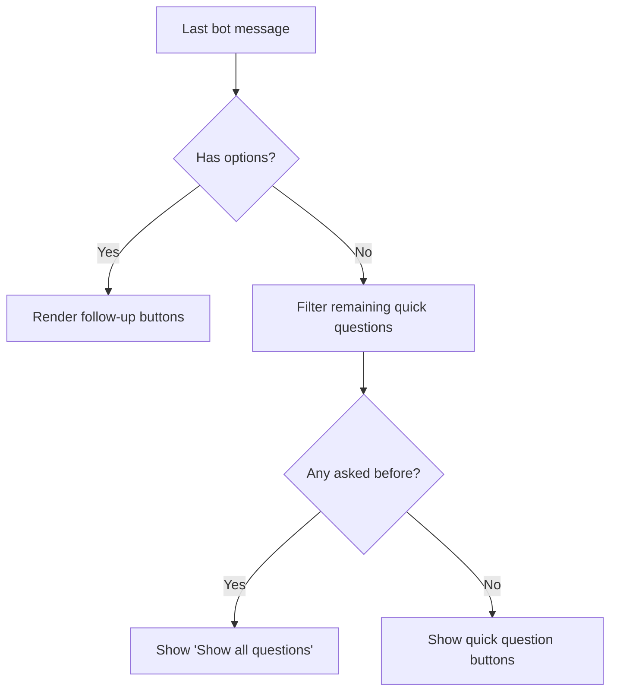
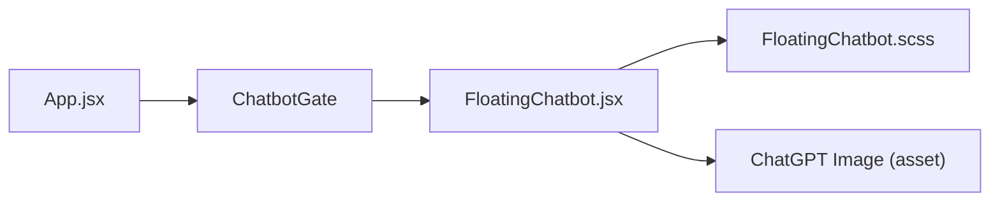
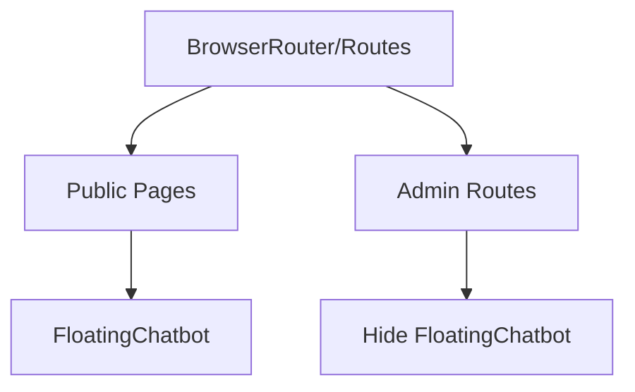

# Floating Chatbot Component

<cite>
**Referenced Files in This Document**
- [FloatingChatbot.jsx](file://src/components/FloatingChatbot.jsx)
- [FloatingChatbot.scss](file://src/components/FloatingChatbot.scss)
- [App.jsx](file://src/App.jsx)
</cite>

## Table of Contents
1. [Introduction](#introduction)
2. [Project Structure](#project-structure)
3. [Core Components](#core-components)
4. [Architecture Overview](#architecture-overview)
5. [Detailed Component Analysis](#detailed-component-analysis)
6. [Dependency Analysis](#dependency-analysis)
7. [Performance Considerations](#performance-considerations)
8. [Troubleshooting Guide](#troubleshooting-guide)
9. [Conclusion](#conclusion)
10. [Appendices](#appendices)

## Introduction
This document explains the FloatingChatbot component: an AI-powered customer support chatbot with a built-in knowledge base, contact integration, and responsive UI. It covers message state management, typing indicators, quick questions, follow-up options, IntersectionObserver-based visibility control, and styling guidelines. It also includes usage examples, customization guidance for knowledge base entries, accessibility considerations, performance optimization techniques, and browser compatibility notes.

## Project Structure
The chatbot is implemented as a single React component with its own styles and is conditionally rendered at the application root based on the current route.

**Diagram sources**
- [App.jsx:12-23](file://src/App.jsx#L12-L23)
- [FloatingChatbot.jsx:1-370](file://src/components/FloatingChatbot.jsx#L1-L370)
- [FloatingChatbot.scss:1-306](file://src/components/FloatingChatbot.scss#L1-L306)

**Section sources**
- [App.jsx:12-23](file://src/App.jsx#L12-L23)
- [FloatingChatbot.jsx:1-370](file://src/components/FloatingChatbot.jsx#L1-L370)
- [FloatingChatbot.scss:1-306](file://src/components/FloatingChatbot.scss#L1-L306)

## Core Components
- FloatingChatbot (React component): Manages open/close state, messages, input, typing indicator, quick questions, follow-up options, and IntersectionObserver-based visibility.
- Knowledge Base (KB): A static array of keyword-to-answer mappings with optional options for branching flows.
- Contact Integration: Automatic detection and linking of email and phone numbers within bot responses.
- Styling: SCSS module providing layout, animations, and responsive behavior.

Key responsibilities:
- Message state management and auto-scrolling
- Typing simulation with randomized delay
- Quick question system and follow-up option buttons
- Contact link rendering via regex
- Visibility toggling using IntersectionObserver when a hero banner is present

**Section sources**
- [FloatingChatbot.jsx:56-171](file://src/components/FloatingChatbot.jsx#L56-L171)
- [FloatingChatbot.jsx:178-182](file://src/components/FloatingChatbot.jsx#L178-L182)
- [FloatingChatbot.jsx:184-370](file://src/components/FloatingChatbot.jsx#L184-L370)
- [FloatingChatbot.scss:1-306](file://src/components/FloatingChatbot.scss#L1-L306)

## Architecture Overview
The chatbot runs client-side without external API calls. It uses a local knowledge base to match user input and returns predefined answers with optional follow-up options. The UI is fixed-positioned and overlays the page content.

**Diagram sources**
- [FloatingChatbot.jsx:226-246](file://src/components/FloatingChatbot.jsx#L226-L246)
- [FloatingChatbot.jsx:178-182](file://src/components/FloatingChatbot.jsx#L178-L182)

## Detailed Component Analysis

### Message State Management and Flow
- State variables:
  - open: controls panel visibility
  - visible: controls whether the launcher/panel is shown at all (based on hero banner intersection)
  - messages: array of {from, text, options?}
  - input: controlled input value
  - typing: shows typing animation
  - askedQuestions: tracks which quick questions have been used
- Auto-scroll: When messages or typing change, the chat body scrolls to the bottom.
- Sending flow:
  - Validate non-empty input
  - Track quick questions
  - Append user message
  - Simulate typing
  - Resolve reply from KB
  - Append bot message with optional options
  - Clear typing state

**Diagram sources**
- [FloatingChatbot.jsx:226-246](file://src/components/FloatingChatbot.jsx#L226-L246)
- [FloatingChatbot.jsx:220-224](file://src/components/FloatingChatbot.jsx#L220-L224)

**Section sources**
- [FloatingChatbot.jsx:184-246](file://src/components/FloatingChatbot.jsx#L184-L246)

### Knowledge Base Structure
- KB is an array of entries with:
  - keywords: array of substrings matched against lowercase user input
  - answer: string response; may include line breaks
  - options: optional array of strings that become follow-up buttons
- Matching strategy:
  - Lowercase user input
  - First entry whose any keyword is included wins
- Fallback:
  - If no match, a default fallback answer is returned

Customization tips:
- Add new software/products by adding entries with unique keywords and descriptive answers.
- Use options to create branching flows (e.g., product details followed by “contact support” or “browse more products”).
- Keep keywords concise and specific to avoid ambiguous matches.

**Diagram sources**
- [FloatingChatbot.jsx:56-171](file://src/components/FloatingChatbot.jsx#L56-L171)
- [FloatingChatbot.jsx:178-182](file://src/components/FloatingChatbot.jsx#L178-L182)

**Section sources**
- [FloatingChatbot.jsx:56-171](file://src/components/FloatingChatbot.jsx#L56-L171)
- [FloatingChatbot.jsx:178-182](file://src/components/FloatingChatbot.jsx#L178-L182)

### Contact Integration (Email/Phone Detection)
- Support email and phone are defined constants.
- A regular expression detects these exact values within bot response lines.
- Detected contacts are rendered as clickable links:
  - Email → mailto link
  - Phone → tel link
- This enables one-tap calling or emailing directly from the chat bubble.

Implementation highlights:
- CONTACT_RE builds a regex from the configured email and display phone number.
- renderLine splits each line by CONTACT_RE and replaces matches with anchor elements styled as floating-chatbot__link.

**Diagram sources**
- [FloatingChatbot.jsx:8-32](file://src/components/FloatingChatbot.jsx#L8-L32)

**Section sources**
- [FloatingChatbot.jsx:8-32](file://src/components/FloatingChatbot.jsx#L8-L32)

### Hero Banner Visibility with IntersectionObserver
- The chatbot launcher is hidden while a .hero-banner element is in view.
- If no .hero-banner exists, the launcher remains visible.
- IntersectionObserver threshold is set to 0.15.
- When the hero banner is intersecting, the panel is closed automatically.

Behavior summary:
- On mount, query for .hero-banner
- Create observer that toggles visible state based on isIntersecting
- Close panel when hero is in view
- Clean up observer on unmount

**Diagram sources**
- [FloatingChatbot.jsx:198-218](file://src/components/FloatingChatbot.jsx#L198-L218)

**Section sources**
- [FloatingChatbot.jsx:198-218](file://src/components/FloatingChatbot.jsx#L198-L218)

### Quick Questions and Follow-Up Options
- Quick questions are predefined and can be filtered based on previously asked questions.
- Follow-up options appear under the latest bot message if it includes options.
- Reset button allows showing all quick questions again after some have been used.

Rendering logic:
- If last bot message has options, show those as follow-up buttons.
- Otherwise, show remaining quick questions not yet asked.
- If any quick questions were asked and there are no follow-ups, show a reset button.

**Diagram sources**
- [FloatingChatbot.jsx:255-339](file://src/components/FloatingChatbot.jsx#L255-L339)

**Section sources**
- [FloatingChatbot.jsx:255-339](file://src/components/FloatingChatbot.jsx#L255-L339)

### Typing Indicator
- While awaiting a reply, three animated dots indicate the bot is typing.
- Animation is handled via CSS keyframes.
- Randomized delay simulates natural response time.

Styling:
- Dots are small circles with staggered animation delays.
- Bubble adapts to row layout during typing.

**Section sources**
- [FloatingChatbot.jsx:298-304](file://src/components/FloatingChatbot.jsx#L298-L304)
- [FloatingChatbot.scss:195-204](file://src/components/FloatingChatbot.scss#L195-L204)

### Responsive Design Patterns
- Panel width is constrained to 380px with max-width calc(100vw - 40px).
- Height is capped to 540px with max-height calc(100vh - 160px).
- Body scroll area hides native scrollbar across browsers.
- Touch-friendly button sizes and spacing.

**Section sources**
- [FloatingChatbot.scss:57-71](file://src/components/FloatingChatbot.scss#L57-L71)
- [FloatingChatbot.scss:139-154](file://src/components/FloatingChatbot.scss#L139-L154)

### Accessibility Considerations
- Toggle button has aria-label="Toggle chat".
- Close button has aria-label="Close chat".
- Avatar images use alt text for screen readers.
- Ensure focus management could be enhanced by focusing the input when the panel opens and trapping focus inside the panel.

Recommendations:
- Add role="dialog" and aria-modal="true" to the panel when open.
- Focus the input field on open and restore focus to the toggle on close.
- Provide keyboard shortcuts (e.g., Escape to close).

**Section sources**
- [FloatingChatbot.jsx:274-281](file://src/components/FloatingChatbot.jsx#L274-L281)
- [FloatingChatbot.jsx:358-365](file://src/components/FloatingChatbot.jsx#L358-L365)

## Dependency Analysis
- App.jsx conditionally renders FloatingChatbot except on login and admin routes.
- FloatingChatbot imports styles and an asset image.
- No external libraries are used beyond React hooks and DOM APIs.

**Diagram sources**
- [App.jsx:12-23](file://src/App.jsx#L12-L23)
- [FloatingChatbot.jsx:1-3](file://src/components/FloatingChatbot.jsx#L1-L3)

**Section sources**
- [App.jsx:12-23](file://src/App.jsx#L12-L23)
- [FloatingChatbot.jsx:1-3](file://src/components/FloatingChatbot.jsx#L1-L3)

## Performance Considerations
- Local processing only: All matching and rendering happen client-side with no network requests.
- Minimal re-renders: State updates are scoped to messages, typing, and input.
- IntersectionObserver cleanup: Observer is disconnected on unmount to prevent leaks.
- Debouncing/throttling: Not needed due to lightweight operations, but consider debouncing rapid input changes if expanding to real-time features.
- Memory: Avoid storing very long conversation histories; consider limiting message count if extended later.

[No sources needed since this section provides general guidance]

## Troubleshooting Guide
- Chatbot not appearing:
  - Verify the current route is not /login or /admin* paths.
  - Confirm FloatingChatbot is imported and rendered by ChatbotGate.
- Hero banner hiding the launcher:
  - Ensure your page contains an element with class .hero-banner.
  - Adjust IntersectionObserver threshold if needed.
- Contacts not clickable:
  - Confirm the exact email and phone values match the constants used in the component.
  - Check that response text includes the configured display phone number exactly.
- Quick questions not resetting:
  - Use the provided reset button to clear askedQuestions.
- Styling issues:
  - Ensure FloatingChatbot.scss is imported and not overridden by global styles.
  - Check z-index conflicts if other fixed elements overlap.

**Section sources**
- [App.jsx:19-23](file://src/App.jsx#L19-L23)
- [FloatingChatbot.jsx:198-218](file://src/components/FloatingChatbot.jsx#L198-L218)
- [FloatingChatbot.jsx:8-32](file://src/components/FloatingChatbot.jsx#L8-L32)
- [FloatingChatbot.jsx:331-339](file://src/components/FloatingChatbot.jsx#L331-L339)

## Conclusion
The FloatingChatbot component delivers a self-contained, client-side conversational interface backed by a simple knowledge base. It supports quick questions, follow-up flows, automatic contact linking, and responsive design. With minimal dependencies and straightforward customization points, it can be adapted to various product portfolios and support workflows.

[No sources needed since this section summarizes without analyzing specific files]

## Appendices

### Usage Example
- Include the component at the app level so it appears across public pages.
- Optionally hide it on sensitive routes (already handled by ChatbotGate).

**Diagram sources**
- [App.jsx:25-70](file://src/App.jsx#L25-L70)

**Section sources**
- [App.jsx:25-70](file://src/App.jsx#L25-L70)

### Customization Guidelines
- Knowledge base entries:
  - Add new entries with unique keywords and informative answers.
  - Use options to guide users through multi-step flows.
- Contact info:
  - Update SUPPORT_EMAIL and SUPPORT_PHONE_DISPLAY constants to reflect current support channels.
- Styling:
  - Modify colors, typography, and spacing in FloatingChatbot.scss.
  - Adjust panel dimensions and animations as needed.

**Section sources**
- [FloatingChatbot.jsx:8-10](file://src/components/FloatingChatbot.jsx#L8-L10)
- [FloatingChatbot.jsx:56-171](file://src/components/FloatingChatbot.jsx#L56-L171)
- [FloatingChatbot.scss:1-306](file://src/components/FloatingChatbot.scss#L1-L306)

### Browser Compatibility Notes
- IntersectionObserver: Supported in modern browsers; ensure polyfill if targeting legacy environments.
- CSS features:
  - Flexbox, custom properties, and animations are widely supported.
  - Scrollbar hiding uses vendor-prefixed rules for broad coverage.

[No sources needed since this section provides general guidance]