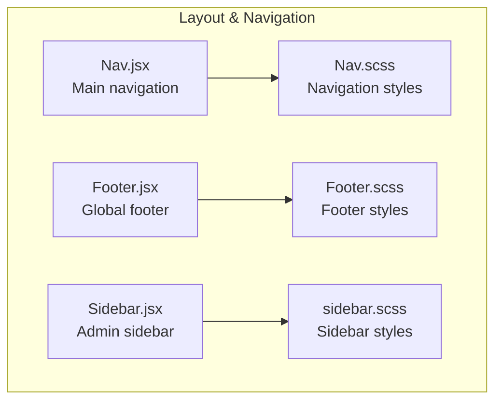
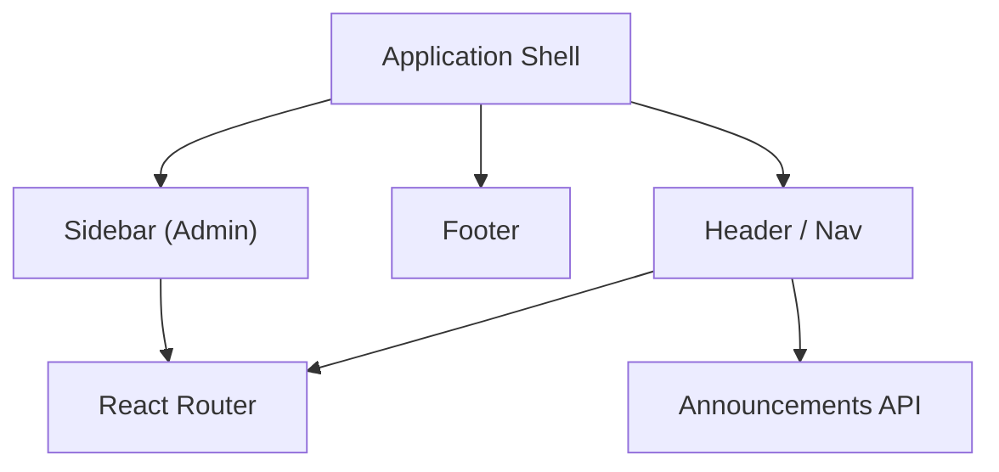
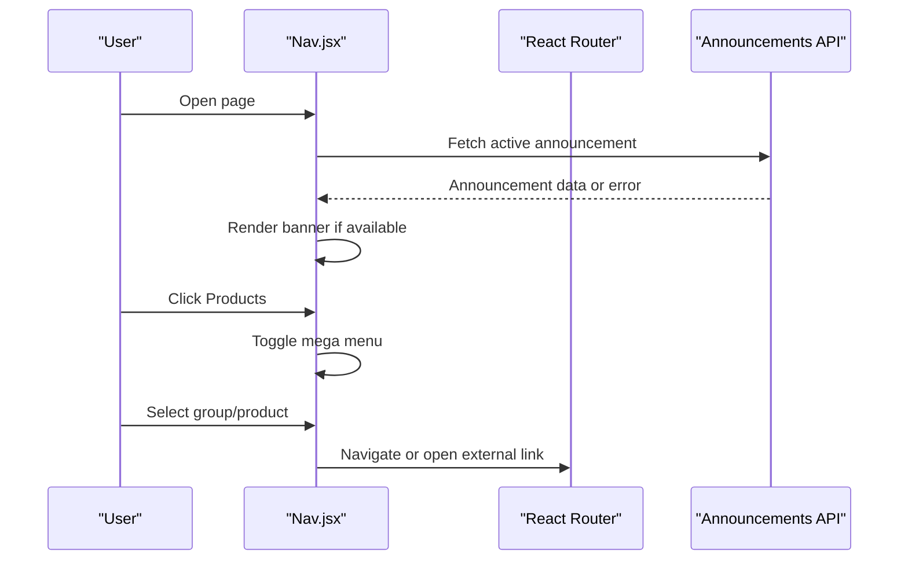
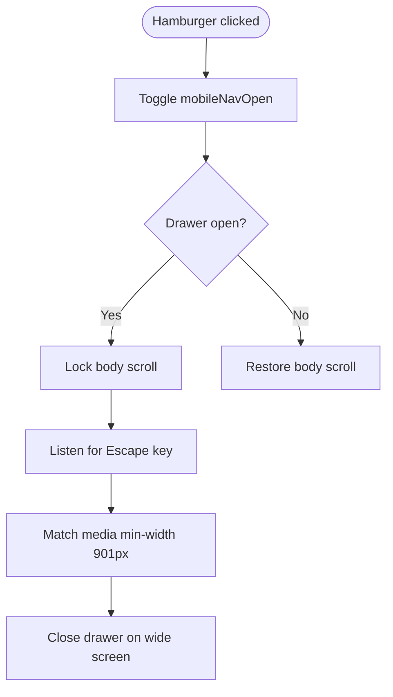
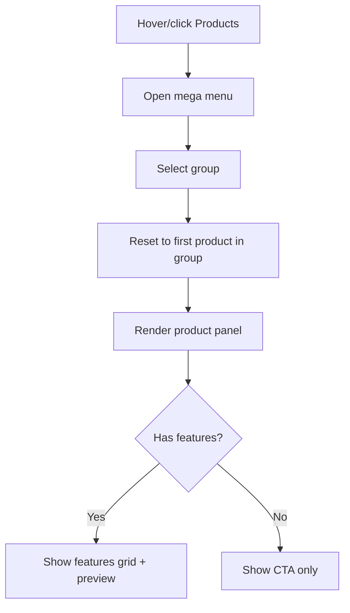
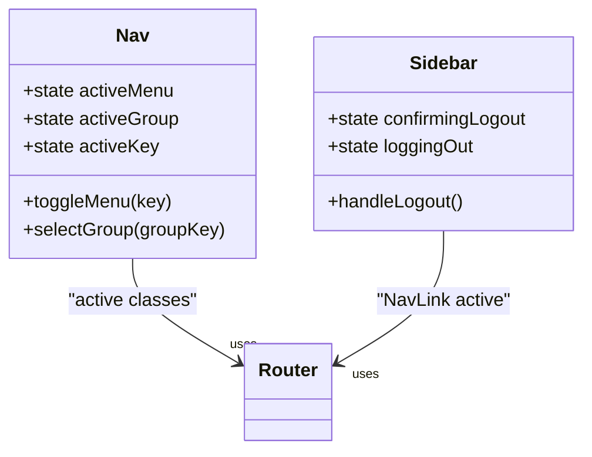
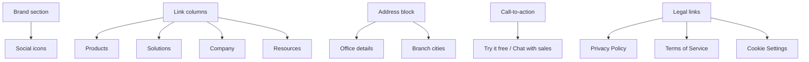
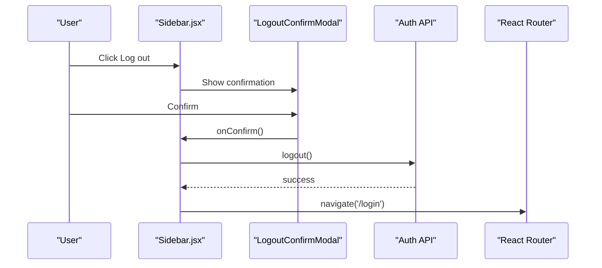
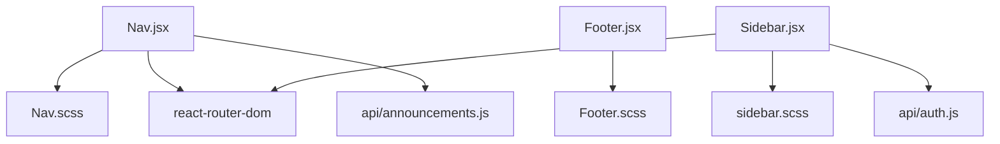

# Layout & Navigation Components

<cite>
**Referenced Files in This Document**
- [Nav.jsx](file://src/components/Nav.jsx)
- [Nav.scss](file://src/components/Nav.scss)
- [Footer.jsx](file://src/components/Footer.jsx)
- [Footer.scss](file://src/components/Footer.scss)
- [Sidebar.jsx](file://src/components/Sidebar.jsx)
- [sidebar.scss](file://src/components/sidebar.scss)
</cite>

## Table of Contents
1. [Introduction](#introduction)
2. [Project Structure](#project-structure)
3. [Core Components](#core-components)
4. [Architecture Overview](#architecture-overview)
5. [Detailed Component Analysis](#detailed-component-analysis)
6. [Dependency Analysis](#dependency-analysis)
7. [Performance Considerations](#performance-considerations)
8. [Troubleshooting Guide](#troubleshooting-guide)
9. [Conclusion](#conclusion)
10. [Appendices](#appendices)

## Introduction
This document explains the layout and navigation components used across the application:
- Main navigation with a responsive hamburger menu, mega menu dropdown, announcement banner, and active route highlighting.
- Footer component with brand information, social links, multi-column links, address blocks, call-to-action area, and legal links.
- Admin sidebar for dashboard navigation with active state handling and logout confirmation.

The documentation focuses on structure, behavior, styling approach, accessibility, customization options, theme integration, and performance considerations for large navigation structures.

## Project Structure
The relevant layout and navigation code is organized under `src/components`:
- `Nav.jsx` and `Nav.scss` implement the main site header, navigation links, mobile drawer, and product mega menu.
- `Footer.jsx` and `Footer.scss` implement the global footer.
- `Sidebar.jsx` and `sidebar.scss` implement the admin dashboard sidebar.

**Diagram sources**
- [Nav.jsx:1-20](file://src/components/Nav.jsx#L1-L20)
- [Nav.scss:1-30](file://src/components/Nav.scss#L1-L30)
- [Footer.jsx:1-10](file://src/components/Footer.jsx#L1-L10)
- [Footer.scss:1-20](file://src/components/Footer.scss#L1-L20)
- [Sidebar.jsx:1-10](file://src/components/Sidebar.jsx#L1-L10)
- [sidebar.scss:1-15](file://src/components/sidebar.scss#L1-L15)

**Section sources**
- [Nav.jsx:1-20](file://src/components/Nav.jsx#L1-L20)
- [Nav.scss:1-30](file://src/components/Nav.scss#L1-L30)
- [Footer.jsx:1-10](file://src/components/Footer.jsx#L1-L10)
- [Footer.scss:1-20](file://src/components/Footer.scss#L1-L20)
- [Sidebar.jsx:1-10](file://src/components/Sidebar.jsx#L1-L10)
- [sidebar.scss:1-15](file://src/components/sidebar.scss#L1-L15)

## Core Components
- **Main Navigation (`Nav.jsx`, `Nav.scss`)**
  - Top announcement banner fetched from an API.
  - Desktop navigation bar with logo, primary links, login, T-ERP login, and contact link.
  - Hamburger button that opens a mobile drawer with accessible dialog semantics.
  - Mega menu for Products grouping products by brand groups and showing feature panels.
  - Active route highlighting through React Router’s active classes.

- **Footer (`Footer.jsx`, `Footer.scss`)**
  - Brand section with logo, tagline, and social icons.
  - Multi-column link sections for Products, Solutions, Company, and Resources.
  - Address block with office details, branches, website, and email.
  - Call-to-action banner and bottom legal links.

- **Admin Sidebar (`Sidebar.jsx`, `sidebar.scss`)**
  - Sticky vertical navigation for admin routes.
  - Active item highlighting based on current URL.
  - Logout confirmation modal rendered via portal.
  - Back to site link and logout action.

**Section sources**
- [Nav.jsx:1277-1558](file://src/components/Nav.jsx#L1277-L1558)
- [Nav.scss:27-313](file://src/components/Nav.scss#L27-L313)
- [Footer.jsx:124-295](file://src/components/Footer.jsx#L124-L295)
- [Footer.scss:11-390](file://src/components/Footer.scss#L11-L390)
- [Sidebar.jsx:167-239](file://src/components/Sidebar.jsx#L167-L239)
- [sidebar.scss:13-176](file://src/components/sidebar.scss#L13-L176)

## Architecture Overview
The navigation system is composed of three independent UI modules:
- The main header handles public-facing navigation and product discovery.
- The footer provides consistent company information and legal content.
- The sidebar manages authenticated admin navigation.

**Diagram sources**
- [Nav.jsx:17-18](file://src/components/Nav.jsx#L17-L18)
- [Nav.jsx:1277-1558](file://src/components/Nav.jsx#L1277-L1558)
- [Sidebar.jsx:4-5](file://src/components/Sidebar.jsx#L4-L5)
- [Sidebar.jsx:167-239](file://src/components/Sidebar.jsx#L167-L239)

## Detailed Component Analysis

### Main Navigation Component
The main navigation component implements:
- Announcement banner with optional scrolling marquee behavior.
- Desktop navigation links including a Products mega menu.
- Mobile drawer with accessible dialog attributes.
- Active route highlighting using React Router’s active class.
- Product group selection and dynamic panel rendering.

#### Key Behaviors
- Announcement banner fetches data and persists dismissal in session storage.
- Long announcements auto-scroll horizontally; animation duration adapts to text width.
- Mobile drawer locks body scroll, closes on Escape, and closes when screen widens beyond the breakpoint.
- Mega menu toggles open/close and highlights selected group and product.

**Diagram sources**
- [Nav.jsx:1289-1315](file://src/components/Nav.jsx#L1289-L1315)
- [Nav.jsx:1320-1349](file://src/components/Nav.jsx#L1320-L1349)
- [Nav.jsx:1378-1400](file://src/components/Nav.jsx#L1378-L1400)
- [Nav.jsx:1479-1527](file://src/components/Nav.jsx#L1479-L1527)
- [Nav.jsx:1676-2043](file://src/components/Nav.jsx#L1676-L2043)

#### Responsive Navigation Menu
- Hamburger button appears below desktop breakpoint and toggles a mobile drawer.
- Drawer uses `role="dialog"` and `aria-modal="true"` for accessibility.
- Links inside the drawer close the drawer after navigation.

**Diagram sources**
- [Nav.jsx:1369-1400](file://src/components/Nav.jsx#L1369-L1400)
- [Nav.jsx:1461-1469](file://src/components/Nav.jsx#L1461-L1469)
- [Nav.jsx:1560-1674](file://src/components/Nav.jsx#L1560-L1674)

#### Dropdown Functionality
- Products menu renders a mega menu with three columns:
  - Groups list with brand logos and slogans.
  - Products list per group with accent colors.
  - Feature panel with description, features grid, preview image, and CTAs.
- Group selection updates active product and resets to first item in the new group.

**Diagram sources**
- [Nav.jsx:1402-1413](file://src/components/Nav.jsx#L1402-L1413)
- [Nav.jsx:1676-2043](file://src/components/Nav.jsx#L1676-L2043)

#### Active Route Highlighting
- Desktop links use React Router’s active class to highlight the current route.
- Sidebar uses NavLink’s active class to highlight the current admin route.

**Diagram sources**
- [Nav.jsx:1277-1558](file://src/components/Nav.jsx#L1277-L1558)
- [Sidebar.jsx:191-211](file://src/components/Sidebar.jsx#L191-L211)

**Section sources**
- [Nav.jsx:1277-2054](file://src/components/Nav.jsx#L1277-L2054)
- [Nav.scss:27-313](file://src/components/Nav.scss#L27-L313)
- [Nav.scss:504-800](file://src/components/Nav.scss#L504-L800)

### Footer Component
The footer component provides:
- Brand section with logo, tagline, and social icons.
- Four-column link sections for Products, Solutions, Company, and Resources.
- Address block with two office locations, branch cities, website, and email.
- Call-to-action banner with primary button and sales link.
- Bottom copyright and legal links.

**Diagram sources**
- [Footer.jsx:5-43](file://src/components/Footer.jsx#L5-L43)
- [Footer.jsx:45-81](file://src/components/Footer.jsx#L45-L81)
- [Footer.jsx:124-295](file://src/components/Footer.jsx#L124-L295)

**Section sources**
- [Footer.jsx:1-295](file://src/components/Footer.jsx#L1-L295)
- [Footer.scss:11-390](file://src/components/Footer.scss#L11-L390)

### Sidebar Component
The sidebar component provides:
- Sticky navigation for admin routes.
- Active item highlighting based on current URL.
- Logout confirmation modal rendered via portal.
- Back to site link and logout action.

**Diagram sources**
- [Sidebar.jsx:121-163](file://src/components/Sidebar.jsx#L121-L163)
- [Sidebar.jsx:172-181](file://src/components/Sidebar.jsx#L172-L181)
- [Sidebar.jsx:220-236](file://src/components/Sidebar.jsx#L220-L236)

**Section sources**
- [Sidebar.jsx:1-239](file://src/components/Sidebar.jsx#L1-L239)
- [sidebar.scss:13-176](file://src/components/sidebar.scss#L13-L176)
- [sidebar.scss:199-293](file://src/components/sidebar.scss#L199-L293)

## Dependency Analysis
- **Nav.jsx dependencies**
  - React Router for navigation and active states.
  - Announcements API for fetching the active banner.
  - Local assets for logo and product images.
  - SCSS module for navigation styles.

- **Footer.jsx dependencies**
  - Local assets for logo.
  - SCSS module for footer styles.

- **Sidebar.jsx dependencies**
  - React Router for navigation and active states.
  - Auth API for logout.
  - Local assets for logo.
  - SCSS module for sidebar styles.

**Diagram sources**
- [Nav.jsx:1-19](file://src/components/Nav.jsx#L1-L19)
- [Footer.jsx:1-4](file://src/components/Footer.jsx#L1-L4)
- [Sidebar.jsx:1-7](file://src/components/Sidebar.jsx#L1-L7)

**Section sources**
- [Nav.jsx:1-19](file://src/components/Nav.jsx#L1-L19)
- [Footer.jsx:1-4](file://src/components/Footer.jsx#L1-L4)
- [Sidebar.jsx:1-7](file://src/components/Sidebar.jsx#L1-L7)

## Performance Considerations
- **Large navigation structures**
  - Keep product and group arrays small and static where possible to avoid heavy re-renders.
  - Use lazy loading for heavy images in the mega menu preview panel.
  - Avoid unnecessary state updates in hover handlers; prefer CSS transitions for visual feedback.

- **Announcement banner**
  - The banner measures DOM nodes and sets up ResizeObserver listeners; ensure cleanup on unmount to prevent memory leaks.
  - Limit marquee animations to long text only; short banners should remain static.

- **Mobile drawer**
  - Locking body scroll and adding event listeners should be cleaned up when the drawer closes.
  - Use matchMedia listeners to automatically close the drawer on wide screens.

- **Sidebar logout modal**
  - Portal rendering avoids stacking context issues; ensure focus management and keyboard trapping are implemented for accessibility.

[No sources needed since this section provides general guidance]

## Troubleshooting Guide
- **Mega menu not opening**
  - Verify that the Products link has the `hasMega` flag set.
  - Check that `activeMenu === "products"` condition is met.

- **Mobile drawer not closing**
  - Ensure Escape key listener is attached and removes itself on cleanup.
  - Confirm matchMedia listener closes the drawer when screen width exceeds breakpoint.

- **Active route not highlighted**
  - For desktop links, verify React Router’s active class is applied.
  - For sidebar items, ensure NavLink’s `end` prop is correctly set for exact matches.

- **Footer layout issues**
  - Check media queries for column wrapping at smaller breakpoints.
  - Ensure brand and link columns have sufficient spacing.

- **Sidebar modal misaligned**
  - Confirm the modal is portaled into `document.body`.
  - Verify overlay styles are not nested under `.sidebar` due to portal usage.

**Section sources**
- [Nav.jsx:1378-1400](file://src/components/Nav.jsx#L1378-L1400)
- [Nav.jsx:1676-2043](file://src/components/Nav.jsx#L1676-L2043)
- [Sidebar.jsx:121-163](file://src/components/Sidebar.jsx#L121-L163)
- [sidebar.scss:199-293](file://src/components/sidebar.scss#L199-L293)

## Conclusion
The layout and navigation components provide a robust foundation for public-facing navigation, consistent footer information, and authenticated admin navigation. The main navigation supports responsive design, mega menu interactions, and active route highlighting. The footer offers structured company information and legal content. The sidebar delivers clear admin navigation with safe logout flows. Styling is implemented with SCSS modules, and accessibility considerations are present throughout. For large navigation structures, consider lazy loading, minimal state updates, and careful cleanup of event listeners to maintain performance.

[No sources needed since this section summarizes without analyzing specific files]

## Appendices

### Usage Examples
- **Using the main navigation**
  - Import and render `<Nav />` in your application shell.
  - Customize top-level links by editing the `NAV_LINKS` array.
  - Add new product groups by extending `GROUPS` and corresponding product entries in `PRODUCTS`.

- **Using the footer**
  - Import and render `<Footer />` at the bottom of pages.
  - Update link columns and social icons by editing `FOOTER_LINKS` and `SOCIALS`.

- **Using the sidebar**
  - Import and render `<Sidebar eyebrow="Admin" />` within the admin layout.
  - Extend `NAV_ITEMS` to add new admin routes.

**Section sources**
- [Nav.jsx:612-618](file://src/components/Nav.jsx#L612-L618)
- [Nav.jsx:544-589](file://src/components/Nav.jsx#L544-L589)
- [Footer.jsx:5-43](file://src/components/Footer.jsx#L5-L43)
- [Sidebar.jsx:9-14](file://src/components/Sidebar.jsx#L9-L14)

### Customization Options
- **Menu items**
  - Modify `NAV_LINKS` to add, remove, or reorder top-level navigation items.
  - Edit `GROUPS` to change brand group labels, slogans, and included products.
  - Adjust `PRODUCTS` to update product names, descriptions, features, and links.

- **Theme integration**
  - Override SCSS variables in `Nav.scss`, `Footer.scss`, and `sidebar.scss` to adjust colors, fonts, and spacing.
  - Use CSS custom properties like `--accent` and `--badge-color` in the mega menu to apply product-specific themes.

- **Accessibility compliance**
  - Ensure all interactive elements have appropriate ARIA attributes.
  - Provide meaningful `alt` text for images and `aria-label` for icon-only buttons.
  - Implement focus management for modals and drawers.

**Section sources**
- [Nav.jsx:612-618](file://src/components/Nav.jsx#L612-L618)
- [Nav.jsx:544-589](file://src/components/Nav.jsx#L544-L589)
- [Nav.jsx:21-542](file://src/components/Nav.jsx#L21-L542)
- [Nav.scss:1-30](file://src/components/Nav.scss#L1-L30)
- [Footer.scss:1-20](file://src/components/Footer.scss#L1-L20)
- [sidebar.scss:1-15](file://src/components/sidebar.scss#L1-L15)