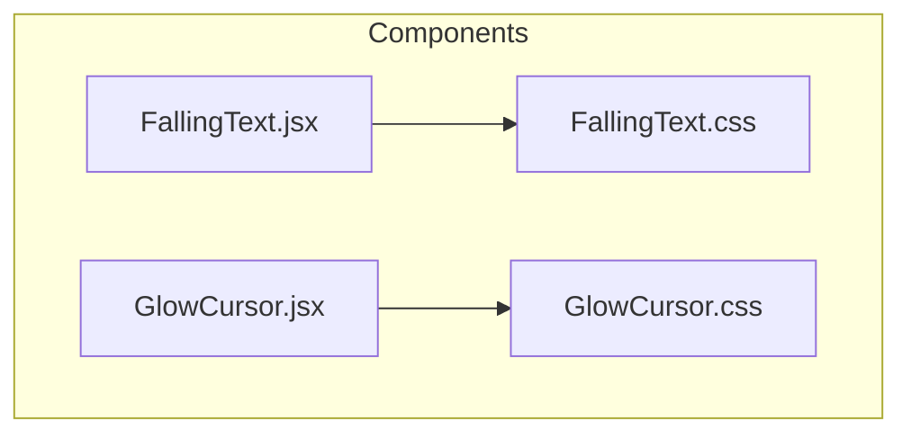
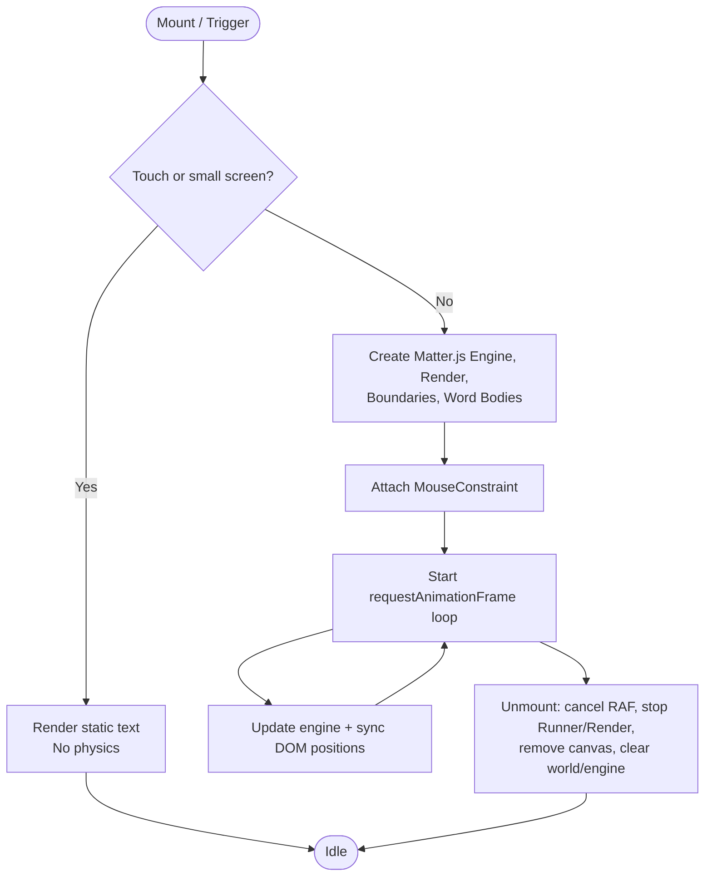
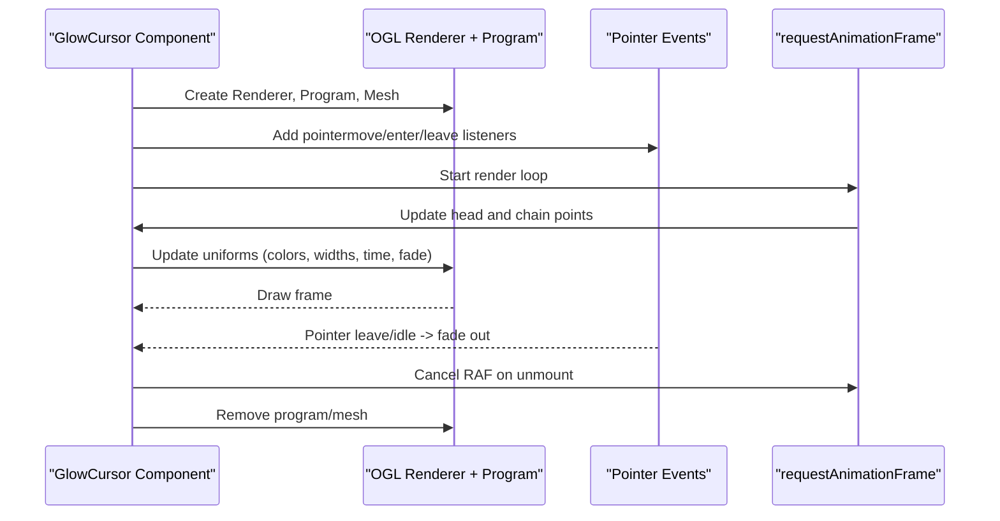
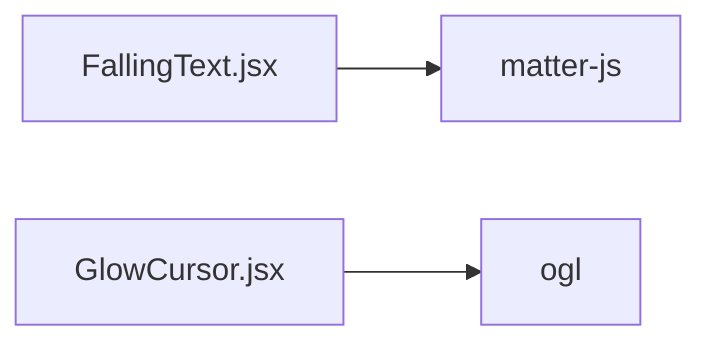

# Visual Effects Components

<cite>
**Referenced Files in This Document**
- [FallingText.jsx](file://src/components/FallingText.jsx)
- [FallingText.css](file://src/components/FallingText.css)
- [GlowCursor.jsx](file://src/components/GlowCursor.jsx)
- [GlowCursor.css](file://src/components/GlowCursor.css)
</cite>

## Table of Contents
1. [Introduction](#introduction)
2. [Project Structure](#project-structure)
3. [Core Components](#core-components)
4. [Architecture Overview](#architecture-overview)
5. [Detailed Component Analysis](#detailed-component-analysis)
6. [Dependency Analysis](#dependency-analysis)
7. [Performance Considerations](#performance-considerations)
8. [Troubleshooting Guide](#troubleshooting-guide)
9. [Conclusion](#conclusion)

## Introduction
This document explains two visual effects components:
- FallingText: a physics-based text animation where each word becomes a rigid body that falls, bounces, and can be dragged with the mouse using Matter.js.
- GlowCursor: an interactive cursor trail effect built with WebGL shaders via OGL, featuring smooth mouse tracking, gradient trails, pulsing, noise, and performance optimizations.

The documentation covers implementation details, configuration options, lifecycle management, requestAnimationFrame usage, memory cleanup, styling customization, cross-browser considerations, and mobile/touch behavior.

## Project Structure
The relevant files for these components are located under src/components:
- FallingText.jsx and FallingText.css implement the physics-based text animation.
- GlowCursor.jsx and GlowCursor.css implement the GPU-accelerated glow cursor trail.



**Diagram sources**
- [FallingText.jsx:1-219](file://src/components/FallingText.jsx#L1-L219)
- [FallingText.css:1-48](file://src/components/FallingText.css#L1-L48)
- [GlowCursor.jsx:1-352](file://src/components/GlowCursor.jsx#L1-L352)
- [GlowCursor.css:1-24](file://src/components/GlowCursor.css#L1-L24)

**Section sources**
- [FallingText.jsx:1-219](file://src/components/FallingText.jsx#L1-L219)
- [FallingText.css:1-48](file://src/components/FallingText.css#L1-L48)
- [GlowCursor.jsx:1-352](file://src/components/GlowCursor.jsx#L1-L352)
- [GlowCursor.css:1-24](file://src/components/GlowCursor.css#L1-L24)

## Core Components
- FallingText
  - Uses Matter.js to create a physics world, boundaries, and per-word bodies.
  - Synchronizes DOM elements with physics bodies each frame.
  - Supports trigger modes (auto, scroll, click, hover), highlight words, and touch/mobile detection.
- GlowCursor
  - Uses OGL to render a full-screen triangle with custom vertex/fragment shaders.
  - Tracks pointer movement, maintains a chain of points, and renders a glowing, tapered trail.
  - Provides extensive uniforms for color, width, taper, pulse, noise, hotspot, brightness, opacity, and blend mode.

**Section sources**
- [FallingText.jsx:5-16](file://src/components/FallingText.jsx#L5-L16)
- [GlowCursor.jsx:127-150](file://src/components/GlowCursor.jsx#L127-L150)

## Architecture Overview
High-level flow for both components:

```mermaid
sequenceDiagram
participant UI as "React Component"
participant Physics as "Matter.js Engine"
participant Render as "Matter.js Render"
participant Loop as "requestAnimationFrame"
participant GL as "OGL Renderer + Shaders"
Note over UI : FallingText initializes physics on mount or trigger
UI->>Physics : Create Engine, World, Bodies
UI->>Render : Create Render with canvas container
UI->>Loop : Start update loop
Loop->>Physics : Update engine state
Loop->>UI : Sync DOM positions from bodies
Note over UI : GlowCursor initializes WebGL on mount
UI->>GL : Create Renderer, Program, Mesh
UI->>Loop : Start render loop
Loop->>GL : Update uniforms and draw
```

**Diagram sources**
- [FallingText.jsx:72-187](file://src/components/FallingText.jsx#L72-L187)
- [GlowCursor.jsx:178-341](file://src/components/GlowCursor.jsx#L178-L341)

## Detailed Component Analysis

### FallingText: Physics-Based Text Animation
Responsibilities:
- Parse input text into word spans and optionally highlight specific words.
- Detect touch/mobile devices and skip physics when necessary.
- Initialize Matter.js engine, renderer, boundaries, and per-word bodies.
- Attach mouse interaction via MouseConstraint.
- Run a frame loop to sync DOM positions with physics bodies.
- Clean up resources on unmount.

Key behaviors:
- Trigger modes: auto, scroll (IntersectionObserver), click, hover.
- Physics parameters: gravity, wireframes, background color, mouse constraint stiffness.
- Mobile handling: disables physics entirely on coarse pointers or narrow screens; strips Matter’s touch listeners to avoid blocking page scroll.

Animation lifecycle:
- Mount or trigger sets effectStarted.
- On effectStarted and not touch device, creates engine, render, bodies, runner, and starts update loop.
- Each frame updates engine and synchronizes DOM element positions and rotation.
- Cleanup cancels animation frame, stops render and runner, removes canvas, clears world and engine.



**Diagram sources**
- [FallingText.jsx:26-35](file://src/components/FallingText.jsx#L26-L35)
- [FallingText.jsx:49-70](file://src/components/FallingText.jsx#L49-L70)
- [FallingText.jsx:72-187](file://src/components/FallingText.jsx#L72-L187)

Configuration options:
- className: additional CSS class for the container.
- text: source string split into words.
- highlightWords: array of prefixes to match and apply highlightClass.
- highlightClass: CSS class applied to highlighted words.
- trigger: 'auto' | 'scroll' | 'click' | 'hover'.
- backgroundColor: physics canvas background.
- wireframes: show physics wireframes.
- gravity: vertical gravity multiplier.
- mouseConstraintStiffness: drag spring stiffness.
- fontSize: base font size for the target text.

Styling:
- Container uses relative positioning and overflow hidden.
- Target text is layered above the physics canvas.
- Words are inline-block; highlighted words get a distinct color and weight.
- On mobile, the target is rendered as normal block text without absolute positioning.

Cross-browser and mobile considerations:
- Touch detection via pointer coarseness and viewport width.
- Strips Matter.js touch event handlers to prevent scroll blocking.
- Disables physics on touch devices to avoid performance issues and unintended interactions.

Memory and performance:
- Cancels requestAnimationFrame on cleanup.
- Stops Matter.js Runner and Render.
- Removes the generated canvas node.
- Clears the world and engine to release internal references.

Usage example:
- Wrap content in FallingText and pass props like text, highlightWords, trigger, and styling options. The component will automatically handle initialization and cleanup.

**Section sources**
- [FallingText.jsx:5-16](file://src/components/FallingText.jsx#L5-L16)
- [FallingText.jsx:26-35](file://src/components/FallingText.jsx#L26-L35)
- [FallingText.jsx:49-70](file://src/components/FallingText.jsx#L49-L70)
- [FallingText.jsx:72-187](file://src/components/FallingText.jsx#L72-L187)
- [FallingText.jsx:189-215](file://src/components/FallingText.jsx#L189-L215)
- [FallingText.css:1-48](file://src/components/FallingText.css#L1-L48)

### GlowCursor: Interactive Cursor Trail with Shaders
Responsibilities:
- Create an OGL Renderer and a full-screen triangle mesh.
- Maintain a chain of points representing the cursor trail.
- Track pointer events and smoothly interpolate head and chain points.
- Update shader uniforms every frame and render the glow trail.
- Manage fade-in/out based on idle time and pointer presence.
- Clean up all resources on unmount.

Key behaviors:
- Smooth follow speed and chain easing for natural motion.
- Gradient trail between primary and secondary colors.
- Configurable width, taper, intensity, spread, hotspot, brightness, opacity, pulse, noise, and blend mode.
- Idle fade-out after a timeout or when pointer leaves the container.

Animation lifecycle:
- On mount, initialize Renderer, Program, Mesh, and point arrays.
- Listen to pointermove/enter/leave and ResizeObserver for sizing.
- In the render loop, update head and chain points, set uniforms, and draw.
- On unmount, cancel RAF, disconnect observers, remove event listeners, and free GPU resources.



**Diagram sources**
- [GlowCursor.jsx:178-341](file://src/components/GlowCursor.jsx#L178-L341)

Configuration options:
- color: primary trail color (hex).
- secondaryColor: secondary trail color (hex).
- trailLength: number of trail segments (capped internally).
- trailWidth: base width of the trail.
- trailTaper: how quickly the trail tapers off.
- followSpeed: responsiveness to pointer movement.
- glowIntensity: overall glow strength.
- glowSpread: softness/spread of the glow.
- hotspot: hot core brightness near the center.
- brightness: luminance boost.
- opacity: global alpha.
- pulseSpeed: pulsing oscillation rate.
- noiseStrength: subtle film grain/noise.
- idleFade: fade out when idle or pointer leaves.
- idleTimeout: ms before fading begins.
- fadeDuration: duration of fade transitions.
- blendMode: 'screen' or 'normal'.
- maxDevicePixelRatio: cap DPR for performance.
- enabled: toggle effect on/off.
- children: optional content overlay.
- className/style: standard DOM attributes.

Styling:
- Canvas is absolutely positioned within the container and does not capture pointer events.
- Content sits above the canvas with z-index.
- Blend mode is applied to the canvas element.

Cross-browser and mobile considerations:
- Uses pointer events for unified mouse/touch handling.
- Caps device pixel ratio to balance quality and performance.
- Mix-blend-mode support varies by browser; fallbacks may be needed if blending appears inconsistent.

Performance tuning guidelines:
- Reduce trailLength and trailWidth on low-end devices.
- Lower maxDevicePixelRatio to reduce GPU load.
- Disable idleFade or increase idleTimeout to reduce frequent fade calculations.
- Use simpler colors and lower pulse/noise values if frame drops occur.

Usage example:
- Wrap any section with GlowCursor and pass desired visual props. The component manages its own canvas and rendering loop.

**Section sources**
- [GlowCursor.jsx:127-150](file://src/components/GlowCursor.jsx#L127-L150)
- [GlowCursor.jsx:178-341](file://src/components/GlowCursor.jsx#L178-L341)
- [GlowCursor.jsx:343-348](file://src/components/GlowCursor.jsx#L343-L348)
- [GlowCursor.css:1-24](file://src/components/GlowCursor.css#L1-L24)

## Dependency Analysis
External dependencies used by these components:
- FallingText depends on Matter.js for physics simulation.
- GlowCursor depends on OGL for WebGL rendering and shader programs.



**Diagram sources**
- [FallingText.jsx:2](file://src/components/FallingText.jsx#L2)
- [GlowCursor.jsx:2](file://src/components/GlowCursor.jsx#L2)

**Section sources**
- [FallingText.jsx:2](file://src/components/FallingText.jsx#L2)
- [GlowCursor.jsx:2](file://src/components/GlowCursor.jsx#L2)

## Performance Considerations
- FallingText
  - Avoid enabling physics on touch devices; the component already skips it.
  - Limit the number of words to reduce body count and per-frame DOM updates.
  - Tune gravity, frictionAir, restitution, and mouseConstraintStiffness for smoother interactions.
  - Ensure container has valid dimensions before initializing to avoid zero-size worlds.
- GlowCursor
  - Cap maxDevicePixelRatio to control GPU workload.
  - Adjust trailLength and trailWidth to balance visual richness and performance.
  - Reduce pulseSpeed and noiseStrength on constrained devices.
  - Use blendMode 'screen' for typical additive glow; switch to 'normal' if compositing artifacts appear.

[No sources needed since this section provides general guidance]

## Troubleshooting Guide
- FallingText
  - Words not moving: verify container has non-zero width/height and that trigger is active.
  - Scroll blocked on mobile: ensure touch detection is working; the component strips Matter’s touch listeners to prevent default behavior.
  - Highlighted words not styled: confirm highlightWords prefixes match the beginning of words and highlightClass is applied.
  - Memory leaks: check that cleanup runs on unmount (RAF canceled, Runner/Render stopped, canvas removed, world/engine cleared).
- GlowCursor
  - Trail not visible: ensure container has dimensions and pointer events are firing; verify blendMode and opacity settings.
  - Jittery motion: adjust followSpeed and chainEase; consider increasing trailLength slightly for smoother interpolation.
  - High CPU/GPU usage: reduce trailLength, trailWidth, and maxDevicePixelRatio; disable idleFade or tune fadeDuration.
  - Shader errors: confirm OGL is available and the canvas context is supported in the environment.

**Section sources**
- [FallingText.jsx:72-187](file://src/components/FallingText.jsx#L72-L187)
- [GlowCursor.jsx:178-341](file://src/components/GlowCursor.jsx#L178-L341)

## Conclusion
FallingText and GlowCursor provide complementary visual effects:
- FallingText leverages Matter.js to turn text into interactive, physics-driven objects with robust lifecycle management and mobile-safe behavior.
- GlowCursor uses OGL shaders to deliver a high-performance, customizable cursor trail with smooth motion, gradient coloring, and thoughtful performance controls.

By tuning their configuration options and following the provided guidelines, you can achieve polished animations across desktop and mobile environments while maintaining good performance and memory hygiene.