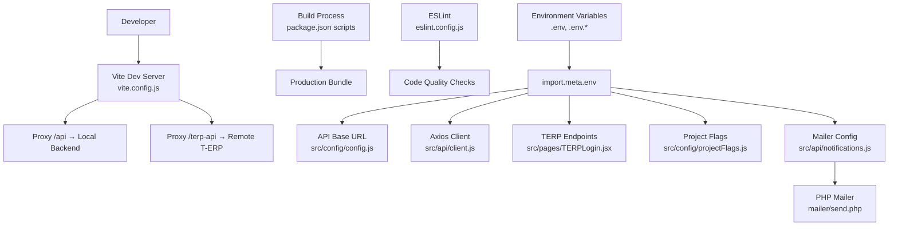
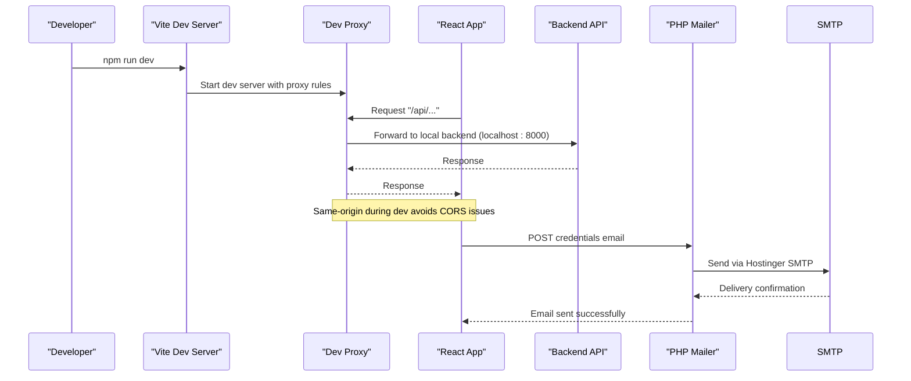
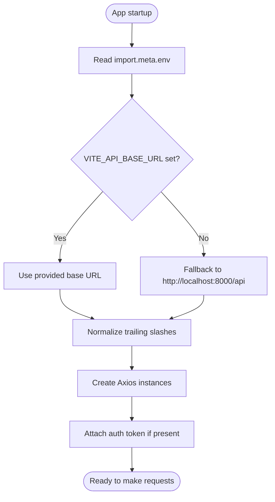
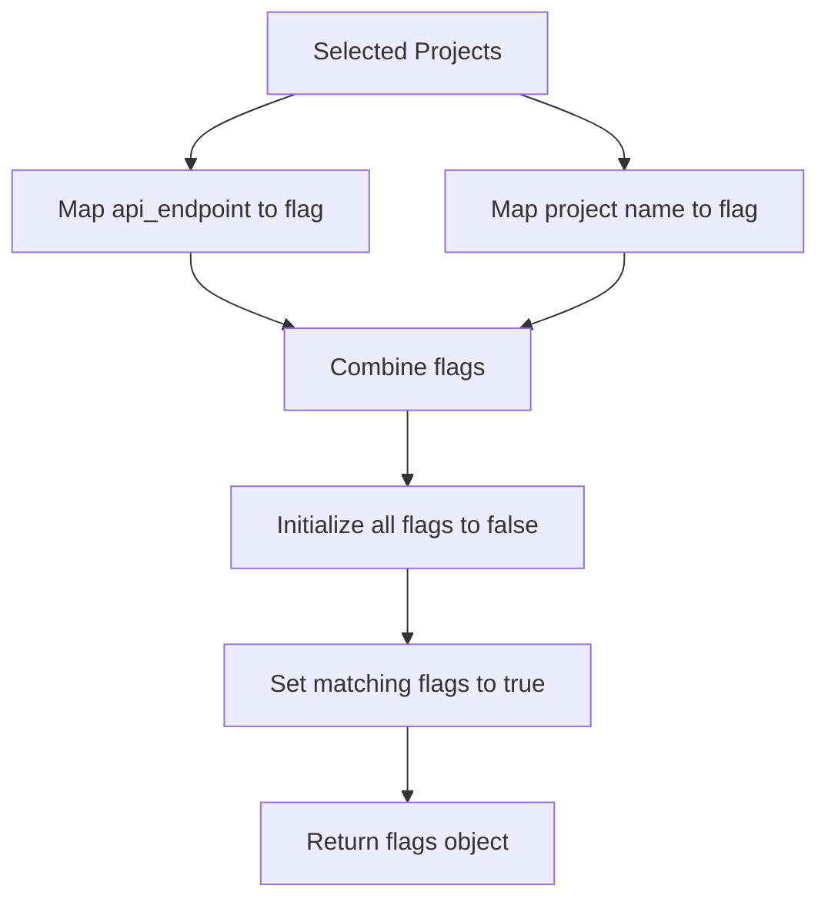
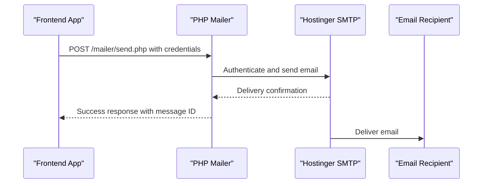
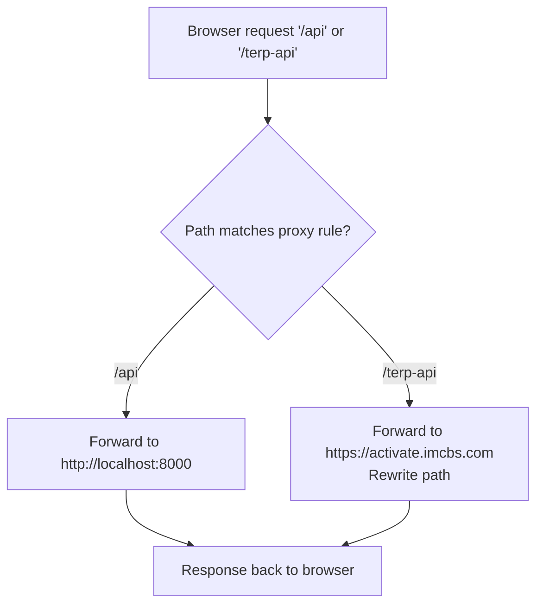
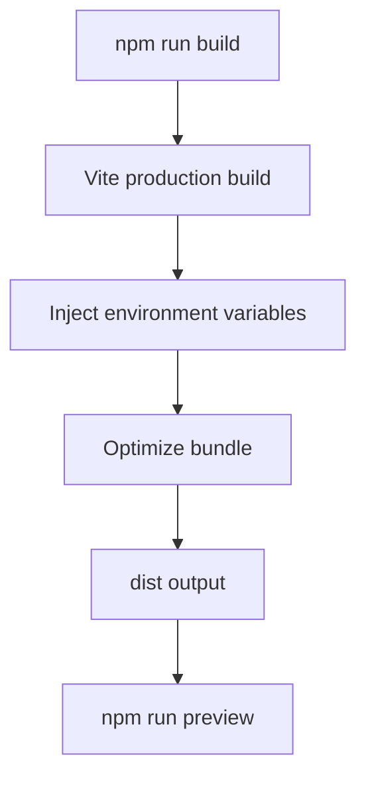
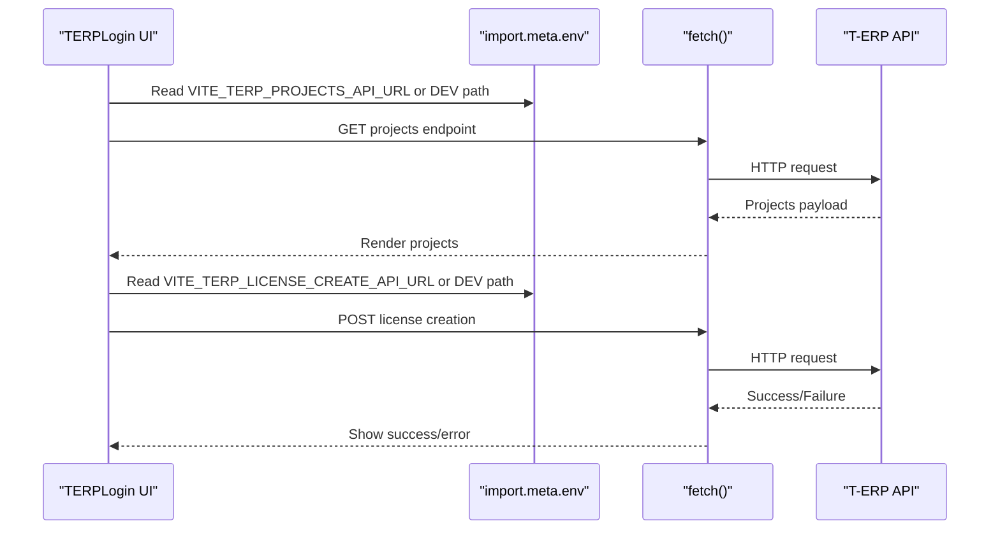
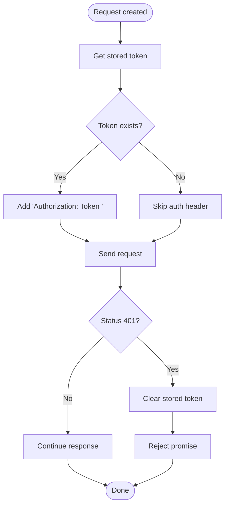
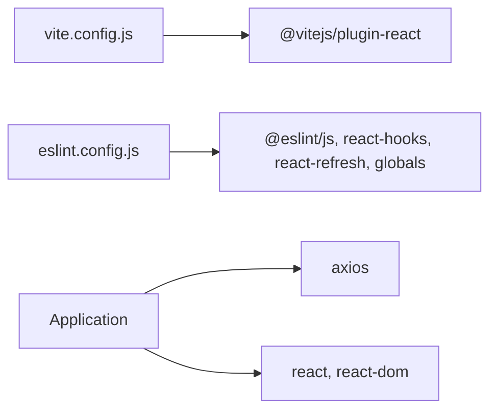

# Configuration and Environment

<cite>
**Referenced Files in This Document**
- [vite.config.js](file://vite.config.js)
- [eslint.config.js](file://eslint.config.js)
- [package.json](file://package.json)
- [src/config/config.js](file://src/config/config.js)
- [src/config/projectFlags.js](file://src/config/projectFlags.js)
- [src/api/client.js](file://src/api/client.js)
- [src/api/notifications.js](file://src/api/notifications.js)
- [mailer/send.php](file://mailer/send.php)
- [src/pages/TERPLogin.jsx](file://src/pages/TERPLogin.jsx)
- [.gitignore](file://.gitignore)
</cite>

## Update Summary
**Changes Made**
- Added documentation for project flags configuration system mapping T-ERP projects to product flags
- Added documentation for backend mailer integration via PHP script for SMTP relay functionality
- Updated environment variable configuration to include mailer-related variables
- Enhanced API client documentation with new authentication flows

## Table of Contents
1. [Introduction](#introduction)
2. [Project Structure](#project-structure)
3. [Core Components](#core-components)
4. [Architecture Overview](#architecture-overview)
5. [Detailed Component Analysis](#detailed-component-analysis)
6. [Dependency Analysis](#dependency-analysis)
7. [Performance Considerations](#performance-considerations)
8. [Troubleshooting Guide](#troubleshooting-guide)
9. [Conclusion](#conclusion)

## Introduction
This document explains how the application is configured and how to set up environments for development, staging, and production. It covers:
- Vite configuration and environment variables
- Development server setup and API proxying
- Production build behavior and optimizations
- ESLint configuration for code quality
- Project flags configuration for T-ERP product mapping
- Backend mailer integration for SMTP relay functionality
- Environment-specific settings and API endpoints
- Deployment considerations and common troubleshooting steps

The project uses Vite with React, Axios-based API clients, and a flat ESLint configuration. Environment variables are injected at build time via Vite's import.meta.env system.

## Project Structure
Configuration-related files are centralized:
- Build tooling: vite.config.js, package.json scripts
- Linting: eslint.config.js
- Runtime configuration: src/config/config.js
- Project flags mapping: src/config/projectFlags.js
- API client configuration: src/api/client.js
- Mailer integration: mailer/send.php, src/api/notifications.js
- Feature-specific environment usage: src/pages/TERPLogin.jsx
- Environment file handling: .gitignore



**Diagram sources**
- [vite.config.js:5-23](file://vite.config.js#L5-L23)
- [package.json:6-10](file://package.json#L6-L10)
- [eslint.config.js:7-21](file://eslint.config.js#L7-L21)
- [src/config/config.js:1-3](file://src/config/config.js#L1-L3)
- [src/config/projectFlags.js:1-53](file://src/config/projectFlags.js#L1-L53)
- [src/api/client.js:8-19](file://src/api/client.js#L8-L19)
- [src/api/notifications.js:22-26](file://src/api/notifications.js#L22-L26)
- [mailer/send.php:1-257](file://mailer/send.php#L1-L257)
- [src/pages/TERPLogin.jsx:7-12](file://src/pages/TERPLogin.jsx#L7-L12)

**Section sources**
- [vite.config.js:1-24](file://vite.config.js#L1-L24)
- [eslint.config.js:1-22](file://eslint.config.js#L1-L22)
- [package.json:1-33](file://package.json#L1-L33)

## Core Components
- Vite configuration defines plugins, dev server, and API proxies.
- ESLint configuration sets recommended rules for JS/JSX and React hooks.
- Environment variables are consumed via import.meta.env across the app.
- API client centralizes base URLs, token handling, and interceptors.
- Project flags configuration maps T-ERP projects to product flags.
- Mailer integration provides SMTP relay functionality via PHP script.
- TERP login page uses environment variables for Google Sign-In and remote endpoints.

Key responsibilities:
- vite.config.js: Dev server and proxy rules
- eslint.config.js: Linting rules and globals
- src/config/config.js: Centralized API base URL
- src/config/projectFlags.js: T-ERP project to product flag mapping
- src/api/client.js: Authenticated and public Axios instances
- src/api/notifications.js: Email delivery orchestration
- mailer/send.php: PHP SMTP relay implementation
- src/pages/TERPLogin.jsx: Environment-driven endpoints and Google client ID

**Section sources**
- [vite.config.js:5-23](file://vite.config.js#L5-L23)
- [eslint.config.js:7-21](file://eslint.config.js#L7-L21)
- [src/config/config.js:1-3](file://src/config/config.js#L1-L3)
- [src/config/projectFlags.js:1-53](file://src/config/projectFlags.js#L1-L53)
- [src/api/client.js:8-19](file://src/api/client.js#L8-L19)
- [src/api/notifications.js:1-415](file://src/api/notifications.js#L1-L415)
- [mailer/send.php:1-257](file://mailer/send.php#L1-L257)
- [src/pages/TERPLogin.jsx:7-12](file://src/pages/TERPLogin.jsx#L7-L12)

## Architecture Overview
The runtime configuration flow relies on Vite injecting environment variables into the bundle. The API layer reads these variables to determine endpoints and authentication behavior. The project flags system maps selected T-ERP projects to product flags for user-master API calls, while the mailer integration provides secure email delivery through an SMTP relay.



**Diagram sources**
- [vite.config.js:7-21](file://vite.config.js#L7-L21)
- [src/api/notifications.js:363-399](file://src/api/notifications.js#L363-L399)
- [mailer/send.php:204-243](file://mailer/send.php#L204-L243)

## Detailed Component Analysis

### Vite Configuration and Environment Variables
- Plugins: React plugin is enabled.
- Dev server:
  - Proxies /api to a local backend (default localhost:8000).
  - Proxies /terp-api to a remote T-ERP endpoint with secure HTTPS and path rewriting.
- Environment variables:
  - VITE_API_URL used by src/config/config.js.
  - VITE_API_BASE_URL used by src/api/client.js.
  - VITE_TERP_PROJECTS_API_URL and VITE_TERP_LICENSE_CREATE_API_URL used by src/pages/TERPLogin.jsx.
  - VITE_GOOGLE_CLIENT_ID used by src/pages/TERPLogin.jsx.
  - VITE_MAIL_API_URL and VITE_MAIL_API_TOKEN used by src/api/notifications.js for mailer integration.



**Diagram sources**
- [src/api/client.js:8-19](file://src/api/client.js#L8-L19)
- [src/api/client.js:47-52](file://src/api/client.js#L47-L52)
- [src/api/client.js:58-64](file://src/api/client.js#L58-L64)

Operational notes:
- In production builds, missing VITE_API_BASE_URL throws an error to prevent accidental calls to localhost.
- During development, the fallback ensures the app works out-of-the-box with a local backend.

**Section sources**
- [vite.config.js:5-23](file://vite.config.js#L5-L23)
- [src/config/config.js:1-3](file://src/config/config.js#L1-L3)
- [src/api/client.js:8-19](file://src/api/client.js#L8-L19)
- [src/pages/TERPLogin.jsx:7-12](file://src/pages/TERPLogin.jsx#L7-L12)
- [src/pages/TERPLogin.jsx:118-120](file://src/pages/TERPLogin.jsx#L118-L120)

### Project Flags Configuration System
The project flags system maps T-ERP projects to product flags expected by the Central Master's user-master API. This enables automatic feature activation based on purchased projects.



**Diagram sources**
- [src/config/projectFlags.js:41-52](file://src/config/projectFlags.js#L41-L52)

Key components:
- USER_MASTER_FLAGS: Array of all supported product flags
- PROJECT_FLAG_BY_ENDPOINT: Mapping from API endpoints to flags
- PROJECT_FLAG_BY_NAME: Fallback mapping from project names to flags
- flagsForProjects(): Function that generates flags object from selected projects

**Section sources**
- [src/config/projectFlags.js:1-53](file://src/config/projectFlags.js#L1-L53)

### Backend Mailer Integration
The mailer integration provides secure email delivery through a PHP script that handles SMTP communication with Hostinger's mail service.



**Diagram sources**
- [src/api/notifications.js:363-399](file://src/api/notifications.js#L363-L399)
- [mailer/send.php:204-243](file://mailer/send.php#L204-L243)

Key features:
- Authentication via bearer token or X-Mail-Token header
- CORS support for frontend integration
- Secure SMTP connection with SSL verification
- Input validation and sanitization
- Error handling and status reporting

**Section sources**
- [src/api/notifications.js:22-26](file://src/api/notifications.js#L22-L26)
- [src/api/notifications.js:363-399](file://src/api/notifications.js#L363-L399)
- [mailer/send.php:1-257](file://mailer/send.php#L1-L257)

### Development Server Setup and Proxy Configuration
- /api proxy:
  - Target: http://localhost:8000
  - changeOrigin: true
- /terp-api proxy:
  - Target: https://activate.imcbs.com
  - changeOrigin: true, secure: true
  - Rewrites paths by removing the /terp-api prefix before forwarding



**Diagram sources**
- [vite.config.js:7-21](file://vite.config.js#L7-L21)

**Section sources**
- [vite.config.js:7-21](file://vite.config.js#L7-L21)

### Production Build Optimizations
- Scripts:
  - build: vite build
  - preview: vite preview
- Behavior:
  - Vite performs standard production optimizations (minification, tree-shaking, etc.).
  - Environment variables are baked into the bundle at build time.
  - Missing required environment variables can cause build-time errors (e.g., VITE_API_BASE_URL in production).



**Diagram sources**
- [package.json:6-10](file://package.json#L6-L10)
- [src/api/client.js:10-16](file://src/api/client.js#L10-L16)

**Section sources**
- [package.json:6-10](file://package.json#L6-L10)
- [src/api/client.js:10-16](file://src/api/client.js#L10-L16)

### ESLint Configuration for Code Quality
- Extends:
  - @eslint/js recommended rules
  - eslint-plugin-react-hooks recommended rules
  - eslint-plugin-react-refresh Vite integration
- Globals:
  - Browser globals enabled
- Parser options:
  - JSX enabled
- Ignores:
  - dist directory

```mermaid
classDiagram
class ESLintConfig {
+files : "**/*.{js,jsx}"
+extends : ["js.recommended", "react-hooks.recommended", "react-refresh.vite"]
+languageOptions.globals : "browser"
+parserOptions.ecmaFeatures.jsx : true
+globalIgnores : ["dist"]
}
```

**Diagram sources**
- [eslint.config.js:7-21](file://eslint.config.js#L7-L21)

**Section sources**
- [eslint.config.js:1-22](file://eslint.config.js#L1-L22)

### Environment-Specific Settings and API Endpoints
- Centralized API base URL:
  - Uses VITE_API_URL with a default fallback.
- Axios client:
  - Reads VITE_API_BASE_URL; enforces its presence in production.
  - Normalizes base URL and attaches Authorization headers using Token scheme.
  - Clears tokens on 401 responses.
- TERP Login:
  - Uses different endpoints depending on environment:
    - Development: proxied /terp-api paths
    - Production: absolute URLs from VITE_TERP_PROJECTS_API_URL and VITE_TERP_LICENSE_CREATE_API_URL
  - Requires VITE_GOOGLE_CLIENT_ID for Google Sign-In.
- Mailer integration:
  - Uses VITE_MAIL_API_URL for PHP mailer endpoint
  - Requires VITE_MAIL_API_TOKEN for authentication
  - Supports multiple email delivery methods (EmailJS, Gmail API, direct SMTP)



**Diagram sources**
- [src/pages/TERPLogin.jsx:7-12](file://src/pages/TERPLogin.jsx#L7-L12)
- [src/pages/TERPLogin.jsx:94-112](file://src/pages/TERPLogin.jsx#L94-L112)
- [src/pages/TERPLogin.jsx:161-189](file://src/pages/TERPLogin.jsx#L161-L189)

**Section sources**
- [src/config/config.js:1-3](file://src/config/config.js#L1-L3)
- [src/api/client.js:8-19](file://src/api/client.js#L8-L19)
- [src/api/client.js:47-75](file://src/api/client.js#L47-L75)
- [src/pages/TERPLogin.jsx:7-12](file://src/pages/TERPLogin.jsx#L7-L12)
- [src/pages/TERPLogin.jsx:118-120](file://src/pages/TERPLogin.jsx#L118-L120)

### API Client Authentication Flow
- Token storage:
  - Supports localStorage and sessionStorage based on "remember" flag.
- Interceptors:
  - Adds Authorization header with Token scheme when token exists.
  - Clears token on 401 responses.



**Diagram sources**
- [src/api/client.js:26-42](file://src/api/client.js#L26-L42)
- [src/api/client.js:58-75](file://src/api/client.js#L58-L75)

**Section sources**
- [src/api/client.js:26-42](file://src/api/client.js#L26-L42)
- [src/api/client.js:58-75](file://src/api/client.js#L58-L75)

## Dependency Analysis
- Vite depends on @vitejs/plugin-react for React support.
- ESLint depends on js, react-hooks, react-refresh, and globals packages.
- Application dependencies include axios for HTTP requests and React ecosystem packages.



**Diagram sources**
- [vite.config.js:1-2](file://vite.config.js#L1-L2)
- [eslint.config.js:1-5](file://eslint.config.js#L1-L5)
- [package.json:12-30](file://package.json#L12-L30)

**Section sources**
- [package.json:12-30](file://package.json#L12-L30)
- [vite.config.js:1-2](file://vite.config.js#L1-L2)
- [eslint.config.js:1-5](file://eslint.config.js#L1-L5)

## Performance Considerations
- Development:
  - Use the dev server with hot module replacement (HMR) via Vite.
  - Keep proxy rules minimal and targeted to reduce overhead.
- Production:
  - Ensure all required environment variables are set to avoid runtime failures.
  - Leverage Vite's default production optimizations (minification, tree-shaking).
  - Avoid unnecessary large assets; consider lazy loading routes where applicable.
- API layer:
  - Reuse Axios instances to minimize overhead.
  - Handle 401 responses gracefully to clear stale tokens.
- Mailer integration:
  - Use the PHP mailer relay instead of direct SMTP connections from the browser.
  - Implement proper error handling for mail delivery failures.
- Project flags:
  - Cache project flag mappings to avoid repeated calculations.
  - Use efficient flag comparison algorithms for large project lists.

[No sources needed since this section provides general guidance]

## Troubleshooting Guide
Common environment-related issues and resolutions:

- API calls fail in development:
  - Verify that the local backend is running on the expected port.
  - Confirm that /api proxy target matches your backend host and port.
  - Ensure CORS is allowed on the backend for the dev origin.

- Remote T-ERP endpoints not reachable:
  - Check network connectivity to https://activate.imcbs.com.
  - Validate that /terp-api rewrite logic matches the backend path expectations.

- Production build fails due to missing environment variables:
  - Set VITE_API_BASE_URL in your production environment file.
  - Rebuild after updating environment variables.

- Google Sign-In does not load:
  - Ensure VITE_GOOGLE_CLIENT_ID is set in the appropriate environment file.
  - Verify that the Google Identity Services script loads successfully.

- Token authentication returns 401 repeatedly:
  - Confirm that the Authorization header uses the Token scheme (not Bearer).
  - Check that the backend expects the same token format and key name.

- Environment files not loaded:
  - Confirm that environment files (.env, .env.development, .env.production) exist and are named correctly.
  - Remember that Vite injects variables at build time; changes require rebuilding for production.

- Project flags not working correctly:
  - Verify that selected projects have valid api_endpoint or project name fields.
  - Check that the project flag mappings in projectFlags.js match your T-ERP project structure.
  - Ensure the user-master API accepts the generated flag combinations.

- Mail delivery fails:
  - Verify that VITE_MAIL_API_URL points to the correct mailer endpoint.
  - Check that VITE_MAIL_API_TOKEN matches the token configured in mailer/send.php.
  - Ensure the PHP mailer script is accessible and has proper file permissions.
  - Validate that the Hostinger SMTP credentials in mailer/send.php are correct.
  - Check CORS configuration if the mailer is hosted on a different domain.

**Section sources**
- [vite.config.js:7-21](file://vite.config.js#L7-L21)
- [src/api/client.js:10-19](file://src/api/client.js#L10-L19)
- [src/pages/TERPLogin.jsx:118-120](file://src/pages/TERPLogin.jsx#L118-L120)
- [.gitignore:9-13](file://.gitignore#L9-L13)
- [src/config/projectFlags.js:41-52](file://src/config/projectFlags.js#L41-L52)
- [src/api/notifications.js:363-399](file://src/api/notifications.js#L363-L399)
- [mailer/send.php:28-37](file://mailer/send.php#L28-L37)

## Conclusion
This application uses Vite's environment variable injection to configure API endpoints and third-party integrations across environments. The dev server proxies API calls to simplify local development, while production builds enforce required environment variables to ensure correct deployment. ESLint provides consistent code quality checks. The project flags system enables automatic feature activation based on purchased T-ERP projects, and the mailer integration provides secure email delivery through an SMTP relay. By following the environment setup guidelines and troubleshooting steps, you can reliably configure development, staging, and production environments and maintain a smooth developer experience.

[No sources needed since this section summarizes without analyzing specific files]