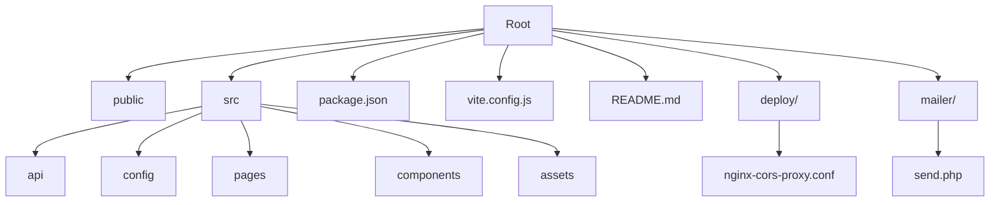
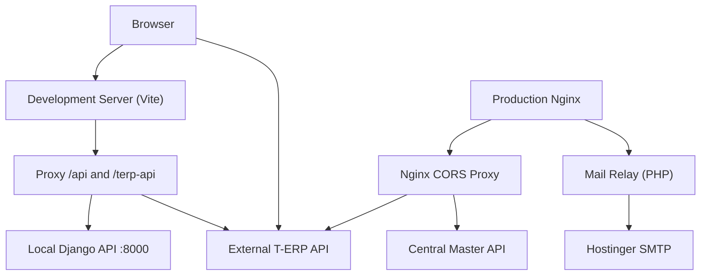
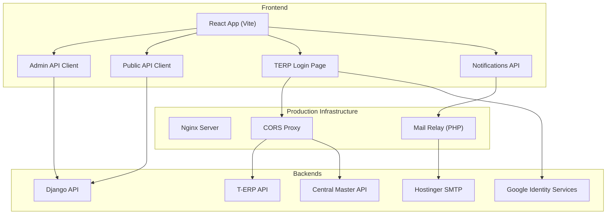
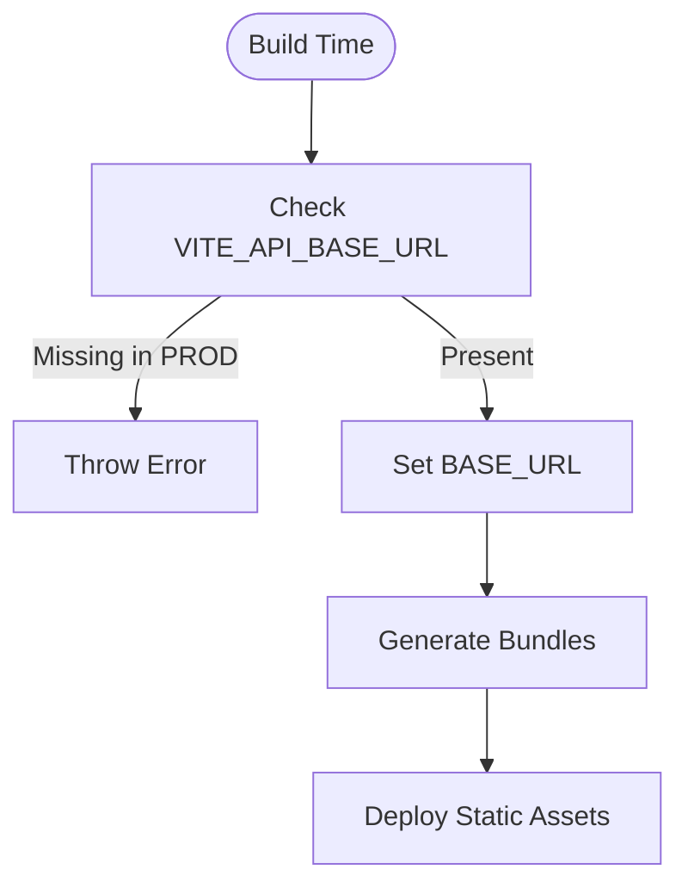
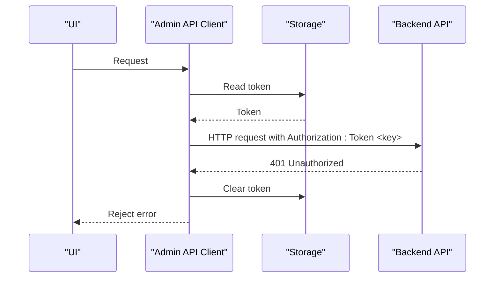
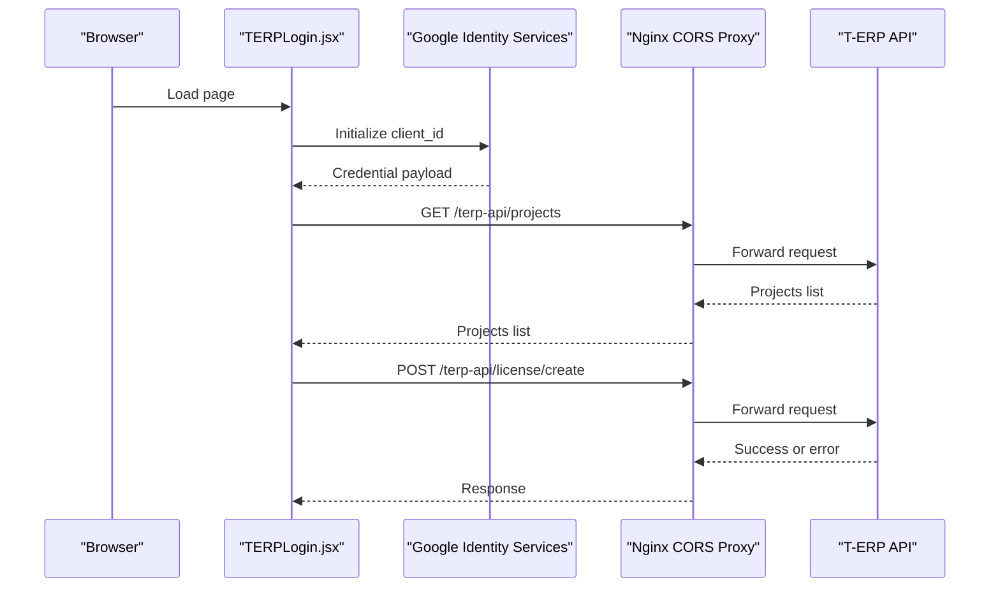
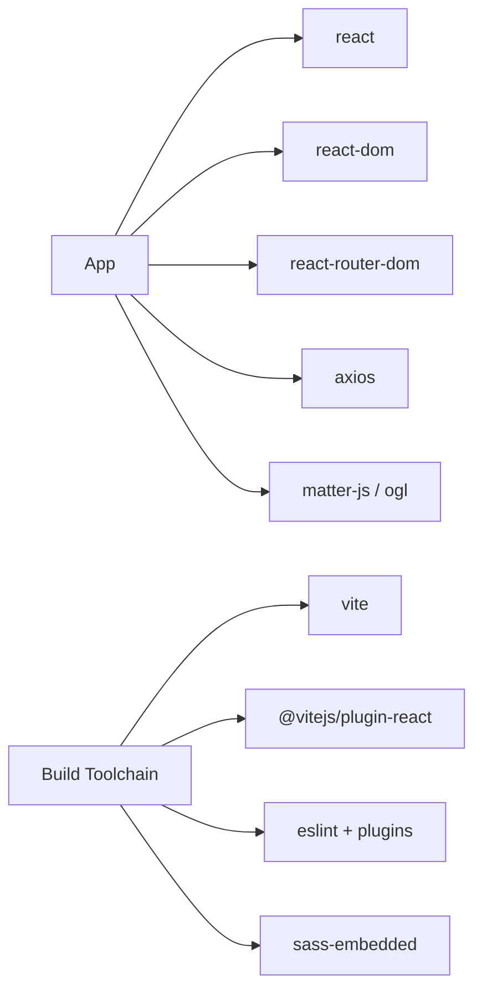

# Deployment Guide

<cite>
**Referenced Files in This Document**
- [package.json](file://package.json)
- [vite.config.js](file://vite.config.js)
- [README.md](file://README.md)
- [src/config/config.js](file://src/config/config.js)
- [src/api/client.js](file://src/api/client.js)
- [src/api/api.js](file://src/api/api.js)
- [src/pages/TERPLogin.jsx](file://src/pages/TERPLogin.jsx)
- [deploy/nginx-cors-proxy.conf](file://deploy/nginx-cors-proxy.conf)
- [src/api/proxy.js](file://src/api/proxy.js)
- [src/api/terpLicense.js](file://src/api/terpLicense.js)
- [src/api/userMaster.js](file://src/api/userMaster.js)
- [mailer/send.php](file://mailer/send.php)
- [src/api/notifications.js](file://src/api/notifications.js)
</cite>

## Update Summary
**Changes Made**
- Enhanced Nginx CORS proxy configuration documentation with detailed mail relay setup instructions
- Added comprehensive mail relay configuration section for PHP-based email delivery
- Updated troubleshooting guide with clearer error scenarios for mail relay issues
- Expanded nginx deployment instructions to include mail relay server block configuration
- Added detailed security considerations for mail relay token management

## Table of Contents
1. [Introduction](#introduction)
2. [Project Structure](#project-structure)
3. [Core Components](#core-components)
4. [Architecture Overview](#architecture-overview)
5. [Detailed Component Analysis](#detailed-component-analysis)
6. [Dependency Analysis](#dependency-analysis)
7. [Performance Considerations](#performance-considerations)
8. [Troubleshooting Guide](#troubleshooting-guide)
9. [Conclusion](#conclusion)
10. [Appendices](#appendices)

## Introduction
This guide documents how to build, optimize, deploy, and operate the TRELLISCO_ERP_FRONTEND application. The project is a React application built with Vite. It uses environment variables for API configuration, supports development proxying, and exposes production build artifacts suitable for static hosting, CDN delivery, or containerized deployment.

**Updated** Enhanced with comprehensive Nginx CORS proxy configuration and mail relay setup for production deployment of T-ERP Login feature and credentials email delivery.

Key goals covered:
- Build process using Vite for production optimization
- Code splitting and asset optimization
- Bundle analysis guidance
- Deployment strategies for static sites, CDNs, and containers
- Environment variable configuration and API endpoint setup
- **Enhanced**: Nginx CORS proxy configuration for production
- **New**: Mail relay setup for credentials email delivery
- Security considerations
- Monitoring, logging, performance monitoring, and maintenance
- CI/CD integration, automated testing, and rollback strategies
- Step-by-step deployment instructions for common platforms
- Troubleshooting deployment issues

## Project Structure
The repository follows a standard Vite + React layout:
- Public assets under public
- Source code under src
  - api: HTTP clients and API helpers
  - config: runtime configuration constants
  - pages: feature pages including admin and login flows
  - components: reusable UI components
  - assets: static media
- Root configuration files: package.json, vite.config.js, README.md
- Production deployment configurations under deploy/
- **New**: Mail relay implementation under mailer/



**Section sources**
- [package.json:1-34](file://package.json#L1-L34)
- [vite.config.js:1-36](file://vite.config.js#L1-L36)
- [README.md:1-17](file://README.md#L1-L17)
- [deploy/nginx-cors-proxy.conf:1-79](file://deploy/nginx-cors-proxy.conf#L1-L79)
- [mailer/send.php:1-257](file://mailer/send.php#L1-L257)

## Core Components
This section focuses on the build system, configuration, and API client layers that directly affect deployment.

- Build toolchain: Vite with React plugin
- Development server proxy for local API calls
- Environment-driven API base URLs
- Axios-based HTTP clients with token handling
- **Enhanced**: Production CORS proxy configuration for external APIs
- **New**: Mail relay system for credentials email delivery



**Diagram sources**
- [vite.config.js:7-33](file://vite.config.js#L7-L33)
- [deploy/nginx-cors-proxy.conf:26-52](file://deploy/nginx-cors-proxy.conf#L26-L52)
- [mailer/send.php:20-26](file://mailer/send.php#L20-L26)

**Section sources**
- [package.json:6-12](file://package.json#L6-L12)
- [vite.config.js:1-36](file://vite.config.js#L1-L36)

## Architecture Overview
At runtime, the frontend consumes multiple APIs:
- Internal backend API via a configured base URL
- T-ERP endpoints for projects and license creation
- Central Master API for user management
- Google Identity Services for sign-in
- **New**: Mail relay for credentials email delivery

**Updated** Production architecture now includes nginx CORS proxy for external API access and mail relay for email delivery.



**Diagram sources**
- [src/api/client.js:1-88](file://src/api/client.js#L1-L88)
- [src/api/api.js:1-39](file://src/api/api.js#L1-L39)
- [src/pages/TERPLogin.jsx:1-636](file://src/pages/TERPLogin.jsx#L1-L636)
- [deploy/nginx-cors-proxy.conf:26-52](file://deploy/nginx-cors-proxy.conf#L26-L52)
- [mailer/send.php:204-243](file://mailer/send.php#L204-L243)
- [src/api/notifications.js:357-403](file://src/api/notifications.js#L357-L403)

## Detailed Component Analysis

### Build Process and Production Optimization
- Scripts:
  - Development: runs Vite dev server with hot module replacement
  - Build: produces optimized static assets for production
  - Preview: serves the production build locally
  - **New**: Mailer: starts PHP development server for mail relay testing
- Plugins:
  - React plugin enables JSX support and optimizations
- Output:
  - Vite generates hashed, minified bundles and assets suitable for static hosting

Operational notes:
- Use npm run build to generate production assets
- Use npm run preview to validate the production build locally before deploying
- Use npm run mailer to start local mail relay server for development

**Section sources**
- [package.json:6-12](file://package.json#L6-L12)
- [package.json:20-31](file://package.json#L20-L31)
- [README.md:1-17](file://README.md#L1-L17)

### Environment Variables and API Configuration
Environment variables are used to configure API endpoints at build time:
- VITE_API_BASE_URL: Base URL for the internal API (must include /api path)
- VITE_API_URL: Alternative base URL used by some modules
- VITE_TERP_PROJECTS_API_URL: T-ERP projects endpoint in production
- VITE_TERP_LICENSE_CREATE_API_URL: T-ERP license creation endpoint in production
- VITE_GOOGLE_CLIENT_ID: Google Identity Services client ID
- **New**: VITE_MAIL_API_URL: Mail relay endpoint URL
- **New**: VITE_MAIL_API_TOKEN: Mail relay authentication token
- **New**: VITE_MAIL_FROM: Sender email address
- **New**: VITE_MAIL_FROM_NAME: Sender display name
- **New**: VITE_MAIL_CC: CC email address for notifications

Behavior:
- In development, the Vite dev server proxies /api and /terp-api to local and external backends
- In production builds, missing required variables can cause explicit errors to prevent misconfiguration
- **New**: Mail relay configuration allows flexible email delivery through multiple transport methods



**Diagram sources**
- [src/api/client.js:4-19](file://src/api/client.js#L4-L19)

**Section sources**
- [src/config/config.js:1-3](file://src/config/config.js#L1-L3)
- [src/api/client.js:1-88](file://src/api/client.js#L1-L88)
- [src/pages/TERPLogin.jsx:7-12](file://src/pages/TERPLogin.jsx#L7-L12)
- [src/pages/TERPLogin.jsx:118-120](file://src/pages/TERPLogin.jsx#L118-L120)
- [src/api/notifications.js:17-38](file://src/api/notifications.js#L17-L38)

### API Clients and Authentication Flow
Two primary HTTP clients are provided:
- Admin client: attaches authentication tokens and handles 401 responses
- Public client: no authentication headers; ensures public content visibility regardless of admin session

Token handling:
- Tokens are stored in localStorage or sessionStorage
- Authorization header uses the Token scheme expected by the backend
- On 401, tokens are cleared automatically



**Diagram sources**
- [src/api/client.js:21-75](file://src/api/client.js#L21-L75)

**Section sources**
- [src/api/client.js:1-88](file://src/api/client.js#L1-L88)
- [src/api/api.js:1-39](file://src/api/api.js#L1-L39)

### T-ERP Login and License Creation Flow
The login page integrates Google Sign-In and communicates with T-ERP endpoints:
- Loads Google script dynamically
- Uses environment variables for endpoints and client ID
- Normalizes project payloads from various response shapes
- Submits company details and selected projects to create a license

**Updated** Production deployment requires nginx CORS proxy configuration for external API access.



**Diagram sources**
- [src/pages/TERPLogin.jsx:35-57](file://src/pages/TERPLogin.jsx#L35-L57)
- [src/pages/TERPLogin.jsx:94-112](file://src/pages/TERPLogin.jsx#L94-L112)
- [src/pages/TERPLogin.jsx:161-190](file://src/pages/TERPLogin.jsx#L161-L190)
- [deploy/nginx-cors-proxy.conf:26-39](file://deploy/nginx-cors-proxy.conf#L26-L39)

**Section sources**
- [src/pages/TERPLogin.jsx:1-636](file://src/pages/TERPLogin.jsx#L1-L636)

### Production CORS Proxy Configuration
**Enhanced Section**

For production deployment, nginx must be configured as a CORS proxy to handle requests to external APIs that don't send proper CORS headers. The T-ERP and Central Master APIs require this proxy setup because they don't respond with Access-Control-* headers.

#### Nginx Configuration Requirements

The nginx CORS proxy configuration is provided in `deploy/nginx-cors-proxy.conf` and handles two main proxy locations:

1. **T-ERP API Proxy** (`/terp-api/`):
   - Proxies to `https://activate.imcbs.com`
   - Handles project listing and license creation
   - Rewrites `/terp-api/` prefix to match upstream paths

2. **Central Master API Proxy** (`/central-api/`):
   - Proxies to `https://centralmastermanagement.imcbs.com`
   - Handles user management and financial year operations
   - Rewrites `/central-api/` prefix to match upstream paths

#### Installation Steps

1. Copy the nginx configuration file to your nginx server:
   ```bash
   sudo cp deploy/nginx-cors-proxy.conf /etc/nginx/conf.d/cors-proxy.conf
   ```

2. Test the nginx configuration:
   ```bash
   sudo nginx -t
   ```

3. Reload nginx to apply changes:
   ```bash
   sudo systemctl reload nginx
   ```

#### Configuration Details

The proxy configuration includes:
- SSL termination with proper hostname verification
- Request forwarding headers (X-Real-IP, X-Forwarded-For, X-Forwarded-Proto)
- Connection timeouts (15s connect, 60s read)
- Cloudflare compatibility notes for DNS resolution

**Section sources**
- [deploy/nginx-cors-proxy.conf:1-79](file://deploy/nginx-cors-proxy.conf#L1-L79)
- [src/api/proxy.js:1-56](file://src/api/proxy.js#L1-L56)

### Mail Relay Configuration
**New Section**

The application includes a PHP-based mail relay system for sending credentials emails through Hostinger's SMTP service. This system provides secure email delivery without exposing SMTP credentials in the browser.

#### Mail Relay Architecture

The mail relay system consists of:
- PHP script (`mailer/send.php`) that handles SMTP communication
- Nginx configuration to serve the PHP file securely
- Frontend integration through the notifications API
- Multiple transport fallback mechanisms (relay → EmailJS → Gmail API)

#### Installation Steps

1. Install PHP-FPM:
   ```bash
   sudo apt install -y php8.3-fpm
   ```

2. Configure nginx to serve the mail relay:
   ```nginx
   location = /mailer/send.php {
       root           /var/www/TRELLISCO_ERP_FRONTEND;
       include        snippets/fastcgi-php.conf;
       fastcgi_pass   unix:/run/php/php8.3-fpm.sock;
   }

   # Block direct access to mailer directory
   location /mailer/ {
       return 403;
   }
   ```

3. Test and reload nginx:
   ```bash
   sudo nginx -t && sudo systemctl reload nginx
   ```

#### Security Configuration

The mail relay includes several security measures:
- Token-based authentication using `VITE_MAIL_API_TOKEN`
- Origin validation for CORS requests
- Input sanitization to prevent header injection
- Rate limiting and size restrictions
- Secure SMTP connection with certificate verification

#### Environment Variables

Configure the following environment variables:
- `VITE_MAIL_API_URL`: URL to the mail relay endpoint
- `VITE_MAIL_API_TOKEN`: Secret token for authenticating mail relay requests
- `VITE_MAIL_FROM`: Sender email address (must match SMTP configuration)
- `VITE_MAIL_FROM_NAME`: Display name for sender
- `VITE_MAIL_CC`: CC email address for notifications

**Section sources**
- [mailer/send.php:1-257](file://mailer/send.php#L1-L257)
- [src/api/notifications.js:23-38](file://src/api/notifications.js#L23-L38)
- [src/api/notifications.js:357-403](file://src/api/notifications.js#L357-L403)

## Dependency Analysis
Runtime dependencies relevant to deployment:
- axios: HTTP client for API requests
- react, react-dom: UI framework
- react-router-dom: routing
- matter-js, ogl: optional visual effects libraries

Dev dependencies relevant to build and quality:
- vite: build tool
- @vitejs/plugin-react: React support
- eslint and related plugins: linting
- sass-embedded: SCSS compilation



**Diagram sources**
- [package.json:12-31](file://package.json#L12-L31)

**Section sources**
- [package.json:12-31](file://package.json#L12-L31)

## Performance Considerations
Optimization techniques available with Vite:
- Minification and tree-shaking reduce bundle size
- Code splitting occurs automatically for routes and dynamic imports
- Asset optimization includes hashing and compression when served correctly
- Development proxy avoids CORS issues during local development

Recommendations:
- Enable gzip or Brotli compression on your web server or CDN
- Configure long-term caching for hashed assets
- Monitor bundle sizes and identify large dependencies
- Use lazy loading for heavy features where possible
- **Enhanced**: Ensure nginx proxy timeouts are appropriate for API response times
- **New**: Optimize mail relay performance with proper PHP-FPM configuration

[No sources needed since this section provides general guidance]

## Troubleshooting Guide

Common deployment issues and resolutions:
- Missing API base URL in production:
  - Symptom: Build fails with an explicit error indicating VITE_API_BASE_URL is not set
  - Resolution: Define VITE_API_BASE_URL in your production environment and rebuild
- Incorrect API paths:
  - Ensure VITE_API_BASE_URL includes the correct /api suffix
- T-ERP endpoints unreachable:
  - Verify VITE_TERP_PROJECTS_API_URL and VITE_TERP_LICENSE_CREATE_API_URL point to valid endpoints
  - Confirm CORS settings allow the deployed origin
- Google Sign-In not loading:
  - Ensure VITE_GOOGLE_CLIENT_ID is set and matches the Google Cloud project configuration
- Local development proxy:
  - When running locally, /api and /terp-api are proxied; ensure target hosts are reachable

**Enhanced** Production CORS Proxy Issues:
- **Symptom**: T-ERP login functionality works in development but fails in production
- **Cause**: Missing nginx CORS proxy configuration
- **Resolution**: 
  1. Install nginx CORS proxy configuration from `deploy/nginx-cors-proxy.conf`
  2. Verify nginx configuration with `sudo nginx -t`
  3. Reload nginx with `sudo systemctl reload nginx`
  4. Check browser network tab for HTML responses instead of JSON (indicates proxy not configured)
- **Symptom**: API requests return HTML instead of JSON
- **Cause**: Nginx proxy not configured, SPA fallback serving index.html
- **Resolution**: Ensure nginx proxy locations are properly configured and active

**New** Mail Relay Issues:
- **Symptom**: Credentials email not sent despite successful account creation
- **Cause**: Mail relay not properly configured or PHP not enabled
- **Resolution**:
  1. Verify PHP-FPM is installed and running: `systemctl status php8.3-fpm`
  2. Check nginx configuration for mail relay location blocks
  3. Test mail relay endpoint: `curl -X POST http://localhost/mailer/send.php`
  4. Verify VITE_MAIL_API_URL and VITE_MAIL_API_TOKEN are correctly configured
- **Symptom**: Mail relay returns HTML instead of JSON
- **Cause**: PHP not enabled for the mail relay endpoint or incorrect nginx configuration
- **Resolution**: Ensure PHP-FPM is properly configured and the mail relay location block is active
- **Symptom**: SMTP authentication failures
- **Cause**: Incorrect SMTP credentials in mailer/send.php
- **Resolution**: Update SMTP_HOST, SMTP_USER, and SMTP_PASS constants in mailer/send.php
- **Symptom**: CORS errors when calling mail relay
- **Cause**: Origin not allowed in mail relay configuration
- **Resolution**: Add your domain to ALLOWED_ORIGINS array in mailer/send.php

**Section sources**
- [src/api/client.js:10-19](file://src/api/client.js#L10-L19)
- [src/pages/TERPLogin.jsx:7-12](file://src/pages/TERPLogin.jsx#L7-L12)
- [src/pages/TERPLogin.jsx:118-120](file://src/pages/TERPLogin.jsx#L118-L120)
- [vite.config.js:7-33](file://vite.config.js#L7-L33)
- [deploy/nginx-cors-proxy.conf:1-79](file://deploy/nginx-cors-proxy.conf#L1-L79)
- [src/api/proxy.js:45-55](file://src/api/proxy.js#L45-L55)
- [mailer/send.php:31-37](file://mailer/send.php#L31-L37)
- [src/api/notifications.js:387-396](file://src/api/notifications.js#L387-L396)

## Conclusion
The TRELLISCO_ERP_FRONTEND application is designed for straightforward deployment across multiple environments. By configuring environment variables for API endpoints and leveraging Vite's production build, you can deliver optimized static assets to any hosting platform. 

**Updated** Proper nginx CORS proxy configuration is essential for production deployment to handle external API requests that don't support CORS. The enhanced mail relay system provides secure credentials email delivery through Hostinger's SMTP service. Security practices, such as enforcing required variables and managing tokens securely, along with robust CI/CD pipelines, will ensure reliable releases and easy rollbacks.

[No sources needed since this section summarizes without analyzing specific files]

## Appendices

### Build and Deployment Commands
- Install dependencies: npm install
- Run development server: npm run dev
- Build production assets: npm run build
- Preview production build locally: npm run preview
- **New**: Start mail relay server: npm run mailer

**Section sources**
- [package.json:6-12](file://package.json#L6-L12)

### Environment Variables Reference
- VITE_API_BASE_URL: Required in production; must include /api
- VITE_API_URL: Alternative base URL used by some modules
- VITE_TERP_PROJECTS_API_URL: T-ERP projects endpoint
- VITE_TERP_LICENSE_CREATE_API_URL: T-ERP license creation endpoint
- VITE_GOOGLE_CLIENT_ID: Google Identity Services client ID
- **New**: VITE_MAIL_API_URL: Mail relay endpoint URL
- **New**: VITE_MAIL_API_TOKEN: Mail relay authentication token
- **New**: VITE_MAIL_FROM: Sender email address
- **New**: VITE_MAIL_FROM_NAME: Sender display name
- **New**: VITE_MAIL_CC: CC email address for notifications

**Section sources**
- [src/config/config.js:1-3](file://src/config/config.js#L1-L3)
- [src/api/client.js:4-19](file://src/api/client.js#L4-L19)
- [src/pages/TERPLogin.jsx:7-12](file://src/pages/TERPLogin.jsx#L7-L12)
- [src/pages/TERPLogin.jsx:118-120](file://src/pages/TERPLogin.jsx#L118-L120)
- [src/api/notifications.js:17-38](file://src/api/notifications.js#L17-L38)

### Deployment Strategies

#### Static Site Hosting
- Build the app with npm run build
- Upload the generated dist directory to your static host (for example, GitHub Pages, Netlify, Vercel, AWS S3 + CloudFront)
- Configure your host to serve index.html for all routes if using client-side routing
- Set environment variables through your host's environment configuration and rebuild

#### CDN Deployment
- Host the dist directory behind a CDN
- Enable compression (gzip/Brotli) and cache policies for hashed assets
- Point your domain to the CDN and configure HTTPS

#### Containerized Deployment
- Create a Dockerfile that installs Node.js, runs npm install, then npm run build
- Serve the dist directory with a lightweight web server (for example, nginx or caddy)
- Inject environment variables at runtime via container orchestration (Kubernetes ConfigMaps/Secrets or Docker environment variables)
- Note: Since variables are baked into the build, inject them before building or use a runtime configuration loader if you need runtime overrides

#### Nginx-Based Deployment
**Enhanced Section**

For nginx-based deployments, you must configure both the static file serving, CORS proxy, and mail relay:

1. **Serve static files**: Configure nginx to serve the dist directory
2. **Configure CORS proxy**: Add the CORS proxy configuration from `deploy/nginx-cors-proxy.conf`
3. **Configure mail relay**: Add PHP-FPM configuration for mail relay
4. **Handle SPA routing**: Configure try_files to serve index.html for client-side routing
5. **SSL termination**: Configure SSL certificates and HTTPS

Example nginx server block structure:
```nginx
server {
    listen 443 ssl;
    server_name trelliscoerp.com;
    
    # SSL configuration here
    
    # Serve static files
    location / {
        root /path/to/dist;
        try_files $uri $uri/ /index.html;
    }
    
    # Include CORS proxy configuration
    include /etc/nginx/conf.d/cors-proxy.conf;
    
    # Configure mail relay
    location = /mailer/send.php {
        root           /var/www/TRELLISCO_ERP_FRONTEND;
        include        snippets/fastcgi-php.conf;
        fastcgi_pass   unix:/run/php/php8.3-fpm.sock;
    }
    
    # Block direct access to mailer directory
    location /mailer/ {
        return 403;
    }
}
```

**Section sources**
- [package.json:6-12](file://package.json#L6-L12)
- [vite.config.js:7-33](file://vite.config.js#L7-L33)
- [deploy/nginx-cors-proxy.conf:1-79](file://deploy/nginx-cors-proxy.conf#L1-L79)
- [mailer/send.php:69-78](file://mailer/send.php#L69-L78)

### CI/CD Pipeline Integration
Recommended pipeline stages:
- Lint: npm run lint
- Test: Add unit and integration tests and run them in CI
- Build: npm run build
- Artifact: Publish the dist directory as a build artifact
- Deploy: Push artifacts to your hosting platform or container registry
- Rollback: Maintain previous artifacts and switch traffic back to the last known good version

Automated testing suggestions:
- Unit tests for API clients and utility functions
- Integration tests for critical user flows (login, license creation)
- End-to-end tests for key pages and navigation

Rollback strategies:
- Keep previous build artifacts and swap deployments instantly
- Use blue/green or canary deployments to minimize risk
- Validate health checks and smoke tests after deployment

[No sources needed since this section provides general guidance]

### Monitoring and Logging
- Frontend error tracking: Integrate an error reporting service to capture unhandled exceptions and promise rejections
- Performance monitoring: Track core web vitals and bundle metrics
- API observability: Log request/response metadata (without sensitive data) and correlate with backend logs
- Uptime monitoring: Use synthetic checks to verify critical endpoints and pages
- **Enhanced**: Monitor nginx proxy health and CORS proxy functionality
- **New**: Monitor mail relay success/failure rates and SMTP connectivity

[No sources needed since this section provides general guidance]

### Maintenance Procedures
- Regularly update dependencies and review security advisories
- Monitor bundle size growth and refactor heavy dependencies
- Rotate secrets and credentials regularly
- Review and prune unused routes and features
- Periodically test disaster recovery and rollback procedures
- **Enhanced**: Verify nginx CORS proxy configuration remains compatible with upstream API changes
- **New**: Monitor mail relay configuration and SMTP credential validity

[No sources needed since this section provides general guidance]

### Nginx CORS Proxy Configuration Reference
**Enhanced Section**

The complete nginx CORS proxy configuration is available in `deploy/nginx-cors-proxy.conf`. Key configuration elements include:

- **Location blocks**: Separate proxy configurations for `/terp-api/` and `/central-api/`
- **Upstream servers**: Direct proxies to `activate.imcbs.com` and `centralmastermanagement.imcbs.com`
- **Security headers**: Proper SSL configuration with hostname verification
- **Request forwarding**: Standard proxy headers for IP and protocol information
- **Timeouts**: Configurable connection and read timeouts
- **DNS resolution**: Optional resolver configuration for dynamic DNS updates
- **New**: Mail relay configuration sections for PHP-FPM integration

Installation commands:
```bash
# Test configuration
sudo nginx -t

# Apply configuration
sudo systemctl reload nginx
```

**Section sources**
- [deploy/nginx-cors-proxy.conf:1-79](file://deploy/nginx-cors-proxy.conf#L1-L79)