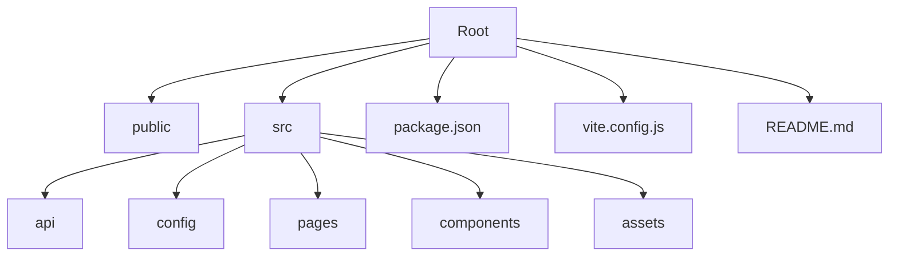
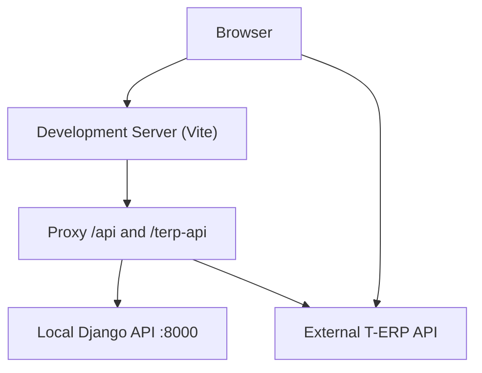
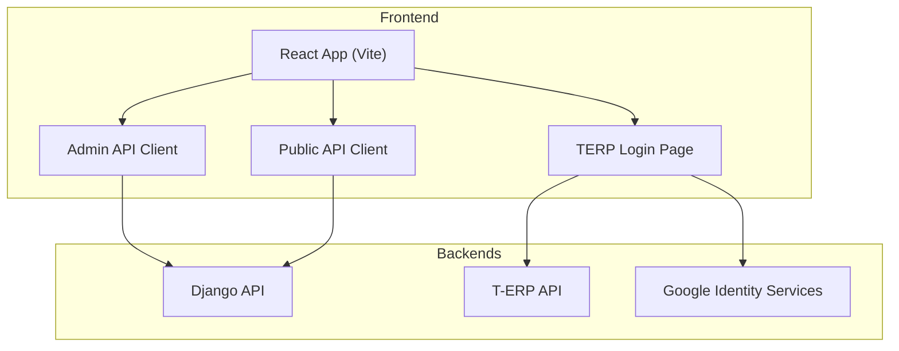
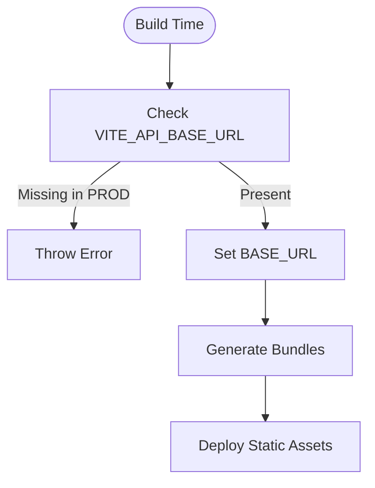
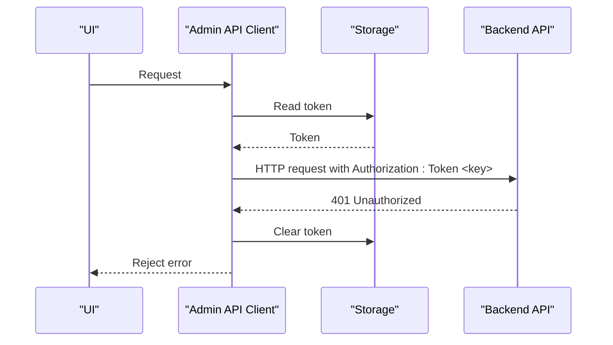
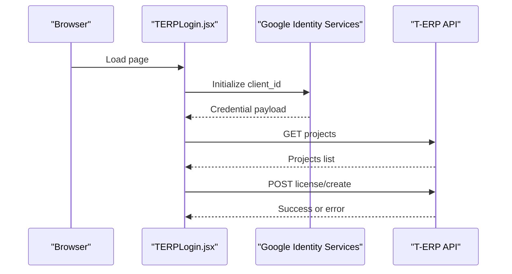
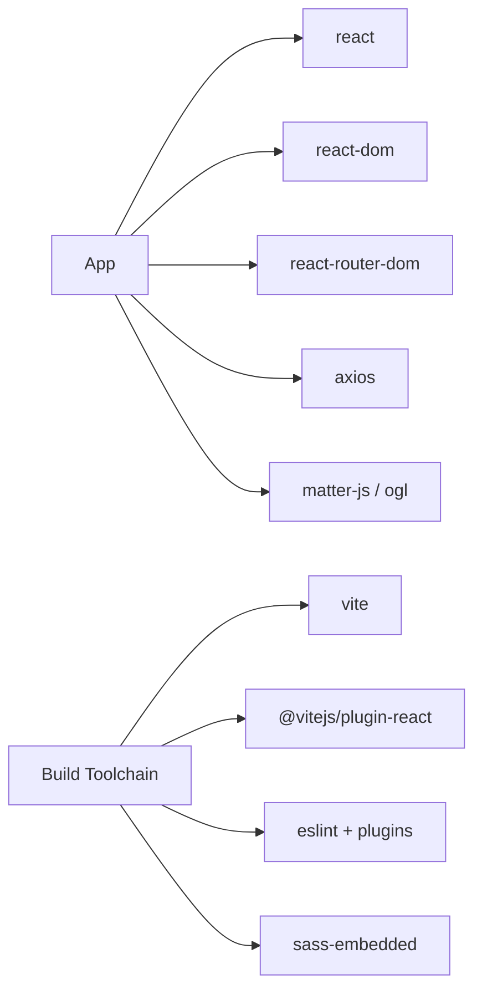

# Deployment Guide

<cite>
**Referenced Files in This Document**
- [package.json](file://package.json)
- [vite.config.js](file://vite.config.js)
- [README.md](file://README.md)
- [src/config/config.js](file://src/config/config.js)
- [src/api/client.js](file://src/api/client.js)
- [src/api/api.js](file://src/api/api.js)
- [src/pages/TERPLogin.jsx](file://src/pages/TERPLogin.jsx)
</cite>

## Table of Contents
1. [Introduction](#introduction)
2. [Project Structure](#project-structure)
3. [Core Components](#core-components)
4. [Architecture Overview](#architecture-overview)
5. [Detailed Component Analysis](#detailed-component-analysis)
6. [Dependency Analysis](#dependency-analysis)
7. [Performance Considerations](#performance-considerations)
8. [Troubleshooting Guide](#troubleshooting-guide)
9. [Conclusion](#conclusion)
10. [Appendices](#appendices)

## Introduction
This guide documents how to build, optimize, deploy, and operate the TRELLISCO_ERP_FRONTEND application. The project is a React application built with Vite. It uses environment variables for API configuration, supports development proxying, and exposes production build artifacts suitable for static hosting, CDN delivery, or containerized deployment.

Key goals covered:
- Build process using Vite for production optimization
- Code splitting and asset optimization
- Bundle analysis guidance
- Deployment strategies for static sites, CDNs, and containers
- Environment variable configuration and API endpoint setup
- Security considerations
- Monitoring, logging, performance monitoring, and maintenance
- CI/CD integration, automated testing, and rollback strategies
- Step-by-step deployment instructions for common platforms
- Troubleshooting deployment issues

## Project Structure
The repository follows a standard Vite + React layout:
- Public assets under public
- Source code under src
  - api: HTTP clients and API helpers
  - config: runtime configuration constants
  - pages: feature pages including admin and login flows
  - components: reusable UI components
  - assets: static media
- Root configuration files: package.json, vite.config.js, README.md

**Section sources**
- [package.json:1-33](file://package.json#L1-L33)
- [vite.config.js:1-24](file://vite.config.js#L1-L24)
- [README.md:1-17](file://README.md#L1-L17)

## Core Components
This section focuses on the build system, configuration, and API client layers that directly affect deployment.

- Build toolchain: Vite with React plugin
- Development server proxy for local API calls
- Environment-driven API base URLs
- Axios-based HTTP clients with token handling

**Diagram sources**
- [vite.config.js:7-22](file://vite.config.js#L7-L22)

**Section sources**
- [package.json:6-11](file://package.json#L6-L11)
- [vite.config.js:1-24](file://vite.config.js#L1-L24)

## Architecture Overview
At runtime, the frontend consumes multiple APIs:
- Internal backend API via a configured base URL
- T-ERP endpoints for projects and license creation
- Google Identity Services for sign-in

**Diagram sources**
- [src/api/client.js:1-88](file://src/api/client.js#L1-L88)
- [src/api/api.js:1-39](file://src/api/api.js#L1-L39)
- [src/pages/TERPLogin.jsx:1-250](file://src/pages/TERPLogin.jsx#L1-L250)

## Detailed Component Analysis

### Build Process and Production Optimization
- Scripts:
  - Development: runs Vite dev server with hot module replacement
  - Build: produces optimized static assets for production
  - Preview: serves the production build locally
- Plugins:
  - React plugin enables JSX support and optimizations
- Output:
  - Vite generates hashed, minified bundles and assets suitable for static hosting

Operational notes:
- Use npm run build to generate production assets
- Use npm run preview to validate the production build locally before deploying

**Section sources**
- [package.json:6-11](file://package.json#L6-L11)
- [package.json:20-31](file://package.json#L20-L31)
- [README.md:1-17](file://README.md#L1-L17)

### Environment Variables and API Configuration
Environment variables are used to configure API endpoints at build time:
- VITE_API_BASE_URL: Base URL for the internal API (must include /api path)
- VITE_API_URL: Alternative base URL used by some modules
- VITE_TERP_PROJECTS_API_URL: T-ERP projects endpoint in production
- VITE_TERP_LICENSE_CREATE_API_URL: T-ERP license creation endpoint in production
- VITE_GOOGLE_CLIENT_ID: Google Identity Services client ID

Behavior:
- In development, the Vite dev server proxies /api and /terp-api to local and external backends
- In production builds, missing required variables can cause explicit errors to prevent misconfiguration

**Diagram sources**
- [src/api/client.js:4-19](file://src/api/client.js#L4-L19)

**Section sources**
- [src/config/config.js:1-3](file://src/config/config.js#L1-L3)
- [src/api/client.js:1-88](file://src/api/client.js#L1-L88)
- [src/pages/TERPLogin.jsx:7-12](file://src/pages/TERPLogin.jsx#L7-L12)
- [src/pages/TERPLogin.jsx:118-120](file://src/pages/TERPLogin.jsx#L118-L120)

### API Clients and Authentication Flow
Two primary HTTP clients are provided:
- Admin client: attaches authentication tokens and handles 401 responses
- Public client: no authentication headers; ensures public content visibility regardless of admin session

Token handling:
- Tokens are stored in localStorage or sessionStorage
- Authorization header uses the Token scheme expected by the backend
- On 401, tokens are cleared automatically

**Diagram sources**
- [src/api/client.js:21-75](file://src/api/client.js#L21-L75)

**Section sources**
- [src/api/client.js:1-88](file://src/api/client.js#L1-L88)
- [src/api/api.js:1-39](file://src/api/api.js#L1-L39)

### T-ERP Login and License Creation Flow
The login page integrates Google Sign-In and communicates with T-ERP endpoints:
- Loads Google script dynamically
- Uses environment variables for endpoints and client ID
- Normalizes project payloads from various response shapes
- Submits company details and selected projects to create a license

**Diagram sources**
- [src/pages/TERPLogin.jsx:35-57](file://src/pages/TERPLogin.jsx#L35-L57)
- [src/pages/TERPLogin.jsx:94-112](file://src/pages/TERPLogin.jsx#L94-L112)
- [src/pages/TERPLogin.jsx:161-190](file://src/pages/TERPLogin.jsx#L161-L190)

**Section sources**
- [src/pages/TERPLogin.jsx:1-250](file://src/pages/TERPLogin.jsx#L1-L250)

## Dependency Analysis
Runtime dependencies relevant to deployment:
- axios: HTTP client for API requests
- react, react-dom: UI framework
- react-router-dom: routing
- matter-js, ogl: optional visual effects libraries

Dev dependencies relevant to build and quality:
- vite: build tool
- @vitejs/plugin-react: React support
- eslint and related plugins: linting
- sass-embedded: SCSS compilation

**Diagram sources**
- [package.json:12-31](file://package.json#L12-L31)

**Section sources**
- [package.json:12-31](file://package.json#L12-L31)

## Performance Considerations
Optimization techniques available with Vite:
- Minification and tree-shaking reduce bundle size
- Code splitting occurs automatically for routes and dynamic imports
- Asset optimization includes hashing and compression when served correctly
- Development proxy avoids CORS issues during local development

Recommendations:
- Enable gzip or Brotli compression on your web server or CDN
- Configure long-term caching for hashed assets
- Monitor bundle sizes and identify large dependencies
- Use lazy loading for heavy features where possible

[No sources needed since this section provides general guidance]

## Troubleshooting Guide

Common deployment issues and resolutions:
- Missing API base URL in production:
  - Symptom: Build fails with an explicit error indicating VITE_API_BASE_URL is not set
  - Resolution: Define VITE_API_BASE_URL in your production environment and rebuild
- Incorrect API paths:
  - Ensure VITE_API_BASE_URL includes the correct /api suffix
- T-ERP endpoints unreachable:
  - Verify VITE_TERP_PROJECTS_API_URL and VITE_TERP_LICENSE_CREATE_API_URL point to valid endpoints
  - Confirm CORS settings allow the deployed origin
- Google Sign-In not loading:
  - Ensure VITE_GOOGLE_CLIENT_ID is set and matches the Google Cloud project configuration
- Local development proxy:
  - When running locally, /api and /terp-api are proxied; ensure target hosts are reachable

**Section sources**
- [src/api/client.js:10-19](file://src/api/client.js#L10-L19)
- [src/pages/TERPLogin.jsx:7-12](file://src/pages/TERPLogin.jsx#L7-L12)
- [src/pages/TERPLogin.jsx:118-120](file://src/pages/TERPLogin.jsx#L118-L120)
- [vite.config.js:7-22](file://vite.config.js#L7-L22)

## Conclusion
The TRELLISCO_ERP_FRONTEND application is designed for straightforward deployment across multiple environments. By configuring environment variables for API endpoints and leveraging Vite’s production build, you can deliver optimized static assets to any hosting platform. Proper security practices, such as enforcing required variables and managing tokens securely, along with robust CI/CD pipelines, will ensure reliable releases and easy rollbacks.

[No sources needed since this section summarizes without analyzing specific files]

## Appendices

### Build and Deployment Commands
- Install dependencies: npm install
- Run development server: npm run dev
- Build production assets: npm run build
- Preview production build locally: npm run preview

**Section sources**
- [package.json:6-11](file://package.json#L6-L11)

### Environment Variables Reference
- VITE_API_BASE_URL: Required in production; must include /api
- VITE_API_URL: Alternative base URL used by some modules
- VITE_TERP_PROJECTS_API_URL: T-ERP projects endpoint
- VITE_TERP_LICENSE_CREATE_API_URL: T-ERP license creation endpoint
- VITE_GOOGLE_CLIENT_ID: Google Identity Services client ID

**Section sources**
- [src/config/config.js:1-3](file://src/config/config.js#L1-L3)
- [src/api/client.js:4-19](file://src/api/client.js#L4-L19)
- [src/pages/TERPLogin.jsx:7-12](file://src/pages/TERPLogin.jsx#L7-L12)
- [src/pages/TERPLogin.jsx:118-120](file://src/pages/TERPLogin.jsx#L118-L120)

### Deployment Strategies

#### Static Site Hosting
- Build the app with npm run build
- Upload the generated dist directory to your static host (for example, GitHub Pages, Netlify, Vercel, AWS S3 + CloudFront)
- Configure your host to serve index.html for all routes if using client-side routing
- Set environment variables through your host’s environment configuration and rebuild

#### CDN Deployment
- Host the dist directory behind a CDN
- Enable compression (gzip/Brotli) and cache policies for hashed assets
- Point your domain to the CDN and configure HTTPS

#### Containerized Deployment
- Create a Dockerfile that installs Node.js, runs npm install, then npm run build
- Serve the dist directory with a lightweight web server (for example, nginx or caddy)
- Inject environment variables at runtime via container orchestration (Kubernetes ConfigMaps/Secrets or Docker environment variables)
- Note: Since variables are baked into the build, inject them before building or use a runtime configuration loader if you need runtime overrides

**Section sources**
- [package.json:6-11](file://package.json#L6-L11)
- [vite.config.js:7-22](file://vite.config.js#L7-L22)

### CI/CD Pipeline Integration
Recommended pipeline stages:
- Lint: npm run lint
- Test: Add unit and integration tests and run them in CI
- Build: npm run build
- Artifact: Publish the dist directory as a build artifact
- Deploy: Push artifacts to your hosting platform or container registry
- Rollback: Maintain previous artifacts and switch traffic back to the last known good version

Automated testing suggestions:
- Unit tests for API clients and utility functions
- Integration tests for critical user flows (login, license creation)
- End-to-end tests for key pages and navigation

Rollback strategies:
- Keep previous build artifacts and swap deployments instantly
- Use blue/green or canary deployments to minimize risk
- Validate health checks and smoke tests after deployment

[No sources needed since this section provides general guidance]

### Monitoring and Logging
- Frontend error tracking: Integrate an error reporting service to capture unhandled exceptions and promise rejections
- Performance monitoring: Track core web vitals and bundle metrics
- API observability: Log request/response metadata (without sensitive data) and correlate with backend logs
- Uptime monitoring: Use synthetic checks to verify critical endpoints and pages

[No sources needed since this section provides general guidance]

### Maintenance Procedures
- Regularly update dependencies and review security advisories
- Monitor bundle size growth and refactor heavy dependencies
- Rotate secrets and credentials regularly
- Review and prune unused routes and features
- Periodically test disaster recovery and rollback procedures

[No sources needed since this section provides general guidance]