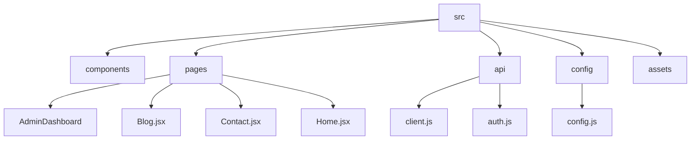
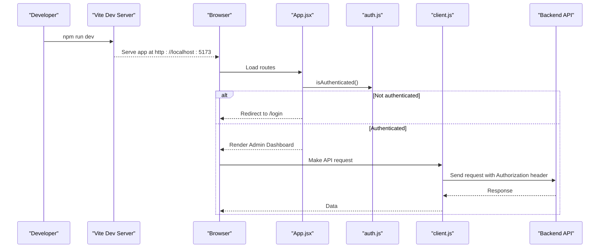
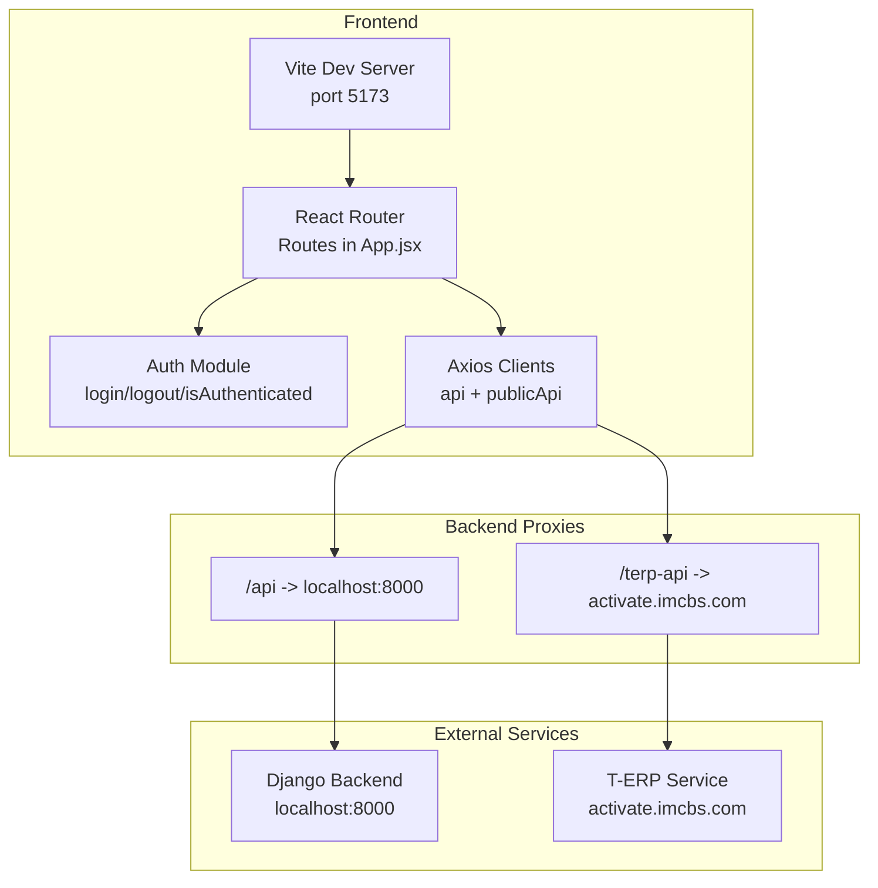
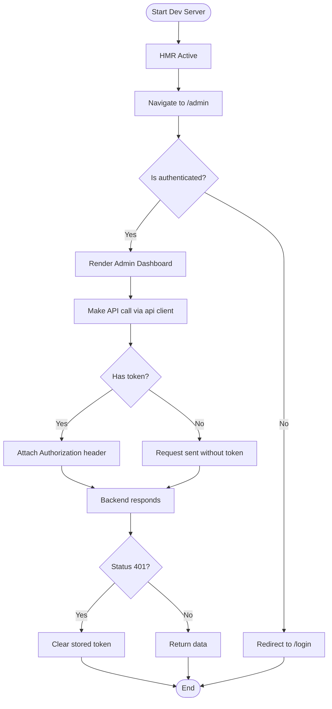
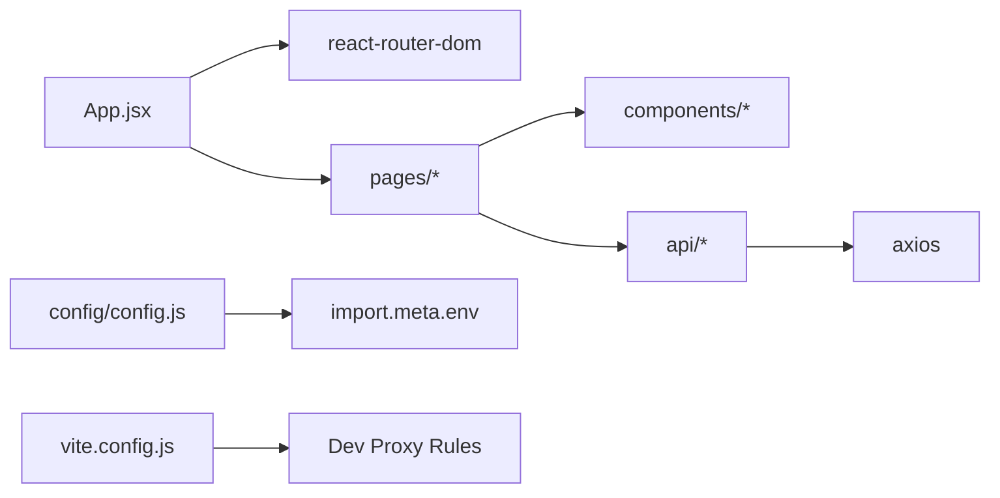

# Getting Started

<cite>
**Referenced Files in This Document**
- [README.md](file://README.md)
- [package.json](file://package.json)
- [vite.config.js](file://vite.config.js)
- [src/config/config.js](file://src/config/config.js)
- [src/main.jsx](file://src/main.jsx)
- [src/App.jsx](file://src/App.jsx)
- [src/api/client.js](file://src/api/client.js)
- [src/api/auth.js](file://src/api/auth.js)
</cite>

## Table of Contents
1. [Introduction](#introduction)
2. [Project Structure](#project-structure)
3. [Core Components](#core-components)
4. [Architecture Overview](#architecture-overview)
5. [Detailed Component Analysis](#detailed-component-analysis)
6. [Dependency Analysis](#dependency-analysis)
7. [Performance Considerations](#performance-considerations)
8. [Troubleshooting Guide](#troubleshooting-guide)
9. [Conclusion](#conclusion)

## Introduction
This guide helps new developers set up and run the TRELLISCO_ERP_FRONTEND project locally. It covers Node.js requirements, installing dependencies, environment configuration, starting the development server, hot module replacement, building for production, and navigating to both the public website and the admin dashboard.

The project is a React application built with Vite. It includes:
- A public-facing site (home, blog, contact)
- An admin dashboard protected by authentication
- API integration via Axios with token-based authentication
- Local proxy configuration for backend services

**Section sources**
- [README.md:1-17](file://README.md#L1-L17)
- [package.json:1-33](file://package.json#L1-L33)

## Project Structure
At a high level, the frontend is organized into feature-oriented directories under src:
- src/components: Reusable UI components (navigation, footer, chatbot, etc.)
- src/pages: Page-level components and their styles
- src/api: API clients and authentication helpers
- src/config: Environment-aware configuration
- src/assets: Static assets (images, fonts, etc.)

**Diagram sources**
- [src/App.jsx:1-74](file://src/App.jsx#L1-L74)
- [src/api/client.js:1-88](file://src/api/client.js#L1-L88)
- [src/config/config.js:1-3](file://src/config/config.js#L1-L3)

**Section sources**
- [src/App.jsx:1-74](file://src/App.jsx#L1-L74)

## Core Components
Key runtime entry points and routing:
- Application bootstrap: main.jsx renders App inside StrictMode
- Routing: App.jsx defines routes for public pages and protected admin routes
- Authentication: api/auth.js provides login/logout and session checks
- API client: api/client.js configures Axios instances and token handling

**Diagram sources**
- [src/main.jsx:1-11](file://src/main.jsx#L1-L11)
- [src/App.jsx:1-74](file://src/App.jsx#L1-L74)
- [src/api/auth.js:1-40](file://src/api/auth.js#L1-L40)
- [src/api/client.js:1-88](file://src/api/client.js#L1-L88)

**Section sources**
- [src/main.jsx:1-11](file://src/main.jsx#L1-L11)
- [src/App.jsx:1-74](file://src/App.jsx#L1-L74)
- [src/api/auth.js:1-40](file://src/api/auth.js#L1-L40)
- [src/api/client.js:1-88](file://src/api/client.js#L1-L88)

## Architecture Overview
The frontend uses Vite for fast development and builds. During development, requests to /api are proxied to a local backend, while T-ERP-related endpoints are proxied to a remote service. The application supports two Axios instances:
- api: For authenticated admin operations (includes Authorization header)
- publicApi: For public content without admin tokens

Environment variables control base URLs:
- VITE_API_URL used by src/config/config.js
- VITE_API_BASE_URL used by src/api/client.js

**Diagram sources**
- [vite.config.js:1-24](file://vite.config.js#L1-L24)
- [src/App.jsx:1-74](file://src/App.jsx#L1-L74)
- [src/api/client.js:1-88](file://src/api/client.js#L1-L88)
- [src/config/config.js:1-3](file://src/config/config.js#L1-L3)

**Section sources**
- [vite.config.js:1-24](file://vite.config.js#L1-L24)
- [src/config/config.js:1-3](file://src/config/config.js#L1-L3)
- [src/api/client.js:1-88](file://src/api/client.js#L1-L88)

## Detailed Component Analysis

### Installation and Setup
Follow these steps to get the project running locally:

1. Install Node.js
   - Use a recent LTS version compatible with Vite 8.x and React 19.x.
   - Verify installation: node --version and npm --version.

2. Clone and enter the repository
   - git clone <repository-url>
   - cd TRELLISCO_ERP_FRONTEND

3. Install dependencies
   - Using npm: npm install
   - Using yarn: yarn install

4. Configure environment variables
   - Create .env in the project root if you need custom values:
     - VITE_API_URL=http://127.0.0.1:8000
     - VITE_API_BASE_URL=http://127.0.0.1:8000/api
   - These variables are consumed by:
     - src/config/config.js (VITE_API_URL)
     - src/api/client.js (VITE_API_BASE_URL)

5. Start the development server
   - npm run dev or yarn dev
   - Open http://localhost:5173 in your browser.

6. Build for production
   - npm run build or yarn build
   - Preview the production build locally: npm run preview or yarn preview

7. Lint the codebase
   - npm run lint or yarn lint

Notes:
- The default backend proxy targets localhost:8000 for /api and a remote service for /terp-api. Adjust vite.config.js if your backend runs elsewhere.

**Section sources**
- [package.json:6-10](file://package.json#L6-L10)
- [vite.config.js:7-22](file://vite.config.js#L7-L22)
- [src/config/config.js:1-3](file://src/config/config.js#L1-L3)
- [src/api/client.js:4-19](file://src/api/client.js#L4-L19)

### Development Workflow
- Hot Module Replacement (HMR): Enabled automatically by Vite during development. Changes to components and styles reflect instantly in the browser.
- Routing: Public routes include Home, Blog, BlogPost, Contact. Protected admin routes require authentication.
- Authentication flow:
  - Login calls the backend’s login endpoint and stores a token.
  - Subsequent admin API calls attach an Authorization header using the stored token.
  - If the backend returns 401, the token is cleared automatically.

**Diagram sources**
- [src/App.jsx:15-23](file://src/App.jsx#L15-L23)
- [src/api/auth.js:1-40](file://src/api/auth.js#L1-L40)
- [src/api/client.js:47-75](file://src/api/client.js#L47-L75)

**Section sources**
- [src/App.jsx:15-23](file://src/App.jsx#L15-L23)
- [src/api/auth.js:1-40](file://src/api/auth.js#L1-L40)
- [src/api/client.js:47-75](file://src/api/client.js#L47-L75)

### Running Locally and Accessing the Site
- Public website: Visit http://localhost:5173 after starting the dev server.
- Admin dashboard:
  - Navigate to /admin. If not authenticated, you will be redirected to /login.
  - Log in using valid credentials; upon success, you can access the admin dashboard and related routes (/admin/dashboard, /admin/announcements, /admin/promo-video).

**Section sources**
- [src/App.jsx:25-69](file://src/App.jsx#L25-L69)
- [src/api/auth.js:1-40](file://src/api/auth.js#L1-L40)

## Dependency Analysis
Runtime and development dependencies:
- Runtime:
  - react, react-dom: UI framework
  - react-router-dom: Client-side routing
  - axios: HTTP client for API calls
  - matter-js, ogl: Optional libraries for interactive visuals
- Development:
  - vite: Build tool and dev server
  - @vitejs/plugin-react: React support for Vite
  - eslint and related plugins: Code quality and hooks rules
  - sass-embedded: SCSS compilation

**Diagram sources**
- [src/App.jsx:1-74](file://src/App.jsx#L1-L74)
- [src/api/client.js:1-88](file://src/api/client.js#L1-L88)
- [src/config/config.js:1-3](file://src/config/config.js#L1-L3)
- [vite.config.js:1-24](file://vite.config.js#L1-L24)
- [package.json:12-31](file://package.json#L12-L31)

**Section sources**
- [package.json:12-31](file://package.json#L12-L31)

## Performance Considerations
- Keep HMR enabled during development for fast feedback loops.
- Avoid heavy computations in render paths; use memoization where appropriate.
- Minimize bundle size by lazy-loading routes and components when possible.
- Ensure environment variables are correctly set before building to avoid runtime errors.

[No sources needed since this section provides general guidance]

## Troubleshooting Guide
Common setup issues and resolutions:

- Dependencies fail to install
  - Ensure Node.js version meets the requirements for Vite 8.x and React 19.x.
  - Clear caches and reinstall: remove node_modules and package-lock.json (or yarn.lock), then run npm install or yarn install again.

- Dev server does not start or port conflict
  - Confirm port 5173 is free or configure a different port in vite.config.js.
  - Restart the terminal and try again.

- API calls return 401 Unauthorized
  - Verify that you have successfully logged in and that a token exists in storage.
  - Check that the backend is reachable and that the Authorization header format matches expectations ("Token <key>").
  - If the backend returns 401, the client clears the token automatically; log in again.

- Environment variables not applied
  - Ensure .env contains VITE_API_URL and/or VITE_API_BASE_URL as needed.
  - Remember that Vite injects environment variables at build time; rebuild after changing .env files.

- Proxy misconfiguration
  - If your backend is not on localhost:8000, update the proxy target in vite.config.js accordingly.
  - For T-ERP endpoints, ensure secure: true is set and rewrite rules match your backend path structure.

- Production build fails due to missing API URL
  - In production, VITE_API_BASE_URL must be defined; otherwise, the client throws an error to prevent accidental calls to localhost from users’ browsers.

**Section sources**
- [vite.config.js:7-22](file://vite.config.js#L7-L22)
- [src/api/client.js:10-19](file://src/api/client.js#L10-L19)
- [src/api/client.js:54-75](file://src/api/client.js#L54-L75)
- [src/api/auth.js:1-40](file://src/api/auth.js#L1-L40)

## Conclusion
You now have everything needed to set up, run, and develop the TRELLISCO_ERP_FRONTEND project. Use the provided scripts for development, building, and linting. Configure environment variables to point to your backend, and leverage the proxy settings for seamless local development. When ready, build and deploy with confidence knowing that required environment variables are enforced in production.

[No sources needed since this section summarizes without analyzing specific files]