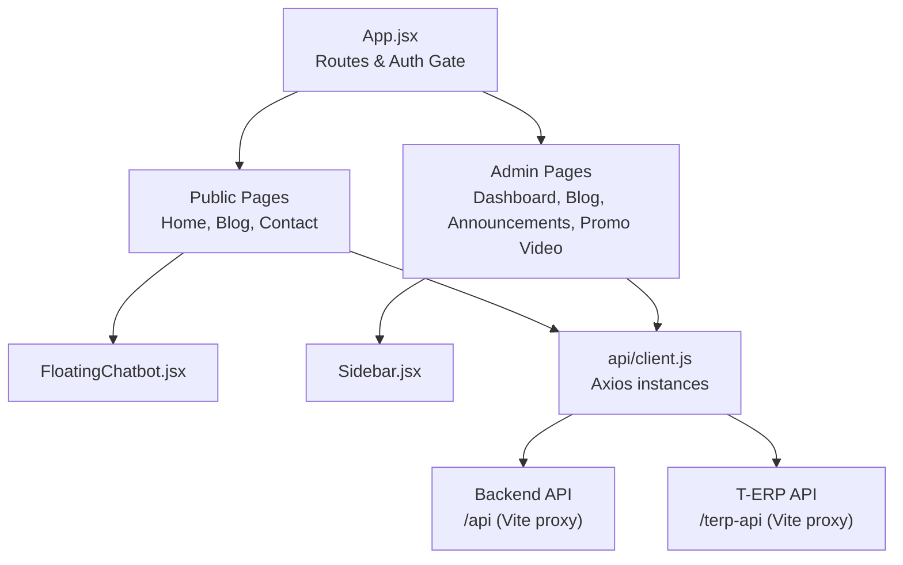
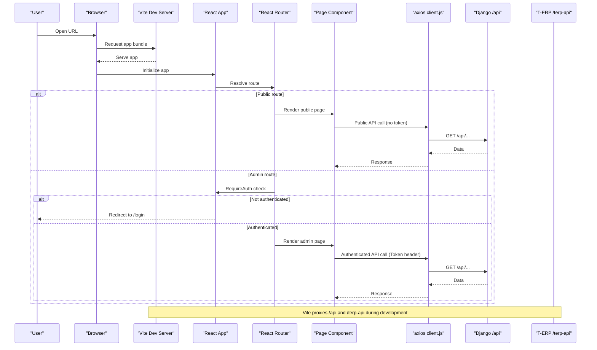
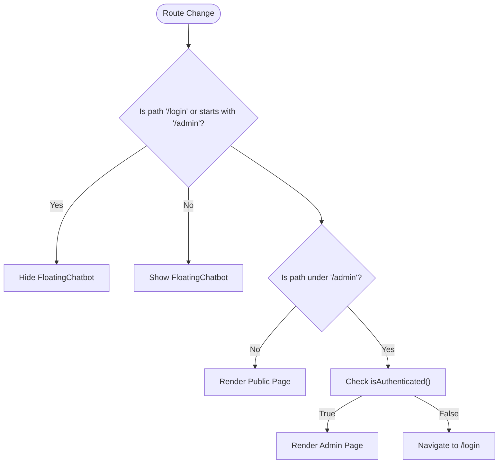
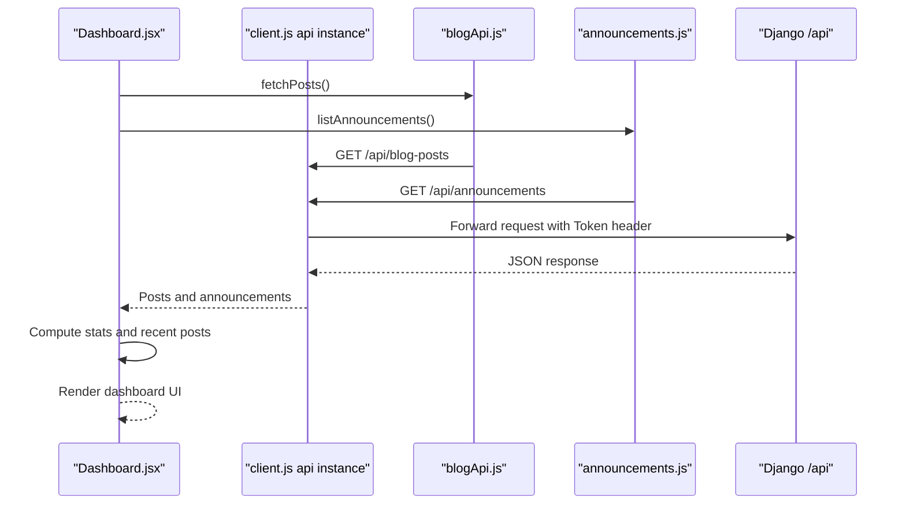
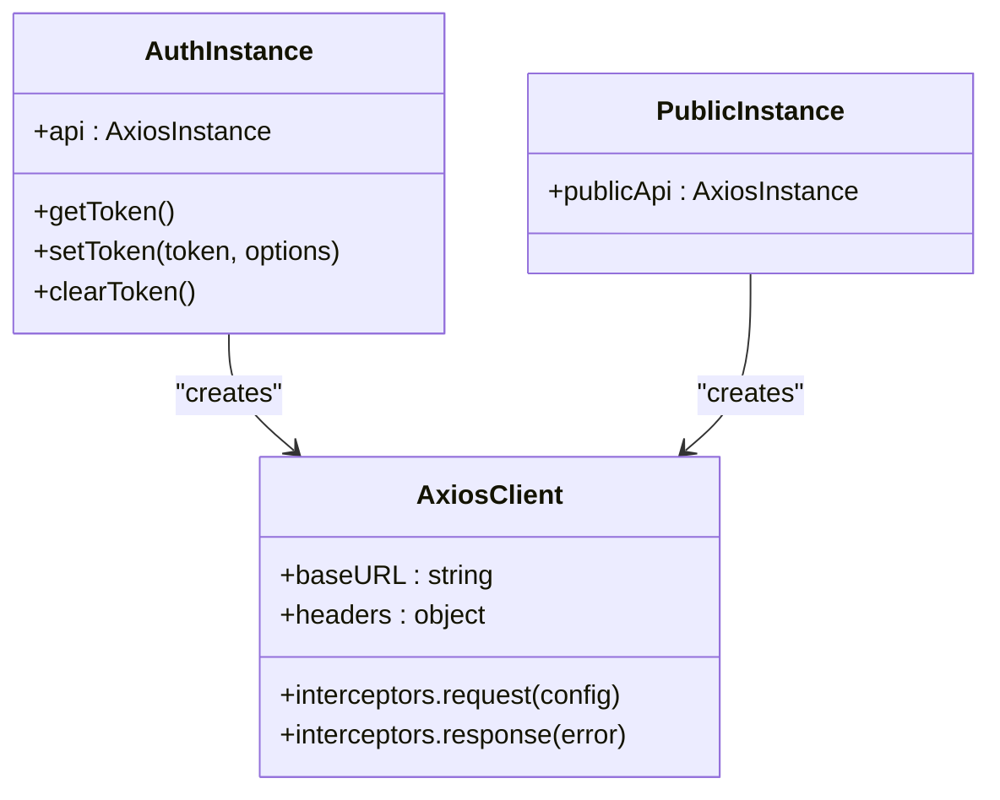
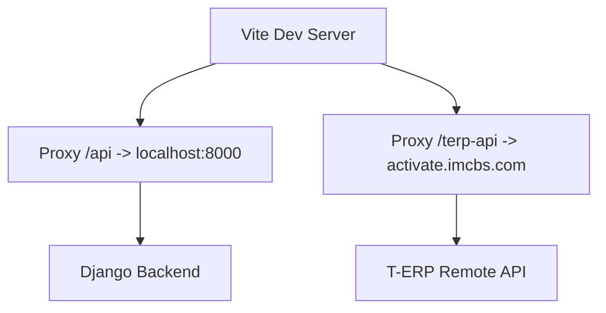
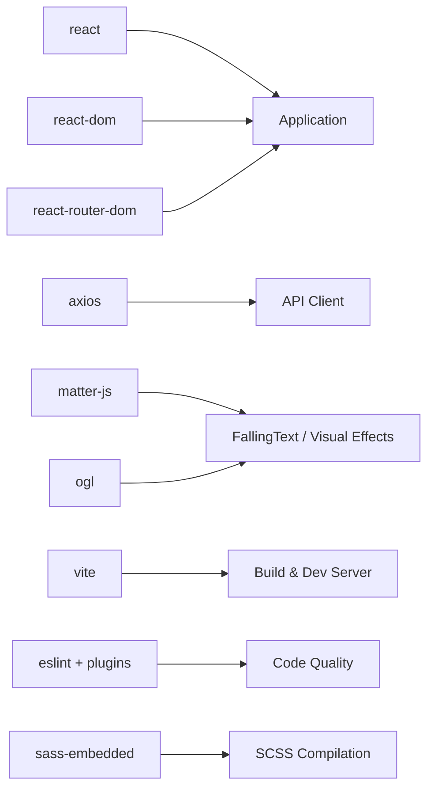

# Project Overview

<cite>
**Referenced Files in This Document**
- [README.md](file://README.md)
- [package.json](file://package.json)
- [vite.config.js](file://vite.config.js)
- [src/App.jsx](file://src/App.jsx)
- [src/config/config.js](file://src/config/config.js)
- [src/api/client.js](file://src/api/client.js)
- [src/pages/Home.jsx](file://src/pages/Home.jsx)
- [src/pages/AdminDashboard/Dashboard.jsx](file://src/pages/AdminDashboard/Dashboard.jsx)
- [src/components/FloatingChatbot.jsx](file://src/components/FloatingChatbot.jsx)
</cite>

## Table of Contents
1. [Introduction](#introduction)
2. [Project Structure](#project-structure)
3. [Core Components](#core-components)
4. [Architecture Overview](#architecture-overview)
5. [Detailed Component Analysis](#detailed-component-analysis)
6. [Dependency Analysis](#dependency-analysis)
7. [Performance Considerations](#performance-considerations)
8. [Troubleshooting Guide](#troubleshooting-guide)
9. [Conclusion](#conclusion)

## Introduction
TRELLISCO_ERP_FRONTEND is a React 19 application built with Vite that serves two purposes from one codebase:
- A public-facing marketing website showcasing Trellisco ERP solutions across industries such as HRMS, Hospitality, Property Management, and Gym Management.
- An administrative dashboard for managing blog posts, announcements, and promotional content.

The project uses React Router to separate public routes from protected admin routes, Axios for API communication, and Matter.js for physics-based text animations on the marketing pages. The site also includes a floating chat assistant that helps visitors learn about products and contact support.

This document explains how the public website and admin dashboard coexist, how data flows between the frontend and backend, and how to install, run, and use the project.

## Project Structure
At a high level, the repository follows a feature-oriented layout:
- `src/pages` contains route-level components for both public marketing pages and admin features.
- `src/components` holds reusable UI pieces like navigation, footer, chatbot, and sidebar.
- `src/api` centralizes API clients and endpoints.
- `src/config` provides environment-driven configuration.
- `public` is reserved for static assets served by Vite.
- Root files include build configuration, package metadata, and ESLint settings.

**Diagram sources**
- [src/App.jsx:1-74](file://src/App.jsx#L1-L74)
- [src/components/FloatingChatbot.jsx:1-370](file://src/components/FloatingChatbot.jsx#L1-L370)
- [src/api/client.js:1-88](file://src/api/client.js#L1-L88)
- [vite.config.js:1-24](file://vite.config.js#L1-L24)

**Section sources**
- [src/App.jsx:1-74](file://src/App.jsx#L1-L74)
- [package.json:1-33](file://package.json#L1-L33)

## Core Components
- Application shell and routing:
  - Defines public routes (`/`, `/blog`, `/blog/:slug`, `/contact`) and admin routes under `/admin/*`.
  - Protects admin routes using an authentication check and redirects unauthenticated users to `/login`.
  - Conditionally renders the floating chatbot only outside login and admin paths.

- Public marketing experience:
  - The homepage presents industry solutions, product highlights, FAQs, and interactive visuals.
  - Physics-based text animation powered by Matter.js enhances engagement.
  - Floating chatbot answers common questions and provides contact links.

- Administrative dashboard:
  - Displays overview statistics for blog posts and announcements.
  - Provides quick actions to manage posts and create new announcements.
  - Loads data via API calls and handles loading and error states.

**Section sources**
- [src/App.jsx:15-23](file://src/App.jsx#L15-L23)
- [src/App.jsx:25-74](file://src/App.jsx#L25-L74)
- [src/pages/Home.jsx:1-800](file://src/pages/Home.jsx#L1-L800)
- [src/components/FloatingChatbot.jsx:1-370](file://src/components/FloatingChatbot.jsx#L1-L370)
- [src/pages/AdminDashboard/Dashboard.jsx:101-234](file://src/pages/AdminDashboard/Dashboard.jsx#L101-L234)

## Architecture Overview
The application uses a dual-purpose architecture:
- Public website: visitor-facing pages that showcase ERP solutions and provide content like blogs and contact information.
- Admin dashboard: authenticated area for content management.

Routing and protection are handled centrally in the app component. API requests are made through Axios instances configured in a shared client module. Development proxies forward requests to local or remote backends.

**Diagram sources**
- [src/App.jsx:1-74](file://src/App.jsx#L1-L74)
- [src/api/client.js:1-88](file://src/api/client.js#L1-L88)
- [vite.config.js:1-24](file://vite.config.js#L1-L24)

## Detailed Component Analysis

### Routing and Authentication Flow
- Public routes are accessible without authentication.
- Admin routes require authentication; unauthenticated users are redirected to `/login`.
- The chatbot is hidden on `/login` and any path starting with `/admin`.

**Diagram sources**
- [src/App.jsx:15-23](file://src/App.jsx#L15-L23)
- [src/App.jsx:25-74](file://src/App.jsx#L25-L74)

**Section sources**
- [src/App.jsx:15-23](file://src/App.jsx#L15-L23)
- [src/App.jsx:25-74](file://src/App.jsx#L25-L74)

### Public Marketing Website
- The homepage showcases industry solutions (HRMS, Hospitality, Property, Gym), product highlights, and FAQs.
- It integrates physics-based text animations using Matter.js via a dedicated component.
- The floating chatbot provides guided interactions, product knowledge, and contact options.

Key responsibilities:
- Presenting brand messaging and solution cards.
- Rendering interactive sections and media.
- Providing a conversational assistant for visitor support.

**Section sources**
- [src/pages/Home.jsx:1-800](file://src/pages/Home.jsx#L1-L800)
- [src/components/FloatingChatbot.jsx:1-370](file://src/components/FloatingChatbot.jsx#L1-L370)

### Administrative Dashboard
- Loads blog posts and announcements concurrently.
- Computes summary statistics and recent posts.
- Provides navigation to manage posts and create announcements.
- Handles loading and error states gracefully.

Data flow:
- Fetches data from the backend via Axios.
- Normalizes post status for display.
- Renders stats and lists based on fetched data.

**Diagram sources**
- [src/pages/AdminDashboard/Dashboard.jsx:101-234](file://src/pages/AdminDashboard/Dashboard.jsx#L101-L234)
- [src/api/client.js:47-75](file://src/api/client.js#L47-L75)

**Section sources**
- [src/pages/AdminDashboard/Dashboard.jsx:101-234](file://src/pages/AdminDashboard/Dashboard.jsx#L101-L234)

### API Communication and Security
- Two Axios instances are provided:
  - `api`: Authenticated instance used by admin pages; automatically attaches `Authorization: Token <key>` headers.
  - `publicApi`: Unauthenticated instance used by public pages; never sends admin tokens.
- Tokens are stored in localStorage or sessionStorage and cleared on 401 responses.
- Environment variables control the base URL; production builds require explicit configuration.

**Diagram sources**
- [src/api/client.js:1-88](file://src/api/client.js#L1-L88)

**Section sources**
- [src/api/client.js:1-88](file://src/api/client.js#L1-L88)
- [src/config/config.js:1-3](file://src/config/config.js#L1-L3)

### Development Proxy Configuration
- Vite proxies `/api` to a local Django server during development.
- Vite proxies `/terp-api` to a remote T-ERP endpoint, rewriting the prefix and enabling secure connections.

**Diagram sources**
- [vite.config.js:1-24](file://vite.config.js#L1-L24)

**Section sources**
- [vite.config.js:1-24](file://vite.config.js#L1-L24)

## Dependency Analysis
Key dependencies and their roles:
- React 19 and ReactDOM: UI framework and rendering.
- React Router: Client-side routing and navigation.
- Axios: HTTP client for API communication.
- Matter.js: Physics engine for text animations.
- OGL: Graphics library (used alongside Matter.js for advanced visuals).
- Vite: Build tool and dev server.
- ESLint and related plugins: Code quality and linting.
- Sass: Styles compilation.

**Diagram sources**
- [package.json:12-31](file://package.json#L12-L31)

**Section sources**
- [package.json:1-33](file://package.json#L1-L33)

## Performance Considerations
- Use the public Axios instance for visitor-facing pages to avoid sending admin tokens unintentionally.
- Keep Matter.js animations lightweight; adjust gravity and stiffness parameters to balance visual appeal and performance.
- Prefer lazy loading for heavy admin features if needed.
- Ensure environment variables are correctly set for production builds to prevent runtime errors.

[No sources needed since this section provides general guidance]

## Troubleshooting Guide
Common issues and resolutions:
- Missing environment variable in production:
  - If `VITE_API_BASE_URL` is not set in production, the build will fail loudly. Add it to `.env.production` and rebuild.
- Authentication failures:
  - Ensure the Authorization header uses the correct scheme (`Token <key>`). The client automatically sets this for authenticated requests.
  - On 401 responses, the token is cleared automatically.
- API proxy misconfiguration:
  - Verify Vite proxy targets for `/api` and `/terp-api` match your backend setup.
- Chatbot visibility:
  - The chatbot is hidden on `/login` and admin routes; ensure routing paths align with expectations.

**Section sources**
- [src/api/client.js:10-16](file://src/api/client.js#L10-L16)
- [src/api/client.js:54-75](file://src/api/client.js#L54-L75)
- [vite.config.js:7-21](file://vite.config.js#L7-L21)
- [src/App.jsx:19-23](file://src/App.jsx#L19-L23)

## Conclusion
TRELLISCO_ERP_FRONTEND combines a marketing website and an admin dashboard within a single React application. It leverages React 19, Vite, React Router, Axios, and Matter.js to deliver an engaging public experience and a functional content management interface. The architecture cleanly separates public and admin concerns while sharing core utilities like the API client. With proper environment configuration and proxy setup, developers can run the app locally and deploy it for production use.

[No sources needed since this section summarizes without analyzing specific files]