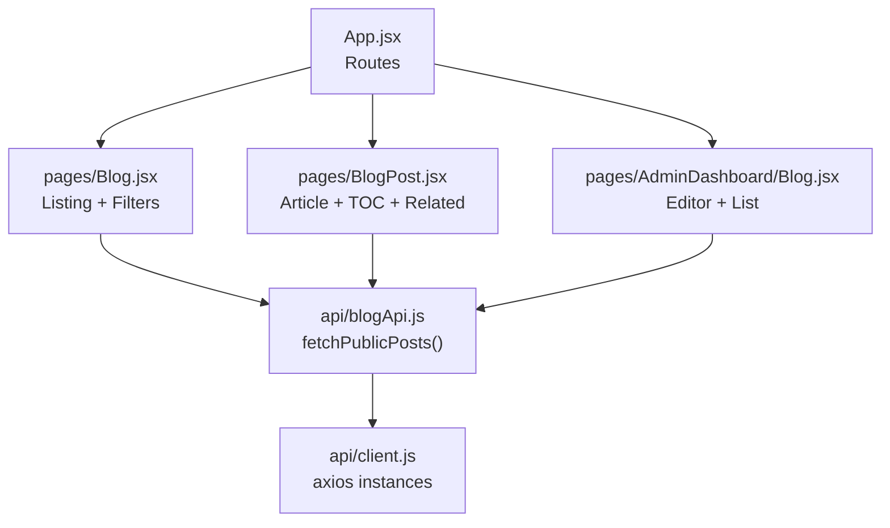
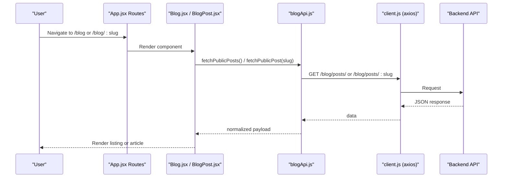
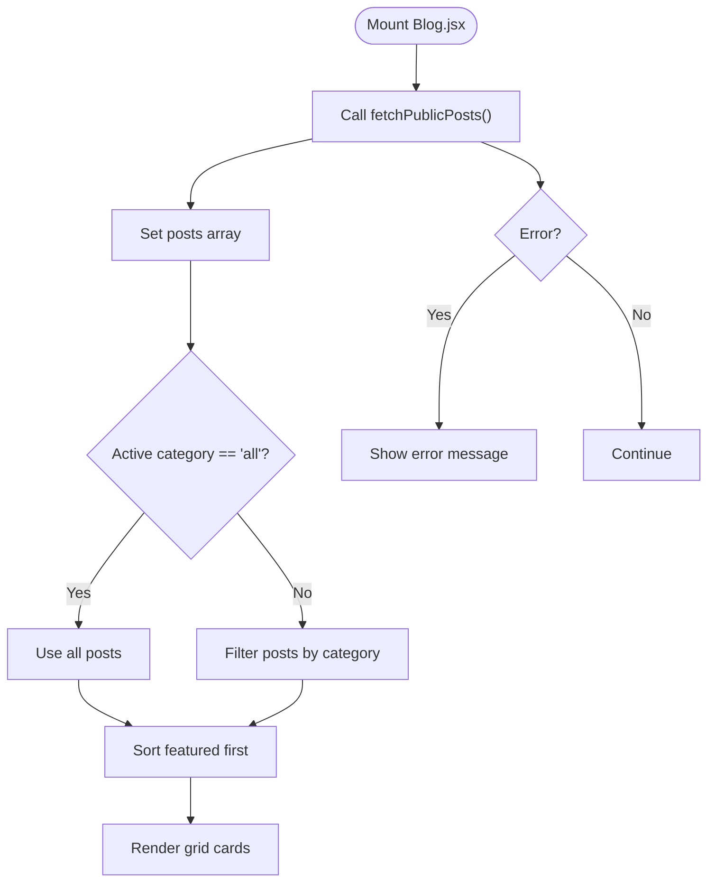
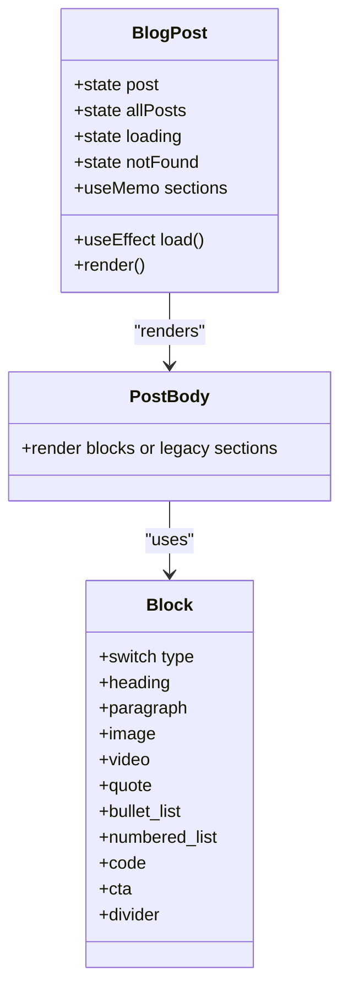
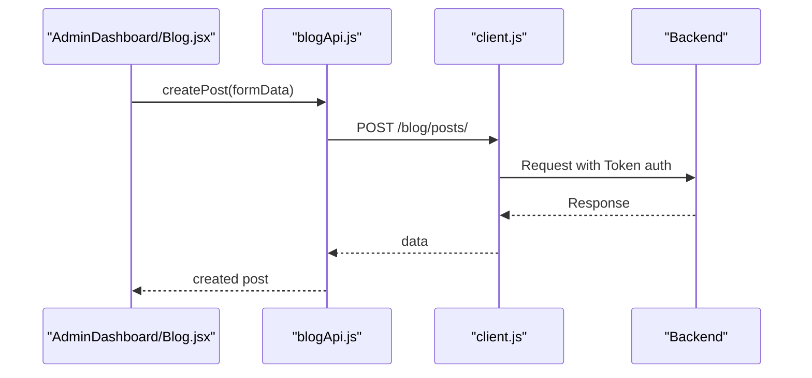
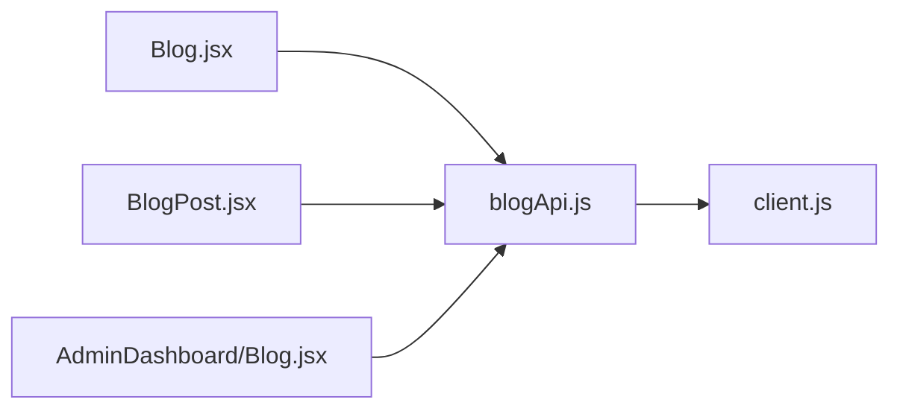

# Blog System

<cite>
**Referenced Files in This Document**
- [Blog.jsx](file://src/pages/Blog.jsx)
- [BlogPost.jsx](file://src/pages/BlogPost.jsx)
- [blogApi.js](file://src/api/blogApi.js)
- [client.js](file://src/api/client.js)
- [App.jsx](file://src/App.jsx)
- [Blog.scss](file://src/pages/Blog.scss)
- [BlogPost.scss](file://src/pages/BlogPost.scss)
- [AdminDashboard/Blog.jsx](file://src/pages/AdminDashboard/Blog.jsx)
</cite>

## Table of Contents
1. [Introduction](#introduction)
2. [Project Structure](#project-structure)
3. [Core Components](#core-components)
4. [Architecture Overview](#architecture-overview)
5. [Detailed Component Analysis](#detailed-component-analysis)
6. [Dependency Analysis](#dependency-analysis)
7. [Performance Considerations](#performance-considerations)
8. [Troubleshooting Guide](#troubleshooting-guide)
9. [Conclusion](#conclusion)

## Introduction
This document explains the blog system’s architecture and implementation across public listing, individual post display, admin management, and API integration. It covers filtering, search, pagination, rich text rendering, image handling, SEO fields, loading states, error management, performance optimizations, responsive design, accessibility, and cross-browser considerations.

## Project Structure
The blog feature is implemented as React components with SCSS styles and a dedicated API layer:

- Public pages:
  - Blog listing page at `/blog`
  - Individual post page at `/blog/:slug`
- Admin dashboard:
  - Post list, editor, uploaders, scheduling, and status controls
- API layer:
  - Public endpoints for visitors
  - Authenticated endpoints for admins
- Routing:
  - Centralized routes in the app shell

**Diagram sources**
- [App.jsx:25-70](file://src/App.jsx#L25-L70)
- [Blog.jsx:1-320](file://src/pages/Blog.jsx#L1-L320)
- [BlogPost.jsx:1-587](file://src/pages/BlogPost.jsx#L1-L587)
- [blogApi.js:1-135](file://src/api/blogApi.js#L1-L135)
- [client.js:1-88](file://src/api/client.js#L1-L88)

**Section sources**
- [App.jsx:25-70](file://src/App.jsx#L25-L70)
- [Blog.jsx:1-320](file://src/pages/Blog.jsx#L1-L320)
- [BlogPost.jsx:1-587](file://src/pages/BlogPost.jsx#L1-L587)
- [blogApi.js:1-135](file://src/api/blogApi.js#L1-L135)
- [client.js:1-88](file://src/api/client.js#L1-L88)

## Core Components
- Blog listing page: category tabs, featured sorting, cover images, comparison section, CTA banner.
- Blog post page: hero, byline, share actions, table of contents with scroll spy, rich block-based body, related posts.
- Admin blog dashboard: post list, filters, sorting, pagination, content block editor, file uploads, scheduling, status toggling.
- API layer: public and authenticated axios clients, CRUD helpers, multipart form builders, upload helper.

Key responsibilities:
- Data fetching and state management for listings and single posts
- Rendering structured content blocks (headings, paragraphs, lists, code, quotes, images, videos, CTAs)
- Admin authoring workflow with validation and scheduling
- Separation of public vs. authenticated requests to hide drafts/scheduled/expired posts from visitors

**Section sources**
- [Blog.jsx:10-320](file://src/pages/Blog.jsx#L10-L320)
- [BlogPost.jsx:87-587](file://src/pages/BlogPost.jsx#L87-L587)
- [AdminDashboard/Blog.jsx:16-1470](file://src/pages/AdminDashboard/Blog.jsx#L16-L1470)
- [blogApi.js:1-135](file://src/api/blogApi.js#L1-L135)

## Architecture Overview
The system separates concerns between UI, data access, and routing:

- Routing defines public and admin routes.
- Public pages use `publicApi` to fetch only published content.
- Admin pages use `api` with token injection for full control.
- Content is stored as structured blocks, enabling flexible layouts without raw HTML.

**Diagram sources**
- [App.jsx:25-70](file://src/App.jsx#L25-L70)
- [Blog.jsx:266-320](file://src/pages/Blog.jsx#L266-L320)
- [BlogPost.jsx:447-587](file://src/pages/BlogPost.jsx#L447-L587)
- [blogApi.js:20-33](file://src/api/blogApi.js#L20-L33)
- [client.js:47-88](file://src/api/client.js#L47-L88)

## Detailed Component Analysis

### Blog Listing Page
Responsibilities:
- Category filtering via tabbed interface
- Sorting featured posts to the top
- Loading and error states
- Cover image fallbacks and lazy loading
- Comparison section and CTA banner

Filtering logic:
- The active category determines whether all posts are shown or filtered by category key.
- Featured posts are prioritized by moving them to the front before rendering.

**Diagram sources**
- [Blog.jsx:266-320](file://src/pages/Blog.jsx#L266-L320)
- [Blog.jsx:122-141](file://src/pages/Blog.jsx#L122-L141)

Accessibility and UX:
- Tabs use ARIA roles and selected states.
- Images include alt text derived from metadata; placeholders used when missing.
- Focus-visible outlines improve keyboard navigation.

Responsive behavior:
- Grid adapts from three columns on desktop to two and then one column on smaller screens.
- Hero and tabs reflow on mobile.

SEO and metadata:
- The listing page does not dynamically set document title or meta tags in this codebase.
- SEO fields exist in the admin model and editor but are not applied to the listing page here.

**Section sources**
- [Blog.jsx:10-320](file://src/pages/Blog.jsx#L10-L320)
- [Blog.scss:27-184](file://src/pages/Blog.scss#L27-L184)

### Individual Post Display
Responsibilities:
- Fetch single post and full list for related articles
- Render structured body content using a block renderer
- Provide share actions and copy link
- Build table of contents and highlight active sections while scrolling
- Handle not-found and loading states

Rich text rendering:
- Supports both new block schema and legacy section schema.
- Block types include headings, paragraphs, images, videos, quotes, bullet/numbered lists, code, CTA links, and dividers.

**Diagram sources**
- [BlogPost.jsx:447-587](file://src/pages/BlogPost.jsx#L447-L587)
- [BlogPost.jsx:274-325](file://src/pages/BlogPost.jsx#L274-L325)
- [BlogPost.jsx:333-372](file://src/pages/BlogPost.jsx#L333-L372)

Table of contents and scroll spy:
- Sections are extracted from either block headings or legacy section headings.
- IntersectionObserver highlights the active heading based on viewport position.

Share and social:
- Share buttons open external sharing URLs with current page URL encoded.
- Copy link uses Clipboard API with graceful fallback.

Image optimization:
- Inline images and cover images use native lazy loading.
- Alt text is provided where available.

SEO and metadata:
- The post page does not dynamically set document title or meta tags in this codebase.
- SEO fields (title, description, keywords) are editable in the admin dashboard and persisted to the backend, but not rendered into the document head here.

**Section sources**
- [BlogPost.jsx:87-587](file://src/pages/BlogPost.jsx#L87-L587)
- [BlogPost.scss:15-758](file://src/pages/BlogPost.scss#L15-L758)

### Admin Dashboard
Responsibilities:
- List posts with filters (status, category), sorting, and pagination
- Create/edit posts with a block-based editor
- Upload images/videos directly
- Schedule publish and expiry times
- Toggle publish status
- Validate and format API errors

Content block editor:
- Supports adding, moving, removing blocks
- Previews filled vs. empty blocks
- Handles direct file uploads per block
- Preserves legacy blocks (app_grid, workflow) during migration

Scheduling and status:
- Converts UTC ISO strings to local datetime-local inputs
- Validates that expiry is after publish time and in the future
- Sends status and schedule fields to backend

Pagination and filtering:
- Uses PAGE_SIZE constant for client-side pagination
- Filters by status and category
- Sorts by newest or oldest

Validation and error handling:
- Frontend validates required fields and scheduling constraints
- Formats backend validation errors into readable messages

**Section sources**
- [AdminDashboard/Blog.jsx:16-1470](file://src/pages/AdminDashboard/Blog.jsx#L16-L1470)

### API Integration
Public vs. authenticated:
- `publicApi` never sends admin tokens, ensuring visitors see only published content.
- `api` attaches an Authorization header with a Token scheme expected by DRF.

Endpoints:
- Public reads: list posts, get single post
- Admin reads/writes: create, update, delete, toggle publish
- File upload endpoint for content media

Multipart form building:
- Builds FormData for creating/updating posts
- Serializes body and arrays to JSON strings
- Maps serializer field names correctly

**Diagram sources**
- [blogApi.js:35-56](file://src/api/blogApi.js#L35-L56)
- [client.js:47-75](file://src/api/client.js#L47-L75)

**Section sources**
- [blogApi.js:1-135](file://src/api/blogApi.js#L1-L135)
- [client.js:1-88](file://src/api/client.js#L1-L88)

## Dependency Analysis
- Pages depend on API functions for data.
- API functions depend on axios instances configured in client.js.
- Styles are scoped per page/component.
- Admin features depend on authentication via token in localStorage/sessionStorage.

**Diagram sources**
- [Blog.jsx:1-320](file://src/pages/Blog.jsx#L1-L320)
- [BlogPost.jsx:1-587](file://src/pages/BlogPost.jsx#L1-L587)
- [AdminDashboard/Blog.jsx:1-1470](file://src/pages/AdminDashboard/Blog.jsx#L1-L1470)
- [blogApi.js:1-135](file://src/api/blogApi.js#L1-L135)
- [client.js:1-88](file://src/api/client.js#L1-L88)

**Section sources**
- [Blog.jsx:1-320](file://src/pages/Blog.jsx#L1-L320)
- [BlogPost.jsx:1-587](file://src/pages/BlogPost.jsx#L1-L587)
- [AdminDashboard/Blog.jsx:1-1470](file://src/pages/AdminDashboard/Blog.jsx#L1-L1470)
- [blogApi.js:1-135](file://src/api/blogApi.js#L1-L135)
- [client.js:1-88](file://src/api/client.js#L1-L88)

## Performance Considerations
- Lazy loading:
  - All cover and inline images use native `loading="lazy"` to defer offscreen resources.
- Memory and render efficiency:
  - Related posts computation uses `useMemo` to avoid unnecessary recalculations.
  - Section extraction for TOC uses `useMemo`.
- Network efficiency:
  - Public endpoints separate from admin endpoints prevent accidental exposure of draft/scheduled content.
- Image handling:
  - Images are displayed with appropriate sizing and aspect ratios; no client-side compression is performed in this codebase.
- Caching strategies:
  - No explicit caching layer is implemented in the frontend.
  - Browser-level HTTP caching may apply depending on server headers.
- Scroll performance:
  - IntersectionObserver is used for TOC highlighting with a tuned rootMargin to reduce frequent updates.

Recommendations:
- Implement request caching (e.g., SWR/React Query) for repeated fetches.
- Introduce image optimization pipeline (CDN resizing, WebP/AVIF).
- Add skeleton loaders for perceived performance.
- Debounce search input if implementing client-side search.

[No sources needed since this section provides general guidance]

## Troubleshooting Guide
Common issues and resolutions:
- Missing API base URL in production:
  - Ensure `VITE_API_BASE_URL` is set; otherwise, the build throws an error to prevent silent misconfiguration.
- Authentication failures:
  - The client expects a `Token <key>` Authorization header; invalid or expired tokens are cleared automatically.
- Drafts visible to visitors:
  - Use `publicApi` for visitor-facing pages; it never sends admin tokens.
- Upload failures:
  - The upload helper wraps errors with readable messages; check network and backend limits.
- Scheduling validation:
  - Expiry must be after publish time and in the future; the editor enforces these rules.

Operational checks:
- Verify environment variables and build configuration.
- Confirm backend endpoints return expected payloads.
- Inspect browser console for network errors and token-related warnings.

**Section sources**
- [client.js:10-16](file://src/api/client.js#L10-L16)
- [client.js:54-75](file://src/api/client.js#L54-L75)
- [blogApi.js:63-74](file://src/api/blogApi.js#L63-L74)
- [AdminDashboard/Blog.jsx:887-948](file://src/pages/AdminDashboard/Blog.jsx#L887-L948)

## Conclusion
The blog system provides a robust public listing and reading experience backed by a flexible block-based content model and a comprehensive admin dashboard. It separates public and authenticated data access, supports rich media, and includes thoughtful accessibility and responsive patterns. While SEO metadata fields are supported in the admin model, dynamic document head updates are not implemented in the current codebase. Performance is improved through lazy loading and memoization, with opportunities for further gains via caching and image optimization pipelines.