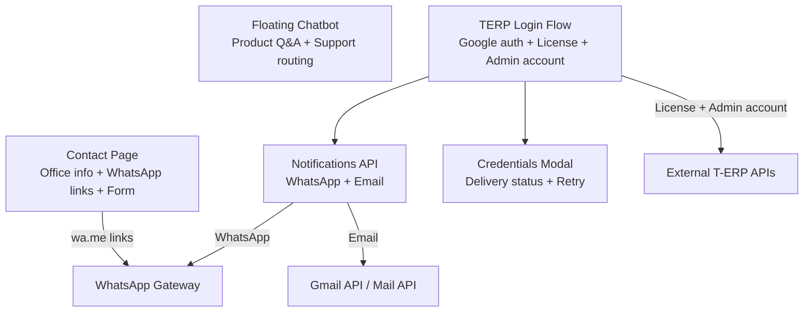
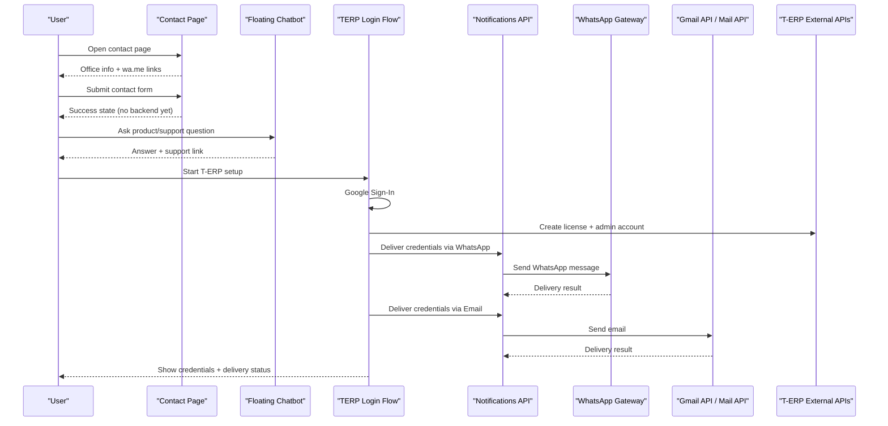
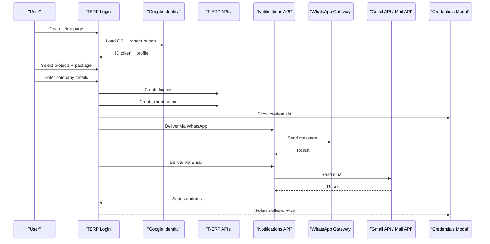
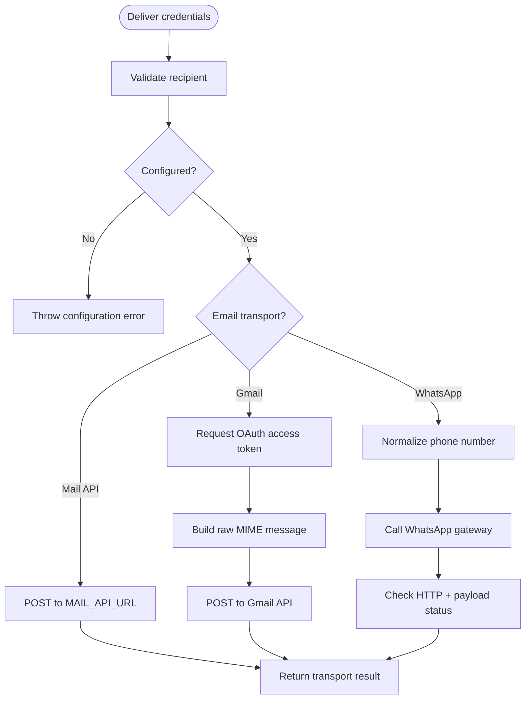
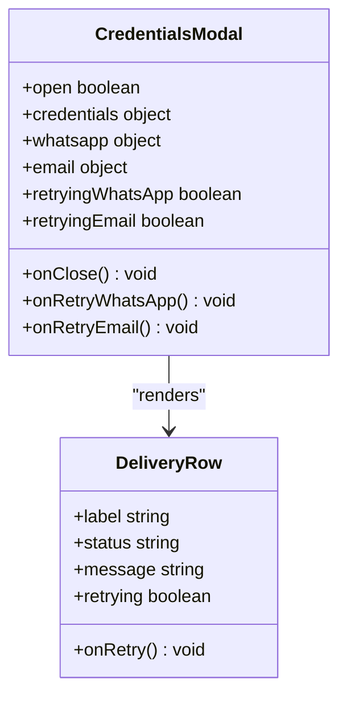
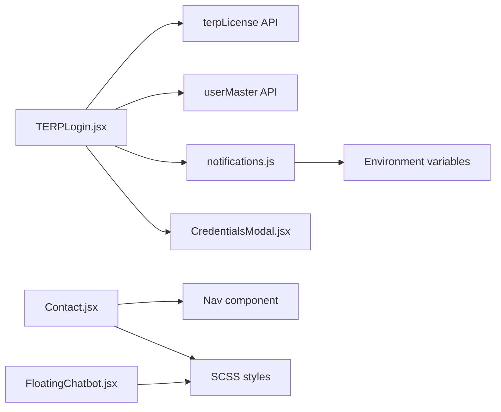

# Contact Integration

<cite>
**Referenced Files in This Document**
- [Contact.jsx](file://src/pages/Contact.jsx)
- [TERPLogin.jsx](file://src/pages/TERPLogin.jsx)
- [FloatingChatbot.jsx](file://src/components/FloatingChatbot.jsx)
- [notifications.js](file://src/api/notifications.js)
- [CredentialsModal.jsx](file://src/components/CredentialsModal.jsx)
- [config.js](file://src/config/config.js)
</cite>

## Table of Contents
1. [Introduction](#introduction)
2. [Project Structure](#project-structure)
3. [Core Components](#core-components)
4. [Architecture Overview](#architecture-overview)
5. [Detailed Component Analysis](#detailed-component-analysis)
6. [Dependency Analysis](#dependency-analysis)
7. [Performance Considerations](#performance-considerations)
8. [Troubleshooting Guide](#troubleshooting-guide)
9. [Conclusion](#conclusion)
10. [Appendices](#appendices)

## Introduction
This document explains the contact integration features in the frontend application, focusing on:
- WhatsApp direct messaging links for customer support routing
- TERP login and license creation flow with secure credential delivery
- Contact form handling, validation patterns, and user experience flows
- External service integrations, security considerations, fallback mechanisms
- Accessibility compliance for contact forms
- Mobile optimization for WhatsApp integration
- Analytics tracking recommendations for contact conversions

The implementation spans a public contact page, a floating chat assistant, and a multi-step T-ERP setup flow that integrates Google authentication, external APIs, WhatsApp messaging, and email delivery.

## Project Structure
The contact-related functionality is primarily implemented across these files:
- Public contact page with office details, phone-to-WhatsApp links, and a message form
- Floating chatbot providing product information and support routing
- T-ERP login and license creation flow with credential delivery via WhatsApp and email
- Notification API layer for WhatsApp and Gmail-based email sending
- Modal for displaying and retrying credential delivery

**Diagram sources**
- [Contact.jsx:69-192](file://src/pages/Contact.jsx#L69-L192)
- [TERPLogin.jsx:49-318](file://src/pages/TERPLogin.jsx#L49-L318)
- [notifications.js:57-229](file://src/api/notifications.js#L57-L229)
- [CredentialsModal.jsx:36-177](file://src/components/CredentialsModal.jsx#L36-L177)

**Section sources**
- [Contact.jsx:1-259](file://src/pages/Contact.jsx#L1-L259)
- [TERPLogin.jsx:1-319](file://src/pages/TERPLogin.jsx#L1-L319)
- [FloatingChatbot.jsx:1-370](file://src/components/FloatingChatbot.jsx#L1-L370)
- [notifications.js:1-230](file://src/api/notifications.js#L1-L230)
- [CredentialsModal.jsx:1-178](file://src/components/CredentialsModal.jsx#L1-L178)

## Core Components
- Contact page: Displays office locations, phone numbers linked to WhatsApp, and a simple contact form with basic browser validation.
- Floating chatbot: Provides quick answers about products and routes users to support channels (email and phone).
- TERP login flow: Multi-step process integrating Google Sign-In, project selection, company details, license creation, admin account creation, and credential delivery via WhatsApp and email.
- Notifications API: Handles WhatsApp gateway calls and email delivery through either a custom mail API or Gmail OAuth.
- Credentials modal: Presents created credentials and shows delivery status with retry options.

**Section sources**
- [Contact.jsx:94-252](file://src/pages/Contact.jsx#L94-L252)
- [FloatingChatbot.jsx:184-367](file://src/components/FloatingChatbot.jsx#L184-L367)
- [TERPLogin.jsx:49-318](file://src/pages/TERPLogin.jsx#L49-L318)
- [notifications.js:24-229](file://src/api/notifications.js#L24-L229)
- [CredentialsModal.jsx:36-177](file://src/components/CredentialsModal.jsx#L36-L177)

## Architecture Overview
The contact integration architecture connects user-facing components with external services:

**Diagram sources**
- [Contact.jsx:103-111](file://src/pages/Contact.jsx#L103-L111)
- [FloatingChatbot.jsx:178-246](file://src/components/FloatingChatbot.jsx#L178-L246)
- [TERPLogin.jsx:184-247](file://src/pages/TERPLogin.jsx#L184-L247)
- [notifications.js:57-229](file://src/api/notifications.js#L57-L229)

## Detailed Component Analysis

### Contact Page: WhatsApp Direct Links and Form Handling
The contact page renders office data and converts phone numbers into WhatsApp direct links using `https://wa.me/<number>`. It also provides a simple contact form with native HTML validation.

Key behaviors:
- Phone numbers are mapped to WhatsApp links for each office.
- The form uses controlled inputs and HTML attributes like `required` and `type="email"` for validation.
- Submission currently simulates success without calling a backend endpoint.

**Diagram sources**
- [Contact.jsx:69-192](file://src/pages/Contact.jsx#L69-L192)
- [Contact.jsx:195-252](file://src/pages/Contact.jsx#L195-L252)

Accessibility and UX notes:
- Inputs use labels and semantic structure.
- Links open in new tabs with `rel="noopener noreferrer"` for safety.
- No ARIA roles are required beyond standard semantics; focus management is handled by the browser.

Mobile optimization:
- WhatsApp links work natively on mobile devices, launching the app directly.

Security considerations:
- Phone numbers are displayed publicly; ensure they belong to official support lines.
- No sensitive data is collected in this form.

Fallback mechanism:
- If WhatsApp is unavailable, users can still use email or call the provided phone number.

Analytics tracking recommendation:
- Track clicks on WhatsApp links and form submissions to measure conversion.

**Section sources**
- [Contact.jsx:69-192](file://src/pages/Contact.jsx#L69-L192)
- [Contact.jsx:195-252](file://src/pages/Contact.jsx#L195-L252)

### Floating Chatbot: Customer Support Routing
The floating chatbot provides product information and routes users to support channels. It detects support-related queries and renders clickable email and phone links.

Key behaviors:
- Quick questions and keyword matching guide users to relevant answers.
- Support answers include an email address and phone number, automatically converted into `mailto:` and `tel:` links.
- The launcher hides while a hero banner is visible to avoid obstructing content.

**Diagram sources**
- [FloatingChatbot.jsx:178-246](file://src/components/FloatingChatbot.jsx#L178-L246)
- [FloatingChatbot.jsx:12-32](file://src/components/FloatingChatbot.jsx#L12-L32)

Accessibility and UX notes:
- Buttons have clear labels and keyboard interaction.
- Close button has an accessible label.
- Content updates trigger auto-scroll for readability.

Mobile optimization:
- Chatbot panel is designed for small screens and avoids overlapping hero banners.

Security considerations:
- No personal data is stored locally in the chatbot.
- Links are safe and do not execute scripts.

Fallback mechanism:
- Fallback responses guide users to rephrase or choose from predefined topics.

Analytics tracking recommendation:
- Track quick question selections and support link clicks to understand user intent.

**Section sources**
- [FloatingChatbot.jsx:12-32](file://src/components/FloatingChatbot.jsx#L12-L32)
- [FloatingChatbot.jsx:178-246](file://src/components/FloatingChatbot.jsx#L178-L246)
- [FloatingChatbot.jsx:253-367](file://src/components/FloatingChatbot.jsx#L253-L367)

### TERP Login Flow: Authentication, License Creation, and Credential Delivery
The TERP login flow guides users through Google authentication, project selection, company details, license creation, and admin account setup. After successful setup, credentials are delivered via WhatsApp and email.

Key behaviors:
- Google Identity Services script is dynamically loaded and used for sign-in.
- Projects and packages are selected before proceeding.
- Company details are validated (including a 10-digit contact number).
- License creation and admin account creation call external APIs.
- Credentials are sent asynchronously via WhatsApp and email; the modal appears immediately.
- Delivery statuses are tracked and allow retries.

**Diagram sources**
- [TERPLogin.jsx:25-47](file://src/pages/TERPLogin.jsx#L25-L47)
- [TERPLogin.jsx:81-102](file://src/pages/TERPLogin.jsx#L81-L102)
- [TERPLogin.jsx:184-247](file://src/pages/TERPLogin.jsx#L184-L247)
- [notifications.js:57-229](file://src/api/notifications.js#L57-L229)
- [CredentialsModal.jsx:36-177](file://src/components/CredentialsModal.jsx#L36-L177)

Validation patterns:
- At least one project must be selected.
- Every selected project must have a package chosen.
- Company fields are required; contact number must be exactly 10 digits.
- Google sign-in is required before submission.

Error handling and fallbacks:
- Network errors are caught and presented with context about which endpoint failed.
- Delivery failures set a failed state with a message and allow retry.
- If email or WhatsApp configuration is missing, explicit errors are thrown.

Security considerations:
- Google ID token is kept in memory only; production should verify server-side.
- Sensitive credentials are shown in a modal and can be copied to clipboard.
- WhatsApp and email delivery functions validate recipients and configuration.

Accessibility and UX notes:
- Error and success messages use appropriate roles (`alert`, `status`).
- Modal traps focus and closes on Escape key.
- Copy-to-clipboard feedback is provided.

Mobile optimization:
- Google Sign-In button size and layout are optimized for touch.
- Numeric input uses `inputMode="numeric"` and `pattern` for better mobile keyboards.

Analytics tracking recommendation:
- Track steps completed (Google auth, project selection, company details), license creation success, and delivery outcomes (WhatsApp/email sent/failed).

**Section sources**
- [TERPLogin.jsx:25-47](file://src/pages/TERPLogin.jsx#L25-L47)
- [TERPLogin.jsx:81-102](file://src/pages/TERPLogin.jsx#L81-L102)
- [TERPLogin.jsx:184-247](file://src/pages/TERPLogin.jsx#L184-L247)
- [TERPLogin.jsx:249-318](file://src/pages/TERPLogin.jsx#L249-L318)
- [CredentialsModal.jsx:36-177](file://src/components/CredentialsModal.jsx#L36-L177)

### Notifications API: WhatsApp and Email Delivery
The notifications module centralizes delivery logic for WhatsApp and email.

Key behaviors:
- WhatsApp: Normalizes recipient numbers, constructs query parameters, calls the configured gateway, and checks both HTTP status and payload status.
- Email: Supports two transports:
  - Custom mail API via `VITE_MAIL_API_URL`
  - Gmail API via OAuth using Google Identity Services
- Configuration constants are read from environment variables.

**Diagram sources**
- [notifications.js:24-52](file://src/api/notifications.js#L24-L52)
- [notifications.js:57-85](file://src/api/notifications.js#L57-L85)
- [notifications.js:90-199](file://src/api/notifications.js#L90-L199)
- [notifications.js:204-229](file://src/api/notifications.js#L204-L229)

Security considerations:
- WhatsApp secret and account are passed via environment variables.
- Gmail OAuth requires user consent; tokens are cached briefly.
- Base64 encoding is used for MIME message construction.

Fallback mechanisms:
- If WhatsApp gateway returns HTTP 200 but payload indicates failure, an error is thrown.
- If Gmail API rejects the message, detailed error text is included.
- If neither mail API nor Gmail client ID is configured, a clear error is thrown.

**Section sources**
- [notifications.js:6-18](file://src/api/notifications.js#L6-L18)
- [notifications.js:24-52](file://src/api/notifications.js#L24-L52)
- [notifications.js:57-85](file://src/api/notifications.js#L57-L85)
- [notifications.js:90-199](file://src/api/notifications.js#L90-L199)
- [notifications.js:204-229](file://src/api/notifications.js#L204-L229)

### Credentials Modal: Delivery Status and Retry
The credentials modal displays created credentials and tracks delivery status for WhatsApp and email.

Key behaviors:
- Shows username, password, client ID, role, license key, email, phone, and projects.
- Displays delivery status rows with copy-to-clipboard and retry actions.
- Closes on Escape and prevents body scroll when open.

**Diagram sources**
- [CredentialsModal.jsx:36-177](file://src/components/CredentialsModal.jsx#L36-L177)

Accessibility and UX notes:
- Modal has `role="dialog"`, `aria-modal="true"`, and an accessible title.
- Close button has an accessible label.
- Keyboard navigation supports Escape to close.

**Section sources**
- [CredentialsModal.jsx:36-177](file://src/components/CredentialsModal.jsx#L36-L177)

## Dependency Analysis
The contact integration depends on several modules and external services:

**Diagram sources**
- [TERPLogin.jsx:1-19](file://src/pages/TERPLogin.jsx#L1-L19)
- [notifications.js:6-18](file://src/api/notifications.js#L6-L18)
- [CredentialsModal.jsx:1-3](file://src/components/CredentialsModal.jsx#L1-L3)
- [Contact.jsx:1-4](file://src/pages/Contact.jsx#L1-L4)
- [FloatingChatbot.jsx:1-4](file://src/components/FloatingChatbot.jsx#L1-L4)

Coupling and cohesion:
- TERPLogin is tightly coupled with notifications and credentials modal for delivery and presentation.
- Notifications encapsulates external service logic, improving cohesion.
- Contact and FloatingChatbot are loosely coupled and focused on user-facing interactions.

Potential circular dependencies:
- None observed between the analyzed files.

External dependencies:
- Google Identity Services for sign-in and Gmail OAuth.
- WhatsApp gateway for messaging.
- Gmail API or custom mail API for email delivery.

Interface contracts:
- Notifications exports normalized number formatting, message builders, and delivery functions.
- TERPLogin expects license and admin account creation results and extracts identifiers.

**Section sources**
- [TERPLogin.jsx:1-19](file://src/pages/TERPLogin.jsx#L1-L19)
- [notifications.js:6-18](file://src/api/notifications.js#L6-L18)
- [CredentialsModal.jsx:1-3](file://src/components/CredentialsModal.jsx#L1-L3)
- [Contact.jsx:1-4](file://src/pages/Contact.jsx#L1-L4)
- [FloatingChatbot.jsx:1-4](file://src/components/FloatingChatbot.jsx#L1-L4)

## Performance Considerations
- Avoid unnecessary re-renders in the contact form by keeping state minimal and using controlled inputs efficiently.
- Lazy-load Google Identity Services script only when needed to reduce initial bundle size.
- Debounce analytics events if tracking many micro-interactions (e.g., quick question clicks).
- Cache short-lived tokens in the notifications module to avoid repeated OAuth flows during a session.
- Use efficient DOM operations in the chatbot to prevent jank when appending messages.

[No sources needed since this section provides general guidance]

## Troubleshooting Guide
Common issues and resolutions:
- WhatsApp delivery fails:
  - Ensure `VITE_WHATSAPP_SECRET` and `VITE_WHATSAPP_ACCOUNT` are configured.
  - Verify recipient number normalization produces a valid international format.
  - Check gateway response payload status even when HTTP status is 200.
- Email delivery fails:
  - Configure either `VITE_MAIL_API_URL` or `VITE_GMAIL_CLIENT_ID`.
  - For Gmail, ensure OAuth consent is granted and token acquisition succeeds.
  - Inspect Gmail API error details for rejection reasons.
- Google Sign-In not loading:
  - Confirm network access to Google Identity Services.
  - Verify `VITE_GOOGLE_CLIENT_ID` is set.
- Contact form does not submit:
  - The current implementation simulates submission; wire up a real backend endpoint.
  - Ensure all required fields pass HTML5 validation.

**Section sources**
- [notifications.js:57-85](file://src/api/notifications.js#L57-L85)
- [notifications.js:182-199](file://src/api/notifications.js#L182-L199)
- [notifications.js:208-229](file://src/api/notifications.js#L208-L229)
- [TERPLogin.jsx:81-102](file://src/pages/TERPLogin.jsx#L81-L102)
- [TERPLogin.jsx:184-247](file://src/pages/TERPLogin.jsx#L184-L247)
- [Contact.jsx:103-111](file://src/pages/Contact.jsx#L103-L111)

## Conclusion
The contact integration combines straightforward public contact methods with a robust T-ERP setup flow. WhatsApp direct links provide immediate support access, while the TERP login flow securely creates licenses and admin accounts, delivering credentials via multiple channels. The notifications module abstracts external service complexity, and the credentials modal offers clear delivery status and retry capabilities. Accessibility and mobile optimization are considered throughout, and analytics tracking recommendations enable measurement of conversion paths.

[No sources needed since this section summarizes without analyzing specific files]

## Appendices

### Configuration Reference
- Environment variables used by the integration:
  - `VITE_WHATSAPP_API_URL`: WhatsApp gateway endpoint
  - `VITE_WHATSAPP_SECRET`: WhatsApp gateway secret
  - `VITE_WHATSAPP_ACCOUNT`: WhatsApp gateway account
  - `VITE_GMAIL_CLIENT_ID`: Gmail OAuth client ID
  - `VITE_GMAIL_SENDER`: Sender email for Gmail API
  - `VITE_MAIL_API_URL`: Custom mail API endpoint
  - `VITE_TERP_APP_LOGIN_URL`: Login URL appended to credential messages
  - `VITE_GOOGLE_CLIENT_ID`: Google Sign-In client ID
  - `VITE_API_URL`: Base URL for internal APIs

**Section sources**
- [notifications.js:6-18](file://src/api/notifications.js#L6-L18)
- [config.js:1-3](file://src/config/config.js#L1-L3)