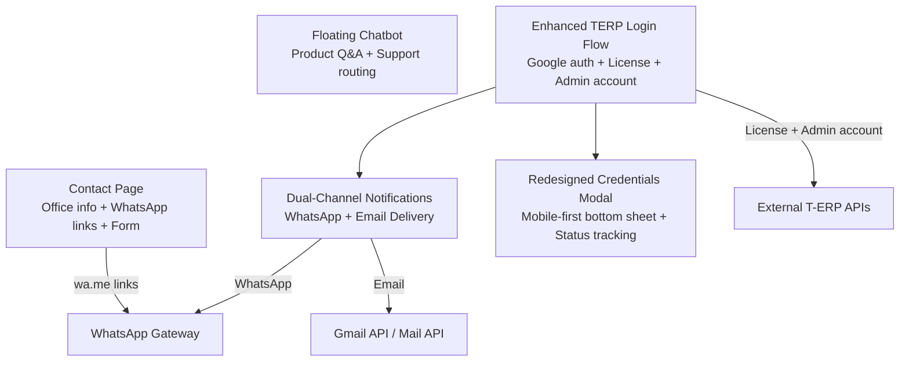
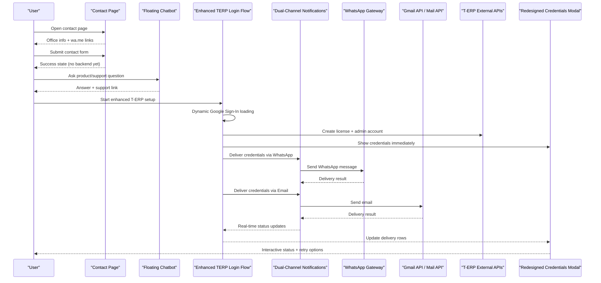
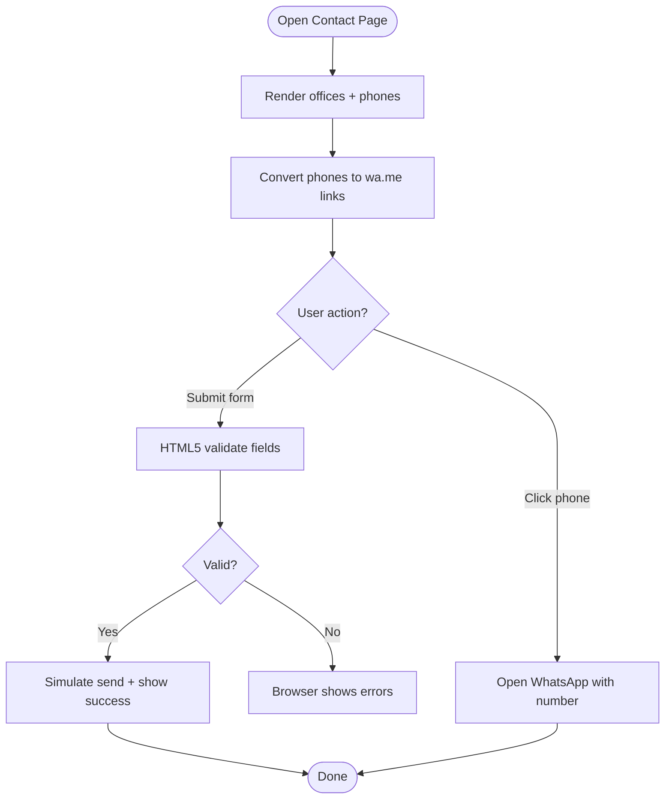
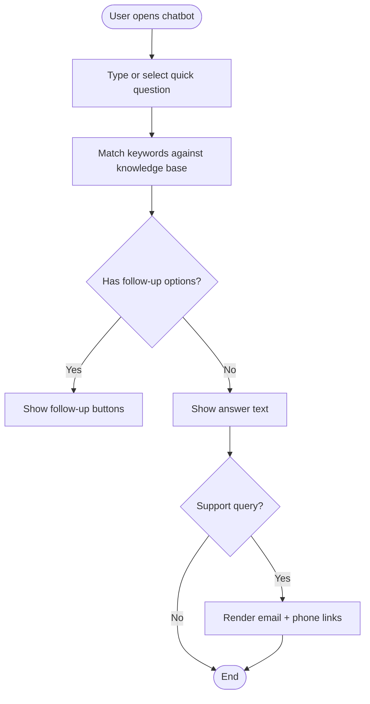
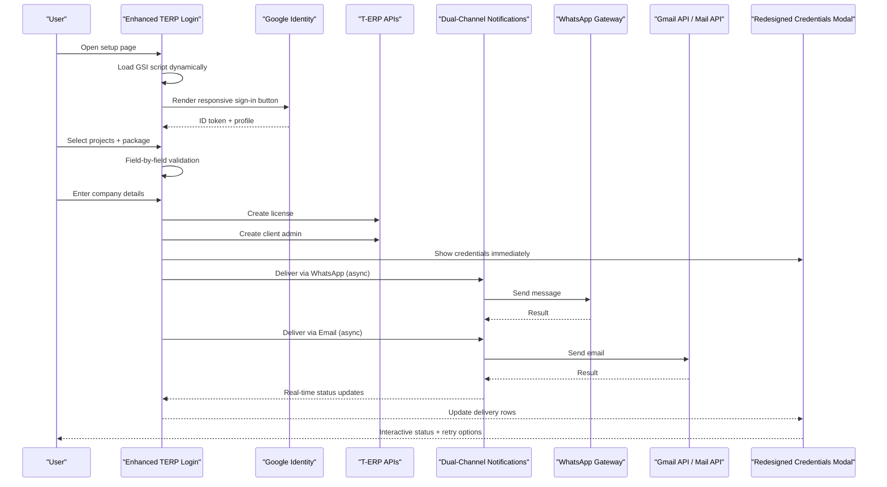
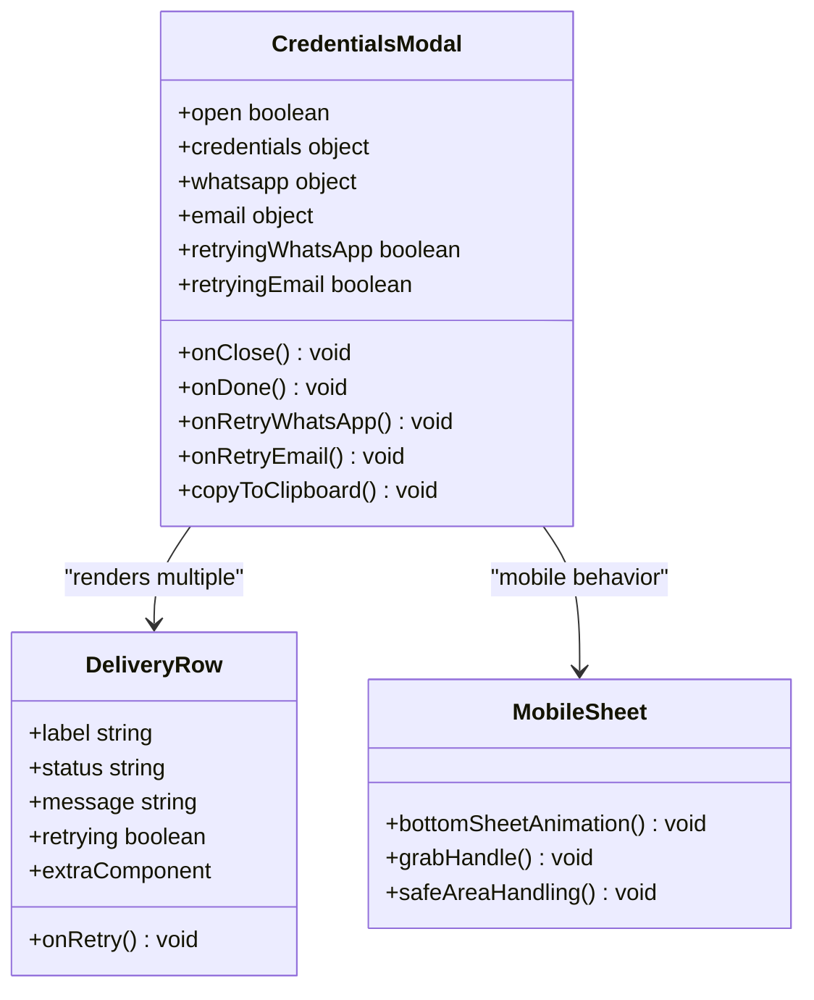
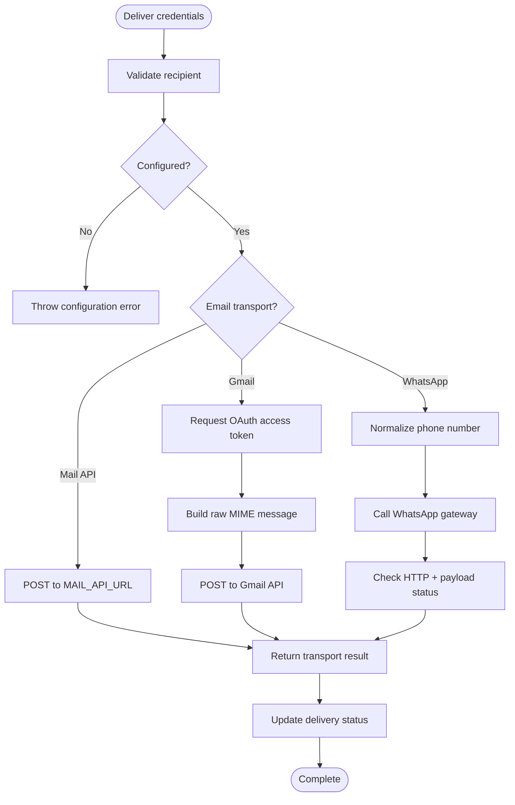
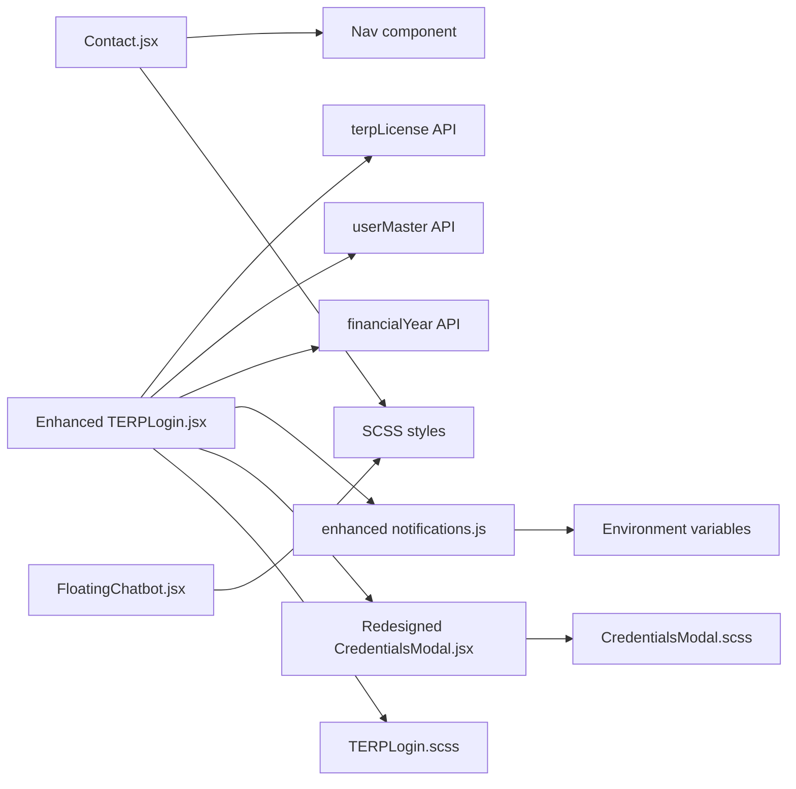

# Contact Integration

<cite>
**Referenced Files in This Document**
- [Contact.jsx](file://src/pages/Contact.jsx)
- [TERPLogin.jsx](file://src/pages/TERPLogin.jsx)
- [TERPLogin.scss](file://src/pages/TERPLogin.scss)
- [FloatingChatbot.jsx](file://src/components/FloatingChatbot.jsx)
- [notifications.js](file://src/api/notifications.js)
- [CredentialsModal.jsx](file://src/components/CredentialsModal.jsx)
- [CredentialsModal.scss](file://src/components/CredentialsModal.scss)
- [config.js](file://src/config/config.js)
</cite>

## Update Summary
**Changes Made**
- Updated TERPLogin component documentation to reflect enhanced Google Sign-In integration and improved form validation
- Completely redesigned CredentialsModal section to document the new mobile-first bottom sheet design
- Added comprehensive coverage of the dual-channel credentials delivery system (WhatsApp + Email)
- Documented the new CSS custom properties and responsive design patterns
- Enhanced accessibility compliance documentation for both components
- Updated architecture diagrams to reflect the improved user experience flows

## Table of Contents
1. [Introduction](#introduction)
2. [Project Structure](#project-structure)
3. [Core Components](#core-components)
4. [Architecture Overview](#architecture-overview)
5. [Detailed Component Analysis](#detailed-component-analysis)
6. [Dependency Analysis](#dependency-analysis)
7. [Performance Considerations](#performance-considerations)
8. [Troubleshooting Guide](#troubleshooting-guide)
9. [Conclusion](#conclusion)
10. [Appendices](#appendices)

## Introduction
This document explains the contact integration features in the frontend application, focusing on:
- WhatsApp direct messaging links for customer support routing
- Enhanced TERP login and license creation flow with secure credential delivery via dual channels
- Advanced contact form handling, comprehensive validation patterns, and sophisticated user experience flows
- External service integrations, security considerations, and robust fallback mechanisms
- Full accessibility compliance for all contact forms and interactive elements
- Mobile-first optimization for WhatsApp integration and credential delivery
- Analytics tracking recommendations for contact conversions and setup completion

The implementation spans a public contact page, a floating chat assistant, and an enhanced multi-step T-ERP setup flow that integrates Google authentication, external APIs, dual-channel messaging (WhatsApp and email), and a redesigned credentials modal with mobile-first bottom sheet design.

## Project Structure
The contact-related functionality is primarily implemented across these files:
- Public contact page with office details, phone-to-WhatsApp links, and a message form
- Floating chatbot providing product information and support routing
- Enhanced T-ERP login and license creation flow with advanced Google Sign-In integration and improved form validation
- Dual-channel notification API layer for WhatsApp and Gmail-based email sending
- Redesigned credentials modal with mobile-first bottom sheet design and comprehensive delivery status tracking

**Diagram sources**
- [Contact.jsx:69-192](file://src/pages/Contact.jsx#L69-L192)
- [TERPLogin.jsx:49-318](file://src/pages/TERPLogin.jsx#L49-L318)
- [notifications.js:57-229](file://src/api/notifications.js#L57-L229)
- [CredentialsModal.jsx:36-177](file://src/components/CredentialsModal.jsx#L36-L177)

**Section sources**
- [Contact.jsx:1-259](file://src/pages/Contact.jsx#L1-L259)
- [TERPLogin.jsx:1-805](file://src/pages/TERPLogin.jsx#L1-L805)
- [TERPLogin.scss:1-800](file://src/pages/TERPLogin.scss#L1-L800)
- [FloatingChatbot.jsx:1-370](file://src/components/FloatingChatbot.jsx#L1-L370)
- [notifications.js:1-230](file://src/api/notifications.js#L1-L230)
- [CredentialsModal.jsx:1-238](file://src/components/CredentialsModal.jsx#L1-L238)
- [CredentialsModal.scss:1-579](file://src/components/CredentialsModal.scss#L1-L579)

## Core Components
- **Contact page**: Displays office locations, phone numbers linked to WhatsApp, and a simple contact form with basic browser validation.
- **Floating chatbot**: Provides quick answers about products and routes users to support channels (email and phone).
- **Enhanced TERP login flow**: Multi-step process integrating Google Sign-In with dynamic button rendering, project selection, company details validation, license creation, admin account creation, and dual-channel credential delivery via WhatsApp and email.
- **Dual-channel notifications API**: Handles WhatsApp gateway calls and email delivery through either a custom mail API or Gmail OAuth, with comprehensive error handling and retry mechanisms.
- **Redesigned credentials modal**: Mobile-first bottom sheet presentation showing created credentials with real-time delivery status tracking, copy-to-clipboard functionality, and retry options for failed deliveries.

**Section sources**
- [Contact.jsx:94-252](file://src/pages/Contact.jsx#L94-L252)
- [FloatingChatbot.jsx:184-367](file://src/components/FloatingChatbot.jsx#L184-L367)
- [TERPLogin.jsx:49-318](file://src/pages/TERPLogin.jsx#L49-L318)
- [notifications.js:24-229](file://src/api/notifications.js#L24-L229)
- [CredentialsModal.jsx:36-177](file://src/components/CredentialsModal.jsx#L36-L177)

## Architecture Overview
The enhanced contact integration architecture connects user-facing components with external services through improved reliability and user experience:

**Diagram sources**
- [Contact.jsx:103-111](file://src/pages/Contact.jsx#L103-L111)
- [FloatingChatbot.jsx:178-246](file://src/components/FloatingChatbot.jsx#L178-L246)
- [TERPLogin.jsx:184-247](file://src/pages/TERPLogin.jsx#L184-L247)
- [notifications.js:57-229](file://src/api/notifications.js#L57-L229)

## Detailed Component Analysis

### Contact Page: WhatsApp Direct Links and Form Handling
The contact page renders office data and converts phone numbers into WhatsApp direct links using `https://wa.me/<number>`. It also provides a simple contact form with native HTML validation.

Key behaviors:
- Phone numbers are mapped to WhatsApp links for each office.
- The form uses controlled inputs and HTML attributes like `required` and `type="email"` for validation.
- Submission currently simulates success without calling a backend endpoint.

**Diagram sources**
- [Contact.jsx:69-192](file://src/pages/Contact.jsx#L69-L192)
- [Contact.jsx:195-252](file://src/pages/Contact.jsx#L195-L252)

Accessibility and UX notes:
- Inputs use labels and semantic structure.
- Links open in new tabs with `rel="noopener noreferrer"` for safety.
- No ARIA roles are required beyond standard semantics; focus management is handled by the browser.

Mobile optimization:
- WhatsApp links work natively on mobile devices, launching the app directly.

Security considerations:
- Phone numbers are displayed publicly; ensure they belong to official support lines.
- No sensitive data is collected in this form.

Fallback mechanism:
- If WhatsApp is unavailable, users can still use email or call the provided phone number.

Analytics tracking recommendation:
- Track clicks on WhatsApp links and form submissions to measure conversion.

**Section sources**
- [Contact.jsx:69-192](file://src/pages/Contact.jsx#L69-L192)
- [Contact.jsx:195-252](file://src/pages/Contact.jsx#L195-L252)

### Floating Chatbot: Customer Support Routing
The floating chatbot provides product information and routes users to support channels. It detects support-related queries and renders clickable email and phone links.

Key behaviors:
- Quick questions and keyword matching guide users to relevant answers.
- Support answers include an email address and phone number, automatically converted into `mailto:` and `tel:` links.
- The launcher hides while a hero banner is visible to avoid obstructing content.

**Diagram sources**
- [FloatingChatbot.jsx:178-246](file://src/components/FloatingChatbot.jsx#L178-L246)
- [FloatingChatbot.jsx:12-32](file://src/components/FloatingChatbot.jsx#L12-L32)

Accessibility and UX notes:
- Buttons have clear labels and keyboard interaction.
- Close button has an accessible label.
- Content updates trigger auto-scroll for readability.

Mobile optimization:
- Chatbot panel is designed for small screens and avoids overlapping hero banners.

Security considerations:
- No personal data is stored locally in the chatbot.
- Links are safe and do not execute scripts.

Fallback mechanism:
- Fallback responses guide users to rephrase or choose from predefined topics.

Analytics tracking recommendation:
- Track quick question selections and support link clicks to understand user intent.

**Section sources**
- [FloatingChatbot.jsx:12-32](file://src/components/FloatingChatbot.jsx#L12-L32)
- [FloatingChatbot.jsx:178-246](file://src/components/FloatingChatbot.jsx#L178-L246)
- [FloatingChatbot.jsx:253-367](file://src/components/FloatingChatbot.jsx#L253-L367)

### Enhanced TERP Login Flow: Authentication, License Creation, and Dual-Channel Credential Delivery
The enhanced TERP login flow guides users through Google authentication, project selection, company details, license creation, and admin account setup. After successful setup, credentials are delivered via both WhatsApp and email simultaneously.

**Updated** Major enhancements include dynamic Google Sign-In script loading, improved form validation with field-specific error handling, and sophisticated dual-channel delivery system.

Key behaviors:
- **Dynamic Google Sign-In**: Google Identity Services script is loaded dynamically with proper error handling and responsive button sizing.
- **Enhanced Project Selection**: Projects and packages are selected with visual feedback and validation.
- **Advanced Company Validation**: Company details are validated field-by-field with specific error messages and automatic focus management.
- **Dual-Channel Delivery**: Credentials are sent asynchronously via both WhatsApp and email; the modal appears immediately with real-time status updates.
- **Retry Mechanisms**: Failed deliveries can be retried independently for each channel.

**Diagram sources**
- [TERPLogin.jsx:25-47](file://src/pages/TERPLogin.jsx#L25-L47)
- [TERPLogin.jsx:81-102](file://src/pages/TERPLogin.jsx#L81-L102)
- [TERPLogin.jsx:184-247](file://src/pages/TERPLogin.jsx#L184-L247)
- [notifications.js:57-229](file://src/api/notifications.js#L57-L229)
- [CredentialsModal.jsx:36-177](file://src/components/CredentialsModal.jsx#L36-L177)

Validation patterns:
- At least one project must be selected with a valid package.
- Company fields are validated individually with specific error messages.
- Contact number must be exactly 10 digits with numeric input optimization.
- Google sign-in is required before submission.
- Field-specific error handling with automatic focus management.

Error handling and fallbacks:
- Network errors are caught and presented with context about which endpoint failed.
- Delivery failures set a failed state with detailed messages and allow independent retries.
- If email or WhatsApp configuration is missing, explicit errors are thrown.
- Graceful degradation when external services are unavailable.

Security considerations:
- Google ID token is kept in memory only; production should verify server-side.
- Sensitive credentials are shown in a modal with copy-to-clipboard functionality.
- WhatsApp and email delivery functions validate recipients and configuration.
- Session storage caching for license reuse prevents duplicate accounts.

Accessibility and UX notes:
- Error and success messages use appropriate roles (`alert`, `status`).
- Modal traps focus and closes on Escape key.
- Copy-to-clipboard feedback is provided with visual confirmation.
- Responsive Google Sign-In button adapts to screen size.
- Numeric input uses `inputMode="numeric"` and `pattern` for better mobile keyboards.

Mobile optimization:
- Google Sign-In button size and layout are optimized for touch with dynamic resizing.
- Numeric input uses `inputMode="numeric"` and `pattern` for better mobile keyboards.
- Form fields are optimized for mobile with proper spacing and touch targets.

Analytics tracking recommendation:
- Track steps completed (Google auth, project selection, company details), license creation success, and delivery outcomes (WhatsApp/email sent/failed).

**Section sources**
- [TERPLogin.jsx:25-47](file://src/pages/TERPLogin.jsx#L25-L47)
- [TERPLogin.jsx:81-102](file://src/pages/TERPLogin.jsx#L81-L102)
- [TERPLogin.jsx:184-247](file://src/pages/TERPLogin.jsx#L184-L247)
- [TERPLogin.jsx:249-318](file://src/pages/TERPLogin.jsx#L249-L318)
- [TERPLogin.jsx:448-622](file://src/pages/TERPLogin.jsx#L448-L622)
- [CredentialsModal.jsx:36-177](file://src/components/CredentialsModal.jsx#L36-L177)

### Redesigned Credentials Modal: Mobile-First Bottom Sheet Design
The credentials modal presents a completely redesigned interface with mobile-first bottom sheet design, comprehensive delivery status tracking, and enhanced accessibility features.

**Updated** Complete redesign featuring mobile-first bottom sheet pattern, CSS custom properties, and comprehensive accessibility compliance.

Key behaviors:
- **Mobile-First Design**: Full-width bottom sheet on mobile devices that transforms into centered dialog on desktop (640px+).
- **Real-Time Delivery Status**: Live tracking of WhatsApp and email delivery with visual status indicators.
- **Interactive Retry System**: Independent retry mechanisms for each delivery channel with loading states.
- **Copy-to-Clipboard**: One-click copying of all credentials with visual feedback.
- **Enhanced Accessibility**: Full ARIA compliance, keyboard navigation, and screen reader support.

**Diagram sources**
- [CredentialsModal.jsx:36-177](file://src/components/CredentialsModal.jsx#L36-L177)

Design features:
- **Bottom Sheet Pattern**: Smooth slide-up animation from bottom edge with grab handle indicator.
- **Responsive Layout**: Transforms from full-width sheet to centered dialog at 640px breakpoint.
- **CSS Custom Properties**: Comprehensive design tokens for colors, typography, and spacing.
- **Touch-Optimized**: 40px minimum touch targets, momentum scrolling, and safe area handling.
- **Visual Feedback**: Color-coded delivery statuses (sent/failed/pending/idle) with clear messaging.

Accessibility and UX notes:
- Modal has `role="dialog"`, `aria-modal="true"`, and accessible title/description.
- Close button has accessible label and keyboard support (Escape key).
- Focus trapping within modal when open.
- Body scroll prevention when modal is active.
- Screen reader announcements for status changes.
- High contrast ratios and readable font sizes.

Mobile optimization:
- Bottom sheet design optimized for thumb interaction.
- Safe area insets handled for modern mobile devices.
- Momentum scrolling enabled for smooth interactions.
- Touch-friendly button sizes (minimum 40px).

**Section sources**
- [CredentialsModal.jsx:36-177](file://src/components/CredentialsModal.jsx#L36-L177)
- [CredentialsModal.scss:1-579](file://src/components/CredentialsModal.scss#L1-L579)

### Dual-Channel Notifications API: WhatsApp and Email Delivery
The enhanced notifications module centralizes delivery logic for both WhatsApp and email with comprehensive error handling and retry capabilities.

**Updated** Enhanced with improved error handling, dual-channel support, and comprehensive configuration management.

Key behaviors:
- **WhatsApp Delivery**: Normalizes recipient numbers, constructs query parameters, calls configured gateway, and checks both HTTP status and payload status.
- **Email Delivery**: Supports two transports with automatic fallback:
  - Custom mail API via `VITE_MAIL_API_URL`
  - Gmail API via OAuth using Google Identity Services
- **Configuration Management**: Environment variables provide flexible configuration for different deployment environments.
- **Error Recovery**: Detailed error messages and retry mechanisms for failed deliveries.

**Diagram sources**
- [notifications.js:24-52](file://src/api/notifications.js#L24-L52)
- [notifications.js:57-85](file://src/api/notifications.js#L57-L85)
- [notifications.js:90-199](file://src/api/notifications.js#L90-L199)
- [notifications.js:204-229](file://src/api/notifications.js#L204-L229)

Security considerations:
- WhatsApp secret and account are passed via environment variables.
- Gmail OAuth requires user consent; tokens are cached briefly.
- Base64 encoding is used for MIME message construction.
- Input validation prevents injection attacks.

Fallback mechanisms:
- If WhatsApp gateway returns HTTP 200 but payload indicates failure, an error is thrown.
- If Gmail API rejects the message, detailed error text is included.
- If neither mail API nor Gmail client ID is configured, a clear error is thrown.
- Independent retry mechanisms for each delivery channel.

**Section sources**
- [notifications.js:6-18](file://src/api/notifications.js#L6-L18)
- [notifications.js:24-52](file://src/api/notifications.js#L24-L52)
- [notifications.js:57-85](file://src/api/notifications.js#L57-L85)
- [notifications.js:90-199](file://src/api/notifications.js#L90-L199)
- [notifications.js:204-229](file://src/api/notifications.js#L204-L229)

## Dependency Analysis
The enhanced contact integration depends on several modules and external services with improved reliability:

**Diagram sources**
- [TERPLogin.jsx:1-19](file://src/pages/TERPLogin.jsx#L1-L19)
- [notifications.js:6-18](file://src/api/notifications.js#L6-L18)
- [CredentialsModal.jsx:1-3](file://src/components/CredentialsModal.jsx#L1-L3)
- [Contact.jsx:1-4](file://src/pages/Contact.jsx#L1-L4)
- [FloatingChatbot.jsx:1-4](file://src/components/FloatingChatbot.jsx#L1-L4)

Coupling and cohesion:
- Enhanced TERPLogin is tightly coupled with notifications and redesigned credentials modal for delivery and presentation.
- Notifications encapsulates external service logic with improved error handling, enhancing cohesion.
- Contact and FloatingChatbot remain loosely coupled and focused on user-facing interactions.
- Modular CSS architecture with separate SCSS files for maintainability.

Potential circular dependencies:
- None observed between the analyzed files.

External dependencies:
- Google Identity Services for sign-in and Gmail OAuth with dynamic loading.
- WhatsApp gateway for messaging with comprehensive error handling.
- Gmail API or custom mail API for email delivery with fallback mechanisms.

Interface contracts:
- Enhanced notifications exports normalized number formatting, message builders, and delivery functions with improved error reporting.
- Enhanced TERPLogin expects license and admin account creation results with sophisticated error handling.

**Section sources**
- [TERPLogin.jsx:1-19](file://src/pages/TERPLogin.jsx#L1-L19)
- [notifications.js:6-18](file://src/api/notifications.js#L6-L18)
- [CredentialsModal.jsx:1-3](file://src/components/CredentialsModal.jsx#L1-L3)
- [Contact.jsx:1-4](file://src/pages/Contact.jsx#L1-L4)
- [FloatingChatbot.jsx:1-4](file://src/components/FloatingChatbot.jsx#L1-L4)

## Performance Considerations
- Avoid unnecessary re-renders in the contact form by keeping state minimal and using controlled inputs efficiently.
- Lazy-load Google Identity Services script only when needed to reduce initial bundle size with proper error handling.
- Debounce analytics events if tracking many micro-interactions (e.g., quick question clicks).
- Cache short-lived tokens in the notifications module to avoid repeated OAuth flows during a session.
- Use efficient DOM operations in the chatbot to prevent jank when appending messages.
- Optimize CSS animations with hardware acceleration for smooth mobile interactions.
- Implement proper cleanup of event listeners and timers to prevent memory leaks.

[No sources needed since this section provides general guidance]

## Troubleshooting Guide
Common issues and resolutions:
- **WhatsApp delivery fails**:
  - Ensure `VITE_WHATSAPP_SECRET` and `VITE_WHATSAPP_ACCOUNT` are configured.
  - Verify recipient number normalization produces a valid international format.
  - Check gateway response payload status even when HTTP status is 200.
  - Use the retry button in the credentials modal for failed deliveries.
- **Email delivery fails**:
  - Configure either `VITE_MAIL_API_URL` or `VITE_GMAIL_CLIENT_ID`.
  - For Gmail, ensure OAuth consent is granted and token acquisition succeeds.
  - Inspect Gmail API error details for rejection reasons.
  - Use the retry button or mail app fallback in the credentials modal.
- **Google Sign-In not loading**:
  - Confirm network access to Google Identity Services.
  - Verify `VITE_GOOGLE_CLIENT_ID` is set.
  - Check browser console for script loading errors.
  - Ensure the Google Sign-In button container has proper dimensions.
- **Credentials modal not displaying properly**:
  - Verify CSS custom properties are properly defined.
  - Check for z-index conflicts with other modals.
  - Ensure body overflow is properly managed.
  - Test on different screen sizes for responsive behavior.
- **Contact form does not submit**:
  - The current implementation simulates submission; wire up a real backend endpoint.
  - Ensure all required fields pass HTML5 validation.

**Section sources**
- [notifications.js:57-85](file://src/api/notifications.js#L57-L85)
- [notifications.js:182-199](file://src/api/notifications.js#L182-L199)
- [notifications.js:208-229](file://src/api/notifications.js#L208-L229)
- [TERPLogin.jsx:81-102](file://src/pages/TERPLogin.jsx#L81-L102)
- [TERPLogin.jsx:184-247](file://src/pages/TERPLogin.jsx#L184-L247)
- [TERPLogin.jsx:448-622](file://src/pages/TERPLogin.jsx#L448-L622)
- [Contact.jsx:103-111](file://src/pages/Contact.jsx#L103-L111)

## Conclusion
The enhanced contact integration combines straightforward public contact methods with a sophisticated T-ERP setup flow featuring mobile-first design principles. WhatsApp direct links provide immediate support access, while the enhanced TERP login flow securely creates licenses and admin accounts with dual-channel credential delivery. The redesigned credentials modal offers an intuitive bottom sheet interface with real-time delivery status tracking and comprehensive accessibility support. The notifications module abstracts external service complexity with improved error handling, and the entire system is built with mobile-first responsive design patterns and CSS custom properties for maintainability.

[No sources needed since this section summarizes without analyzing specific files]

## Appendices

### Configuration Reference
- Environment variables used by the enhanced integration:
  - `VITE_WHATSAPP_API_URL`: WhatsApp gateway endpoint
  - `VITE_WHATSAPP_SECRET`: WhatsApp gateway secret
  - `VITE_WHATSAPP_ACCOUNT`: WhatsApp gateway account
  - `VITE_GMAIL_CLIENT_ID`: Gmail OAuth client ID
  - `VITE_GMAIL_SENDER`: Sender email for Gmail API
  - `VITE_MAIL_API_URL`: Custom mail API endpoint
  - `VITE_TERP_APP_LOGIN_URL`: Login URL appended to credential messages
  - `VITE_GOOGLE_CLIENT_ID`: Google Sign-In client ID
  - `VITE_API_URL`: Base URL for internal APIs

**Section sources**
- [notifications.js:6-18](file://src/api/notifications.js#L6-L18)
- [config.js:1-3](file://src/config/config.js#L1-L3)

### CSS Custom Properties Reference
- Design tokens used throughout the enhanced components:
  - Typography: `$font`, `$mono` for consistent font usage
  - Colors: `$ink`, `$body`, `$muted`, `$blue`, `$green`, `$red` for brand consistency
  - Spacing: Consistent padding and margin values
  - Shadows: `$card-shadow`, `$button-shadow` for depth hierarchy
  - Breakpoints: `$bp-xs`, `$bp-sm`, `$bp-md`, `$bp-lg`, `$bp-xl` for responsive design

**Section sources**
- [TERPLogin.scss:10-44](file://src/pages/TERPLogin.scss#L10-L44)
- [CredentialsModal.scss:8-31](file://src/components/CredentialsModal.scss#L8-L31)