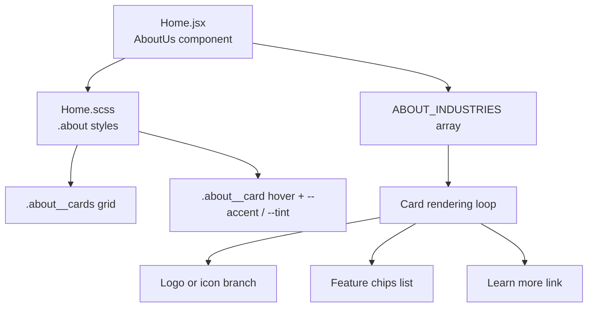
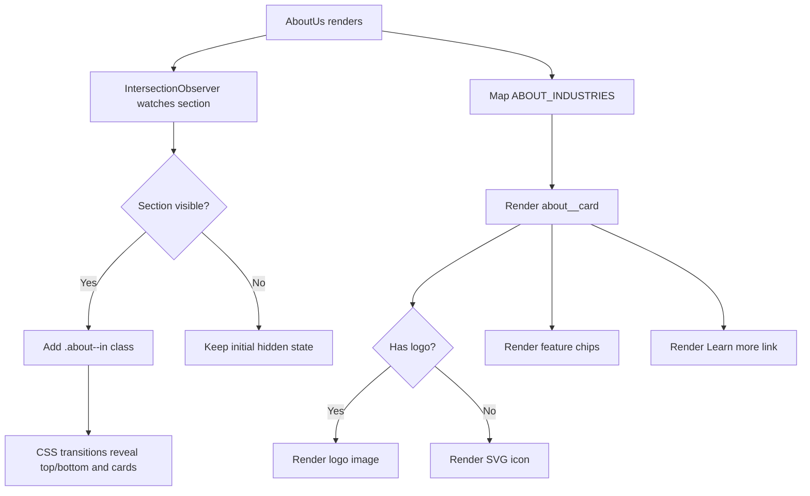
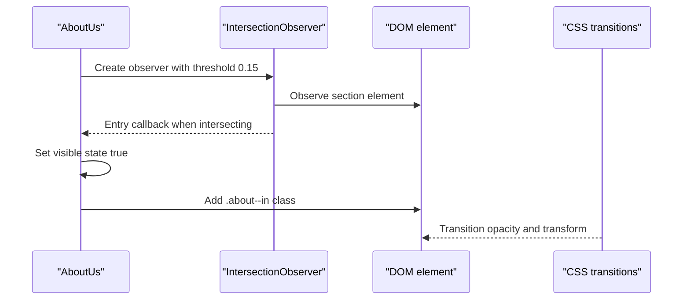
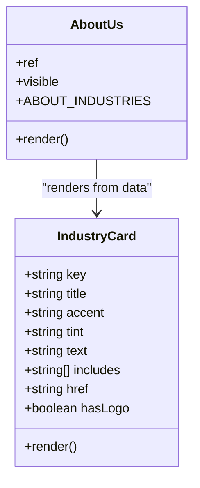
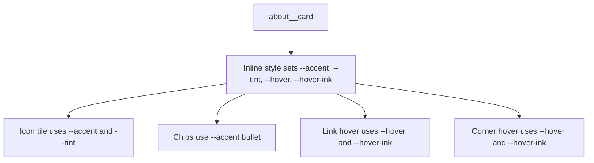
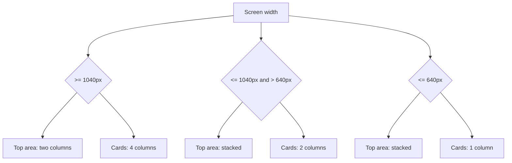
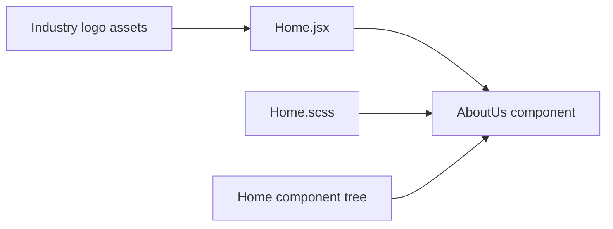

# About Us Section

<cite>
**Referenced Files in This Document**
- [Home.jsx](file://src/pages/Home.jsx)
- [Home.scss](file://src/pages/Home.scss)
</cite>

## Table of Contents
1. [Introduction](#introduction)
2. [Project Structure](#project-structure)
3. [Core Components](#core-components)
4. [Architecture Overview](#architecture-overview)
5. [Detailed Component Analysis](#detailed-component-analysis)
6. [Dependency Analysis](#dependency-analysis)
7. [Performance Considerations](#performance-considerations)
8. [Accessibility Compliance](#accessibility-compliance)
9. [Mobile Responsiveness Strategies](#mobile-responsiveness-strategies)
10. [Troubleshooting Guide](#troubleshooting-guide)
11. [Conclusion](#conclusion)

## Introduction
This document explains the implementation of the About Us section on the home page. It covers:
- Scroll-triggered reveal animations using `IntersectionObserver`.
- Industry cards for HRMS, Hospitality, Property, and Gym with hover effects and CSS custom properties.
- Responsive layout structure across desktop, tablet, and mobile breakpoints.
- The data-driven approach that renders logos, icons, descriptions, feature chips, and links from a single industry configuration array.
- Performance considerations for image loading and animation.
- Accessibility practices for interactive elements.
- Mobile responsiveness strategies used by the component and its styles.

## Project Structure
The About Us section is part of the home page and lives inside the main home component file. Its visual behavior is defined in the home page stylesheet.

**Diagram sources**
- [Home.jsx:34-101](file://src/pages/Home.jsx#L34-L101)
- [Home.jsx:188-252](file://src/pages/Home.jsx#L188-L252)
- [Home.scss:793-983](file://src/pages/Home.scss#L793-L983)

**Section sources**
- [Home.jsx:16-257](file://src/pages/Home.jsx#L16-L257)
- [Home.scss:439-983](file://src/pages/Home.scss#L439-L983)

## Core Components
The About Us section is implemented as a React component inside the home page. It contains:
- A scroll-triggered container that reveals content when it enters the viewport.
- An upper area with an image, badge, floating labels, headline, description, checklist, and call-to-action link.
- A lower area introducing industry solutions and rendering four industry cards.

Key responsibilities:
- Manage visibility state through `IntersectionObserver`.
- Render industry cards from a static data array.
- Apply per-card accent colors and hover variables via inline CSS custom properties.
- Provide accessible labels and semantic markup for headings, lists, and links.

**Section sources**
- [Home.jsx:103-257](file://src/pages/Home.jsx#L103-L257)

## Architecture Overview
The About Us section follows a simple data-driven architecture:
- A configuration array defines each industry solution.
- The component maps over this array to render cards.
- Each card can show either a logo image or an SVG icon.
- Feature lists are rendered from a small array per industry.
- Styling uses CSS custom properties to theme each card without duplicating rules.

**Diagram sources**
- [Home.jsx:107-125](file://src/pages/Home.jsx#L107-L125)
- [Home.jsx:188-252](file://src/pages/Home.jsx#L188-L252)
- [Home.scss:489-502](file://src/pages/Home.scss#L489-L502)

## Detailed Component Analysis

### Scroll-Triggered Animations with IntersectionObserver
The About Us section observes itself and toggles a visible state once at least 15% of the section is intersecting the viewport. When visible, it adds a modifier class that removes the initial opacity and transform, allowing CSS transitions to animate the top and bottom areas and the cards into view.

Behavior highlights:
- Uses `IntersectionObserver` with a threshold of 0.15.
- Falls back to immediately showing content if the API is unavailable.
- Disconnects the observer after revealing to avoid unnecessary work.
- Applies a `.about--in` class to trigger CSS transitions.

**Diagram sources**
- [Home.jsx:107-125](file://src/pages/Home.jsx#L107-L125)
- [Home.jsx:127-129](file://src/pages/Home.jsx#L127-L129)
- [Home.scss:489-502](file://src/pages/Home.scss#L489-L502)

**Section sources**
- [Home.jsx:103-129](file://src/pages/Home.jsx#L103-L129)
- [Home.scss:489-502](file://src/pages/Home.scss#L489-L502)

### Industry Cards: Data Model and Rendering
Industry solutions are defined in a single array. Each entry includes:
- A unique key.
- Optional logo image path.
- Title.
- Accent color and tint for theming.
- Description text.
- Feature list.
- External link.
- Optional SVG icon fallback.

Rendering logic:
- Maps over the array to create one card per industry.
- Sets CSS custom properties `--accent`, `--tint`, and optional `--hover`/`--hover-ink` on each card.
- Staggered transition delays are applied based on index.
- If a logo exists, the card renders the logo image; otherwise, it renders the provided SVG icon.
- Feature items are rendered as chips.
- A full-width “Learn more” link is included with an accessible label.

**Diagram sources**
- [Home.jsx:34-101](file://src/pages/Home.jsx#L34-L101)
- [Home.jsx:188-252](file://src/pages/Home.jsx#L188-L252)

**Section sources**
- [Home.jsx:34-101](file://src/pages/Home.jsx#L34-L101)
- [Home.jsx:188-252](file://src/pages/Home.jsx#L188-L252)

### Hover Effects and CSS Custom Properties
Each card uses CSS custom properties to control its theme and hover behavior:
- `--accent`: primary brand color for the card icon background and chip bullets.
- `--tint`: light background behind the icon.
- `--hover` and `--hover-ink`: optional hover background and text color, used by the corner button and “Learn more” link.

Hover interactions include:
- Card shadow elevation.
- Corner circle changes to the hover color with contrasting ink.
- “Learn more” link fills with the hover color and shows a shadow.
- On reveal, hovering also applies a subtle lift transition.

**Diagram sources**
- [Home.jsx:193-198](file://src/pages/Home.jsx#L193-L198)
- [Home.scss:849-901](file://src/pages/Home.scss#L849-L901)
- [Home.scss:931-972](file://src/pages/Home.scss#L931-L972)

**Section sources**
- [Home.jsx:193-198](file://src/pages/Home.jsx#L193-L198)
- [Home.scss:849-901](file://src/pages/Home.scss#L849-L901)
- [Home.scss:931-972](file://src/pages/Home.scss#L931-L972)

### Responsive Layout Structure
The About Us section adapts across screen sizes:
- Desktop: two-column layout for the top media and copy area, and a four-column card grid.
- Tablet: stacks the top area vertically and switches the card grid to two columns.
- Mobile: stacks everything into a single column, reduces padding, and simplifies some decorative elements.

Breakpoints used:
- `$bp-tablet`: 860px.
- `$bp-mobile`: 640px.
- Additional card-grid breakpoint at 1040px for two-column mode.

**Diagram sources**
- [Home.scss:505-520](file://src/pages/Home.scss#L505-L520)
- [Home.scss:793-818](file://src/pages/Home.scss#L793-L818)

**Section sources**
- [Home.scss:505-520](file://src/pages/Home.scss#L505-L520)
- [Home.scss:793-818](file://src/pages/Home.scss#L793-L818)

## Dependency Analysis
The About Us component depends on:
- Static assets imported at the top of the home page file for industry logos.
- The home page stylesheet for all visual styling, including animations, hover states, and responsive rules.
- The parent `Home` component, which mounts `AboutUs` after the hero flow.

**Diagram sources**
- [Home.jsx:1-14](file://src/pages/Home.jsx#L1-L14)
- [Home.jsx:1374-1378](file://src/pages/Home.jsx#L1374-L1378)

**Section sources**
- [Home.jsx:1-14](file://src/pages/Home.jsx#L1-L14)
- [Home.jsx:1374-1378](file://src/pages/Home.jsx#L1374-L1378)

## Performance Considerations
- Image loading:
  - Industry logos are imported as static assets and rendered conditionally when present.
  - Images use responsive sizing and contain attributes appropriate for their role.
  - Consider lazy-loading large images if the number of logos grows significantly.
- Animation performance:
  - The intersection-based reveal uses CSS transitions rather than JavaScript animation frames.
  - The observer disconnects after revealing to avoid repeated callbacks.
  - Reduced-motion preferences are respected by disabling transitions where applicable.
- Rendering efficiency:
  - The card list is small and static, so mapping over it is inexpensive.
  - Inline style objects set only necessary CSS custom properties per card.

[No sources needed since this section provides general guidance]

## Accessibility Compliance
- Semantic structure:
  - Headings and paragraphs describe the section purpose.
  - Lists are used for feature checkmarks and industry features.
- Interactive elements:
  - Links have descriptive text and accessible labels where needed.
  - Decorative SVGs use `aria-hidden="true"` to avoid being announced unnecessarily.
- Motion preferences:
  - The stylesheet disables transitions for reduced-motion users.
- Focus and keyboard interaction:
  - Links are naturally focusable and operable with keyboard navigation.

**Section sources**
- [Home.jsx:159-173](file://src/pages/Home.jsx#L159-L173)
- [Home.jsx:224-250](file://src/pages/Home.jsx#L224-L250)
- [Home.scss:975-983](file://src/pages/Home.scss#L975-L983)

## Mobile Responsiveness Strategies
- Grid collapse:
  - The top area collapses from two columns to one column at the tablet breakpoint.
  - The card grid collapses from four columns to two at 1040px, then to one at the mobile breakpoint.
- Spacing and typography:
  - Padding, font sizes, and gaps adjust for smaller screens.
- Decorative elements:
  - Floating badges and animated decorations are hidden or simplified on mobile to reduce clutter.
- Touch-friendly interactions:
  - Buttons and links have sufficient touch targets and clear hover/focus feedback.

**Section sources**
- [Home.scss:505-520](file://src/pages/Home.scss#L505-L520)
- [Home.scss:793-818](file://src/pages/Home.scss#L793-L818)
- [Home.scss:595-601](file://src/pages/Home.scss#L595-L601)

## Troubleshooting Guide
Common issues and resolutions:
- Cards do not animate on scroll:
  - Verify that the section is entering the viewport and that the observer is connected.
  - Check that the `.about--in` class is added and that CSS transitions are not disabled by reduced-motion settings.
- Industry logos not appearing:
  - Confirm that the logo asset path exists and is correctly imported.
  - Ensure the card data entry includes the logo property.
- Hover colors not applying:
  - Inspect the inline style on the card to confirm `--accent`, `--tint`, `--hover`, and `--hover-ink` are set.
  - Verify that the stylesheet references these variables in hover rules.
- Layout breaks on mobile:
  - Check the active breakpoint and ensure the correct grid column count is applied.
  - Validate that no child element exceeds the container width.

**Section sources**
- [Home.jsx:107-125](file://src/pages/Home.jsx#L107-L125)
- [Home.jsx:193-198](file://src/pages/Home.jsx#L193-L198)
- [Home.scss:793-818](file://src/pages/Home.scss#L793-L818)
- [Home.scss:975-983](file://src/pages/Home.scss#L975-L983)

## Conclusion
The About Us section is a compact, data-driven component that:
- Reveals content on scroll using `IntersectionObserver`.
- Renders industry cards with dynamic logos, icons, feature chips, and themed hover effects.
- Uses CSS custom properties for flexible per-card theming.
- Adapts cleanly across desktop, tablet, and mobile breakpoints.
- Follows accessibility best practices and respects reduced-motion preferences.

For future enhancements, consider:
- Extracting the industry data to a separate configuration file for easier maintenance.
- Adding analytics events on “Learn more” clicks.
- Introducing skeleton loaders if industries become dynamically fetched.
- Expanding the card grid to support additional industries while preserving the responsive breakpoints.

[No sources needed since this section summarizes without analyzing specific files]