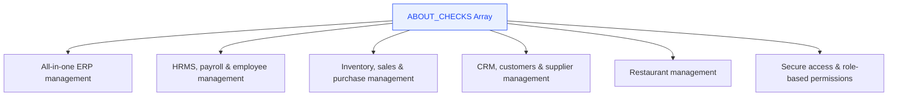
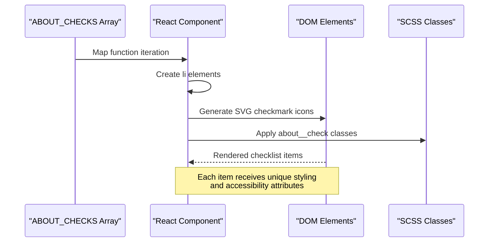
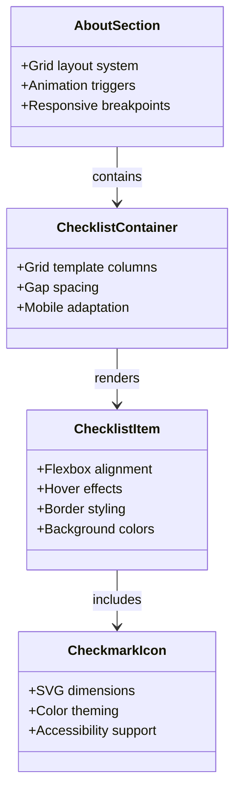
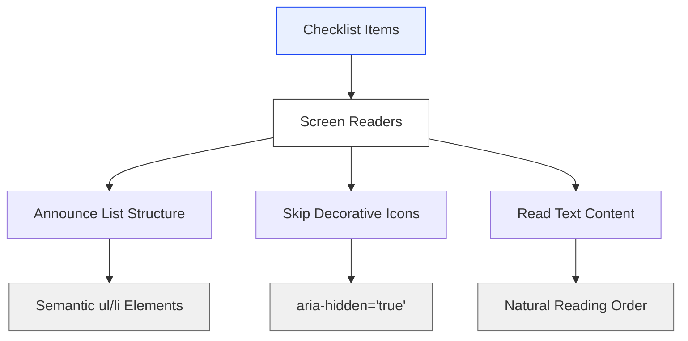
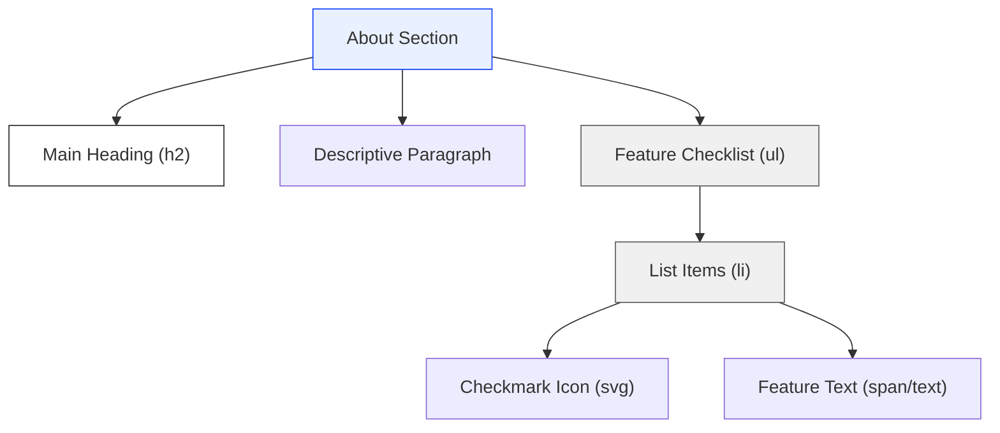
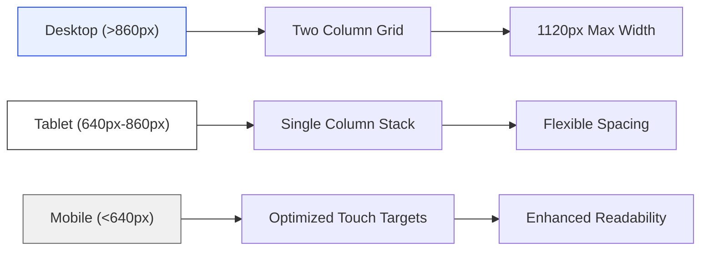
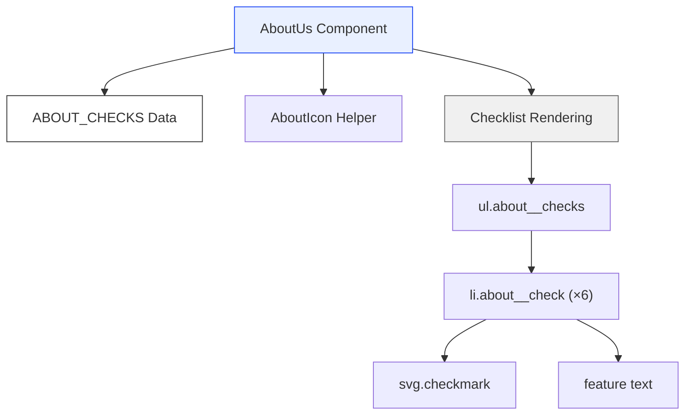

# Feature Checklist

<cite>
**Referenced Files in This Document**
- [Home.jsx](file://src/pages/Home.jsx)
- [Home.scss](file://src/pages/Home.scss)
</cite>

## Table of Contents
1. [Introduction](#introduction)
2. [ABOUT_CHECKS Array Structure](#about_checks-array-structure)
3. [Dynamic Rendering Implementation](#dynamic-rendering-implementation)
4. [Styling Approach with SCSS](#styling-approach-with-scss)
5. [Accessibility Considerations](#accessibility-considerations)
6. [Semantic HTML Structure](#semantic-html-structure)
7. [Mobile Responsiveness Strategies](#mobile-responsiveness-strategies)
8. [Component Architecture Overview](#component-architecture-overview)
9. [Performance and Optimization](#performance-and-optimization)
10. [Best Practices and Recommendations](#best-practices-and-recommendations)

## Introduction

The feature checklist is a key component within the About Us section of the Trellisco ERP landing page. It serves as a visual representation of the platform's core capabilities, presenting six main ERP features in an engaging, accessible format. The implementation combines React's dynamic rendering capabilities with modern CSS Grid layouts and inline SVG graphics to create a responsive, user-friendly experience that effectively communicates the platform's value proposition.

This component demonstrates several important front-end development patterns including data-driven UI rendering, semantic markup for accessibility, mobile-first responsive design, and progressive enhancement through CSS animations and transitions.

## ABOUT_CHECKS Array Structure

The `ABOUT_CHECKS` array serves as the primary data source for the feature checklist, containing six string elements that describe the core ERP capabilities offered by Trellisco. Each element represents a distinct business function or module that the platform supports.

### Data Structure Analysis

The array follows a simple but effective structure:

**Diagram sources**
- [Home.jsx:19-26](file://src/pages/Home.jsx#L19-L26)

### Content Organization Strategy

The checklist items are strategically ordered to guide users through the platform's capabilities:

1. **Foundation**: Starting with the overarching "all-in-one" concept establishes the platform's unified approach
2. **Core Business Functions**: HRMS and inventory/CRM modules represent essential business operations
3. **Industry-Specific Solutions**: Restaurant management showcases specialized capabilities
4. **Security Foundation**: Ending with security features reinforces trust and reliability

This ordering creates a logical narrative flow that helps users understand both the breadth and depth of the platform's offerings.

**Section sources**
- [Home.jsx:19-26](file://src/pages/Home.jsx#L19-L26)

## Dynamic Rendering Implementation

The feature checklist utilizes React's mapping functionality to dynamically generate list items from the `ABOUT_CHECKS` array. This approach provides several advantages including maintainability, scalability, and separation of concerns between data and presentation.

### Rendering Flow

**Diagram sources**
- [Home.jsx:159-169](file://src/pages/Home.jsx#L159-L169)

### Key Implementation Details

The dynamic rendering process involves several critical steps:

1. **Array Mapping**: Using `.map()` to iterate through each checklist item
2. **Unique Keys**: Leveraging the string content as unique keys for React reconciliation
3. **Inline SVG Generation**: Creating custom checkmark icons for each list item
4. **Class Application**: Applying consistent styling through SCSS class names
5. **Accessibility Attributes**: Ensuring proper screen reader support with `aria-hidden` attributes

### Performance Considerations

The implementation uses efficient React patterns:
- String keys provide optimal performance for static data
- Inline SVGs eliminate external asset dependencies
- Minimal re-renders due to stable data structure
- CSS Grid layout enables efficient browser rendering

**Section sources**
- [Home.jsx:159-169](file://src/pages/Home.jsx#L159-L169)

## Styling Approach with SCSS

The styling system employs a modular SCSS architecture with BEM-like naming conventions, CSS custom properties, and responsive design principles. The checklist component benefits from a well-organized stylesheet that separates concerns while maintaining consistency across the application.

### CSS Architecture Pattern

**Diagram sources**
- [Home.scss:699-734](file://src/pages/Home.scss#L699-L734)

### Core Styling Components

#### Container Layout System
The checklist container uses CSS Grid for a two-column layout that adapts to single column on mobile devices:

- **Grid Template**: `grid-template-columns: 1fr 1fr` for desktop
- **Responsive Breakpoint**: Single column at `$bp-mobile` (640px)
- **Spacing**: Consistent 12px gaps between items
- **List Reset**: Removal of default bullet points and padding

#### Item Styling Architecture
Each checklist item receives comprehensive styling:

- **Layout**: Flexbox for icon-text alignment
- **Visual Design**: Rounded corners, subtle borders, background colors
- **Interactive States**: Hover effects with color transitions and box shadows
- **Typography**: Consistent font sizing and weight specifications

#### Color System Integration
The component integrates seamlessly with the application's design system:

- **Primary Blue**: `#1b46f5` for checkmark backgrounds
- **Neutral Backgrounds**: Light grays for item backgrounds
- **Border Colors**: Subtle blue-tinted borders for visual hierarchy
- **Text Colors**: High contrast for readability

**Section sources**
- [Home.scss:699-734](file://src/pages/Home.scss#L699-L734)

## Accessibility Considerations

The feature checklist implementation demonstrates strong accessibility practices, ensuring that the component is usable by people with disabilities and compatible with assistive technologies.

### Screen Reader Support

**Diagram sources**
- [Home.jsx:162-165](file://src/pages/Home.jsx#L162-L165)

### Key Accessibility Features

#### Semantic HTML Structure
- **List Semantics**: Proper use of `<ul>` and `<li>` elements provides structural meaning
- **Heading Hierarchy**: Checklist appears under appropriate heading levels
- **Native Elements**: No unnecessary wrapper elements that could confuse assistive technologies

#### Decorative Element Handling
- **ARIA Hidden**: All decorative SVG icons include `aria-hidden="true"` to prevent screen readers from announcing them
- **Content Separation**: Visual decorations don't interfere with text content reading order
- **Focus Management**: No interactive elements that could trap keyboard focus

#### Color and Contrast Compliance
- **WCAG Compliance**: Sufficient color contrast ratios for text and interactive elements
- **Color Independence**: Information conveyed through multiple channels (color + shape + text)
- **Focus Indicators**: Clear visual feedback for keyboard navigation

#### Mobile Accessibility
- **Touch Targets**: Adequate sizing for touch interaction
- **Readable Typography**: Font sizes meet minimum accessibility guidelines
- **Orientation Support**: Layout adapts appropriately for different screen orientations

**Section sources**
- [Home.jsx:162-165](file://src/pages/Home.jsx#L162-L165)

## Semantic HTML Structure

The feature checklist adheres to semantic HTML best practices, providing meaningful structure that enhances both accessibility and SEO performance.

### Document Structure Hierarchy

**Diagram sources**
- [Home.jsx:148-169](file://src/pages/Home.jsx#L148-L169)

### Semantic Elements Usage

#### List Structure
- **Unordered List (`<ul>`)**: Indicates a collection of related items without specific ordering
- **List Items (`<li>`)**: Each feature capability represented as a distinct list entry
- **No Nested Lists**: Flat structure maintains simplicity and clarity

#### Heading Hierarchy
- **Section Heading**: Uses `<h2>` for the main About section title
- **Proper Nesting**: Maintains logical heading hierarchy throughout the page
- **Descriptive Titles**: Headings clearly communicate section purpose

#### Content Organization
- **Paragraph Elements**: Descriptive text uses semantic `
` tags
- **Inline Elements**: Feature text flows naturally within list items
- **Image Alt Text**: Decorative images properly marked with `aria-hidden`

### SEO Benefits
The semantic structure provides search engines with clear signals about content importance and relationships, potentially improving search rankings and snippet generation.

**Section sources**
- [Home.jsx:148-169](file://src/pages/Home.jsx#L148-L169)

## Mobile Responsiveness Strategies

The feature checklist implements comprehensive mobile responsiveness strategies, ensuring optimal user experience across all device sizes and orientations.

### Responsive Design Breakpoints

**Diagram sources**
- [Home.scss:707-709](file://src/pages/Home.scss#L707-L709)

### Grid System Adaptation

#### Desktop Layout
- **Two-Column Grid**: `grid-template-columns: 1fr 1fr` maximizes space utilization
- **Consistent Spacing**: 12px gaps provide visual breathing room
- **Maximum Width**: 1120px container prevents excessive stretching on large screens

#### Tablet and Mobile Adaptation
- **Single Column**: Switches to `grid-template-columns: 1fr` for better readability
- **Touch Optimization**: Larger touch targets and spacing for mobile interaction
- **Font Scaling**: Responsive typography using clamp() functions

### Animation and Interaction Enhancements

#### Scroll-Triggered Animations
- **Intersection Observer**: Smooth fade-in effects when checklist enters viewport
- **Performance Optimization**: GPU-accelerated transforms and opacity changes
- **Reduced Motion Support**: Respects user preferences for motion sensitivity

#### Hover and Focus States
- **Visual Feedback**: Subtle background color changes and border highlights
- **Keyboard Navigation**: Clear focus indicators for accessibility
- **Touch-Friendly**: Enhanced hover states for touch devices

### Cross-Browser Compatibility
- **CSS Grid Fallbacks**: Graceful degradation for older browsers
- **Vendor Prefixes**: Automatic handling through build tools
- **Modern Features**: Progressive enhancement with feature detection

**Section sources**
- [Home.scss:707-709](file://src/pages/Home.scss#L707-L709)

## Component Architecture Overview

The feature checklist component follows a clean architectural pattern that separates concerns while maintaining high cohesion and low coupling.

### Component Structure

**Diagram sources**
- [Home.jsx:103-169](file://src/pages/Home.jsx#L103-L169)

### Data Flow Architecture

1. **Data Layer**: Static `ABOUT_CHECKS` array provides feature descriptions
2. **Component Layer**: `AboutUs` component manages state and rendering logic
3. **Presentation Layer**: JSX structure defines visual hierarchy and semantics
4. **Style Layer**: SCSS classes provide visual styling and responsive behavior

### State Management

The component utilizes React hooks for enhanced functionality:
- **useState**: Manages visibility state for scroll-triggered animations
- **useEffect**: Handles IntersectionObserver setup and cleanup
- **useRef**: Provides reference to DOM elements for animation triggers

### Reusability Patterns

While currently implemented as part of the larger AboutUs component, the checklist pattern demonstrates reusability principles:
- **Data-Driven Rendering**: Easy to extend with additional features
- **Modular Styling**: SCSS classes can be reused across components
- **Accessible Foundation**: Built-in accessibility supports future enhancements

**Section sources**
- [Home.jsx:103-169](file://src/pages/Home.jsx#L103-L169)

## Performance and Optimization

The feature checklist implementation incorporates several performance optimization strategies that contribute to fast loading times and smooth user interactions.

### Rendering Optimization

#### Efficient Data Structures
- **Static Arrays**: `ABOUT_CHECKS` defined at module level avoids recreation
- **String Keys**: Simple string identifiers provide optimal React reconciliation performance
- **Minimal Dependencies**: No complex object structures reduce memory overhead

#### DOM Efficiency
- **Flat Structure**: Single-level list structure minimizes DOM complexity
- **Inline SVGs**: Eliminates network requests for icon assets
- **CSS-Only Effects**: Visual enhancements use CSS rather than JavaScript animations

### Memory Management

#### Component Lifecycle
- **Cleanup Functions**: IntersectionObserver properly disconnected in useEffect cleanup
- **Event Listener Management**: No lingering event listeners after component unmount
- **Reference Cleanup**: DOM references properly managed through refs

#### Asset Optimization
- **Zero External Dependencies**: Icons rendered inline as SVG paths
- **Minimal CSS**: Scoped styles reduce global stylesheet size
- **Efficient Selectors**: CSS selectors optimized for browser matching performance

### Browser Performance

#### CSS Optimizations
- **GPU Acceleration**: Transform and opacity animations leverage hardware acceleration
- **Will-Change Hints**: Strategic use of will-change for frequently animated properties
- **Media Query Optimization**: Efficient breakpoint definitions minimize recalculation

#### JavaScript Performance
- **Event Delegation**: Single observer instance for scroll-triggered animations
- **Debounced Operations**: IntersectionObserver callbacks optimized for frequent triggering
- **Memory Leaks Prevention**: Proper cleanup of observers and event listeners

**Section sources**
- [Home.jsx:107-125](file://src/pages/Home.jsx#L107-L125)

## Best Practices and Recommendations

Based on the analysis of the feature checklist implementation, several best practices emerge that can guide future development and maintenance of similar components.

### Code Organization Principles

#### Data-Driven Architecture
- **Separate Data from Presentation**: Keep feature descriptions in dedicated arrays
- **Configuration Objects**: Use structured data for easy maintenance and updates
- **Type Safety**: Consider TypeScript interfaces for enhanced type checking

#### Component Modularity
- **Single Responsibility**: Each component handles one specific concern
- **Prop Interfaces**: Clear boundaries between parent and child components
- **Reusable Patterns**: Extract common patterns into shared utilities

### Accessibility Standards

#### WCAG Compliance
- **Semantic Markup**: Always prefer native HTML elements over custom implementations
- **ARIA Attributes**: Use aria-hidden for decorative elements and aria-label for interactive elements
- **Keyboard Navigation**: Ensure full keyboard operability for all interactive elements

#### Inclusive Design
- **Color Independence**: Don't rely solely on color to convey information
- **Screen Reader Testing**: Regular testing with various assistive technologies
- **Motion Sensitivity**: Respect prefers-reduced-motion media queries

### Performance Guidelines

#### Bundle Optimization
- **Code Splitting**: Lazy load heavy components when possible
- **Asset Optimization**: Compress images and optimize SVG files
- **Tree Shaking**: Eliminate unused code through proper imports

#### Runtime Performance
- **Virtual Scrolling**: Consider for very long lists of items
- **Memoization**: Use React.memo and useMemo for expensive calculations
- **Lazy Loading**: Load non-critical resources asynchronously

### Maintenance and Scalability

#### Documentation Standards
- **JSDoc Comments**: Document component props, state, and methods
- **Storybook Integration**: Create interactive documentation for component usage
- **API Contracts**: Define clear interfaces for component communication

#### Testing Strategies
- **Unit Tests**: Test component logic and data transformations
- **Integration Tests**: Verify component interactions and state changes
- **Accessibility Tests**: Automated testing for common accessibility issues

### Future Enhancements

#### Advanced Features
- **Filtering and Search**: Allow users to filter checklist items by category
- **Progressive Disclosure**: Show/hide advanced features based on user context
- **Personalization**: Customize checklist based on user roles or preferences

#### Analytics and Monitoring
- **User Engagement Tracking**: Monitor which features receive the most attention
- **Performance Monitoring**: Track component render times and memory usage
- **Error Boundary**: Catch and report runtime errors gracefully

By following these best practices, the feature checklist implementation can serve as a foundation for building more sophisticated and maintainable components while ensuring excellent user experience and accessibility compliance.