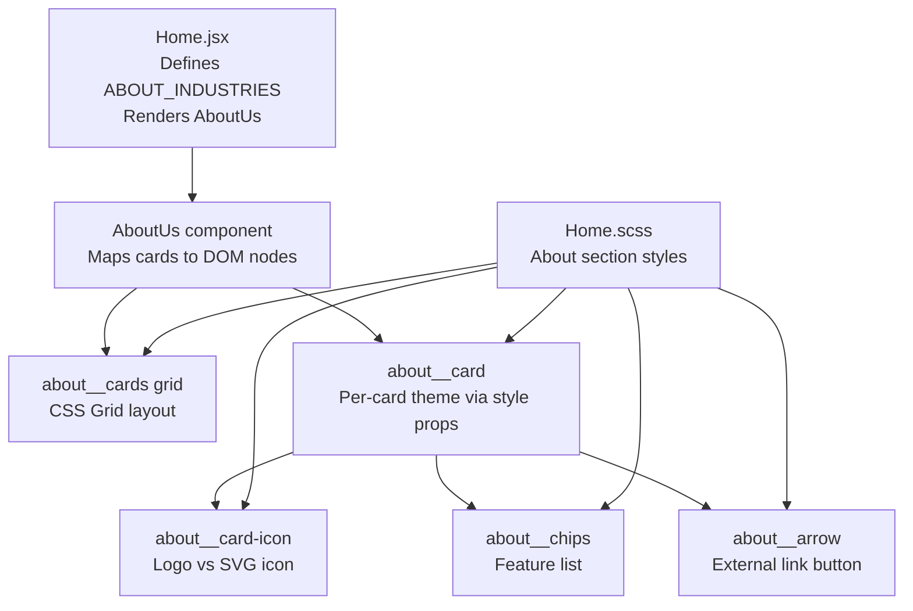
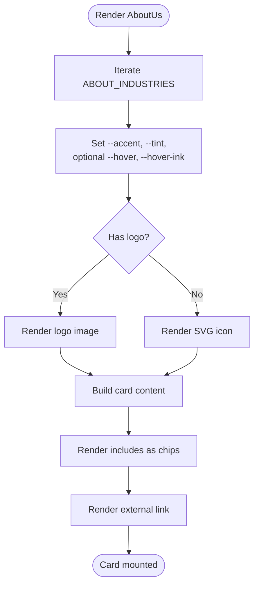
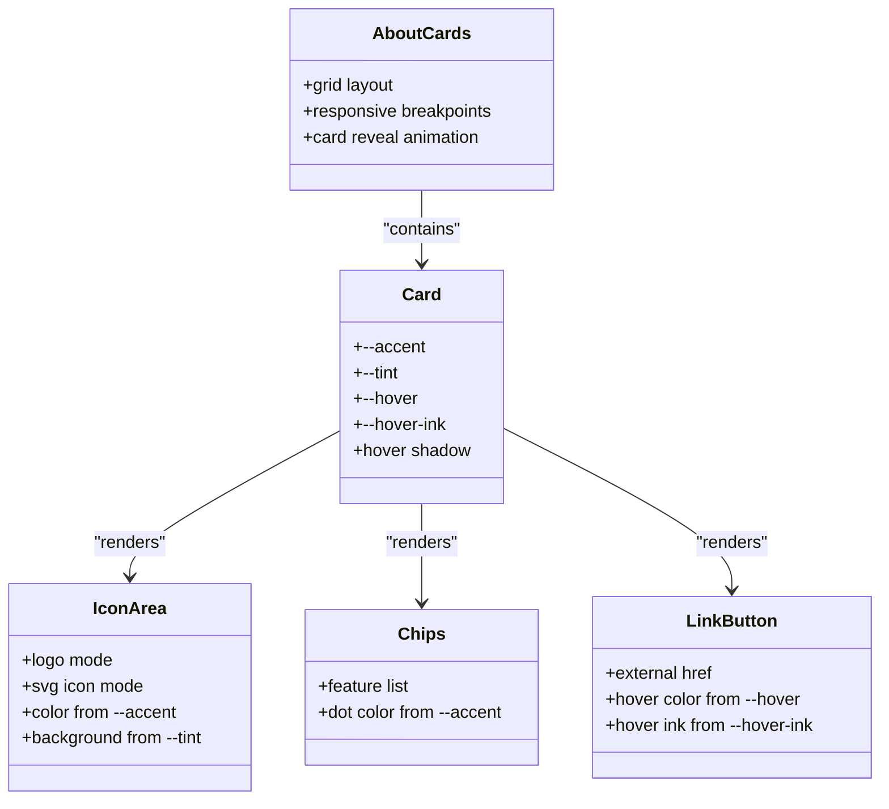
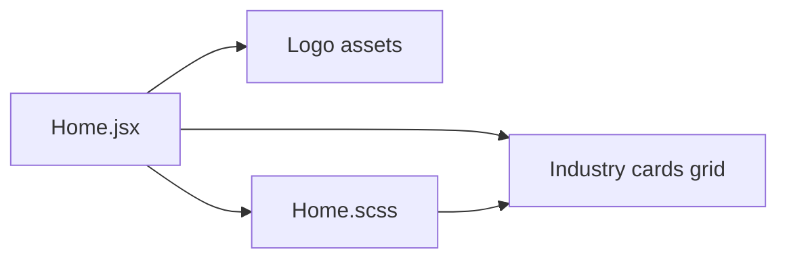

# Industry Cards Component

<cite>
**Referenced Files in This Document**
- [Home.jsx](file://src/pages/Home.jsx)
- [Home.scss](file://src/pages/Home.scss)
</cite>

## Table of Contents
1. [Introduction](#introduction)
2. [Project Structure](#project-structure)
3. [Core Components](#core-components)
4. [Architecture Overview](#architecture-overview)
5. [Detailed Component Analysis](#detailed-component-analysis)
6. [Dependency Analysis](#dependency-analysis)
7. [Performance Considerations](#performance-considerations)
8. [Troubleshooting Guide](#troubleshooting-guide)
9. [Conclusion](#conclusion)

## Introduction
This document explains the industry cards component used to showcase Trellisco ERP’s industry solutions. The component is data-driven: a single array defines each card’s identity, branding, colors, description, feature list, and external link. The React component renders those items into a responsive grid, while CSS custom properties provide per-card theming and hover behavior.

The goal is to help you understand how the data flows from configuration to rendered UI, how different card types are supported (logo images versus inline SVG icons), and how to extend or customize the cards safely.

## Project Structure
The industry cards live inside the Home page component and its associated stylesheet:

- `src/pages/Home.jsx` contains the `ABOUT_INDUSTRIES` array and the rendering logic for the About section, including the industry cards grid.
- `src/pages/Home.scss` contains the styles for the About section, including the card grid, icon/logo variants, chips, and hover effects.



**Diagram sources**
- [Home.jsx:34-101](file://src/pages/Home.jsx#L34-L101)
- [Home.jsx:103-257](file://src/pages/Home.jsx#L103-L257)
- [Home.scss:439-984](file://src/pages/Home.scss#L439-L984)

**Section sources**
- [Home.jsx:1-15](file://src/pages/Home.jsx#L1-L15)
- [Home.jsx:34-101](file://src/pages/Home.jsx#L34-L101)
- [Home.jsx:103-257](file://src/pages/Home.jsx#L103-L257)
- [Home.scss:439-984](file://src/pages/Home.scss#L439-L984)

## Core Components
The industry cards component is composed of three main parts:

1. **Data source**: `ABOUT_INDUSTRIES`, an array of objects describing each industry solution.
2. **Rendering logic**: The `AboutUs` component maps over `ABOUT_INDUSTRIES` and outputs one card per item.
3. **Styling layer**: SCSS classes that define the grid, card appearance, icon/logo variants, chips, and hover states.

Key responsibilities:
- Provide consistent structure across all cards.
- Support two visual modes: logo-based cards and SVG icon-based cards.
- Apply per-card accent colors and tints through CSS custom properties.
- Render feature chips and an external “Learn more” link.

**Section sources**
- [Home.jsx:34-101](file://src/pages/Home.jsx#L34-L101)
- [Home.jsx:188-253](file://src/pages/Home.jsx#L188-L253)
- [Home.scss:793-984](file://src/pages/Home.scss#L793-L984)

## Architecture Overview
At runtime, the flow is straightforward:

```mermaid
sequenceDiagram
participant Page as "Home.jsx"
participant About as "AboutUs"
participant Grid as "about__cards"
participant Card as "about__card"
participant Icon as "about__card-icon"
participant Link as "about__arrow"
Page->>About : Render AboutUs()
About->>Grid : Map ABOUT_INDUSTRIES
Grid->>Card : Create card element
Card->>Icon : Render logo or SVG icon
Card->>Link : Render external link
Card-->>Page : Styled card with CSS variables
```

**Diagram sources**
- [Home.jsx:103-257](file://src/pages/Home.jsx#L103-L257)
- [Home.jsx:188-253](file://src/pages/Home.jsx#L188-L253)

## Detailed Component Analysis

### Data Model: ABOUT_INDUSTRIES Array
Each entry in `ABOUT_INDUSTRIES` represents one industry card. The following properties are used by the renderer and styles:

| Property | Type | Purpose | Used By |
|---|---|---|---|
| `key` | string | Unique identifier for React list rendering | Renderer |
| `logo` | image import or undefined | Brand logo image when available | Icon branch |
| `title` | string | Card heading text | Title element |
| `accent` | color string | Primary brand color for the card | CSS variable `--accent` |
| `tint` | color string | Light background tint for the icon area | CSS variable `--tint` |
| `text` | string | Short description of the industry solution | Paragraph element |
| `includes` | array of strings | Feature chips shown under the description | Chips list |
| `href` | URL string | External link destination | Anchor element |
| `icon` | JSX/SVG element | Inline SVG icon used when no logo exists | Icon branch |
| `hover` | optional color string | Hover background color override | CSS variable `--hover` |
| `hoverInk` | optional color string | Hover text/icon color override | CSS variable `--hover-ink` |

Example usage patterns already present:
- HRMS, Hospitality, and Property use `logo` plus `icon`.
- Gym uses `hover` and `hoverInk` to customize hover behavior.

**Section sources**
- [Home.jsx:34-101](file://src/pages/Home.jsx#L34-L101)

### Rendering Logic: AboutUs and Card Mapping
The `AboutUs` component:
- Uses an intersection observer to reveal the section on scroll.
- Renders the top media/copy area.
- Renders the industry cards grid by mapping `ABOUT_INDUSTRIES`.

For each card:
- It sets inline CSS custom properties:
  - `--accent`: primary color
  - `--tint`: light tint
  - `--hover` and `--hover-ink`: optional hover overrides
- It chooses between:
  - Logo mode: render an `` when `c.logo` exists.
  - Icon mode: render the provided `c.icon` SVG when no logo exists.
- It renders:
  - Title
  - Description
  - Feature chips
  - External link anchor



**Diagram sources**
- [Home.jsx:188-253](file://src/pages/Home.jsx#L188-L253)

**Section sources**
- [Home.jsx:103-125](file://src/pages/Home.jsx#L103-L125)
- [Home.jsx:188-253](file://src/pages/Home.jsx#L188-L253)

### Styling Layer: Theming, Icons, and Hover Effects
The SCSS file defines the visual system for the cards:

- **Grid layout**:
  - Four columns on large screens.
  - Two columns on medium screens.
  - One column on mobile.
- **Card base**:
  - White background, rounded corners, shadow.
  - Fade-in and slide-up animation controlled by the parent section’s visible state.
- **Icon container**:
  - Uses `var(--accent)` and `var(--tint)` for color and background.
  - When a logo is present, it switches to a horizontal layout without the colored tile.
- **Corner indicator**:
  - Circular badge in the card header.
  - On hover, changes to `var(--hover)` background and `var(--hover-ink)` text color.
- **Chips**:
  - Small feature labels with a colored dot using `var(--accent)`.
- **Link button**:
  - Pill-shaped button.
  - On hover/focus, applies `var(--hover)` background and `var(--hover-ink)` text color, plus a colored shadow.



**Diagram sources**
- [Home.scss:793-984](file://src/pages/Home.scss#L793-L984)

**Section sources**
- [Home.scss:793-984](file://src/pages/Home.scss#L793-L984)

### Dynamic Card Types: Logos vs SVG Icons
The component supports two rendering paths:

1. **Logo cards**:
   - Use `logo` property.
   - Render an image inside the icon area.
   - Remove the default colored tile and adjust layout for brand logos.
2. **SVG icon cards**:
   - Use `icon` property.
   - Render inline SVGs styled by `--accent`.

This design allows brand consistency where logos exist, while still supporting lightweight vector icons for cases where a logo asset is not available.

**Section sources**
- [Home.jsx:200-207](file://src/pages/Home.jsx#L200-L207)
- [Home.scss:849-884](file://src/pages/Home.scss#L849-L884)

### CSS Custom Properties and Theming
The card styling relies heavily on CSS custom properties set inline per card:

| Variable | Default Behavior | Meaning |
|---|---|---|
| `--accent` | Falls back to the About blue token | Primary brand color for icons, chips, and hover fallback |
| `--tint` | Falls back to the About blue background token | Light background behind the icon area |
| `--hover` | Falls back to `--accent` | Background color on hover |
| `--hover-ink` | Falls back to white | Text/icon color on hover |

These variables make each card independently themed without duplicating CSS rules.

**Section sources**
- [Home.jsx:193-198](file://src/pages/Home.jsx#L193-L198)
- [Home.scss:849-901](file://src/pages/Home.scss#L849-L901)
- [Home.scss:931-972](file://src/pages/Home.scss#L931-L972)

### Responsive Grid Layout
The industry cards grid adapts to screen size:

- Large screens: four-column grid.
- Medium screens: two-column grid.
- Mobile screens: single-column grid with reduced padding and corner radius.

This ensures the cards remain readable and usable across devices.

**Section sources**
- [Home.scss:793-819](file://src/pages/Home.scss#L793-L819)

### Hover Effects and Color Transitions
Hover behavior is applied at multiple levels:

- **Card hover**:
  - Increases shadow depth.
  - Lifts the card slightly when the section is visible.
- **Corner indicator hover**:
  - Changes background to `--hover` and text color to `--hover-ink`.
- **Link button hover**:
  - Applies `--hover` background, `--hover-ink` text color, and a colored shadow.

Transitions are smooth and respect reduced-motion preferences.

**Section sources**
- [Home.scss:821-840](file://src/pages/Home.scss#L821-L840)
- [Home.scss:898-901](file://src/pages/Home.scss#L898-L901)
- [Home.scss:967-972](file://src/pages/Home.scss#L967-L972)

## Dependency Analysis
The industry cards component has clear boundaries:

- **Component dependency**:
  - `Home.jsx` imports shared components like `Nav`, `Footer`, and `FallingText`, but the industry cards themselves only depend on local data and assets.
- **Asset dependencies**:
  - Logo images are imported directly into `Home.jsx`.
- **Style dependency**:
  - `Home.jsx` imports `Home.scss`, which provides all card-related styles.



**Diagram sources**
- [Home.jsx:1-14](file://src/pages/Home.jsx#L1-L14)
- [Home.jsx:34-101](file://src/pages/Home.jsx#L34-L101)
- [Home.scss:793-984](file://src/pages/Home.scss#L793-L984)

**Section sources**
- [Home.jsx:1-14](file://src/pages/Home.jsx#L1-L14)
- [Home.jsx:34-101](file://src/pages/Home.jsx#L34-L101)

## Performance Considerations
- **List rendering**: Each card is keyed by `key`, which helps React efficiently update the list.
- **Inline styles**: CSS custom properties are set inline for theming; this is lightweight and scoped per card.
- **Animations**:
  - Section reveal uses opacity and transform transitions.
  - Reduced-motion media queries disable animations for accessibility.
- **Image assets**:
  - Logo images should be optimized to avoid layout shifts and heavy payloads.
- **Scroll-triggered visibility**:
  - IntersectionObserver is used once per section to toggle visibility, minimizing repeated work.

[No sources needed since this section provides general guidance]

## Troubleshooting Guide

### Card Colors Do Not Apply
- Ensure each object in `ABOUT_INDUSTRIES` includes both `accent` and `tint`.
- Verify that the inline style assignment passes these values to `--accent` and `--tint`.
- Check that SCSS selectors reference `var(--accent, ...)` and `var(--tint, ...)`.

**Section sources**
- [Home.jsx:193-198](file://src/pages/Home.jsx#L193-L198)
- [Home.scss:849-858](file://src/pages/Home.scss#L849-L858)

### Hover Color Is Not Changing
- If you want a custom hover color, add `hover` and optionally `hoverInk` to the card object.
- Confirm that the conditional style spread includes `--hover` and `--hover-ink`.
- Verify SCSS uses `var(--hover, var(--accent, ...))` and `var(--hover-ink, #{$white})`.

**Section sources**
- [Home.jsx:193-198](file://src/pages/Home.jsx#L193-L198)
- [Home.scss:898-901](file://src/pages/Home.scss#L898-L901)
- [Home.scss:967-972](file://src/pages/Home.scss#L967-L972)

### Logo Does Not Display
- Ensure the logo asset is imported correctly.
- Confirm the card object includes the `logo` property.
- Check that the conditional rendering path for `c.logo` is active.

**Section sources**
- [Home.jsx:200-207](file://src/pages/Home.jsx#L200-L207)

### Cards Are Not Responsive
- Verify the grid breakpoint rules are intact.
- Confirm the viewport meta tag is configured in the HTML template.
- Check for any overriding styles that force fixed widths.

**Section sources**
- [Home.scss:793-819](file://src/pages/Home.scss#L793-L819)

## Conclusion
The industry cards component is a clean, data-driven pattern:
- Define industries in `ABOUT_INDUSTRIES`.
- Let the renderer map those entries into structured cards.
- Use CSS custom properties for flexible, per-card theming.
- Support both logo-based and SVG icon-based visuals.
- Rely on responsive CSS Grid for layout adaptability.

To extend the component:
- Add new entries to `ABOUT_INDUSTRIES` with the documented properties.
- Customize appearance by adjusting `accent`, `tint`, `hover`, and `hoverInk`.
- Keep descriptions concise and feature lists focused on core capabilities.

[No sources needed since this section summarizes without analyzing specific files]