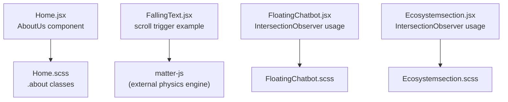
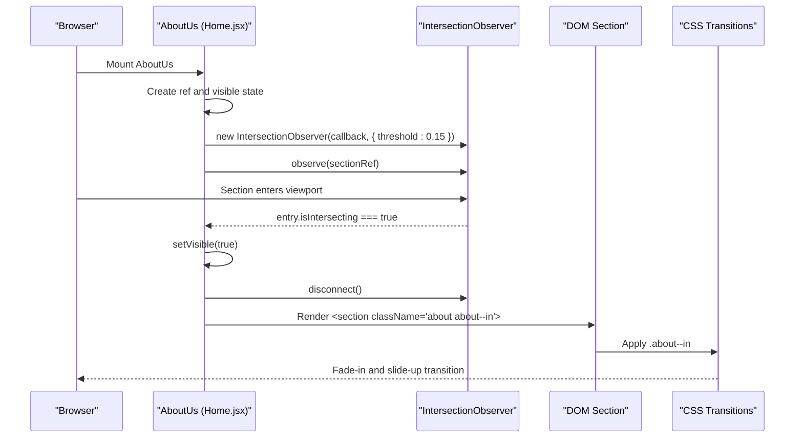
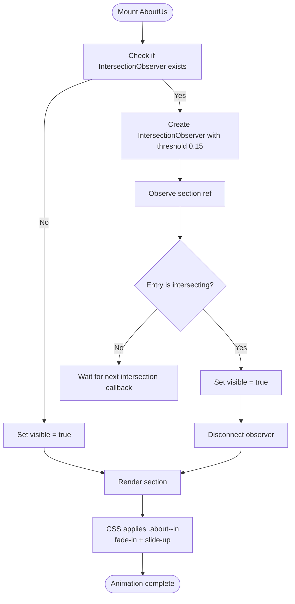
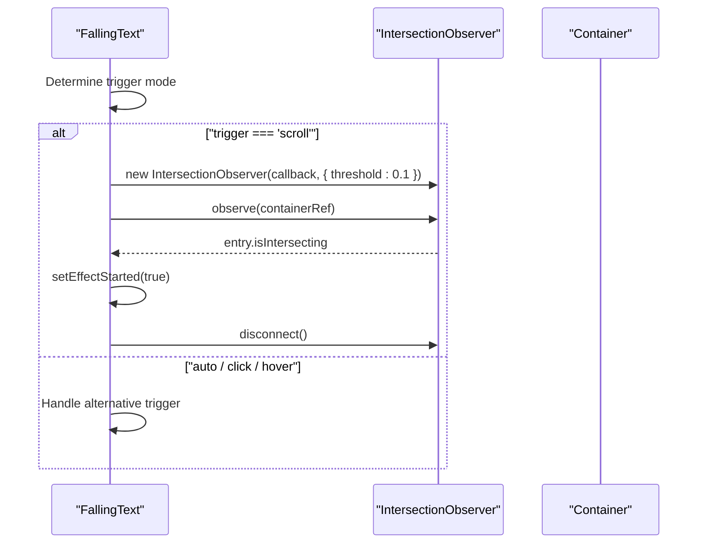
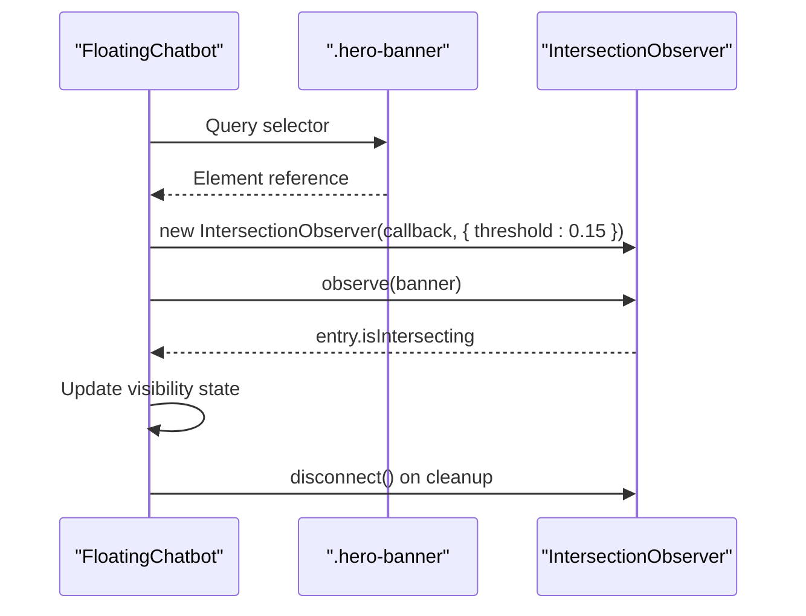
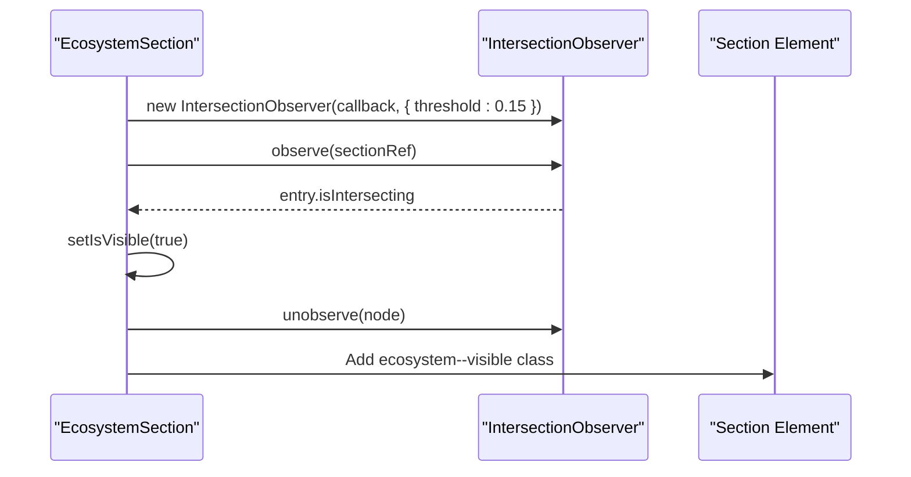
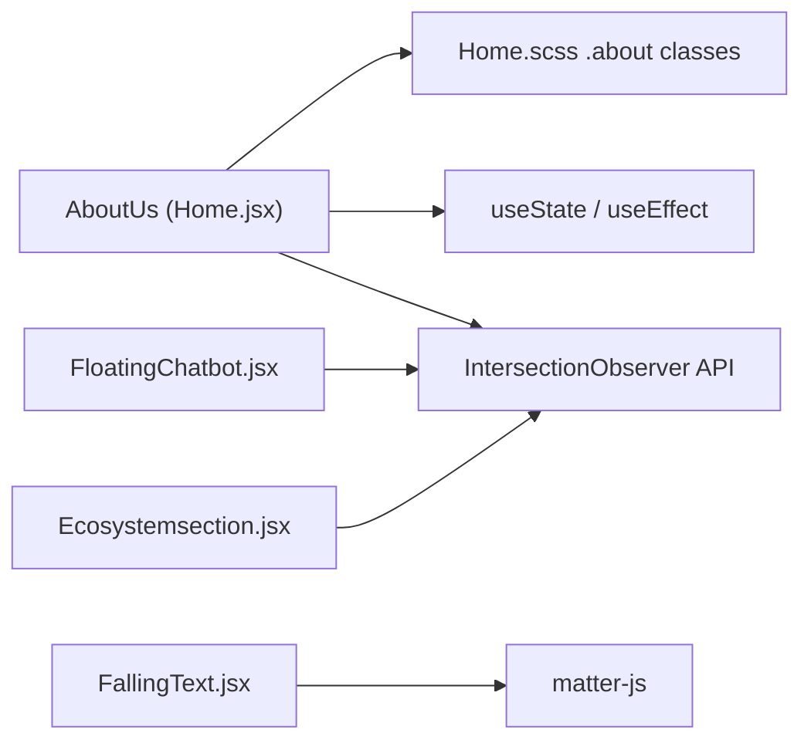

# Scroll Animations

<cite>
**Referenced Files in This Document**
- [Home.jsx](file://src/pages/Home.jsx)
- [Home.scss](file://src/pages/Home.scss)
- [FallingText.jsx](file://src/components/FallingText.jsx)
- [FloatingChatbot.jsx](file://src/components/FloatingChatbot.jsx)
- [Ecosystemsection.jsx](file://src/pages/Ecosystemsection.jsx)
</cite>

## Table of Contents
1. [Introduction](#introduction)
2. [Project Structure](#project-structure)
3. [Core Components](#core-components)
4. [Architecture Overview](#architecture-overview)
5. [Detailed Component Analysis](#detailed-component-analysis)
6. [Dependency Analysis](#dependency-analysis)
7. [Performance Considerations](#performance-considerations)
8. [Troubleshooting Guide](#troubleshooting-guide)
9. [Conclusion](#conclusion)

## Introduction
This document explains the scroll-triggered animations used in the About Us section and related parts of the application. It focuses on:
- Using the IntersectionObserver API to detect when elements enter the viewport.
- Managing animation state with React’s `useState` and `useEffect`.
- Applying CSS class transitions that create smooth fade-in effects.
- Performance optimizations such as observer cleanup, threshold configuration, and graceful fallbacks for browsers without IntersectionObserver support.

The implementation is centered around the `AboutUs` component in the home page, with additional examples from other components that follow the same pattern.

## Project Structure
The scroll animation logic lives primarily in the home page component and its associated styles. Supporting components demonstrate similar patterns for scroll-triggered behavior.

**Diagram sources**
- [Home.jsx:103-128](file://src/pages/Home.jsx#L103-L128)
- [Home.scss:439-502](file://src/pages/Home.scss#L439-L502)
- [FallingText.jsx:53-70](file://src/components/FallingText.jsx#L53-L70)
- [FloatingChatbot.jsx:200-218](file://src/components/FloatingChatbot.jsx#L200-L218)
- [Ecosystemsection.jsx:242-262](file://src/pages/Ecosystemsection.jsx#L242-L262)

**Section sources**
- [Home.jsx:103-128](file://src/pages/Home.jsx#L103-L128)
- [Home.scss:439-502](file://src/pages/Home.scss#L439-L502)

## Core Components
The About Us section uses a lightweight, declarative approach:
- A ref points to the section element.
- A boolean state controls whether the section is visible.
- A single effect sets up an IntersectionObserver once on mount.
- When the section enters the viewport, the state flips to visible and the observer disconnects.
- The rendered section conditionally includes an animated modifier class.
- CSS transitions animate opacity and transform when the modifier class is present.

Key behaviors:
- Fallback: If IntersectionObserver is not available, the section becomes visible immediately.
- Threshold: The observer triggers after about 15% of the section is visible.
- Cleanup: The observer is disconnected both after triggering and during effect cleanup.

**Section sources**
- [Home.jsx:103-128](file://src/pages/Home.jsx#L103-L128)
- [Home.scss:489-502](file://src/pages/Home.scss#L489-L502)

## Architecture Overview
The animation flow connects React state, DOM refs, IntersectionObserver callbacks, and CSS transitions.

**Diagram sources**
- [Home.jsx:103-128](file://src/pages/Home.jsx#L103-L128)
- [Home.scss:489-502](file://src/pages/Home.scss#L489-L502)

## Detailed Component Analysis

### About Us Section Animation
The About Us section demonstrates the canonical scroll-triggered pattern:
- State management: `visible` toggles from false to true when the section enters the viewport.
- Observer setup: A single IntersectionObserver is created inside `useEffect`, observing the section ref.
- Trigger logic: When `entry.isIntersecting` is true, the component sets `visible` to true and disconnects the observer.
- Fallback: If IntersectionObserver is undefined, the component sets `visible` to true immediately so content still appears.
- CSS transitions: The `.about--in` modifier class enables opacity and transform transitions for `.about__top` and `.about__bottom`.

**Diagram sources**
- [Home.jsx:103-128](file://src/pages/Home.jsx#L103-L128)
- [Home.scss:489-502](file://src/pages/Home.scss#L489-L502)

**Section sources**
- [Home.jsx:103-128](file://src/pages/Home.jsx#L103-L128)
- [Home.scss:489-502](file://src/pages/Home.scss#L489-L502)

### FallingText Scroll Trigger Example
Although not part of the About Us section, the FallingText component shows another IntersectionObserver pattern:
- It supports multiple triggers: automatic, scroll-based, click, or hover.
- For scroll-based triggering, it creates an IntersectionObserver with a threshold of 0.1 and disconnects after the first intersection.
- It also handles touch devices by skipping the physics effect entirely.

**Diagram sources**
- [FallingText.jsx:53-70](file://src/components/FallingText.jsx#L53-L70)

**Section sources**
- [FallingText.jsx:53-70](file://src/components/FallingText.jsx#L53-L70)

### FloatingChatbot Visibility Control
The floating chatbot uses IntersectionObserver to hide itself while the hero banner is in view:
- It observes the `.hero-banner` element.
- When the banner is intersecting, the chatbot becomes hidden; otherwise, it remains visible.
- The observer is cleaned up on unmount.

**Diagram sources**
- [FloatingChatbot.jsx:200-218](file://src/components/FloatingChatbot.jsx#L200-L218)

**Section sources**
- [FloatingChatbot.jsx:200-218](file://src/components/FloatingChatbot.jsx#L200-L218)

### Ecosystem Section Reveal
The ecosystem section follows the same pattern as the About Us section:
- It observes the section element.
- When intersecting, it sets a visible state and stops observing.
- The CSS adds a visible modifier class to reveal children with staggered delays.

**Diagram sources**
- [Ecosystemsection.jsx:242-262](file://src/pages/Ecosystemsection.jsx#L242-L262)

**Section sources**
- [Ecosystemsection.jsx:242-262](file://src/pages/Ecosystemsection.jsx#L242-L262)

## Dependency Analysis
The About Us animation depends on:
- React hooks for state and lifecycle management.
- IntersectionObserver for viewport detection.
- CSS transitions for visual effects.
- External libraries are not required for the About Us animation itself; however, related components may use external dependencies like matter-js for physics-based text animations.

**Diagram sources**
- [Home.jsx:103-128](file://src/pages/Home.jsx#L103-L128)
- [FallingText.jsx:1-3](file://src/components/FallingText.jsx#L1-L3)
- [FloatingChatbot.jsx:200-218](file://src/components/FloatingChatbot.jsx#L200-L218)
- [Ecosystemsection.jsx:242-262](file://src/pages/Ecosystemsection.jsx#L242-L262)

**Section sources**
- [Home.jsx:103-128](file://src/pages/Home.jsx#L103-L128)
- [FallingText.jsx:1-3](file://src/components/FallingText.jsx#L1-L3)

## Performance Considerations
- Observer cleanup: Each IntersectionObserver is disconnected after triggering or during effect cleanup to prevent memory leaks and unnecessary callbacks.
- Threshold configuration: The About Us section uses a threshold of 0.15, meaning the animation triggers when approximately 15% of the section is visible. This balances responsiveness with avoiding premature triggers.
- Graceful fallback: If IntersectionObserver is unavailable, the About Us section sets the visible state immediately, ensuring content is always shown.
- Minimal re-renders: The observer only updates state once per element, reducing unnecessary renders.
- CSS-driven transitions: Animations rely on CSS transitions rather than JavaScript animation loops, improving performance and reducing main-thread work.

[No sources needed since this section provides general guidance]

## Troubleshooting Guide
Common issues and resolutions:
- Animation does not trigger:
  - Verify the section has a ref and is being observed.
  - Ensure the IntersectionObserver threshold is appropriate for your layout.
  - Check that the parent container is not clipping the element before it enters the viewport.
- Content flashes before animation:
  - Confirm the initial state is not visible.
  - Ensure CSS default states hide the element until the modifier class is applied.
- Memory leaks:
  - Confirm observers are disconnected after triggering and during cleanup.
- Accessibility concerns:
  - Respect reduced-motion preferences where applicable.
  - Ensure interactive elements remain accessible even when animations are disabled.

**Section sources**
- [Home.jsx:103-128](file://src/pages/Home.jsx#L103-L128)
- [Home.scss:489-502](file://src/pages/Home.scss#L489-L502)

## Conclusion
The About Us section implements a clean, performant scroll-triggered animation using IntersectionObserver, React state, and CSS transitions. The pattern is consistent across the codebase, with clear thresholds, proper cleanup, and graceful fallbacks. This approach ensures smooth user experiences while maintaining performance and accessibility.

[No sources needed since this section summarizes without analyzing specific files]