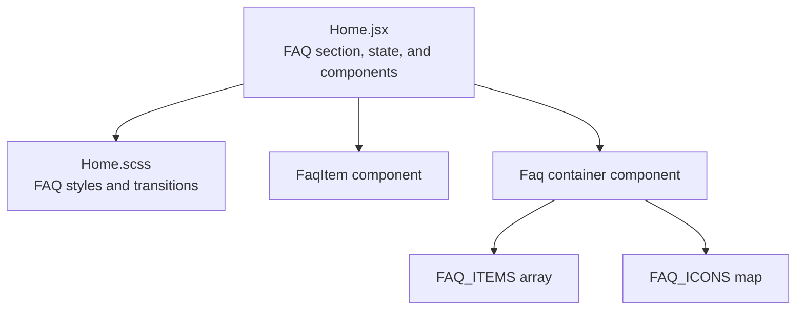
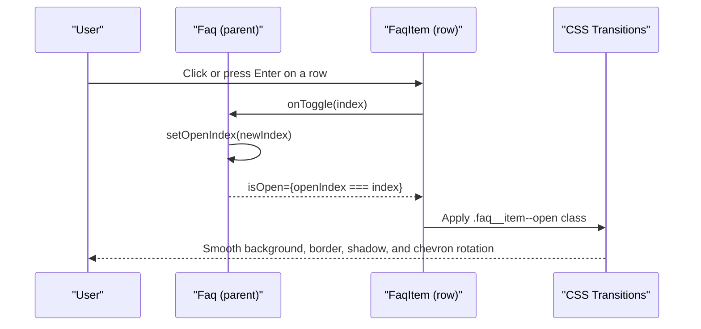
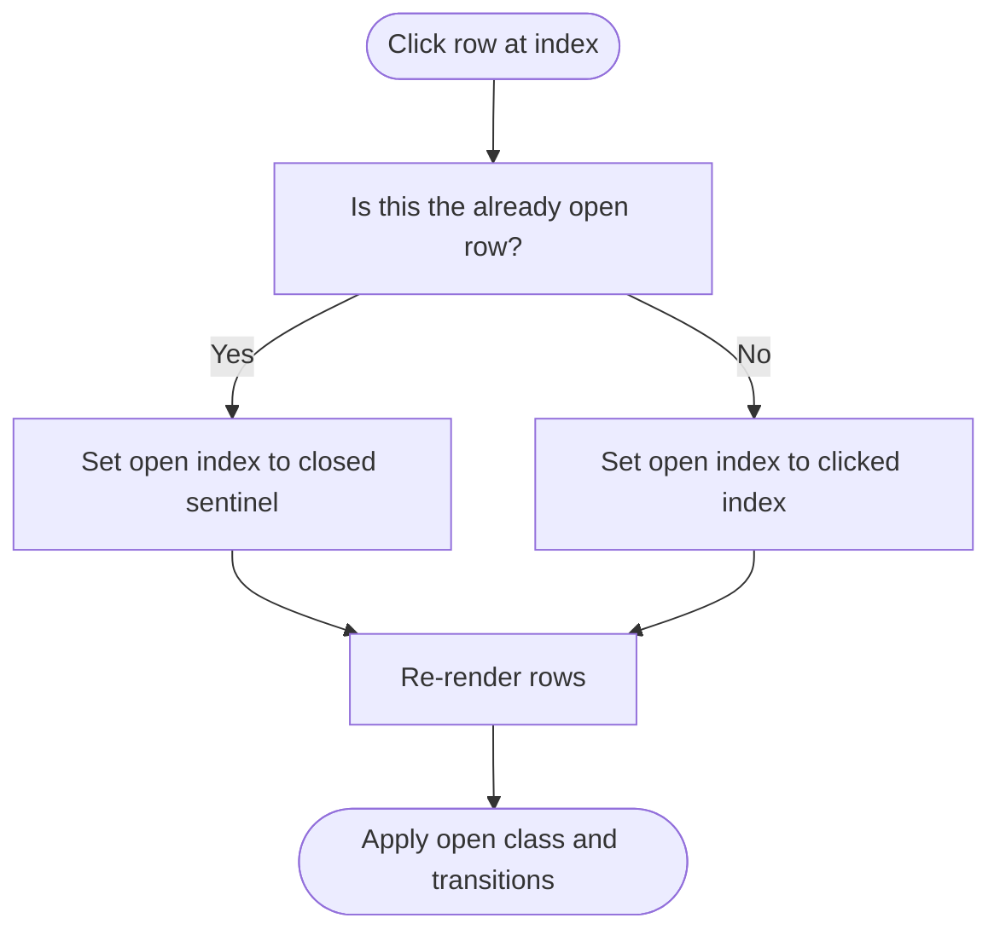
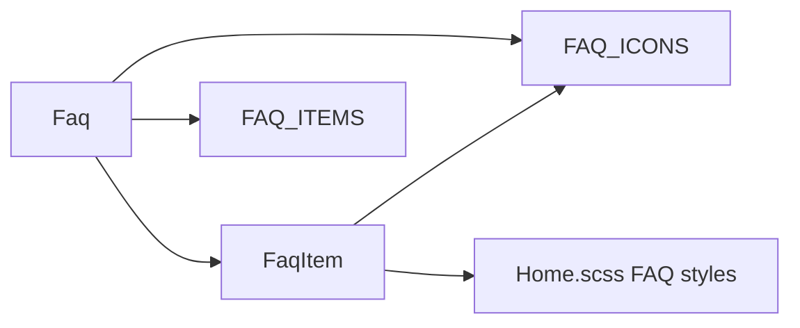
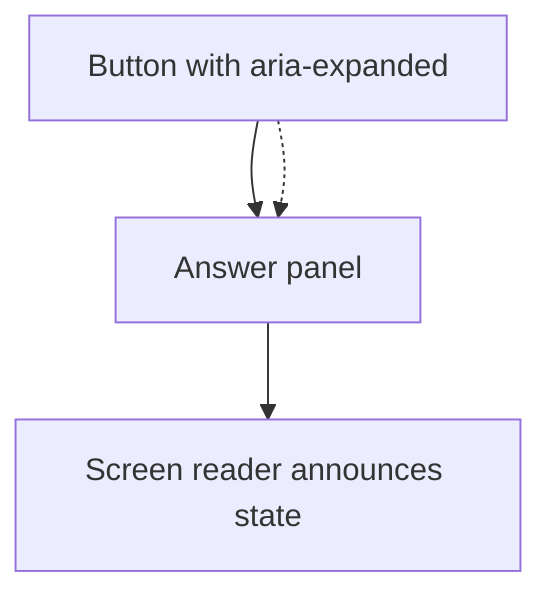

# FAQ Accordion

<cite>
**Referenced Files in This Document**
- [Home.jsx](file://src/pages/Home.jsx)
- [Home.scss](file://src/pages/Home.scss)
</cite>

## Table of Contents
1. [Introduction](#introduction)
2. [Project Structure](#project-structure)
3. [Core Components](#core-components)
4. [Architecture Overview](#architecture-overview)
5. [Detailed Component Analysis](#detailed-component-analysis)
6. [Dependency Analysis](#dependency-analysis)
7. [Performance Considerations](#performance-considerations)
8. [Accessibility Best Practices](#accessibility-best-practices)
9. [Troubleshooting Guide](#troubleshooting-guide)
10. [Conclusion](#conclusion)

## Introduction
This document explains the FAQ accordion component implemented on the home page. It covers:
- State management for open/closed states using React’s `useState` hook
- Keyboard navigation and accessibility attributes, including `aria-expanded`
- Smooth CSS transitions for expand/collapse animations
- The data structure for FAQ items, icon mapping, color themes, and content organization
- Practical guidance for extending the component while preserving accessibility and performance

## Project Structure
The FAQ accordion lives inside the home page module and its styles:
- Component logic, data, and rendering are defined in the home page file
- Visual styling, theme tokens, and animation rules are defined in the home page stylesheet

**Diagram sources**
- [Home.jsx:263-300](file://src/pages/Home.jsx#L263-L300)
- [Home.jsx:302-395](file://src/pages/Home.jsx#L302-L395)
- [Home.jsx:397-479](file://src/pages/Home.jsx#L397-L479)
- [Home.scss:990-1245](file://src/pages/Home.scss#L990-L1245)

**Section sources**
- [Home.jsx:260-479](file://src/pages/Home.jsx#L260-L479)
- [Home.scss:990-1245](file://src/pages/Home.scss#L990-L1245)

## Core Components
The FAQ feature is composed of:
- A data array defining each question, answer, icon key, and tone
- An icon map that resolves icon keys to SVG elements
- A row component representing a single FAQ item
- A container component managing open state and rendering the list

Key responsibilities:
- `FaqItem`: Renders one FAQ row with an icon, question/answer text, chevron, and `aria-expanded`
- `Faq`: Holds the open index state, toggles it, and maps over the data to render rows
- `FAQ_ITEMS`: Centralized content configuration
- `FAQ_ICONS`: Centralized icon configuration

**Section sources**
- [Home.jsx:263-300](file://src/pages/Home.jsx#L263-L300)
- [Home.jsx:302-395](file://src/pages/Home.jsx#L302-L395)
- [Home.jsx:397-479](file://src/pages/Home.jsx#L397-L479)

## Architecture Overview
The FAQ accordion follows a simple parent-child pattern:
- The parent `Faq` component owns the open state
- Each child `FaqItem` receives whether it is open and a toggle handler
- Styling reacts to the open state via modifier classes and CSS transitions

**Diagram sources**
- [Home.jsx:432-479](file://src/pages/Home.jsx#L432-L479)
- [Home.jsx:397-430](file://src/pages/Home.jsx#L397-L430)
- [Home.scss:1104-1194](file://src/pages/Home.scss#L1104-L1194)

## Detailed Component Analysis

### Data Model: FAQ Items
Each FAQ item defines:
- Question text
- Answer text
- Icon key mapped to an SVG
- Tone used for color theming

Example fields:
- `q`: Question string
- `a`: Answer string
- `icon`: Key into the icon map
- `tone`: Theme token controlling icon background and color

Complexity:
- Rendering cost is linear in the number of items
- Adding new items is declarative and does not require code changes beyond the data array

**Section sources**
- [Home.jsx:263-300](file://src/pages/Home.jsx#L263-L300)

### Icon Mapping
Icons are resolved by key from a central map:
- Keys include values such as help, layers, play, shield, link, chat
- Each key maps to an inline SVG element
- Icons are rendered inside the row and styled via the tone-based theme

Benefits:
- Single source of truth for icons
- Easy to extend without changing rendering logic

**Section sources**
- [Home.jsx:302-395](file://src/pages/Home.jsx#L302-L395)

### Row Component: FaqItem
Responsibilities:
- Render the interactive row button
- Display the icon based on the item’s icon key
- Show the question and answer
- Rotate the chevron when open
- Provide `aria-expanded` reflecting the current state

Accessibility highlights:
- Uses a native `<button>` for keyboard support
- Marks decorative icons and chevrons with `aria-hidden="true"`
- Exposes the expanded state through `aria-expanded`

State-driven visuals:
- Adds a modifier class when open to change background, border, shadow, and chevron rotation

**Section sources**
- [Home.jsx:397-430](file://src/pages/Home.jsx#L397-L430)
- [Home.scss:1104-1194](file://src/pages/Home.scss#L1104-L1194)

### Container Component: Faq
Responsibilities:
- Manage the currently open index using `useState`
- Toggle behavior: clicking the same item closes it; clicking another opens that item
- Render the FAQ header, subtitle, and list
- Pass `isOpen` and `onToggle` to each row

Open/close algorithm:
- If the clicked index matches the current open index, close all by setting the index to a closed sentinel
- Otherwise, open the clicked item by setting its index

**Diagram sources**
- [Home.jsx:432-437](file://src/pages/Home.jsx#L432-L437)
- [Home.jsx:466-475](file://src/pages/Home.jsx#L466-L475)

**Section sources**
- [Home.jsx:432-479](file://src/pages/Home.jsx#L432-L479)

### Styling and Animations
Visual behavior:
- Closed items have a neutral background, subtle border, and minimal shadow
- Open items receive a themed background, stronger border, and elevated shadow
- The chevron rotates 180 degrees when open
- The answer text expands from a single line to full height using a clamp transition

Theme tokens:
- Tones include blue, violet, green, orange, pink
- Each tone controls the icon background and color
- The open state uses a consistent blue accent for focus and emphasis

Transitions:
- Background, border, shadow, and chevron transform use smooth easing
- Answer visibility transitions via `-webkit-line-clamp`

Mobile adjustments:
- Reduced padding, smaller icon sizes, and adjusted typography for small screens

**Section sources**
- [Home.scss:990-1245](file://src/pages/Home.scss#L990-L1245)

## Dependency Analysis
Internal relationships:
- `Faq` depends on `FaqItem`, `FAQ_ITEMS`, and `FAQ_ICONS`
- `FaqItem` depends on `FAQ_ICONS` and CSS classes
- Styles depend on Sass variables and BEM-style class names

Coupling:
- Low coupling between data and presentation due to clear separation of concerns
- Styling is encapsulated within the FAQ namespace to avoid global conflicts

Potential circular dependencies:
- None observed; imports are straightforward

External integration points:
- No external libraries are required for the accordion behavior
- Styles rely on standard CSS features and Sass variables

**Diagram sources**
- [Home.jsx:397-479](file://src/pages/Home.jsx#L397-L479)
- [Home.scss:990-1245](file://src/pages/Home.scss#L990-L1245)

**Section sources**
- [Home.jsx:397-479](file://src/pages/Home.jsx#L397-L479)
- [Home.scss:990-1245](file://src/pages/Home.scss#L990-L1245)

## Performance Considerations
- Rendering is lightweight: only one open state is tracked
- CSS transitions handle visual updates efficiently
- Avoid heavy computations inside `FaqItem`; keep it presentational
- For large FAQ lists, consider memoizing static icon components if needed

[No sources needed since this section provides general guidance]

## Accessibility Best Practices
Current implementation strengths:
- Native `<button>` ensures keyboard operability by default
- `aria-expanded` reflects the open/closed state for assistive technologies
- Decorative icons and chevrons are marked with `aria-hidden="true"`

Recommended enhancements:
- Add `aria-controls` on the button pointing to the panel ID containing the answer
- Add an `id` to the answer panel so `aria-controls` can reference it
- Ensure focus management remains intuitive when expanding content
- Test with screen readers and keyboard-only navigation

[No sources needed since this diagram shows conceptual workflow, not actual code structure]

**Section sources**
- [Home.jsx:397-430](file://src/pages/Home.jsx#L397-L430)

## Troubleshooting Guide
Common issues and resolutions:
- Chevron does not rotate: verify the `.faq__item--open` modifier is applied and that the chevron transition is active
- Answer text does not expand: ensure the open class is set and that the `-webkit-line-clamp` rule is overridden when open
- Incorrect theme colors: confirm the item’s `tone` value matches a supported theme token
- Keyboard navigation not working: ensure the row is a `<button>` and not a non-interactive element like `
`

**Section sources**
- [Home.jsx:397-430](file://src/pages/Home.jsx#L397-L430)
- [Home.scss:1104-1194](file://src/pages/Home.scss#L1104-L1194)

## Conclusion
The FAQ accordion is a compact, accessible, and visually polished component. It uses a simple state model, leverages CSS transitions for smooth interactions, and separates data, icons, and presentation cleanly. With minor enhancements such as `aria-controls` and panel IDs, it can achieve even stronger accessibility compliance while remaining easy to extend.

[No sources needed since this section summarizes without analyzing specific files]