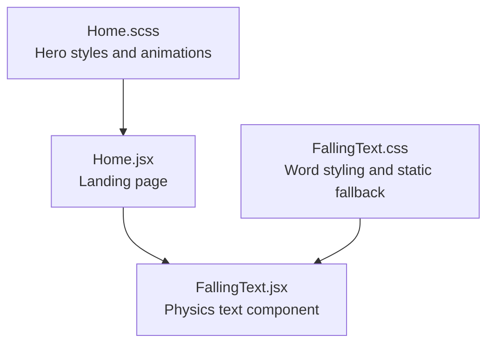
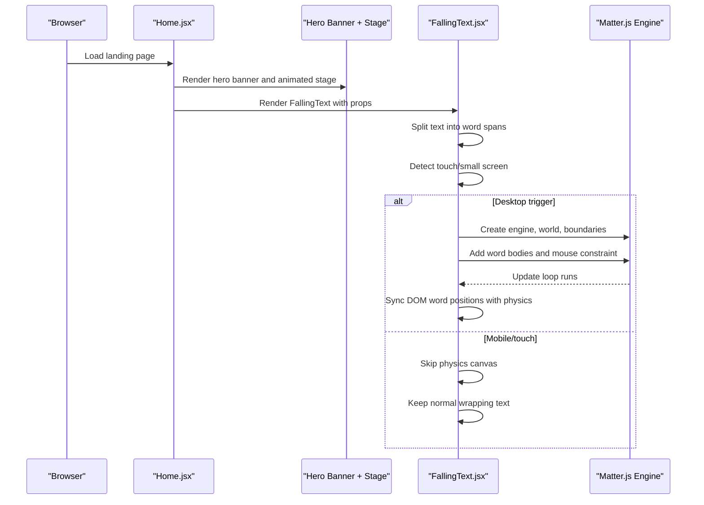
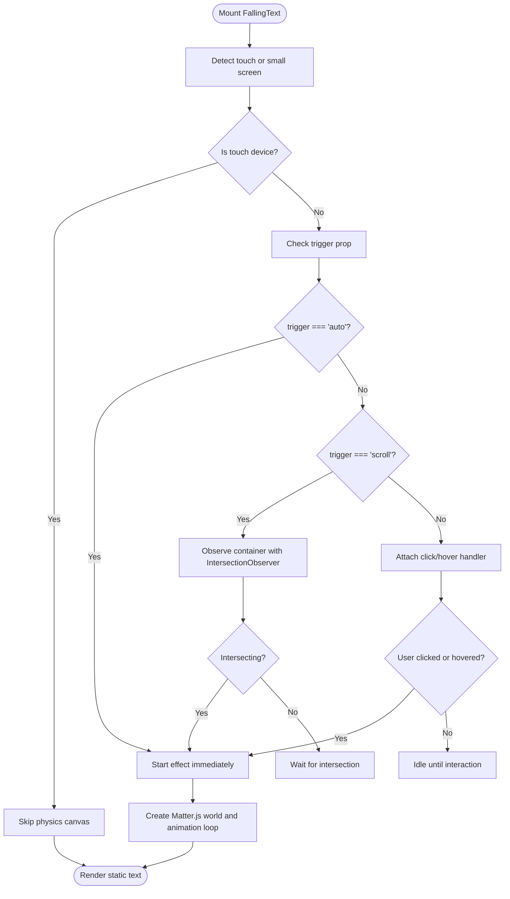
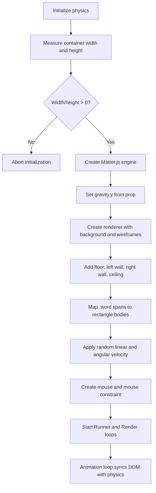
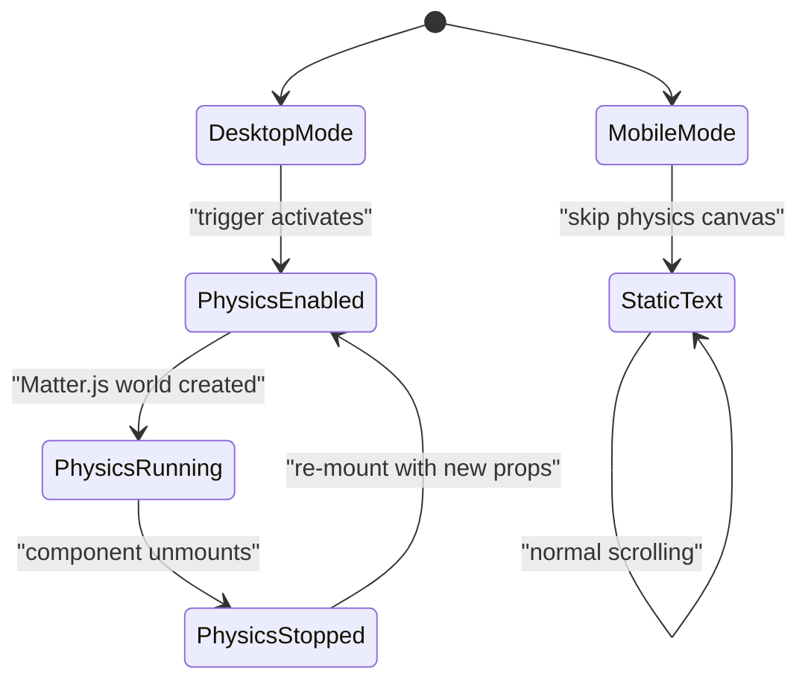
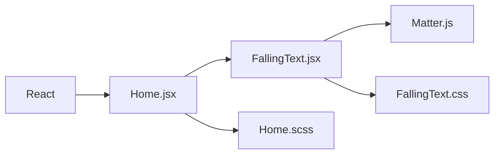

# Hero Section

<cite>
**Referenced Files in This Document**
- [FallingText.jsx](file://src/components/FallingText.jsx)
- [FallingText.css](file://src/components/FallingText.css)
- [Home.jsx](file://src/pages/Home.jsx)
- [Home.scss](file://src/pages/Home.scss)
</cite>

## Table of Contents
1. [Introduction](#introduction)
2. [Project Structure](#project-structure)
3. [Core Components](#core-components)
4. [Architecture Overview](#architecture-overview)
5. [Detailed Component Analysis](#detailed-component-analysis)
6. [Dependency Analysis](#dependency-analysis)
7. [Performance Considerations](#performance-considerations)
8. [Troubleshooting Guide](#troubleshooting-guide)
9. [Conclusion](#conclusion)

## Introduction
This document explains the hero section implementation and its physics-based text animation system. The landing page uses a custom `FallingText` component that integrates Matter.js to turn headline words into interactive, gravity-driven bodies. The hero also includes scroll-triggered effects, responsive layout rules for mobile and tablet screens, accessibility considerations for screen readers, and performance optimizations for heavy visual elements.

The core idea is simple:
- On desktop, words can fall, bounce, rotate, and be dragged with the mouse.
- On touch/mobile devices, the physics canvas is disabled so scrolling remains smooth and natural.
- The hero’s main banner is always visible on phones, while the animated stage is hidden.
- A separate product showcase section demonstrates how to configure `FallingText` with custom parameters such as `fontSize`, `gravity`, and `highlightWords`.

## Project Structure
The hero-related code lives primarily in two places:
- `src/components/FallingText.jsx` and `src/components/FallingText.css`: the reusable physics-based text component.
- `src/pages/Home.jsx` and `src/pages/Home.scss`: the landing page that composes the hero banner, floating icons, animated stage, and showcases `FallingText`.

**Diagram sources**
- [Home.jsx:1-14](file://src/pages/Home.jsx#L1-L14)
- [Home.scss:49-398](file://src/pages/Home.scss#L49-L398)
- [FallingText.jsx:1-219](file://src/components/FallingText.jsx#L1-L219)
- [FallingText.css:1-48](file://src/components/FallingText.css#L1-L48)

**Section sources**
- [Home.jsx:1-14](file://src/pages/Home.jsx#L1-L14)
- [Home.scss:49-398](file://src/pages/Home.scss#L49-L398)
- [FallingText.jsx:1-219](file://src/components/FallingText.jsx#L1-L219)
- [FallingText.css:1-48](file://src/components/FallingText.css#L1-L48)

## Core Components
### FallingText Component
`FallingText` is a React component that:
- Splits input text into word spans.
- Optionally highlights specific words using a configurable highlight class.
- Detects touch or small-screen devices and disables the physics canvas on those devices.
- Supports three trigger modes:
  - `auto`: starts immediately.
  - `scroll`: starts when the container enters the viewport via `IntersectionObserver`.
  - `click` or `hover`: starts when the user interacts with the container.
- Integrates Matter.js to create a physics world with:
  - Gravity.
  - Boundary walls (floor, left wall, right wall, ceiling).
  - Mouse constraints for dragging words.
  - An animation loop that synchronizes DOM word positions with physics bodies.

Key props include:
- `text`: the full headline string.
- `highlightWords`: array of word prefixes used to apply bold/highlight styling.
- `highlightClass`: CSS class applied to highlighted words.
- `trigger`: `"auto" | "scroll" | "click" | "hover"`.
- `backgroundColor`: background color of the Matter.js renderer.
- `wireframes`: whether to render wireframes.
- `gravity`: vertical gravity value passed to the Matter.js engine.
- `mouseConstraintStiffness`: stiffness of the mouse constraint for dragging.
- `fontSize`: font size applied to the target text container.

**Section sources**
- [FallingText.jsx:5-16](file://src/components/FallingText.jsx#L5-L16)
- [FallingText.jsx:21-70](file://src/components/FallingText.jsx#L21-L70)
- [FallingText.jsx:72-187](file://src/components/FallingText.jsx#L72-L187)
- [FallingText.jsx:189-216](file://src/components/FallingText.jsx#L189-L216)

### Hero Banner and Animated Stage
The landing page defines:
- `.hero-banner`: the primary dark-blue hero area with title, subtitle, actions, and dashboard image.
- `.hero-flow`: the wrapper that creates the animated stage, sticky positioning, gradients, and copy overlay.
- Floating SVG icons around the hero copy.
- A dropbox and falling animation controlled by CSS variables and media queries.

On mobile (`max-width: 640px`), the animated stage is hidden and the plain hero banner is always visible.

**Section sources**
- [Home.scss:49-163](file://src/pages/Home.scss#L49-L163)
- [Home.scss:197-223](file://src/pages/Home.scss#L197-L223)
- [Home.scss:225-398](file://src/pages/Home.scss#L225-L398)

### Product Showcase Using FallingText
The product showcase section demonstrates `FallingText` in action:
- It passes a long headline string.
- It highlights the first sentence through `highlightWords`.
- It sets `trigger="scroll"` so the effect begins when the section scrolls into view.
- It configures `gravity={0.6}` for a softer fall.
- It uses a responsive `clamp()` font size for `fontSize`.

**Section sources**
- [Home.jsx:481-531](file://src/pages/Home.jsx#L481-L531)

## Architecture Overview
The hero architecture combines React composition, CSS-driven layout and animation, and a lightweight 2D physics simulation for text.

**Diagram sources**
- [Home.jsx:481-531](file://src/pages/Home.jsx#L481-L531)
- [FallingText.jsx:21-70](file://src/components/FallingText.jsx#L21-L70)
- [FallingText.jsx:72-187](file://src/components/FallingText.jsx#L72-L187)

## Detailed Component Analysis

### FallingText Implementation Details

#### Trigger Logic
The component supports multiple trigger strategies:
- `auto`: starts immediately.
- `scroll`: uses `IntersectionObserver` to start when the container becomes visible.
- `click` or `hover`: starts when the user clicks or hovers over the container.

Touch detection prevents the physics effect from starting on coarse-pointer or narrow-screen devices.

**Diagram sources**
- [FallingText.jsx:21-70](file://src/components/FallingText.jsx#L21-L70)
- [FallingText.jsx:189-216](file://src/components/FallingText.jsx#L189-L216)

#### Physics World Setup
When the effect starts on desktop:
- The component reads the container dimensions.
- Creates a Matter.js engine and sets `engine.world.gravity.y` from the `gravity` prop.
- Creates a renderer bound to a dedicated canvas container.
- Adds boundary bodies: floor, left wall, right wall, ceiling.
- Converts each word span into a rectangle body positioned at the DOM element’s current location.
- Applies initial random velocity and angular velocity for a natural scatter.
- Sets up a mouse constraint for dragging words.
- Runs an animation loop that updates DOM positions and angles based on physics state.

**Diagram sources**
- [FallingText.jsx:72-187](file://src/components/FallingText.jsx#L72-L187)

#### Cleanup and Memory Management
The component cleans up after itself:
- Cancels the request animation frame.
- Stops the renderer and runner.
- Removes the canvas element from the DOM.
- Clears the world and engine.

This prevents memory leaks and ensures that re-renders do not accumulate multiple physics worlds.

**Section sources**
- [FallingText.jsx:176-187](file://src/components/FallingText.jsx#L176-L187)

### Responsive Design Patterns

#### Mobile Behavior
- The hero banner is always visible on phones.
- The animated stage is hidden on mobile.
- `FallingText` skips the physics canvas on touch or small screens.
- Word spans remain as normal wrapping text.

**Diagram sources**
- [Home.scss:138-162](file://src/pages/Home.scss#L138-L162)
- [Home.scss:238-271](file://src/pages/Home.scss#L238-L271)
- [FallingText.jsx:21-35](file://src/components/FallingText.jsx#L21-L35)
- [FallingText.jsx:49-70](file://src/components/FallingText.jsx#L49-L70)
- [FallingText.jsx:195-216](file://src/components/FallingText.jsx#L195-L216)

#### Typography Scaling
The hero banner uses `clamp()` for fluid typography:
- Title scales between a minimum and maximum based on viewport width.
- Subtitle scales similarly but with smaller ranges.
- The product showcase headline uses a responsive `fontSize` prop with `clamp()`.

**Section sources**
- [Home.scss:90-111](file://src/pages/Home.scss#L90-L111)
- [Home.jsx:510-518](file://src/pages/Home.jsx#L510-L518)

### Accessibility Considerations

#### Screen Reader Behavior
- The hero banner contains semantic headings and descriptive text.
- Decorative SVGs use `aria-hidden="true"` where appropriate.
- Links have accessible labels.
- The physics canvas is purely decorative; it does not replace meaningful content.

#### Reduced Motion
The stylesheet disables certain animations when the user prefers reduced motion:
- Floating icon animations are turned off.
- The animated runway, copy animation, and dropbox are hidden.

This helps users who are sensitive to motion or who rely on assistive technologies.

**Section sources**
- [Home.scss:393-398](file://src/pages/Home.scss#L393-L398)
- [Home.jsx:28-31](file://src/pages/Home.jsx#L28-L31)
- [Home.jsx:232-249](file://src/pages/Home.jsx#L232-L249)

### Performance Optimizations

#### Skipping Physics on Touch Devices
The component avoids creating a Matter.js world on touch or small screens. This prevents:
- Blocking page scroll due to touch event handling.
- Unnecessary CPU/GPU usage for drag interactions that are not useful on mobile.

#### Canvas Cleanup
The cleanup function stops the renderer and runner, removes the canvas, clears the world, and clears the engine. This reduces memory pressure during navigation or re-renders.

#### CSS Animation Strategy
The hero uses CSS variables and `will-change` for animated properties like transform and opacity. This encourages compositor-only updates and reduces layout thrashing.

#### Avoiding Expensive Filters During Animation
The dropbox shadow is implemented as a baked gradient rather than a live `drop-shadow` filter on an animated SVG. This avoids expensive per-frame rasterization.

**Section sources**
- [FallingText.jsx:21-35](file://src/components/FallingText.jsx#L21-L35)
- [FallingText.jsx:176-187](file://src/components/FallingText.jsx#L176-L187)
- [Home.scss:356-386](file://src/pages/Home.scss#L356-L386)
- [Home.scss:244-271](file://src/pages/Home.scss#L244-L271)

## Dependency Analysis
The hero section depends on:
- React for component composition and state management.
- Matter.js for 2D physics simulation.
- CSS and SCSS for layout, gradients, typography, and animations.
- The browser APIs `IntersectionObserver`, `matchMedia`, and `requestAnimationFrame`.

**Diagram sources**
- [Home.jsx:1-14](file://src/pages/Home.jsx#L1-L14)
- [FallingText.jsx:1-3](file://src/components/FallingText.jsx#L1-L3)

**Section sources**
- [Home.jsx:1-14](file://src/pages/Home.jsx#L1-L14)
- [FallingText.jsx:1-3](file://src/components/FallingText.jsx#L1-L3)

## Performance Considerations
- Prefer `trigger="scroll"` for heavy visuals so they only run when needed.
- Keep `gravity` moderate; very high gravity can cause rapid collisions and more frequent updates.
- Limit the number of highlighted words if the headline is extremely long.
- Use responsive `fontSize` values instead of excessively large fonts on desktop.
- Avoid animating many heavy SVGs simultaneously with physics; keep decorative animations lightweight.
- Monitor memory usage if the hero appears frequently in routes that mount/unmount often.

[No sources needed since this section provides general guidance]

## Troubleshooting Guide

### Words Do Not Fall on Mobile
**Cause:** The component intentionally skips the physics canvas on touch or small screens.  
**Solution:** Accept the static text behavior on mobile, or adjust the touch detection logic if you have a custom requirement.

**Section sources**
- [FallingText.jsx:21-35](file://src/components/FallingText.jsx#L21-L35)
- [FallingText.jsx:49-70](file://src/components/FallingText.jsx#L49-L70)
- [FallingText.jsx:195-216](file://src/components/FallingText.jsx#L195-L216)

### Page Scroll Blocks When Touching the Hero
**Cause:** Matter.js mouse handlers can prevent default touch events.  
**Solution:** The component already removes touch handlers from the mouse element. If you customize the component, avoid re-adding handlers that call `preventDefault` on touch events.

**Section sources**
- [FallingText.jsx:137-155](file://src/components/FallingText.jsx#L137-L155)

### Effect Does Not Start
**Cause:** The trigger is set to `scroll`, but the container never intersects the viewport, or the effect was already started and disconnected the observer.  
**Solution:** Verify the container is visible, check the trigger prop, and ensure the component is mounted.

**Section sources**
- [FallingText.jsx:53-70](file://src/components/FallingText.jsx#L53-L70)

### Highlighted Words Are Not Bold
**Cause:** The highlight class may not match the CSS rule.  
**Solution:** Ensure `highlightClass` matches a CSS selector that applies bold styling, such as `fx-bold`.

**Section sources**
- [FallingText.jsx:37-47](file://src/components/FallingText.jsx#L37-L47)
- [FallingText.css:39-48](file://src/components/FallingText.css#L39-L48)
- [Home.jsx:510-518](file://src/pages/Home.jsx#L510-L518)

### Canvas Overlaps or Misaligns
**Cause:** Container dimensions are zero or the DOM has not been measured yet.  
**Solution:** Ensure the container has a valid width and height before initializing the physics world.

**Section sources**
- [FallingText.jsx:77-83](file://src/components/FallingText.jsx#L77-L83)

## Conclusion
The hero section combines a visually rich banner with a carefully designed physics-based text animation. `FallingText` provides a flexible API for configuring gravity, triggers, highlighting, and responsiveness. The landing page’s SCSS handles layout, gradients, and motion preferences, while the component itself manages Matter.js lifecycle and touch-device safety. For best results, use scroll-triggered effects, keep physics parameters reasonable, and rely on the existing mobile fallback to preserve usability.

[No sources needed since this section summarizes without analyzing specific files]