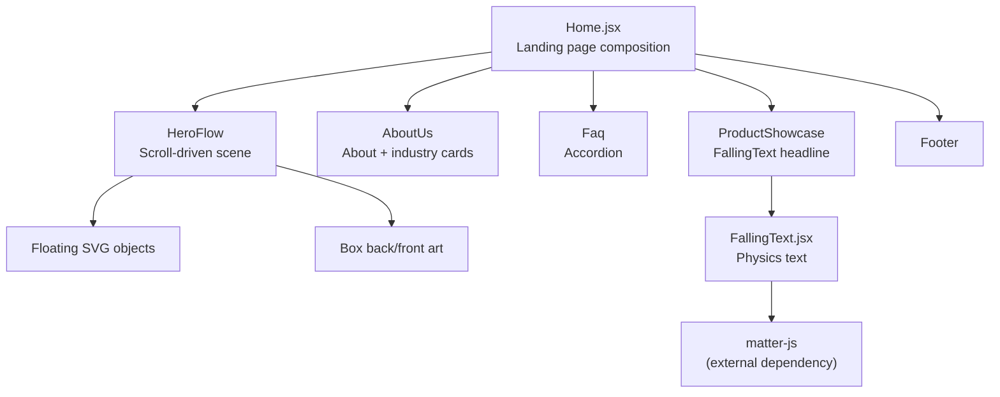
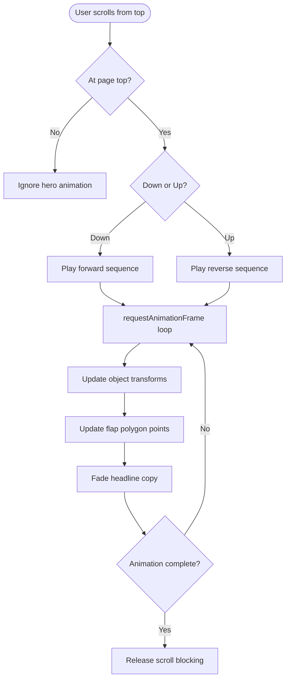
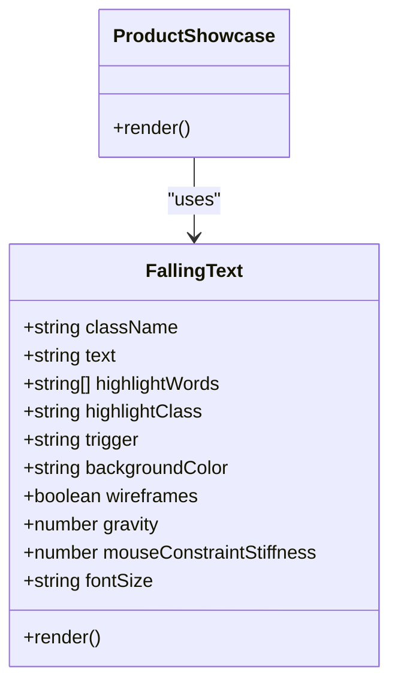
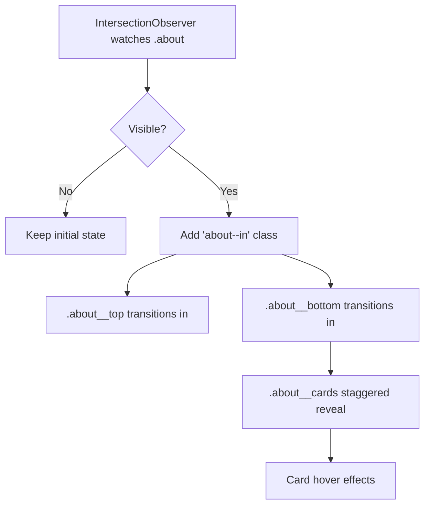
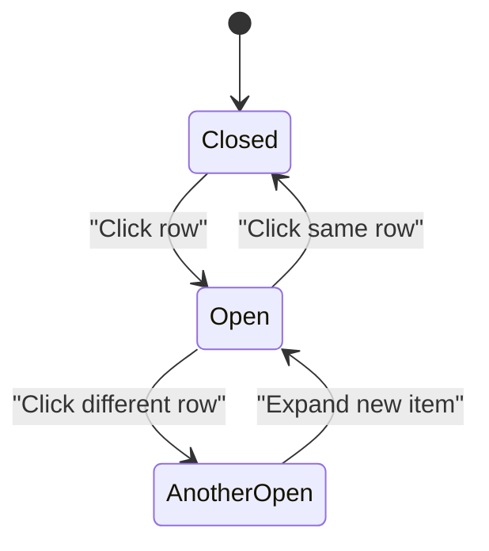
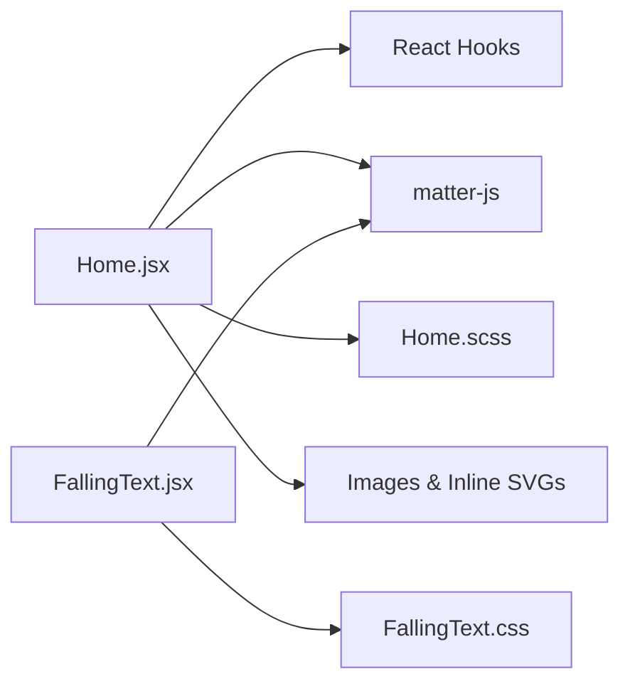

# Landing Page

<cite>
**Referenced Files in This Document**   
- [Home.jsx](file://src/pages/Home.jsx)
- [Home.scss](file://src/pages/Home.scss)
- [FallingText.jsx](file://src/components/FallingText.jsx)
- [FallingText.css](file://src/components/FallingText.css)
</cite>

## Table of Contents
1. [Introduction](#introduction)
2. [Project Structure](#project-structure)
3. [Core Components](#core-components)
4. [Architecture Overview](#architecture-overview)
5. [Detailed Component Analysis](#detailed-component-analysis)
6. [Dependency Analysis](#dependency-analysis)
7. [Performance Considerations](#performance-considerations)
8. [Accessibility Compliance](#accessibility-compliance)
9. [Mobile Responsiveness Strategies](#mobile-responsiveness-strategies)
10. [Troubleshooting Guide](#troubleshooting-guide)
11. [Conclusion](#conclusion)

## Introduction
This document explains the landing page implementation for TRELLISCO_ERP_FRONTEND with a focus on:
- The hero section and its scroll-driven animation scene.
- Physics-based text animations using the `FallingText` component.
- Industry showcases for HRMS, Hospitality, Property, and Gym solutions.
- The About Us section with scroll-triggered reveal animations and interactive industry cards.
- The FAQ accordion.
- The product showcase section with animated SVG illustrations.
- Performance, accessibility, and mobile responsiveness considerations.

The landing page is built as a React application where `Home.jsx` composes the visible sections, while `Home.scss` provides layout, motion, and responsive styles. Visual assets include static images and inline SVG components that represent products and decorative elements.

## Project Structure
The landing page lives under `src/pages/Home.jsx`, with styling in `src/pages/Home.scss`. Interactive physics-based text is implemented in `src/components/FallingText.jsx` and styled by `src/components/FallingText.css`.



**Diagram sources**
- [Home.jsx:926-1323](file://src/pages/Home.jsx#L926-L1323)
- [Home.jsx:1325-1386](file://src/pages/Home.jsx#L1325-L1386)
- [FallingText.jsx:1-219](file://src/components/FallingText.jsx#L1-L219)

**Section sources**
- [Home.jsx:1-15](file://src/pages/Home.jsx#L1-L15)
- [Home.jsx:1325-1386](file://src/pages/Home.jsx#L1325-L1386)

## Core Components
- **HeroFlow**: A scroll-driven scene that animates floating icons into a box, closes flaps, and reveals a headline. It uses time-based animation rather than raw scroll values to avoid jitter.
- **AboutUs**: A two-part section with an image/story block and an industry solutions grid. It uses `IntersectionObserver` to trigger entrance animations.
- **Faq**: An accessible accordion with single-open behavior, keyboard support, and visual state changes.
- **ProductShowcase**: A section whose headline uses `FallingText` for physics-based word animations triggered by scroll.
- **FallingText**: A reusable component that splits text into words, attaches a `matter-js` physics world, and updates DOM positions each frame. It disables physics on touch/mobile devices.

**Section sources**
- [Home.jsx:926-1323](file://src/pages/Home.jsx#L926-L1323)
- [Home.jsx:103-258](file://src/pages/Home.jsx#L103-L258)
- [Home.jsx:432-479](file://src/pages/Home.jsx#L432-L479)
- [Home.jsx:505-531](file://src/pages/Home.jsx#L505-L531)
- [FallingText.jsx:5-219](file://src/components/FallingText.jsx#L5-L219)

## Architecture Overview
The landing page composes several sections inside `Home()`. The hero is wrapped by `HeroFlow`, which owns the complex animation loop. The rest of the page follows a standard top-to-bottom flow: About Us, Platform Features, FAQ, Product Showcase, and Footer.

```mermaid
sequenceDiagram
participant User as "User"
participant Window as "Window Events"
participant HeroFlow as "HeroFlow (Home.jsx)"
participant Stage as ".hero-flow__stage"
participant Objects as "Floating SVG Objects"
participant Box as "Box Art"
participant Copy as "Headline Copy"
User->>Window : Scroll / Wheel / Touch / Keyboard
Window->>HeroFlow : Event handlers
HeroFlow->>Stage : Update CSS variables (--hp, --by, --to, --ty)
HeroFlow->>Objects : Apply transform (translate, rotate, scale)
HeroFlow->>Box : Update flap points per fold angle
HeroFlow->>Copy : Fade-in and slide-up
Note over HeroFlow,Objects : Animation runs via requestAnimationFrame until finished
```

**Diagram sources**
- [Home.jsx:955-1285](file://src/pages/Home.jsx#L955-L1285)

## Detailed Component Analysis

### Hero Section and Scroll-Driven Scene
The hero section has two layers:
1. A plain banner with title, subtitle, buttons, and dashboard image.
2. A hidden stage that plays when the user scrolls down from the top.

The stage contains:
- Back box layer.
- Floating SVG objects representing HRMS, gym, property, box, and stay/hospitality visuals.
- Front box layer.
- Headline copy that fades in after the objects land.

Key behaviors:
- Scrolling down from the top starts the sequence; scrolling up from the end reverses it.
- Wheel, touch swipe, and keyboard inputs are handled at the top of the page.
- During playback, normal scrolling is blocked so the animation remains smooth.
- On phones (`max-width: 640px`) and when `prefers-reduced-motion` is enabled, the animated stage is disabled.



**Diagram sources**
- [Home.jsx:955-1285](file://src/pages/Home.jsx#L955-L1285)

**Section sources**
- [Home.jsx:926-1323](file://src/pages/Home.jsx#L926-L1323)
- [Home.scss:49-398](file://src/pages/Home.scss#L49-L398)

### Physics-Based Text Animations with FallingText
`ProductShowcase` renders a headline through `FallingText`. The component:
- Splits the input text into word spans.
- Optionally highlights specified words with a custom class.
- Detects touch/mobile devices and skips the physics canvas entirely.
- Supports triggers: automatic, scroll-triggered via `IntersectionObserver`, click, or hover.
- Creates a `matter-js` engine, adds boundary bodies, creates rectangle bodies for each word, and syncs DOM positions with physics bodies every frame.
- Cleans up canvas, runner, and event listeners on unmount.



**Diagram sources**
- [FallingText.jsx:5-219](file://src/components/FallingText.jsx#L5-L219)
- [Home.jsx:505-531](file://src/pages/Home.jsx#L505-L531)

**Section sources**
- [FallingText.jsx:1-219](file://src/components/FallingText.jsx#L1-L219)
- [FallingText.css:1-48](file://src/components/FallingText.css#L1-L48)
- [Home.jsx:481-531](file://src/pages/Home.jsx#L481-L531)

### About Us Section with Scroll-Triggered Animations
The About Us section includes:
- An image area with floating badges and a badge showing “10+ Industries.”
- A story block with checklist items and a call-to-action link.
- An industry solutions grid with four cards: HRMS, Hospitality, Property, and Gym.

Behavior:
- `IntersectionObserver` toggles an `about--in` class once the section enters the viewport.
- CSS transitions animate `.about__top`, `.about__bottom`, and `.about__card` from invisible and shifted to visible and in place.
- Cards have hover effects: elevated shadow, corner icon color change, and pill button hover states.



**Diagram sources**
- [Home.jsx:103-258](file://src/pages/Home.jsx#L103-L258)
- [Home.scss:439-984](file://src/pages/Home.scss#L439-L984)

**Section sources**
- [Home.jsx:19-258](file://src/pages/Home.jsx#L19-L258)
- [Home.scss:439-984](file://src/pages/Home.scss#L439-L984)

### Industry Showcases: HRMS, Hospitality, Property, Gym
Each industry card contains:
- A logo or icon.
- Title and short description.
- Feature chips.
- A full-width “Learn more” link.

Data structure:
- `ABOUT_INDUSTRIES` defines keys, logos, titles, accent colors, tints, descriptions, included features, and external links.
- Styling uses CSS variables like `--accent`, `--tint`, `--hover`, and `--hover-ink` to customize each card’s brand feel.

Responsiveness:
- Four-column grid on large screens.
- Two columns on medium screens.
- Single column on mobile.

**Section sources**
- [Home.jsx:34-101](file://src/pages/Home.jsx#L34-L101)
- [Home.jsx:177-258](file://src/pages/Home.jsx#L177-L258)
- [Home.scss:765-984](file://src/pages/Home.scss#L765-L984)

### FAQ Accordion Functionality
The FAQ section:
- Renders a list of questions with icons and tone-based color variants.
- Uses a single open index state so only one answer can be expanded at a time.
- Provides `aria-expanded` on the button and visually rotates the chevron when open.
- Styles the open item with a highlighted background and border.



**Diagram sources**
- [Home.jsx:263-479](file://src/pages/Home.jsx#L263-L479)
- [Home.scss:986-1245](file://src/pages/Home.scss#L986-L1245)

**Section sources**
- [Home.jsx:263-479](file://src/pages/Home.jsx#L263-L479)
- [Home.scss:986-1245](file://src/pages/Home.scss#L986-L1245)

### Product Showcase Section with Animated SVG Illustrations
The product showcase section:
- Displays a headline powered by `FallingText`.
- Shows a platform preview image.
- Uses bold highlighting for selected words in the headline.

SVG illustrations used elsewhere in the hero scene include:
- Gym barbell illustration.
- Box illustration.
- Property building illustration.
- Stay/hospitality bed illustration.
- HRMS organization chart illustration.

These SVGs are defined as React components and rendered inside floating objects during the hero animation.

**Section sources**
- [Home.jsx:481-531](file://src/pages/Home.jsx#L481-L531)
- [Home.jsx:538-822](file://src/pages/Home.jsx#L538-L822)

## Dependency Analysis
The landing page depends on:
- React hooks: `useEffect`, `useRef`, `useState`.
- External physics library: `matter-js`.
- CSS/Sass for layout, animations, and responsive breakpoints.
- Inline SVG components for visual storytelling.



**Diagram sources**
- [Home.jsx:1-15](file://src/pages/Home.jsx#L1-L15)
- [FallingText.jsx:1-3](file://src/components/FallingText.jsx#L1-L3)

**Section sources**
- [Home.jsx:1-15](file://src/pages/Home.jsx#L1-L15)
- [FallingText.jsx:1-3](file://src/components/FallingText.jsx#L1-L3)

## Performance Considerations
Heavy visual elements on the landing page include:
- A continuous `requestAnimationFrame` loop in the hero scene.
- Frequent DOM updates for object transforms and SVG flap points.
- A physics simulation with multiple bodies in `FallingText`.
- Large images and gradients in the hero and about sections.

Recommended practices already present or implied:
- Disable the animated hero stage on mobile and reduced-motion preferences.
- Skip physics entirely on touch/mobile devices in `FallingText`.
- Use CSS variables and GPU-friendly properties like `transform` and `opacity`.
- Avoid expensive filters on frequently animated elements; the code comments note avoiding live drop shadows on large animated SVGs.
- Measure geometry once and cache computed transforms to reduce DOM writes.

[No sources needed since this section provides general guidance]

## Accessibility Compliance
Key accessibility features:
- `aria-hidden="true"` on decorative floating objects and non-interactive SVGs.
- `aria-expanded` on FAQ accordion buttons.
- Semantic HTML: headings, paragraphs, lists, and buttons.
- Reduced motion support:
  - Hero floating animations pause.
  - Hero stage content is hidden.
  - About section animations are disabled.
- Keyboard navigation:
  - Hero scene responds to arrow keys, spacebar, page up/down, home, and end.
  - FAQ rows are buttons and can be focused and activated.

Recommendations:
- Ensure all meaningful images have descriptive `alt` text.
- Provide visible focus indicators for interactive elements.
- Test screen reader announcements for dynamic content changes.

**Section sources**
- [Home.jsx:955-1285](file://src/pages/Home.jsx#L955-L1285)
- [Home.jsx:397-479](file://src/pages/Home.jsx#L397-L479)
- [Home.scss:393-398](file://src/pages/Home.scss#L393-L398)
- [Home.scss:599-601](file://src/pages/Home.scss#L599-L601)
- [Home.scss:975-983](file://src/pages/Home.scss#L975-L983)

## Mobile Responsiveness Strategies
The landing page adapts across breakpoints:
- Hero:
  - Plain banner always visible on phones.
  - Animated stage is hidden on small screens.
  - Button sizes and spacing adjust for touch targets.
- About Us:
  - Two-column story layout collapses to single column.
  - Floating badges hide on mobile.
  - Industry cards stack vertically.
- FAQ:
  - Smaller padding, font sizes, and tighter spacing.
- General:
  - Horizontal overflow is clipped on phones to prevent layout shifts.
  - Breakpoints are defined as Sass variables for consistency.

**Section sources**
- [Home.scss:33-47](file://src/pages/Home.scss#L33-L47)
- [Home.scss:138-163](file://src/pages/Home.scss#L138-L163)
- [Home.scss:238-271](file://src/pages/Home.scss#L238-L271)
- [Home.scss:515-519](file://src/pages/Home.scss#L515-L519)
- [Home.scss:595-597](file://src/pages/Home.scss#L595-L597)
- [Home.scss:814-818](file://src/pages/Home.scss#L814-L818)
- [Home.scss:1196-1244](file://src/pages/Home.scss#L1196-L1244)

## Troubleshooting Guide
Common issues and resolutions:
- Physics text does not appear on mobile:
  - Expected behavior: `FallingText` disables the physics canvas on touch/mobile devices.
  - Verify device detection logic and ensure the static text fallback is rendered.
- Hero animation does not start:
  - Confirm the user is at the top of the page.
  - Check that `prefers-reduced-motion` is not set to reduce.
  - Ensure wheel/touch events are not being consumed elsewhere.
- Jittery hero animation:
  - Avoid heavy filters on animated SVGs.
  - Keep animations on transform and opacity.
  - Ensure ResizeObserver and font load events trigger re-measurement.
- FAQ accordion not expanding:
  - Verify the button has `aria-expanded` and proper click handler.
  - Check that the open index state is updating correctly.

**Section sources**
- [FallingText.jsx:24-35](file://src/components/FallingText.jsx#L24-L35)
- [FallingText.jsx:49-70](file://src/components/FallingText.jsx#L49-L70)
- [Home.jsx:955-1285](file://src/pages/Home.jsx#L955-L1285)
- [Home.jsx:432-479](file://src/pages/Home.jsx#L432-L479)

## Conclusion
The landing page combines a polished hero experience, clear industry positioning, and interactive educational sections. The hero scene uses a robust time-based animation loop, while `FallingText` brings playful physics to the product headline. The About Us section communicates value through scroll-triggered reveals and branded industry cards. The FAQ accordion provides accessible, keyboard-friendly information retrieval. With careful attention to performance, accessibility, and mobile responsiveness, the landing page delivers a modern, engaging entry point to the TRELLISCO ERP ecosystem.

[No sources needed since this section summarizes without analyzing specific files]