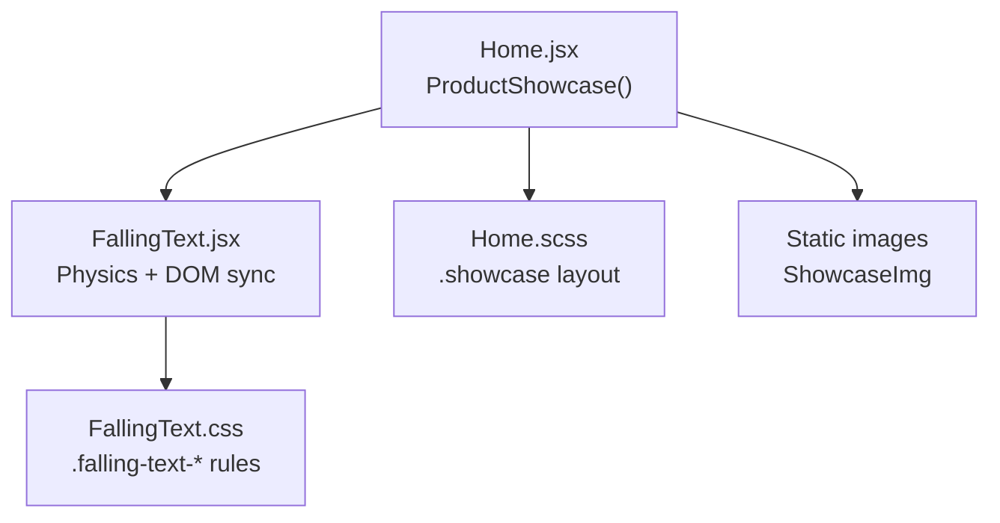
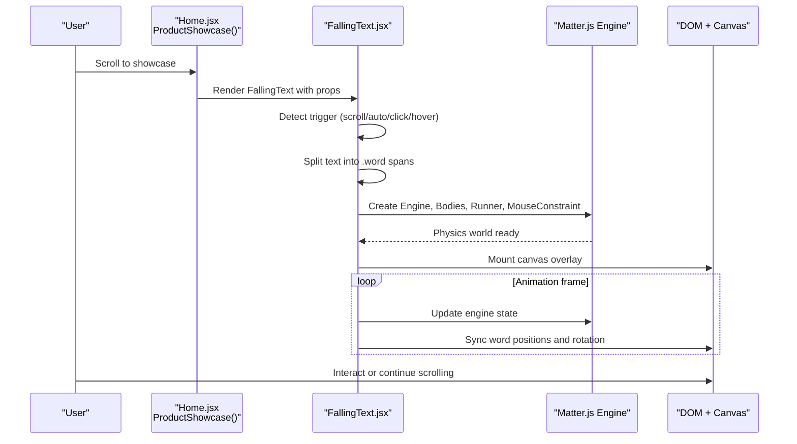
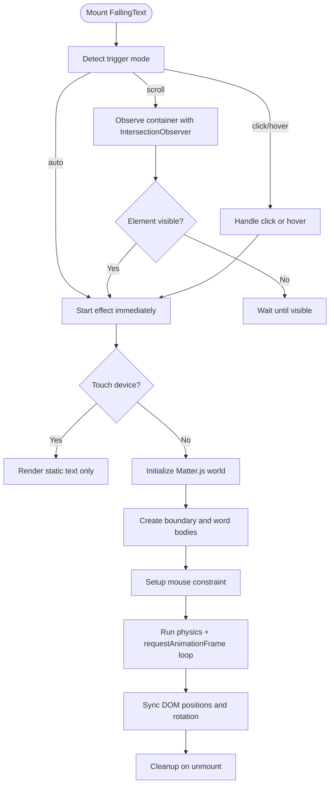
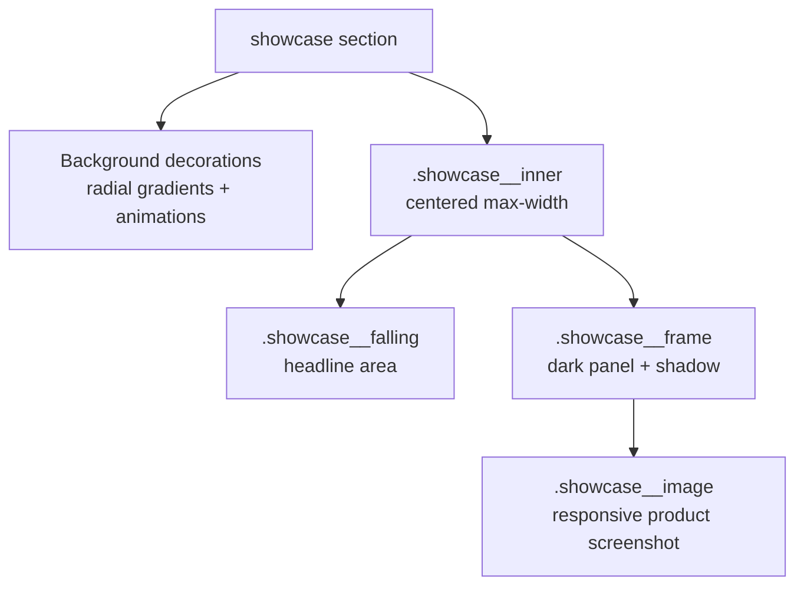
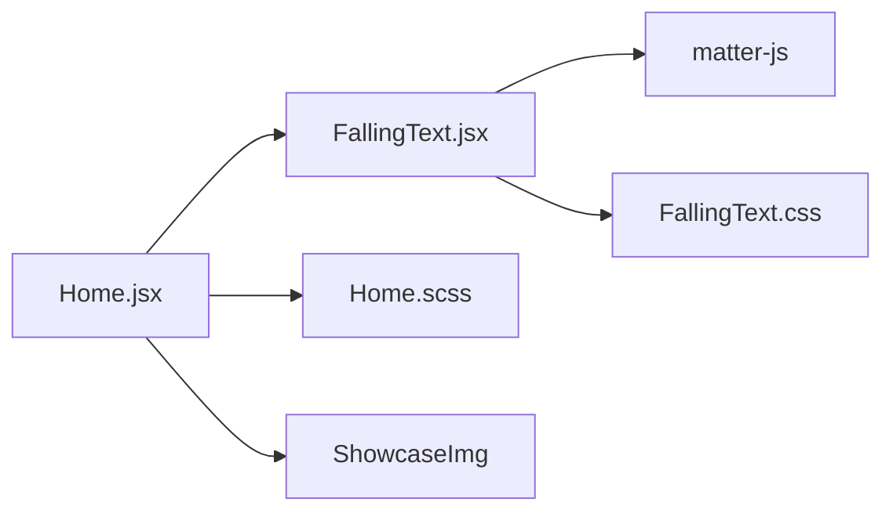

# Product Showcase

<cite>
**Referenced Files in This Document**
- [Home.jsx](file://src/pages/Home.jsx)
- [Home.scss](file://src/pages/Home.scss)
- [FallingText.jsx](file://src/components/FallingText.jsx)
- [FallingText.css](file://src/components/FallingText.css)
</cite>

## Table of Contents
1. [Introduction](#introduction)
2. [Project Structure](#project-structure)
3. [Core Components](#core-components)
4. [Architecture Overview](#architecture-overview)
5. [Detailed Component Analysis](#detailed-component-analysis)
6. [Dependency Analysis](#dependency-analysis)
7. [Performance Considerations](#performance-considerations)
8. [Troubleshooting Guide](#troubleshooting-guide)
9. [Conclusion](#conclusion)

## Introduction
This document explains the product showcase section that combines a FallingText physics animation with a static product image. The headline text is split into word-level elements and animated using a 2D physics engine, while the accompanying screenshot is displayed as a responsive framed image. The animation timing is scroll-triggered, and the implementation includes mobile-safe behavior to avoid blocking page scrolling.

The goal is to help developers understand:
- How the FallingText component works inside the showcase layout.
- How scroll-triggered animation timing is configured.
- How heavy visual content is optimized for performance.
- Which configuration options are available for FallingText in this context.
- How the component integrates with the overall page layout and styling.

## Project Structure
The product showcase lives in the home page and uses a reusable FallingText component plus dedicated styles.

**Diagram sources**
- [Home.jsx:480-531](file://src/pages/Home.jsx#L480-L531)
- [Home.scss:2108-2241](file://src/pages/Home.scss#L2108-L2241)
- [FallingText.jsx:1-219](file://src/components/FallingText.jsx#L1-L219)
- [FallingText.css:1-48](file://src/components/FallingText.css#L1-L48)

**Section sources**
- [Home.jsx:480-531](file://src/pages/Home.jsx#L480-L531)
- [Home.scss:2108-2241](file://src/pages/Home.scss#L2108-L2241)

## Core Components
The showcase is composed of two main parts:
- A FallingText headline that animates words with physics when scrolled into view.
- A framed static image showing the product preview.

Key responsibilities:
- Home.jsx defines the showcase section, provides the headline text, highlights specific words, configures FallingText, and renders the static image.
- FallingText.jsx handles text splitting, trigger detection, physics setup, canvas rendering, and DOM synchronization.
- Home.scss styles the showcase container, background decorations, falling area height, and image frame.
- FallingText.css styles the text container, word spans, highlight classes, and canvas overlay.

**Section sources**
- [Home.jsx:480-531](file://src/pages/Home.jsx#L480-L531)
- [FallingText.jsx:1-219](file://src/components/FallingText.jsx#L1-L219)
- [Home.scss:2108-2241](file://src/pages/Home.scss#L2108-L2241)
- [FallingText.css:1-48](file://src/components/FallingText.css#L1-L48)

## Architecture Overview
The showcase architecture connects React components, CSS, and a physics library.

**Diagram sources**
- [Home.jsx:505-531](file://src/pages/Home.jsx#L505-L531)
- [FallingText.jsx:49-187](file://src/components/FallingText.jsx#L49-L187)

## Detailed Component Analysis

### FallingText Component
FallingText is a self-contained animation component. It:
- Splits input text into word spans and applies highlight classes.
- Supports multiple triggers: automatic, scroll-based intersection observation, click, and hover.
- Skips physics on touch/mobile devices to prevent blocking page scrolling.
- Creates a Matter.js physics world with boundaries and word bodies.
- Renders a canvas overlay and synchronizes DOM element positions each frame.
- Cleans up animation frames, runners, renderers, and physics objects on unmount.

**Diagram sources**
- [FallingText.jsx:24-70](file://src/components/FallingText.jsx#L24-L70)
- [FallingText.jsx:72-187](file://src/components/FallingText.jsx#L72-L187)
- [FallingText.jsx:189-215](file://src/components/FallingText.jsx#L189-L215)

#### Props and Configuration
The showcase passes these props to FallingText:
- `text`: The full headline string.
- `highlightWords`: Words to style with bold/highlight class.
- `highlightClass`: CSS class applied to highlighted words.
- `trigger`: `"scroll"` so the animation starts when the section enters the viewport.
- `gravity`: Lower gravity value for a softer fall feel.
- `mouseConstraintStiffness`: Controls how stiff dragging feels.
- `fontSize`: Responsive font size using CSS clamp.

These props control:
- Text content and highlighting.
- When the animation begins.
- Visual feel of the physics simulation.
- Typography scaling across screen sizes.

**Section sources**
- [Home.jsx:510-518](file://src/pages/Home.jsx#L510-L518)
- [FallingText.jsx:5-16](file://src/components/FallingText.jsx#L5-L16)

#### Trigger Behavior
- Automatic trigger starts the effect immediately.
- Scroll trigger uses an IntersectionObserver with a threshold to start once the container is partially visible.
- Click and hover triggers require explicit user interaction.
- Touch/mobile devices skip the physics effect entirely to avoid blocking page scrolling.

**Section sources**
- [FallingText.jsx:49-70](file://src/components/FallingText.jsx#L49-L70)
- [FallingText.jsx:189-193](file://src/components/FallingText.jsx#L189-L193)

#### Physics and Rendering
- The component measures the container dimensions and creates a physics world with floor, walls, and ceiling boundaries.
- Each word span becomes a rectangle body with random initial velocity and angular velocity.
- A canvas overlay is mounted behind the text layer.
- An animation loop updates the physics engine and synchronizes DOM element positions and rotation.
- Cleanup cancels the animation frame, stops the runner and renderer, removes the canvas, and clears the physics world.

**Section sources**
- [FallingText.jsx:72-187](file://src/components/FallingText.jsx#L72-L187)

#### Styling and Mobile Behavior
- The container sets width/height and allows vertical pan on touch devices.
- The target text layer is positioned relative with z-index above the canvas.
- On touch/mobile, the target gets a static class that restores normal text flow and resets absolute positioning.
- Highlighted words use a default highlight class with color and weight changes.
- A custom bold class is used by the showcase to emphasize selected words.

**Section sources**
- [FallingText.css:1-48](file://src/components/FallingText.css#L1-L48)

### ProductShowcase Section
The ProductShowcase function renders:
- A `.showcase` section with decorative background layers.
- A `.showcase__falling` container holding the FallingText component.
- A `.showcase__frame` containing the static product image.

It configures FallingText with:
- Full headline text.
- Bold words for the first sentence.
- Scroll-triggered animation.
- Custom gravity and mouse stiffness.
- Responsive font sizing.

**Section sources**
- [Home.jsx:480-531](file://src/pages/Home.jsx#L480-L531)

### Showcase Layout and Styling
The `.showcase` styles provide:
- A white background with decorative radial-gradient dots and small confetti-like dots.
- Two layered pseudo-elements with subtle animations for floating and drifting effects.
- A centered inner container with a maximum width.
- A fixed-height falling area for the headline.
- A dark-framed image container with rounded corners and shadow.
- Responsive adjustments for mobile padding, heights, and border radius.

**Diagram sources**
- [Home.scss:2108-2241](file://src/pages/Home.scss#L2108-L2241)

**Section sources**
- [Home.scss:2108-2241](file://src/pages/Home.scss#L2108-L2241)

## Dependency Analysis
The showcase depends on:
- React component composition in Home.jsx.
- FallingText component for physics-driven text animation.
- Matter.js for 2D physics simulation.
- CSS modules/styles for layout and visual polish.
- Static assets for the product screenshot.

**Diagram sources**
- [Home.jsx:1-14](file://src/pages/Home.jsx#L1-L14)
- [Home.jsx:480-531](file://src/pages/Home.jsx#L480-L531)
- [FallingText.jsx:1-3](file://src/components/FallingText.jsx#L1-L3)

**Section sources**
- [Home.jsx:1-14](file://src/pages/Home.jsx#L1-L14)
- [Home.jsx:480-531](file://src/pages/Home.jsx#L480-L531)
- [FallingText.jsx:1-3](file://src/components/FallingText.jsx#L1-L3)

## Performance Considerations
Heavy visual content in the showcase involves both CSS animations and a live physics loop. The implementation includes several optimizations:

- **Mobile safety**: Touch/mobile devices skip the physics effect entirely, preventing Matter.js from attaching touch listeners that block page scrolling.
- **IntersectionObserver**: Scroll-triggered activation ensures the physics world is created only when needed.
- **Single animation loop**: The component uses one `requestAnimationFrame` loop to update physics and sync DOM.
- **Cleanup**: Unmounting cancels the animation frame, stops the runner and renderer, removes the canvas, and clears the physics world to avoid memory leaks.
- **CSS-only background decorations**: The showcase uses layered pseudo-elements with lightweight animations instead of extra DOM nodes.
- **Responsive typography**: Font size uses CSS clamp to reduce layout thrashing across breakpoints.

Recommendations for further optimization:
- Limit the number of words in the headline to keep the physics simulation light.
- Avoid changing `text`, `highlightWords`, or `trigger` frequently to prevent reinitialization.
- Keep the showcase container dimensions stable; large layout shifts can cause expensive reflows during animation.
- Consider disabling or reducing background animations on low-power devices if needed.

**Section sources**
- [FallingText.jsx:24-35](file://src/components/FallingText.jsx#L24-L35)
- [FallingText.jsx:49-70](file://src/components/FallingText.jsx#L49-L70)
- [FallingText.jsx:163-187](file://src/components/FallingText.jsx#L163-L187)
- [Home.scss:2108-2241](file://src/pages/Home.scss#L2108-L2241)

## Troubleshooting Guide
Common issues and resolutions:

- **Animation does not start on scroll**:
  - Ensure the `.showcase__falling` container is visible and has non-zero dimensions.
  - Verify that `trigger="scroll"` is set and the container is observed by the IntersectionObserver.
  - Check that the container is not hidden by parent overflow or display properties.

- **Text overlaps or misaligns after resize**:
  - The physics loop reads container dimensions at initialization; resizing after start may require re-mounting or recalculating bounds.
  - Avoid frequent dynamic changes to container size during active animation.

- **Page scroll blocked on mobile**:
  - The component disables physics on touch/mobile devices. If you see scroll blocking, confirm that the touch-device detection is working and that the static fallback class is applied.

- **Highlight class not applied**:
  - Confirm that `highlightWords` matches the beginning of words in the headline.
  - Ensure `highlightClass` corresponds to a valid CSS rule, such as `fx-bold`.

- **Canvas remains after navigation**:
  - The cleanup logic removes the canvas and clears the physics world. If the canvas persists, verify that the component unmounts correctly and no external references hold the renderer.

**Section sources**
- [FallingText.jsx:24-35](file://src/components/FallingText.jsx#L24-L35)
- [FallingText.jsx:49-70](file://src/components/FallingText.jsx#L49-L70)
- [FallingText.jsx:176-187](file://src/components/FallingText.jsx#L176-L187)
- [FallingText.css:13-18](file://src/components/FallingText.css#L13-L18)

## Conclusion
The product showcase section combines a FallingText physics animation with a static product image to create an engaging, scroll-triggered experience. The implementation prioritizes mobile safety, performance, and clean integration with the page layout. By configuring FallingText through props like `trigger`, `gravity`, and `fontSize`, developers can tailor the animation behavior to fit the showcase’s design goals while maintaining responsiveness and accessibility.