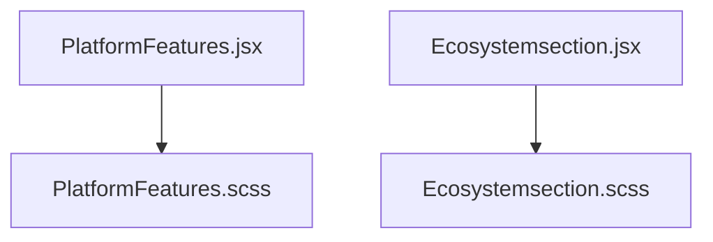
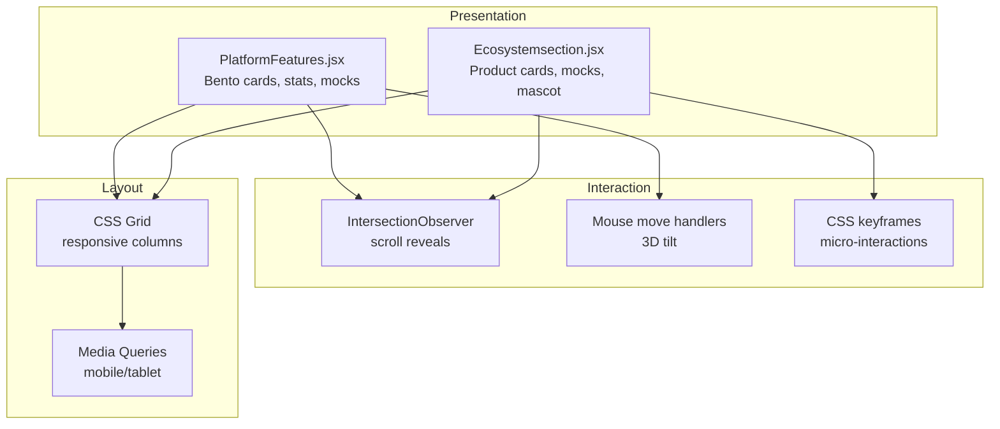
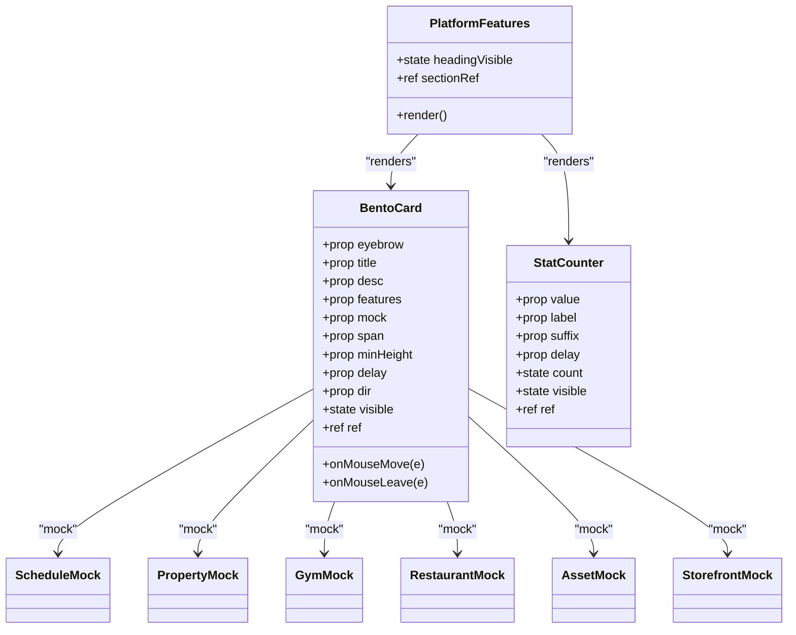
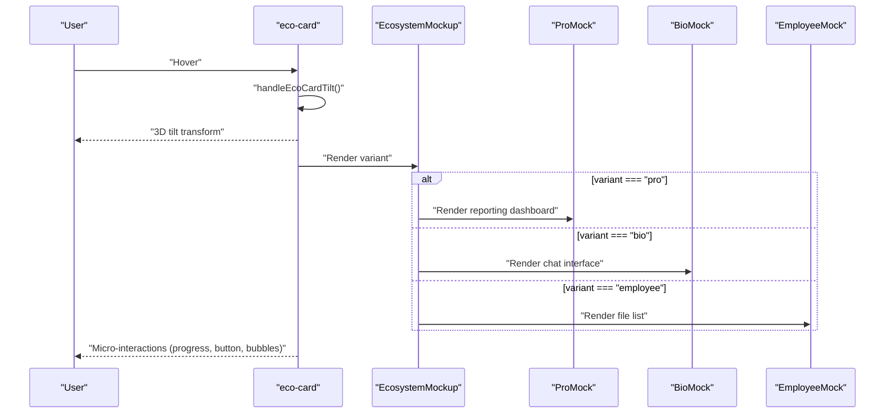
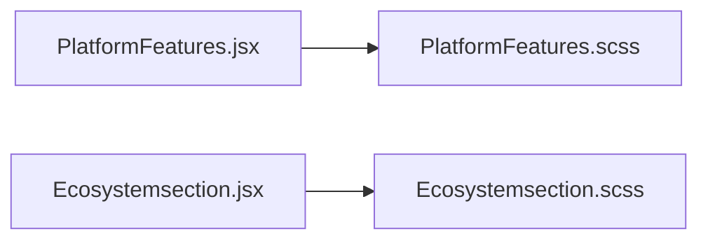

# Platform Showcases

<cite>
**Referenced Files in This Document**
- [PlatformFeatures.jsx](file://src/pages/PlatformFeatures.jsx)
- [PlatformFeatures.scss](file://src/pages/PlatformFeatures.scss)
- [Ecosystemsection.jsx](file://src/pages/Ecosystemsection.jsx)
- [Ecosystemsection.scss](file://src/pages/Ecosystemsection.scss)
- [README.md](file://README.md)
</cite>

## Table of Contents
1. [Introduction](#introduction)
2. [Project Structure](#project-structure)
3. [Core Components](#core-components)
4. [Architecture Overview](#architecture-overview)
5. [Detailed Component Analysis](#detailed-component-analysis)
6. [Dependency Analysis](#dependency-analysis)
7. [Performance Considerations](#performance-considerations)
8. [Troubleshooting Guide](#troubleshooting-guide)
9. [Conclusion](#conclusion)
10. [Appendices](#appendices)

## Introduction
This document explains the platform features showcase and ecosystem sections that highlight different ERP solutions. It covers how the components render platform capabilities, how interactive feature demonstrations work, and how the ecosystem visualization is structured. It also documents responsive design patterns, animation transitions between sections, performance optimizations for large content blocks, and customization options for adding new platform features while maintaining consistent visual design.

The project is a React + Vite application. The showcase and ecosystem are implemented as page-level components with inline styles and scoped SCSS files.

**Section sources**
- [README.md:1-17](file://README.md#L1-L17)

## Project Structure
The relevant parts of the frontend structure for this documentation are:

- `src/pages/PlatformFeatures.jsx` — Main platform features showcase with bento-style cards, animated stats, and scroll-triggered reveals.
- `src/pages/PlatformFeatures.scss` — Shared styling primitives and mock UI components used by the platform showcase.
- `src/pages/Ecosystemsection.jsx` — Ecosystem section with product cards, mascot illustration, hover micro-interactions, and a call-to-action bar.
- `src/pages/Ecosystemsection.scss` — Animations, layout, and responsive rules for the ecosystem section.

**Diagram sources**
- [PlatformFeatures.jsx:1-557](file://src/pages/PlatformFeatures.jsx#L1-L557)
- [PlatformFeatures.scss:1-459](file://src/pages/PlatformFeatures.scss#L1-L459)
- [Ecosystemsection.jsx:1-315](file://src/pages/Ecosystemsection.jsx#L1-L315)
- [Ecosystemsection.scss:1-432](file://src/pages/Ecosystemsection.scss#L1-L432)

**Section sources**
- [PlatformFeatures.jsx:1-557](file://src/pages/PlatformFeatures.jsx#L1-L557)
- [PlatformFeatures.scss:1-459](file://src/pages/PlatformFeatures.scss#L1-L459)
- [Ecosystemsection.jsx:1-315](file://src/pages/Ecosystemsection.jsx#L1-L315)
- [Ecosystemsection.scss:1-432](file://src/pages/Ecosystemsection.scss#L1-L432)

## Core Components
The platform showcases consist of two major component groups:

- Platform Features Showcase
  - Bento card grid displaying multiple ERP modules (HRMS, Property Management, Gym & Fitness, Restaurant, Asset Management, E-commerce).
  - Animated stat counters.
  - Scroll-triggered heading reveal and card entrance animations.
  - Interactive 3D tilt on hover.

- Ecosystem Visualization
  - Product cards for Trellisco Pro, Bio, Employee, Academy, Community, Compliance, Payroll, Insights, Support.
  - Three mockup variants: reporting dashboard, chat interface, and employee file list.
  - Mascot illustration with pop-in animation.
  - Hover-triggered micro-interactions (progress fill, button press, slide-in bubbles, check mark pop).
  - Sticky call-to-action bar for booking a demo.

Key responsibilities:
- Data-driven rendering of cards and mocks.
- IntersectionObserver-based reveal animations.
- Mouse-move-based 3D tilt effects.
- Responsive layouts using CSS Grid and media queries.
- Consistent visual language through shared color tokens and typography.

**Section sources**
- [PlatformFeatures.jsx:10-64](file://src/pages/PlatformFeatures.jsx#L10-L64)
- [PlatformFeatures.jsx:305-380](file://src/pages/PlatformFeatures.jsx#L305-L380)
- [PlatformFeatures.jsx:385-426](file://src/pages/PlatformFeatures.jsx#L385-L426)
- [PlatformFeatures.jsx:431-557](file://src/pages/PlatformFeatures.jsx#L431-L557)
- [Ecosystemsection.jsx:141-205](file://src/pages/Ecosystemsection.jsx#L141-L205)
- [Ecosystemsection.jsx:207-213](file://src/pages/Ecosystemsection.jsx#L207-L213)
- [Ecosystemsection.jsx:215-225](file://src/pages/Ecosystemsection.jsx#L215-L225)
- [Ecosystemsection.jsx:227-240](file://src/pages/Ecosystemsection.jsx#L227-L240)
- [Ecosystemsection.jsx:242-307](file://src/pages/Ecosystemsection.jsx#L242-L307)

## Architecture Overview
The platform showcases follow a layered architecture:

- Presentation Layer
  - React components render structured content and mock UIs.
  - Inline styles provide localized theming; SCSS provides reusable styles and animations.

- Interaction Layer
  - IntersectionObserver triggers reveal animations when elements enter the viewport.
  - Mouse events compute tilt transforms for 3D hover effects.
  - CSS animations handle micro-interactions like progress fills and button presses.

- Layout Layer
  - CSS Grid organizes bento cards and ecosystem cards.
  - Media queries adapt layouts for tablets and mobile devices.

**Diagram sources**
- [PlatformFeatures.jsx:305-380](file://src/pages/PlatformFeatures.jsx#L305-L380)
- [PlatformFeatures.jsx:385-426](file://src/pages/PlatformFeatures.jsx#L385-L426)
- [PlatformFeatures.jsx:431-557](file://src/pages/PlatformFeatures.jsx#L431-L557)
- [Ecosystemsection.jsx:207-225](file://src/pages/Ecosystemsection.jsx#L207-L225)
- [Ecosystemsection.jsx:242-307](file://src/pages/Ecosystemsection.jsx#L242-L307)
- [PlatformFeatures.scss:85-94](file://src/pages/PlatformFeatures.scss#L85-L94)
- [Ecosystemsection.scss:109-114](file://src/pages/Ecosystemsection.scss#L109-L114)
- [Ecosystemsection.scss:398-432](file://src/pages/Ecosystemsection.scss#L398-L432)

## Detailed Component Analysis

### Platform Features Showcase
The platform features showcase renders a hero header, animated statistics, and a bento grid of ERP module cards. Each card includes an eyebrow label, title, description, optional feature tags, and a mock UI representing the module’s core interaction.

Key implementation details:
- Color palette and typography constants define brand colors and fonts.
- FeatureTags component renders small pill badges describing additional module capabilities beyond the mock.
- Mock components simulate real UIs: schedule calendar, occupancy table, member check-ins, order tracking, asset inventory, and storefront product detail.
- BentoCard handles:
  - IntersectionObserver-based visibility state.
  - Mouse-move tilt transform calculation.
  - Gradient background, glow shadow, and layered depth via translateZ.
  - Staggered transition delays for entrance animations.
- StatCounter animates numeric values when scrolled into view using requestAnimationFrame and easing functions.
- Section-level IntersectionObserver reveals headings and text with blur-to-sharp transitions.

Responsive behavior:
- On narrow screens, the bento grid collapses to a single column.
- Typography uses clamp() for fluid scaling.

Customization:
- Add new modules by creating a new mock component and a corresponding BentoCard entry with span, minHeight, delay, and dir props.
- Extend feature tags to communicate broader module scope.

**Diagram sources**
- [PlatformFeatures.jsx:305-380](file://src/pages/PlatformFeatures.jsx#L305-L380)
- [PlatformFeatures.jsx:385-426](file://src/pages/PlatformFeatures.jsx#L385-L426)
- [PlatformFeatures.jsx:431-557](file://src/pages/PlatformFeatures.jsx#L431-L557)
- [PlatformFeatures.jsx:105-142](file://src/pages/PlatformFeatures.jsx#L105-L142)
- [PlatformFeatures.jsx:147-175](file://src/pages/PlatformFeatures.jsx#L147-L175)
- [PlatformFeatures.jsx:180-208](file://src/pages/PlatformFeatures.jsx#L180-L208)
- [PlatformFeatures.jsx:213-233](file://src/pages/PlatformFeatures.jsx#L213-L233)
- [PlatformFeatures.jsx:238-263](file://src/pages/PlatformFeatures.jsx#L238-L263)
- [PlatformFeatures.jsx:268-293](file://src/pages/PlatformFeatures.jsx#L268-L293)

**Section sources**
- [PlatformFeatures.jsx:10-64](file://src/pages/PlatformFeatures.jsx#L10-L64)
- [PlatformFeatures.jsx:72-100](file://src/pages/PlatformFeatures.jsx#L72-L100)
- [PlatformFeatures.jsx:105-293](file://src/pages/PlatformFeatures.jsx#L105-L293)
- [PlatformFeatures.jsx:305-380](file://src/pages/PlatformFeatures.jsx#L305-L380)
- [PlatformFeatures.jsx:385-426](file://src/pages/PlatformFeatures.jsx#L385-L426)
- [PlatformFeatures.jsx:431-557](file://src/pages/PlatformFeatures.jsx#L431-L557)
- [PlatformFeatures.scss:85-94](file://src/pages/PlatformFeatures.scss#L85-L94)

### Ecosystem Visualization
The ecosystem section presents a collection of Trellisco products with three mock variants:
- Pro: Reporting dashboard with a progress bar and action button.
- Bio: Chat interface with incoming/outgoing bubbles and composer.
- Employee: File list with download and check actions.

Key implementation details:
- ECOSYSTEM_CARDS defines product metadata including title, description, accent color, and variant.
- EcosystemMockup selects the appropriate mock based on variant.
- handleEcoCardTilt and handleEcoCardTiltReset compute 3D tilt transforms on mouse movement.
- EcosystemMascot renders the mascot image with click handler for booking a demo.
- EcosystemSection orchestrates:
  - IntersectionObserver to trigger section-wide reveal animations.
  - Rendering of cards with staggered delays.
  - Call-to-action bar with demo booking button.

Animations:
- Keyframe animations include mascot pop-in, cursor movement, button press, progress fill, bubble slide-in, and check pop.
- Micro-interactions are gated on parent card hover to ensure they play once per interaction.

Responsive behavior:
- On smaller screens, the mascot hides, the grid stacks vertically, and the CTA bar becomes a full-width block below the grid.

Customization:
- Add new products by appending entries to ECOSYSTEM_CARDS with a unique key, title, description, accent color, and variant.
- Introduce new mock variants by extending EcosystemMockup and adding corresponding styles in SCSS.

**Diagram sources**
- [Ecosystemsection.jsx:141-205](file://src/pages/Ecosystemsection.jsx#L141-L205)
- [Ecosystemsection.jsx:207-213](file://src/pages/Ecosystemsection.jsx#L207-L213)
- [Ecosystemsection.jsx:215-225](file://src/pages/Ecosystemsection.jsx#L215-L225)
- [Ecosystemsection.jsx:242-307](file://src/pages/Ecosystemsection.jsx#L242-L307)
- [Ecosystemsection.scss:6-40](file://src/pages/Ecosystemsection.scss#L6-L40)
- [Ecosystemsection.scss:243-276](file://src/pages/Ecosystemsection.scss#L243-L276)
- [Ecosystemsection.scss:311-333](file://src/pages/Ecosystemsection.scss#L311-L333)
- [Ecosystemsection.scss:374-379](file://src/pages/Ecosystemsection.scss#L374-L379)

**Section sources**
- [Ecosystemsection.jsx:16-23](file://src/pages/Ecosystemsection.jsx#L16-L23)
- [Ecosystemsection.jsx:25-49](file://src/pages/Ecosystemsection.jsx#L25-L49)
- [Ecosystemsection.jsx:51-83](file://src/pages/Ecosystemsection.jsx#L51-L83)
- [Ecosystemsection.jsx:85-139](file://src/pages/Ecosystemsection.jsx#L85-L139)
- [Ecosystemsection.jsx:141-205](file://src/pages/Ecosystemsection.jsx#L141-L205)
- [Ecosystemsection.jsx:207-225](file://src/pages/Ecosystemsection.jsx#L207-L225)
- [Ecosystemsection.jsx:227-240](file://src/pages/Ecosystemsection.jsx#L227-L240)
- [Ecosystemsection.jsx:242-307](file://src/pages/Ecosystemsection.jsx#L242-L307)
- [Ecosystemsection.scss:6-40](file://src/pages/Ecosystemsection.scss#L6-L40)
- [Ecosystemsection.scss:42-156](file://src/pages/Ecosystemsection.scss#L42-L156)
- [Ecosystemsection.scss:158-194](file://src/pages/Ecosystemsection.scss#L158-L194)
- [Ecosystemsection.scss:196-380](file://src/pages/Ecosystemsection.scss#L196-L380)
- [Ecosystemsection.scss:382-432](file://src/pages/Ecosystemsection.scss#L382-L432)

## Dependency Analysis
Component relationships and dependencies:

- PlatformFeatures.jsx depends on:
  - Internal mock components (ScheduleMock, PropertyMock, GymMock, RestaurantMock, AssetMock, StorefrontMock).
  - FeatureTags for capability pills.
  - PlatformFeatures.scss for grid responsiveness and shared mock primitives.

- Ecosystemsection.jsx depends on:
  - ECOSYSTEM_CARDS data array.
  - Mock components (ProMock, BioMock, EmployeeMock).
  - Ecosystemsection.scss for animations and responsive layout.

Coupling and cohesion:
- Both sections encapsulate their own mocks and styles, promoting high cohesion within each showcase.
- Minimal cross-dependency between sections reduces coupling.

External integration points:
- Images from external URLs (avatars, ID photo, mascot).
- Optional callback for booking demos in the ecosystem section.

Potential circular dependencies:
- None observed; components are self-contained and do not import each other.

**Diagram sources**
- [PlatformFeatures.jsx:1-557](file://src/pages/PlatformFeatures.jsx#L1-L557)
- [PlatformFeatures.scss:1-459](file://src/pages/PlatformFeatures.scss#L1-L459)
- [Ecosystemsection.jsx:1-315](file://src/pages/Ecosystemsection.jsx#L1-L315)
- [Ecosystemsection.scss:1-432](file://src/pages/Ecosystemsection.scss#L1-L432)

**Section sources**
- [PlatformFeatures.jsx:1-557](file://src/pages/PlatformFeatures.jsx#L1-L557)
- [PlatformFeatures.scss:1-459](file://src/pages/PlatformFeatures.scss#L1-L459)
- [Ecosystemsection.jsx:1-315](file://src/pages/Ecosystemsection.jsx#L1-L315)
- [Ecosystemsection.scss:1-432](file://src/pages/Ecosystemsection.scss#L1-L432)

## Performance Considerations
- IntersectionObserver usage:
  - Used sparingly for section and card reveals, minimizing unnecessary re-renders.
  - Observers are disconnected in cleanup functions to prevent memory leaks.

- Animation performance:
  - CSS transitions and keyframes are hardware-accelerated where possible.
  - Transform and opacity changes avoid layout thrashing.
  - requestAnimationFrame is used for smooth stat counter animations.

- Large content blocks:
  - Bento cards use will-change hints for transform and opacity.
  - Grid layouts reduce DOM complexity compared to nested flex structures.
  - Images are loaded from external CDNs; consider lazy loading or placeholders if bandwidth is constrained.

- Responsive optimization:
  - Media queries collapse grids to single-column layouts on small screens, reducing reflow cost.
  - Clamp-based typography avoids heavy recalculations across breakpoints.

[No sources needed since this section provides general guidance]

## Troubleshooting Guide
Common issues and resolutions:

- Cards not revealing on scroll:
  - Ensure IntersectionObserver thresholds are set appropriately.
  - Verify that the container has sufficient height to allow scrolling.

- Tilt effect not working:
  - Confirm that mousemove and mouseleave handlers are attached to the correct element.
  - Check that transform properties are not overridden by CSS.

- Animations not triggering:
  - Verify that parent hover states are correctly applied.
  - Ensure keyframe animations are defined in SCSS and referenced by classes.

- Mascot not appearing:
  - Confirm that the mascot image path is correct and accessible.
  - Check media queries hiding the mascot on small screens.

- Demo booking callback not firing:
  - Ensure onBookDemo prop is passed to EcosystemSection and bound to a valid function.

**Section sources**
- [PlatformFeatures.jsx:305-380](file://src/pages/PlatformFeatures.jsx#L305-L380)
- [PlatformFeatures.jsx:385-426](file://src/pages/PlatformFeatures.jsx#L385-L426)
- [Ecosystemsection.jsx:215-225](file://src/pages/Ecosystemsection.jsx#L215-L225)
- [Ecosystemsection.jsx:227-240](file://src/pages/Ecosystemsection.jsx#L227-L240)
- [Ecosystemsection.jsx:242-307](file://src/pages/Ecosystemsection.jsx#L242-L307)
- [Ecosystemsection.scss:398-432](file://src/pages/Ecosystemsection.scss#L398-L432)

## Conclusion
The platform features showcase and ecosystem sections provide a cohesive, interactive presentation of ERP solutions. They combine data-driven rendering, scroll-triggered animations, and hover micro-interactions to create engaging user experiences. The architecture emphasizes modularity and consistency, enabling easy customization for new features and products while maintaining responsive design and performance best practices.

[No sources needed since this section summarizes without analyzing specific files]

## Appendices

### Customization Guide: Adding New Platform Features
Steps to add a new ERP module to the platform features showcase:

1. Create a new mock component representing the module’s core interaction.
2. Add a new BentoCard entry in the main section with:
   - eyebrow: Module category.
   - title: Descriptive headline.
   - desc: Short explanation.
   - features: Array of capability tags.
   - mock: Reference to your new mock component.
   - span: Grid column span.
   - minHeight: Minimum card height.
   - delay: Entrance animation delay.
   - dir: Directional entrance style.

3. Optionally extend PlatformFeatures.scss with shared mock primitives if needed.

**Section sources**
- [PlatformFeatures.jsx:484-550](file://src/pages/PlatformFeatures.jsx#L484-L550)
- [PlatformFeatures.scss:146-459](file://src/pages/PlatformFeatures.scss#L146-L459)

### Customization Guide: Adding New Ecosystem Products
Steps to add a new product to the ecosystem visualization:

1. Append a new entry to ECOSYSTEM_CARDS with:
   - key: Unique identifier.
   - title: Product name.
   - desc: Description.
   - accent: Brand accent color.
   - variant: pro, bio, or employee.

2. If introducing a new mock variant:
   - Implement a new mock component.
   - Extend EcosystemMockup to render it based on variant.
   - Add corresponding styles and animations in Ecosystemsection.scss.

**Section sources**
- [Ecosystemsection.jsx:141-205](file://src/pages/Ecosystemsection.jsx#L141-L205)
- [Ecosystemsection.jsx:207-213](file://src/pages/Ecosystemsection.jsx#L207-L213)
- [Ecosystemsection.scss:196-380](file://src/pages/Ecosystemsection.scss#L196-L380)